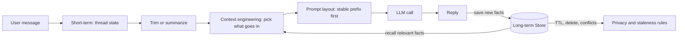
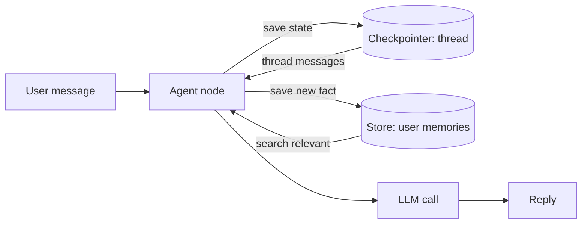
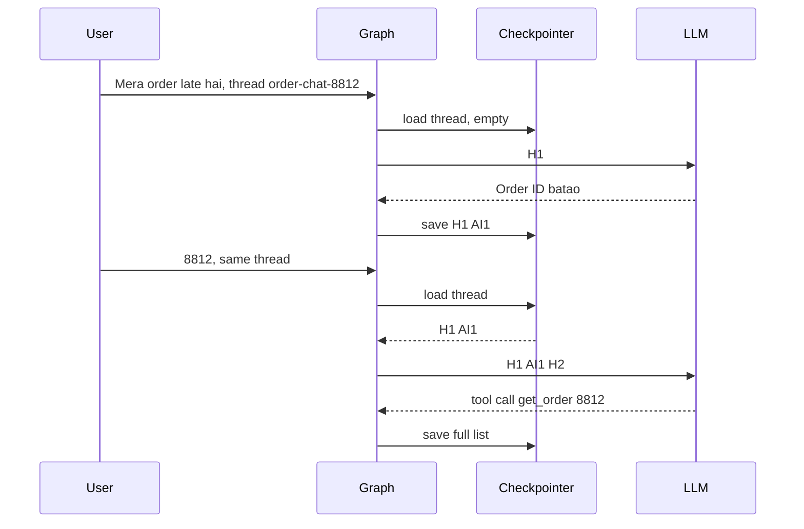
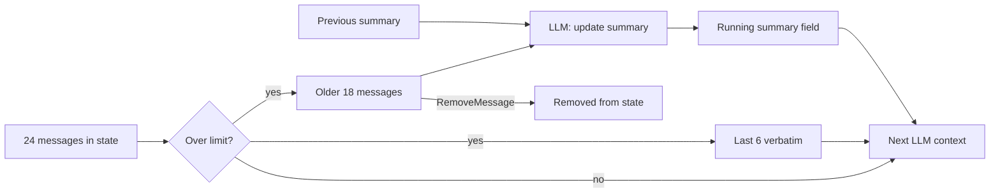
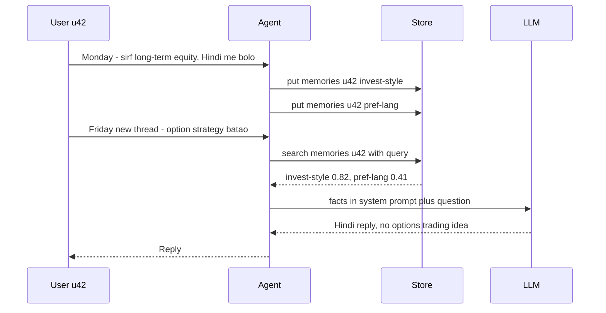
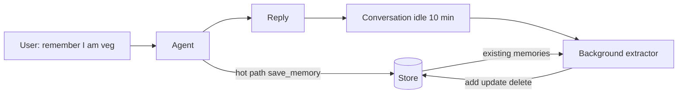
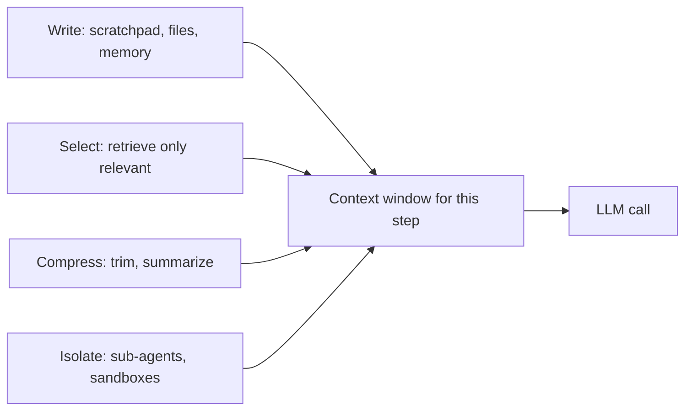
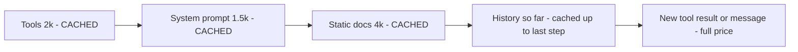
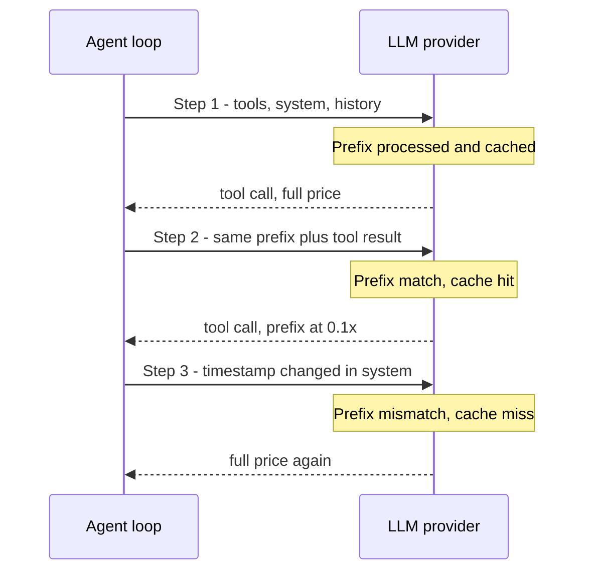
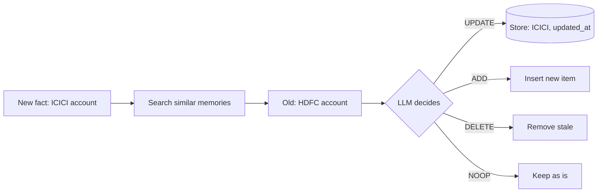

# Memory & Context

Is page pe: agent cheezein kaise "yaad" rakhta hai. Ek conversation ke andar (**short-term memory**), sessions ke paar (**long-term memory**), aur har LLM call me window me kya jaaye (**context engineering**). Production agents zyada tar model ki wajah se fail nahi hote, **galat ya bhare hue context** ki wajah se fail hote hain.

**Is page ke baad tum ye samjha paoge:**
- LLM khud kuch yaad kyun nahi rakhta, aur "memory" asal me kaun sa code hai.
- Lambi chat me context window kaise bharti hai, aur trimming ya summary se usko kaise control karte hain.
- User ki baat agle hafte ke naye session me kaise yaad aati hai (LangGraph Store).
- Har step pe window me kya daalna hai aur kya bahar rakhna hai.
- Prompt caching ka prefix kaise bachta hai, aur purani ya galat memory ko kaise sambhalte hain.

## Big picture: LLM bhoolta hai, code yaad dilata hai

LLM ek API call hai, aur har call naya hai. Model ko pichli call ka kuch pata nahi. Isliye "memory" = **hamara code**, jo har call se pehle sahi cheezein jod ke prompt banata hai. Conversation thread state me (short-term), jo badhne pe trim ya summarize hoti hai. Pakke facts Store me (long-term), jo agle session me wapas aate hain. Context engineering tay karti hai window me kya jaaye, caching uske stable hisse ko sasta banati hai, aur privacy rules purani ya sensitive memory ko kaabu me rakhte hain.



Har box is page ka ek section hai. Neeche ek-ek karke real request ke saath chalayenge.

## ⭐ Memory ke types: ek map

**Ye kyun chahiye?** Bina memory wala bot, do turns:

1. User: "Mera naam Riya hai, mera order 8812 late hai." Bot: "Sorry Riya, check karta hoon."
2. User (agli call): "Mera order number kya tha?" Bot: "Mujhe nahi pata."

Bot jhooth nahi bol raha. Dusri call me LLM ko sirf `["Mera order number kya tha?"]` mila. Pehla message usne dekha hi nahi.

**Analogy: doctor ka clinic.** Aaj ki visit ke notes parchi pe (**short-term**, visit khatam to kaam khatam). Purani file almari me: allergy, purani bimari (**long-term**, har visit pe nikalti hai). Doctor ka dimaag = LLM. Parchi aur file na ho to har visit pehli visit hai.

**Same example, memory ke saath.** Turn 2 pe LLM ko ye list jaati hai:

| # | Message | Kahan se aaya |
|---|---|---|
| 1 | System: "Tum Swiggy support bot ho." | code |
| 2 | System: "User facts: Hindi pasand" | long-term Store |
| 3 | Human: "Mera naam Riya hai, mera order 8812 late hai." | thread state (checkpointer) |
| 4 | AI: "Sorry Riya, check karta hoon." | thread state |
| 5 | Human: "Mera order number kya tha?" | naya message |

Ab LLM "8812" bata sakta hai. LLM nahi badla, sirf input badla.

**Kaunsi memory kaunsi galti theek karti hai:**

| Failure | Fix |
|---|---|
| Same chat me pichla message bhool gaya | short-term: checkpointer + `thread_id` |
| Chat itni lambi ki window bhar gayi ya bill bada | trimming / summarization |
| Agle hafte naye session me preference bhool gaya | long-term: Store |
| Window me kachra bhara hai, answer bigad raha | context engineering |
| Purani memory galat jawab dila rahi hai | TTL, conflict resolution |

| | Short-term | Long-term |
|---|---|---|
| Scope | ek thread / session | threads ke paar, user ya org level |
| LangGraph me | state + **checkpointer** | **Store** (namespaced key-value + search) |
| Kya rakhta | messages, tool results, scratch fields | preferences, facts, past episodes, instructions |
| Lifetime | thread khatam to irrelevant | TTL ya delete tak |
| Problem | context window bhar jaata hai | stale, conflicting, privacy |



**Ab terms:**
- **Stateless:** model ek call se doosri call tak kuch nahi rakhta.
- **Thread:** ek conversation, pehchaan `thread_id`. **Checkpointer** uski state DB me save karta hai.
- **Store:** threads ke paar rehne wali memory, user ya org ke naam pe.
- Memory ka asli sawal: **kya save karein, kab save karein, kab wapas laayein, kab bhool jaayein.**

## ⭐ Short-term memory: checkpointer aur thread state

**Ye kyun chahiye?** Server pe har request alag aati hai, kabhi alag pod pe. Pehle ke messages kahin save nahi to bot har baar "order ID batao" poochega.

**Analogy: kirana dukaan ka khata.** Har customer ka ek page (`thread_id`). Customer aata hai, page khulta hai, naya saamaan likha jaata hai, page band. Page kho gaya (pod restart + `InMemorySaver`) to hisaab gaya.

**Walk-through: Swiggy bot, `thread_id = "order-chat-8812"`.**
1. Turn 1. User: "Mera order late hai." AI: "Order ID batao". Checkpoint save: `[H1, AI1]`.
2. Turn 2. Same `thread_id` ke saath "8812" aata hai. Checkpointer `[H1, AI1]` load karta hai, `H2` jodta hai. AI `get_order(8812)` call karta hai. Save: `[H1, AI1, H2, AI2(tool_call), Tool2, AI2b]`.
3. Turn 3. "Refund milega?" Poore 6 messages + `H3` load. Order ID list me hai, isliye yaad hai. Pod restart ho to bhi `PostgresSaver` se wapas aata hai.



**Ab terms:**
- **Super-step:** graph ka ek tick. Har super-step ke baad checkpoint save hota hai.
- **`InMemorySaver`** sirf dev/test. Production me **`PostgresSaver` / `RedisSaver`** (durable, multi-instance).
- Checkpoint ke bonus: **resume after crash**, **human-in-the-loop** (`interrupt`), **time travel** (purane checkpoint se fork).

Ye code chhota chat graph banata hai aur checkpointer lagata hai, taaki har `thread_id` ki history apne aap save/load ho.

```python
from langchain.chat_models import init_chat_model
from langgraph.graph import StateGraph, START, END, MessagesState
from langgraph.checkpoint.memory import InMemorySaver

llm = init_chat_model("openai:gpt-4.1-mini")

def chat(state: MessagesState):
    # state["messages"] me is thread ki poori history already load ho chuki hai
    return {"messages": [llm.invoke(state["messages"])]}

builder = StateGraph(MessagesState)
builder.add_node("chat", chat)
builder.add_edge(START, "chat")
builder.add_edge("chat", END)
graph = builder.compile(checkpointer=InMemorySaver())  # prod me PostgresSaver

cfg = {"configurable": {"thread_id": "order-chat-8812"}}  # khata ka page number
graph.invoke({"messages": [("user", "Mera order late hai")]}, cfg)
graph.invoke({"messages": [("user", "8812")]}, cfg)  # pichla message apne aap juda
```

**Code me kya ho raha hai:**
- `MessagesState` me `messages` list hai. Naye messages append hote hain, replace nahi.
- `thread_id` batata hai kaunsa page kholna hai. Naya `thread_id` = nayi conversation.
- Doosre `invoke` me sirf "8812" bheja, par `chat` node ko teeno messages mile.

**Interview tip:** "Short-term memory = checkpointer + thread_id. State me full history rakhta hoon, par LLM ko token-budgeted window bhejta hoon."

**Common galti:** production me `InMemorySaver` ship kar dena. Pod restart pe saari conversations gayab.

## ⭐ Context window ka budget aur trimming

**Ye kyun chahiye?** Thread state sirf badhti hai. 20 turns baad har call me hazaaron purane tokens jaate hain: bill, latency, aur ek din window limit cross.

**Analogy: exam ki cheat-sheet.** Ek hi page milta hai. Poori kitaab nahi, sirf abhi ke sawal ke kaam ki cheez.

**Token budget: turn 1 vs turn 20** (Swiggy bot, approx tokens):

| Window me kya | Turn 1 | Turn 20 |
|---|---|---|
| System prompt | 800 | 800 |
| Tool definitions (6 tools) | 1,200 | 1,200 |
| User memories (Store se) | 150 | 150 |
| Purani conversation | 0 | 22,000 |
| Purane tool results (order JSON, policy) | 0 | 9,000 |
| Latest user message | 30 | 40 |
| **Total** | **~2,200** | **~33,200** |

Fixed hissa same rehta hai, sirf history aur tool results badhte hain. Budget 8,000 ho to turn 20 pe 25k tokens kaatne padenge.

**Walk-through: `trim_messages` se pehle aur baad.** State me 12 messages:

| # | Message | Window me bacha? |
|---|---|---|
| 1 | System: "Tum Swiggy support bot ho" | haan (`include_system`) |
| 2–3 | Human: "Mera order late hai" → AI: "Order ID batao" | nahi |
| 4 | Human: "8812" | nahi |
| 5–6 | AI: tool_call `get_order(8812)` → Tool: `{"status": "picked_up", "eta": 25}` | nahi |
| 7 | AI: "Order nikal chuka hai, 25 min me aayega" | nahi |
| 8 | Human: "Refund milega kya?" | haan |
| 9 | AI: tool_call `refund_policy()` | haan |
| 10 | Tool: "30+ min late pe Rs 50 coupon" | haan |
| 11 | AI: "45 min late hua to Rs 50 coupon milega" | haan |
| 12 | Human: "Theek hai, coupon de do" | haan |

1. `strategy="last"`: end se peeche chalo, budget tak messages lo. Maan lo 8 se 12 fit hue.
2. `start_on="human"`: window human message se hi shuru ho. Agar budget 9 pe kat-ta, to 9, 10, 11 bhi hat-te aur sirf `[12]` bachta. Yahan 8 human hai, theek.
3. System message 1 aage juda (`include_system=True`). LLM ko gaya `[1, 8, 9, 10, 11, 12]`. State me abhi bhi poore 12.

Problem dekho: order ID "8812" (message 4) window se gir gaya. User pooche "mera order number kya tha?" to bot nahi bata payega. Isi ke liye agla section, summarization.

**Ab terms:**
- **Context window:** ek call me model jitne tokens padh sakta hai. **Token budget:** usme se kitna hum use karenge.
- **Trimming:** purane messages LLM ke view se hatana. Info seedha kho jaati hai.
- **Tool-call pair:** AI ka `tool_call` + uska `ToolMessage`. Ek bina doosre ke gaya to provider API error deta hai.

Ye `chat` node ka trimmed version hai. State nahi badalta, sirf LLM ko jaane wali list chhoti karta hai.

```python
from langchain_core.messages import trim_messages
from langchain_core.messages.utils import count_tokens_approximately

def chat(state: MessagesState):
    window = trim_messages(
        state["messages"],
        strategy="last",                 # end se peeche ki taraf messages lo
        token_counter=count_tokens_approximately,
        max_tokens=3000,                 # hamara budget
        start_on="human",                # window human message se shuru ho
        end_on=("human", "tool"),        # dangling AI tool_call na chhoote
        include_system=True,             # system prompt hamesha rakho
    )
    return {"messages": [llm.invoke(window)]}  # state me full history safe hai
```

**Code me kya ho raha hai:**
- `trim_messages` nayi list lautata hai. `state["messages"]` audit ke liye jaisi thi waisi.
- `max_tokens=3000` budget hai, `count_tokens_approximately` sasta estimate.
- `start_on` / `end_on` ensure karte hain ki `AIMessage(tool_calls)` bina matching `ToolMessage` ke na bache.

**Interview tip:** "Main budget table banata hoon: fixed hissa (system, tools) vs variable (history, tool results). Variable hisse ko trimming ya summary se cap karta hoon, aur tool_call / tool_result pairs kabhi split nahi karta."

**Common galti:** message count se trim karna ("last 10 messages"). Ek tool result 20k tokens ka ho sakta hai. Tokens se trim karo.

## ⭐ Summarization node

**Ye kyun chahiye?** Trimming ne order ID gira diya. Purani baatein chahiye, par chhote roop me.

**Analogy: doctor ki file ka "case summary".** Har purani parchi nahi padhte. Upar ek paragraph: "Diabetic, 2024 se metformin, penicillin allergy." Naye notes usi me jud jaate hain.

**Walk-through: 24 messages ka thread.**
1. 24 messages, limit 20, to summarize node chalta hai.
2. Split: purane 18 (`old`), latest 6 (`keep`). `keep` ka pehla message `ToolMessage` ho to split ek step peeche, taaki tool pair na toote.
3. LLM ko: purana summary (abhi khaali) + 18 messages + "IDs, amounts, decisions rakho".
4. Naya summary: "User Riya. Order 8812 late, picked up, ETA 25 min. Policy: 30+ min late pe Rs 50 coupon. User ne coupon accept kiya."
5. Node return karta `summary` + 18 `RemoveMessage`. Reducer un 18 ko state se hata deta hai.
6. Agli call: `System("Conversation summary: ...")` + latest 6. ~14,000 tokens ki jagah ~2,500, aur order ID wapas aa gaya.



**Ab terms:**
- **Running summary:** state field jo har baar purane summary + naye messages se update hota hai.
- **`RemoveMessage(id=...)`:** `add_messages` reducer ise dekh ke us ID ka message state se hata deta hai.
- **Summary drift:** har round me thoda detail girta hai. 10 rounds baad summary dhundhli ho sakti hai.

Code: `summarize` node `chat` ke baad chalta hai, aur `chat` summary ko system message ki tarah use karta hai.

```python
from langchain_core.messages import RemoveMessage, SystemMessage, ToolMessage

class State(MessagesState):
    summary: str

def summarize(state: State):
    msgs = state["messages"]
    if len(msgs) <= 20:
        return {}                                   # abhi zarurat nahi
    cut = len(msgs) - 6
    while cut > 0 and isinstance(msgs[cut], ToolMessage):
        cut -= 1                                    # tool pair ko split mat karo
    old = msgs[:cut]
    prompt = (f"Purana summary: {state.get('summary', '')}\n"
              "Neeche ke messages ko jod ke summary update karo. "
              "Order IDs, amounts, user ke decisions zaroor rakho.")
    new_summary = llm.invoke(old + [("user", prompt)]).content
    return {"summary": new_summary,
            "messages": [RemoveMessage(id=m.id) for m in old]}  # reducer inhe hatayega

def chat(state: State):
    sys = SystemMessage(f"Conversation summary: {state.get('summary', '')}")
    return {"messages": [llm.invoke([sys] + state["messages"])]}

builder = StateGraph(State)
builder.add_node("chat", chat)
builder.add_node("summarize", summarize)
builder.add_edge(START, "chat")
builder.add_edge("chat", "summarize")   # reply ke baad summarize, user ko jawab pehle
builder.add_edge("summarize", END)
```

**Code me kya ho raha hai:**
- `while` loop ensure karta hai ki bache messages `ToolMessage` se shuru na hon.
- Purana summary prompt me jaata hai, isliye summary "running" hai, scratch se nahi banti.
- `chat` summary ko **system message** me daalta hai, human message ki tarah nahi.

- Trimming free hai par info seedha khoti hai. Summarization ek extra LLM call hai par info compress hoti hai (risk: drift).
- Summary prompt me batao kya **kabhi nahi** girana: IDs, amounts, commitments, explicit preferences.
- Background me summarize karo (response stream hone ke baad) taaki latency na badhe.

**Common galti:** summary ko har baar scratch se banana (purana summary input me na dena), ya summary ko `messages` me human message ki tarah daal dena.

## ⭐ Long-term memory: semantic, episodic, procedural

**Ye kyun chahiye?** Checkpointer ek thread ke liye hai. Agle hafte naya chat, naya `thread_id`, aur bot phir poochta hai "aap kis type ke investor ho?"

**Analogy: patient file ke teen hisse.** "Penicillin allergy" = **fact**. "Pichli baar ye dawai 3 din me kaam ki" = **experience**. "Is patient ko Hindi me samjhao" = **rule**.

**Ek line me:** CoALA paper (Cognitive Architectures for Language Agents) ke hisaab se teen tarah ki long-term memory: **facts** (semantic), **experiences** (episodic), **how-to rules** (procedural).

| Type | Kya store | Example (Zerodha assistant) | Kaise use hota |
|---|---|---|---|
| Semantic | user/world ke facts | "User F&O trade nahi karta, sirf long-term equity" | profile ya collection, search karke prompt me |
| Episodic | past interactions, successful runs | "Pichhli baar tax P&L report ke liye ye 3 steps kaam aaye" | few-shot examples ki tarah |
| Procedural | agent ke rules/instructions | "Is user ko hamesha Hindi me jawab do" | system prompt ka hissa, agent khud update kar sakta |

**Walk-through:** user bolta hai "Main F&O nahi karta. Pichhli baar wala tax report tareeka chahiye. Hindi me bolo." Ek message, teen writes: semantic fact save hota hai, pichli successful run ke 3 steps example ki tarah prompt me aate hain, aur system prompt me "Hamesha Hindi me jawab do" judta hai.

**Ab terms:**
- **Semantic** ke do shapes:
  - **Profile:** ek JSON document jo update hota rehta hai (`{"language": "hi", "risk": "low"}`). Simple, par concurrent updates me conflict.
  - **Collection:** bahut saare chhote items, search se laaye jaate. Recall better, par duplicates aur contradictions manage karne padte.
- **Episodic:** successful trajectories ko few-shot examples ki tarah dynamically select karo.
- **Procedural:** feedback se agent apna system prompt refine kar sakta hai (LangMem ka prompt optimizer). Risky, review ke bina prod me mat lagao.

**Interview tip:** "Main pehle decide karta hoon kaunsi memory chahiye. 80% B2C assistants ko sirf semantic profile chahiye. Episodic tab jab task repeatable ho, procedural tab jab behaviour per-user customize karna ho."

## ⭐ LangGraph Store: namespaces, put, search

**Ye kyun chahiye?** Long-term memory ko aisi jagah chahiye jo threads ke paar zinda rahe, aur har user ka data alag rahe.

**Analogy: bank ke lockers.** Har customer ka locker number (namespace), andar alag envelopes (keys). Sirf apna locker khulta hai, aur andar naam se ya andaaze se ("kuch investment wala") dhoondh sakte ho.

**Walk-through: Monday save, Friday recall.**
1. **Monday, thread `t-mon`.** User u42: "Main sirf long-term equity me invest karta hoon. Hindi me baat karo." Code do items save karta hai:

| Namespace | Key | Value |
|---|---|---|
| `("memories", "u42")` | `invest-style` | `{"text": "User sirf long-term equity karta hai, F&O nahi"}` |
| `("memories", "u42")` | `pref-lang` | `{"text": "User Hindi me baat karna pasand karta hai"}` |

2. Store `text` field ka embedding bhi rakhta hai.
3. **Friday, naya thread `t-fri`.** User: "Koi achhi option strategy batao." Thread history khaali.
4. `search(("memories", "u42"), query="Koi achhi option strategy batao", limit=3)` → `invest-style` (0.82), `pref-lang` (0.41).
5. Dono facts system prompt me jaate hain. Jawab Hindi me: "Aap F&O nahi karte, isliye options ki jagah ye long-term choices dekhiye..." Monday ka thread khole bina Monday yaad.



**Ab terms:**
- **Namespace:** tuple jaise `("memories", user_id)`. Folder jaisa, aur yahi **access boundary** hai.
- **`put(namespace, key, value)`** upsert hai (same key pe overwrite). **`get`** exact key, **`search`** filter + semantic query.

Ye code `text` field pe semantic search wala Store banata hai, aur `chat` node har call pe user ki memories system prompt me daalta hai.

```python
from dataclasses import dataclass
from langchain.embeddings import init_embeddings
from langgraph.store.memory import InMemoryStore
from langgraph.runtime import Runtime

store = InMemoryStore(index={
    "embed": init_embeddings("openai:text-embedding-3-small"),
    "dims": 1536,
    "fields": ["text"],      # sirf ye field embed hoga
})

@dataclass
class Ctx:
    user_id: str             # trusted login session se aata hai

def chat(state: MessagesState, runtime: Runtime[Ctx]):
    ns = ("memories", runtime.context.user_id)   # per-user isolation
    query = state["messages"][-1].content
    hits = runtime.store.search(ns, query=query, limit=3)  # sirf is user ke locker me
    facts = "\n".join(h.value["text"] for h in hits)
    sys = f"User ke baare me known facts:\n{facts}"
    return {"messages": [llm.invoke([("system", sys)] + state["messages"])]}

builder = StateGraph(MessagesState, context_schema=Ctx)
builder.add_node("chat", chat)
builder.add_edge(START, "chat")
graph = builder.compile(checkpointer=InMemorySaver(), store=store)

# Monday: memory save
store.put(("memories", "u42"), "pref-lang", {"text": "User Hindi me baat karna pasand karta hai"})
# Friday: naya thread, par memory mil jaayegi
graph.invoke({"messages": [("user", "Mera portfolio summary do")]},
             {"configurable": {"thread_id": "t-fri"}}, context=Ctx(user_id="u42"))
```

**Code me kya ho raha hai:**
- `index` dene se `search(query=...)` semantic ho jaata hai. Bina `index` sirf key-value.
- `user_id` `runtime.context` se aata hai jo hamara server set karta hai. LLM ise badal nahi sakta.
- Thread `t-fri` naya hai, phir bhi facts aaye kyunki Store thread se bandha nahi.

- Production: `PostgresStore` (pgvector) ya `RedisStore`. `InMemoryStore` restart pe khaali.

**Common galti:** sab users ki memories ek namespace me daal ke sirf query se filter karna. Ek bug aur ek user ka data doosre ke prompt me.

## ⭐ Memory likhna: hot path vs background

**Ye kyun chahiye?** Store me likhega kaun, aur kab? Har message pe "save karun?" sochna jawab slow karta hai. Baad me karo to agle turn me memory nahi milti.

**Analogy: waiter vs manager.** "Mujhe peanut allergy hai" waiter turant slip pe likhta hai (**hot path**). Raat ko manager din bhar ke orders dekh ke regulars ki diary update karta hai (**background**).

**Walk-through: Zomato assistant.**
1. User: "Yaad rakhna, main veg hoon." Explicit hai, to agent `save_memory` tool call karta hai. Store: `diet = "User vegetarian hai"`.
2. Baad me: "Indiranagar wale ghar pe bhejo." Implicit fact, abhi save nahi hota.
3. Conversation 10 min idle. Background extractor ko milta hai poori conversation + existing `[diet: vegetarian]`.
4. Output: `ADD {"text": "User ka ghar Indiranagar, Bengaluru me hai"}`, `NOOP diet`. Agle session me dono available.

| | Hot path | Background |
|---|---|---|
| Kaise | agent ke paas `save_memory` tool | conversation idle hone pe extractor job |
| Freshness | turant available | thodi der baad |
| Latency | response slow, extra tokens | user pe zero asar |
| Quality | agent ka dhyaan bat-ta hai, kam/zyada save | poori conversation dekh ke behtar dedupe |
| Transparency | user ko dikha sakte "yaad rakh liya" | hidden |



**Ab terms:**
- **Debounce:** har message pe nahi, conversation 5–10 min idle ho tab extract karo.
- **Consolidation:** extractor ko existing memories bhi do taaki wo insert/update/delete decide kare, sirf append nahi.
- **LangMem in brief:** `create_manage_memory_tool` / `create_search_memory_tool` (hot path tools jo Store use karte), `create_memory_store_manager` (background extraction + consolidation), aur prompt optimizer (procedural memory). Mem0, Zep jaise managed options bhi hain.

**Interview tip:** "Default background extraction, debounced, kyunki latency aur quality dono better. Hot path sirf jab user explicitly bole ya next turn me hi memory chahiye."

**Common galti:** har message pe extractor chalana. Cost dugni, aur same fact 10 baar save.

## ⭐ Context engineering: write, select, compress, isolate

**Ye kyun chahiye?** Memory sahi ho, phir bhi window me kachra ho to agent bigadta hai: bade tool outputs, 100 tools ki list, purane results.

**Analogy: rasoi ka counter.** Counter (window) chhota hai. Raashan fridge me (**write**). Aaj ki dish ka saamaan hi nikaalo (**select**). Badi cheez kaat ke chhoti (**compress**). Masala alag mixer me pisao, counter pe sirf tayaar masala (**isolate**).

> **Example:** Flipkart seller-ops agent ek 40,000 rows wali CSV analyze karta hai, 6 tools call karta hai, aur 30 steps chalta hai.

**Walk-through: same task, chaar strategies ke saath.**
1. **Step 3, `load_csv` (write).** 40,000 rows (~120k tokens) messages me nahi. File `/data/orders.csv` me save, LLM ko sirf `{"path": "/data/orders.csv", "rows": 40000, "columns": ["sku", "category", "return_reason"], "preview": 5 rows}`, ~300 tokens. Agent zarurat pe grep/slice tool se padhe.
2. **Step 7 (select).** 80 tools me se query ke relevant 6 ki definitions. 12k ki jagah 1k tokens.
3. **Step 15 (compress).** Step 3–10 ke purane tool outputs "[result cleared, see /data/step5.json]" se replace.
4. **Step 20 (isolate).** Sub-agent apni fresh window me 50k tokens explore karta hai, parent ko sirf 1.5k ka summary.

| Step 12 pe window | Bina engineering | Saath |
|---|---|---|
| CSV data | 120,000 | 300 |
| Tool definitions | 12,000 | 1,000 |
| Purane tool outputs | 18,000 | 2,000 |
| Baaki (system, history) | 4,000 | 4,000 |
| **Total** | **~154,000** | **~7,300** |



**Ab terms:** **scratchpad** = plan, todo, findings ek state field ya file me (write). **Tool-result pruning** = purane results placeholder se replace (compress). Isolate me state schema ke heavy fields bhi aate hain jo LLM ko kabhi nahi jaate.

**Context rot aur lost-in-the-middle:**
- **Lost in the middle** (Liu et al. 2023): models context ke **start aur end** ki info better use karte hain, beech ki miss karte hain.
- **Context rot:** input tokens badhne pe accuracy girti hai, chahe window 1M ho. Bada window ≠ achha recall.
- Doosre failure modes: **context poisoning** (hallucination state me save ho ke baar-baar reuse), **distraction**, **confusion** (irrelevant tools), **clash** (contradicting info).
- Isliye: important instructions start me, current task/question end me, beech me minimum.

**Interview tip:** "Mere liye context ek budget hai. Har tool output token cap ke saath, bade outputs file me offload, aur deep research sub-agents ko jo sirf summary lautaate hain."

**Common galti:** "1M context window hai, sab daal do". Cost, latency aur accuracy teeno kharab.

## Prompt caching

**Ye kyun chahiye?** Agent loop me har step pe wahi lamba prefix jaata hai: tools, system prompt, static docs. 30 steps = same 8k tokens ka bill 30 baar.

**Analogy: chai ki dukaan pe "roz wala order".** Dukaandar ko pehle se pata hai "kam cheeni, adrak". Customer sirf naya bolta hai: "aaj biscuit bhi". Par pehla shabd hi badla ("aaj coffee") to poora order naye sire se.

**Walk-through: kaunsa hissa reuse hota hai.** Provider prompt ke **same prefix** ka processed state cache karta hai. Wo prefix agli call me sasta (roughly 10% price tak) aur fast, par sirf jab **byte-for-byte same** ho.



1. **Step 1:** 7.5k prefix pehli baar process, cache **write** (Anthropic pe ~1.25x).
2. **Step 2:** same 7.5k + 600 naye tokens. Cache **read** at ~0.1x. Cost units: bina cache `8,100`, cache ke saath `7,500 × 0.1 + 600 = 1,350`, lagbhag 83% sasta.
3. **Step 3:** system prompt me `Time: 14:32:07` aa gaya. Tools (2k) match, uske baad mismatch, baaki sab full price.

| | Anthropic | OpenAI |
|---|---|---|
| Kaise on | explicit `cache_control` breakpoints (max 4) | automatic, prompts ≥ 1024 tokens |
| TTL | 5 min default (har hit pe refresh), 1h option | idle pe kuch minute, extended retention option |
| Pricing | cache write ~1.25x, read ~0.1x | cached input pe discount, write ka extra charge nahi |
| Order | tools → system → messages | prefix match, `prompt_cache_key` routing me madad |

- Exact numbers model ke hisaab se badalte hain. Interview me concept bolo, numbers "approx".
- **Cache-friendly layout:** stable pehle, badalne wala baad me: (1) tool definitions (fixed order, deterministic JSON), (2) system prompt, (3) static docs / few-shot, (4) history (append-only), (5) latest message + dynamic bits.
- **Cache todne wale bugs:** system prompt me timestamp, tools ka random order, per-request user name sabse upar, history ko beech me edit karna (trimming bhi prefix badalta hai).
- **Cache hit rate** (kitne input tokens cache se aaye) ko metric ki tarah track karo.



**Interview tip:** "Main dynamic cheezein (date, user memory) system prompt ke end me ya latest message me daalta hoon taaki tools + static instructions ka prefix cached rahe. Cache hit rate ko metric ki tarah track karta hoon."

**Common galti:** summarization/trimming se har turn prefix badal dena, phir sochna caching kaam kyun nahi kar rahi. Summary kabhi-kabhi karo (jaise har 20 messages pe), har turn nahi.

## Memory privacy aur staleness

**Ye kyun chahiye?** Long-term memory user ka personal data hai, aur purana bhi hota hai. Galat memory = galat jawab. Leak hui memory = legal problem.

**Analogy: phone ki contact list.** Dost ka number badla aur update nahi kiya, to call galat aadmi ko. Aur tumhari list kisi aur ke phone me dikhe, to badi problem.

**Ek line me:** long-term memory ko DB jaisa treat karo: isolation, TTL, deletion, audit, aur conflict resolution.

**Walk-through: Razorpay merchant assistant.**
1. **Jan 10:** Store me `{"text": "Settlement account HDFC ...1234", "updated_at": "2026-01-10", "source": "user said"}`.
2. **Mar 12:** merchant: "Settlement account ICICI ...9876 kar diya." Extractor similar memory dhoondhta hai, HDFC wali milti hai (score 0.91).
3. LLM dono dekh ke `UPDATE` decide karta hai. Store me ab ICICI, `updated_at: 2026-03-12`.
4. **Mar 20:** "Settlement kis account me jayega?" Agent memory pe bharosa nahi karta, `get_settlement_account` API call karta hai. Transactional fact API se, memory sirf hint.



**Ab terms aur rules:**
- **Privacy:**
  - Per-user namespace, trusted `user_id`, cross-tenant search ka test.
  - PII (card, Aadhaar, OTP, passwords) memory me **save hi mat karo**. Extractor prompt + regex filter dono se roko.
  - User ko "meri memories dikhao / delete karo" ka control do. DPDP/GDPR "right to erasure" me memory store, vector index, backups, aur summaries sab cover hon.
- **Staleness:**
  - **TTL (time to live):** volatile facts (current city, open ticket) pe short, stable preferences pe lamba. LangGraph store backends TTL support karte hain (config me default TTL, read pe refresh).
  - Har memory pe `created_at`, `updated_at`, `source`. Prompt me "as of" date ke saath dikhao.
- **Conflicts:** write time pe consolidate (`UPDATE / DELETE / NOOP / ADD`). Read time pe latest wins, aur explicit user statement > inferred fact. Critical data (bank account, address) **source-of-truth API** se.

**Interview tip:** "Memory ek cache hai, source of truth nahi. Transactional facts hamesha API se, memory sirf personalization ke liye."

**Common galti:** sirf append karna. 6 mahine baad ek user ki 300 memories jinme aadhi ek doosre ko contradict karti hain.

## Aage padho

- [LangGraph Core Concepts](02-langgraph-core.md): state, reducers, checkpointer detail me.
- [Agentic Patterns: Agents & Multi-agent](04-agent-patterns.md): sub-agent context isolation.
- [Data & Retrieval for Agents](06-agentic-data-rag.md): memory search ke peeche retrieval.
- [Cost & Latency](11-cost-latency.md): caching aur token budgets ka cost side.
- [Vector databases](../05-db/11-vector.md): semantic memory index ke neeche kya hai.
- [Multi-agent lab](/viewinter/agents/labs/multi): sub-agents browser me chala ke dekho.

## Checklist

- [ ] Short-term vs long-term memory aur LangGraph me checkpointer vs Store ka role ek example se samjha sakta hoon
- [ ] Token budget table bana ke `trim_messages` aur summarization node samjha sakta hoon, aur tool_call pairs split na hone ka reason bata sakta hoon
- [ ] Semantic, episodic aur procedural memory ko examples ke saath samjha sakta hoon
- [ ] Store namespaces, `put`/`search` aur per-user isolation explain kar sakta hoon, ek session me save aur agle me recall dikha ke
- [ ] Hot path vs background memory writing ka trade-off bata sakta hoon
- [ ] Context engineering ki write, select, compress, isolate strategies examples ke saath bata sakta hoon
- [ ] Context rot aur lost-in-the-middle samjha ke unke mitigations bata sakta hoon
- [ ] Cache-friendly prompt layout design kar sakta hoon aur cache todne wale bugs gina sakta hoon
- [ ] Memory ke liye TTL, deletion aur conflict resolution plan bata sakta hoon
