# Data & Retrieval for Agents

Is page pe: jab retrieval ek fixed pipeline nahi balki agent ka **decision** ban jaata hai. Agentic RAG, corrective/self/adaptive RAG, GraphRAG, text-to-SQL, ingestion, ACL aur PII, aur eval ke liye synthetic data. Real agents ka data PDFs, SQL tables aur APIs me bikhra hota hai, aur "galat ya unauthorized data retrieve hua" sabse mehenga bug hai.

**Is page ke baad tum ye samjha paoge:**
- Classic RAG aur agentic RAG same sawal pe alag kaise chalte hain, trace ke saath.
- CRAG me retrieved docs kaise grade hote hain, aur kuch kaam ka na mile to fallback kya hai.
- Text-to-SQL agent ka poora safar: sawal → schema → SQL → validation fail → fix → answer.
- GraphRAG ek chhote entity graph pe multi-hop sawal kaise solve karta hai.
- Ingestion, ACL, PII aur synthetic eval data production me kyun zaroori hain.

## Big picture: sawal se grounded jawab tak

User ka sawal aata hai. Agent pehle tay karta hai: retrieval chahiye ya nahi, aur kahan se. Text docs ke liye vector/hybrid search, aur laaye gaye docs ko grade karke kachra hatana (CRAG). Numbers aur tables ke liye SQL. Relations aur poore corpus ke themes ke liye GraphRAG. Ye sab sources ek ingestion pipeline se bharte hain, jo har chunk pe ACL aur PII rules lagati hai. Aur poore system ko synthetic + real eval set se test karte hain.

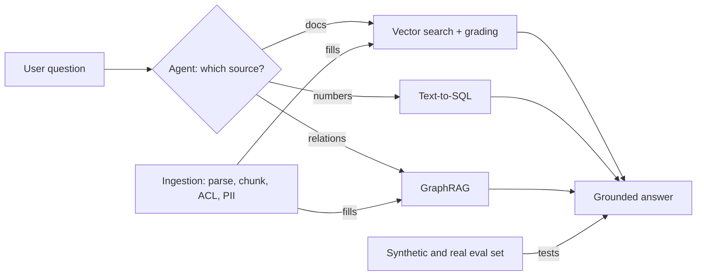

## Recap: RAG basics (detail 09-rag me)

| Topic | Ek line | Detail |
|---|---|---|
| RAG kya hai | retrieve → augment prompt → generate | [What is RAG](../09-rag/01-what-is-rag.md) |
| Embeddings, semantic search | meaning ko vector me, ANN se nearest | [Semantic search](../09-rag/02-semantic-search.md) |
| Chunking | structure-aware chunks, overlap, parent-child | [Chunking](../09-rag/03-chunking.md) |
| Hybrid search | BM25 + dense + RRF | [Hybrid search](../09-rag/04-hybrid-search.md) |
| Reranking | cross-encoder se top-k precision | [Reranking](../09-rag/05-reranking.md) |
| Advanced retrieval | HyDE, multi-query, query decomposition | [Advanced retrieval](../09-rag/07-advanced-retrieval.md) |
| RAG eval | context precision/recall, faithfulness | [RAG evaluation](../09-rag/08-rag-evaluation.md) |

- Yahan focus: agent **kab, kya aur kaise** retrieve kare, aur data side ki production problems.

## ⭐ Agentic RAG: retrieval as a tool

**Ye kyun chahiye?** Classic RAG har sawal pe ek baar, ek index se, user ke raw text se search karta hai. "Hi" pe bhi 4 docs laata hai. Do sources wale sawal pe ek source miss ho jaata hai.

**Analogy: do tarah ke librarian.** Pehla har customer ko ek hi shelf se 4 kitaabein pakda deta hai, chahe sawal kuch bhi ho. Doosra poochta hai "kya chahiye?", zarurat ho to do alag shelf aur accounts register dono dekhta hai, aur kam pade to dobara jaata hai. Doosra wala agentic RAG hai.

**Walk-through: same sawal, do traces.** Zerodha support. User: "Mera DP charge kitna hai aur pichle mahine kitna kata?"

*Classic RAG:*
1. Raw sawal ka embedding, policy index se top-4 chunks.
2. Mila: "DP charge Rs 15.34 per scrip per day jab sell ho" (sahi), aur 3 irrelevant chunks.
3. Ledger kabhi dekha hi nahi. LLM jawab: "DP charge Rs 15.34 hai. Pichle mahine ka data mere paas nahi." Aadha jawab. (Numbers sirf example.)

*Agentic RAG:*
1. Agent sochta hai: do parts hain, do sources.
2. Tool call 1: `search_policy_docs("Zerodha DP charge per scrip")` → pricing chunk.
3. Tool call 2: `get_ledger(month="2026-10", type="DP")` → `[{"date": "10-07", "amt": 15.34}, {"date": "10-21", "amt": 15.34}]`.
4. Agent dono jodta hai: "DP charge Rs 15.34 per scrip per sell day hai. Pichle mahine 2 baar kata, total Rs 30.68."

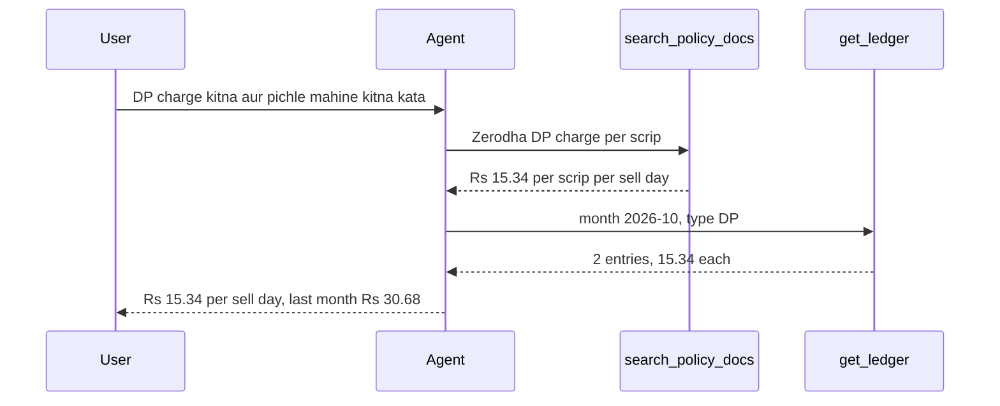

| | Classic (2-step) RAG | Agentic RAG |
|---|---|---|
| Retrieve kab | hamesha, ek baar | zarurat pe, 0 se N baar |
| Query | user ka raw text | agent rewrite / decompose karta |
| Sources | ek index | multiple tools (vector, SQL, API, web) |
| Latency/cost | predictable, kam | variable, zyada |
| Multi-hop | nahi | haan |

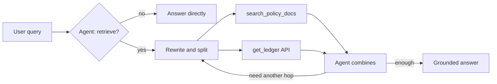

**Ab terms:**
- **Query rewriting:** "uska fee kya hai?" → conversation se resolve karke "Zerodha Coin direct mutual fund ka fee". Pronoun wali query pe retrieval fail hota hai.
- **Decomposition / multi-hop:** "Jis AMC ka fund mere portfolio me sabse bada hai, uska expense ratio?" → hop 1: portfolio API, hop 2: us fund ka factsheet search. Hop 2 ki query hop 1 ke result pe depend karti hai.
- **Source routing:** tool descriptions padh ke agent chunta hai `search_policy_docs` vs `query_orders_db` vs `web_search`.
- **Guard rails:** max retrieval calls (jaise 4), har result token-capped, aur "kuch nahi mila" ek explicit result, taaki agent hallucinate na kare.

Code: retriever ko tool banao, LLM ko tools do, aur ek loop chalao jo tab tak tools call karta hai jab tak LLM khud ruk na jaaye.

```python
from langchain_core.tools import tool
from langgraph.prebuilt import ToolNode, tools_condition

@tool
def search_policy_docs(query: str, k: int = 4) -> str:
    """Zerodha pricing aur policy docs me search karo. Charges, fees, rules ke liye.
    Specific self-contained query do, pronouns nahi."""
    docs = retriever.invoke(query)[:k]
    if not docs:   # khaali result ko explicit batao
        return "NO_RESULTS: query badal ke try karo ya user se clarify karo."
    return "\n\n".join(f"[{d.metadata['source']}] {d.page_content[:800]}" for d in docs)  # har chunk capped

@tool
def get_ledger(month: str, type: str) -> str:
    """User ke ledger se ek mahine (YYYY-MM) ki given type ki entries."""
    return str(ledger_api.fetch(user_id=CURRENT_USER, month=month, type=type))  # user_id session se

llm_t = llm.bind_tools([search_policy_docs, get_ledger])   # LLM ko tools dikhao

def agent(state: MessagesState):
    return {"messages": [llm_t.invoke(state["messages"])]}

b = StateGraph(MessagesState)
b.add_node("agent", agent)
b.add_node("tools", ToolNode([search_policy_docs, get_ledger]))
b.add_edge(START, "agent")
b.add_conditional_edges("agent", tools_condition)  # tool_calls hain to "tools", warna END
b.add_edge("tools", "agent")                       # result lekar agent phir sochta hai
graph = b.compile()
```

**Code me kya ho raha hai:**
- Docstring hi tool description hai. LLM isi se tay karta hai kaunsa tool kab. `NO_RESULTS` saaf batata hai ki kuch nahi mila.
- `get_ledger` me `user_id` LLM ke args se nahi, server ke session se aata hai.
- `tools_condition` dekhta hai AI message me tool call hai ya nahi. Haan to `tools` node, warna END. Isse 0 se N retrievals possible.

**Interview tip:** "Simple FAQ bot ke liye classic RAG sasta aur predictable hai. Agentic RAG tab jab queries multi-source ya multi-hop hon, aur tab bhi main tool calls cap karta hoon."

**Common galti:** har query ko agentic bana dena. 3x latency aur cost, simple sawalon pe koi gain nahi.

## ⭐ Corrective RAG (CRAG): docs ko grade karo

**Ye kyun chahiye?** Retriever hamesha kuch na kuch lautata hai, chahe kaam ka na ho. LLM un irrelevant docs se bhi confident jawab bana deta hai.

**Analogy: exam ki copy check karne wala teacher.** Har answer sheet (doc) dekh ke tick ya cross. Saari cross hon to student ko sawal phir se padhne bolo (rewrite). Phir bhi na aaye to guide book (web) kholo.

**Ek line me:** retrieve karke andha generate mat karo. Har doc ko **grade** karo. Kaam ke docs na milen to query rewrite karo, phir bhi na milen to web search.

**Walk-through 1: docs mil gaye.** Sawal: "Zerodha pe MTF ka interest rate kya hai?"

| Doc | Content (chhota) | Grader |
|---|---|---|
| D1 | "MTF interest: 0.04% per day on funded amount" | relevant ✓ |
| D2 | "Intraday brokerage: 0.03% ya Rs 20, jo kam ho" | irrelevant ✗ |
| D3 | "Account opening charges ..." | irrelevant ✗ |
| D4 | "MTF ke liye eligible stocks ki list" | relevant ✓ |

1. `retrieve` ne 4 docs laaye.
2. `grade` ne D2, D3 hata diye. `docs = [D1, D4]`.
3. `decide`: docs khaali nahi, to `generate`.
4. Jawab sirf D1, D4 se: "MTF pe 0.04% per day interest lagta hai." (Numbers sirf example.)

**Walk-through 2: fallback path.** Sawal: "Zerodha ne kal naya MTF rate announce kiya kya?" Index purana hai.
1. `retrieve` → 4 docs, sab purani pricing. `grade` → sab ✗. `tries = 0`, to `rewrite`.
2. Rewrite: "Zerodha MTF interest rate change announcement November 2026". `tries = 1`.
3. `retrieve` → phir sab ✗. `tries = 1 < 2`, to phir `rewrite`. `tries = 2`.
4. `retrieve` → sab ✗. Ab `tries = 2`, to `web_search`.
5. Web se 3 results, `generate` unse jawab banata hai (web content untrusted hai, sanitize karke).

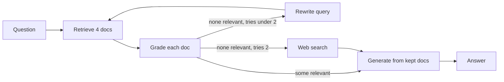

**Ab terms:**
- **Retrieval evaluator / grader:** ek sasta LLM call jo har doc pe haan/na deta hai.
- **CRAG paper:** evaluator docs ko correct / ambiguous / incorrect grade karta hai. Incorrect pe **web search fallback**, ambiguous pe dono. Docs ko "knowledge strips" me tod ke irrelevant hissa hata deta hai. LangGraph me hum simple binary grade se karte hain.
- **Retry counter (`tries`):** rewrite ↔ retrieve ka infinite loop rokta hai.

Code: har step ek node hai. `decide` grading ke baad batata hai aage kahan jaana hai.

```python
from typing import TypedDict
from pydantic import BaseModel

class S(TypedDict):
    question: str
    docs: list
    answer: str
    tries: int

class Grade(BaseModel):
    relevant: bool

grader = llm.with_structured_output(Grade)   # output hamesha {"relevant": true/false}

def retrieve(s: S):
    return {"docs": retriever.invoke(s["question"])}

def grade_docs(s: S):
    keep = [d for d in s["docs"] if grader.invoke(
        f"Question: {s['question']}\nDoc: {d.page_content}\nKya ye relevant hai?").relevant]
    return {"docs": keep}                    # sirf ✓ wale bache

def decide(s: S):
    if s["docs"]:
        return "generate"
    return "web_search" if s.get("tries", 0) >= 2 else "rewrite"

def rewrite(s: S):
    q = llm.invoke(f"Is question ko search ke liye behtar likho: {s['question']}").content
    return {"question": q, "tries": s.get("tries", 0) + 1}

def web_search(s: S):
    return {"docs": web_tool.invoke(s["question"])}

def generate(s: S):
    ctx = "\n\n".join(d.page_content for d in s["docs"])
    return {"answer": llm.invoke(f"Sirf context se jawab do.\n{ctx}\n\nQ: {s['question']}").content}

g = StateGraph(S)
for name, fn in [("retrieve", retrieve), ("grade", grade_docs), ("rewrite", rewrite),
                 ("web_search", web_search), ("generate", generate)]:
    g.add_node(name, fn)
g.add_edge(START, "retrieve")
g.add_edge("retrieve", "grade")
g.add_conditional_edges("grade", decide, ["generate", "rewrite", "web_search"])
g.add_edge("rewrite", "retrieve")
g.add_edge("web_search", "generate")
g.add_edge("generate", END)   # agle section me yahan answer grader judega
app = g.compile()
```

**Code me kya ho raha hai:**
- `with_structured_output(Grade)` grader ko sirf `bool` dene pe majboor karta hai, parse karna aasaan.
- `grade_docs` irrelevant docs state se hata deta hai, `generate` unhe kabhi nahi dekhta.
- `decide` teen raaste: docs bache → generate, nahi bache aur tries < 2 → rewrite, warna web.
- `rewrite` `tries` badhata hai, isliye loop zyada se zyada 2 baar ghoomta hai.

- Graders sasta model (mini/haiku class) pe, batch ya parallel. Har grade ek LLM call: 5 docs = 5 extra calls.

**Common galti:** web search fallback bina allow-list/sanitization ke. Untrusted web content seedha prompt me = prompt injection risk.

## ⭐ Self-RAG aur Adaptive RAG: answer check aur routing

**Ye kyun chahiye?** CRAG docs check karta hai, answer nahi. Docs sahi hon phir bhi LLM galat number likh sakta hai. Aur har sawal pe poora graph chalana mehenga hai, "Hi" pe bhi.

**Analogy: hospital ka triage + senior doctor.** Gate pe nurse tay karti hai: chhoti problem to seedha dawai, normal to OPD, serious to specialist (**adaptive routing**). Junior ka prescription senior check karta hai: report se match karta hai? kaam ka hai? (**Self-RAG checks**).

**Walk-through: adaptive routing, teen sawal.**

| Sawal | Router ka faisla | Raasta |
|---|---|---|
| "Hi" | direct | koi retrieval nahi, seedha jawab |
| "DP charge kitna hai?" | index | ek baar retrieve + grade |
| "Kal SEBI ne kya naya rule nikala?" | web | seedha web search |

**Walk-through: hallucination check.**
1. Docs me likha hai "MTF interest 0.04% per day".
2. `generate` likhta hai: "MTF interest 0.05% per day hai."
3. Hallucination grader: "Kya har claim context se supported hai?" → `grounded: false`.
4. Graph wapas `generate` pe. Naya jawab "0.04% per day" → `grounded: true`.
5. Answer grader: "Kya ye sawal ka jawab deta hai?" → useful → return.

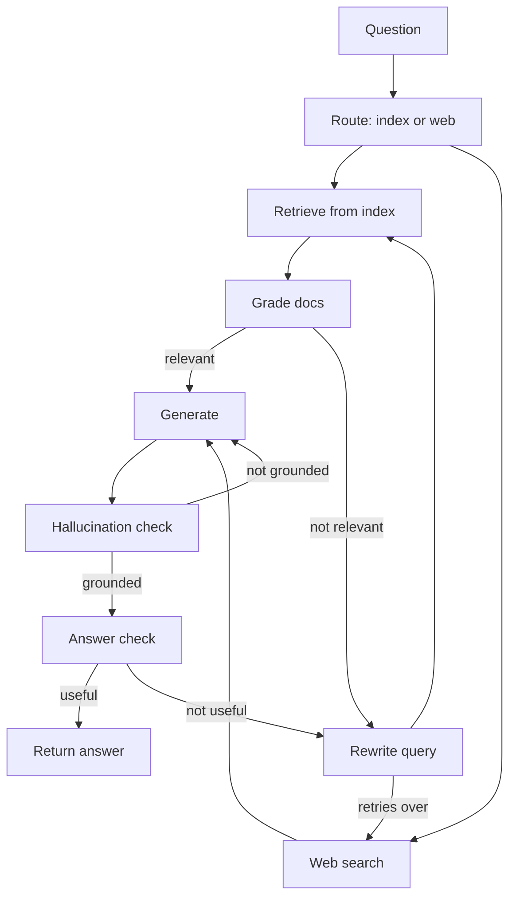

**Ab terms:**
- **Self-RAG:** model khud reflection karta hai: retrieve karna hai? (Retrieve), doc relevant hai? (IsRel), answer doc se supported hai? (IsSup), answer useful hai? (IsUse). Paper me ye trained reflection tokens hain. LangGraph me hum inhe LLM grader nodes se banate hain.
- **Adaptive RAG:** pehle query **classify/route** karo: no retrieval, single-shot retrieval, ya multi-step/web. Simple queries pe cost bachta hai.
- **Grounded:** answer ka har claim retrieved context me hai.

Code: CRAG graph me `generate → END` ki jagah ye check lagao.

```python
class Grounded(BaseModel):
    grounded: bool

checker = llm.with_structured_output(Grounded)

def check_answer(s: S):
    ctx = "\n\n".join(d.page_content for d in s["docs"])
    v = checker.invoke(f"Context:\n{ctx}\n\nAnswer: {s['answer']}\n"
                       "Kya answer ka har claim context se supported hai?")
    return "done" if v.grounded else "retry"   # real code me retry count bhi cap karo

g.add_conditional_edges("generate", check_answer, {"done": END, "retry": "generate"})
```

**Code me kya ho raha hai:**
- `grounded` false ho to graph `generate` pe wapas, true ho to END.
- Ye `add_edge("generate", END)` ko replace karta hai. Dono rakhoge to graph do raaste pe chalega.

**Interview tip:** "CRAG retrieval quality fix karta hai, Self-RAG generation quality, Adaptive RAG cost. Production me main teeno ka mix ek LangGraph graph me banata hoon, bounded retries ke saath."

**Common galti:** grader loops pe cap na lagana. Ek ziddi sawal pe 20 LLM calls aur timeout.

## GraphRAG aur knowledge graphs

**Ye kyun chahiye?** Kuch sawalon ka jawab kisi ek chunk me nahi hota. Wo do-teen chunks ko **jodne** se banta hai. Vector search sirf similar chunks laata hai, connections nahi.

**Analogy: shaadi me rishtedaaron ka family tree.** "Pinky ki mausi ke bete ka sasural kahan hai?" Kisi ek aadmi ko poora jawab nahi pata. Tree pe line se line chalna padta hai. Aur "is shaadi me kaun-kaun se parivaar aaye?" jaise sawal ke liye har parivaar (community) ka ek chhota summary kaam aata hai.

**Walk-through: chhota entity graph.** Ek fintech ki internal docs (example data, fictional names):
- C1: "QuickMart ne March me UPI Autopay integrate kiya."
- C2: "UPI Autopay ko Payments Infra team own karti hai."
- C3: "INC-42: UPI Autopay mandate failures, 2 ghante, Payments Infra ne fix kiya."
- C4: "TripKaro ke checkout me UPI Autopay live hai."

Sawal: "INC-42 se kaunse merchants affected ho sakte the?"
1. **Vector RAG:** query "INC-42 merchants affected" se C3 milta hai. C1 aur C4 me "INC-42" ka zikr hi nahi, wo nahi aate. Jawab: "Pata nahi."
2. **GraphRAG indexing:** LLM ne chunks se entities aur relations nikale (neeche ka graph).
3. **Local search:** query me entity "INC-42" mili. Graph pe chalo: INC-42 → affected → UPI Autopay → used by → QuickMart, TripKaro.
4. Un nodes ke linked chunks (C1, C3, C4) context me. Jawab: "QuickMart aur TripKaro, kyunki dono UPI Autopay use karte hain."

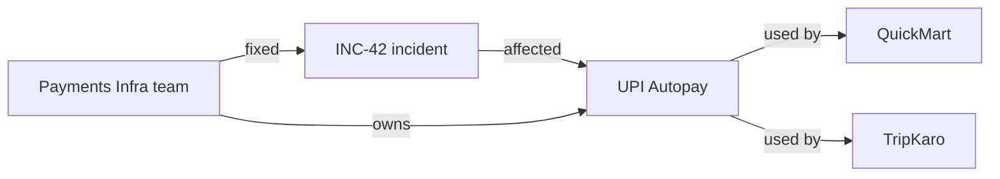

**Global sawal:** "Is saal ke saare incidents ke main themes kya hain?" Graph communities me bata hai (Payments cluster, Logistics cluster). Har community ka summary pehle se bana hai. **Map:** har summary se partial jawab. **Reduce:** sab jod ke ek final list. Vector RAG yahan fail hota hai kyunki jawab kisi ek chunk me nahi.

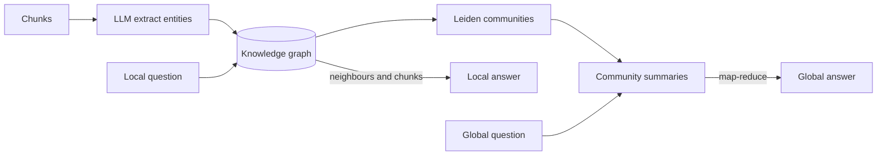

Pehla half indexing hai (mehenga, ek baar). Local query graph neighbours se, global query community summaries pe map-reduce se answer hoti hai.

**Ab terms:**
- **Entity / relation:** graph ke node (INC-42, UPI Autopay) aur edges (affected, used by).
- **Microsoft GraphRAG pipeline:** (1) chunks se LLM entity + relationship + claims extract karta hai, (2) graph pe **Leiden** community detection, hierarchical levels, (3) har community ka LLM summary.
- **Local search** = entities + neighbours + linked chunks. **Global search** = community summaries pe map-reduce.

| | Vector RAG | GraphRAG |
|---|---|---|
| Best for | specific facts | relations, multi-hop, themes |
| Index cost | embeddings, sasta | LLM extraction, mehenga |
| Update | easy, per chunk | mushkil, re-cluster |

- **Kab worth it:** multi-hop relational sawal, "poore corpus ko summarize karo" type sawal, connected data (contracts, org charts, fraud rings).
- **Kab nahi:** simple factual lookup, tezi se badalta corpus. Indexing **bahut mehenga** (har chunk pe LLM calls) aur incremental update mushkil. Sasta variant: LazyGraphRAG, ya existing graph DB (Neo4j) pe text-to-Cypher.

**Common galti:** GraphRAG ko default bana dena bina eval ke ki vector + reranking kahan fail ho raha hai. Graph DB basics: [Graph databases](../05-db/10-graph.md).

## ⭐ Structured data: text-to-SQL agents aur API tools

**Ye kyun chahiye?** "Pichle hafte kitne % orders late the?" ka jawab kisi document me likha nahi hai. Wo `orders` table pe GROUP BY se nikalta hai. Embeddings yahan bekaar, **query** chahiye.

**Analogy: bank ka clerk aur ledger room.** Tum clerk ko sawal do, wo ledger room me jaa ke hisaab nikalta hai. Par clerk ko sirf **padhne** ki permission hai, kuch mita nahi sakta. Aur har request pe manager (validator) check karta hai ki wo sahi register khol raha hai.

> **Example:** Swiggy ops analyst: "Pichle hafte Bengaluru me 45 min se late orders ka % restaurant category wise?"

**Walk-through: sawal se jawab tak.**
1. **Schema retrieval:** 400 tables me se table descriptions ke index se top 3 aaye: `orders`, `restaurants`, `cities`.
2. **LLM SQL v1 likhta hai.** Galti se `customers` table join karta hai city ke liye.
3. **Validator:** `customers` allowed list me nahi → `ERROR: Allowed nahi: {'customers'}`.
4. **Agent error padh ke SQL v2** likhta hai: `orders.city_id` se `cities` join.
5. **Validator pass,** `LIMIT 200` khud jodta hai. Read-only replica pe chalti hai.
6. **Result:** 3 rows. Agent summarize karta hai.

```sql
-- 1. Schema snippet jo LLM ko mila
-- orders(id, restaurant_id, city_id, placed_at, delivered_at)
-- restaurants(id, name, category)
-- cities(id, name)

-- 2. SQL v1: validator ne roka (customers allowed nahi)
SELECT r.category, COUNT(*) FROM orders o
JOIN restaurants r ON r.id = o.restaurant_id
JOIN customers c ON c.id = o.customer_id
WHERE c.city = 'Bengaluru' GROUP BY r.category;

-- 3. SQL v2: fix ke baad, validator ne LIMIT joda
SELECT r.category,
       ROUND(100.0 * AVG(CASE WHEN o.delivered_at - o.placed_at > INTERVAL '45 minutes'
                              THEN 1 ELSE 0 END), 1) AS late_pct
FROM orders o
JOIN restaurants r ON r.id = o.restaurant_id
JOIN cities ci ON ci.id = o.city_id
WHERE ci.name = 'Bengaluru' AND o.placed_at >= now() - INTERVAL '7 days'
GROUP BY r.category
ORDER BY late_pct DESC
LIMIT 200;

-- 4. Result: ('Biryani', 18.4), ('Pizza', 11.2), ('South Indian', 6.9)
```

Final jawab: "Pichle 7 din me Bengaluru me Biryani ke 18.4% orders 45 min se late the, Pizza ke 11.2%, South Indian ke 6.9%."

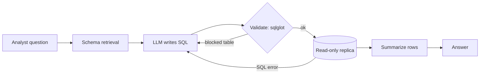

**Ab terms:**
- **Schema retrieval:** poora DDL prompt me nahi. Table/column descriptions ka index, query ke hisaab se top 5–10 tables + sample rows + column meanings.
- **Read-only role:** DB user ke paas sirf `SELECT`, sirf allowed schemas/views pe. **Row-level security (RLS)** se tenant isolation. Prompt me "DELETE mat karna" likhna security nahi hai.
- **Query validation:** parse (sqlglot), sirf ek `SELECT`, denied tables block, `LIMIT` inject, `EXPLAIN` se cost check, statement timeout. **Self-correction:** error agent ko wapas, max 2–3 tries.
- **Result summarization:** 10,000 rows LLM ko mat do. Aggregates, top-N, ya file me offload + preview.
- **Semantic layer:** metrics (`late_order_pct`) pehle se defined hon to agent unhe use kare. Raw SQL se zyada accurate aur consistent.
- **API tools:** jahan API hai wahan SQL nahi. API business rules, auth aur rate limits already enforce karta hai.

Code: `validate_sql` SQL ko parse karke check karta hai, aur `run_sql` tool error ko agent ke liye readable text me lautata hai.

```python
import sqlglot
from sqlglot import exp

ALLOWED = {"orders", "restaurants", "cities"}

def validate_sql(sql: str, max_rows: int = 200) -> str:
    tree = sqlglot.parse(sql, read="postgres")             # text → syntax tree
    if len(tree) != 1 or not isinstance(tree[0], exp.Select):
        raise ValueError("Sirf ek SELECT allowed hai")      # DELETE, ';' se do queries, sab band
    q = tree[0]
    tables = {t.name for t in q.find_all(exp.Table)}        # query me jitni tables
    if not tables <= ALLOWED:
        raise ValueError(f"Allowed nahi: {tables - ALLOWED}")
    if not q.args.get("limit"):
        q = q.limit(max_rows)                               # LIMIT khud jodo
    return q.sql(dialect="postgres")

@tool
def run_sql(sql: str) -> str:
    """Analytics replica pe read-only SELECT chalao. Max 200 rows lautata hai."""
    try:
        safe = validate_sql(sql)
        rows = ro_conn.execute(safe).fetchall()   # read-only role, 10s statement_timeout
        return f"{len(rows)} rows. Pehle 20: {rows[:20]}"
    except Exception as e:
        return f"ERROR: {e}. Schema check karke query theek karo."   # agent isse sudharega
```

**Code me kya ho raha hai:**
- `sqlglot.parse` string ko tree banata hai. Regex se SQL check karna aasaani se bypass hota hai, tree se nahi.
- Ek se zyada statement ya non-SELECT pe turant error.
- Tree ki saari `Table` nodes allow-list se compare hoti hain. Walk-through ka `customers` yahin pakda gaya.
- Error tool se bahar `raise` nahi hota, text ban ke agent ke paas jaata hai taaki wo SQL theek kare. Asli safety DB side pe hai (read-only role, timeout).

**Interview tip:** "Text-to-SQL me defense in depth: read-only replica + RLS, parser-based validation, LIMIT aur timeout, aur result ko summarize karke hi LLM ko dena."

**Common galti:** primary DB pe agent ko connection dena. Ek galat JOIN se production slow.

## Data ingestion pipelines

**Ye kyun chahiye?** Retrieval utna hi achha jitna index. Agar policy update hui par index me purana version hai, ya deleted doc abhi bhi index me hai, to agent galat ya confidential jawab dega.

**Analogy: library me naya edition.** Naya edition aaya to shelf pe rakho **aur** purana hatao. Kitaab library se nikal di to catalogue card bhi phaado. Warna log purani ya gayab kitaab maangte rahenge.

**Walk-through: ek policy update aur ek delete.**
1. Confluence pe `refund-policy` v3 publish hua. Webhook se change detection.
2. Doc ka content hash badla. Parse → 12 chunks. Chunk hashes compare: sirf 2 chunk badle.
3. Sirf wahi 2 re-embed, `doc_id + chunk_index + version` wale IDs pe upsert.
4. Ek aur page "old-escalation-matrix" Confluence se delete hua.
5. Pipeline `doc_id = conf-881` ke saare chunks vector index, BM25 index aur cache se hatati hai.

Ek chunk record aisa dikhta hai:

```json
{
  "chunk_id": "hash(conf-552 + 4 + v3)",
  "doc_id": "conf-552",
  "source": "confluence/refund-policy",
  "section": "Refund timelines",
  "version": 3,
  "updated_at": "2026-11-02T10:15:00Z",
  "tenant_id": "swiggy",
  "acl_groups": ["support", "ops"],
  "language": "en",
  "text": "Refund 5-7 working days me source account me aata hai..."
}
```

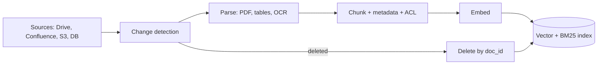

**Ab terms:**
- **Parsing:** PDFs me tables, multi-column layout, headers/footers, scanned pages. Tools: Unstructured, Docling, LlamaParse, ya vision LLM. Tables ko markdown/HTML me rakho, row-wise todo mat.
- **Metadata:** upar ke record jaise fields. Filtering aur citations isi se.
- **Incremental re-index:** content hash per doc/chunk, sirf changed chunks re-embed. Full re-index sirf embedding model badalne pe (aur tab blue-green index).
- **Freshness:** CDC/webhooks se near-real-time. SLA define karo ("policy change 15 min me searchable"). Prompt me `updated_at` dikhao.
- **Deletes:** sabse zyada bhoola jaata hai. Source se delete = index se delete (vector + BM25 + cache).
- **Idempotent pipeline:** chunk ID = `hash(doc_id + chunk_index + version)`, retries safe.

**Common galti:** sirf naye docs add karna, updates aur deletes ignore. Index me same policy ke 3 versions.

## ⭐ Data quality, access control aur PII

**Ye kyun chahiye?** Ek shared index me HR ke salary docs aur engineering docs saath hain. Bina filter ke koi bhi employee "appraisal budget" pooch ke HR ka data nikal sakta hai.

**Analogy: bank ka locker room.** Guard andar jaane se **pehle** chaabi check karta hai. Ye nahi ki sab lockers khol do aur baad me kaho "doosre ka mat dekhna".

**Ek line me:** agent ko wahi data dikhe jo **user** dekh sakta hai, aur wo filter retrieval ke **time** pe lage, generation ke baad nahi.

**Walk-through: same sawal, do users.** Sawal: "Is saal ka appraisal budget kitna hai?"
1. **Riya (groups: hr, all).** Session se `acl_groups = ["hr", "all"]`. Vector DB query me filter `acl_groups in [hr, all]`. HR budget chunk milta hai. Jawab milta hai.
2. **Aman (groups: eng, all).** Filter `acl_groups in [eng, all]`. HR chunk search me aata hi nahi. Jawab: "Is info ka access aapke paas nahi hai."
3. **Post-filter ki galti dekho:** agar pehle bina filter top-4 laate aur baad me filter karte, to Aman ke liye top-4 saare HR chunks the. Filter ke baad 0 bache. Recall gira, aur ek bug pe leak.

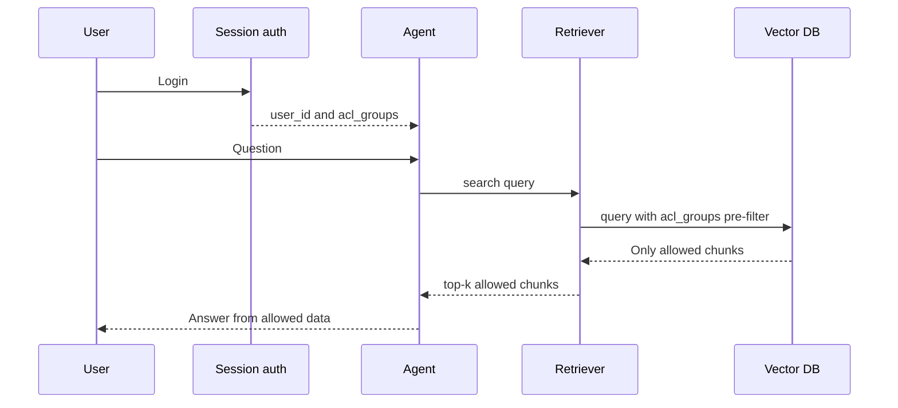

**Ab terms:**
- **ACL (access control list):** har chunk pe `acl_groups` / `tenant_id` metadata, ingestion ke time se.
- **Pre-filter:** search ke andar filter (vector DB metadata filter). **Post-filter:** top-k ke baad filter, recall girta hai aur leakage risk.
- User identity trusted session se aaye, LLM tool args se nahi. ACL change (employee team chhode) bhi re-index trigger kare.
- **PII handling:** ingestion pe detect + redact/mask (Presidio jaisa). Jaise: "Customer Rahul, PAN ABCDE1234F, phone 98xxxxxx12" → "Customer `<PERSON>`, PAN `<PAN>`, phone `<PHONE>`". Jahan PII chahiye (KYC agent) wahan tokenization aur strict ACL. Logs/traces me masking. Third-party LLM/embedding API ko kya ja raha hai, data residency check.
- **Data quality:** duplicate docs (near-dup dedupe), outdated versions, boilerplate (nav, footers), OCR garbage. Ye "wrong but confident" answers banate hain.

**Interview tip:** "Authorization LLM ka kaam nahi hai. Retrieval layer user ke ACL se pre-filter karti hai. LLM ko kabhi aisa chunk milta hi nahi jo user nahi dekh sakta."

**Common galti:** ek shared index bina tenant filter ke, aur system prompt me "doosre customers ka data mat batana".

## Synthetic data: evals aur fine-tuning ke liye

**Ye kyun chahiye?** Naya RAG agent banaya, par test karne ke liye labeled sawal-jawab nahi hain. Bina eval ke pata hi nahi chalega ki CRAG ya reranker se fayda hua ya nahi.

**Analogy: teacher ka question paper.** Teacher chapter padh ke khud sawal banata hai, answer key likhta hai, aur paper ek senior se check karwata hai ki sawal saaf hain. Kuch "trick" sawal bhi daalta hai jinka jawab chapter me nahi.

**Ek line me:** real labeled data kam ho to LLM se corpus ke upar question-answer-context triples banao, phir **filter aur human-review** karke eval set ya training data banao.

**Walk-through: ek chunk se eval item.**
1. Chunk: "Refund 5-7 working days me source account me aata hai."
2. Generator LLM: Q "Refund kitne din me aata hai?", A "5-7 working days", context = ye chunk.
3. Critique LLM: "Kya context se answerable hai? Ambiguous to nahi?" → pass.
4. Ek unanswerable item bhi: Q "Refund crypto me milega?", expected "Docs me iski jaankari nahi hai."
5. Dedupe ke baad 10–20% items insaan check karta hai. 50 real production queries ke saath mila ke eval set tayaar.

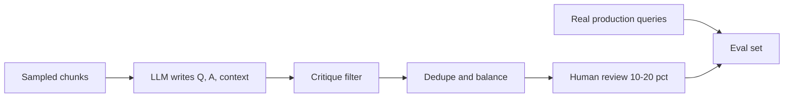

**Ab terms:**
- **Eval set generation:** simple, multi-hop, comparison, "unanswerable" ka mix. Ragas testset generator, ya custom.
- **Agent evals:** synthetic user personas + tasks + expected tool calls/final state (jaise "refund for order X" → `get_order`, `create_refund`).
- **Quality filters:** critique LLM se check, dedupe, difficulty balance. 10–20% human review must.
- **Fine-tuning data:** strong model ke trajectories (distillation) → sirf successful runs → chhote model ko SFT. Query rewriter, grader, router jaise narrow tasks pe best.
- **Risks:** synthetic sawal real users se zyada "clean" hote hain, isliye production logs se real queries mix karo. Generator aur judge same model ho to bias.

**Interview tip:** "Main 50–100 real production queries ko gold set banata hoon aur synthetic se coverage badhata hoon, khaaskar edge cases aur unanswerable questions."

## Aage padho

- [Memory & Context Engineering](05-memory-context.md): retrieved context ko budget me kaise rakhein.
- [Tools, MCP & A2A](07-tools-mcp-a2a.md): retrieval aur SQL tools ka design.
- [Guardrails & Safety](08-guardrails.md): web content se prompt injection.
- [Evals for Agents](09-agent-evals.md): synthetic sets ko eval me kaise use karein.
- [Production RAG API](../09-rag/09-production-rag-api.md) aur [Vector databases](../05-db/11-vector.md).
- [RAG lab](/viewinter/agents/labs/rag) aur [Web agent lab](/viewinter/agents/labs/web).

## Checklist

- [ ] Classic RAG vs agentic RAG ka difference same sawal ke trace se, aur kab kaunsa, bata sakta hoon
- [ ] Query rewriting, decomposition aur multi-hop retrieval example ke saath samjha sakta hoon
- [ ] CRAG ka grading aur fallback path, Self-RAG aur Adaptive RAG ka difference, aur unka LangGraph graph bana sakta hoon
- [ ] GraphRAG ka local vs global search ek entity graph pe, aur kab worth it hai, bata sakta hoon
- [ ] Safe text-to-SQL agent design kar sakta hoon: schema retrieval, read-only role, validation, LIMIT, self-correction
- [ ] Ingestion pipeline me incremental re-index, freshness aur deletes handle karna samjha sakta hoon
- [ ] Retrieval time pe per-user ACL filtering aur PII handling explain kar sakta hoon
- [ ] Evals aur fine-tuning ke liye synthetic data generate aur filter karna bata sakta hoon
