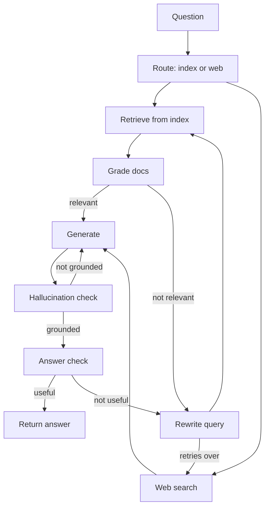
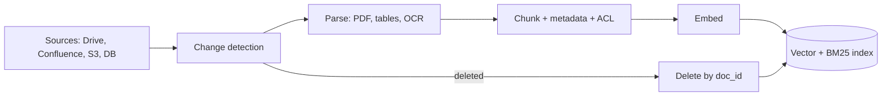

# Data & Retrieval for Agents

Is page pe: jab retrieval ek fixed pipeline nahi balki agent ka **decision** ban jaata hai. Agentic RAG, corrective/self/adaptive RAG graphs, GraphRAG, text-to-SQL agents, ingestion pipelines, ACL aur PII, aur eval ke liye synthetic data. Interviewer poochta hai kyunki real agents ka data PDFs, SQL tables aur APIs me bikhra hota hai, aur "galat ya unauthorized data retrieve hua" sabse mehenga bug hai.

## Recap: RAG basics (detail 09-rag me)

| Topic | Ek line | Detail |
|---|---|---|
| RAG kya hai | retrieve → augment prompt → generate | [What is RAG](../09-rag/01-what-is-rag.md) |
| Embeddings, semantic search | meaning ko vector me, ANN se nearest | [Semantic search](../09-rag/02-semantic-search.md) |
| Chunking | structure-aware chunks, overlap, parent-child | [Chunking](../09-rag/03-chunking.md) |
| Hybrid search | BM25 + dense + RRF | [Hybrid search](../09-rag/04-hybrid-search.md) |
| Reranking | cross-encoder se top-k precision | [Reranking](../09-rag/05-reranking.md) |
| Advanced retrieval | HyDE, multi-query, query decomposition | [Advanced retrieval](../09-rag/07-advanced-retrieval.md) |
| RAG eval | context precision/recall, faithfulness | [RAG evaluation](../09-rag/08-rag-evaluation.md) |

- Yahan focus: agent **kab, kya aur kaise** retrieve kare, aur data side ki production problems.

## ⭐ Agentic RAG: retrieval as a tool

**Ek line me:** classic RAG har query pe ek baar retrieve karta hai; agentic RAG me retriever ek **tool** hai aur LLM decide karta hai ki retrieve karna hai ya nahi, kis query se, kis source se, aur kitni baar.

> **Example:** Zerodha support agent. "Hi" pe retrieval ki zarurat nahi. "Mera DP charge kitna hai aur pichle mahine kitna kata?" pe do alag sources: pricing docs (vector search) aur user ka ledger (API tool). Agent query ko do parts me todta hai, dono tools call karta hai, phir jodta hai.

| | Classic (2-step) RAG | Agentic RAG |
|---|---|---|
| Retrieve kab | hamesha, ek baar | zarurat pe, 0 se N baar |
| Query | user ka raw text | agent rewrite / decompose karta |
| Sources | ek index | multiple tools (vector, SQL, API, web) |
| Latency/cost | predictable, kam | variable, zyada |
| Multi-hop | nahi | haan |

- **Query rewriting:** "uska fee kya hai?" → conversation se resolve karke "Zerodha Coin direct mutual fund ka fee". Pronouns aur follow-ups ke bina rewrite retrieval fail.
- **Decomposition / multi-hop:** "Jis AMC ka fund mere portfolio me sabse bada hai, uska expense ratio?" → hop 1: portfolio API, hop 2: us fund ka factsheet search.
- **Source routing:** tool descriptions se agent chunta hai `search_policy_docs` vs `query_orders_db` vs `web_search`.
- **Guard rails:** max retrieval calls (jaise 4), har call ka result token-capped, aur "kuch nahi mila" ko explicit result banao taaki agent hallucinate na kare.

```python
from langchain_core.tools import tool
from langgraph.prebuilt import ToolNode, tools_condition

@tool
def search_policy_docs(query: str, k: int = 4) -> str:
    """Zerodha pricing aur policy docs me search karo. Charges, fees, rules ke liye.
    Specific self-contained query do, pronouns nahi."""
    docs = retriever.invoke(query)[:k]
    if not docs:
        return "NO_RESULTS: query badal ke try karo ya user se clarify karo."
    return "\n\n".join(f"[{d.metadata['source']}] {d.page_content[:800]}" for d in docs)

llm_t = llm.bind_tools([search_policy_docs, get_ledger])

def agent(state: MessagesState):
    return {"messages": [llm_t.invoke(state["messages"])]}

b = StateGraph(MessagesState)
b.add_node("agent", agent)
b.add_node("tools", ToolNode([search_policy_docs, get_ledger]))
b.add_edge(START, "agent")
b.add_conditional_edges("agent", tools_condition)  # tool_calls hain to "tools", warna END
b.add_edge("tools", "agent")
graph = b.compile()
```

**Interview tip:** "Simple FAQ bot ke liye classic RAG sasta aur predictable hai. Agentic RAG tab jab queries multi-source ya multi-hop hon, aur tab bhi main tool calls cap karta hoon."

**Common galti:** har query ko agentic bana dena; 3x latency aur cost, simple questions pe koi gain nahi.

## ⭐ Corrective, Self aur Adaptive RAG as graphs

**Ek line me:** retrieve karke andha generate mat karo; **grade** karo ki docs relevant hain, warna query rewrite ya web search, aur answer ko bhi grade karo ki grounded aur useful hai.

- **CRAG (Corrective RAG):** retrieval evaluator docs ko correct / ambiguous / incorrect grade karta hai. Incorrect pe **web search fallback**, ambiguous pe dono. Docs ko "knowledge strips" me refine karke irrelevant hissa hata deta hai.
- **Self-RAG:** model khud reflection karta hai: retrieve karna hai? (Retrieve), doc relevant hai? (IsRel), answer doc se supported hai? (IsSup), answer useful hai? (IsUse). Paper me ye trained reflection tokens hain; LangGraph me hum inhe LLM grader nodes se implement karte hain.
- **Adaptive RAG:** pehle query **classify/route** karo: no retrieval (simple), single-shot retrieval, ya multi-step/web. Simple queries pe cost bachta hai.



```python
from typing import TypedDict
from pydantic import BaseModel

class S(TypedDict):
    question: str
    docs: list
    answer: str
    tries: int

class Grade(BaseModel):
    relevant: bool

grader = llm.with_structured_output(Grade)

def retrieve(s: S):
    return {"docs": retriever.invoke(s["question"])}

def grade_docs(s: S):
    keep = [d for d in s["docs"] if grader.invoke(
        f"Question: {s['question']}\nDoc: {d.page_content}\nKya ye relevant hai?").relevant]
    return {"docs": keep}

def decide(s: S):
    if s["docs"]:
        return "generate"
    return "web_search" if s.get("tries", 0) >= 2 else "rewrite"

def rewrite(s: S):
    q = llm.invoke(f"Is question ko search ke liye behtar likho: {s['question']}").content
    return {"question": q, "tries": s.get("tries", 0) + 1}

def web_search(s: S):
    return {"docs": web_tool.invoke(s["question"])}

def generate(s: S):
    ctx = "\n\n".join(d.page_content for d in s["docs"])
    return {"answer": llm.invoke(f"Sirf context se jawab do.\n{ctx}\n\nQ: {s['question']}").content}

g = StateGraph(S)
for name, fn in [("retrieve", retrieve), ("grade", grade_docs), ("rewrite", rewrite),
                 ("web_search", web_search), ("generate", generate)]:
    g.add_node(name, fn)
g.add_edge(START, "retrieve")
g.add_edge("retrieve", "grade")
g.add_conditional_edges("grade", decide, ["generate", "rewrite", "web_search"])
g.add_edge("rewrite", "retrieve")
g.add_edge("web_search", "generate")
g.add_edge("generate", END)   # yahan hallucination/answer grader node jod sakte ho
app = g.compile()
```

- Har loop pe **retry counter** zaroori; warna rewrite ↔ retrieve infinite loop.
- Graders sasta model (mini/haiku class) aur structured output (`bool`) se chalao; per-doc grading ko batch ya parallel karo.
- Cost: har grader ek LLM call. 5 docs + 2 answer checks = 7 extra calls. Isliye adaptive routing pehle.

**Interview tip:** "CRAG retrieval quality fix karta hai, Self-RAG generation quality, Adaptive RAG cost. Production me main teeno ka mix ek LangGraph graph me banata hoon, bounded retries ke saath."

**Common galti:** web search fallback bina allow-list/sanitization ke; untrusted web content seedha prompt me = prompt injection risk.

## GraphRAG aur knowledge graphs

**Ek line me:** documents se **entities aur relations** extract karke graph banao, graph ko communities me cluster karke unke summaries banao; phir entity-centric (local) ya corpus-wide (global) sawaalon ka jawab do.

- **Microsoft GraphRAG pipeline:**
  1. Chunks se LLM entity + relationship + claims extract karta hai.
  2. Graph pe **Leiden** community detection, hierarchical levels.
  3. Har community ka LLM summary.
- **Local search:** query ki entities graph me dhoondo, unke neighbours, relations aur linked chunks context me. "Razorpay ke kaunse partners ne X feature use kiya?"
- **Global search:** community summaries pe map-reduce. "Is saal ke saare incident reports ke main themes kya hain?" Vector RAG yahan fail hota hai kyunki answer kisi ek chunk me nahi.
- **Kab worth it:** multi-hop relational questions, "summarize the whole corpus" type questions, connected data (contracts, org charts, fraud rings).
- **Kab nahi:** simple factual lookup, tezi se badalta corpus. Indexing **bahut mehenga** (har chunk pe LLM calls) aur incremental update mushkil. Sasta variant: LazyGraphRAG, ya existing graph DB (Neo4j) pe text-to-Cypher.

| | Vector RAG | GraphRAG |
|---|---|---|
| Best for | specific facts | relations, multi-hop, themes |
| Index cost | embeddings, sasta | LLM extraction, mehenga |
| Update | easy, per chunk | mushkil, re-cluster |

**Common galti:** GraphRAG ko default bana dena bina eval ke ki vector + reranking kahan fail ho raha hai. Graph DB basics: [Graph databases](../05-db/10-graph.md).

## ⭐ Structured data: text-to-SQL agents aur API tools

**Ek line me:** structured data ke liye embeddings nahi, **query** chahiye; agent SQL likhta hai, par usse safe banana engineering ka kaam hai.

> **Example:** Swiggy ops analyst poochta hai "Pichle hafte Bengaluru me 45 min se late orders ka % restaurant category wise?" Ye vector search se nahi, `orders` aur `restaurants` pe GROUP BY se aayega.

- **Schema retrieval:** 400 tables ka DDL prompt me nahi daal sakte. Table/column descriptions ko index karo, query ke hisaab se top 5–10 tables + sample rows + column meanings laao.
- **Read-only role:** DB user ke paas sirf `SELECT`, sirf allowed schemas/views pe; **row-level security** se tenant isolation. Prompt me "DELETE mat karna" likhna security nahi hai.
- **Query validation:** SQL ko parse karo (sqlglot), sirf ek `SELECT` statement allow, denied tables block, `LIMIT` inject, `EXPLAIN` se cost check, statement timeout.
- **Self-correction:** error aaye to error message ke saath agent ko wapas do (max 2–3 tries).
- **Result summarization:** 10,000 rows LLM ko mat do. Aggregates, top-N, ya file me offload + preview.
- **Semantic layer:** metrics (`late_order_pct`) pehle se defined ho to agent unhe use kare; raw SQL se zyada accurate aur consistent.
- **API tools:** jahan API hai wahan SQL nahi. API business rules, auth aur rate limits already enforce karta hai. Tool ko typed args aur concise response do.

```python
import sqlglot
from sqlglot import exp

ALLOWED = {"orders", "restaurants", "cities"}

def validate_sql(sql: str, max_rows: int = 200) -> str:
    tree = sqlglot.parse(sql, read="postgres")
    if len(tree) != 1 or not isinstance(tree[0], exp.Select):
        raise ValueError("Sirf ek SELECT allowed hai")
    q = tree[0]
    tables = {t.name for t in q.find_all(exp.Table)}
    if not tables <= ALLOWED:
        raise ValueError(f"Allowed nahi: {tables - ALLOWED}")
    if not q.args.get("limit"):
        q = q.limit(max_rows)
    return q.sql(dialect="postgres")

@tool
def run_sql(sql: str) -> str:
    """Analytics replica pe read-only SELECT chalao. Max 200 rows lautata hai."""
    try:
        safe = validate_sql(sql)
        rows = ro_conn.execute(safe).fetchall()   # read-only role, 10s statement_timeout
        return f"{len(rows)} rows. Pehle 20: {rows[:20]}"
    except Exception as e:
        return f"ERROR: {e}. Schema check karke query theek karo."
```

**Interview tip:** "Text-to-SQL me defense in depth: read-only replica + RLS, parser-based validation, LIMIT aur timeout, aur result ko summarize karke hi LLM ko dena."

**Common galti:** primary DB pe agent ko connection dena; ek galat JOIN se production slow.

## Data ingestion pipelines

**Ek line me:** retrieval utna hi achha jitna ingestion; parsing, metadata, incremental re-index aur deletes yahin decide hote hain.



- **Parsing:** PDFs me tables, multi-column layout, headers/footers, scanned pages. Tools: Unstructured, Docling, LlamaParse, ya vision LLM. Tables ko markdown/HTML me rakho, row-wise todo mat.
- **Metadata:** `doc_id`, `source`, `section`, `updated_at`, `version`, `tenant_id`, `acl_groups`, `language`. Filtering aur citations isi se.
- **Incremental re-index:** content hash per doc/chunk; sirf changed chunks re-embed. Full re-index sirf embedding model badalne pe (aur tab blue-green index).
- **Freshness:** CDC/webhooks se near-real-time; SLA define karo ("policy change 15 min me searchable"). Prompt me `updated_at` dikhao.
- **Deletes:** sabse zyada bhoola jaata hai. Source se delete = index se delete (vector + BM25 + cache). Warna deleted/confidential doc answers me aata rahega.
- **Idempotent pipeline:** chunk ID = `hash(doc_id + chunk_index + version)`, retries safe.

**Common galti:** sirf naye docs add karna, updates aur deletes ignore; index me same policy ke 3 versions.

## ⭐ Data quality, access control aur PII

**Ek line me:** agent ko wahi data dikhe jo **user** dekh sakta hai, aur wo filter retrieval ke **time** pe lage, generation ke baad nahi.

- **Per-user ACL at retrieval time:**
  - Har chunk pe `acl_groups` / `tenant_id` metadata ingestion ke time se.
  - Query time pe authenticated user ke groups se **pre-filter** (vector DB metadata filter). Post-filter top-k ke baad karne se recall girta hai aur leakage risk.
  - User identity trusted session se aaye, LLM tool args se nahi.
  - ACL change (employee team chhode) bhi re-index trigger kare.
- **PII handling:**
  - Ingestion pe detect + redact/mask (Presidio jaisa). Aadhaar, PAN, card numbers, phone.
  - Jahan PII chahiye (KYC agent) wahan tokenization aur strict ACL; logs/traces me masking.
  - Third-party LLM/embedding API ko kya ja raha hai, data residency check.
- **Data quality:** duplicate docs (near-dup dedupe), outdated versions, boilerplate (nav, footers), OCR garbage. Retrieval eval me ye "wrong but confident" answers banate hain.

**Interview tip:** "Authorization LLM ka kaam nahi hai. Retrieval layer user ke ACL se pre-filter karti hai; LLM ko kabhi aisa chunk milta hi nahi jo user nahi dekh sakta."

**Common galti:** ek shared index bina tenant filter ke, aur system prompt me "doosre customers ka data mat batana".

## Synthetic data: evals aur fine-tuning ke liye

**Ek line me:** real labeled data kam ho to LLM se corpus ke upar question-answer-context triples banao, phir **filter aur human-review** karke eval set ya training data banao.

- **Eval set generation:** chunk(s) sample karo → LLM se question + reference answer → simple, multi-hop, comparison, "unanswerable" mix. Ragas testset generator, ya custom.
- **Agent evals:** synthetic user personas + tasks + expected tool calls/final state (jaise "refund for order X" → `get_order`, `create_refund`).
- **Quality filters:** critique LLM se check (answerable from context? ambiguous?), dedupe, difficulty balance. 10–20% human review must.
- **Fine-tuning data:** strong model ke trajectories (distillation) → filter sirf successful runs → chhote model ko SFT. Query rewriter, grader, router jaise narrow tasks pe best.
- **Risks:** synthetic questions real users se zyada "clean" hote hain; production logs se real queries mix karo. Generator aur judge same model ho to bias.

**Interview tip:** "Main 50–100 real production queries ko gold set banata hoon aur synthetic se coverage badhata hoon, khaaskar edge cases aur unanswerable questions."

## Aage padho

- [Memory & Context Engineering](05-memory-context.md): retrieved context ko budget me kaise rakhein.
- [Tools, MCP & A2A](07-tools-mcp-a2a.md): retrieval aur SQL tools ka design.
- [Guardrails & Safety](08-guardrails.md): web content se prompt injection.
- [Evals for Agents](09-agent-evals.md): synthetic sets ko eval me kaise use karein.
- [Production RAG API](../09-rag/09-production-rag-api.md) aur [Vector databases](../05-db/11-vector.md).
- [RAG lab](/viewinter/agents/labs/rag) aur [Web agent lab](/viewinter/agents/labs/web).

## Checklist

- [ ] Classic RAG vs agentic RAG ka difference aur kab kaunsa, bata sakta hoon
- [ ] Query rewriting, decomposition aur multi-hop retrieval example ke saath samjha sakta hoon
- [ ] CRAG, Self-RAG aur Adaptive RAG ka difference aur unka LangGraph graph bana sakta hoon
- [ ] GraphRAG ka local vs global search aur kab worth it hai, bata sakta hoon
- [ ] Safe text-to-SQL agent design kar sakta hoon: schema retrieval, read-only role, validation, LIMIT
- [ ] Ingestion pipeline me incremental re-index, freshness aur deletes handle karna samjha sakta hoon
- [ ] Retrieval time pe per-user ACL filtering aur PII handling explain kar sakta hoon
- [ ] Evals aur fine-tuning ke liye synthetic data generate aur filter karna bata sakta hoon
