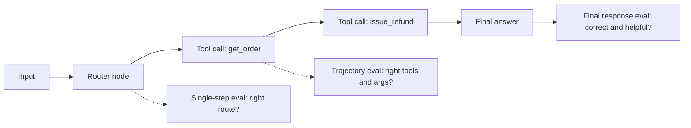
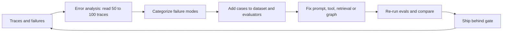

# Evals for Agents

Evals matlab agent ki quality ko **numbers me measure** karna, taaki prompt, model ya tool change karne pe pata chale ki cheez behtar hui ya tooti. Agentic AI interviews me ye almost guaranteed topic hai: "agent ko evaluate kaise karoge", "trajectory eval kya hai", "LLM judge pe bharosa kaise karoge", "CI me evals kaise lagaoge".

## ⭐ Agent evals mushkil kyun hain

**Ek line me:** agent non-deterministic hai, multi-step hai, aur ek hi goal tak pahunchne ke kai sahi raaste hain, isliye simple "expected == actual" test kaam nahi karta.

> **Example:** Swiggy support agent ko "mera order late hai, refund do" milta hai. Ek run me wo `get_order` → `check_delay` → `issue_refund` karta hai, doosre me `get_order` → `issue_refund`. Dono shayad sahi hain. Final message ke words bhi har baar alag.

- **Non-determinism:** same input, alag output (sampling, model updates, tool latency). Ek run pe judgement mat do; har case 3–5 baar chalao, pass rate dekho (pass@k ya pass^k).
- **Multi-step compounding:** har step 95% sahi ho to 10 steps ke baad ≈ 60% (0.95^10). Error kahan hua, ye pata karna padta hai.
- **Many valid paths:** exact trajectory match bahut strict; isliye subset/superset ya LLM-judged trajectory.
- **Open-ended outputs:** "accha jawab" ka koi string match nahi; rubric aur judge chahiye.
- **Side effects:** agent DB/email/payment pe actions leta hai; evals ke liye sandbox ya mocked tools chahiye.
- **Cost:** har eval run me real LLM + tool calls; dataset size aur frequency ka budget.

**Interview tip:** "Agent eval teen sawal poochta hai: final answer sahi hai? raasta theek tha? aur kitne cost/latency me? Teeno alag measure karta hoon."

**Common galti:** 5 examples manually check karke "kaam kar raha hai" bol dena. Vibes eval scale nahi karta.

## ⭐ Eval levels: final response, single step, trajectory

**Ek line me:** agent ko teen granularity pe test karo: end-to-end final answer, ek node/step ka unit test, aur poora path (trajectory).



| Level | Kya check | Kab useful | Limitation |
|---|---|---|---|
| Final response | answer correct, complete, grounded, tone | user-facing quality, black-box | pata nahi kahan galti hui |
| Single step / per-node | router ne sahi intent choose kiya? tool args sahi? | fast, cheap, debug friendly | node ko isolated input chahiye |
| Trajectory | tool calls ka sequence aur args | process matters: cost, safety, efficiency | valid alternate paths ko penalize kar sakta hai |

- **Single-step:** graph ke ek node ko fixed state dekar chalao, e.g. router ko 200 labeled queries, accuracy dekho. Unit test jaisa.
- **Final response:** reference answer ke saath correctness judge, ya bina reference ke rubric judge.
- Teeno saath: final response pass + trajectory fail = "sahi answer, galat/mehenga raasta".

**Interview tip:** "Main pehle per-node evals lagata hoon, kyunki wo sasti aur stable hain; end-to-end evals regression pakadne ke liye."

**Common galti:** sirf final answer check karna, jabki agent 12 unnecessary tool calls karke ₹2 kharch kar raha hai.

## ⭐ Trajectory evals

**Ek line me:** agent ne kaunse tools, kis order me, kin arguments ke saath call kiye, usko reference trajectory se compare karo ya LLM judge se grade karo.

> **Example:** Zerodha ka "portfolio summary" agent. Reference: `get_holdings` → `get_prices`. Agar agent ne `place_order` call kiya, to answer kitna bhi accha ho, ye fail hai.

| Match mode | Rule | Kab use karo |
|---|---|---|
| Strict / exact | same tools same order | compliance flows (KYC steps ka fixed order) |
| Unordered | same tools, koi bhi order | parallel lookups |
| Subset | agent ke calls ⊆ reference | "koi unexpected/dangerous tool nahi" |
| Superset | agent ke calls ⊇ reference | "zaroori tools call hue, extra chalega" |
| LLM-judged | judge poora trajectory padh ke grade kare | kai valid paths, no single reference |

- **Argument accuracy alag check karo:** sahi tool, galat `order_id` = fail. Args match: exact, ignore, ya custom matcher (case-insensitive city).
- Tool calls ko messages se extract karo (OpenAI format ya LangChain messages); `agentevals` dono leta hai.

```python
import json
from agentevals.trajectory.match import create_trajectory_match_evaluator
from agentevals.trajectory.llm import (create_trajectory_llm_as_judge,
                                       TRAJECTORY_ACCURACY_PROMPT)

def call(name, **args):
    return {"function": {"name": name, "arguments": json.dumps(args)}}

reference = [
    {"role": "user", "content": "Order ORD1 late hai, refund do"},
    {"role": "assistant", "content": "", "tool_calls": [call("get_order", order_id="ORD1")]},
    {"role": "tool", "content": "{'status': 'delayed', 'amount': 450}"},
    {"role": "assistant", "content": "", "tool_calls": [call("issue_refund", order_id="ORD1")]},
    {"role": "tool", "content": "refund_ok"},
    {"role": "assistant", "content": "Rs 450 refund ho gaya."},
]

# "Zaroori tools hue?" -> superset; extra lookups allowed
must_call = create_trajectory_match_evaluator(trajectory_match_mode="superset",
                                              tool_args_match_mode="exact")
judge = create_trajectory_llm_as_judge(prompt=TRAJECTORY_ACCURACY_PROMPT,
                                       model="openai:o3-mini")

agent_msgs = run_agent("Order ORD1 late hai, refund do")   # tumhara agent
print(must_call(outputs=agent_msgs, reference_outputs=reference))
print(judge(outputs=agent_msgs))   # {'key': 'trajectory_accuracy', 'score': True, ...}
```

**Interview tip:** "Safety ke liye subset mode (koi forbidden tool nahi), completeness ke liye superset mode, aur flexible tasks pe LLM-judged trajectory."

**Common galti:** strict mode har jagah lagana, phir har prompt change pe tests laal aur team evals ignore karna shuru kar deti hai.

## Metrics table

**Ek line me:** quality, process aur efficiency teeno ke metrics track karo; ek single "accuracy" number kaafi nahi.

| Metric | Kya measure | Kaise nikalein |
|---|---|---|
| Task success / completion | user ka goal poora hua? | rubric judge ya programmatic check (refund DB me hai?) |
| Correctness | answer facts sahi | reference ke saath judge ya exact match |
| Faithfulness / groundedness | claims context/tool output se supported | NLI ya LLM judge |
| Relevance | answer sawal se related | LLM judge |
| Tool-call accuracy | sahi tool select hua | trajectory match |
| Argument accuracy | tool args sahi aur valid | exact/custom matcher, schema |
| Steps / turns | kitne LLM calls, loops | trace se count |
| Cost per task | tokens × price + tool cost | trace metadata |
| Latency | p50/p95, TTFT | trace timings |
| Safety | policy violations, PII leaks | guard classifiers, red-team set |

- **Programmatic checks** jahan possible (state check: "refund row bana?") judge se zyada reliable aur sasta.
- Metrics ko **slice** karo: intent, language (Hindi/English), user tier. Average me regressions chhup jaate hain.

**Interview tip:** "Main ek north-star metric (task success) rakhta hoon aur guardrail metrics (cost, latency, safety) jinhe kharab nahi hone dena."

**Common galti:** sirf average score dekhna; 2% overall drop ke peeche ek intent 30% gir sakta hai.

## ⭐ LLM-as-judge

**Ek line me:** ek LLM ko rubric dekar doosre LLM ke output grade karwana; scalable hai par biased bhi, isliye human labels se calibrate karo.

> **Example:** Flipkart ka product-QA agent. 10,000 answers ko humans se grade karwana impossible. Judge rubric: "answer product spec se supported hai aur sawal ka seedha jawab deta hai? PASS/FAIL + reason."

- **Rubric specific ho:** "helpful hai?" vague. "Order ID mention kiya, refund amount sahi, next step bataya" concrete.
- **Pass/fail > 1–10 scale:** binary judgements zyada consistent aur actionable; 1–10 me 6 vs 7 ka koi matlab nahi. Zaroorat ho to 3-level (pass/partial/fail).
- **Reasoning pehle, verdict baad me** (chain-of-thought), aur structured output.
- **Types:**
  - **Reference-free:** sirf input + output + rubric (tone, safety).
  - **Reference-guided:** golden answer ke saath compare (correctness).
  - **Pairwise:** A vs B kaunsa better; model/prompt comparison ke liye best.
- **Biases:**

| Bias | Matlab | Fix |
|---|---|---|
| Position | pairwise me pehla/doosra option favour | dono order me chalao, swap karke average |
| Verbosity | lamba answer better lagta hai | rubric me "concise" criteria, length control |
| Self-preference | judge apne model family ke output ko favour | alag family ka judge |
| Leniency | sab kuch PASS | few-shot FAIL examples, strict rubric |

- **Calibration:** 100–200 examples pe humans label karo (domain expert), judge chalao, **agreement** measure karo: accuracy, Cohen's kappa, ya TPR/TNR. Target ~85–90%+ agreement, warna rubric/prompt fix karo.
- Judge ko bhi version karo (model + prompt); judge badla to baseline dobara.

```python
from openevals.llm import create_llm_as_judge

RUBRIC = """Tum Swiggy support answers grade kar rahe ho.
PASS sirf tab jab: (1) order ka status sahi bataya, (2) refund amount tool output se match,
(3) agla step clear hai. Warna FAIL. Pehle reasoning, phir verdict.
<question>{inputs}</question>
<answer>{outputs}</answer>
<tool_data>{reference_outputs}</tool_data>"""

judge = create_llm_as_judge(prompt=RUBRIC, feedback_key="support_quality",
                            model="openai:o3-mini")   # binary score by default

def agreement(examples, human_labels):
    preds = [judge(inputs=e["q"], outputs=e["a"], reference_outputs=e["tools"])["score"]
             for e in examples]
    return sum(p == h for p, h in zip(preds, human_labels)) / len(human_labels)
```

**Interview tip:** "LLM judge bhi ek model hai jise eval karna padta hai. Main pehle human-labeled set pe uska agreement nikalta hoon, tab hi uske numbers pe decisions leta hoon."

**Common galti:** same model ko generator aur judge dono banana, aur 1–10 score ka average report karna.

## RAG evals, short me

**Ek line me:** agent agar retrieve karta hai to retrieval aur generation dono ko alag evaluate karo.

- **Retrieval:** context precision, context recall, MRR, nDCG, hit@k.
- **Generation:** faithfulness (hallucination nahi), answer relevance, correctness.
- Agentic RAG me extra: agent ne retrieve **kab** kiya, query rewrite theek thi, kitni baar retrieve kiya.
- Detail: [RAG Evaluation](../09-rag/08-rag-evaluation.md).

**Interview tip:** "Galat answer aaya to pehle dekhta hoon ki sahi chunk retrieve hua tha ya nahi; isse pata chalta hai fix retriever me hai ya prompt me."

**Common galti:** sirf end answer score karna aur retrieval failure ko generation problem samajh ke prompt tweak karte rehna.

## ⭐ Datasets banana

**Ek line me:** eval utna hi accha jitna dataset: real prod traces, edge cases, adversarial cases, thoda synthetic, aur sab versioned.

> **Example:** Razorpay merchant agent ka golden set: 150 real queries (traces se), 40 edge cases (partial refund, multiple currencies), 30 adversarial (injection, doosre merchant ka data), 80 synthetic paraphrases Hindi/Hinglish me.

- **Prod traces se golden set:** real distribution, real phrasing. Thumbs-down aur escalated conversations sabse valuable.
- **Edge cases:** empty results, tool timeout, ambiguous query, multi-intent, long conversation.
- **Adversarial:** prompt injection, jailbreak, PII fishing, out-of-scope. Guardrails ka eval yahi hai.
- **Synthetic generation:** LLM se variations banao (personas, paraphrases, languages); par human review zaroori, warna easy aur repetitive examples.
- **Size:** shuru 20–50 se karo, phir 200–500 tak; bade dataset se pehle achhi coverage.
- **Versioning:** dataset v1, v2 (LangSmith/Langfuse datasets ya git me JSONL). Experiment results hamesha dataset version ke saath compare.
- Har example: `inputs`, `reference_outputs` (answer aur/ya expected trajectory), `metadata` (intent, difficulty, source).
- **Contamination se bacho:** eval examples ko prompt ke few-shot me mat daalo.

**Interview tip:** "Mera best eval data production failures se aata hai. Har incident ek naya test case ban jaata hai."

**Common galti:** sirf synthetic happy-path data pe 95% score dekh ke ship karna.

## Offline vs online evals

**Ek line me:** offline = fixed dataset pe release se pehle; online = live traffic pe production me; dono chahiye.

| | Offline | Online |
|---|---|---|
| Data | curated golden set | real user traffic (sampled) |
| Kab | dev, PR, release se pehle | continuously in prod |
| Reference | haan, mostly | nahi, reference-free judges |
| Pakadta hai | regressions | drift, naye failure types |

- **A/B tests:** prompt/model v2 ko 5–10% traffic, business metrics compare: resolution rate, escalation rate, CSAT, cost per conversation. Statistical significance ka dhyan.
- **User feedback signals:** explicit (thumbs, rating) sparse hota hai; implicit zyada: rephrase, "agent se baat karni hai", abandonment, copy action, retry.
- Online evaluator (reference-free judge) sampled traces pe; low score traces → review queue → dataset. Detail: [AI Observability](10-agent-observability.md).

**Interview tip:** "Offline evals ship karne ka gate hai, online evals 'kya prod me sach me kaam kar raha hai' ka jawab."

**Common galti:** sirf thumbs-down pe depend karna; 1–2% users hi feedback dete hain.

## Evals in CI/CD as regression gates

**Ek line me:** har PR (prompt, model, tool change) pe eval suite chalao aur threshold se neeche gire to merge block.

```python
# tests/test_agent_evals.py  -> CI me: pytest -m evals
import pytest
from langsmith import Client
from langchain_core.messages import convert_to_openai_messages
from agentevals.trajectory.match import create_trajectory_match_evaluator

client = Client()
no_bad_tools = create_trajectory_match_evaluator(trajectory_match_mode="subset")

def target(inputs: dict) -> dict:
    result = agent.invoke({"messages": [("user", inputs["question"])]})
    return {"messages": convert_to_openai_messages(result["messages"])}

def task_success(outputs: dict, reference_outputs: dict) -> bool:
    return reference_outputs["must_contain"] in outputs["messages"][-1]["content"]

def trajectory_ok(outputs: dict, reference_outputs: dict):
    return no_bad_tools(outputs=outputs["messages"],
                        reference_outputs=reference_outputs["trajectory"])

@pytest.mark.evals
def test_agent_regression():
    results = client.evaluate(target, data="swiggy-support-golden-v3",
                              evaluators=[task_success, trajectory_ok],
                              experiment_prefix="pr-check", num_repetitions=2,
                              max_concurrency=8)
    df = results.to_pandas()
    assert df["feedback.task_success"].mean() >= 0.90
    assert df["feedback.trajectory_subset_match"].mean() >= 0.98
```

- Thresholds **baseline se relative** rakho (e.g. main branch se 2% se zyada drop nahi) ya absolute floors.
- Fast suite (50 examples, per-node) har PR pe; full suite (500, multi-turn) nightly ya release se pehle.
- Noise ke liye repetitions, aur flaky cases alag tag karo.
- LangSmith ka pytest plugin (`@pytest.mark.langsmith`) bhi hai; Promptfoo YAML-based CI checks deta hai.

**Interview tip:** "Prompt bhi code hai. Bina eval gate ke prompt change merge karna bina tests ke code merge karne jaisa hai."

**Common galti:** CI me har PR pe 1,000 examples full LLM judge ke saath chalana; 40 minute aur ₹ hazaar, team bypass karne lagti hai.

## Simulation-based evals for multi-turn agents

**Ek line me:** ek LLM "simulated user" persona aur goal ke saath tumhare agent se poori conversation karta hai, phir judge poori conversation grade karta hai.

> **Example:** MakeMyTrip booking agent. Persona: "confused senior citizen, Delhi se Goa 15 Dec, budget ₹8,000, pehle date galat batata hai". 50 personas × 3 runs, judge check karta hai booking sahi hui ya nahi.

- Single-turn datasets multi-turn bugs miss karte hain: context bhoolna, clarifying question na poochna, loop.
- Simulator ko **goal + persona + hidden info** do (jo user tabhi bataye jab poocha jaaye).
- Stop conditions: goal pura, max turns (e.g. 10), ya user frustrated.
- Tools ko mock/sandbox karo; τ-bench isi style ka public benchmark hai (user simulator + tools + DB state check).
- Final check ideally **state-based**: DB me sahi booking bani?

```python
def simulate(agent, persona: str, goal: str, max_turns: int = 8):
    history, user_msg = [], simulated_user(persona, goal, history)
    for _ in range(max_turns):
        reply = agent.invoke({"messages": history + [("user", user_msg)]})
        history = reply["messages"]
        user_msg = simulated_user(persona, goal, history)   # LLM plays the user
        if user_msg.strip() == "DONE":
            break
    return history

convo = simulate(agent, "Hindi-speaking first-time user", "Cancel order ORD9 and get refund")
score = conversation_judge(outputs=convo)   # goal achieved? polite? no repeats?
```

**Interview tip:** "Multi-turn agent ke liye main user simulator + state check use karta hoon, kyunki asli bugs turn 4–5 pe aate hain."

**Common galti:** simulator ko itna smart aur cooperative bana dena ki wo agent ki galtiyon ko khud fix kar de.

## Tools table

| Tool | Type | Strength |
|---|---|---|
| LangSmith | hosted platform | datasets, experiments, LangGraph tracing, online evaluators, annotation queues |
| Langfuse | open source, self-host | tracing + datasets + LLM judge evaluators, prompt management |
| DeepEval | open source library | pytest-style, many ready metrics (G-Eval, task completion, tool correctness) |
| RAGAS | open source library | RAG metrics (faithfulness, context precision/recall), synthetic testsets |
| Promptfoo | open source CLI | YAML test configs, model comparison, red-teaming, CI friendly |
| Braintrust | hosted platform | experiments, scorers, playground, CI diffs |
| Arize Phoenix | open source | OTel-based tracing + evals, self-host |
| Inspect (UK AISI) | open source framework | agentic/safety evals, sandboxed tool tasks |
| agentevals / openevals | open source library | trajectory match, LLM-as-judge helpers |

**Interview tip:** "Tool se zyada important hai loop: dataset, evaluators, experiments compare karna. Wo kisi bhi tool me ho sakta hai."

**Common galti:** tool choose karne me hafta lagana aur pehla eval set abhi tak na banana.

## ⭐ Eval-driven development loop

**Ek line me:** failures dekho → categorize karo → fix karo → evals dobara chalao; ye loop hi agent ko production-ready banata hai.



- **Error analysis pehle, metrics baad me:** traces padh ke open notes likho ("date galat parse", "refund tool do baar"), phir unhe categories me group karo (axial coding). Sabse frequent category pehle fix.
- Har category ke liye ek targeted evaluator (code check ya chhota judge); generic "helpfulness" score se zyada useful.
- Fix ke baad **poora suite** chalao: ek fix doosri jagah tod sakta hai.
- Experiments side-by-side compare: per-example diff dekho, sirf aggregate nahi.

**Interview tip:** "Main generic metrics se shuru nahi karta. Pehle 100 traces padhta hoon, failure modes nikalta hoon, phir unke liye evals likhta hoon."

**Common galti:** off-the-shelf metrics (BLEU, generic helpfulness) lagake dashboard bana dena jo real failures se correlate hi nahi karte.

## Aage padho

- [AI Observability](10-agent-observability.md): traces se datasets aur online evals.
- [Guardrails & Safety](08-guardrails.md): adversarial cases aur guard evals.
- [RAG Evaluation](../09-rag/08-rag-evaluation.md): retrieval aur faithfulness metrics detail me.
- [Agents in Production](12-agents-in-production.md): rollout aur A/B.

## Checklist

- [ ] Agent evals mushkil kyun hain (non-determinism, multi-step, many paths) samjha sakta hoon
- [ ] Final response, single-step aur trajectory evals ka fark bata sakta hoon
- [ ] Trajectory match modes (strict, unordered, subset, superset) aur kab kaunsa, bata sakta hoon
- [ ] LLM-as-judge ke rubric, pass/fail, pairwise aur biases samjha sakta hoon
- [ ] Judge ko human labels se calibrate karke agreement measure kar sakta hoon
- [ ] Golden dataset prod traces, edge cases, adversarial aur synthetic se bana sakta hoon
- [ ] Offline vs online evals, A/B aur implicit feedback signals bata sakta hoon
- [ ] CI me LangSmith evaluate ya pytest se regression gate likh sakta hoon
- [ ] Multi-turn agent ke liye user simulator eval design kar sakta hoon
- [ ] Error analysis se shuru hone wala eval-driven development loop samjha sakta hoon
