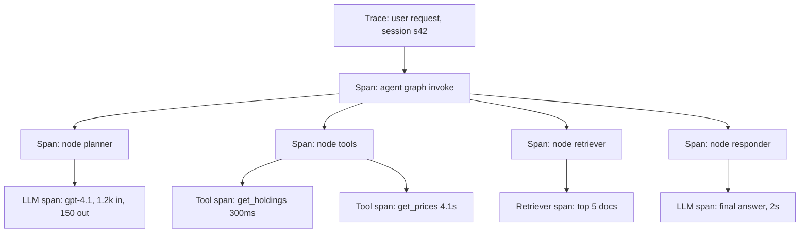
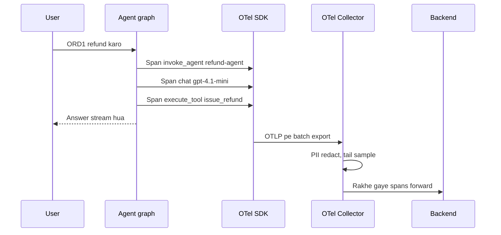
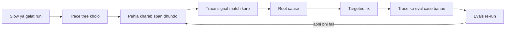
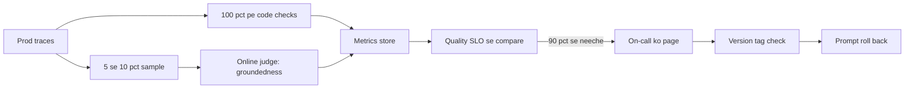
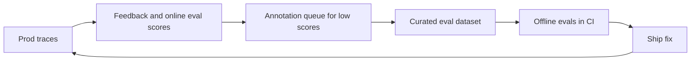
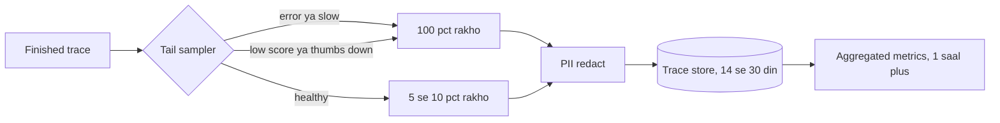

# AI Observability

AI observability matlab agent ke andar har LLM call, tool call aur retrieval ko trace karna, taaki pata chale **kya hua, kyun hua, kitne ka hua aur kitna time laga**. Agent prod me galat jawab de to 500 error nahi aata; HTTP 200 ke andar galat refund chhupa hota hai. Interviewer poochta hai: "agent ko debug kaise karoge", "kya log karoge", "OpenTelemetry GenAI conventions kya hain", "prod me quality kaise monitor karoge".

## ⭐ LLM/agent observability APM se alag kyun hai

**Ek line me:** APM batata hai service up hai aur fast hai; LLM observability batata hai ki **jawab sahi tha ya nahi**, kyunki failures silent, semantic aur non-deterministic hote hain.

> **Example:** Swiggy support agent. Datadog APM: p95 1.8s, error rate 0.1%, sab green. Par 6% conversations me agent galat order ka refund suggest kar raha hai. Ye sirf trace ke prompt, tool args aur output dekh ke pakda ja sakta hai.

| | Traditional APM | LLM/agent observability |
|---|---|---|
| Failure type | exception, 5xx, timeout | galat jawab, hallucination, galat tool, loop (sab HTTP 200) |
| Key data | latency, errors, CPU | prompt, completion, tokens, cost, tool I/O, eval scores |
| Determinism | same input → same path | same input → alag path aur output |
| Cost | infra cost mostly fixed | har request ka variable ₹ (tokens) |
| "Correct" kaise pata | status code | evals, user feedback, judges |
| Payload size | chhote spans | bade prompts (10k+ tokens), PII risk |

- Agent ka **control flow runtime pe LLM decide karta hai**, isliye code padh ke path nahi pata; trace hi source of truth hai.
- Observability = debugging + cost tracking + quality monitoring + eval datasets ka source.

**Interview tip:** "APM 'kya system chal raha hai' batata hai, LLM observability 'kya system sahi kaam kar raha hai'. Mujhe dono chahiye, aur dono ko trace ID se jodta hoon."

**Common galti:** sirf latency aur error rate dashboard bana ke maan lena ki agent healthy hai.

## ⭐ Traces, spans aur runs

**Ek line me:** ek user request = ek **trace**; uske andar har step (agent node, LLM call, tool call, retriever) ek nested **span** (LangSmith me "run", Langfuse me "observation").

> **Example:** Zerodha ka "meri portfolio P&L kyun gira?" agent. Trace tree dikhata hai: planner LLM 1.2s, `get_holdings` 300ms, `get_prices` 4.1s (slow!), final LLM 2s.



- **Trace:** poori request, trace_id se identify. Multi-turn chat me traces ko **session/thread id** se group karo.
- **Span types:** LLM/generation, tool, retriever, embedding, chain/agent node, guardrail, evaluator.
- Har span: start/end time, parent id, input, output, status, attributes (model, tokens).
- **Distributed context:** agent doosri service (MCP server, A2A agent) call kare to W3C `traceparent` header propagate karo, taaki ek hi trace bane.

**Interview tip:** "Main trace tree me teen cheezein dekhta hoon: sabse lamba span, sabse mehenga span, aur pehla span jahan output galat hua."

**Common galti:** har LLM call ko alag trace bana dena; phir poore agent run ka flow jod hi nahi pate.

## Kya log karein, kya redact karein

**Ek line me:** debugging aur cost ke liye har span pe enough context log karo, par PII aur secrets log hone se pehle hata do.

| Field | Kyun |
|---|---|
| Prompt (system + messages) aur completion | debug, eval dataset |
| Model name aur params (temperature, max_tokens) | reproduce karna |
| Prompt version / template id | regression kis change se aaya |
| Token usage: input, output, cached, reasoning | cost aur context overflow |
| Cost (₹/$) | per user, per feature budgets |
| Latency: total, TTFT, per span | slow step dhoondhna |
| Tool name, args, result, error | galat tool ya hallucinated args |
| Retrieved doc ids aur scores | RAG failures |
| Errors, retries, finish_reason | truncation (`length`), content filter |
| User feedback, session id, user id (hashed) | quality aur grouping |
| App version, git sha, environment | rollout compare |

- **Redact:** phone, email, PAN/Aadhaar, card, addresses, API keys, auth tokens, passwords. Presidio ya regex ko trace exporter se pehle lagao.
- LangSmith me `hide_inputs`/`hide_outputs` hooks aur Langfuse me masking function: trace bhejne se pehle data clean.
- User id ko hash karo; raw identity alag secure store me.

**Interview tip:** "Prompt version aur model version har trace pe tag hote hain, warna 'kal se quality giri' ka root cause nahi milta."

**Common galti:** tool results me poora customer record (address, phone) as-is trace tool me bhej dena.

## ⭐ OpenTelemetry GenAI semantic conventions aur OpenInference

**Ek line me:** OTel GenAI conventions LLM/agent spans ke liye standard attribute names (`gen_ai.*`) define karti hain, taaki koi bhi backend same data samjhe; OpenInference Arize ka similar convention hai.

- **Kyun:** vendor lock-in kam. Instrument ek baar OTel se, export Langfuse, Phoenix, Datadog, Grafana kahin bhi.
- **Important `gen_ai.*` attributes:**

| Attribute | Example |
|---|---|
| `gen_ai.operation.name` | `chat`, `embeddings`, `execute_tool`, `invoke_agent` |
| `gen_ai.provider.name` (pehle `gen_ai.system`) | `openai`, `anthropic`, `aws.bedrock` |
| `gen_ai.request.model` / `gen_ai.response.model` | `gpt-4.1-mini` |
| `gen_ai.request.temperature`, `gen_ai.request.max_tokens` | `0.2`, `1024` |
| `gen_ai.usage.input_tokens` / `gen_ai.usage.output_tokens` | `1200`, `150` |
| `gen_ai.response.finish_reasons` | `["stop"]`, `["length"]` |
| `gen_ai.agent.name`, `gen_ai.conversation.id` | `refund-agent`, `s42` |
| `gen_ai.tool.name`, `gen_ai.tool.call.id` | `issue_refund`, `call_abc` |

- Span naming: `chat gpt-4.1-mini`, `execute_tool issue_refund`, `invoke_agent refund-agent`.
- Metrics bhi defined: `gen_ai.client.token.usage`, `gen_ai.client.operation.duration`.
- **Message content default me capture nahi** (privacy); opt-in hota hai (`OTEL_INSTRUMENTATION_GENAI_CAPTURE_MESSAGE_CONTENT=true`).
- Conventions abhi "development" status me hain; attribute names badal sakte hain, isliye instrumentation library versions pin karo.
- **OpenInference:** `openinference.span.kind` = LLM, CHAIN, TOOL, RETRIEVER, AGENT, EMBEDDING, RERANKER, GUARDRAIL; attributes jaise `llm.model_name`, `llm.token_count.prompt`, `input.value`. Phoenix natively use karta hai; LangChain, LlamaIndex, OpenAI ke auto-instrumentors available.

**Interview tip:** "Main OTel GenAI conventions pe instrument karta hoon taaki backend badalna sirf exporter config ka change ho."

**Common galti:** custom attribute names (`model`, `tokens_in`) har team alag rakhe; phir cross-service dashboard banana impossible.

## Instrumentation code

**Ek line me:** LangGraph ke liye LangSmith env vars se auto-trace, custom functions pe `@traceable`; Langfuse ke liye callback handler; non-LangChain code ke liye plain OTel span.

**LangSmith: env vars + `@traceable`**

```python
# export LANGSMITH_TRACING=true
# export LANGSMITH_API_KEY=lsv2_...
# export LANGSMITH_PROJECT=swiggy-support-prod
from langsmith import traceable

@traceable(run_type="retriever", name="fetch_order_docs")
def fetch_order_docs(order_id: str) -> list[dict]:
    return [{"page_content": f"Order {order_id} policy...", "type": "Document"}]

@traceable(run_type="tool", metadata={"prompt_version": "refund-v7"})
def issue_refund(order_id: str, amount: float) -> str:
    return "refund_ok"

# LangGraph graph.invoke(...) env vars se apne aap trace hota hai;
# ye functions us trace me child runs ban jaate hain.
result = graph.invoke({"messages": [("user", "Refund ORD1")]},
                      config={"metadata": {"user_id": "u_hash_91"},
                              "tags": ["prod", "v2.3.1"]})
```

**Langfuse: LangGraph callback handler**

```python
# env: LANGFUSE_PUBLIC_KEY, LANGFUSE_SECRET_KEY, LANGFUSE_BASE_URL
from langfuse import propagate_attributes
from langfuse.langchain import CallbackHandler

handler = CallbackHandler()

with propagate_attributes(user_id="u_hash_91", session_id="s42",
                          tags=["refund-agent", "prod"]):
    graph.invoke({"messages": [("user", "Order late hai, refund do")]},
                 config={"callbacks": [handler], "run_name": "refund-turn"})
```

**Plain OpenTelemetry span around a tool**

```python
from opentelemetry import trace
from opentelemetry.trace import Status, StatusCode

tracer = trace.get_tracer("refund-agent")

def get_prices(symbols: list[str]) -> dict:
    with tracer.start_as_current_span("execute_tool get_prices") as span:
        span.set_attribute("gen_ai.operation.name", "execute_tool")
        span.set_attribute("gen_ai.tool.name", "get_prices")
        span.set_attribute("app.symbol_count", len(symbols))
        try:
            prices = price_api.fetch(symbols)          # real call
            span.set_attribute("app.result_count", len(prices))
            return prices
        except Exception as e:
            span.record_exception(e)
            span.set_status(Status(StatusCode.ERROR, str(e)))
            raise
```

- Exporter (OTLP) aur `TracerProvider` app startup pe configure karo; Langfuse aur Phoenix dono OTLP endpoint accept karte hain.
- Short-lived jobs (Lambda, scripts) me end pe **flush** karo, warna spans gum.



Request chalte waqt har node aur tool ek span emit karta hai; SDK unhe background me batch me export karta hai, isliye user tracing ka wait nahi karta.

**Interview tip:** "Framework callbacks se 80% coverage free milti hai; baaki custom tools aur business steps pe main manual spans lagata hoon."

**Common galti:** tracing synchronous blocking mode me chalana; tracing backend slow hua to agent bhi slow. SDKs background batching karte hain, wahi use karo.

## Tools table

| Tool | Type | Strength | Dhyan rakho |
|---|---|---|---|
| LangSmith | hosted (self-host enterprise) | LangGraph native, datasets, evals, annotation queues, online evaluators | LangChain ecosystem centric |
| Langfuse | open source, self-host ya cloud | OTel based, tracing + prompt mgmt + evals + cost | self-host ops (ClickHouse, Postgres) |
| Arize Phoenix | open source | OpenInference/OTel, evals, notebooks me local | prod scale ke liye Arize AX |
| Helicone | proxy/gateway based | one-line integration, caching, cost tracking | proxy = extra hop, agent internals kam |
| Datadog LLM Observability | hosted APM add-on | APM + infra + LLM traces ek jagah | mehenga, eval features limited |
| W&B Weave | hosted | `@weave.op` tracing, evals, experiments | W&B ecosystem |

**Interview tip:** "Self-host aur data residency chahiye to Langfuse ya Phoenix; LangGraph-heavy team ke liye LangSmith; existing Datadog shop me Datadog LLM Obs + ek eval tool."

**Common galti:** do-teen tools parallel lagana aur kisi me bhi complete trace na hona.

## ⭐ Traces se agent failures debug karna

**Ek line me:** har common agent failure ka trace me ek pehchaan signal hota hai; signal dekho, root cause pakdo, targeted fix karo.

> **Example:** Flipkart returns agent kabhi-kabhi 40 seconds leta hai. Trace me 14 baar `search_orders` same args ke saath. Loop: tool "no results" deta hai aur agent baar-baar retry karta hai.

| Symptom | Trace signal | Fix |
|---|---|---|
| Infinite loop / bahut slow | same tool + same args repeat, step count high | max steps / recursion limit, tool error message better, loop detector |
| Wrong tool | router/LLM span me galat tool choice, similar tool descriptions | tool descriptions clear karo, tools kam karo, few-shot |
| Hallucinated args | tool args me ID jo pehle kisi output me nahi tha | args schema validate, IDs sirf state se, enum/constraints |
| Context overflow | input tokens limit ke paas, `finish_reason=length`, purana info bhoola | summarization, trim history, tool output truncate |
| Slow step | ek span ka latency baaki se bahut zyada | cache, parallel tool calls, chhota model, timeout |
| Galat answer, sahi tools | retriever span me irrelevant docs | retrieval fix, reranker, query rewrite |
| Random failures | tool span errors, retries, 429 | backoff, fallback model, circuit breaker |
| Cost spike | input tokens per trace badhe | prompt diff (version tag), history growth, cache hit rate |

- Trace ko **eval case** me convert karo (LangSmith/Langfuse me "add to dataset"), fix ke baad wahi case regression test.
- LangGraph me checkpoint se **replay/time-travel**: failed state se dobara chalao, prompt badal ke compare.



Debugging us pehle span se shuru hoti hai jiska output galat hua, aur har fixed trace eval case ban jaata hai taaki wahi bug wapas na aaye.

**Interview tip:** "Debugging ka pehla sawal: kaunsa span pehla tha jahan output galat hua? Uske upar sab sahi tha, to bug wahi hai."

**Common galti:** final answer dekh ke prompt badalna, bina trace dekhe ki galti retrieval me thi.

## Production monitoring

**Ek line me:** cost, tokens, latency, errors aur quality ke dashboards + sampled traffic pe online evaluators + drift alerts.

> **Example:** Razorpay merchant agent ka dashboard: cost per conversation ₹1.8, p95 6s, tool failure rate 0.7%, online groundedness pass 93%. Ek prompt deploy ke baad groundedness 81% → alert → rollback.

- **Dashboards:**
  - Cost aur tokens: per day, per feature, per user tier, per model.
  - Latency: p50/p95/p99, TTFT, per node.
  - Error rate, tool failure rate, retry rate, guardrail block rate.
  - Steps per run, escalation-to-human rate, feedback rate.
- **Online evaluators:** 5–10% sampled traces pe reference-free judge (groundedness, policy, task success); 100% pe cheap code checks.
- **Drift aur degradation alerts:**
  - Input drift: naye intents, language mix, query length (embedding clusters se).
  - Quality drop: judge pass rate, thumbs-down rate, escalation rate threshold se neeche.
  - Provider side: model version change, latency spikes, 429s.
- Alerts ko **versions** se jodo (prompt v8 deploy ke baad drop), taaki rollback decision fast ho.



Saste code checks har trace pe, mehnga judge sirf sample pe; dono ek metric me jaate hain, breach pe on-call page hota hai jo version tag dekh ke rollback karta hai.

**Interview tip:** "Main quality ko bhi SLO ki tarah treat karta hoon: groundedness pass rate 90% se neeche gaya to page, bilkul latency jaise."

**Common galti:** 100% traffic pe LLM judge chalana; eval cost agent cost se zyada ho jaati hai.

## Feedback collection aur loop close karna

**Ek line me:** user feedback aur online eval scores ko trace se attach karo, bure traces ko review queue me bhejo, aur unse eval datasets banao.



- **Explicit feedback:** thumbs up/down, rating, comment; trace/run id ke saath store (LangSmith `create_feedback`, Langfuse scores).
- **Implicit signals:** rephrase, "human se baat", abandonment, copy, follow-up complaint.
- **Annotation queues:** domain experts low-score traces label karein; ye labels judge calibration ke liye bhi.
- Har reviewed failure → dataset example → CI eval. Detail: [Evals for Agents](09-agent-evals.md).

**Interview tip:** "Observability ka asli ROI tab hai jab traces eval datasets ban jaate hain. Warna wo sirf mehenge logs hain."

**Common galti:** feedback collect karna par trace id ke saath link na karna; phir pata hi nahi kis response pe thumbs-down aaya.

## Sampling aur data retention / PII policy

**Ek line me:** high traffic pe sab trace store karna mehenga aur risky hai; smart sampling, short retention, aur strict PII policy rakho.

- **Head sampling:** request start pe decide (e.g. 10%). Simple, par rare errors miss.
- **Tail sampling:** request khatam hone ke baad decide: errors, high latency, low eval score, thumbs-down 100% rakho, baaki 5–10%. OTel Collector ka tail sampling processor.
- SDK settings: LangSmith `LANGSMITH_TRACING_SAMPLING_RATE`, Langfuse `LANGFUSE_SAMPLE_RATE` (ya `sample_rate`).
- **Retention:** full payload traces 14–30 days, aggregated metrics 1 saal+, eval datasets (redacted) long-term.
- **PII policy:** redaction before export, data residency (India me data for DPDP/RBI), access control on trace UI, deletion requests support, encryption.
- Sensitive flows (payments, health) me prompt content log hi mat karo, sirf metadata aur hashes.



Sampler trace khatam hone ke baad decide karta hai, isliye har interesting trace bachti hai, healthy traffic patla hota hai, aur store se pehle sab redact hota hai.

**Interview tip:** "Errors aur bure scores ko 100% rakhta hoon, healthy traffic ko sample. Isse cost control me aur debugging data bhi milta hai."

**Common galti:** prod me 100% traces with full prompts bina retention policy ke; storage bill aur compliance risk dono.

## Aage padho

- [Evals for Agents](09-agent-evals.md): traces se datasets aur CI gates.
- [Cost & Latency](11-cost-latency.md): dashboards ke numbers ko kam kaise karein.
- [Agents in Production](12-agents-in-production.md): rollouts, alerts, incidents.
- [Reliability & Observability (HLD)](../01-topics/20-reliability-observability.md): general logs, metrics, traces basics.
- [Production agent lab](/viewinter/agents/labs/prod)

## Checklist

- [ ] LLM observability traditional APM se kyun alag hai, table ke saath samjha sakta hoon
- [ ] Agent ke trace, spans aur runs ka tree draw kar sakta hoon
- [ ] Har span pe kya log karna hai aur kya redact karna hai bata sakta hoon
- [ ] OTel GenAI `gen_ai.*` attributes aur OpenInference samjha sakta hoon
- [ ] LangSmith `@traceable`, Langfuse callback aur plain OTel span ka code likh sakta hoon
- [ ] Loop, wrong tool, hallucinated args, context overflow ko trace signals se debug kar sakta hoon
- [ ] Production dashboards, online evaluators aur drift alerts design kar sakta hoon
- [ ] Feedback se datasets tak ka loop aur sampling/retention/PII policy bata sakta hoon
