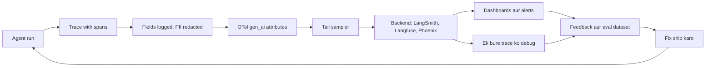
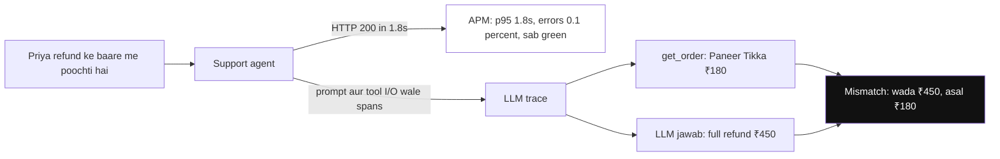
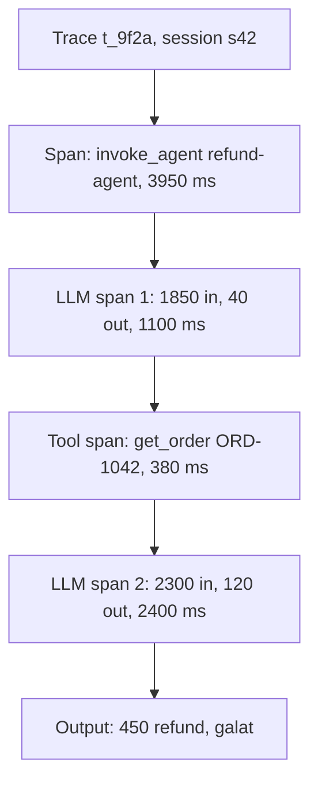
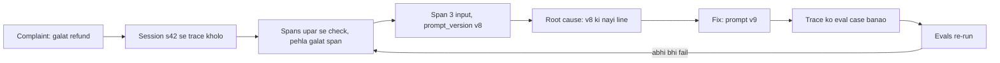
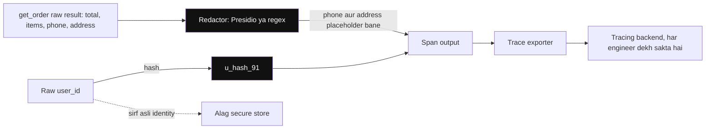
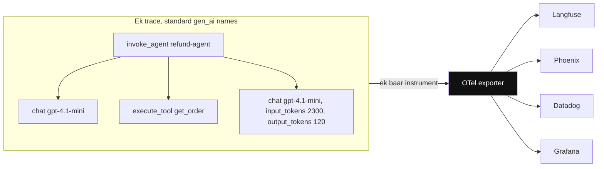
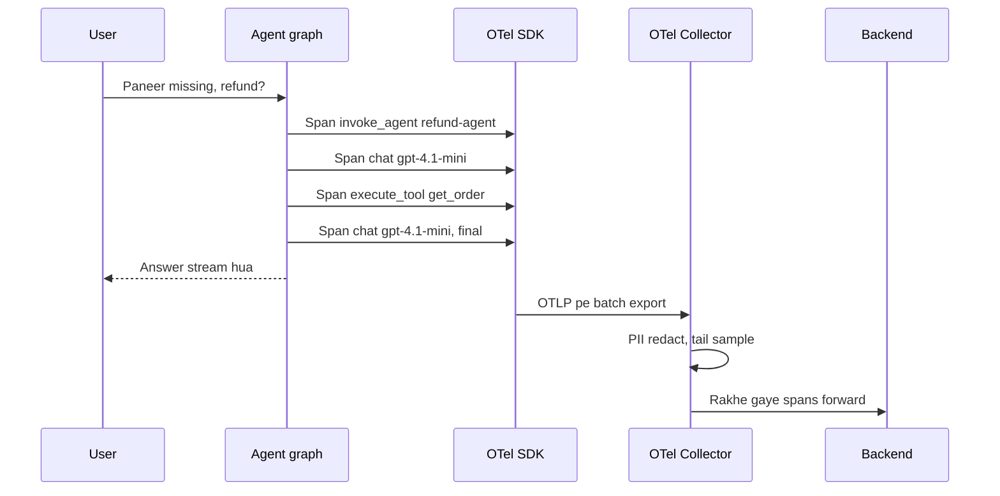
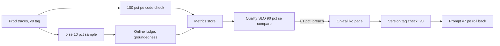
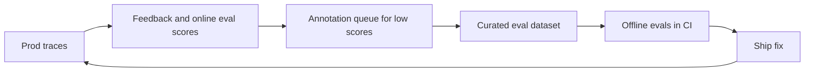
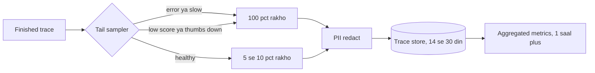

# AI Observability

AI observability matlab agent ke andar har LLM call aur tool call ko record karna, taaki baad me pata chale **kya hua, kyun hua, kitne ka hua aur kitna time laga**. Agent galat jawab de to koi 500 error nahi aata. HTTP 200 ke andar galat refund chhupa hota hai. Interviewer poochta hai: "agent ko debug kaise karoge", "kya log karoge", "OpenTelemetry GenAI conventions kya hain", "prod me quality kaise monitor karoge".

**Is page ke baad tum ye samjha paoge:**

- Ek user complaint ("bot ne galat refund bataya") se shuru karke trace kholna aur root cause tak pahunchna.
- Trace, span aur run kya hote hain, ek real trace tree pe.
- Har span pe kya log karna hai, kya redact karna hai, aur OTel `gen_ai.*` attributes kya hain.
- LangSmith, Langfuse aur plain OpenTelemetry se tracing ka code.
- Prod dashboards, alerts, feedback loop aur sampling policy kaise design karte hain.

## Pehle ye shabd samjho

LLM naye ho? Pehle [How LLMs Work](14-how-llms-work.md) padho. Usme tokens, context window aur model text kaise banata hai, ye sab hai.

| Shabd | Simple matlab |
|---|---|
| tool call | Model ka tumhare code se ek function (jaise `get_order`) chalwana, apne chune hue arguments ke saath. |
| OpenTelemetry (OTel) | Kisi bhi service se traces, metrics aur logs record karne ka open standard aur libraries ka set. |
| Trace | Ek agent run ka poora record, user message se final answer tak, har step ke saath. |
| Span | Trace ke andar ek step, start aur end time ke saath, jaise ek LLM call ya ek tool call. |
| PII | Personally Identifiable Information: phone, email, address, ID number, jo bhi asli insaan tak le jaaye. |
| Eval dataset | Saved inputs aur unke sahi jawab, har change ke baad dobara chalate hain taaki tooti cheez pakdi jaaye. |
| APM | Application Performance Monitoring: Datadog jaise tools jo service ki speed, errors aur uptime track karte hain. |
| Hallucination | Model poore confidence se galat ya banayi hui baat bole, jaise ek order ID jo kabhi tha hi nahi. |
| LLM judge | Ek doosri model call jo jawab ko grade karti hai, jaise check karna ki refund policy follow hui ya nahi. |
| System prompt | Fixed instructions jo app har user message se pehle model ko bhejta hai, jaise refund policy. |
| Prompt version | `refund-v8` jaisa label jo batata hai ki request ke waqt system prompt ka kaunsa version live tha. |
| Retriever | Wo step jo documents me search karke milta-julta text prompt me jodta hai (isi ko RAG kehte hain). |
| MCP / A2A | Protocols jinse agent bahar ke tools call karta hai (MCP) ya doosre agents ko kaam deta hai (A2A). |
| TTFT | Time To First Token: jawab ka pehla shabd user tak pahunchne me kitna time laga. |

## Big picture: poora page ek nazar me

Socho agent ek flight hai. Flight ka **black box** har second record karta hai: speed, altitude, pilot ki awaaz. Crash ke baad investigator black box kholta hai aur second-by-second dekhta hai ki galti kahan hui. Agent ke liye ye black box **trace** hai. Har agent run ek trace banata hai. Uske andar har LLM call aur tool call ek **span** hota hai. Hum har span pe zaroori fields log karte hain (PII hata ke), standard naam (`gen_ai.*`) use karte hain, aur sab ek backend (LangSmith, Langfuse, Phoenix) me bhejte hain. Wahan se do kaam hote hain: ek bure run ko debug karna, aur dashboards se poore traffic ko monitor karna. Bure runs eval dataset me jaate hain, fix ship hota hai, aur loop dobara chalta hai.



Neeche har section is chain ka ek dabba hai. Ek hi example poore page me chalega: Swiggy ka refund agent jisne galat refund bataya.

## ⭐ LLM/agent observability APM se alag kyun hai

**Ye kyun chahiye?** Swiggy support agent ka Datadog APM dashboard dekho: p95 1.8s, error rate 0.1%, sab green. Phir bhi customer Priya complain karti hai: "bot ne bola ₹450 refund milega, mila sirf ₹180". APM ko ye galti dikhi hi nahi, kyunki request ne HTTP 200 diya. Aise 6% conversations me agent galat refund bata raha hai.

**Analogy:** restaurant ki kitchen screen. Wo batati hai ki har order 12 minute me nikla (APM: system chal raha hai, fast hai). Par wo ye nahi batati ki plate me sahi dish thi ya nahi. Uske liye har station pe order slip aur plate ki photo chahiye (LLM observability: jawab sahi tha ya nahi).

| Kitchen | Agent |
|---|---|
| order 12 min me nikla | latency, status code (APM) |
| plate me galat dish | galat jawab, HTTP 200 ke saath |
| har station ki slip aur photo | har span ka prompt, tool input, output |



*Diagram:* Ek hi request do nazar se: APM (dimmed) sirf fast HTTP 200 dekhta hai, jabki trace dikhata hai ki tool ne ₹180 bola aur model ne ₹450 ka wada kiya.

**Ek line me:** APM batata hai service up hai aur fast hai; LLM observability batata hai ki **jawab sahi tha ya nahi**, kyunki failures silent, semantic aur non-deterministic hote hain.

| | Traditional APM | LLM/agent observability |
|---|---|---|
| Failure type | exception, 5xx, timeout | galat jawab, hallucination, galat tool, loop (sab HTTP 200) |
| Key data | latency, errors, CPU | prompt, completion, tokens, cost, tool I/O, eval scores |
| Determinism | same input → same path | same input → alag path aur output |
| Cost | infra cost mostly fixed | har request ka variable ₹ (tokens) |
| "Correct" kaise pata | status code | evals, user feedback, judges |
| Payload size | chhote spans | bade prompts (10k+ tokens), PII risk |

- Agent ka **control flow runtime pe LLM decide karta hai**. Code padh ke path nahi pata chalta. Trace hi source of truth hai.
- Observability ke chaar kaam: debugging, cost tracking, quality monitoring, aur eval datasets ka source.

**Interview tip:** "APM 'kya system chal raha hai' batata hai, LLM observability 'kya system sahi kaam kar raha hai'. Mujhe dono chahiye, aur dono ko trace ID se jodta hoon."

**Common galti:** sirf latency aur error rate dashboard bana ke maan lena ki agent healthy hai.

## ⭐ Traces, spans aur runs

**Ye kyun chahiye?** Priya ki complaint aayi. Ab tumhe dekhna hai ki us ek request me agent ne kya socha, kaunsa tool bulaya, tool ne kya diya, aur final jawab kahan bigda. Agar har step alag-alag log line me bikhra hai, to inhe jodna mushkil hai. Trace sab steps ko ek tree me jod deta hai.

**Analogy:** courier tracking (Delhivery, Blue Dart). Ek parcel ka ek **AWB number** hota hai. Us number pe poori timeline dikhti hai: picked up, Delhi hub, Mumbai hub, out for delivery. Har event pe time likha hota hai.

| Courier | Agent tracing |
|---|---|
| AWB number | `trace_id` |
| poori timeline | trace |
| har hub scan (time ke saath) | span |
| hub ke andar sorting, loading | child spans |
| customer ke saare parcels | session / thread |

**Example step by step:** Priya ki request ka asli trace. Agent ne 2 LLM calls aur 1 tool call kiye.

1. Agent run shuru hua. Root span bana: `invoke_agent refund-agent`.
2. **LLM call 1:** model ko system prompt + Priya ka message gaya (1,850 tokens). Model ne decide kiya ki order dekhna hai, aur `get_order` tool call return kiya (40 tokens). Time 1,100 ms.
3. **Tool call:** `get_order("ORD-1042")` chala. Result: order total ₹450, Paneer Tikka ₹180 "missing". Time 380 ms.
4. **LLM call 2:** model ko system prompt + history + tool result gaya (2,300 tokens). Model ne final jawab likha (120 tokens): "₹450 ka full refund milega". Time 2,400 ms.
5. Run khatam. Total 3,950 ms. Status OK.

Tracing UI me yahi tree aisa dikhta hai:

```text
TRACE t_9f2a   session s42   user u_hash_91   prompt_version refund-v8
status OK   total 3,950 ms   tokens 4,150 in / 160 out   cost ~$0.002 (illustrative)

invoke_agent refund-agent                                   3,950 ms
├── [1] chat gpt-4.1-mini                1,100 ms   in 1,850   out 40
│       input : system prompt (refund-v8) + "Paneer Tikka missing tha, refund?"
│       output: tool_call get_order(order_id="ORD-1042")
├── [2] execute_tool get_order              380 ms
│       input : {"order_id": "ORD-1042"}
│       output: {"total": 450, "items": [{"name": "Paneer Tikka",
│                "price": 180, "status": "missing"}, ...]}
└── [3] chat gpt-4.1-mini                2,400 ms   in 2,300   out 120
        input : system prompt (refund-v8) + history + get_order result
        output: "Aapko ₹450 ka full refund mil jayega."     <-- galat
```

Har line ek span hai. Indentation batata hai ki kaun kiske andar hai. Span 1, 2, 3 teeno root span ke children hain.



Upar ka diagram wahi order dikhata hai jisme cheezein hui: run, phir LLM call 1, phir tool, phir LLM call 2, phir jawab.

**Ab terms:**

- **Trace:** ek user request ka poora record, ek `trace_id` se pehchana jaata hai. Upar `t_9f2a`.
- **Span:** trace ke andar ek step, start time, end time aur parent ke saath. Upar teen child spans.
- **Run:** LangSmith span ko "run" bolta hai. Langfuse "observation" bolta hai. Matlab same.
- **Session / thread:** ek chat ke multiple traces ka group. Upar `s42`. Multi-turn chat me traces isi id se jodo.
- **Span types:** LLM/generation, tool, retriever, embedding, chain/agent node, guardrail, evaluator.
- **Har span me:** start/end time, parent id, input, output, status, attributes (model, tokens).
- **Distributed context:** agent doosri service (MCP server, A2A agent) ko call kare to W3C `traceparent` header (trace id le jaane wala standard HTTP header) aage bhejo. Tab doosri service ke spans bhi isi trace me judte hain.

**Interview tip:** "Main trace tree me teen cheezein dekhta hoon: sabse lamba span, sabse mehenga span, aur pehla span jahan output galat hua."

**Common galti:** har LLM call ko alag trace bana dena. Phir poore agent run ka flow jod hi nahi pate.

## ⭐ Traces se agent failures debug karna

**Ye kyun chahiye?** Bina trace ke log galat jawab dekh ke seedha prompt badal dete hain. Aksar galti kahin aur hoti hai: tool ne galat data diya, ya retriever ne purana doc diya. Trace se tum guess nahi karte, dekhte ho.

**Analogy:** doctor ki diagnosis. Doctor bukhaar dekh ke seedha dawai nahi deta. Wo blood test, X-ray ek-ek karke dekhta hai, aur pehli report jahan gadbad hai wahi bimari ki jagah hai. Trace ke spans wahi reports hain.

**Example step by step:** Priya ki complaint se root cause tak.

1. **Trace dhundo.** Complaint ticket me chat ka `session_id = s42` hai. Tracing UI me us session ka trace kholo: `t_9f2a`. (Isliye session id log karna zaroori hai.)
2. **Top level dekho.** Status OK, 3,950 ms, koi error nahi. Matlab ye "silent" failure hai. APM isse kabhi nahi pakadta.
3. **Span 1 check karo.** Output: `get_order(order_id="ORD-1042")`. Priya ka order yahi tha. Sahi.
4. **Span 2 check karo.** Tool output: Paneer Tikka ₹180, status missing, total ₹450. Data sahi hai.
5. **Span 3 check karo.** Output: "₹450 full refund". Policy kehti hai sirf missing item ka paisa, yaani ₹180. **Ye pehla galat span hai.**
6. **Span 3 ka input padho.** Tool result sahi pahuncha tha. To galti prompt me honi chahiye. Trace pe tag hai `prompt_version = refund-v8`. Kal v7 se v8 deploy hua tha.
7. **v7 vs v8 diff karo.** v8 me ek nayi line judi thi: "Missing item ho to customer khush rakhne ke liye poora order refund karo." Yahi root cause hai.
8. **Confirm karo.** Dashboard pe `prompt_version = refund-v8` wale traces filter karo. Average refund amount kal ke deploy ke baad 2.3x ho gaya. Pakka.
9. **Fix aur lock karo.** Line hatao (v9). Trace `t_9f2a` ko eval dataset me "add to dataset" karo, expected answer ₹180. Evals chalao, pass ho to ship.

Sabse bada sabak: upar ke spans (1 aur 2) sahi the, isliye bug span 3 me hi tha. Prompt version tag na hota to root cause dhundhne me din lag jaate.



Debugging us pehle span se shuru hoti hai jiska output galat hua. Har fixed trace eval case ban jaata hai, taaki wahi bug wapas na aaye.

**Common failures ke trace signals:** har failure ka trace me ek pehchaan signal hota hai. Signal dekho, root cause pakdo, targeted fix karo.

> **Example:** Flipkart returns agent kabhi-kabhi 40 seconds leta hai. Trace me 14 baar `search_orders` same args ke saath. Ye loop hai: tool "no results" deta hai aur agent baar-baar retry karta hai.

| Symptom | Trace signal | Fix |
|---|---|---|
| Infinite loop / bahut slow | same tool + same args repeat, step count high | max steps / recursion limit, tool error message better, loop detector |
| Wrong tool | router/LLM span me galat tool choice, similar tool descriptions | tool descriptions clear karo, tools kam karo, few-shot |
| Hallucinated args | tool args me ID jo pehle kisi output me nahi tha | args schema validate, IDs sirf state se, enum/constraints |
| Context overflow | input tokens limit ke paas, `finish_reason=length`, purana info bhoola | summarization, trim history, tool output truncate |
| Slow step | ek span ka latency baaki se bahut zyada | cache, parallel tool calls, chhota model, timeout |
| Galat answer, sahi tools | retriever span me irrelevant docs | retrieval fix, reranker, query rewrite |
| Random failures | tool span errors, retries, 429 | backoff, fallback model, circuit breaker |
| Cost spike | input tokens per trace badhe | prompt diff (version tag), history growth, cache hit rate |

**Ab terms:**

- **Silent failure:** galti jisme koi error ya exception nahi aata, sirf jawab galat hota hai.
- **Eval case:** ek saved input + expected output, jo har change pe dobara test hota hai. LangSmith/Langfuse me trace se "add to dataset".
- **Replay / time-travel:** LangGraph checkpoint (har step ke baad save hua agent state ka snapshot) se failed state dobara chalana, prompt badal ke compare karna.

**Interview tip:** "Debugging ka pehla sawal: kaunsa span pehla tha jahan output galat hua? Uske upar sab sahi tha, to bug wahi hai."

**Common galti:** final answer dekh ke prompt badalna, bina trace dekhe ki galti retrieval ya tool me thi.

## Kya log karein, kya redact karein

**Ye kyun chahiye?** Upar ka debug tabhi possible hua kyunki span pe input, output aur `prompt_version` logged the. Par `get_order` ka poora result Priya ka phone number aur ghar ka address bhi rakhta hai. Wo trace tool me chala gaya to har engineer use dekh sakta hai. Matlab: zaroori cheez log karo, private cheez pehle hatao.

**Analogy:** hospital ki case file research team ko dena. Bimari, dawai, test results sab jaate hain (debug ke liye zaroori). Par naam, phone, Aadhaar kaale marker se chhupa diye jaate hain.

**Example step by step:** span 2 (`get_order`) ka output trace me jaane se pehle.

1. Tool ka raw result: `{"order_id": "ORD-1042", "total": 450, "phone": "98xxxxxx21", "address": "Flat 302, Andheri", "items": [...]}`.
2. Redaction step (Presidio, Microsoft ka open-source PII detector, ya regex) exporter se pehle chalta hai. Phone aur address pakde gaye.
3. Trace me jo pahuncha: `{"order_id": "ORD-1042", "total": 450, "phone": "<PHONE>", "address": "<ADDRESS>", "items": [...]}`.
4. Debug ke liye jo chahiye (total, items, price, status) sab bacha. Private data gaya hi nahi.
5. `user_id` bhi raw nahi gaya, hash gaya: `u_hash_91`. Asli identity alag secure store me hai.



*Diagram:* Redaction aur hashing (highlighted) exporter se pehle hain, isliye tracing backend tak sirf placeholders aur hashed user id pahunchte hain; asli identity alag store me rehti hai.

**Kya log karna hai:**

| Field | Kyun |
|---|---|
| Prompt (system + messages) aur completion | debug, eval dataset |
| Model name aur params (temperature, max_tokens) | reproduce karna |
| Prompt version / template id | regression kis change se aaya (upar wala v8 bug) |
| Token usage: input, output, cached, reasoning | cost aur context overflow |
| Cost (₹/$) | per user, per feature budgets |
| Latency: total, TTFT, per span | slow step dhoondhna |
| Tool name, args, result, error | galat tool ya hallucinated args |
| Retrieved doc ids aur scores | RAG failures |
| Errors, retries, finish_reason | truncation (`length`), content filter |
| User feedback, session id, user id (hashed) | quality aur grouping |
| App version, git sha, environment | rollout compare |

**Kya redact karna hai:**

- Phone, email, PAN/Aadhaar, card, addresses, API keys, auth tokens, passwords.
- Presidio ya regex ko **trace exporter se pehle** lagao, baad me nahi.
- LangSmith me `hide_inputs`/`hide_outputs` hooks aur Langfuse me masking function: trace bhejne se pehle data clean karte hain.
- User id ko hash karo. Raw identity alag secure store me.

**Ab terms:**

- **Redaction:** sensitive value ko placeholder (`<PHONE>`) se badalna.
- **PII:** Personally Identifiable Information, jo kisi insaan ko pehchan sake.
- **Exporter:** SDK ka hissa jo spans ko backend tak bhejta hai.

**Interview tip:** "Prompt version aur model version har trace pe tag hote hain, warna 'kal se quality giri' ka root cause nahi milta."

**Common galti:** tool results me poora customer record (address, phone) as-is trace tool me bhej dena.

## ⭐ OpenTelemetry GenAI semantic conventions aur OpenInference

**Ye kyun chahiye?** Team A token count ko `tokens_in` bolti hai, Team B `input_tokens`, Team C `prompt_tok`. Ab ek dashboard banana ho jo teeno ka cost jode, to impossible. Aur kal tum Langfuse se Datadog shift karo to sab instrumentation dobara likhna padega.

**Analogy:** GST invoice. Har dukaan ka bill alag dikhta hai, par har bill me same fields hote hain: GSTIN, HSN code, taxable amount, tax. Isliye koi bhi accounting software (Tally, Zoho) koi bhi bill padh leta hai.

| GST | OTel GenAI |
|---|---|
| fixed field names (GSTIN, HSN) | fixed attribute names (`gen_ai.*`) |
| koi bhi dukaan | koi bhi framework (LangGraph, plain SDK) |
| koi bhi accounting software | koi bhi backend (Langfuse, Phoenix, Datadog, Grafana) |

**Example step by step:** Priya ke trace ka span 3 (LLM call 2) OTel GenAI attributes ke saath aisa dikhta hai.

1. Span ka naam convention se: `chat gpt-4.1-mini` (operation + model).
2. Span pe attributes lagte hain:

| Attribute | Span 3 ki value | Matlab |
|---|---|---|
| `gen_ai.operation.name` | `chat` | kis type ka call |
| `gen_ai.provider.name` | `openai` | kaunsa provider |
| `gen_ai.request.model` | `gpt-4.1-mini` | kaunsa model maanga |
| `gen_ai.response.model` | `gpt-4.1-mini-2025-04-14` | asal me kaunsa chala |
| `gen_ai.request.temperature` | `0.2` | randomness |
| `gen_ai.request.max_tokens` | `1024` | output ki limit |
| `gen_ai.usage.input_tokens` | `2300` | input tokens |
| `gen_ai.usage.output_tokens` | `120` | output tokens |
| `gen_ai.response.finish_reasons` | `["stop"]` | normal khatam hua, truncate nahi |
| `gen_ai.agent.name` | `refund-agent` | kaunsa agent |
| `gen_ai.conversation.id` | `s42` | kaunsi chat |

3. Langfuse, Phoenix ya Datadog, koi bhi backend in naamon ko pehchanta hai. Cost aur token dashboard apne aap ban jaata hai.
4. Span 2 (tool) pe `gen_ai.operation.name = execute_tool`, `gen_ai.tool.name = get_order`, `gen_ai.tool.call.id = call_abc` lagta hai. Root span pe `invoke_agent`.



*Diagram:* Spans convention se named hain (invoke_agent, chat, execute_tool), isliye Langfuse se Datadog jaana sirf exporter (highlighted) pe ek change hai.

**Ek line me:** OTel GenAI conventions LLM/agent spans ke liye standard attribute names (`gen_ai.*`) define karti hain, taaki koi bhi backend same data samjhe. OpenInference Arize ka similar convention hai.

**Baaki zaroori baatein:**

- **Kyun:** vendor lock-in kam. Instrument ek baar OTel se, export Langfuse, Phoenix, Datadog, Grafana kahin bhi.
- `gen_ai.operation.name` ki values: `chat`, `embeddings`, `execute_tool`, `invoke_agent`.
- `gen_ai.provider.name` pehle `gen_ai.system` tha. Values: `openai`, `anthropic`, `aws.bedrock`.
- `finish_reasons = ["length"]` matlab output beech me kata (max_tokens khatam).
- Span naming: `chat gpt-4.1-mini`, `execute_tool get_order`, `invoke_agent refund-agent`.
- Metrics bhi defined hain: `gen_ai.client.token.usage`, `gen_ai.client.operation.duration`.
- **Message content default me capture nahi hota** (privacy). Opt-in karna padta hai: `OTEL_INSTRUMENTATION_GENAI_CAPTURE_MESSAGE_CONTENT=true`.
- Conventions abhi "development" status me hain. Attribute names badal sakte hain, isliye instrumentation library versions pin karo.
- **OpenInference:** `openinference.span.kind` = LLM, CHAIN, TOOL, RETRIEVER, AGENT, EMBEDDING, RERANKER, GUARDRAIL. Attributes jaise `llm.model_name`, `llm.token_count.prompt`, `input.value`. Phoenix ise natively use karta hai. LangChain, LlamaIndex, OpenAI ke auto-instrumentors available hain.

**Ab terms:**

- **Semantic convention:** sab ke liye agreed attribute naam aur unka matlab.
- **Attribute:** span pe laga key-value pair, jaise `gen_ai.usage.input_tokens = 2300`.
- **Instrumentation:** code me wo hissa jo spans banata hai (auto ya manual).

**Interview tip:** "Main OTel GenAI conventions pe instrument karta hoon taaki backend badalna sirf exporter config ka change ho."

**Common galti:** custom attribute names (`model`, `tokens_in`) har team alag rakhe. Phir cross-service dashboard banana impossible.

## Instrumentation code

**Ye kyun chahiye?** Upar wala trace apne aap nahi banta. Kisi code ko har LLM call aur tool call ke aas-paas span kholna aur band karna padta hai. Achhi baat: framework callbacks se zyada tar kaam free me ho jaata hai.

**Analogy:** CCTV lagana. Main gate aur lobby pe builder ne pehle se camera lagaye (framework auto-tracing). Tumhare apne godown me camera tumhe khud lagana padta hai (custom tool pe manual span).

**Example step by step:** Priya ka trace kaise bana.

1. App start pe tracing env vars set the. LangGraph ka `graph.invoke` apne aap root span (`invoke_agent`) aur LLM spans (span 1, 3) banata hai.
2. `get_order` humara custom function hai. Uspe `@traceable` (ya OTel span) laga tha, isliye span 2 bana.
3. `invoke` ke config me user id, session id, tags diye the. Wo trace pe metadata ban gaye.
4. SDK ne spans memory me jama kiye aur background me batch karke backend bhej diye. Priya ko jawab rukna nahi pada.

**1. LangSmith: env vars + `@traceable`.** Env vars se LangGraph ka poora run trace hota hai. `@traceable` humare custom function ko us trace ka child bana deta hai.

```python
# export LANGSMITH_TRACING=true                 # tracing on
# export LANGSMITH_API_KEY=lsv2_...
# export LANGSMITH_PROJECT=swiggy-support-prod   # traces is project me jaayenge
from langsmith import traceable

# run_type batata hai span ka type: "llm", "tool", "retriever", "chain"
@traceable(run_type="tool", name="get_order",
           metadata={"prompt_version": "refund-v8"})   # version tag har trace pe
def get_order(order_id: str) -> dict:
    return orders_db.fetch(order_id)                   # yahi span 2 banta hai

# graph.invoke env vars se apne aap trace hota hai (root + LLM spans).
# get_order is trace ke andar child run ban jaata hai.
result = graph.invoke(
    {"messages": [("user", "Paneer Tikka missing tha, refund?")]},
    config={"metadata": {"user_id": "u_hash_91", "session_id": "s42"},
            "tags": ["prod", "v2.3.1"]},               # filter karne ke liye
)
```

**Code me kya ho raha hai:**

- Teen env vars se tracing chalu hoti hai. LangGraph code me koi change nahi.
- `@traceable(run_type="tool")` function ke input aur output ko ek tool span me record karta hai.
- `metadata` me `prompt_version` diya, isliye debug ke step 6 me v8 dikha.
- `config.metadata` aur `tags` trace pe lagte hain. Inse UI me "session s42" ya "prod" filter karte hain.

**2. Langfuse: LangGraph callback handler.** Langfuse LangChain callback ke through har node, LLM aur tool call ko observe karta hai.

```python
# env: LANGFUSE_PUBLIC_KEY, LANGFUSE_SECRET_KEY, LANGFUSE_BASE_URL
from langfuse import propagate_attributes
from langfuse.langchain import CallbackHandler

handler = CallbackHandler()          # LangGraph events sunta hai, spans banata hai

# is block ke andar bane saare spans pe user, session, tags lag jaate hain
with propagate_attributes(user_id="u_hash_91", session_id="s42",
                          tags=["refund-agent", "prod"]):
    graph.invoke(
        {"messages": [("user", "Paneer Tikka missing tha, refund?")]},
        config={"callbacks": [handler],      # handler ko run me jodo
                "run_name": "refund-turn"},  # trace ka naam
    )
```

**Code me kya ho raha hai:**

- `CallbackHandler` LangGraph ke har step (node start/end, LLM call, tool call) pe event pakadta hai.
- `config={"callbacks": [handler]}` se handler is run me judta hai.
- `propagate_attributes` block ke andar har span pe user, session aur tags apne aap lagte hain.
- `run_name` se trace ko UI me pehchanna aasaan hota hai.

**3. Plain OpenTelemetry span around a tool.** Jab framework nahi hai, ya tumhe OTel GenAI attributes khud set karne hain, to span haath se kholo.

```python
from opentelemetry import trace
from opentelemetry.trace import Status, StatusCode

tracer = trace.get_tracer("refund-agent")

def get_order(order_id: str) -> dict:
    # "with" block = span ki life. Block shuru = start time, khatam = end time
    with tracer.start_as_current_span("execute_tool get_order") as span:
        span.set_attribute("gen_ai.operation.name", "execute_tool")  # standard naam
        span.set_attribute("gen_ai.tool.name", "get_order")
        span.set_attribute("app.order_id", order_id)        # apna business field
        try:
            order = orders_api.fetch(order_id)                # real call
            span.set_attribute("app.item_count", len(order["items"]))
            return order
        except Exception as e:
            span.record_exception(e)                          # error trace me dikhe
            span.set_status(Status(StatusCode.ERROR, str(e)))
            raise
```

**Code me kya ho raha hai:**

- `get_tracer` ek tracer deta hai. `start_as_current_span` span kholta hai aur use "current" banata hai, taaki andar ke spans iske children banein.
- `gen_ai.*` attributes standard naam hain. `app.*` apne business fields ke liye.
- Success pe result count jaisa useful attribute lagta hai.
- Error pe `record_exception` aur `ERROR` status. Trace UI me ye span laal dikhega.

**Setup ki do baatein:**

- Exporter (OTLP) aur `TracerProvider` (jo tracers banata hai aur jaanta hai spans kahan bhejne hain) app startup pe configure karo. Langfuse aur Phoenix dono OTLP endpoint accept karte hain.
- Short-lived jobs (Lambda, scripts) me end pe **flush** karo, warna spans gum ho jaate hain.



Request chalte waqt har node aur tool ek span emit karta hai. SDK unhe background me batch me export karta hai, isliye user tracing ka wait nahi karta.

**Ab terms:**

- **Auto-instrumentation:** framework callback jo bina code badle spans banata hai.
- **Manual span:** tumne khud `with tracer.start_as_current_span(...)` likha.
- **OTLP:** OpenTelemetry ka wire protocol, jisse spans bheje jaate hain.
- **Collector:** beech ka service jo spans leta hai, redact/sample karta hai, aage bhejta hai.
- **Flush:** buffer me pade spans ko turant bhej dena.

**Interview tip:** "Framework callbacks se 80% coverage free milti hai. Baaki custom tools aur business steps pe main manual spans lagata hoon."

**Common galti:** tracing synchronous blocking mode me chalana. Tracing backend slow hua to agent bhi slow. SDKs background batching karte hain, wahi use karo.

## Tools table

**Ye kyun chahiye?** Interview me poocha jaata hai "kaunsa tool lagaoge aur kyun". Har tool ki strength alag hai. Galat choice se ya to data residency toot-ti hai ya team ka workflow.

**Analogy:** CCTV vendor chunna. Koi cloud recording deta hai, koi apne server pe. Koi sirf gate ka camera hai (proxy), koi andar har kamre ka (full tracing).

| Tool | Type | Strength | Dhyan rakho |
|---|---|---|---|
| LangSmith | hosted (self-host enterprise) | LangGraph native, datasets, evals, annotation queues, online evaluators | LangChain ecosystem centric |
| Langfuse | open source, self-host ya cloud | OTel based, tracing + prompt mgmt + evals + cost | self-host ops (ClickHouse, Postgres) |
| Arize Phoenix | open source | OpenInference/OTel, evals, notebooks me local | prod scale ke liye Arize AX |
| Helicone | proxy/gateway based | one-line integration, caching, cost tracking | proxy = extra hop, agent internals kam dikhte |
| Datadog LLM Observability | hosted APM add-on | APM + infra + LLM traces ek jagah | mehenga, eval features limited |
| W&B Weave | hosted | `@weave.op` tracing, evals, experiments | W&B ecosystem |

**Kaise chunein, ek line me:**

- Data India me rakhna hai, self-host chahiye → Langfuse ya Phoenix.
- Team LangGraph-heavy hai → LangSmith.
- Company pehle se Datadog pe hai → Datadog LLM Obs + ek eval tool.
- Sirf cost dekhna hai, code nahi chhedna → Helicone jaisa proxy.

**Interview tip:** "Self-host aur data residency chahiye to Langfuse ya Phoenix. LangGraph-heavy team ke liye LangSmith. Existing Datadog shop me Datadog LLM Obs + ek eval tool."

**Common galti:** do-teen tools parallel lagana aur kisi me bhi complete trace na hona.

## Production monitoring

**Ye kyun chahiye?** Priya ki complaint pe humne bug pakda. Par tab tak v8 ek din se live tha aur hazaron logon ko galat refund bata chuka tha. Monitoring ka kaam hai bug ko **complaint se pehle** pakadna.

**Analogy:** car ke dashboard ki warning lights. Tum har second engine nahi kholte. Engine temperature ya oil light jalti hai, tab rukte ho. Dashboards aur alerts agent ki warning lights hain.

**Example step by step:** agar monitoring hoti to v8 ka bug kaise pakda jaata.

1. 14:00 pe prompt `refund-v8` deploy hua. Har trace pe ye version tag laga.
2. Har trace pe sasta code check chala: "refund amount <= missing items ka total?" v8 ke baad 6% traces fail.
3. 5–10% traces pe online LLM judge chala: "kya jawab policy ke hisaab se grounded hai?" Pass rate 93% se gir ke 81%.
4. Dono numbers metrics store me gaye. Quality SLO 90% hai. 15:00 pe breach.
5. On-call ko page gaya. Alert me hi likha tha: drop `prompt_version = refund-v8` pe hai.
6. On-call ne v7 pe rollback kiya. Pass rate wapas 93%. Bug 1 ghante me khatam, ek din me nahi.



Saste code checks har trace pe, mehnga judge sirf sample pe. Dono ek metric me jaate hain. Breach pe on-call page hota hai, jo version tag dekh ke rollback karta hai.

**Dashboards me kya rakho:**

- Cost aur tokens: per day, per feature, per user tier, per model.
- Latency: p50/p95/p99, TTFT, per node.
- Error rate, tool failure rate, retry rate, guardrail block rate.
- Steps per run, escalation-to-human rate, feedback rate.

> **Example:** Razorpay merchant agent ka dashboard: cost per conversation ₹1.8, p95 6s, tool failure rate 0.7%, online groundedness pass 93%.

**Online evaluators:** 5–10% sampled traces pe reference-free judge (groundedness, policy, task success). 100% traces pe cheap code checks.

**Drift aur degradation alerts:**

- Input drift: naye intents, language mix, query length (embedding clusters se, yaani queries ko matlab ke hisaab se group karke).
- Quality drop: judge pass rate, thumbs-down rate, escalation rate threshold se neeche.
- Provider side: model version change, latency spikes, 429s.
- Alerts ko **versions** se jodo (prompt v8 deploy ke baad drop), taaki rollback decision fast ho.

**Ab terms:**

- **Online evaluator:** prod traffic pe chalne wala eval, bina expected answer ke (reference-free).
- **Quality SLO:** quality ka target, jaise "groundedness pass rate 90% se upar".
- **Drift:** time ke saath input ya output ka pattern badalna.

**Interview tip:** "Main quality ko bhi SLO ki tarah treat karta hoon: groundedness pass rate 90% se neeche gaya to page, bilkul latency jaise."

**Common galti:** 100% traffic pe LLM judge chalana. Eval cost agent cost se zyada ho jaati hai.

## Feedback collection aur loop close karna

**Ye kyun chahiye?** Priya ne thumbs-down dabaya. Agar wo click kisi trace se juda nahi hai, to bas ek number hai: "aaj 120 thumbs-down". Kis jawab pe, kyun, kuch nahi pata. Feedback ko trace se jodo, tab wo sudhaar ka raw material banta hai.

**Analogy:** restaurant ka feedback card jo bill number ke saath staple hota hai. Manager bill number se dekh sakta hai kaunsi dish, kaunsa chef, kaunsa time. Bina bill number ke card sirf "khana theek nahi tha" hai.

**Example step by step:**

1. Priya ne jawab pe thumbs-down dabaya. App ne `trace_id = t_9f2a` ke saath feedback bheja (LangSmith `create_feedback`, Langfuse score).
2. Low score wale traces apne aap **annotation queue** me gaye.
3. Support team ke expert ne trace dekha aur label kiya: "galat refund amount, expected ₹180".
4. Ye trace + label **eval dataset** ka naya example bana.
5. Ab har prompt PR pe CI me ye dataset chalta hai. Koi v10 dobara ₹450 bole to PR fail.
6. Fix ship hua. Naye prod traces aaye. Loop chalta rehta hai.



**Feedback ke types:**

- **Explicit feedback:** thumbs up/down, rating, comment. Trace/run id ke saath store karo.
- **Implicit signals:** user ne sawal dobara likha, "human se baat karao" bola, chat chhod di, jawab copy kiya, baad me complaint aayi.
- **Annotation queues:** domain experts low-score traces label karte hain. Ye labels LLM judge ko calibrate karne me bhi kaam aate hain.
- Har reviewed failure → dataset example → CI eval. Detail: [Evals for Agents](09-agent-evals.md).

**Ab terms:**

- **Annotation queue:** traces ki list jo insaan review aur label karega.
- **Calibration:** check karna ki LLM judge ke scores insaan ke labels se kitna match karte hain.

**Interview tip:** "Observability ka asli ROI tab hai jab traces eval datasets ban jaate hain. Warna wo sirf mehenge logs hain."

**Common galti:** feedback collect karna par trace id ke saath link na karna. Phir pata hi nahi kis response pe thumbs-down aaya.

## Sampling aur data retention / PII policy

**Ye kyun chahiye?** Swiggy pe roz 1 lakh refund chats. Har trace me 4k+ tokens ka prompt. Sab rakhoge to storage bill bada, aur itna PII ek jagah = compliance risk. Par sab phenk diya to Priya jaisa trace bhi gaya.

**Analogy:** airport security. Har flagged bag (alarm baja) zaroor khulta hai. Baaki bags me se kuch random check hote hain. **Head sampling** = gate pe hi coin toss, bag dekhe bina. **Tail sampling** = X-ray ke baad decide, jab pata hai bag me kya hai.

**Example step by step:** ek din ke 1,00,000 traces pe tail sampler.

1. Har trace khatam hone ke baad sampler uska result dekhta hai.
2. 500 traces me error → sab rakho (500).
3. 1,200 traces slow (p99 se upar) → sab rakho (1,200).
4. 800 traces pe thumbs-down ya low judge score (Priya wala bhi) → sab rakho (800).
5. Baaki 97,500 healthy traces → 5% rakho (4,875).
6. Total rakhe: 7,375, yaani ~7.4%. Storage ~13x kam, par har interesting trace bacha.
7. Store karne se pehle sab pe PII redaction. Full traces 30 din baad delete, aggregated metrics 1 saal.



Sampler trace khatam hone ke baad decide karta hai. Isliye har interesting trace bachti hai, healthy traffic patla hota hai, aur store se pehle sab redact hota hai.

**Ab terms aur policy:**

- **Head sampling:** request start pe decide (e.g. 10%). Simple, par rare errors miss ho jaate hain.
- **Tail sampling:** request khatam hone ke baad decide. Errors, high latency, low eval score, thumbs-down 100% rakho, baaki 5–10%. OTel Collector ka tail sampling processor ye karta hai.
- **SDK settings:** LangSmith `LANGSMITH_TRACING_SAMPLING_RATE`, Langfuse `LANGFUSE_SAMPLE_RATE` (ya `sample_rate`).
- **Retention:** full payload traces 14–30 din, aggregated metrics 1 saal+, eval datasets (redacted) long-term.
- **PII policy:** export se pehle redaction, data residency (India me data, DPDP/RBI ke liye), trace UI pe access control, deletion requests support, encryption.
- Sensitive flows (payments, health) me prompt content log hi mat karo, sirf metadata aur hashes.

**Interview tip:** "Errors aur bure scores ko 100% rakhta hoon, healthy traffic ko sample. Isse cost control me aur debugging data bhi milta hai."

**Common galti:** prod me 100% traces with full prompts bina retention policy ke. Storage bill aur compliance risk dono.

## Aage padho

- [Evals for Agents](09-agent-evals.md): traces se datasets aur CI gates.
- [Cost & Latency](11-cost-latency.md): dashboards ke numbers ko kam kaise karein.
- [Agents in Production](12-agents-in-production.md): rollouts, alerts, incidents.
- [Reliability & Observability (HLD)](../01-topics/20-reliability-observability.md): general logs, metrics, traces basics.
- [Production agent lab](/viewinter/agents/labs/prod)

## Checklist

- [ ] LLM observability traditional APM se kyun alag hai, table ke saath samjha sakta hoon
- [ ] Ek agent run (LLM call, tool call, LLM call) ka trace aur spans ka tree draw kar sakta hoon
- [ ] Har span pe kya log karna hai aur kya redact karna hai bata sakta hoon
- [ ] OTel GenAI `gen_ai.*` attributes ek span ke example se aur OpenInference samjha sakta hoon
- [ ] LangSmith `@traceable`, Langfuse callback aur plain OTel span ka code likh sakta hoon
- [ ] Galat jawab, loop, wrong tool, hallucinated args, context overflow ko trace signals se debug kar sakta hoon
- [ ] Production dashboards, online evaluators aur drift alerts design kar sakta hoon
- [ ] Feedback se datasets tak ka loop aur sampling/retention/PII policy bata sakta hoon
