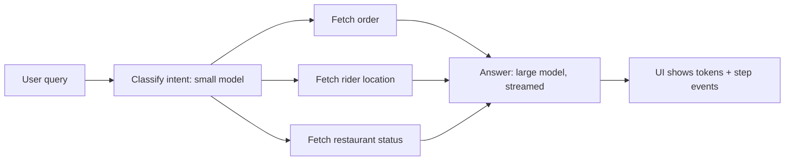

# Cost & Latency

Ye page agent ka bill aur speed control karna sikhata hai: token economics, model routing, caching, kam steps, streaming, budgets aur fine-tuning kab. Interviewer ye isliye poochta hai kyunki demo me agent chal jaata hai, par production me ek task ke 8 LLM calls, 50k tokens aur 30 second lagte hain. Senior engineer se expect hota hai ki wo har lever ka saving aur trade-off number ke saath bata sake.

## ⭐ Token economics

**Ek line me:** bill = (input tokens × input price) + (output tokens × output price), aur agent har step pe poora badhta hua context dobara bhejta hai, isliye cost steps ke saath linear se zyada badhti hai.

> **Example:** Zerodha ka "portfolio explain karo" agent. User ek sawal poochta hai, agent 6 steps me holdings fetch, prices fetch, sector map, P&L calculate aur final answer banata hai. Ek single LLM call ka jo cost hota, agent usse ~7x zyada kharch karta hai.

**Token types:**

| Type | Kya hai | Price (relative) |
|---|---|---|
| Input | system prompt + tools schema + history + tool results | base (sasta) |
| Output | model jo generate karta hai | aksar input ka ~3–5x |
| Cached input | pichli request ka same prefix, provider cache se padha | input ka ~10–50% (provider pe depend) |
| Reasoning / thinking | hidden chain of thought, output ke rate pe bill hota hai | output price, aur dikhta bhi nahi |

- Output tokens mehenge aur **slow** (ek-ek karke generate) hote hain. Latency ka bada hissa yahi.
- Reasoning models chhote answer ke liye bhi hazaron thinking tokens kha sakte hain. `reasoning_effort` / thinking budget set karo.
- Tool schemas har call me input me jaate hain. 30 tools × ~150 tokens = ~4.5k tokens har step pe, chahe tool use ho ya nahi.

**Worked example (illustrative prices: assume $3 / 1M input, $15 / 1M output, cached read $0.30 / 1M):**

- Static prefix (system + tool schemas) = 4,000 tokens, user query = 500.
- Har step ke baad history me ~1,500 tokens judte hain (AI tool-call message + tool result).
- Step inputs: 4.5k, 6k, 7.5k, 9k, 10.5k, 12k → **total 49.5k input**.
- Output: 5 tool-call steps × 300 + final answer 700 = **2.2k output**.
- Cost = 49,500 × 3/1M + 2,200 × 15/1M = $0.1485 + $0.033 ≈ **$0.18 per task**.
- Single call (4.5k in, 700 out) ≈ $0.024. Agent ≈ **7.5x** mehenga.
- 4k static prefix ko cache karo (steps 2–6 pe cached read): 20k tokens pe $2.70/1M bachat ≈ $0.054. Naya total ≈ **$0.128**. 1 lakh tasks/day pe ye $18,000 → $12,800 per day.

**Agents cost kyun multiply karte hain:**
- Har step pe **poora context resend** (LLM stateless hai): total input ≈ O(steps²) jab har step history badhata hai.
- Retries, self-reflection loops, critic agents, multi-agent handoffs: har ek naya LLM call.
- Bade tool results (raw JSON, poore web pages) context me pade rehte hain.

```python
def task_cost(steps, prefix=4000, query=500, per_step=1500, out_step=300,
              out_final=700, p_in=3.0, p_out=15.0, p_cache=0.30, cache=True):
    # illustrative prices per 1M tokens, real provider prices alag hote hain
    cost = 0.0
    for i in range(steps):
        ctx = prefix + query + i * per_step
        cached = prefix if (cache and i > 0) else 0
        cost += (ctx - cached) * p_in / 1e6 + cached * p_cache / 1e6
        out = out_final if i == steps - 1 else out_step
        cost += out * p_out / 1e6
    return round(cost, 4)

print(task_cost(6, cache=False), task_cost(6))  # ~0.1815, ~0.1275
```

**Interview tip:** cost ko "per task" (per resolved ticket, per report) me bolo, per call me nahi. Formula likho, phir 3 levers batao: kam steps, kam tokens per step, sasta token (cache/chhota model).

**Common galti:** sirf output price dekhna. Agents me input tokens volume me 10–20x hote hain, bill ka bada hissa input se aata hai.

## ⭐ Model routing aur cascading

**Ek line me:** har request ko sabse bade model pe mat bhejo; chhota/sasta model pehle, aur sirf mushkil ya low-confidence case bade model pe escalate karo.

> **Example:** Swiggy support bot. 70% queries "order kahan hai", "refund status" jaisi simple hain, chhota model kaafi. "Wrong item aaya, aadha refund mila, coupon bhi kat gaya" jaise multi-issue cases bade model ko jaate hain.

- **Routing (upfront):** ek classifier (chhota LLM, ya embedding + logistic regression, ya rules) request ka difficulty/intent decide karta hai, phir sahi model/subgraph.
- **Cascading (try-then-escalate):** chhota model answer karta hai, phir check: structured confidence, verifier, schema validation, ya tool error. Fail → bada model.
- **Per-step routing:** agent ke andar bhi: planning aur final synthesis bada model, extraction/summarize/classify chhota model.
- Saving typically 40–70% jab traffic ka bada hissa simple ho. Trade-off: router ki galti (hard query chhote model pe) quality girati hai, aur cascade me escalation ka latency double lagta hai.

```python
from typing import Literal, TypedDict
from pydantic import BaseModel
from langchain.chat_models import init_chat_model
from langgraph.graph import StateGraph, START, END

small = init_chat_model("openai:gpt-5-mini")        # sasta, fast
large = init_chat_model("anthropic:claude-sonnet-4-5")  # mehenga, strong

class Route(BaseModel):
    tier: Literal["simple", "complex"]
    confidence: float  # 0..1

class S(TypedDict):
    question: str
    tier: str
    answer: str

def router(s: S):
    r = small.with_structured_output(Route).invoke(
        f"Classify difficulty of this support query: {s['question']}")
    # kam confidence ho to safe side: complex
    tier = r.tier if r.confidence >= 0.7 else "complex"
    return {"tier": tier}

def answer_small(s: S):
    return {"answer": small.invoke(s["question"]).content}

def answer_large(s: S):
    return {"answer": large.invoke(s["question"]).content}

g = StateGraph(S)
g.add_node("router", router)
g.add_node("small", answer_small)
g.add_node("large", answer_large)
g.add_edge(START, "router")
g.add_conditional_edges("router", lambda s: s["tier"],
                        {"simple": "small", "complex": "large"})
g.add_edge("small", END)
g.add_edge("large", END)
app = g.compile()
```

**Interview tip:** "Router ko bhi eval karta hoon: confusion matrix (simple ko complex bhejna = paisa waste, complex ko simple bhejna = quality loss). Doosri galti zyada mehengi hai, isliye threshold usi taraf bias karta hoon."

**Common galti:** router ke liye bada model use karna, jisse saving hi khatam; ya escalation ka koi signal define na karna.

## ⭐ Caching

**Ek line me:** teen layer: provider **prompt caching** (same prefix sasta), **semantic cache** (similar sawal ka purana answer), aur **tool-result cache** (same tool call ka result TTL tak).

> **Example:** Flipkart ka product-QnA agent. System prompt + 25 tool schemas har call me same hain (prompt cache). "iPhone 16 return policy?" din me hazaar baar aata hai (semantic cache). `get_product(sku)` ka result 10 minute tak same rehta hai (tool cache).

**1. Provider prompt caching:**
- Provider request ke **exact prefix** ka KV cache rakhta hai. Agla request same prefix se shuru ho to wo tokens sasta + fast (TTFT bhi girta hai).
- Kuch providers automatic karte hain (prefix ≥ ~1k tokens), kuch me explicit marker (`cache_control`) lagana padta hai. Cache TTL chhota hota hai (minutes), aur cache write thoda mehenga ho sakta hai.
- **Stable prefix rule:** static cheezein pehle (system prompt, tool schemas, few-shot), dynamic baad me (user data, timestamp, history). Prompt ke shuru me `datetime.now()` daala to cache har baar toot jaayega.
- Tools ka order deterministic rakho; tools ko dynamically add/remove karna prefix todta hai.

**2. Semantic cache:**
- Query embed karo, vector store me nearest purani query dhoondo; similarity ≥ threshold (e.g. cosine 0.95) to cached answer do.
- **Risks:** "order 123 ka status" aur "order 124 ka status" bahut similar embeddings → galat user ka answer. Personalized ya time-sensitive data pe semantic cache mat lagao, ya key me `user_id`/`tenant` daalo.
- Threshold low = zyada hits par galat answers; high = kam hits. Eval set pe tune karo, aur TTL + invalidation (policy change pe flush) rakho.
- Agents me poore answer ki jagah **plan ya sub-step** cache karna aksar safe hota hai.

**3. Tool-result caching:**
- Read-only, deterministic tools (product info, FX rate, docs search) ka result `(tool, normalized_args)` key pe TTL ke saath.
- Write tools (payment, cancel order) kabhi cache nahi. Wahan [idempotency](../01-topics/10-idempotency-retries.md) chahiye, cache nahi.

```python
import hashlib, json
from langgraph.types import CachePolicy
from langgraph.cache.memory import InMemoryCache

def fetch_product(state):
    # mehenga API call, result 10 min tak same
    return {"product": catalog_api.get(state["sku"])}

def key_by_sku(state) -> str:
    return hashlib.sha256(json.dumps({"sku": state["sku"]}).encode()).hexdigest()

builder.add_node("fetch_product", fetch_product,
                 cache_policy=CachePolicy(key_func=key_by_sku, ttl=600))
graph = builder.compile(cache=InMemoryCache())  # prod me Redis-backed cache
```

**Interview tip:** teeno layers alag naam se bolo, aur semantic cache ka risk khud bolo (personalized data leak, stale answers). Ye senior signal hai. Basics: [Caching](../01-topics/05-caching.md).

**Common galti:** prompt ke shuru me har request ka dynamic data (date, user name) daal ke provider cache ko zero kar dena, aur phir sochna "caching kaam nahi kar raha".

## Steps kam karna

**Ek line me:** sabse sasta LLM call wo hai jo hua hi nahi; kam iterations = kam cost + kam latency + kam failure chances.

> **Example:** Razorpay merchant-support agent pehle `get_merchant`, `get_settlements`, `get_disputes` teen alag calls me 3 loop iterations leta tha. Ek `get_merchant_overview(merchant_id)` tool ne ise ek step bana diya.

- **Better tool design:** coarse-grained, task-shaped tools (`get_order_summary`) instead of thin CRUD wrappers. Tool result chhota aur relevant (sirf zaroori fields, raw JSON nahi).
- **Parallel tool calls:** model ek turn me multiple independent tool calls de sakta hai; executor unhe parallel chalaye (LangGraph `ToolNode` ye karta hai). 3 sequential steps → 1 step.
- **Fewer loop iterations:** clear system prompt ("jab answer mil jaye, ruk jao"), achhe tool error messages (taaki model retry me na fanse), max-iteration cap.
- **Workflows instead of agents:** jab steps pehle se pata hain (fetch → classify → reply), fixed workflow graph banao. LLM sirf jahan judgment chahiye. Ye [Workflow patterns](03-workflow-patterns.md) wala argument hai.
- **Plan once, execute many:** plan-and-execute me bada model ek baar plan banata hai, chhota model/plain code steps chalata hai.

**Interview tip:** "Pehle traces se dekhta hoon ki average kitne steps lag rahe hain aur kaunse steps redundant hain; aksar 2–3 tools merge karke ya workflow bana ke 40% steps kat jaate hain."

**Common galti:** har cheez ko autonomous agent banana. Jahan flow fixed hai, wahan agent sirf extra calls aur unpredictability laata hai.

## ⭐ Latency

**Ek line me:** user ko do cheez feel hoti hain: **TTFT** (pehla token kab dikha) aur **total latency** (kaam kab poora hua); agents me total latency = sum of sequential LLM + tool calls, isliye streaming aur parallelism zaroori.

> **Example:** Swiggy ka "mera order late kyun hai" agent 4 steps me 9 second leta hai. Agar 9 second blank screen rahe to user app band kar deta hai. Agar "Order dhoondh raha hoon... rider ki location check kar raha hoon..." dikhe aur final answer stream ho, to wahi 9 second theek lagte hain.

| Metric | Kya hai | Kaun control karta hai |
|---|---|---|
| TTFT | request se pehla token | prompt size, prompt cache, model size, queueing |
| TPOT / tokens per sec | har token ka time | model size, provider load |
| Total latency | poora task | steps × (TTFT + output tokens × TPOT) + tool time |

**Levers:**
- **Stream tokens** final answer ke, aur **intermediate steps** bhi (tool start/end, "searching..."). LangGraph me `stream_mode=["messages", "updates", "custom"]`.
- **Async + parallel nodes:** independent branches (order API + rider API + weather) ek saath; LangGraph me fan-out edges same superstep me parallel chalte hain.
- **Speculative / optimistic execution:** likely next step pehle se shuru karo (e.g. intent classify hote hi order fetch kar lo, kyunki 80% queries order ki hoti hain). Galat nikle to result phenk do. Sirf read-only kaam pe.
- **Chhote/fast models for sub-steps:** classification, extraction, summarization pe chhota model; final synthesis pe bada.
- **Output kam karo:** output tokens sabse slow hain. Concise format, structured output, "max 3 lines".
- **Prompt caching** se TTFT bhi girta hai (lambe prefix pe kaafi).



```python
async def stream_run(graph, question: str, thread_id: str):
    cfg = {"configurable": {"thread_id": thread_id}}
    async for mode, chunk in graph.astream(
        {"messages": [("user", question)]}, cfg,
        stream_mode=["updates", "messages"],
    ):
        if mode == "updates":            # node khatam hua, step event bhejo
            for node in chunk:
                yield {"type": "step", "node": node}
        elif mode == "messages":         # LLM token
            msg, meta = chunk
            if msg.content:
                yield {"type": "token", "text": msg.content}
```

**Interview tip:** latency budget breakdown bolo: "p95 target 6s: classify 300ms, parallel tools 1.2s, synthesis TTFT 800ms, phir streaming." Number ke saath bolna senior lagta hai.

**Common galti:** sirf average latency dekhna. Agents ka p95/p99 bahut lamba hota hai (ek extra loop iteration = +3s), isliye percentile aur step-count dono monitor karo.

## Batch APIs for offline jobs

**Ek line me:** jo kaam real-time nahi (nightly evals, bulk tagging, doc enrichment), use provider ke batch API pe bhejo; aksar ~50% sasta, result hours me.

> **Example:** Meesho roz 5 lakh naye product listings ka category + attribute extraction karta hai. Batch API pe raat ko bhejo, subah result.

- JSONL file of requests upload → provider async process karta hai (typically within 24h) → results file.
- Use cases: eval runs, LLM-as-judge scoring, embeddings backfill, summarizing old tickets, synthetic data.
- Trade-off: latency guarantee nahi, partial failures handle karne padte hain (`custom_id` se retry), rate limits alag pool me.
- Agents ke multi-step loop ko batch karna mushkil hai (har step pichle pe depend). Batch ko per-step pipeline me use karo ("sab docs ka step-1 ek batch me").

**Interview tip:** "Eval aur offline enrichment ka bill batch API se aadha ho jaata hai; online path pe kabhi nahi."

**Common galti:** batch result ko order ke bharose map karna; hamesha `custom_id` se map karo.

## Context size control

**Ek line me:** har step pe jitna context bhejoge utna paisa aur latency; history trim/summarize karo aur poora data context me ghusaane ki jagah retrieve karo.

> **Example:** HDFC ka 40-turn support chat. Poori history har turn bhejoge to turn 40 pe 30k tokens input. Last 8 messages + ek running summary se 4k me kaam ho jaata hai.

- **Trimming:** last N messages ya last T tokens (`trim_messages`). Tool-call aur uska tool-result pair kabhi alag mat karo, warna API error.
- **Summarizing:** purani history ko chhote model se summary me badlo (LangChain `SummarizationMiddleware`, trigger e.g. 4k tokens pe). Trade-off: details (order ID, amount) kho sakte hain, isliye important facts state me structured fields me rakho.
- **Tool result compaction:** 20 KB JSON ki jagah sirf zaroori fields; bade results ko store me rakho aur reference ID context me do.
- **Retrieval vs long context:** 1M-token window hai iska matlab ye nahi ki bharo. Long context = har call pe cost + slow TTFT + "lost in the middle". Retrieval = sirf relevant 2–5k tokens. Chhota, stable corpus + cache ho to long context theek. Detail: [Memory & Context Engineering](05-memory-context.md).

**Interview tip:** "Context ek budget hai: system + tools + memory + retrieved + history. Main har bucket ka cap rakhta hoon."

**Common galti:** trim karte waqt AI ka tool_call message rakh lena par uska ToolMessage hata dena (ya ulta), jisse provider request reject karta hai.

## ⭐ Budgets aur limits

**Ek line me:** agent loop ko hamesha hard limits me baandho: max steps, token cap, per-user spend limit aur wall-clock timeout; warna ek bug ya prompt injection raat bhar me lakhon ka bill bana sakta hai.

> **Example:** ek coding agent test fail → fix → test fail ke loop me phas gaya, 400 iterations, ek raat me ek user ne $900 kharch kar diye. `recursion_limit` aur per-user daily cap ise 25 steps aur $5 pe rok dete.

- **Max steps:** LangGraph `recursion_limit` (config me, supersteps count karta hai; default version pe depend karta hai, isliye hamesha explicitly set karo). Exceed hone pe `GraphRecursionError`. Graceful exit ke liye state me `RemainingSteps` padh ke pehle hi wrap-up karo. `create_agent` me `ModelCallLimitMiddleware(run_limit=..., thread_limit=...)`.
- **Token caps:** `max_tokens` per call, aur run-level token counter state me (`usage_metadata` se).
- **Per-user / per-tenant spend limits:** Redis counter (daily $), limit pe graceful message ya chhota model. [Rate limiting](../01-topics/11-rate-limiting.md) jaisa hi, bas unit tokens/$ hai.
- **Timeouts:** har LLM call (client timeout), har tool, aur poore run pe (`asyncio.timeout`).
- Limit hit hone pe **graceful exit**: partial answer + "aage human se baat karein", na ki 500 error.

```python
import asyncio
from langgraph.errors import GraphRecursionError

PRICE_IN, PRICE_OUT = 3 / 1e6, 15 / 1e6     # illustrative per-token prices
DAILY_LIMIT_USD = 5.0

async def run_with_budget(graph, user_id: str, thread_id: str, msg: str):
    key = f"spend:{user_id}:{today()}"
    if float(await redis.get(key) or 0) >= DAILY_LIMIT_USD:
        return "Aaj ki limit khatam. Kal try karein ya support se baat karein."
    cfg = {"configurable": {"thread_id": thread_id}, "recursion_limit": 20}
    try:
        async with asyncio.timeout(60):          # poore run ka wall-clock cap
            out = await graph.ainvoke({"messages": [("user", msg)]}, cfg)
    except (GraphRecursionError, TimeoutError):
        return "Ye request lambi ho gayi, ek support agent aapki madad karega."
    cost = 0.0
    for m in out["messages"]:
        u = getattr(m, "usage_metadata", None)   # sirf AI messages pe hota hai
        if u:
            cost += u["input_tokens"] * PRICE_IN + u["output_tokens"] * PRICE_OUT
    await redis.incrbyfloat(key, cost)
    await redis.expire(key, 86400)
    return out["messages"][-1].content
```

**Interview tip:** "Teen level pe guard: per-call (max_tokens, timeout), per-run (recursion_limit, run token budget), per-user/tenant (daily $ cap). Aur cost per run ko trace me attribute karta hoon." Monitoring: [AI Observability](10-agent-observability.md).

**Common galti:** sirf `recursion_limit` pe bharosa. Ek step me bhi model 30k-token output ya bahut mehenga tool call kar sakta hai; spend cap alag chahiye.

## Fine-tuning aur distillation vs prompting

**Ek line me:** prompting se shuru karo; fine-tune/distill tab jab volume bahut high hai, task narrow aur stable hai, aur ek chhota model achhe data pe bade model jitna kar sakta hai.

> **Example:** PhonePe ka transaction-dispute classifier roz 20 lakh tickets pe chalta hai. Bade model + 3k-token prompt mehenga tha. Bade model ke 50k labelled outputs pe chhota model distill kiya: prompt 300 tokens, latency 4x kam, cost ~10x kam, accuracy eval pe barabar.

| | Prompting (+RAG) | Fine-tuning / distillation |
|---|---|---|
| Upfront cost | almost zero | data + training + eval pipeline |
| Per-call cost | lamba prompt, bada model | chhota prompt, chhota model |
| Change karna | minutes | retrain, re-eval |
| Facts / fresh data | RAG se achha | weak (facts ke liye mat karo) |
| Best for | early stage, changing tasks | high-volume, narrow, stable tasks (routing, extraction, format) |

- **Distillation:** bada "teacher" model outputs generate kare, chhota "student" unpe train ho. Agents me router, classifier, tool-arg extractor ke liye common.
- **Break-even soch:** (bachat per call × calls per month) vs (training + eval + maintenance + re-train jab base model badle).
- Trade-off: model drift, naya base model aaye to dobara karna, aur hosting (self-hosted) ki ops cost.

**Interview tip:** "Fine-tuning behaviour/format ke liye, RAG knowledge ke liye. Cost ke liye distillation tab jab ek narrow step high volume pe chal raha ho aur eval set ready ho."

**Common galti:** naye facts sikhane ke liye fine-tune karna, ya bina eval set ke distill karna (pata hi nahi chalega quality kitni giri).

## ⭐ Cost/latency levers table

| Lever | Kya bachata hai | Trade-off |
|---|---|---|
| Model routing / cascade | cost 40–70%, latency (simple cases) | router galti = quality loss, escalation pe double latency |
| Provider prompt caching | input cost + TTFT | stable prefix discipline, short TTL |
| Semantic cache | poora LLM call | galat/stale/dusre user ka answer ka risk |
| Tool-result cache | tool latency + API cost | staleness, sirf read-only tools |
| Better tools / fewer steps | cost + latency dono | tool design effort |
| Parallel tool calls / nodes | latency | rate limits, partial failure handling |
| Workflow instead of agent | cost, latency, variance | flexibility kam |
| Streaming | perceived latency (TTFT) | total cost same, UI complexity |
| Context trim/summarize | input cost + TTFT | details kho sakte hain |
| Batch API | ~50% offline cost | hours ki latency |
| Budgets / limits | runaway cost | kuch valid lambe tasks bhi kategi |
| Distillation / fine-tune | per-call cost + latency | training, eval, maintenance |

## Aage padho

- [Memory & Context Engineering](05-memory-context.md), [Workflow patterns](03-workflow-patterns.md)
- [AI Observability](10-agent-observability.md): cost per run aur latency traces me
- [Agents in Production](12-agents-in-production.md): rate limits, retries, failover
- [Caching](../01-topics/05-caching.md), [Rate limiting](../01-topics/11-rate-limiting.md), [LLM chat app](../02-questions/t2-22-llm-chat-app.md)
- [Production agent lab](/viewinter/agents/labs/prod)

## Checklist

- [ ] Input, output, cached aur reasoning tokens ka fark aur pricing bata sakta hoon
- [ ] 6-step agent ka cost per task haath se calculate karke bata sakta hoon ki agent cost kyun multiply hota hai
- [ ] Model routing vs cascading samjha sakta hoon aur LangGraph me router node likh sakta hoon
- [ ] Prompt caching, semantic caching aur tool-result caching ke risks ke saath fark bata sakta hoon
- [ ] Steps kam karne ke tareeke (tool design, parallel calls, workflow) bata sakta hoon
- [ ] TTFT vs total latency aur streaming, parallel nodes, speculative execution samjha sakta hoon
- [ ] Context trimming/summarization aur retrieval vs long context ka trade-off bata sakta hoon
- [ ] Max steps, token caps, per-user spend limit aur timeouts ka code likh sakta hoon
- [ ] Fine-tuning/distillation kab pay off karta hai, numbers ke saath bata sakta hoon
