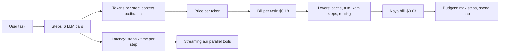
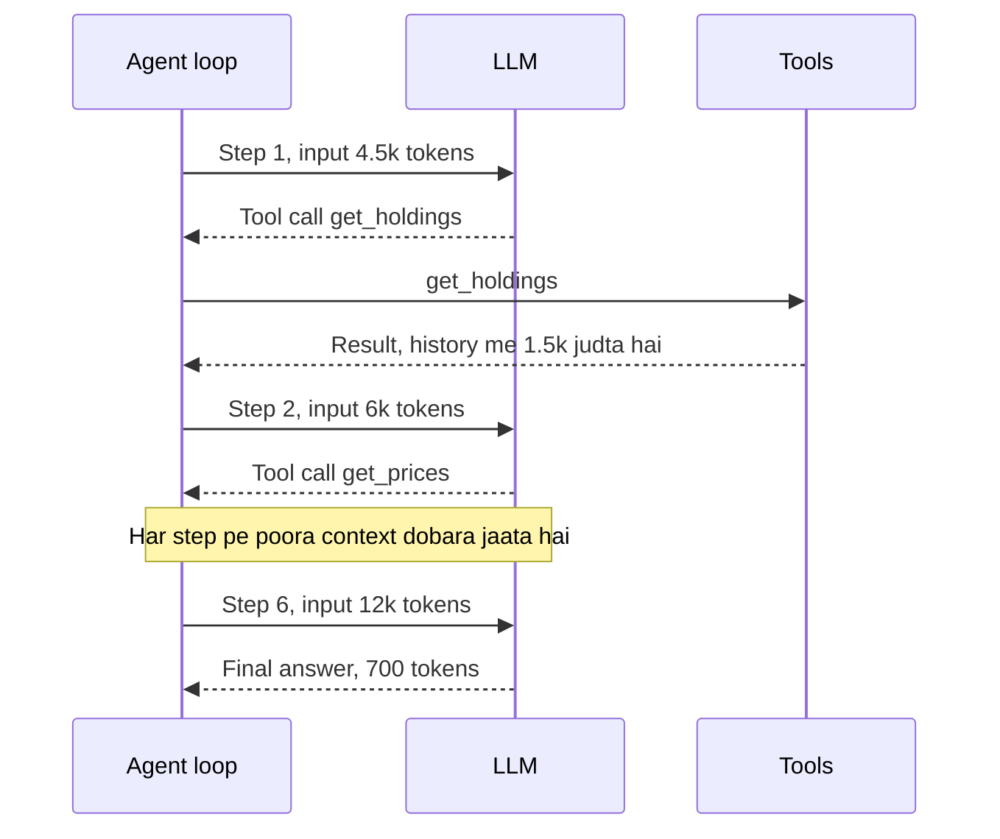
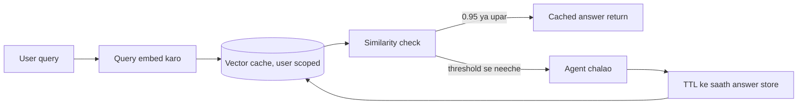
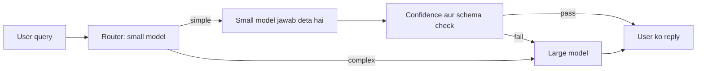
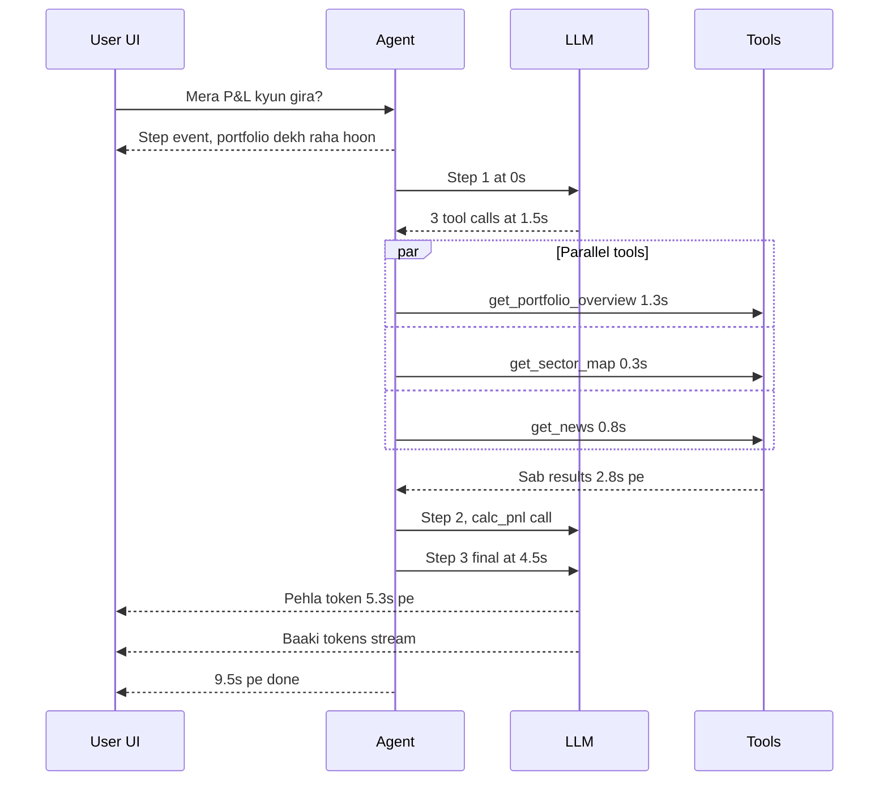
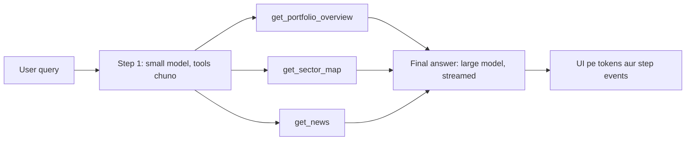
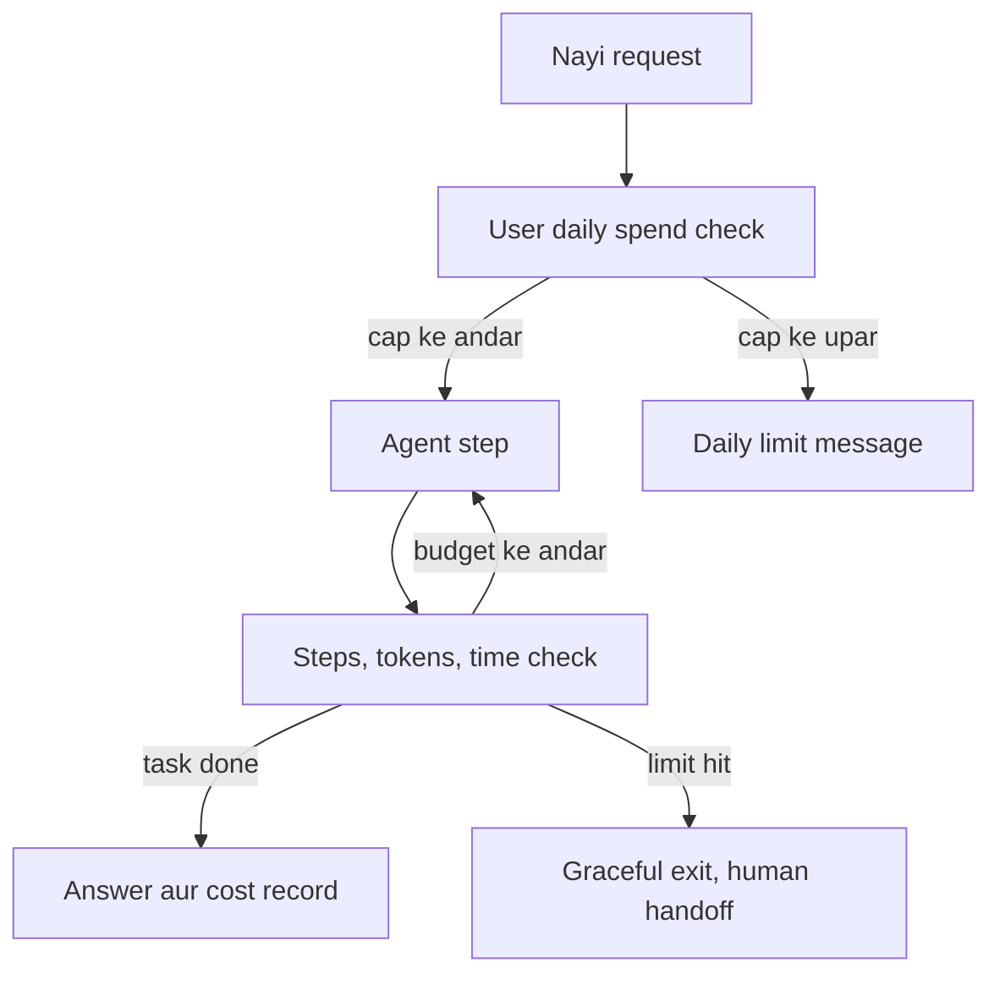

# Cost & Latency

Ye page agent ka bill aur speed control karna sikhata hai. Demo me agent chal jaata hai. Production me ek task ke 6–8 LLM calls, 50k tokens aur 15–30 second lagte hain, aur 1 lakh tasks/day pe bill hazaaron dollar roz. Interviewer expect karta hai ki tum har lever ka saving aur trade-off **number ke saath** bata sako.

**Is page ke baad tum ye samjha paoge:**

- Ek 6-step agent ka bill line by line banana, aur ye ki step 6 step 1 se mehenga kyun hai.
- Caching, trimming, kam steps aur routing ko ek-ek karke usi bill pe lagana, aur naya total batana ($0.18 → $0.03).
- Same run ki timeline: TTFT, tool waits, aur sequential vs parallel.
- Budgets (max steps, spend cap, timeout), batch API aur fine-tuning kab.

## Big picture: poora page ek nazar me

Bijli ka bill yaad karo: **units × rate**. Agent ka bill bhi aisa hi hai: **steps × tokens per step × price per token**. Har lever in teen me se ek cheez ko chhota karta hai. Caching aur routing **price** girate hain. Trimming **tokens per step** girata hai. Better tools aur workflows **steps** girate hain. Latency bhi steps se judi hai: har step = ek LLM call ka wait + tool ka wait. Streaming aur parallel tools us wait ko chhota ya kam bura banate hain. Aur budgets ek fuse ki tarah hain: kuch bigde to bill hazaar dollar tak na jaaye.



Poore page me ek hi example chalega: Zerodha ka "mera portfolio P&L kyun gira?" agent. Pehle iska bill banayenge, phir har section me ek lever laga ke bill chhota karenge.

## ⭐ Token economics

**Ye kyun chahiye?** Team ne socha: "ek LLM call ~$0.02 ka hai, to agent bhi utne ka hoga". Launch ke baad bill 7–8x aaya. Wajah: agent ek call nahi, 6 calls karta hai, aur har call pichli call se badi hoti hai. Jab tak ye maths nahi samjhoge, koi lever sahi jagah nahi lagega.

**Analogy:** ek ajeeb auto-rickshaw socho. Har stop pe meter **shuru se poora route dobara** charge karta hai. Stop 1 pe 2 km ka paisa. Stop 2 pe 2 + 1 = 3 km ka. Stop 6 pe 7 km ka. Har stop pichhle se mehenga, aur total paisa bahut tez badhta hai.

| Auto | Agent |
|---|---|
| har stop | har agent step (LLM call) |
| shuru se poora route dobara charge | poora context (prompt + history) dobara bhejna |
| har stop pe naya rasta judta hai | har step ke baad tool result history me judta hai |
| meter rate | price per token |

LLM stateless hai. Use pichli call yaad nahi. Isliye har step pe system prompt, tool schemas, poori history aur saare tool results dobara bhejne padte hain.

**Example step by step:** Zerodha agent, ek user ka ek sawal. Prices illustrative hain: **$3 / 1M input tokens, $15 / 1M output tokens, cached input $0.30 / 1M**. Real provider prices alag hote hain.

1. **Fixed hissa:** system prompt + tool schemas = 4,000 tokens. User ka sawal = 500 tokens. To step 1 ka input = 4,500.
2. **Har step ke baad:** model ka tool-call message + tool ka result history me judta hai, ~1,500 tokens.
3. **Output:** har tool-call step ~300 tokens likhta hai. Final answer 700 tokens.
4. Agent 5 tools bulata hai (holdings, prices, sector map, news, P&L) aur 6th step pe final answer deta hai.

Ab bill, line by line:

| Step | Kya hua | Input tokens | Input cost | Output tokens | Output cost | Step total |
|---|---|---|---|---|---|---|
| 1 | `get_holdings` call | 4,500 | $0.0135 | 300 | $0.0045 | $0.0180 |
| 2 | `get_prices` call | 6,000 | $0.0180 | 300 | $0.0045 | $0.0225 |
| 3 | `get_sector_map` call | 7,500 | $0.0225 | 300 | $0.0045 | $0.0270 |
| 4 | `get_news` call | 9,000 | $0.0270 | 300 | $0.0045 | $0.0315 |
| 5 | `calc_pnl` call | 10,500 | $0.0315 | 300 | $0.0045 | $0.0360 |
| 6 | final answer | 12,000 | $0.0360 | 700 | $0.0105 | $0.0465 |
| **Total** | | **49,500** | **$0.1485** | **2,200** | **$0.0330** | **$0.1815** |

Ek line ka hisaab: step 2 input = 6,000 × $3 / 1,000,000 = $0.018.

**Step 6 step 1 se 2.6x mehenga kyun?** Step 1 ne 4,500 tokens bheje. Step 6 ne 12,000, kyunki pichle 5 steps ke tool calls aur results bhi saath gaye. Output bhi bada tha (final answer). Same agent, same model, par context badhta gaya.

**Comparison:** ek single LLM call (4,500 in, 700 out) ≈ $0.024. Agent ≈ $0.18. Yaani **~7.5x**. 1 lakh tasks/day pe ye $18,150 roz hai. Ye hamara **starting bill** hai. Aage har lever isi bill pe lagega.



LLM stateless hai, isliye har step prefix aur poori badhti history dobara bhejta hai. Aise hi 6 steps 49.5k input tokens tak pahunch jaate hain.

**Ab terms:**

| Token type | Kya hai | Price (relative) |
|---|---|---|
| Input | system prompt + tools schema + history + tool results | base (sasta) |
| Output | model jo generate karta hai | aksar input ka ~3–5x |
| Cached input | pichli request ka same prefix, provider cache se padha | input ka ~10–50% (provider pe depend) |
| Reasoning / thinking | hidden chain of thought, output ke rate pe bill hota hai | output price, aur dikhta bhi nahi |

- **Output tokens** mehenge bhi hain aur **slow** bhi (ek-ek karke generate hote hain). Latency ka bada hissa yahi.
- **Reasoning models** chhote answer ke liye bhi hazaron thinking tokens kha sakte hain. `reasoning_effort` / thinking budget set karo.
- **Tool schemas** har call me input me jaate hain. 30 tools × ~150 tokens = ~4.5k tokens har step pe, chahe tool use ho ya nahi.
- **Agents cost kyun multiply karte hain:** har step pe poora context resend (total input ≈ O(steps²) jab har step history badhata hai). Retries, self-reflection, critic agents, multi-agent handoffs: har ek naya LLM call. Bade tool results (raw JSON, poore web pages) context me pade rehte hain.

**Code:** neeche ka function upar wala bill hi calculate karta hai. Isse har lever ka asar ek line me check kar sakte ho.

```python
def task_cost(steps, prefix=4000, query=500, per_step=1500, out_step=300,
              out_final=700, p_in=3.0, p_out=15.0, p_cache=0.30, cache=True):
    # illustrative prices per 1M tokens, real provider prices alag hote hain
    cost = 0.0
    for i in range(steps):
        ctx = prefix + query + i * per_step               # context har step badhta hai
        cached = prefix if (cache and i > 0) else 0       # step 2 se prefix cache se
        cost += (ctx - cached) * p_in / 1e6               # naye tokens, full price
        cost += cached * p_cache / 1e6                    # cached tokens, sasta
        out = out_final if i == steps - 1 else out_step   # last step = final answer
        cost += out * p_out / 1e6
    return round(cost, 4)

print(task_cost(6, cache=False))          # 0.1815  starting bill
print(task_cost(6))                       # 0.1275  + prompt caching
print(task_cost(6, per_step=600))         # 0.087   + tool result trimming
print(task_cost(3, per_step=600))         # 0.0438  + kam steps
```

**Code me kya ho raha hai:**

- Loop har step ke liye ek baar chalta hai.
- `ctx` = fixed prefix + query + ab tak judi history. Isliye har step ka input badhta hai.
- `cached` step 2 se prefix ke 4,000 tokens ko sasta maanta hai (cache=True ho to).
- Output ka paisa alag judta hai. Last step pe bada final answer.
- Neeche ke 4 prints wahi numbers hain jo aage ke sections me ek-ek lever ke baad aayenge.

**Interview tip:** cost ko "per task" (per resolved ticket, per report) me bolo, per call me nahi. Formula likho, phir 3 levers batao: kam steps, kam tokens per step, sasta token (cache/chhota model).

**Common galti:** sirf output price dekhna. Agents me input tokens volume me 10–20x hote hain. Upar bhi 49.5k input vs 2.2k output. Bill ka bada hissa input se aata hai.

## ⭐ Caching

**Ye kyun chahiye?** Upar ke bill me har step pe wahi 4,000 token ka system prompt + tool schemas dobara full price pe gaye. Wo kabhi badalte hi nahi. Aur bahut se users roz same sawal poochte hain ("iPhone 16 return policy?"). Same kaam ka baar-baar paisa dena waste hai.

**Analogy:** teen tarah ki yaad.

| Desi example | Cache layer | Kya bachata hai |
|---|---|---|
| teacher ka board: intro pehle se likha hai, sirf naya part likhna hai | **provider prompt caching** | same prefix ka paisa aur time |
| railway enquiry ka FAQ board: "Rajdhani platform 3 pe" | **semantic cache** | poora LLM call, similar sawal pe |
| kirana wala subah mandi rate yaad rakhta hai, har grahak pe phone nahi karta | **tool-result cache** | same tool call, TTL tak |

**Example step by step (lever 1: prompt caching ko bill pe lagao):**

1. **Step 1:** cache khaali hai. 4,500 tokens full price: $0.0135. Provider prefix ko cache me rakh leta hai.
2. **Step 2:** input 6,000 = 4,000 prefix (cache hit) + 2,000 naya. Cost = 4,000 × $0.30/1M + 2,000 × $3/1M = $0.0012 + $0.0060 = **$0.0072** input (pehle $0.018 tha).
3. **Steps 3–6:** har step pe wahi 4,000 tokens cache se. Naya hissa hi full price.
4. **Bachat:** 5 steps × 4,000 = 20,000 cached tokens. Har token pe $3 − $0.30 = $2.70/1M bacha. 20,000 × $2.70/1M = **$0.054**.
5. **Naya bill:** $0.1815 − $0.054 = **$0.1275 per task**. 1 lakh tasks/day pe $18,150 → $12,750 roz.

(Kuch providers cache write pe thoda extra lete hain. Simple rakhne ke liye yahan ignore kiya.)

**1. Provider prompt caching:**

- Provider request ke **exact prefix** ka KV cache rakhta hai. Agla request same prefix se shuru ho to wo tokens sasta + fast (TTFT bhi girta hai).
- Kuch providers automatic karte hain (prefix ≥ ~1k tokens), kuch me explicit marker (`cache_control`) lagana padta hai. Cache TTL chhota hota hai (minutes), aur cache write thoda mehenga ho sakta hai.
- **Stable prefix rule:** static cheezein pehle (system prompt, tool schemas, few-shot), dynamic baad me (user data, timestamp, history). Prompt ke shuru me `datetime.now()` daala to cache har baar toot jaayega.
- Tools ka order deterministic rakho. Tools ko dynamically add/remove karna prefix todta hai.

**2. Semantic cache, step by step:**

1. User poochta hai: "iPhone 16 ki return policy kya hai?"
2. Query ka embedding banta hai, vector cache me nearest purani query dhoondhi jaati hai: "iPhone 16 return policy?" Similarity 0.97.
3. 0.97 ≥ threshold 0.95, to **hit**. Purana answer turant. Koi LLM call nahi, sirf embedding ka chhota kharcha.
4. Ab danger: "order 123 ka status" aur "order 124 ka status" ki similarity 0.98. Hit ho gaya to user ko **doosre ka order** dikh jaayega.
5. Isliye personalized ya time-sensitive data pe semantic cache mat lagao, ya cache key me `user_id`/`tenant` daalo.



Hit pe poori LLM call bachti hai. Miss pe agent chalta hai aur naya answer TTL ke saath store hota hai. Isliye threshold aur scope key hi saving aur risk dono decide karte hain.

- Threshold low = zyada hits par galat answers. High = kam hits. Eval set pe tune karo, aur TTL + invalidation (policy change pe flush) rakho.
- Agents me poore answer ki jagah **plan ya sub-step** cache karna aksar safe hota hai.

**3. Tool-result caching:**

- Read-only, deterministic tools (product info, FX rate, docs search) ka result `(tool, normalized_args)` key pe TTL ke saath rakho.
- Write tools (payment, cancel order) kabhi cache nahi. Wahan [idempotency](../01-topics/10-idempotency-retries.md) chahiye, cache nahi.

**Code:** LangGraph me ek node ka result cache karna. Same SKU ke liye 10 minute tak API dobara nahi bulegi.

```python
import hashlib, json
from langgraph.types import CachePolicy
from langgraph.cache.memory import InMemoryCache

def fetch_product(state):
    # mehenga API call, result 10 min tak same
    return {"product": catalog_api.get(state["sku"])}

def key_by_sku(state) -> str:
    # cache key sirf sku se bane, baaki state se nahi
    return hashlib.sha256(json.dumps({"sku": state["sku"]}).encode()).hexdigest()

builder.add_node("fetch_product", fetch_product,
                 cache_policy=CachePolicy(key_func=key_by_sku, ttl=600))  # 600s TTL
graph = builder.compile(cache=InMemoryCache())  # prod me Redis-backed cache
```

**Code me kya ho raha hai:**

- `fetch_product` ek normal node hai jo catalog API bulata hai.
- `key_by_sku` sirf SKU se key banata hai. Same SKU = same key = cache hit.
- `CachePolicy(..., ttl=600)` batata hai ki result 10 minute valid hai.
- `compile(cache=...)` cache store deta hai. Test me memory, prod me Redis.

**Ab terms:**

- **Prefix:** prompt ka shuru ka hissa jo har request me same hai.
- **KV cache:** model ka andar ka computed state, jo provider prefix ke liye bacha ke rakhta hai.
- **Cache hit / miss:** hit = purana result mila, miss = naya kaam karna pada.
- **TTL:** time to live, kitni der tak cached cheez valid hai.

**Interview tip:** teeno layers alag naam se bolo, aur semantic cache ka risk khud bolo (personalized data leak, stale answers). Ye senior signal hai. Basics: [Caching](../01-topics/05-caching.md).

**Common galti:** prompt ke shuru me har request ka dynamic data (date, user name) daal ke provider cache ko zero kar dena, aur phir sochna "caching kaam nahi kar raha".

## Context size control

**Ye kyun chahiye?** Bill me har step ~1,500 tokens jodta tha. Kyun? `get_holdings` ne 40 fields wala raw JSON diya, jisme se agent ko sirf 4 chahiye the (symbol, qty, avg price, sector). Wo faltu tokens har agle step me dobara bheje gaye aur paisa lete rahe.

**Analogy:** doctor ke paas jaate waqt 200 page ki poori medical file nahi le jaate. Last 3 reports + ek summary page le jaate ho. Doctor jaldi samajhta hai, aur zaroori baat kho nahi jaati.

**Example step by step (lever 2: tool results ko trim karo):**

1. `get_holdings` ka raw result 1,500 tokens. Usme se sirf `symbol, qty, avg_price, sector` rakho. Ab ~600 tokens.
2. Har step ab history me 1,500 ki jagah 600 tokens jodta hai.
3. Step inputs: 4.5k, 5.1k, 5.7k, 6.3k, 6.9k, 7.5k = **36,000** (pehle 49,500).
4. Prompt caching abhi bhi on hai. Bill: 16,000 naye tokens × $3/1M = $0.048, 20,000 cached × $0.30/1M = $0.006, output $0.033.
5. **Naya bill: $0.087 per task** (pehle $0.1275). Step 6 ab 12k nahi, 7.5k tokens bhejta hai, to TTFT bhi girta hai.

> **Example:** HDFC ka 40-turn support chat. Poori history har turn bhejoge to turn 40 pe 30k tokens input = ~$0.09 per turn. Last 8 messages + ek running summary se 4k tokens = ~$0.012 per turn.

**Tareeke:**

- **Trimming:** last N messages ya last T tokens (`trim_messages`). Tool-call aur uska tool-result pair kabhi alag mat karo, warna API error.
- **Summarizing:** purani history ko chhote model se summary me badlo (LangChain `SummarizationMiddleware`, trigger e.g. 4k tokens pe). Trade-off: details (order ID, amount) kho sakte hain, isliye important facts state me structured fields me rakho.
- **Tool result compaction:** 20 KB JSON ki jagah sirf zaroori fields. Bade results ko store me rakho aur sirf reference ID context me do.
- **Retrieval vs long context:** 1M-token window hai iska matlab ye nahi ki bharo. Long context = har call pe cost + slow TTFT + "lost in the middle". Retrieval = sirf relevant 2–5k tokens. Chhota, stable corpus + cache ho to long context theek. Detail: [Memory & Context Engineering](05-memory-context.md).

**Ab terms:**

- **Context window:** ek call me model kitne tokens le sakta hai.
- **Lost in the middle:** lambe context ke beech ki info model aksar miss kar deta hai.
- **Compaction:** bade data ko chhote, kaam ke roop me badalna.

**Interview tip:** "Context ek budget hai: system + tools + memory + retrieved + history. Main har bucket ka cap rakhta hoon."

**Common galti:** trim karte waqt AI ka tool_call message rakh lena par uska ToolMessage hata dena (ya ulta). Provider request reject kar deta hai.

## Steps kam karna

**Ye kyun chahiye?** Ab bhi agent 6 LLM calls karta hai. Har call = paisa + 1.5 second wait + ek aur mauka galti ka. Sabse sasta LLM call wo hai jo hua hi nahi.

**Analogy:** sabzi mandi. Aalu ke liye ek chakkar, tamatar ke liye doosra, dhaniya ke liye teesra: 3 chakkar. Ya ek list banao aur ek chakkar me sab le aao. List = coarse tool, ek chakkar = ek step.

**Example step by step (lever 3: steps 6 → 3):**

1. Traces dekhe: `get_holdings` ke turant baad hamesha `get_prices` aata hai. Dono ko merge karke ek tool banao: `get_portfolio_overview(user_id)`.
2. `get_sector_map` aur `get_news` ek doosre pe depend nahi karte. Model ek hi turn me dono call kar sakta hai (**parallel tool calls**).
3. Naya flow: step 1 → `get_portfolio_overview` + `get_sector_map` + `get_news` ek saath. Step 2 → `calc_pnl`. Step 3 → final answer.
4. Input: 4.5k, 5.1k, 5.7k (cache aur trimming on). Output: 300 + 300 + 700.
5. **Naya bill: $0.0438 per task** (pehle $0.087). Aur 3 LLM waits kam, to latency bhi kam (Latency section me timeline).

> **Example:** Razorpay merchant-support agent pehle `get_merchant`, `get_settlements`, `get_disputes` teen alag calls me 3 loop iterations leta tha. Ek `get_merchant_overview(merchant_id)` tool ne ise ek step bana diya.

**Tareeke:**

- **Better tool design:** coarse-grained, task-shaped tools (`get_order_summary`), thin CRUD wrappers nahi. Tool result chhota aur relevant (sirf zaroori fields, raw JSON nahi).
- **Parallel tool calls:** model ek turn me multiple independent tool calls de sakta hai. Executor unhe parallel chalaye (LangGraph `ToolNode` ye karta hai). 3 sequential steps → 1 step.
- **Fewer loop iterations:** clear system prompt ("jab answer mil jaye, ruk jao"), achhe tool error messages (taaki model retry me na fanse), max-iteration cap.
- **Workflows instead of agents:** jab steps pehle se pata hain (fetch → classify → reply), fixed workflow graph banao. LLM sirf jahan judgment chahiye. Ye [Workflow patterns](03-workflow-patterns.md) wala argument hai.
- **Plan once, execute many:** plan-and-execute me bada model ek baar plan banata hai, chhota model ya plain code steps chalata hai.

**Ab terms:**

- **Coarse-grained tool:** ek tool jo poora chhota kaam kar de, sirf ek table ki row nahi.
- **Parallel tool calls:** ek LLM response me kai tool calls, jo saath chalte hain.
- **Workflow:** fixed steps wala graph, jahan LLM path decide nahi karta.

**Interview tip:** "Pehle traces se dekhta hoon ki average kitne steps lag rahe hain aur kaunse redundant hain. Aksar 2–3 tools merge karke ya workflow bana ke 40% steps kat jaate hain."

**Common galti:** har cheez ko autonomous agent banana. Jahan flow fixed hai, wahan agent sirf extra calls aur unpredictability laata hai.

## ⭐ Model routing aur cascading

**Ye kyun chahiye?** Ab bhi teeno steps bade, mehenge model pe chal rahe hain. Par step 1 aur 2 ka kaam sirf "kaunsa tool bulana hai" decide karna hai. Iske liye bada model zaroori nahi. Bada model sirf final explanation ke liye chahiye.

**Analogy:** hospital. Pehle GP dekhta hai. Bukhaar-khansi wahi theek kar deta hai. Sirf mushkil case specialist ko refer hota hai. Har mareez seedha specialist ke paas jaaye to fees bhi zyada aur line bhi lambi.

| Hospital | Agent |
|---|---|
| GP | chhota, sasta model |
| specialist | bada, mehenga model |
| refer karna | escalate karna |
| GP ka "ye mere bas ka nahi" | low confidence ya failed check |

**Example step by step (lever 4: per-step routing):**

Chhote model ki illustrative price: $0.30/1M input, $1.20/1M output, cached $0.03/1M.

1. **Step 1 (chhota model):** 4,500 × $0.30/1M + 300 × $1.20/1M = $0.00135 + $0.00036 = **$0.00171**.
2. **Step 2 (chhota model):** 1,100 naye × $0.30/1M + 4,000 cached × $0.03/1M + 300 out × $1.20/1M = **$0.00081**.
3. **Step 3 (bada model, final answer):** bade model ka cache is run me thanda hai (cache har model ka alag hota hai). 5,700 × $3/1M + 700 × $15/1M = $0.0171 + $0.0105 = **$0.0276**.
4. **Naya bill: ~$0.030 per task** (pehle $0.0438).
5. Prod me same prefix doosre users ki requests se warm rehta hai, to asli bill aur kam hoga. Hum yahan sirf is run ka cache gin rahe hain.

**Traffic level pe bhi yahi idea:**

> **Example:** Swiggy support bot. 70% queries "order kahan hai", "refund status" jaisi simple hain. Chhota model kaafi. "Wrong item aaya, aadha refund mila, coupon bhi kat gaya" jaise multi-issue cases bade model ko jaate hain.

- **Routing (upfront):** ek classifier (chhota LLM, ya embedding + logistic regression, ya rules) request ka difficulty/intent decide karta hai, phir sahi model ya subgraph.
- **Cascading (try-then-escalate):** chhota model answer karta hai, phir check: structured confidence, verifier, schema validation, ya tool error. Fail → bada model.
- **Per-step routing:** agent ke andar bhi: planning aur final synthesis bada model, extraction/summarize/classify chhota model (upar wala example).
- Saving typically 40–70% jab traffic ka bada hissa simple ho. Trade-off: router ki galti (hard query chhote model pe) quality girati hai, aur cascade me escalation ka latency double lagta hai.



Simple queries small model pe hi ruk jaati hain. Sirf failed checks ya complex route hui queries large model ka paisa deti hain. 40–70% saving yahin se aati hai.

**Code:** LangGraph me ek router node. Chhota model query ko "simple" ya "complex" bolta hai, aur graph usi hisaab se model chunta hai.

```python
from typing import Literal, TypedDict
from pydantic import BaseModel
from langchain.chat_models import init_chat_model
from langgraph.graph import StateGraph, START, END

small = init_chat_model("openai:gpt-5-mini")             # sasta, fast
large = init_chat_model("anthropic:claude-sonnet-5-5")   # mehenga, strong

class Route(BaseModel):          # router ka structured output
    tier: Literal["simple", "complex"]
    confidence: float            # 0..1

class S(TypedDict):              # graph ka state
    question: str
    tier: str
    answer: str

def router(s: S):
    r = small.with_structured_output(Route).invoke(
        f"Classify difficulty of this support query: {s['question']}")
    # kam confidence ho to safe side: complex
    tier = r.tier if r.confidence >= 0.7 else "complex"
    return {"tier": tier}

def answer_small(s: S):
    return {"answer": small.invoke(s["question"]).content}

def answer_large(s: S):
    return {"answer": large.invoke(s["question"]).content}

g = StateGraph(S)
g.add_node("router", router)
g.add_node("small", answer_small)
g.add_node("large", answer_large)
g.add_edge(START, "router")
g.add_conditional_edges("router", lambda s: s["tier"],      # tier padh ke rasta chuno
                        {"simple": "small", "complex": "large"})
g.add_edge("small", END)
g.add_edge("large", END)
app = g.compile()
```

**Code me kya ho raha hai:**

- Do models bante hain: `small` (sasta) aur `large` (mehenga).
- `router` node chhote model se structured output leta hai: tier + confidence.
- Confidence 0.7 se kam ho to tier zabardasti "complex". Shak ho to quality chuno.
- `add_conditional_edges` state ka `tier` padh ke `small` ya `large` node pe bhejta hai.
- Router khud chhota model hai, isliye routing ka kharcha bachat ko kha nahi jaata.

**Ab terms:**

- **Routing:** pehle hi decide karna kaunsa model.
- **Cascading:** pehle chhota try karo, fail ho to bada.
- **Escalation:** chhote se bade model pe bhejna.

**Interview tip:** "Router ko bhi eval karta hoon: confusion matrix (simple ko complex bhejna = paisa waste, complex ko simple bhejna = quality loss). Doosri galti zyada mehengi hai, isliye threshold usi taraf bias karta hoon."

**Common galti:** router ke liye bada model use karna, jisse saving hi khatam. Ya escalation ka koi signal define na karna.

## ⭐ Latency

**Ye kyun chahiye?** Zerodha user ne "mera P&L kyun gira?" poocha aur 11 second tak screen khaali rahi. User ne app band kar di. Jawab sahi tha, par kisi ne dekha hi nahi. Agents me latency = har sequential LLM call + har tool ka wait, sab jod ke.

**Analogy:** shaadi ka khaana. Ek waiter ek-ek dish laaye, aur har dish ke baad kitchen jaaye: bahut der (sequential). Kai cooks saath me pakayein aur sab ek saath aaye: jaldi (parallel). Aur pehle hi starter aa jaaye to mehmaan bore nahi hote, chahe main course der se aaye (TTFT + streaming).

| Shaadi | Agent |
|---|---|
| starter kitni jaldi aaya | TTFT (pehla token) |
| poora khaana kab khatam | total latency |
| ek waiter, ek-ek dish | sequential tool calls |
| kai cooks saath me | parallel tool calls |
| "abhi paneer aa raha hai" announcement | step events stream karna |

**Example step by step:** same Zerodha run ki timeline. Har tool-call LLM step = TTFT 0.6s + output 0.9s = 1.5s. Final step: TTFT 0.8s + 700 tokens stream ~4.2s.

```text
A) Pehle: 6 steps, sab sequential, sirf final answer stream
   time (s)      kya ho raha hai                         user ko kya dikha
   0.0 - 1.5     LLM step 1 (TTFT 0.6 + 0.9)             khaali screen
   1.5 - 1.9     tool get_holdings       wait 0.4
   1.9 - 3.4     LLM step 2
   3.4 - 4.6     tool get_prices         wait 1.2
   4.6 - 6.1     LLM step 3
   6.1 - 6.4     tool get_sector_map     wait 0.3
   6.4 - 7.9     LLM step 4
   7.9 - 8.7     tool get_news           wait 0.8
   8.7 - 10.2    LLM step 5
  10.2 - 10.4    tool calc_pnl           wait 0.2
  10.4 - 11.2    LLM step 6 final, TTFT 0.8              pehla token 11.2s pe
  11.2 - 15.4    final answer stream                     done 15.4s

B) Baad me: 3 steps, parallel tools, step events stream
   0.0           step event "portfolio dekh raha hoon"   progress turant
   0.0 - 1.5     LLM step 1, 3 tool calls ek saath
   1.5 - 2.8     get_portfolio_overview  1.3  ┐
                 get_sector_map          0.3  ├ parallel, wait = max = 1.3
                 get_news                0.8  ┘
   2.8 - 4.3     LLM step 2
   4.3 - 4.5     tool calc_pnl           wait 0.2
   4.5 - 5.3     LLM step 3 final, TTFT 0.8              pehla token 5.3s pe
   5.3 - 9.5     final answer stream                     done 9.5s
```

Timeline se kya seekha:

1. **LLM waits sabse bade hain.** A me 5 × 1.5s = 7.5s sirf tool decide karne me. Steps kam karna = sabse bada latency win.
2. **Tool waits jud jaate hain** jab sequential hain: 0.4 + 1.2 + 0.3 + 0.8 + 0.2 = 2.9s. Parallel me wait = sabse lamba tool (1.3s), sum nahi.
3. **TTFT user ka feel decide karta hai.** A me 11.2s pe pehla word. B me 5.3s pe, aur step events 0s se.
4. **Total:** 15.4s → 9.5s. Aur user ko pehle hi second se progress dikhti hai.



Teen tools saath chale, isliye wait 1.3s hi laga. User ko pehle second me progress aur 5.3s pe text dikh gaya.

**Ab terms:**

| Metric | Kya hai | Kaun control karta hai |
|---|---|---|
| TTFT | request se pehla token | prompt size, prompt cache, model size, queueing |
| TPOT / tokens per sec | har token ka time | model size, provider load |
| Total latency | poora task | steps × (TTFT + output tokens × TPOT) + tool time |

**Levers:**

- **Stream tokens** final answer ke, aur **intermediate steps** bhi (tool start/end, "searching..."). LangGraph me `stream_mode=["messages", "updates", "custom"]`.
- **Async + parallel nodes:** independent branches (portfolio API + news API + sector map) ek saath. LangGraph me fan-out edges same superstep me parallel chalte hain.
- **Speculative / optimistic execution:** likely next step pehle se shuru karo (e.g. intent classify hote hi portfolio fetch kar lo, kyunki 80% queries usi ki hoti hain). Galat nikle to result phenk do. Sirf read-only kaam pe.
- **Chhote/fast models for sub-steps:** classification, extraction, summarization pe chhota model. Final synthesis pe bada.
- **Output kam karo:** output tokens sabse slow hain. Concise format, structured output, "max 3 lines".
- **Prompt caching** se TTFT bhi girta hai (lambe prefix pe kaafi).



**Code:** graph ko stream karna, taaki UI ko step events aur tokens dono milein.

```python
async def stream_run(graph, question: str, thread_id: str):
    cfg = {"configurable": {"thread_id": thread_id}}
    async for mode, chunk in graph.astream(
        {"messages": [("user", question)]}, cfg,
        stream_mode=["updates", "messages"],    # do tarah ke events chahiye
    ):
        if mode == "updates":            # node khatam hua, step event bhejo
            for node in chunk:
                yield {"type": "step", "node": node}
        elif mode == "messages":         # LLM ka ek token aaya
            msg, meta = chunk
            if msg.content:
                yield {"type": "token", "text": msg.content}
```

**Code me kya ho raha hai:**

- `astream` graph ko chalata hai aur beech-beech me events deta hai, end ka wait nahi karta.
- `stream_mode=["updates", "messages"]` do streams maangta hai: node updates aur LLM tokens.
- `updates` aane pe UI ko "step" event jaata hai ("portfolio dekh raha hoon").
- `messages` aane pe har token UI ko jaata hai, taaki jawab type hota dikhe.

**Interview tip:** latency budget breakdown bolo: "p95 target 6s: classify 300ms, parallel tools 1.2s, synthesis TTFT 800ms, phir streaming." Number ke saath bolna senior lagta hai.

**Common galti:** sirf average latency dekhna. Agents ka p95/p99 bahut lamba hota hai (ek extra loop iteration = +1.5–3s), isliye percentile aur step-count dono monitor karo.

## Batch APIs for offline jobs

**Ye kyun chahiye?** Kuch kaam ka jawab abhi nahi chahiye: raat ke evals, bulk tagging, purane tickets ka summary. Inhe real-time API pe chalana matlab "express" ka paisa dena jab "normal" se kaam chal jaata.

**Analogy:** speed post vs normal post. Same chitthi, same address. Kal pahunchani hai to normal post sasta hai.

**Example step by step:** Meesho roz 5 lakh naye product listings ka category + attribute extraction.

1. Har listing: 800 input + 100 output tokens, chhote model pe ($0.30 / $1.20 per 1M, illustrative).
2. Online cost: 5,00,000 × (800 × 0.30 + 100 × 1.20) / 1M = 5,00,000 × $0.00036 = **$180 per raat**.
3. Saari requests ek JSONL file me, har line pe ek `custom_id` (listing id).
4. File batch API pe upload. Provider 24 ghante ke andar process karta hai.
5. Subah results file aati hai. Har result `custom_id` se listing pe map hota hai.
6. Batch discount ~50%: **~$90 per raat**. Saal bhar me ~$33,000 bachat.

**Points:**

- JSONL file of requests upload → provider async process karta hai (typically within 24h) → results file.
- Use cases: eval runs, LLM-as-judge scoring, embeddings backfill, purane tickets summarize karna, synthetic data.
- Trade-off: latency guarantee nahi, partial failures handle karne padte hain (`custom_id` se retry), rate limits alag pool me.
- Agents ke multi-step loop ko batch karna mushkil hai (har step pichle pe depend). Batch ko per-step pipeline me use karo ("sab docs ka step-1 ek batch me").

**Ab terms:**

- **Batch API:** async endpoint jo bahut saari requests ek saath, sasti rate pe, ghanton me process karta hai.
- **custom_id:** har request ka tumhara apna id, result ko wapas jodne ke liye.

**Interview tip:** "Eval aur offline enrichment ka bill batch API se aadha ho jaata hai. Online path pe kabhi nahi."

**Common galti:** batch result ko order ke bharose map karna. Hamesha `custom_id` se map karo.

## ⭐ Budgets aur limits

**Ye kyun chahiye?** Ek coding agent "test fail → fix → test fail" ke loop me phas gaya. 400 iterations, ek raat, ek user, **$900**. Koi alarm nahi baja kyunki koi error nahi tha. Har iteration "successful" LLM call tha. Bina limits ke ek bug ya prompt injection lakhon ka bill bana sakta hai.

**Analogy:** prepaid mobile recharge. Daily 1.5 GB data. Khatam hua to speed slow ho jaati hai, bill nahi phatta. Har call ki bhi limit hai. Agent ko bhi aisa hi pack chahiye.

| Prepaid | Agent |
|---|---|
| daily data limit | per-user daily $ cap |
| ek call ki max length | `max_tokens` per call, timeout |
| ek session me max calls | `recursion_limit` (max steps) |
| limit ke baad slow speed | graceful exit, human handoff |

**Example step by step:** user `u91` ka din, upar ke code ke saath (daily cap $5, `recursion_limit` 20, timeout 60s).

1. Subah se `u91` ne $4.90 kharch kiye. Redis key `spend:u91:2026-11-03 = 4.90`.
2. Nayi request aayi. Check: 4.90 < 5.00, chalne do.
3. Agent chala, 6 steps me khatam, 20 ke andar. 60s ke andar.
4. Run ke AI messages ke `usage_metadata` se cost nikla: $0.13. Redis ab $5.03.
5. Agli request: 5.03 ≥ 5.00. Agent chalta hi nahi. User ko message: "Aaj ki limit khatam."
6. Agar kisi run me loop lagta: step 20 pe `GraphRecursionError`, ya 60s pe `TimeoutError`. Dono me user ko polite message, 500 error nahi. Aur din ka max kharcha $5, $900 nahi.



Spend cap run shuru hone se pehle check hota hai aur step, token, time budget har step ke baad. Isliye runaway loop bill ki jagah graceful message pe khatam hota hai.

**Code:** ek wrapper jo teeno guard lagata hai: daily cap, max steps, timeout. Aur run ke baad cost Redis me jodta hai.

```python
import asyncio
from langgraph.errors import GraphRecursionError

PRICE_IN, PRICE_OUT = 3 / 1e6, 15 / 1e6     # illustrative per-token prices
DAILY_LIMIT_USD = 5.0

async def run_with_budget(graph, user_id: str, thread_id: str, msg: str):
    key = f"spend:{user_id}:{today()}"                   # har user, har din ki key
    if float(await redis.get(key) or 0) >= DAILY_LIMIT_USD:
        return "Aaj ki limit khatam. Kal try karein ya support se baat karein."
    cfg = {"configurable": {"thread_id": thread_id},
           "recursion_limit": 20}                       # max 20 supersteps
    try:
        async with asyncio.timeout(60):                  # poore run ka wall-clock cap
            out = await graph.ainvoke({"messages": [("user", msg)]}, cfg)
    except (GraphRecursionError, TimeoutError):
        return "Ye request lambi ho gayi, ek support agent aapki madad karega."
    cost = 0.0
    for m in out["messages"]:
        u = getattr(m, "usage_metadata", None)           # sirf AI messages pe hota hai
        if u:
            cost += u["input_tokens"] * PRICE_IN + u["output_tokens"] * PRICE_OUT
    await redis.incrbyfloat(key, cost)                   # aaj ka kharcha badhao
    await redis.expire(key, 86400)                       # key 1 din me khud mit jaaye
    return out["messages"][-1].content
```

**Code me kya ho raha hai:**

- Pehle Redis se aaj ka kharcha padha. Cap ke upar ho to agent chalta hi nahi.
- `recursion_limit: 20` loop ko 20 supersteps pe rokta hai (`GraphRecursionError`).
- `asyncio.timeout(60)` poore run ko 60 second me khatam karwata hai.
- Dono errors pe user ko polite message milta hai, crash nahi.
- Run ke baad har AI message ke `usage_metadata` se tokens × price jod ke Redis counter badhaya.

**Ab terms aur details:**

- **Max steps:** LangGraph `recursion_limit` (config me, supersteps count karta hai. Default version pe depend karta hai, isliye hamesha explicitly set karo). Exceed hone pe `GraphRecursionError`. Graceful exit ke liye state me `RemainingSteps` padh ke pehle hi wrap-up karo. `create_agent` me `ModelCallLimitMiddleware(run_limit=..., thread_limit=...)`.
- **Token caps:** `max_tokens` per call, aur run-level token counter state me (`usage_metadata` se).
- **Per-user / per-tenant spend limits:** Redis counter (daily $), limit pe graceful message ya chhota model. [Rate limiting](../01-topics/11-rate-limiting.md) jaisa hi, bas unit tokens/$ hai.
- **Timeouts:** har LLM call (client timeout), har tool, aur poore run pe (`asyncio.timeout`).
- **Graceful exit:** limit hit hone pe partial answer + "aage human se baat karein", 500 error nahi.

**Interview tip:** "Teen level pe guard: per-call (max_tokens, timeout), per-run (recursion_limit, run token budget), per-user/tenant (daily $ cap). Aur cost per run ko trace me attribute karta hoon." Monitoring: [AI Observability](10-agent-observability.md).

**Common galti:** sirf `recursion_limit` pe bharosa. Ek step me bhi model 30k-token output ya bahut mehenga tool call kar sakta hai. Spend cap alag chahiye.

## Fine-tuning aur distillation vs prompting

**Ye kyun chahiye?** Ek narrow kaam (jaise ticket ko 12 categories me daalna) roz lakhon baar chal raha hai, aur har baar bada model + 3k token ka prompt. Wahi kaam ek chhota trained model 10x saste me kar sakta hai. Par har jagah fine-tune karna bhi galat hai. Kab pay off karta hai, ye numbers se decide hota hai.

**Analogy:** har ITR ke liye bade CA ko bulana (bada model + lamba prompt) vs ek intern ko 500 examples pe ek hi form bharna sikhana (distilled chhota model). Intern ek form me CA jitna achha, aur bahut sasta. Par naya kaanoon aaya to intern ko dobara sikhana padega.

**Example step by step:** PhonePe transaction-dispute classifier, roz 20 lakh tickets.

1. **Abhi:** bada model, 3,000 token prompt, 50 token output. Per call = 3,000 × $3/1M + 50 × $15/1M = $0.009 + $0.00075 = **$0.00975**.
2. **Roz ka bill:** 20,00,000 × $0.00975 = **$19,500/day**.
3. **Distill:** bade model ke 50k labelled outputs pe chhota model train kiya. Prompt 300 tokens. Cost ~10x kam: ~$1,950/day. Latency 4x kam. Accuracy eval pe barabar.
4. **Ek baar ka kharcha** (data, training, eval pipeline): maan lo ~$15,000 (illustrative).
5. **Break-even:** roz ki bachat ~$17,500. Ek din me paisa wapas.
6. **Ulta case:** wahi kaam sirf 2,000 tickets/day pe. Bachat ~$17.5/day. $15,000 wapas aane me ~850 din. Fine-tune mat karo, prompting pe raho.

| | Prompting (+RAG) | Fine-tuning / distillation |
|---|---|---|
| Upfront cost | almost zero | data + training + eval pipeline |
| Per-call cost | lamba prompt, bada model | chhota prompt, chhota model |
| Change karna | minutes | retrain, re-eval |
| Facts / fresh data | RAG se achha | weak (facts ke liye mat karo) |
| Best for | early stage, changing tasks | high-volume, narrow, stable tasks (routing, extraction, format) |

**Ab terms:**

- **Fine-tuning:** existing model ko apne examples pe aur train karna.
- **Distillation:** bada "teacher" model outputs generate kare, chhota "student" unpe train ho. Agents me router, classifier, tool-arg extractor ke liye common.
- **Break-even:** (bachat per call × calls per month) vs (training + eval + maintenance + re-train jab base model badle).
- **Trade-off:** model drift, naya base model aaye to dobara karna, aur hosting (self-hosted) ki ops cost.

**Interview tip:** "Fine-tuning behaviour/format ke liye, RAG knowledge ke liye. Cost ke liye distillation tab jab ek narrow step high volume pe chal raha ho aur eval set ready ho."

**Common galti:** naye facts sikhane ke liye fine-tune karna, ya bina eval set ke distill karna (pata hi nahi chalega quality kitni giri).

## ⭐ Cost/latency levers table

**Same bill, saare levers ke baad** (Zerodha agent, illustrative prices):

| Bill | Per task | 1 lakh tasks/day | Kya badla |
|---|---|---|---|
| Start | $0.1815 | $18,150 | 6 steps, sab bada model, raw tool results |
| + prompt caching | $0.1275 | $12,750 | 4k prefix step 2–6 pe 10% price pe |
| + tool result trimming | $0.0870 | $8,700 | har step 1,500 → 600 tokens |
| + kam steps (6 → 3) | $0.0438 | $4,380 | merged tool + parallel calls |
| + per-step routing | $0.0301 | $3,010 | step 1–2 chhote model pe |

Bill ~6x chhota hua, aur latency 15.4s se 9.5s (pehla token 11.2s se 5.3s).

**Saare levers ek jagah:**

| Lever | Kya bachata hai | Trade-off |
|---|---|---|
| Model routing / cascade | cost 40–70%, latency (simple cases) | router galti = quality loss, escalation pe double latency |
| Provider prompt caching | input cost + TTFT | stable prefix discipline, short TTL |
| Semantic cache | poora LLM call | galat/stale/dusre user ka answer ka risk |
| Tool-result cache | tool latency + API cost | staleness, sirf read-only tools |
| Better tools / fewer steps | cost + latency dono | tool design effort |
| Parallel tool calls / nodes | latency | rate limits, partial failure handling |
| Workflow instead of agent | cost, latency, variance | flexibility kam |
| Streaming | perceived latency (TTFT) | total cost same, UI complexity |
| Context trim/summarize | input cost + TTFT | details kho sakte hain |
| Batch API | ~50% offline cost | hours ki latency |
| Budgets / limits | runaway cost | kuch valid lambe tasks bhi kategi |
| Distillation / fine-tune | per-call cost + latency | training, eval, maintenance |

**Interview tip:** levers ko is order me bolo: pehle measure (traces), phir sasta aur safe (caching, trimming), phir design change (kam steps, workflow), phir quality risk wale (routing, distillation). Har ek ke saath number do.

## Aage padho

- [Memory & Context Engineering](05-memory-context.md), [Workflow patterns](03-workflow-patterns.md)
- [AI Observability](10-agent-observability.md): cost per run aur latency traces me
- [Agents in Production](12-agents-in-production.md): rate limits, retries, failover
- [Caching](../01-topics/05-caching.md), [Rate limiting](../01-topics/11-rate-limiting.md), [LLM chat app](../02-questions/t2-22-llm-chat-app.md)
- [Production agent lab](/viewinter/agents/labs/prod)

## Checklist

- [ ] Input, output, cached aur reasoning tokens ka fark aur pricing bata sakta hoon
- [ ] 6-step agent ka bill line by line bana ke bata sakta hoon ki step 6 mehenga kyun hai aur agent cost kyun multiply hota hai
- [ ] Model routing vs cascading samjha sakta hoon aur LangGraph me router node likh sakta hoon
- [ ] Prompt caching, semantic caching aur tool-result caching ke risks ke saath fark bata sakta hoon, aur prompt cache ki bachat calculate kar sakta hoon
- [ ] Steps kam karne ke tareeke (tool design, parallel calls, workflow) bata sakta hoon
- [ ] TTFT vs total latency ek timeline pe, aur streaming, parallel nodes, speculative execution samjha sakta hoon
- [ ] Context trimming/summarization aur retrieval vs long context ka trade-off bata sakta hoon
- [ ] Max steps, token caps, per-user spend limit aur timeouts ka code likh sakta hoon
- [ ] Fine-tuning/distillation kab pay off karta hai, numbers ke saath bata sakta hoon
