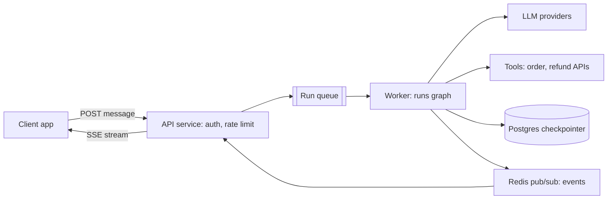
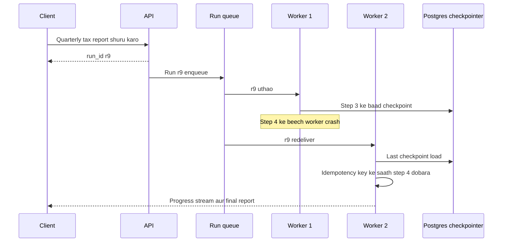
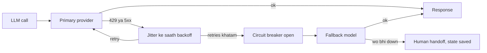
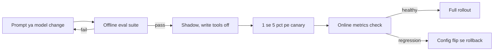
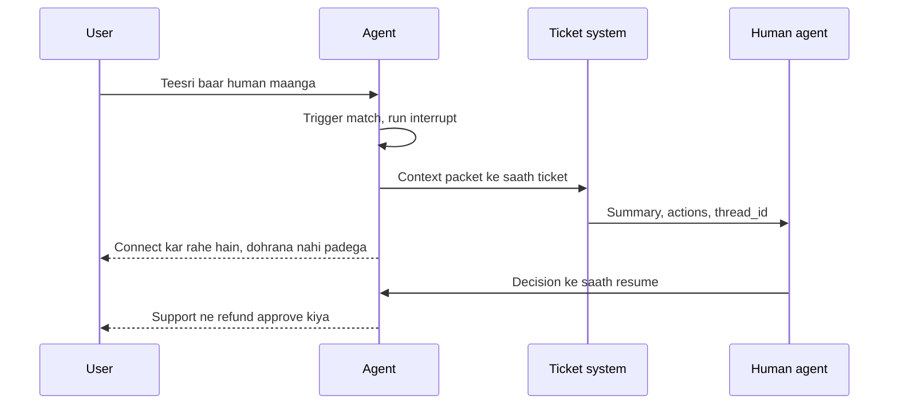
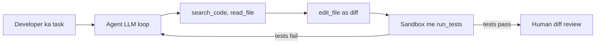
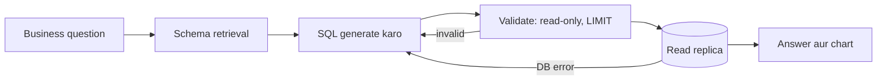

# Agents in Production

Ye page batata hai ki notebook wala agent production service kaise banta hai: serving architecture, background runs, durable execution, LangGraph Platform vs self-hosted FastAPI, reliability, security, versioning, human handoff, aur 4 real case studies. Interviewer yahi check karta hai ki tum agent ko ek **distributed system** ki tarah soch sakte ho ya sirf prompt likhna aata hai.

## ⭐ Serving architecture

**Ek line me:** API request leti hai, lamba kaam queue ke through worker ko jaata hai, worker graph chalata hai aur har step Postgres checkpointer me save karta hai, aur events SSE/WebSocket se user tak stream hote hain.

> **Example:** Swiggy ka order-issue bot. Peak dinner time pe 20k concurrent chats. API pods sirf auth + enqueue karte hain, worker pods LangGraph runs chalate hain, Postgres me har thread ka state, Redis pub/sub se tokens wapas API pod tak aur wahan se SSE pe app tak.



- **API layer stateless:** auth, input validation, rate limit, run create. Lamba kaam yahan nahi.
- **Queue:** backpressure, retries, worker crash pe run dobara pick ho sake. Redis streams / SQS / Kafka ([Message queues](../01-topics/07-message-queues-kafka.md)).
- **Workers:** graph chalate hain; scale on queue depth, CPU pe nahi (zyada waqt LLM ka wait hota hai, isliye async workers high concurrency le sakte hain).
- **Checkpointer (Postgres):** har superstep ke baad state save. Isi se resume, human-in-the-loop, time-travel debugging.
- **Streaming back:** SSE simple hai (one-way, HTTP pe, auto-reconnect); WebSocket tab jab client beech me interrupt/cancel bhi bheje. Detail: [Real-time communication](../01-topics/08-real-time-communication.md).
- Chhote, fast agents (< ~10s) ke liye queue skip karke API pod me hi stream kar sakte ho.

**Interview tip:** "Agent run ek long-running job hai, request nahi. Isliye API ko worker se alag karta hoon aur state checkpointer me rakhta hoon, process memory me nahi."

**Common galti:** graph ko API request handler me synchronously chalana aur state in-memory rakhna. Pod restart = sab conversations gayab, aur 60s load-balancer timeout pe runs kat jaate hain.

## Sync vs background runs, durable execution

**Ek line me:** chhote interactive runs sync + streaming; lambe tasks (minutes–hours) background run banao jo crash ke baad last checkpoint se resume ho.

> **Example:** Zerodha ka "quarterly tax report bana do" agent 8 minute leta hai. User ko turant `run_id` milta hai, progress stream hota hai; beech me worker crash ho to naya worker usi thread ke last checkpoint se aage chalta hai, poora dobara nahi.

| | Sync (streaming) run | Background run |
|---|---|---|
| Duration | seconds | minutes–hours |
| Client | connection khula rakhta hai | `run_id` le ke poll / webhook / re-join stream |
| Failure | client retry karta hai | worker resume from checkpoint |
| Example | support chat reply | deep research, bulk refund audit |

- **Durable execution:** har step ke baad state persist; crash ke baad same `thread_id` ke saath `invoke(None, config)` karne se graph last successful checkpoint se aage chalta hai.
- Isliye **nodes idempotent** hone chahiye: jo node crash ke waqt aadha chala tha wo dobara chalega. Side effects (refund) pe idempotency key.
- LangGraph `durability` mode: `"exit"` (sirf end pe save, fast), `"async"` (default, background me save), `"sync"` (har step ke baad save ho, phir aage; sabse safe).
- **Temporal-style durability (brief):** Temporal workflow ka har activity result event history me log karta hai; crash pe workflow replay hota hai aur completed activities dobara nahi chalti. Bahut lambe, multi-day, money-moving workflows me log Temporal ke andar LLM calls ko activities bana dete hain. LangGraph checkpointer step-level durability deta hai, Temporal stronger workflow guarantees (timers, signals, versioning).



Client ke paas sirf `run_id` hota hai; worker mare to doosra worker last checkpoint se run uthata hai aur sirf adhoora step dobara chalata hai.

**Interview tip:** "Background run + checkpointer + idempotent nodes = crash-safe agent. Main bataunga ki resume pe kaunsa node dobara chalega aur uske side effects kaise safe hain."

**Common galti:** maan lena ki checkpointer exactly-once deta hai. Wo step-level resume deta hai; node ke andar ka external call dobara ho sakta hai.

## LangGraph Platform vs self-hosted FastAPI

**Ek line me:** LangGraph Platform (Agent Server) ready-made assistants/threads/runs/cron/streaming/double-texting deta hai; self-hosted FastAPI me ye sab khud banana padta hai par full control milta hai.

> **Example:** ek startup jaldi launch karna chahta hai to Platform pe deploy karta hai. Ek bank (HDFC jaisa) jiske paas strict data residency aur apna infra hai, FastAPI + apna Postgres + apna queue banata hai.

**Platform concepts:**
- **Assistant:** graph + config (model, prompt, tools) ka versioned instance. Ek graph se multiple assistants (e.g. "support-hindi", "support-english").
- **Thread:** ek conversation ka persistent state (checkpoints).
- **Run:** thread pe assistant ka ek execution; sync, streaming ya background.
- **Cron:** scheduled runs (e.g. roz subah 9 baje portfolio summary).
- **Double-texting:** run chal raha hai aur user doosra message bhej de. Strategies: `reject` (naya reject), `enqueue` (pehla khatam hone do, phir naya), `interrupt` (pehla roko, progress rakho, naya chalao), `rollback` (pehla roko aur uska progress hata do, naya chalao).

```python
from langgraph_sdk import get_client

client = get_client(url="https://my-agent.example.com")
thread = await client.threads.create(metadata={"user_id": "u_42"})

# user ne pehla message bheja, run stream karo
async for chunk in client.runs.stream(
    thread["thread_id"], "support_agent",
    input={"messages": [{"role": "user", "content": "Order late hai"}]},
    stream_mode="messages-tuple",
):
    print(chunk.event, chunk.data)

# beech me doosra message: pehla run interrupt karke naya chalao
await client.runs.create(
    thread["thread_id"], "support_agent",
    input={"messages": [{"role": "user", "content": "Cancel kar do"}]},
    multitask_strategy="interrupt",
)
```

**Self-hosted FastAPI (SSE + Postgres checkpointer):**

```python
import json
from contextlib import asynccontextmanager
from fastapi import FastAPI, Depends
from fastapi.responses import StreamingResponse
from langgraph.checkpoint.postgres.aio import AsyncPostgresSaver

@asynccontextmanager
async def lifespan(app: FastAPI):
    async with AsyncPostgresSaver.from_conn_string(DB_URI) as saver:
        await saver.setup()                       # tables bana deta hai (ek baar)
        app.state.graph = builder.compile(checkpointer=saver)
        yield

app = FastAPI(lifespan=lifespan)

@app.post("/threads/{thread_id}/messages")
async def chat(thread_id: str, body: dict, user=Depends(current_user)):
    assert_thread_owner(thread_id, user.id)       # tenant isolation
    cfg = {"configurable": {"thread_id": f"{user.tenant}:{thread_id}"},
           "recursion_limit": 25}
    graph = app.state.graph

    async def events():
        async for msg, meta in graph.astream(
            {"messages": [("user", body["text"])]}, cfg, stream_mode="messages"
        ):
            if msg.content:
                yield f"data: {json.dumps({'node': meta['langgraph_node'], 'text': msg.content})}\n\n"
        yield "data: [DONE]\n\n"

    return StreamingResponse(events(), media_type="text/event-stream")
```

| | LangGraph Platform | Self-hosted FastAPI |
|---|---|---|
| Time to prod | din | hafte |
| Threads/runs/cron/double-texting | built-in | khud banao |
| Task queue, horizontal workers | built-in | khud (Celery/Arq/SQS) |
| Control, data residency | cloud/hybrid/self-hosted options | full |
| Cost | license/managed fees | infra + eng time |

**Interview tip:** "Platform jo deta hai wo list karo (persistence, queue, double-texting, cron, streaming), phir bolo ki FastAPI pe inme se kaunse mujhe khud banane padenge." Ye dikhata hai ki tum problem samajhte ho, sirf tool nahi.

**Common galti:** FastAPI version me double-texting bhool jana. Same thread pe do runs parallel chal ke state corrupt kar dete hain; per-thread lock ya queue chahiye.

## ⭐ Reliability

**Ek line me:** LLM providers rate-limit karte hain, timeout hote hain aur kabhi poore down hote hain; retries with backoff, failover, timeouts, circuit breakers aur idempotent tools se agent survive karta hai.

> **Example:** IPL final ke time Dream11 ka support agent. Provider 429 dene lagta hai. Bina backoff ke saare workers ek saath retry karke aur bura karte hain (thundering herd). Backoff + jitter + doosre provider pe failover se service chalti rehti hai.

- **Provider rate limits:** RPM aur TPM (tokens per minute) dono. Client-side token bucket rakho taaki 429 aane se pehle hi pace karo ([Rate limiting](../01-topics/11-rate-limiting.md)). Multiple API keys/regions/deployments pe load spread.
- **Retries with exponential backoff + jitter:** sirf retryable errors pe (429, 5xx, timeout). 400 (bad request) ya content-filter pe retry nahi. `Retry-After` header respect karo.
- **Failover:** primary model down → secondary provider/model. Fallback model pe bhi evals chalao; prompt har model pe same behave nahi karta.
- **Idempotent tools:** retry ya resume pe `create_refund` do baar na chale. Idempotency key = `thread_id + step + tool_call_id` ([Idempotency](../01-topics/10-idempotency-retries.md)).
- **Timeouts:** har LLM call, har tool, poora run. Tool timeout pe model ko clear error message do, crash nahi.
- **Circuit breaker:** ek tool/provider lagatar fail ho raha hai to kuch der use band karo, fast-fail + fallback; har request 30s wait na kare.
- **Graceful degradation:** sab fail ho to "abhi problem hai, human agent se jod raha hoon", aur run ka state bacha rahe.



Transient errors pe kuch spaced-out retries hote hain; provider down hi rahe to breaker khulta hai aur traffic fallback model pe jaata hai, aakhri step human handoff.

```python
from langgraph.types import RetryPolicy
from langchain.agents import create_agent
from langchain.agents.middleware import ModelFallbackMiddleware

# node level: transient errors pe backoff + jitter ke saath retry
builder.add_node(
    "call_order_api", call_order_api,
    retry_policy=RetryPolicy(max_attempts=4, initial_interval=0.5,
                             backoff_factor=2.0, jitter=True,
                             retry_on=(TimeoutError, ConnectionError)),
    timeout=10,                                   # seconds
)

# agent level: primary provider down ho to doosra model
agent = create_agent(
    model="anthropic:claude-sonnet-4-5",
    tools=tools,
    middleware=[ModelFallbackMiddleware("openai:gpt-5")],
)
```

**Interview tip:** retry aur idempotency ko hamesha saath bolo: "Main retry tabhi safe maanta hoon jab tool idempotent ho; write tools pe idempotency key mandatory hai."

**Common galti:** har layer pe retry (SDK retry 3 × node retry 3 × queue retry 3 = 27 calls). Retries ek hi layer pe owned hon, baaki pe off.

## ⭐ Security

**Ek line me:** agent user ki taraf se actions leta hai, isliye user ki identity har tool tak jaani chahiye, har tenant ka memory/checkpoint alag hona chahiye, secrets model se door, aur code execution sandbox me.

> **Example:** Razorpay ka merchant agent. Merchant A ka agent prompt injection se "merchant B ke settlements dikhao" bole to tool layer pe hi `403` aana chahiye, LLM ke "samajhdaar" hone pe bharosa nahi.

- **Secrets:** API keys secret manager (Vault/KMS) me; prompt, tool output ya trace me kabhi nahi. Traces me PII/secrets redact karo.
- **Per-user auth propagated to tools:** tool ko user ka scoped token / identity runtime context se milta hai, LLM ke arguments se nahi. LLM `user_id` argument me kuch bhi likh sakta hai.
- **Least privilege:** har agent/tool ke liye minimum scopes; read aur write tools alag; high-risk writes pe human approval ([Guardrails & Safety](08-guardrails.md)).
- **Multi-tenant isolation:** `thread_id` me tenant prefix + ownership check; long-term memory store namespace `(tenant, user)`; vector search me tenant filter; checkpoints ka row-level security ya per-tenant schema.
- **Sandboxing:** code-execution / browser tools isolated containers (gVisor, Firecracker, E2B jaisa sandbox) me, no network ya allowlist, CPU/memory/time limits, no host secrets.
- **Prompt injection:** tool results aur retrieved docs untrusted data hain. Wo instructions ki tarah treat na hon.

```python
from dataclasses import dataclass
from langchain.tools import tool, ToolRuntime

@dataclass
class Ctx:
    user_id: str
    tenant_id: str
    token: str          # user ka scoped OAuth token, LLM ko kabhi nahi dikhta

@tool
def get_settlements(days: int, runtime: ToolRuntime[Ctx]) -> list[dict]:
    """Last N days ke settlements laata hai."""
    c = runtime.context
    # identity context se aati hai, model ke args se nahi
    return payments_api.settlements(merchant=c.tenant_id, days=days,
                                    auth=c.token)

agent = create_agent(model, tools=[get_settlements], context_schema=Ctx)
agent.invoke({"messages": [("user", "Last week ke settlements")]},
             context=Ctx(user_id="u1", tenant_id="m_77", token=user_token))
```

**Interview tip:** "Authorization tool/API layer pe enforce hota hai, prompt me nahi. LLM ko sirf wahi tools dikhte hain jo is user ke role ko allowed hain."

**Common galti:** ek shared service-account key se saare tools chalana, aur tenant filter LLM ke banaye arguments pe chhodna.

## ⭐ Versioning

**Ek line me:** prompt, graph code, tools aur model teeno behaviour badalte hain; sabko version karo, model versions pin karo, aur naya version canary/shadow deploy karo jo evals pass hone pe hi aage badhe.

> **Example:** Flipkart ne support prompt me ek line badli ("refund policy short me batao"). Eval me sab theek, par production me refund-eligible users ko kam refund offers jaane lage. Canary 5% pe metrics (refund rate, CSAT, escalation rate) dekh ke rollback kiya.

- **Prompts:** git me ya prompt registry me versioned; har trace me `prompt_version` tag.
- **Models:** dated/pinned version use karo (`...-2025-xx-xx` style), floating alias (`latest`) nahi. Provider ka silent upgrade behaviour badal deta hai.
- **Graphs:** code deploy ke saath; **in-flight threads** ka dhyan: naye graph me node rename/remove kiya to purane checkpoints resume pe toot sakte hain. State schema changes backward-compatible rakho (naye fields optional).
- **Release flow:** offline eval suite (golden set) → **shadow** (naya version real traffic pe chalta hai, response user ko nahi jaata, compare hota hai; sirf read-only tools ke saath!) → **canary** (1–5% users) → full rollout. Har gate pe evals + online metrics.
- Rollback ek config flip hona chahiye (assistant/config version), redeploy nahi.



Har stage pichhla gate pass hone ke baad hi change ko zyada real traffic dikhata hai, aur canary pe regression config flip se undo hota hai, redeploy se nahi.

| Cheez | Version kaise | Gate |
|---|---|---|
| Prompt | registry / git hash | offline evals |
| Model | pinned snapshot ID | evals + cost/latency compare |
| Graph code | release tag, schema migration | integration tests + resume test |
| Tools | API version | contract tests |

**Interview tip:** "Shadow deploy me write tools mock ya disabled hote hain, warna naya version bhi real refunds kar dega." Evals: [Evals for Agents](09-agent-evals.md).

**Common galti:** model alias floating chhod dena aur phir "kal se agent ajeeb behave kar raha hai" debug karna.

## Human escalation aur support handoff

**Ek line me:** agent ko pata hona chahiye kab ruk ke human ko dena hai, aur handoff ke saath poora context (summary, actions taken, state) jaana chahiye taaki user ko dobara na batana pade.

> **Example:** Swiggy bot: user teesri baar gussa ho ke "agent se baat karao" likhe, ya refund ₹2,000 se upar ho, ya food safety complaint ho, to turant human. Human agent ke screen pe summary: "Order #8812, missing item, ₹180 refund already diya, user ab full refund maang raha hai."

- **Triggers:** explicit user request, negative sentiment trend, low confidence, policy limit (amount, VIP, legal/safety keywords), loop/step-limit hit, repeated tool failures.
- **Mechanism:** LangGraph `interrupt()` se run pause, ticket create (Zendesk/Freshdesk), thread state human ko dikhe; human ka decision `Command(resume=...)` se agent me wapas, ya human conversation take over kare.
- **Context packet:** summary, user intent, actions + tool results, pending decision, `thread_id` link to trace.
- Escalation rate ek core metric hai: bahut kam = agent galat cases bhi khud handle kar raha hai; bahut zyada = agent ka value kam.



Run khatam nahi, pause hota hai: human ko poora context packet milta hai, aur uska decision usi thread ko resume karta hai, to user ko kuch dohrana nahi padta.

**Interview tip:** escalation ko failure nahi, design feature bolo, aur uska metric (escalation rate, resolution after handoff) batao.

**Common galti:** handoff pe sirf "connecting you to an agent" bolna aur context na bhejna; user ko sab dobara likhna padta hai.

## ⭐ Case studies

**Ek line me:** har famous agent product kuch hi patterns ka combination hai; interview me architecture + pattern + "mushkil hissa kya hai" bolna aana chahiye.

> **Example:** neeche 4 systems jo interviews me baar-baar aate hain: coding agent, customer-support agent, deep-research agent, data-analyst agent.

### 1. Coding agent (Cursor/Claude Code jaisa)
- **Architecture:** single agent loop (ReAct) + tools: `read_file`, `search_code` (grep + embeddings), `edit_file` (diff-based), `run_tests`, `shell` sandbox me. Optional planner + sub-agents for big tasks.
- **Patterns:** ReAct loop, evaluator-optimizer (tests as verifier), human approval for destructive commands.
- **Hard parts:** context (repo bada, sab context me nahi aata, isliye search + file summaries), edit reliability (exact string/diff edits), sandbox security, infinite fix-test loops (step budget), long runs ka cost.



Tests verifier ka kaam karte hain: failure feedback ban ke loop me wapas jaata hai, aur iterations pe cap endless fix-test cycle rokta hai.

### 2. Customer-support agent (Swiggy order-issue bot)
- **Architecture:** intent router → specialised subgraphs (missing item, late order, refund, payment) → tools (`get_order`, `get_rider_eta`, `issue_refund` with idempotency) → policy check → reply; escalation node.
- **Patterns:** routing, mostly **workflow** with LLM at decision points, HITL for high-value refunds, RAG on policy docs.
- **Hard parts:** refund abuse/fraud (policy limits in code, not prompt), multilingual + Hinglish, latency at peak, correct escalation, consistent policy application.

### 3. Deep-research agent
- **Architecture:** planner breaks question into sub-questions → parallel researcher sub-agents (search + fetch + summarize) → aggregator → writer with citations → critic/reflection loop. Background run, minutes long.
- **Patterns:** orchestrator-workers, parallelization (`Send`), reflection, background runs + checkpointer.
- **Hard parts:** source quality and citation faithfulness, cost (sub-agents token multiply karte hain), context overflow (summaries pass karo, raw pages nahi), stopping criteria, progress streaming.

### 4. Data-analyst (text-to-SQL) agent
- **Architecture:** schema retrieval (relevant tables + column docs + sample queries) → SQL generation → validate (parse, read-only, LIMIT, cost estimate) → execute on read replica → on error, self-correct loop → chart/answer.
- **Patterns:** RAG over schema/semantic layer, evaluator-optimizer (DB error as feedback), tool sandboxing.
- **Hard parts:** ambiguous business metrics ("active user" ki definition, semantic layer se solve), wrong-but-runs SQL (silent errors, eval with gold queries), row-level permissions, expensive queries (timeouts, read-only role).



Validation aur DB errors self-correction ke liye generator ko wapas jaate hain, aur execution sirf read replica pe hota hai.

| Agent | Main pattern | Sabse mushkil |
|---|---|---|
| Coding | ReAct + test verifier | repo context, safe execution |
| Support | router + workflow + HITL | policy correctness, fraud, escalation |
| Deep research | orchestrator-workers + reflection | faithfulness, cost, stopping |
| Text-to-SQL | schema RAG + self-correction | metric semantics, silent wrong answers |

**Interview tip:** har case me "hard part" khud bolo; interviewer usi pe deep-dive karega. Full walkthroughs: [Agentic AI Interview Prep](13-agentic-interview-qa.md).

**Common galti:** sab case studies ko "multi-agent supervisor" bana dena. Support bot ke liye workflow + router aksar better hai.

## ⭐ Production-readiness checklist table

| Area | Kya hona chahiye |
|---|---|
| State | Postgres checkpointer, tenant-scoped thread IDs, schema migration plan |
| Execution | background runs for long tasks, resume after crash, idempotent nodes |
| Limits | recursion_limit, token caps, per-user spend cap, timeouts ([Cost & Latency](11-cost-latency.md)) |
| Reliability | backoff + jitter, single retry owner, model failover, circuit breakers |
| Security | secrets in vault, user identity via runtime context, least-privilege tools, sandbox |
| Safety | input/output guardrails, HITL on risky writes ([Guardrails & Safety](08-guardrails.md)) |
| Quality | offline eval suite in CI, online evals on sampled traffic ([Evals for Agents](09-agent-evals.md)) |
| Observability | traces per run, cost/latency/step-count dashboards, alerts ([AI Observability](10-agent-observability.md)) |
| Release | pinned models, versioned prompts, shadow + canary, one-click rollback |
| Support | escalation triggers, context handoff, feedback loop to evals |

## Aage padho

- [Cost & Latency](11-cost-latency.md), [AI Observability](10-agent-observability.md), [Guardrails & Safety](08-guardrails.md)
- [Idempotency & retries](../01-topics/10-idempotency-retries.md), [Message queues](../01-topics/07-message-queues-kafka.md), [Reliability & observability](../01-topics/20-reliability-observability.md)
- [LLM chat app design](../02-questions/t2-22-llm-chat-app.md)
- Labs: [Production agent](/viewinter/agents/labs/prod), [Multi-agent](/viewinter/agents/labs/multi)

## Checklist

- [ ] API → queue → worker → checkpointer → SSE serving architecture draw karke samjha sakta hoon
- [ ] Sync vs background runs aur crash ke baad resume (durability modes, idempotent nodes) bata sakta hoon
- [ ] LangGraph Platform ke assistants, threads, runs, cron aur double-texting strategies bata sakta hoon
- [ ] FastAPI endpoint likh sakta hoon jo thread_id ke saath compiled graph ko SSE pe stream kare
- [ ] Rate limits, backoff, failover, timeouts aur circuit breakers ke saath reliability plan bata sakta hoon
- [ ] Per-user auth tools tak propagate karna aur multi-tenant isolation samjha sakta hoon
- [ ] Prompt, model aur graph versioning aur shadow/canary deploy with eval gates samjha sakta hoon
- [ ] Human escalation ke triggers aur handoff context bata sakta hoon
- [ ] Coding, support, deep-research aur text-to-SQL agent ka architecture aur hard parts bata sakta hoon
