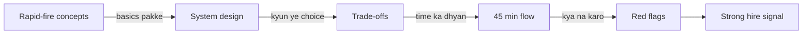
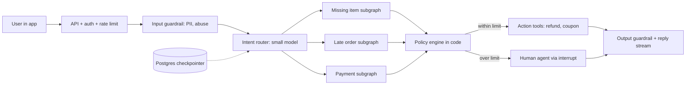
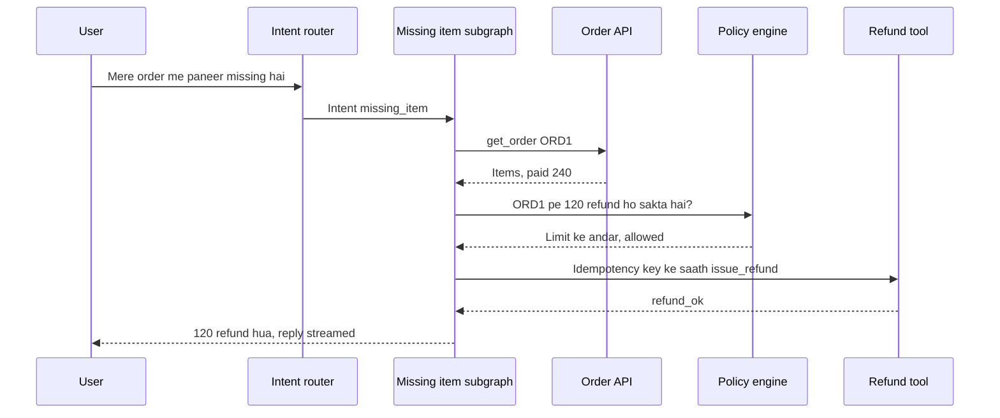
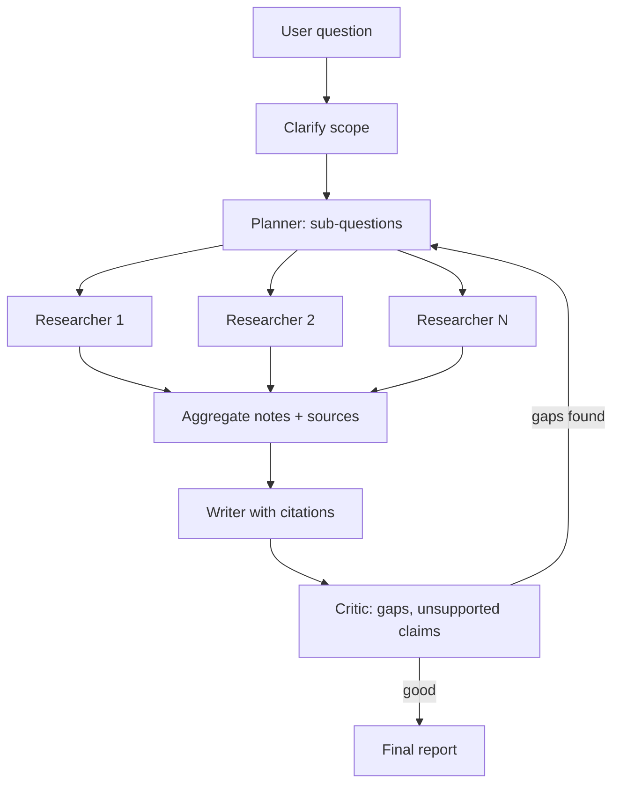
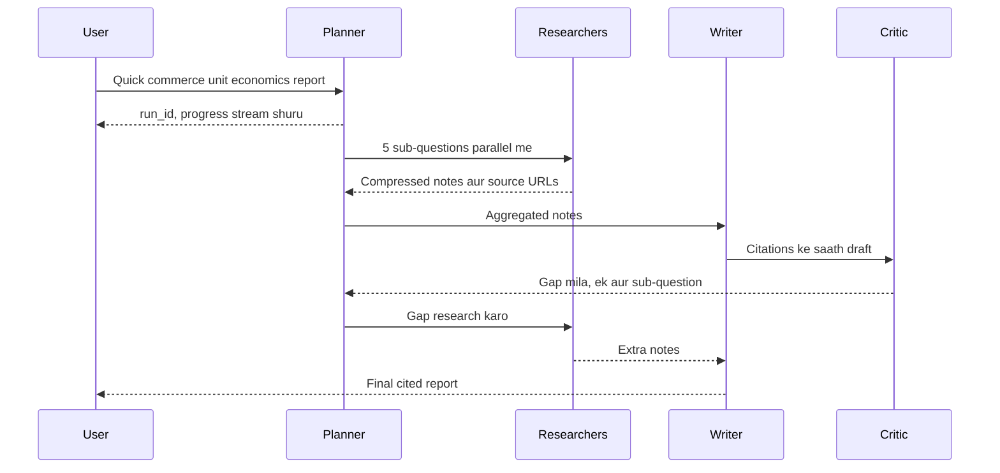
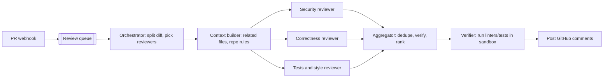
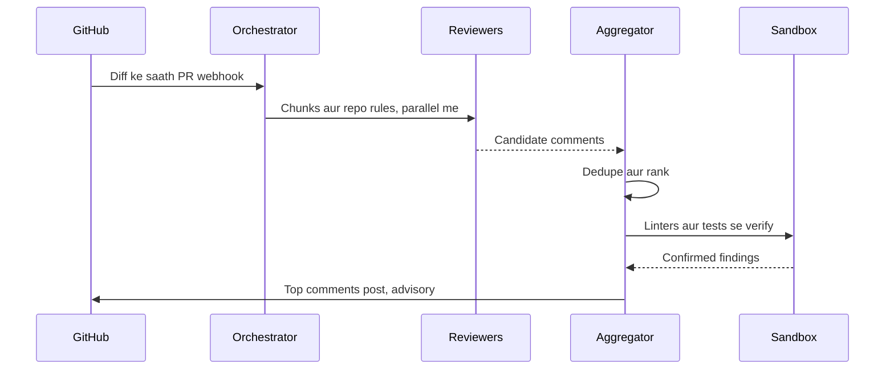
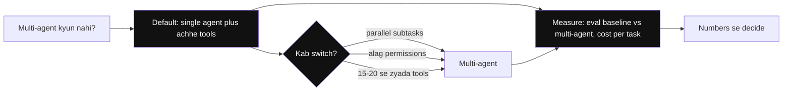
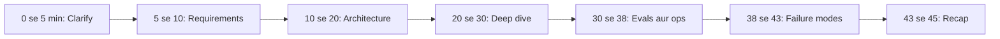

# Agentic AI Interview Prep

Ye page interview se pehle ki revision ke liye hai. Agentic AI Engineer interviews me teen cheez check hoti hain: concepts saaf hain ya nahi, ek system end-to-end design kar sakte ho ya nahi, aur trade-offs reasons ke saath bol sakte ho ya nahi. Yahan teeno ki practice hai.

**Is page ke baad tum ye samjha paoge:**
- 27 common conceptual sawalon ke 2–4 line answers, aur har jargon ka simple matlab.
- Support agent, deep-research agent aur code-review system ka design, us order me jaise ek strong candidate bolta hai.
- "X kyun, Y kyun nahi?" type trade-off sawalon ka jawab: default, kab badloge, kaise measure karoge.
- 45 minute ke round me time kaise baantna hai aur kaunse red flags se bachna hai.

## Pehle ye shabd samjho

LLM naye ho? Pehle [How LLMs Work](14-how-llms-work.md) padho. Usme tokens, context window aur model text kaise banata hai, ye sab hai.

| Shabd | Simple matlab |
|---|---|
| LangGraph | Agents ko graph ki tarah banane ki Python library: steps (nodes), arrows (edges), aur ek shared state. |
| Tool | Function jise chalane ko model tumhare code se keh sakta hai, jaise `get_order` ya `issue_refund`. |
| Superstep | LangGraph run ka ek round: saare ready nodes chalte hain, phir state save hoti hai. |
| RAG | Retrieval-augmented generation: documents me search karo, relevant hissa prompt me daalo, phir jawab banao. |
| HITL | Human-in-the-loop: run ruka rehta hai jab tak insaan approve ya edit na kare, phir aage chalta hai. |
| Store / namespace | Chats ke paar facts rakhne wala database; namespace, jaise `(tenant, user)`, har user ke facts alag rakhta hai. |
| Guardrail | Model se pehle ya baad ka check jo unsafe input, output ya action rok deta hai. |
| Eval | Automated test jo fixed example inputs pe agent ke outputs ko score karta hai. |
| LLM-as-judge | Ek doosri model call se jawab ko rubric (likhi hui scoring guide) ke against grade karwana. |
| Prompt caching | Provider baar-baar aane wale prompt-start ka kaam reuse karta hai, un tokens ka bill bahut kam. |
| Semantic cache | Naya sawal kisi purane sawal jaisa matlab rakhe, to stored jawab lauta deta hai. |
| `recursion_limit` | LangGraph setting jo N steps ke baad run rok deti hai, taaki loop me phansa agent hamesha na chale. |
| Subgraph | Bade graph ke andar ek step ki tarah chalne wala chhota graph, jaise har issue type ka ek. |
| Hallucination | Jab model galat ya banayi hui baat ko sach ki tarah bol de. |

## Big picture: interview me kya check hota hai

Ek agentic AI round aam taur pe teen hisson me chalta hai. Pehle chhote conceptual sawal (rapid-fire), jo dekhte hain ki basics pakke hain. Phir ek system design ("support agent design karo"), jahan dekha jaata hai ki tum clarify karte ho, sahi pattern chunte ho, aur evals, cost aur failures tak pahunchte ho. Beech-beech me trade-off sawal aate hain ("multi-agent kyun?"). Poore round me interviewer red flags bhi note karta hai. Is page ke sections isi order me hain.

**Is page ko kaise use karo:** rapid-fire answers zor se bol ke practice karo. Design sections ko script ki tarah padho, phir bina dekhe board pe diagram banao.

## ⭐ Rapid-fire: foundations aur LangGraph

**Ek line me:** agent = LLM + tools + loop + state; LangGraph us loop ko explicit graph banata hai jisme state, persistence aur control tumhare haath me hai.

> **Example:** "Swiggy bot agent hai ya chatbot?" Agar wo `get_order`, `issue_refund` tools khud choose karke loop me chalata hai to agent; agar fixed FAQ answer deta hai to chatbot.

**Q1. Agent vs workflow?**
Workflow me steps code decide karta hai (LLM sirf nodes ke andar). Agent me LLM khud next step/tool choose karta hai loop me. Predictable task = workflow; open-ended = agent. ([Foundations](01-agent-foundations.md))

**Q2. ReAct kya hai?**
Reason → Act (tool call) → Observe (tool result) → repeat jab tak answer na mile. Aaj ke native tool-calling agents isi loop ka form hain.
*Simple words me:* model sochta hai, ek tool chalata hai, result dekhta hai, aur phir sochta hai, jab tak kaam pura na ho.

**Q3. Agent kab nahi banana chahiye?**
Jab flow fixed hai, latency/cost tight hai, ya galti ki keemat bahut zyada hai aur autonomy ka fayda kam. Simple prompt chain ya workflow pehle try karo.

**Q4. LangGraph me state, node, edge?**
State = typed dict (reducers ke saath, e.g. messages append). Node = function jo state padh ke update return kare. Edge = next node; conditional edge = function jo route choose kare. ([LangGraph Core](02-langgraph-core.md))
*Simple words me:* state ek shared notebook hai, node us notebook me kuch likhne wala ek step hai, aur edge batata hai agla step kaunsa. Reducer batata hai naya data purane ke saath kaise milega (jaise list me jodna).

**Q5. Checkpointer aur thread_id kyun?**
Har superstep ke baad state save hoti hai `thread_id` ke against. Isse multi-turn memory, crash resume, human-in-the-loop (`interrupt`) aur time-travel (purane save point se dobara chalana) milta hai. Prod me Postgres checkpointer.
*Simple words me:* har step ke baad game ka "save point" banta hai. `thread_id` us save file ka naam hai. Crash ho ya user kal laute, wahi save load hota hai.

**Q6. `interrupt()` aur `Command` kya karte hain?**
`interrupt()` run ko pause karke value bahar deta hai (e.g. approval chahiye); `Command(resume=...)` se run wahin se aage chalta hai. `Command(goto=..., update=...)` se node routing + state update ek saath.
*Simple words me:* `interrupt` = "ruko, insaan se poochh ke aata hoon"; `Command(resume=...)` = "jawab mil gaya, wahin se chalo".

## ⭐ Rapid-fire: patterns, memory aur RAG

**Ek line me:** patterns = kaunsa control flow (chain, route, parallel, orchestrator, evaluator); memory = kya yaad rakhna hai aur kahan; RAG = sahi knowledge sahi waqt context me.

> **Example:** deep-research agent = orchestrator-workers + reflection; support bot = routing + workflow + HITL.

**Q7. Main workflow patterns?**
Prompt chaining, routing, parallelization (sectioning/voting), orchestrator-workers, evaluator-optimizer. Pehle sabse simple pattern jo kaam kare. ([Workflow patterns](03-workflow-patterns.md))
*Simple words me:* chaining = ek ke baad ek step; routing = sawal dekh ke sahi raasta; parallel = kaam baant ke saath karo; orchestrator = ek boss kaam baante; evaluator = ek likhe, doosra check kare.

**Q8. Supervisor vs swarm/handoff multi-agent?**
Supervisor: ek central agent sub-agents ko route karta hai, control clear. Swarm/handoff: agents khud ek doosre ko control pass karte hain, kam hops par debugging mushkil. ([Agent patterns](04-agent-patterns.md))
*Simple words me:* supervisor = ek manager sab ko kaam deta hai; swarm = team members khud baton aage pass karte hain, bina manager ke.

**Q9. Multi-agent kab worth hai?**
Jab tasks genuinely parallel hon (research), alag tools/permissions chahiye, ya single agent ka context/tool list bahut bada ho gaya. Warna single agent + achhe tools; multi-agent tokens multiply karta hai.

**Q10. Short-term vs long-term memory?**
Short-term = thread ki conversation state (checkpointer). Long-term = cross-thread facts/preferences (store, namespace per user), semantic/episodic/procedural types. ([Memory & Context](05-memory-context.md))
*Simple words me:* short-term = is baatcheet me kya hua; long-term = user ke baare me jo agli baatcheet me bhi yaad rehna chahiye (jaise "Hindi pasand hai"). Semantic = facts, episodic = pichhle anubhav, procedural = kaam karne ke tareeke.

**Q11. Context engineering kya hai?**
Har step pe model ko kya dikhana hai uska design: write (bahar save), select (retrieve), compress (summarize/trim), isolate (sub-agents). Context bada = mehenga + slow + distraction.
*Simple words me:* model ki table pe sirf wahi kaagaz rakho jo abhi kaam ke hain. Baaki file me rakho, zarurat pe nikaalo.

**Q12. Agentic RAG vs classic RAG?**
Classic: ek baar retrieve → generate. Agentic: agent decide karta hai kab/kahan search kare, query rewrite, multiple sources, results grade karke re-retrieve. Multi-hop pe better, par slow aur mehenga. ([Data & Retrieval](06-agentic-data-rag.md))
*Simple words me:* classic RAG ek baar library jaata hai; agentic RAG tab tak dhoondhta rehta hai jab tak sahi kitaab na mile. Multi-hop = jawab ke liye ek ke baad ek kai cheezein dhoondhni padein.

## ⭐ Rapid-fire: tools, MCP, guardrails aur evals

**Ek line me:** tools agent ke haath hain, MCP unhe standard plug banata hai, guardrails haath ko galat kaam se rokte hain, aur evals batate hain ki sab sahi chal raha hai ya nahi.

> **Example:** Razorpay agent ka `issue_refund` tool MCP server se aata hai, ₹5,000 se upar HITL guardrail lagta hai, aur trajectory eval check karta hai ki refund se pehle `get_payment` call hua.

**Q13. Achha tool kaisa hota hai?**
Clear naam + description (model ke liye docs), strict typed args, task-shaped (thin CRUD nahi), chhota relevant output, helpful error messages, idempotent writes. ([Tools, MCP & A2A](07-tools-mcp-a2a.md))
*Simple words me:* tool ek kaam poora kare (jaise `refund_order`), na ki chhote DB operations jinhe model ko jodna pade. Idempotent = do baar chale to bhi ek hi baar ka asar.

**Q14. MCP kya hai?**
Model Context Protocol: tools, resources aur prompts expose karne ka open standard (client–server, stdio yaani local process, ya HTTP). Ek baar MCP server banao, kisi bhi MCP-compatible agent/host me use karo.
*Simple words me:* MCP tools ke liye USB jaisa hai. Ek standard plug, kisi bhi device (agent app) me lag jaata hai.

**Q15. MCP vs A2A?**
MCP = agent ↔ tools/data. A2A = agent ↔ agent (doosre vendor/team ke agent ko task dena, agent card se discovery, task lifecycle). Dono complementary.
*Simple words me:* MCP se agent auzaar uthata hai; A2A se agent doosre agent ko kaam outsource karta hai. Agent card = us agent ka visiting card (kya kar sakta hai, kahan milega).

**Q16. Prompt injection kaise rokoge?**
Ek fix nahi: tool results/docs untrusted data, least-privilege tools, risky actions pe HITL, output validation, input classifiers, aur sensitive data + untrusted input + external action teeno ek saath na hon. ([Guardrails](08-guardrails.md))
*Simple words me:* prompt injection = kisi document ya webpage me chhupi line jo agent ko galat kaam karne ko bole. Bachaav: agent ke paas kam power, aur khatarnaak kaam se pehle insaan ki haan.

**Q17. Agent evals kaise karte ho?**
Teen level: final output (correctness, LLM-as-judge with rubric), trajectory (sahi tools, sahi order, kitne steps), single step/tool-call (unit tests). Golden dataset + CI gate + online sampled evals. ([Evals for Agents](09-agent-evals.md))
*Simple words me:* sirf final jawab nahi, raasta bhi check karo. Trajectory = agent ne kaunse tools kis order me chalaye. Golden dataset = sahi jawab ke saath sample sawal.

**Q18. LLM-as-judge ke risks?**
Position/length/self bias, rubric vague ho to noisy. Fix: clear rubric, pairwise (do jawab compare karke behtar chunna) ya binary pass/fail, judge ko human labels pe calibrate karo, zaroorat ho to strong judge model.
*Simple words me:* judge model bhi galti karta hai: pehle wala jawab ya lamba jawab pasand kar leta hai. Isliye saaf rubric do aur uske faisle insaan ke faislon se milao.

## ⭐ Rapid-fire: observability, cost aur production

**Ek line me:** traces se dikhta hai agent ne kya kiya, cost/latency levers bill kam rakhte hain, aur production patterns crash, rate limits aur bad deploys se bachate hain.

> **Example:** ek run 40 second laga; trace me dikha ki `search` tool 5 baar same query se chala. Tool cache + prompt fix ke baad 9 second.

**Q19. Agent observability me kya track karoge?**
Har run ka trace (spans: LLM calls, tools, tokens, latency, errors), prompt/model version, cost per run, step count, user feedback. Dashboards p95 latency, cost/task, error/escalation rate. OpenTelemetry GenAI conventions. ([AI Observability](10-agent-observability.md))
*Simple words me:* trace = ek run ki CCTV recording; span = us recording ka ek clip (ek LLM call ya ek tool). p95 = 100 me se 95 requests isse tez.

**Q20. Agent ka cost kaise ghataoge?**
Model routing/cascade, prompt caching (stable prefix), tool/semantic cache, kam steps (better tools, workflows), context trim, batch API offline ke liye, distillation high-volume steps ke liye. ([Cost & Latency](11-cost-latency.md))
*Simple words me:* aasaan kaam chhote sasta model ko do, baar-baar bheja jaane wala prompt cache karo, aur steps kam karo. Distillation = bade model ke jawabon se chhota model sikhaana.

**Q21. Latency kaise ghataoge?**
Stream tokens + step events (TTFT), parallel tool calls/nodes, chhote models for sub-steps, kam output tokens, speculative fetch (jo data shayad chahiye, use model ke maangne se pehle la lena), prompt caching.
*Simple words me:* user ko pehla shabd jaldi dikhao (TTFT = time to first token), aur jo kaam saath ho sakte hain wo saath karo.

**Q22. Runaway agent kaise rokoge?**
`recursion_limit`, model-call limits, token caps, per-user $ cap, timeouts, aur loop detect (same tool + same args baar-baar) → stop ya escalate.

**Q23. Crash ke beech me run ho to?**
Checkpointer se last superstep se resume. Aadha chala node dobara chalega, isliye write tools idempotent (idempotency key). Lambe tasks background runs. ([Agents in Production](12-agents-in-production.md))
*Simple words me:* doosra worker last save point se chalata hai; jo step aadha tha wo dobara chalega, to refund jaise kaam ek unique key ke saath bhejo taaki do baar na ho.

**Q24. Naya prompt/model safely kaise ship karoge?**
Pinned model versions, versioned prompts, offline eval gate, shadow (write tools off), canary 1–5% with online metrics, instant rollback.
*Simple words me:* shadow = naya version chupchaap saath chalta hai par jawab user ko nahi jaata; canary = pehle 1–5% users ko dikhao, sab theek to sabko.

**Q25. Sync vs background run kab?**
Seconds wale interactive replies sync + streaming. Minutes–hours wale tasks (research, bulk audits) background run: turant `run_id`, progress stream/poll, worker crash pe resume.

**Q26. Multi-tenant isolation kaise?**
Thread IDs tenant-scoped + ownership check, memory store namespace `(tenant, user)`, vector search me tenant filter, tools ko identity runtime context se. LLM ke arguments pe kabhi bharosa nahi.
*Simple words me:* tenant = ek customer company. Har jagah (threads, memory, search) data pe company ka label server lagata hai, LLM nahi.

**Q27. Human ko kab escalate karoge?**
User maange, sentiment bigde, confidence low ho, policy limit (amount, safety, legal) cross ho, ya step/tool-failure limit hit ho. Handoff ke saath summary + actions taken + trace link.

## ⭐ Design: customer-support agent for food delivery

> **Example:** "Swiggy ke liye support agent design karo jo missing item, late order, refund aur payment issues handle kare."

**Ek line me:** router + mostly-workflow subgraphs + idempotent action tools + policy engine in code + HITL/escalation, Postgres checkpointer aur streaming ke saath.

Neeche wo script hai jo ek strong candidate isi order me bolta hai.

**1. Clarify (0–5 min).** "Design se pehle main kuch sawal poochunga."
- "Kaunse issue types hain, aur top 5 kitna traffic cover karte hain?" (Maan lo: ~80%.)
- "Agent khud kaunse actions le sakta hai? Refund ki limit kya hai?" (Maan lo: ₹500 tak khud.)
- "Channels kaunse hain (in-app chat, voice) aur languages (Hindi/Hinglish)?"
- "Peak QPS aur latency target? Human team ka handoff tool kya hai?"
- "Success kaise naapenge: resolution rate, CSAT, refund leakage?"

**2. Pattern choose karo.** "Steps zyada tar predictable hain aur paisa move hota hai. Isliye main full autonomous agent nahi, **routing + workflow subgraphs** banaunga. LLM sirf intent samjhega, details nikaalega, aur empathetic reply likhega. Refund ka faisla code karega."

**3. High-level diagram (10–20 min).** "Ab main architecture draw karta hoon, user ki taraf se andar ki taraf."

**4. Ek request trace karo.** "Ek real message pe chalta hoon: 'Mere order me paneer missing hai'."

"LLM sirf intent pakadta hai aur reply likhta hai; refund ka decision code wale policy engine se aata hai, aur refund call idempotency key ke saath jaati hai."

**5. Tools aur memory.** "Tools: `get_order(order_id)`, `get_rider_eta`, `get_restaurant_status`, `issue_refund(order_id, amount, idempotency_key)`, `create_ticket`. User ki identity runtime context se aayegi, LLM ke args se nahi. Thread state (current issue, order_id, actions taken) checkpointer me. Long-term store me user ka refund history/abuse score aur language preference."

**6. Guardrails.** "Refund amount/frequency limits code me, prompt me nahi. PII redaction. Tool outputs ko untrusted maanunga (prompt injection). High-value ya food-safety case seedha HITL."

**7. Evals.** "Har intent ke liye golden conversations. Trajectory check: 'refund se pehle get_order + policy check hua?'. Policy-violation rate. Tone ke liye LLM-judge. Online: resolution rate, CSAT, escalation rate, refund leakage."

**8. Cost aur latency.** "Intent aur extraction chhote model pe, reply mid-size model pe. Policy text pe prompt cache. Order, rider aur restaurant ka data parallel fetch. Target p95 < 5s, streaming ke saath."

**9. Failure modes.** "Agar aap poochein ki ye toote to?"
- Provider down → fallback model → canned flows + human.
- Order API down → circuit breaker + "thodi der me update deta hoon".
- Double refund → idempotency key.
- Fraud ring → per-user limits + abuse score.
- User ne beech me doosra message bheja (double-texting) → interrupt strategy.

*Simple words me:* HITL = human-in-the-loop, insaan ki approval; policy engine = normal code jo rules check karta hai; idempotency key = har refund ka unique number taaki do baar na ho.

**Interview tip:** khud bolo "policy engine code me hai, LLM sirf samjhaata hai". Ye sabse strong signal hai.

**Common galti:** refund decision LLM pe chhod dena, ya escalation path ka zikr hi na karna.

## ⭐ Design: deep-research agent

> **Example:** "Ek agent design karo jo 'India me quick-commerce ka unit economics' pe 10 minute me cited report bana de."

**Ek line me:** planner → parallel researcher sub-agents → synthesizer with citations → critic loop, background run ke roop me with streaming progress aur strict budgets.

Script, us order me jaise bolna hai:

**1. Clarify (0–5 min).** "Pehle main ye poochunga:"
- "Sources kaunse: open web, paid DBs, internal docs?"
- "Output kaisa: report kitni lambi, citation format kya?"
- "Time budget 2 min hai ya 30 min? Har report ka cost budget kitna?"
- "Freshness kitni zaroori? Kya agent user se clarification pooch sakta hai?"
- "Ek saath kitni reports chalengi?"

**2. Budget aur stopping pehle.** "Deep research ka sabse bada risk unbounded cost hai. Isliye main shuru me hi tay karta hoon: max 5 sub-questions, max 2 reflection rounds, per-run token budget. Run background me chalega kyunki minutes lagenge."

**3. High-level diagram.** "Ab flow draw karta hoon. Planner kaam baantta hai, researchers parallel me kaam karte hain, writer likhta hai, critic check karta hai."

**4. Ek run trace karo.** "Quick-commerce wale sawal pe ek run aisa chalega:"

"Researchers raw pages nahi, compressed notes lautate hain, aur critic run ko planner pe sirf limited baar wapas bhej sakta hai, phir report ship hoti hai."

**5. Pattern aur tools.** "Pattern orchestrator-workers hai: LangGraph `Send` (har sub-question ke liye ek parallel branch) se dynamic fan-out, reflection loop max 2 rounds, background run + Postgres checkpointer. Tools: web search API, page fetch + clean (HTML → text), PDF parse, internal RAG. Har researcher ka apna isolated context."

**6. Memory aur context.** "Researchers **compressed notes + source URLs** lautate hain, raw pages nahi; aggregator dedupe karta hai. Long-term me user ke past reports/preferences optional."

**7. Guardrails.** "Web content untrusted hai (injection). Source allowlist/quality score, har claim ke saath citation, aur unsupported claims critic flag karega."

**8. Evals.** "Citation faithfulness (claim sach me source me hai?), expert outline ke against coverage, LLM-judge rubric, aur cost + time per report."

**9. Cost aur latency.** "Researchers chhote/mid model pe, planner aur writer bade pe. Max sub-questions 5, per-run token budget, tool-result cache. User ko progress events: '3/5 sub-questions done'."

**10. Failure modes.**
- Search API rate limit → backoff + queue.
- Ek researcher hang → timeout, partial report.
- Critic kabhi satisfied nahi → max reflection rounds.
- Context overflow → sirf summaries.
- Worker crash → checkpoint se resume.

*Simple words me:* fan-out = ek kaam ko kai workers me baantna; reflection = apna draft khud review karke sudharna; citation faithfulness = jo likha hai wo sach me us source me hai ya nahi.

**Interview tip:** stopping criteria aur budget pehle bolo; deep research ka sabse bada risk unbounded cost hai.

**Common galti:** sab raw pages writer ke context me daal dena, jisse 200k tokens aur lost-in-the-middle.

## ⭐ Design: multi-agent code-review system

> **Example:** "Flipkart ki engineering team ke liye PR review bot design karo jo har PR pe 5 minute me useful comments de."

**Ek line me:** PR event → orchestrator jo diff ko split karke specialised reviewers (security, correctness, style/tests) ko parallel deta hai → aggregator dedupe + severity ranking → GitHub comments, sab sandbox aur budgets ke saath.

Script:

**1. Clarify (0–5 min).** "Pehle main ye poochunga:"
- "Languages kaunsi, monorepo kitna bada, PR size distribution kya hai?"
- "Kya agent code chala sakta hai (tests, linters)?"
- "Comments merge block karenge ya sirf advisory?"
- "False positives kitne bardasht hain? PR khulne ke kitni der me review chahiye?"
- "Private code ki data policy: kaunsa model, kahan host?"

**2. Multi-agent kyun.** "Yahan multi-agent justified hai kyunki security, correctness aur style ke reviewers ko alag prompts aur alag tools chahiye, aur wo parallel chal sakte hain. Aggregator evaluator ki tarah low-confidence findings filter karega."

**3. High-level diagram.** "Webhook se comment tak flow aisa hai:"

**4. Ek PR trace karo.** "Ek PR pe ye hota hai:"

"Reviewers parallel me candidates banate hain, par post sirf wahi hote hain jo aggregator dedupe kare aur sandbox confirm kare. Isse precision high rehti hai."

**5. Tools aur memory.** "Tools: `get_diff`, `read_file`, `search_code`, `run_linter`, `run_tests` (sandbox, no network, time limit), `post_comment`. Repo-level rules (CONTRIBUTING, pichhle accepted/rejected comments) long-term store me. PR-level state checkpointer me. Naye commits pe incremental review."

**6. Guardrails.** "Sandbox, read-only repo token. PR content untrusted hai (code me injection comments ho sakte hain!). Har PR pe max comments. Bot kabhi auto-approve ya merge nahi karega."

**7. Evals.** "Known bugs wale historical PRs pe recall. Human-labelled comment usefulness se precision. Online: comment acceptance/resolution rate aur false-positive rate."

**8. Cost aur latency.** "Bada PR file-wise chunk, generated/vendor files skip, file summaries cache. Style ke liye chhota model, security/correctness ke liye bada. Target < 5 min, background run."

**9. Failure modes.**
- Bahut bada PR → summary-only mode.
- Noisy comments → developers ignore karne lagte hain (isliye precision > recall).
- Reviewers ke duplicate comments → aggregator dedupe.
- Sandbox escape → isolated microVM.

*Simple words me:* precision = jo comments diye unme se kitne sahi the; recall = asli bugs me se kitne pakde. Sandbox = band kamra jahan code chale par bahar kuch bigaad na sake.

**Interview tip:** "Precision recall se zyada important hai; ek baar dev ne bot ko noisy maan liya to sab ignore." Ye product sense dikhata hai.

**Common galti:** har reviewer ko poora repo context dena (cost explode), ya bot ko merge/approve permission dena.

## ⭐ Trade-off discussions

**Ye kyun chahiye?** Interviewer "X kyun, Y kyun nahi?" isliye poochta hai kyunki iska koi ek sahi jawab nahi hota. "Hamesha X" bolna weak lagta hai. Strong jawab ke teen hisse hain: **default kya hai, kab badloge, aur kaise measure karoge.**

> **Example:** "LangGraph kyun, plain Python kyun nahi?" Jawab: "Persistence, HITL, streaming free milte hain; par 3-step pipeline ke liye plain code + retries kaafi hai."

*Diagram:* Highlighted teen hisse har trade-off sawal ke jawab ka shape hain: default batao, kab switch karoge batao, aur kaise measure karoge batao.

| Agar ye poochein | Ye bolo | Kyunki | Kab doosra chunoge |
|---|---|---|---|
| "Framework kyun, custom code kyun nahi?" | "LangGraph jaisa low-level framework; heavy abstractions avoid karta hoon taaki prompts aur control flow dikhte rahein" | persistence, HITL, streaming free milte hain | bahut simple flow, ya extreme control/perf chahiye |
| "Multi-agent kyun nahi?" | "Pehle single agent + achhe tools" | multi-agent tokens 3–10x karta hai; tabhi jab eval me gain dikhe | parallel subtasks, alag permissions, tool list > ~15–20 |
| "RAG ya long context?" | "RAG" | long context har call pe cost + TTFT badhata hai; RAG relevant 2–5k tokens aur citations deta hai | chhota stable corpus + prompt cache |
| "Fine-tune karoge?" | "Pehle prompting + RAG" | knowledge ke liye RAG, behaviour ke liye fine-tune, cost ke liye distill | high-volume narrow task (distill), strict format/style |
| "Open model ya closed?" | "Quality aur speed to market ke liye closed API; hybrid jahan sense ho" | router/extraction open self-hosted, complex reasoning closed; GPU ops cost bhi count hota hai | data residency, scale pe cost, customization |

- **Agar poochein "framework ne kab rok diya?":** bolo "jab debugging ke liye framework ke andar ghusna pade, wahan custom code", kyunki framework tab tak achha hai jab tak control na chheene.
- **Agar poochein "multi-agent better hai, kaise pata?":** bolo "pehle single agent ka eval baseline, phir multi-agent, dono ka cost per task compare", kyunki bina number ke ye sirf raay hai.
- **Agar poochein "open model sasta hai na?":** bolo "token price ke saath GPU, MLOps team, eval aur upgrades bhi jodta hoon", kyunki total cost sirf token price nahi.

*Simple words me:* TTFT = pehla token aane me lagne wala time; distill = bade model se chhota, sasta model sikhaana; data residency = data kis desh me rehna chahiye, iska kanooni rule.

**Interview tip:** har trade-off ka end "main isko eval set aur cost per task pe measure karke decide karunga" pe karo.

**Common galti:** "multi-agent hamesha better" ya "fine-tuning se hallucination khatam" jaise absolute statements.

## 45-minute interview flow

**Ye kyun chahiye?** Achhe candidates bhi fail hote hain kyunki 20 minute prompt likhne me laga dete hain aur evals ya failures tak pahunchte hi nahi. Time pehle se baant lo.

**Ek line me:** time box karo: clarify → requirements → high-level → deep dive → evals/ops → wrap-up; interviewer ko har stage pe hook do.

> **Example:** "Design a customer-support agent" round ke liye neeche wala time split.

| Minute | Kya karo | Ek sample line |
|---|---|---|
| 0–5 | Clarifying questions: users, actions allowed, scale, latency, success metric, risk | "Agent khud kaunse actions le sakta hai?" |
| 5–10 | Functional + non-functional requirements, agent vs workflow decision with reason | "Steps predictable hain, to workflow + router." |
| 10–20 | High-level architecture mermaid: API, router, graph, tools, memory, checkpointer, streaming | "User se andar ki taraf draw karta hoon." |
| 20–30 | Deep dive 1–2: tool design + guardrails/HITL, ya multi-agent orchestration (interviewer jahan push kare) | "Aap kis hisse me gehraai chahenge?" |
| 30–38 | Evals (offline + online), observability, cost/latency numbers | "Golden set + trajectory check, p95 < 5s." |
| 38–43 | Failure modes, reliability, versioning/rollout | "Provider down ho to fallback, phir human." |
| 43–45 | Recap + "isko aur better kaise" (fine-tune router, better memory, more automation) | "Agla step: router ko distill karunga." |

- Har stage pe ek line me decision + trade-off bolo, phir aage badho.
- Numbers: cost per task, p95 latency, steps per task, escalation rate.

Round ek pipeline ki tarah: diagram 20 minute tak ban jaaye, aur recap se pehle evals aur failure modes ko apna slot zaroor mile.

**Interview tip:** 20 minute ke andar diagram board pe hona chahiye; uske baad interviewer deep dive chunta hai.

**Common galti:** 20 minute prompt likhne me laga dena aur evals/failures tak pahunchna hi nahi.

## Red flags interviewers notice

**Ek line me:** ye signals batate hain ki candidate ne sirf demos banaye hain, production agent nahi chalaya.

> **Example:** candidate ne design me "GPT-4 sab handle kar lega" bola, koi tool permission, eval ya budget nahi. Interviewer ka note: "no production depth".

| Red flag | Iski jagah ye bolo |
|---|---|
| Har problem ka jawab "multi-agent" ya "bada model"; workflow vs agent ka sawal hi nahi uthaya | "Pehle dekhta hoon workflow kaafi hai ya agent chahiye." |
| Evals ka zikr nahi, ya sirf "manually check karenge" | "Golden set, trajectory checks, CI gate aur online sampled evals." |
| Authorization/tenant isolation prompt me ("model ko bol denge dusre user ka data na dikhaye") | "Identity runtime context se, check tool/API layer pe." |
| Write tools bina idempotency ke retry karna; HITL kahin nahi | "Write tools pe idempotency key, risky actions pe human approval." |
| Cost/latency ka koi number nahi; step limits, budgets nahi | "Cost per task ~₹X, p95 < 5s, recursion_limit aur token budget." |
| Prompt injection ko "system prompt me mana kar denge" se solve karna | "Tool outputs untrusted, least privilege, HITL." |
| Framework names ki list, par state, checkpointing, failure handling explain nahi kar paana | "Checkpoint se resume, aur kaunsa node dobara chalega." |
| Model versions pinned nahi, rollout/rollback plan nahi | "Pinned model, shadow + canary, config flip se rollback." |

**Interview tip:** in red flags ka ulta khud se bolo (evals, budgets, idempotency, auth at tool layer); bina pooche bolna senior signal hai.

**Common galti:** sirf happy path design karna; interviewer hamesha "aur agar tool fail ho jaye?" poochega.

## Aage padho

- [AI Agents: Foundations](01-agent-foundations.md), [LangGraph Core](02-langgraph-core.md), [Workflow patterns](03-workflow-patterns.md), [Agent patterns](04-agent-patterns.md)
- [Memory & Context](05-memory-context.md), [Data & Retrieval](06-agentic-data-rag.md), [Tools, MCP & A2A](07-tools-mcp-a2a.md)
- [Guardrails](08-guardrails.md), [Evals](09-agent-evals.md), [Observability](10-agent-observability.md), [Cost & Latency](11-cost-latency.md), [Agents in Production](12-agents-in-production.md)
- [LLM Engineer Interview Prep](22-llm-engineer-interview.md): fundamentals, serving aur fine-tuning ke sawal
- [RAG Interview Q&A](../09-rag/10-rag-interview-qa.md), [LLM chat app](../02-questions/t2-22-llm-chat-app.md)
- Labs: [Production agent](/viewinter/agents/labs/prod), [Multi-agent](/viewinter/agents/labs/multi), [Web agent](/viewinter/agents/labs/web)

## Checklist

- [ ] Foundations aur LangGraph ke rapid-fire sawalon ke 2–4 line answers de sakta hoon
- [ ] Patterns, memory aur agentic RAG ke sawal confidently answer kar sakta hoon
- [ ] Tools, MCP vs A2A, prompt injection aur agent evals ke answers de sakta hoon
- [ ] Observability, cost, latency aur production ke rapid-fire answers numbers ke saath de sakta hoon
- [ ] Food-delivery support agent ka poora design (clarify se failure modes tak) 15 minute me bol sakta hoon
- [ ] Deep-research agent ka design budgets aur stopping criteria ke saath samjha sakta hoon
- [ ] Multi-agent code-review system ka design aur precision vs recall trade-off bata sakta hoon
- [ ] Framework, single/multi-agent, RAG/long context, fine-tuning aur open/closed trade-offs "agar ye poochein, ye bolo, kyunki" format me bata sakta hoon
- [ ] 45-minute round ka time split aur red flags bata sakta hoon
