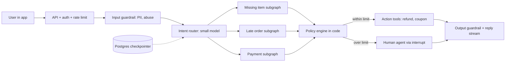
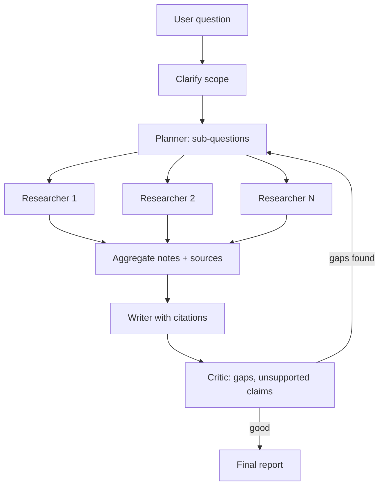
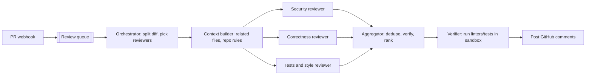

# Agentic AI Interview Prep

Ye page revision ke liye hai: 27 rapid-fire conceptual sawal (crisp 2–4 line answers), 3 full system design walkthroughs, trade-off discussions, 45-minute round ka flow, aur red flags. Agentic AI Engineer interviews me yahi teen cheez check hoti hain: concepts saaf hain, end-to-end design kar sakte ho, aur trade-offs number aur reasons ke saath bol sakte ho.

## ⭐ Rapid-fire: foundations aur LangGraph

**Ek line me:** agent = LLM + tools + loop + state; LangGraph us loop ko explicit graph banata hai jisme state, persistence aur control tumhare haath me hai.

> **Example:** "Swiggy bot agent hai ya chatbot?" Agar wo `get_order`, `issue_refund` tools khud choose karke loop me chalata hai to agent; agar fixed FAQ answer deta hai to chatbot.

**Q1. Agent vs workflow?**
Workflow me steps code decide karta hai (LLM sirf nodes ke andar). Agent me LLM khud next step/tool choose karta hai loop me. Predictable task = workflow; open-ended = agent. ([Foundations](01-agent-foundations.md))

**Q2. ReAct kya hai?**
Reason → Act (tool call) → Observe (tool result) → repeat jab tak answer na mile. Aaj ke native tool-calling agents isi loop ka form hain.

**Q3. Agent kab nahi banana chahiye?**
Jab flow fixed hai, latency/cost tight hai, ya galti ki keemat bahut zyada hai aur autonomy ka fayda kam. Simple prompt chain ya workflow pehle try karo.

**Q4. LangGraph me state, node, edge?**
State = typed dict (reducers ke saath, e.g. messages append). Node = function jo state padh ke update return kare. Edge = next node; conditional edge = function jo route choose kare. ([LangGraph Core](02-langgraph-core.md))

**Q5. Checkpointer aur thread_id kyun?**
Har superstep ke baad state save hoti hai `thread_id` ke against. Isse multi-turn memory, crash resume, human-in-the-loop (`interrupt`) aur time-travel milta hai. Prod me Postgres checkpointer.

**Q6. `interrupt()` aur `Command` kya karte hain?**
`interrupt()` run ko pause karke value bahar deta hai (e.g. approval chahiye); `Command(resume=...)` se run wahin se aage chalta hai. `Command(goto=..., update=...)` se node routing + state update ek saath.

## ⭐ Rapid-fire: patterns, memory aur RAG

**Ek line me:** patterns = kaunsa control flow (chain, route, parallel, orchestrator, evaluator); memory = kya yaad rakhna hai aur kahan; RAG = sahi knowledge sahi waqt context me.

> **Example:** deep-research agent = orchestrator-workers + reflection; support bot = routing + workflow + HITL.

**Q7. Main workflow patterns?**
Prompt chaining, routing, parallelization (sectioning/voting), orchestrator-workers, evaluator-optimizer. Pehle sabse simple pattern jo kaam kare. ([Workflow patterns](03-workflow-patterns.md))

**Q8. Supervisor vs swarm/handoff multi-agent?**
Supervisor: ek central agent sub-agents ko route karta hai, control clear. Swarm/handoff: agents khud ek doosre ko control pass karte hain, kam hops par debugging mushkil. ([Agent patterns](04-agent-patterns.md))

**Q9. Multi-agent kab worth hai?**
Jab tasks genuinely parallel hon (research), alag tools/permissions chahiye, ya single agent ka context/tool list bahut bada ho gaya. Warna single agent + achhe tools; multi-agent tokens multiply karta hai.

**Q10. Short-term vs long-term memory?**
Short-term = thread ki conversation state (checkpointer). Long-term = cross-thread facts/preferences (store, namespace per user), semantic/episodic/procedural types. ([Memory & Context](05-memory-context.md))

**Q11. Context engineering kya hai?**
Har step pe model ko kya dikhana hai uska design: write (bahar save), select (retrieve), compress (summarize/trim), isolate (sub-agents). Context bada = mehenga + slow + distraction.

**Q12. Agentic RAG vs classic RAG?**
Classic: ek baar retrieve → generate. Agentic: agent decide karta hai kab/kahan search kare, query rewrite, multiple sources, results grade karke re-retrieve. Multi-hop pe better, par slow aur mehenga. ([Data & Retrieval](06-agentic-data-rag.md))

## ⭐ Rapid-fire: tools, MCP, guardrails aur evals

**Ek line me:** tools agent ke haath hain, MCP unhe standard plug banata hai, guardrails haath ko galat kaam se rokte hain, aur evals batate hain ki sab sahi chal raha hai ya nahi.

> **Example:** Razorpay agent ka `issue_refund` tool MCP server se aata hai, ₹5,000 se upar HITL guardrail lagta hai, aur trajectory eval check karta hai ki refund se pehle `get_payment` call hua.

**Q13. Achha tool kaisa hota hai?**
Clear naam + description (model ke liye docs), strict typed args, task-shaped (thin CRUD nahi), chhota relevant output, helpful error messages, idempotent writes. ([Tools, MCP & A2A](07-tools-mcp-a2a.md))

**Q14. MCP kya hai?**
Model Context Protocol: tools, resources aur prompts expose karne ka open standard (client–server, stdio/HTTP). Ek baar MCP server banao, kisi bhi MCP-compatible agent/host me use karo.

**Q15. MCP vs A2A?**
MCP = agent ↔ tools/data. A2A = agent ↔ agent (doosre vendor/team ke agent ko task dena, agent card se discovery, task lifecycle). Dono complementary.

**Q16. Prompt injection kaise rokoge?**
Ek fix nahi: tool results/docs untrusted data, least-privilege tools, risky actions pe HITL, output validation, input classifiers, aur sensitive data + untrusted input + external action teeno ek saath na hon. ([Guardrails](08-guardrails.md))

**Q17. Agent evals kaise karte ho?**
Teen level: final output (correctness, LLM-as-judge with rubric), trajectory (sahi tools, sahi order, kitne steps), single step/tool-call (unit tests). Golden dataset + CI gate + online sampled evals. ([Evals for Agents](09-agent-evals.md))

**Q18. LLM-as-judge ke risks?**
Position/length/self bias, rubric vague ho to noisy. Fix: clear rubric, pairwise ya binary pass/fail, judge ko human labels pe calibrate karo, zaroorat ho to strong judge model.

## ⭐ Rapid-fire: observability, cost aur production

**Ek line me:** traces se dikhta hai agent ne kya kiya, cost/latency levers bill kam rakhte hain, aur production patterns crash, rate limits aur bad deploys se bachate hain.

> **Example:** ek run 40 second laga; trace me dikha ki `search` tool 5 baar same query se chala. Tool cache + prompt fix ke baad 9 second.

**Q19. Agent observability me kya track karoge?**
Har run ka trace (spans: LLM calls, tools, tokens, latency, errors), prompt/model version, cost per run, step count, user feedback. Dashboards p95 latency, cost/task, error/escalation rate. OpenTelemetry GenAI conventions. ([AI Observability](10-agent-observability.md))

**Q20. Agent ka cost kaise ghataoge?**
Model routing/cascade, prompt caching (stable prefix), tool/semantic cache, kam steps (better tools, workflows), context trim, batch API offline ke liye, distillation high-volume steps ke liye. ([Cost & Latency](11-cost-latency.md))

**Q21. Latency kaise ghataoge?**
Stream tokens + step events (TTFT), parallel tool calls/nodes, chhote models for sub-steps, kam output tokens, speculative fetch, prompt caching.

**Q22. Runaway agent kaise rokoge?**
`recursion_limit`, model-call limits, token caps, per-user $ cap, timeouts, aur loop detect (same tool + same args baar-baar) → stop ya escalate.

**Q23. Crash ke beech me run ho to?**
Checkpointer se last superstep se resume. Aadha chala node dobara chalega, isliye write tools idempotent (idempotency key). Lambe tasks background runs. ([Agents in Production](12-agents-in-production.md))

**Q24. Naya prompt/model safely kaise ship karoge?**
Pinned model versions, versioned prompts, offline eval gate, shadow (write tools off), canary 1–5% with online metrics, instant rollback.

**Q25. Sync vs background run kab?**
Seconds wale interactive replies sync + streaming. Minutes–hours wale tasks (research, bulk audits) background run: turant `run_id`, progress stream/poll, worker crash pe resume.

**Q26. Multi-tenant isolation kaise?**
Thread IDs tenant-scoped + ownership check, memory store namespace `(tenant, user)`, vector search me tenant filter, tools ko identity runtime context se. LLM ke arguments pe kabhi bharosa nahi.

**Q27. Human ko kab escalate karoge?**
User maange, sentiment bigde, confidence low ho, policy limit (amount, safety, legal) cross ho, ya step/tool-failure limit hit ho. Handoff ke saath summary + actions taken + trace link.

## ⭐ Design: customer-support agent for food delivery

**Ek line me:** router + mostly-workflow subgraphs + idempotent action tools + policy engine in code + HITL/escalation, Postgres checkpointer aur streaming ke saath.

> **Example:** "Swiggy ke liye support agent design karo jo missing item, late order, refund aur payment issues handle kare."

**Clarifying questions:** kaunse issue types (top 5 = ~80% traffic?), kaunse actions agent khud le sakta hai (refund limit?), channels (in-app chat, voice?), languages (Hindi/Hinglish), peak QPS, latency target, human team ka handoff tool, success metric (resolution rate, CSAT, refund leakage).

- **Pattern choice:** routing + workflow subgraphs (steps predictable), LLM sirf intent, extraction, aur empathetic reply ke liye. Full autonomous agent nahi, kyunki paisa move hota hai.
- **Tools:** `get_order(order_id)`, `get_rider_eta`, `get_restaurant_status`, `issue_refund(order_id, amount, idempotency_key)`, `create_ticket`. User identity runtime context se, LLM args se nahi.
- **Memory:** thread state (current issue, order_id, actions taken) checkpointer me; long-term: user ka refund history/abuse score (store), language preference.
- **Guardrails:** refund amount/frequency limits code me (prompt me nahi), PII redaction, prompt-injection safe tool outputs, high-value/food-safety → HITL.
- **Evals:** golden conversations per intent, trajectory check ("refund se pehle get_order + policy check"), policy-violation rate, LLM-judge for tone, online: resolution rate, CSAT, escalation rate, refund leakage.
- **Cost/latency:** intent + extraction chhote model pe, reply bada model ya same mid-size; prompt cache for policy text; parallel fetch (order + rider + restaurant); p95 < 5s, streaming.
- **Failure modes:** provider down → fallback model → canned flows + human; order API down → circuit breaker + "thodi der me update"; double refund → idempotency key; fraud ring → per-user limits + abuse score; double-texting → interrupt strategy.

**Interview tip:** khud bolo "policy engine code me hai, LLM sirf samjhaata hai". Ye sabse strong signal hai.

**Common galti:** refund decision LLM pe chhod dena, ya escalation path ka zikr hi na karna.

## ⭐ Design: deep-research agent

**Ek line me:** planner → parallel researcher sub-agents → synthesizer with citations → critic loop, background run ke roop me with streaming progress aur strict budgets.

> **Example:** "Ek agent design karo jo 'India me quick-commerce ka unit economics' pe 10 minute me cited report bana de."

**Clarifying questions:** sources (open web, paid DBs, internal docs?), output (report length, citations format), time budget (2 min vs 30 min), cost budget per report, freshness, user clarification allowed?, kitne concurrent reports.

- **Pattern:** orchestrator-workers (LangGraph `Send` se dynamic fan-out), reflection loop (max 2 rounds), background run + Postgres checkpointer.
- **Tools:** web search API, page fetch + clean (HTML → text), PDF parse, internal RAG; har researcher ka apna isolated context.
- **Memory/context:** researchers raw pages nahi, **compressed notes + source URLs** lautate hain; aggregator dedupe karta hai. Long-term: user ke past reports/preferences optional.
- **Guardrails:** web content untrusted (injection), source allowlist/quality score, har claim ke saath citation, unsupported claims critic flag kare.
- **Evals:** citation faithfulness (claim source me hai?), coverage vs expert outline, LLM-judge rubric, cost aur time per report.
- **Cost/latency:** researchers chhote/mid model, planner + writer bada; max sub-questions (e.g. 5), per-run token budget, tool-result cache; progress events stream ("3/5 sub-questions done").
- **Failure modes:** search API rate limit → backoff + queue; ek researcher hang → timeout, partial report; loop never satisfied → max reflection rounds; context overflow → summaries only; crash → resume from checkpoint.

**Interview tip:** stopping criteria aur budget pehle bolo; deep research ka sabse bada risk unbounded cost hai.

**Common galti:** sab raw pages writer ke context me daal dena, jisse 200k tokens aur lost-in-the-middle.

## ⭐ Design: multi-agent code-review system

**Ek line me:** PR event → orchestrator jo diff ko split karke specialised reviewers (security, correctness, style/tests) ko parallel deta hai → aggregator dedupe + severity ranking → GitHub comments, sab sandbox aur budgets ke saath.

> **Example:** "Flipkart ki engineering team ke liye PR review bot design karo jo har PR pe 5 minute me useful comments de."

**Clarifying questions:** languages/monorepo size, PR size distribution, kya agent code chala sakta hai (tests, linters)?, comments block karte hain ya advisory?, false-positive tolerance, latency (PR open ke kitni der me), private code ka data policy (kaunsa model/hosting).

- **Pattern:** orchestrator-workers + parallelization; reviewers ke alag prompts/tools (yahi multi-agent ka justification hai); aggregator evaluator ki tarah low-confidence findings filter kare.
- **Tools:** `get_diff`, `read_file`, `search_code`, `run_linter`, `run_tests` (sandbox, no network, time limit), `post_comment`.
- **Memory:** repo-level rules (CONTRIBUTING, past accepted/rejected comments) long-term store me; PR-level state checkpointer me; incremental review on new commits.
- **Guardrails:** sandbox, read-only repo token, PR content untrusted (injection comments in code!), max comments per PR, never auto-approve/merge.
- **Evals:** historical PRs with known bugs (recall), human-labelled comment usefulness (precision), comment acceptance/resolution rate online, false-positive rate.
- **Cost/latency:** big PR → chunk by file, skip generated/vendor files, cache file summaries, chhota model for style, bada for security/correctness; target < 5 min, background run.
- **Failure modes:** huge PR → summary-only mode; noisy comments → developers ignore (precision > recall); duplicate comments across reviewers → aggregator dedupe; sandbox escape → isolated microVM.

**Interview tip:** "Precision recall se zyada important hai; ek baar dev ne bot ko noisy maan liya to sab ignore." Ye product sense dikhata hai.

**Common galti:** har reviewer ko poora repo context dena (cost explode), ya bot ko merge/approve permission dena.

## ⭐ Trade-off discussions

**Ek line me:** har trade-off me "default + kab badloge + kaise measure karoge" bolo; ek-tarafa jawab weak lagta hai.

> **Example:** "LangGraph kyun, plain Python kyun nahi?" Jawab: "Persistence, HITL, streaming free milte hain; par 3-step pipeline ke liye plain code + retries kaafi hai."

| Trade-off | Default | Kab doosra | Kya bolo |
|---|---|---|---|
| Framework vs custom code | LangGraph jaisa low-level framework | bahut simple flow, ya extreme control/perf | "Framework se persistence, HITL, streaming milta hai; heavy abstractions avoid karta hoon taaki prompts aur control flow dikhte rahein" |
| Single vs multi-agent | single agent + achhe tools | parallel subtasks, alag permissions, tool list > ~15–20 | "Multi-agent tokens 3–10x karta hai; tabhi jab eval me gain dikhe" |
| RAG vs long context | RAG | chhota stable corpus + prompt cache | "Long context har call pe cost + TTFT; RAG relevant 2–5k tokens deta hai aur citations" |
| Fine-tuning vs prompting vs RAG | prompting + RAG | high-volume narrow task (distill), strict format/style | "Knowledge ke liye RAG, behaviour ke liye fine-tune, cost ke liye distill" |
| Open vs closed models | closed API for quality + speed to market | data residency, cost at scale, customization | "Hybrid: router/extraction open self-hosted, complex reasoning closed; GPU ops cost bhi count karta hoon" |

- **Framework vs custom:** framework tab tak jab tak wo control nahi chheenta; agar debugging me framework ke andar ghusna pad raha hai to wahan custom.
- **Single vs multi:** pehle single agent ka eval baseline, phir multi-agent ka; dono ka cost per task compare.
- **Open vs closed:** total cost me GPU, MLOps team, eval, upgrades bhi; sirf token price compare mat karo.

**Interview tip:** har trade-off ka end "main isko eval set aur cost per task pe measure karke decide karunga" pe karo.

**Common galti:** "multi-agent hamesha better" ya "fine-tuning se hallucination khatam" jaise absolute statements.

## 45-minute interview flow

**Ek line me:** time box karo: clarify → requirements → high-level → deep dive → evals/ops → wrap-up; interviewer ko har stage pe hook do.

> **Example:** "Design a customer-support agent" round ke liye neeche wala time split.

| Minute | Kya karo |
|---|---|
| 0–5 | Clarifying questions: users, actions allowed, scale, latency, success metric, risk |
| 5–10 | Functional + non-functional requirements, agent vs workflow decision with reason |
| 10–20 | High-level architecture mermaid: API, router, graph, tools, memory, checkpointer, streaming |
| 20–30 | Deep dive 1–2: tool design + guardrails/HITL, ya multi-agent orchestration (interviewer jahan push kare) |
| 30–38 | Evals (offline + online), observability, cost/latency numbers |
| 38–43 | Failure modes, reliability, versioning/rollout |
| 43–45 | Recap + "isko aur better kaise" (fine-tune router, better memory, more automation) |

- Har stage pe ek line me decision + trade-off bolo, phir aage badho.
- Numbers: cost per task, p95 latency, steps per task, escalation rate.

**Interview tip:** 20 minute ke andar diagram board pe hona chahiye; uske baad interviewer deep dive chunta hai.

**Common galti:** 20 minute prompt likhne me laga dena aur evals/failures tak pahunchna hi nahi.

## Red flags interviewers notice

**Ek line me:** ye signals batate hain ki candidate ne sirf demos banaye hain, production agent nahi chalaya.

> **Example:** candidate ne design me "GPT-4 sab handle kar lega" bola, koi tool permission, eval ya budget nahi. Interviewer ka note: "no production depth".

- Har problem ka jawab "multi-agent" ya "bada model"; workflow vs agent ka sawal hi nahi uthaya.
- Evals ka zikr nahi, ya sirf "manually check karenge".
- Authorization/tenant isolation prompt me ("model ko bol denge dusre user ka data na dikhaye").
- Write tools bina idempotency ke retry karna; HITL kahin nahi.
- Cost/latency ka koi number nahi; step limits, budgets nahi.
- Prompt injection ko "system prompt me mana kar denge" se solve karna.
- Framework names ki list, par state, checkpointing, failure handling explain nahi kar paana.
- Model versions pinned nahi, rollout/rollback plan nahi.

**Interview tip:** in red flags ka ulta khud se bolo (evals, budgets, idempotency, auth at tool layer); bina pooche bolna senior signal hai.

**Common galti:** sirf happy path design karna; interviewer hamesha "aur agar tool fail ho jaye?" poochega.

## Aage padho

- [AI Agents: Foundations](01-agent-foundations.md), [LangGraph Core](02-langgraph-core.md), [Workflow patterns](03-workflow-patterns.md), [Agent patterns](04-agent-patterns.md)
- [Memory & Context](05-memory-context.md), [Data & Retrieval](06-agentic-data-rag.md), [Tools, MCP & A2A](07-tools-mcp-a2a.md)
- [Guardrails](08-guardrails.md), [Evals](09-agent-evals.md), [Observability](10-agent-observability.md), [Cost & Latency](11-cost-latency.md), [Agents in Production](12-agents-in-production.md)
- [RAG Interview Q&A](../09-rag/10-rag-interview-qa.md), [LLM chat app](../02-questions/t2-22-llm-chat-app.md)
- Labs: [Production agent](/viewinter/agents/labs/prod), [Multi-agent](/viewinter/agents/labs/multi), [Web agent](/viewinter/agents/labs/web)

## Checklist

- [ ] Foundations aur LangGraph ke rapid-fire sawalon ke 2–4 line answers de sakta hoon
- [ ] Patterns, memory aur agentic RAG ke sawal confidently answer kar sakta hoon
- [ ] Tools, MCP vs A2A, prompt injection aur agent evals ke answers de sakta hoon
- [ ] Observability, cost, latency aur production ke rapid-fire answers numbers ke saath de sakta hoon
- [ ] Food-delivery support agent ka poora design (clarify se failure modes tak) 15 minute me kar sakta hoon
- [ ] Deep-research agent ka design budgets aur stopping criteria ke saath samjha sakta hoon
- [ ] Multi-agent code-review system ka design aur precision vs recall trade-off bata sakta hoon
- [ ] Framework, single/multi-agent, RAG/long context, fine-tuning aur open/closed trade-offs bata sakta hoon
- [ ] 45-minute round ka time split aur red flags bata sakta hoon
