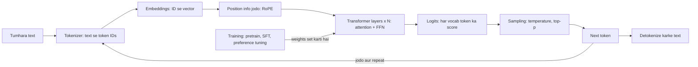
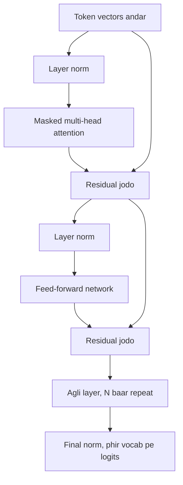
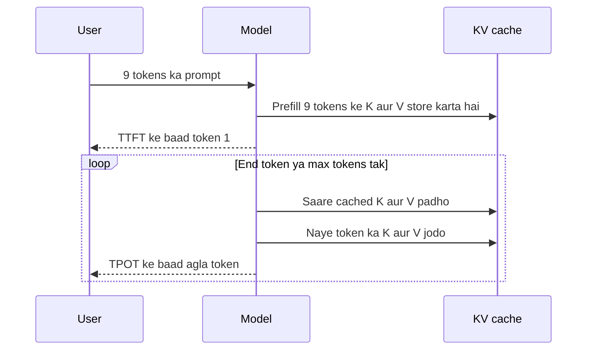

# How LLMs Work

Ye page batata hai ki large language model ke andar asal me kya hota hai: tumhare type kiye text se lekar model ke wapas bheje shabdon tak. Har agent, RAG system aur AI feature isi machine ke upar bana hai. Interviewers yahin se shuru karte hain, ye check karne ke liye ki tum sirf API call nahi, engine bhi samajhte ho.

**Is page ke baad tum ye jawab de paoge:**
- "LLM ko prompt bhejne pe kya-kya hota hai, step by step batao."
- "Model 'strawberry' me r kyun nahi gin paata?"
- "Attention sequence length me quadratic kyun hai, aur iski keemat kya hai?"
- "GQA kya hai, aur ye KV cache ko chhota kyun karta hai?"
- "Temperature 0 rakha phir bhi alag answers aa rahe hain. Kyun?"
- "Mixture of Experts ke trade-offs kya hain?"
- "Reasoning model kab use karoge, aur kab nahi?"
- "LLMs hallucinate kyun karte hain, aur isko kam kaise karte ho?"

## Pehle ye shabd samjho

| Shabd | Simple matlab |
|---|---|
| Token | Text ka chhota tukda, jaise "chai" ya "ing". Model letters nahi, tokens padhta aur likhta hai. |
| Tokenizer | Wo program jo text ko tokens me kaatta hai aur har token ko ek number (ID) deta hai. |
| Vocabulary | Model ke saare tokens ki fixed list, aam taur pe 32,000 se 200,000 tokens. |
| Parameter (weight) | Model ke andar ek seekha hua number. "7B model" me 7 billion aise numbers hain. |
| Vector | Numbers ki list, jaise [0.2, -1.3, 0.7]. Model saara kaam inhi se karta hai. |
| Embedding | Wo vector jo ek token ko represent karta hai. Milte-julte matlab ke vectors paas hote hain. |
| Logit | Har possible next token ko model ka diya raw score. Zyada score matlab zyada likely. |
| Softmax | Formula jo raw scores ko probabilities me badalta hai, jinka total 1 hota hai. |
| Attention | Wo step jahan har token pichle tokens ko dekhta hai aur relevant cheez chunta hai. |
| Transformer | Saare modern LLMs ka neural network design, stacked attention blocks se bana. |
| Context window | Ek call me model zyada se zyada kitne tokens dekh sakta hai. |
| Inference | Trained model se output banwana. Training seekhna hai, inference jawab dena. |
| VRAM | GPU ki memory. Model aur uska working data yahin fit hona chahiye. |
| KV cache | Pichle tokens ka saved attention data, taaki har naye token pe dobara compute na ho. |

## Big picture

LLM ek function hai jo tokens ki list leta hai aur vocabulary ke har token ko score deta hai: "iske next aane ke chances kitne hain?" Tumhara text tokens me kat-ta hai. Har token ek vector (embedding) banta hai. Vectors transformer layers ke stack se guzarte hain, jahan attention har token ko pichle tokens se matlab uthane deta hai. Last layer logits deti hai. Sampling rule ek token chunta hai. Wo token input me jud jaata hai, aur poora process tab tak repeat hota hai jab tak answer poora na ho. Is page ki baaki har cheez in boxes me se kisi ek ki detail hai.



## LLM asal me kya hai

**Ek line me:** LLM ek bahut bada function hai jo next token predict karta hai, aur trillions tokens ke text pe train hua hai taaki uski predictions kaam ki ho jaayein.

**Ye kyun chahiye:** Language ke rules haath se likhna scale nahi karta. Cases bahut zyada hain. Isliye model ko bahut saara text dikhate hain aur patterns usse khud seekhne dete hain. "Next word predict karo" aisa task hai jo model ko grammar, facts aur thoda reasoning seekhne pe majboor karta hai.

**Aise socho:** Phone keyboard ka autocomplete. Tum "Happy" type karte ho, wo "birthday" suggest karta hai. LLM wahi idea hai, ek billion guna bada, aur loop me chalta hai taaki poore pages likh sake.

**Kaise kaam karta hai, step by step:**
1. **Task.** "The capital of India is" diya, model har token ki probability deta hai. " New" ko 0.92 mil sakta hai. " Mumbai" ko 0.03.
2. **Parameters hi knowledge hain.** Model zyada tar numbers ki badi tables (matrices) hai. Ye numbers parameters hain. Shuru me random hote hain.
3. **Training.** Real text daalo, model se har next token predict karwao, aur naapo kitna galat tha ("loss"). Gradient descent naam ka algorithm har parameter ko thoda sa khiskata hai taaki error kam ho. Ye trillions tokens pe repeat hota hai. Jaise Llama 3 lagbhag 15 trillion tokens pe pretrain hua tha.
4. **Inference.** Training ke baad parameters freeze ho jaate hain. Hum sirf model ko forward chala ke predictions lete hain. API call pe yahi hota hai.
5. **Memory me size.** Har parameter ek number ki tarah store hota hai. 16-bit format (FP16 ya BF16) me ek number 2 bytes leta hai. To 7B model ko sirf weights rakhne ke liye 7B × 2 bytes = **14 GB** chahiye. 70B model ko lagbhag 140 GB, matlab kam se kam do 80 GB GPUs.

| | Training | Inference |
|---|---|---|
| Goal | Parameters seekhna | Parameters use karna |
| Parameters badalte hain? | Haan, har step pe | Nahi, frozen |
| Memory per parameter | Lagbhag 16 bytes (weights, gradients, optimizer state) | FP16 me 2 bytes, INT8 me 1, 4-bit me 0.5 |
| Kaun karta hai | Model labs, ek baar, hafton tak | Tum, har request pe |

**Interview tip:** "LLM kya hai, ek sentence me?" Bolo: "Ek transformer jo next token predict karne ke liye train hua hai. Inference pe wo yahi prediction loop me chalata hai, ek-ek token sample karke, aur jo bhi useful karta hai wo usi next-token training me seekhe patterns se aata hai."

**Common galti:**
- Ye bolna ki model cheezein "lookup" karta hai. Uske paas koi database nahi. Uski knowledge weights me compressed hai, aur galat ya purani ho sakti hai.
- Bhoolna ki memory cost sirf weights ki nahi. Inference pe KV cache ke liye bhi jagah chahiye (neeche dekho).

## ⭐ Tokens aur tokenization

**Ek line me:** Text ko tokens (characters ke common tukde) me kaata jaata hai aur har token ko ek integer ID milti hai, kyunki model sirf ek fixed list ke numbers ke saath kaam kar sakta hai.

**Ye kyun chahiye:** Model ko fixed vocabulary chahiye. Poore words use karna fail hota hai: millions words hain, upar se typos, naam aur code. Single characters chalte hain par sequences bahut lambe ho jaate hain, aur lambe sequences slow aur mehenge hain. Subword tokens beech ka raasta hain: common words ek token, rare words tukdon me.

**Aise socho:** Kirana shop jo common orders ke ready bags rakhta hai. "1 kg atta + 1 kg cheeni" itna common hai ki ek hi bag hai. Rare order khule saamaan se banta hai. Tokenization bhi yahi karta hai: frequent letter groups ek token, rare wale chhote tukdon se.

**How it works, step by step (Byte Pair Encoding, BPE):** BPE wo method hai jo GPT, Llama aur zyada tar LLMs use karte hain. Ye sabse frequent symbol pair ko baar-baar merge karke vocabulary banata hai.

Chhota training corpus, har word kitni baar aaya: `hug` ×10, `pug` ×5, `pun` ×12, `bun` ×4, `hugs` ×5.

1. **Single characters se shuru.** Vocabulary = `b, g, h, n, p, s, u`. Har word split: `h u g`, `p u g`, `p u n`, `b u n`, `h u g s`.
2. **Har adjacent pair gino.** `u g` aata hai hug (10) + pug (5) + hugs (5) = **20**. `u n` aata hai pun (12) + bun (4) = 16. `h u` aata hai 10 + 5 = 15.
3. **Top pair merge karo.** `u g` jeeta, to token `ug` add karo. Words ban gaye `h ug`, `p ug`, `p u n`, `b u n`, `h ug s`.
4. **Phir gino aur merge karo.** Ab `u n` (16) top pe hai. `un` add. Words: `p un`, `b un`.
5. **Phir se.** `h ug` (10 + 5 = 15) top pe. `hug` add. Ab `hug` ek token hai aur `hugs` = `hug` + `s`.
6. **Target size pe ruko.** Real tokenizers ye tab tak karte hain jab tak vocabulary 32K se 200K tokens ki na ho jaaye. Merges ki ordered list save hoti hai aur naye text pe replay hoti hai.

Modern tokenizers BPE ko characters pe nahi, **bytes** pe chalate hain. Isliye koi bhi text, emoji ya language encode ho jaati hai, kuch bhi "unknown" nahi hota.

**Tokens vs words, numbers me:**

| Fact | Lagbhag value |
|---|---|
| English words per token | about 0.75 (yaani 1,000 tokens ≈ 750 words) |
| Characters per token, English | about 4 |
| Hindi, Tamil aur baaki Indic text | same matlab ke liye aksar 2–4 guna zyada tokens, tokenizer pe depend |
| Vocabulary sizes | GPT-2: 50,257. Llama 2: 32,000. Llama 3: lagbhag 128,000. GPT-4o: lagbhag 200,000 |

Hindi mehengi kyun? Tokenizer zyada tar English data pe train hua, to kam Hindi letter groups ko apna token mila. Hindi word bahut chhote tukdon me toot-ta hai. APIs per token bill karti hain, to wahi answer Hindi me 2–3 guna mehenga ho sakta hai aur context window bhi zyada khaata hai. Nayi, badi vocabulary wale tokenizers ye gap kam karte hain.

**"strawberry" me letters ginna kyun fail hota hai:** Model letters dekhta hi nahi. Wo kuch aisa dekhta hai `str` + `aw` + `berry` (exact split tokenizer pe depend), jo teen IDs ban jaate hain. r ginne ke liye usse har token ki spelling yaad honi chahiye. Aksar nahi hoti. Isi wajah se words ulta karna, characters ginna aur lambe numbers pe kuch arithmetic bhi mushkil hota hai.

**Badi vocabulary ek trade-off hai:**
- Badi vocabulary: text pe kam tokens, to har sentence fast aur sasta, aur bahut languages ke liye behtar.
- Keemat: embedding table aur output layer badhti hai. 128,000 tokens aur 4,096 numbers per vector ke saath ek table 128,000 × 4,096 ≈ 0.5B parameters hai.

```python
# pip install tiktoken
import tiktoken

enc = tiktoken.get_encoding("o200k_base")  # GPT-4o models ka tokenizer

for text in ["strawberry", "unbelievable", "Mujhe chai chahiye", "मुझे चाय चाहिए"]:
    ids = enc.encode(text)
    # har ID alag decode karo taaki asli tukde dikhein
    pieces = [enc.decode_single_token_bytes(i).decode("utf-8", errors="replace") for i in ids]
    print(f"{text!r}: {len(ids)} tokens -> {pieces}")

# Rough cost check: paisa tokens ka lagta hai, words ka nahi
prompt = "Summarise this customer complaint in two lines. " * 50
print("tokens:", len(enc.encode(prompt)), "words:", len(prompt.split()))
```

**Code kya karta hai:**
- `tiktoken` library se ek real tokenizer (`o200k_base`) load karta hai.
- Har string ko token IDs me encode karta hai aur har ID ka tukda print karta hai.
- Dikhata hai ki ek English word kai tokens ho sakta hai aur Devanagari text ko aam taur pe zyada tokens lagte hain.
- Token count ko word count se compare karta hai, jisse API cost estimate hoti hai.

**Interview tip:** "Model letters ginne me kyun atakta hai?" Bolo: "Wo letters nahi, subword tokens dekhta hai. 'strawberry' teen tokens ho sakta hai, aur model ko har ek ki spelling yaad honi chahiye. Fix: pehle word ko letter by letter spell karwao, ya code tool de do."

**Common galti:**
- Cost ya context limit words me estimate karna. Hamesha model ke apne tokenizer se tokens gino, kyunki har model family alag tokenize karti hai.
- Maan lena ki non-English users ka kharcha English jitna hai. Indic languages ke liye zyada tokens ka budget rakho.

## ⭐ Embeddings

**Ek line me:** Har token ID ek vector me badalti hai jisme kuch hazaar numbers hote hain, aur model ye vectors aise seekhta hai ki milte-julte matlab wale tokens paas-paas aa jaayein.

**Ye kyun chahiye:** 4,821 jaisi ID sirf ek label hai. Matlab ke baare me kuch nahi batati. 4,821 matlab me 4,822 ke "paas" nahi hai. Model ko aisa representation chahiye jahan math (distance, direction) matlab se match kare.

**Aise socho:** Mumbai ka map. Kisi tarah se milti-julti jagahein paas hoti hain: saare cricket grounds ek area me, saare banks dusre me. Embedding ek map pe position hai, bas do nahi, hazaaron directions ke saath. "King" aur "queen" padosi hain. "King" aur "samosa" door.

**Kaise kaam karta hai, step by step:**
1. Model ke paas ek embedding table hai: har vocabulary token ki ek row. Llama 2 7B me 32,000 rows, har row me 4,096 numbers.
2. Lookup: token ID 4,821 matlab "row 4,821 lo". Wahi row token ka starting vector hai.
3. Ye rows parameters hain. Training inhe aise khiskati hai ki useful patterns ban jaayein. Koi inhe haath se nahi likhta.
4. Paas-paas hona aam taur pe **cosine similarity** se naapte hain: 1 matlab same direction, 0 matlab koi rishta nahi.
5. 3 numbers wale vectors ka chhota example: `cat = [0.9, 0.1, 0.0]`, `dog = [0.8, 0.2, 0.1]`, `invoice = [0.0, 0.1, 0.9]`. Cat aur dog ek hi taraf point karte hain (cosine ≈ 0.98). Cat aur invoice nahi (cosine ≈ 0.01).
6. Model ke andar ye pehle vectors sirf shuruaat hain. Attention layers ke baad har vector apne context ka matlab bhi le leta hai. To "river bank" aur "bank loan" me "bank" ke vectors alag ho jaate hain.

**Semantic search se connection:** Ek alag **embedding model** (jaise sentence-transformer ya embeddings API) poore sentence ko ek vector banata hai. Tum apne documents ke vectors vector database me rakhte ho. Query time pe sawal ko embed karke sabse paas ke document vectors dhoondhte ho. "Mera paisa wapas kaise milega?" se "Refund policy" naam ka doc mil jaata hai, chahe ek bhi word match na ho. Yahi RAG ka core hai.

**Interview tip:** "LLM ke andar ke embeddings aur search wale embeddings me kya farak hai?" Bolo: "LLM ke andar har token ka vector hota hai jo layer by layer refine hota hai. Search ke liye alag model use karte hain jo aise train hua hai ki ek sentence ya chunk ka ek vector matlab pakad le, aam taur pe contrastive training se. Idea same, model aur goal alag."

**Common galti:**
- Do alag embedding models ke vectors compare karna. Unke spaces ka koi rishta nahi, to distance ka koi matlab nahi.
- Sochna ki vector ka har number ek saaf human concept hai jaise "jaanwar hai". Matlab bahut saare numbers me faila hota hai.

## ⭐ Transformer aur self-attention

**Ek line me:** Transformer identical layers ka stack hai; har layer me attention har token ko pichle tokens se information kheenchne deta hai, aur phir ek feed-forward network har token ko akele process karta hai.

**Ye kyun chahiye:** Purane models (RNNs) text ek-ek word padhte the aur ek hi memory aage pass karte the. Door ke links kho jaate the, aur training parallel nahi chal sakti thi. 2017 ke paper "Attention Is All You Need" ne transformer diya. Har token seedha har dusre token ko dekh sakta hai, aur training me saare tokens parallel process hote hain.

**Aise socho:** Cricket team meeting. Har player (token) ek sawal poochhta hai: "Pitch ke baare me kaun jaanta hai?" (ye **query** hai). Har player ek badge pehne hai ki usse kya pata hai (ye **key** hai). Jinka badge sawal se match karta hai unpe zyada dhyan jaata hai. Phir har player apne asli notes share karta hai (ye **value** hai). Meeting se tum notes ka mix lekar nikalte ho, jitna relevant banda utna zyada weight.

**How it works, step by step (ek attention head):**
1. Har token ka vector teen learned matrices se multiply hota hai, teen naye vectors milte hain: **Q** (query: main kya dhoondh raha hoon?), **K** (key: mere paas kya hai?), aur **V** (value: chuna gaya to main kya dunga?).
2. Current token ke liye har pichle token ke saath score nikalo: iske Q aur unke K ka dot product. High score matlab "mere liye relevant".
3. Scores ko √d_k (vector size ka square root) se divide karo. Isse numbers bahut bade nahi hote aur softmax bahut sharp nahi hota.
4. Softmax lagao taaki scores weights ban jaayein jinka total 1 ho.
5. Output = V vectors ka weighted sum. Formula: `Attention(Q, K, V) = softmax(Q·Kᵀ / √d_k) · V`.

**Worked example: "the river bank".** Hume "bank" ka naya vector chahiye. Maan lo bank ki query ke har key ke saath scaled scores ye hain: `the` = 0.1, `river` = 2.0, `bank` = 1.0.

| Token | Score | Softmax weight |
|---|---|---|
| the | 0.1 | 0.10 |
| river | 2.0 | 0.66 |
| bank | 1.0 | 0.24 |

2-number value vectors lo jahan pehla number "paani" aur dusra "paisa" hai: `V_the = [0, 0]`, `V_river = [1, 0]`, `V_bank = [0.5, 0.5]` (akele me confusing).

Bank ka output = 0.10 × [0, 0] + 0.66 × [1, 0] + 0.24 × [0.5, 0.5] = **[0.78, 0.12]**. Naya "bank" vector zor se "paani" ki taraf jhukta hai. "the bank approved my loan" me "loan" ko high weight milta, aur bank "paisa" ki taraf jhukta. Context se matlab aise badalta hai.

**Causal mask.** Generate karte waqt token future nahi dekh sakta. Isliye aage ki positions ke scores softmax se pehle minus infinity kar diye jaate hain, jisse unka weight bilkul 0 ho jaata hai. Token 3 sirf token 1, 2 aur 3 pe attend kar sakta hai. Isiliye in models ko "causal" ya "decoder-only" kehte hain.

**Multi-head attention.** Ek head ek tarah ka rishta seekhta hai. Isliye har layer kai heads parallel chalati hai, jaise 128 size ke 32 heads (32 × 128 = 4,096). Ek head grammar track kar sakta hai, dusra pronoun ko naam se jodta hai, teesra quotes track karta hai. Unke outputs jod ke ek aur matrix se mix hote hain.

**Ek layer ka baaki hissa (decoder block):**
1. **Layer norm** har vector ko stable range me rescale karta hai taaki training phat na jaaye. Modern models ise har sub-step se pehle lagate hain ("pre-norm"), aksar RMSNorm naam ke variant ke saath.
2. **Attention**, upar jaisa.
3. **Residual connection:** attention ka output input me wapas jodo (`x = x + attention(x)`). Har layer sirf ek correction jodti hai, to original signal kabhi khota nahi aur deep stacks achhe se train hote hain.
4. **Feed-forward network (FFN):** har token pe alag se do-teen matrix multiplies, aam taur pe width ko 3–4 guna phaila ke wapas laate hain. Lagbhag do-tihai parameters yahin hote hain. Attention ko "information ikattha karna" aur FFN ko "uspe sochna aur stored facts yaad karna" samjho.
5. Ek aur residual add. Phir agli layer. 7B model me 32 aisi layers hoti hain. 70B me 80.



**Attention O(n²) kyun hai.** n tokens ho to har token har dusre token ke saath score karta hai. Ye n × n scores ki table hai, har head, har layer me.

| Sequence length n | Scores per head per layer (n²) |
|---|---|
| 1,000 | 1 million |
| 4,000 | 16 million |
| 32,000 | lagbhag 1 billion |
| 128,000 | lagbhag 16 billion |

Prompt length double karo to attention ka kaam chaar guna. FFN wala hissa sirf linear badhta hai. To chhote prompts pe FFN haavi hota hai, aur bahut lambe prompts pe attention. FlashAttention (2022) same result tiles me nikalta hai, poori n × n table kabhi store nahi karta. Isse memory linear ho jaati hai aur speed bahut badhti hai, par compute ab bhi quadratic hai.

```python
import numpy as np

def softmax(x, axis=-1):
    x = x - x.max(axis=axis, keepdims=True)   # numerical safety ke liye max ghatao
    e = np.exp(x)
    return e / e.sum(axis=axis, keepdims=True)

def causal_self_attention(X, Wq, Wk, Wv):
    """X: (n_tokens, d_model). Returns (n_tokens, d_head)."""
    Q, K, V = X @ Wq, X @ Wk, X @ Wv           # har token ko query, key, value me project karo
    d_k = Q.shape[-1]
    scores = Q @ K.T / np.sqrt(d_k)            # (n, n): har token vs har token -> O(n^2)
    n = X.shape[0]
    mask = np.triu(np.ones((n, n)), k=1)       # diagonal ke upar 1s = future tokens
    scores = np.where(mask == 1, -np.inf, scores)  # future chhupao
    weights = softmax(scores)                  # har row ka total 1
    return weights @ V, weights                # values ka weighted mix

rng = np.random.default_rng(0)
n, d_model, d_head = 4, 8, 4
X = rng.normal(size=(n, d_model))              # 4 token vectors
Wq, Wk, Wv = (rng.normal(size=(d_model, d_head)) for _ in range(3))
out, w = causal_self_attention(X, Wq, Wk, Wv)
print(np.round(w, 2))   # lower-triangular: token i sirf tokens 0..i pe attend karta hai
```

**Code kya karta hai:**
- Teen weight matrices se har token vector ko Q, K aur V me project karta hai.
- n × n score table banata hai, quadratic cost yahin se aati hai.
- Causal mask lagata hai taaki koi token aage ke tokens na dekhe.
- Har row ko softmax karke weights banata hai aur value vectors mix karta hai.
- Weight table print karta hai, jo mask ki wajah se lower-triangular hai.

**Interview tip:** "Attention quadratic kyun hai, aur log iska kya karte hain?" Bolo: "n tokens me se har ek n tokens ke saath score nikalta hai, to har head, har layer me n² scores. FlashAttention tiling se compute wahi rakhta hai par n² memory hata deta hai. Sliding-window ya sparse attention compute hi kam karte hain. Inference pe KV cache ki wajah se har naya token sirf n kaam karta hai, par cache context ke saath linear badhta hai."

**Common galti:**
- Kehna ki FlashAttention attention ko linear bana deta hai. Memory linear hoti hai; compute ab bhi n² hai.
- Q, K aur V ko mix up karna. Q aur K tay karte hain **kitna** attend karna hai. V hai **kya** aage jaata hai.

## Attention variants: MHA, MQA, GQA

**Ek line me:** Ye variants tay karte hain ki query heads kitne key/value heads share karte hain, aur yahi seedha KV cache ka size set karta hai.

**Ye kyun chahiye:** Generation ke waqt model har pichle token ke K aur V vectors save karta hai (KV cache) taaki dobara compute na karne pade. Standard attention me ye cache lambe context aur bade batches pe bahut bada ho jaata hai. Ek GPU kitne users serve kare, iski limit compute nahi, memory ban jaati hai.

**Aise socho:** Classroom me har student (query head) ki apni textbook (apna K aur V). Mehenga hai. Ya poori class ek textbook share kare, sasta par bheed. Ya chaar-chaar ke group ek book share karein. Wahi sweet spot hai.

**Kaise kaam karta hai, step by step:**
1. **MHA (multi-head attention):** har query head ka apna K aur V head. 32 query heads → 32 KV heads. Original transformer, Llama 2 7B.
2. **MQA (multi-query attention):** saare query heads **ek** K aur V head share karte hain. Cache 32 guna chhota. Quality thodi girti hai aur training kam stable ho sakti hai. PaLM aur Falcon me use hua.
3. **GQA (grouped-query attention):** query heads groups me bante hain, har group ek KV head share karta hai. Jaise 32 query heads aur 8 KV heads, yaani har KV head pe 4 query heads. Quality MHA ke kareeb, aur cache 4 guna chhota. Llama 2 70B, Llama 3 aur Mistral me use hota hai.
4. **Math.** KV cache bytes per token = 2 (K aur V) × layers × KV heads × head size × bytes per number.
   - Llama 2 7B, MHA: 2 × 32 × 32 × 128 × 2 bytes = **512 KB per token**. 4,000-token chat 2 GB leti hai.
   - Llama 3 8B, 8 KV heads wala GQA: 2 × 32 × 8 × 128 × 2 = **128 KB per token**. Wahi chat 0.5 GB.
5. 4 guna chhota cache matlab same GPU pe 4 guna zyada concurrent users ya 4 guna lamba context.

| | MHA | GQA | MQA |
|---|---|---|---|
| KV heads (32 query heads ke liye) | 32 | 8 (typical) | 1 |
| KV cache size | 1× | 1/4× | 1/32× |
| Quality | Best | Lagbhag MHA | Thodi kam |
| Kahan dikhta | GPT-2, Llama 2 7B | Llama 3, Mistral, zyada tar naye models | PaLM, Falcon |

DeepSeek models aur aage jaate hain MLA (multi-head latent attention) se, jo cache karne se pehle K aur V ko ek chhote vector me compress karta hai. Caches pe aur detail [Inference and Serving](15-inference-serving.md) me.

**Interview tip:** "GQA kya hai aur sab ise kyun use karte hain?" Bolo: "Grouped-query attention me kai query heads ek key/value head share karte hain. 32 query heads aur 8 KV heads ke saath KV cache 4 guna chhota hota hai, quality lagbhag same. Decoding memory-bound hai aur cache batch size limit karta hai, to iska seedha matlab hai per GPU zyada users."

**Common galti:**
- Sochna ki GQA query heads kam karta hai. Ye sirf K aur V heads kam karta hai.
- Bhoolna ki KV cache context length **aur** batch size dono ke saath badhta hai.

## Positional encodings

**Ek line me:** Attention akela word order ignore karta hai, isliye model har token me position ki info jodta hai, aur modern models ye RoPE se karte hain, jo vectors ko position ke hisaab se ek angle se ghumata hai.

**Ye kyun chahiye:** Attention ka math ek weighted sum hai. Tokens shuffle kar do to bhi same result deta hai. Par "dog bites man" aur "man bites dog" ka matlab alag hai. Model ko pata hona chahiye kaun sa token kahan hai.

**Aise socho:** Ghadi ki suyi. Har position pe suyi thodi aur ghoomti hai. Paas-paas ke do tokens ki suyi lagbhag same angle pe hoti hai. Door ke do tokens ke angles bahut alag. Model do suiyon ka gap padh sakta hai, jo unki doori hai.

**Kaise kaam karta hai, step by step:**
1. **Sinusoidal (original 2017):** har token ke vector me sine aur cosine waves ka fixed pattern jodo. Position 5 ko hamesha same pattern milta hai. Simple, par training se lambi lengths pe kamzor.
2. **Learned absolute (GPT-2):** position 0, 1, 2 … ek maximum tak (GPT-2 ke liye 1,024) har ek ka trained vector. Model us maximum ke aage ja hi nahi sakta.
3. **RoPE (rotary position embedding, Llama, Mistral, Qwen aur zyada tar open models me):** kuch jodo mat. Q aur K vectors ko ghumao. Har vector ko numbers ke pairs me baanto, aur har pair ko `position × θ` angle se ghumao, har pair ki speed θ alag.
4. **Rotation kyun kaam karta hai:** position 10 ki query aur position 7 ki key ka dot product lo, to rotations cancel ho jaate hain bas difference, 3, bachta hai. To attention score **relative distance** pe depend karta hai, jo language ko chahiye.
5. **Context extension:** 4K ya 8K positions pe trained model uske aage naye, untrained angles dekhta hai aur toot jaata hai. Fixes angles ko daba ya kheench dete hain taaki lambi positions jaani-pehchaani lagein:
   - **Position interpolation:** positions ko ek factor (jaise 4) se divide karo, to 32K positions trained 8K range pe map ho jaati hain.
   - **NTK-aware scaling aur YaRN:** tez ghoomne wale pairs (paas ki detail) ko kam aur dheere wale (lambi doori) ko zyada scale karo. YaRN ko sirf chhota fine-tune chahiye. Llama 3.1 aisi hi RoPE scaling se 128K tokens tak pahunchta hai.

**Interview tip:** "Learned positions ki jagah RoPE kyun?" Bolo: "RoPE Q aur K ko ghuma ke position encode karta hai, to attention score sirf relative distance pe depend karta hai. Koi parameter nahi jodta, aur YaRN jaise interpolation tricks se chhote fine-tune ke saath context ko training length se kaafi aage badha sakte ho."

**Common galti:**
- Sochna ki 128K window wala model poore 128K ko barabar achhe se use karta hai. Quality aksar advertised limit se pehle hi girti hai.
- Kehna ki RoPE token embedding me add hota hai. Ye har attention layer ke andar Q aur K pe lagta hai.

## ⭐ Generation loop: prefill aur decode

**Ek line me:** Model pehle tumhara poora prompt ek parallel pass me padhta hai (prefill), phir answer ek-ek token likhta hai (decode), har naya token wapas input me daal ke.

**Ye kyun chahiye:** Model ek pass me sirf **ek** next token predict karta hai. 200 tokens likhne ke liye 200 passes chahiye. Do phases samajhne se latency, cost aur zyada tar serving tricks samajh aati hain.

**Aise socho:** IRCTC agent aur ek lamba form. Pehle wo tumhara poora form ek baar me padhta hai (prefill). Phir ticket ek-ek character type karta hai, har character se pehle form dobara dekh ke (decode). Padhna tez hai. Type karna slow hissa hai.

**Kaise kaam karta hai, step by step:**
1. Prompt ko **tokenize** karo: "Translate to Hindi: Good morning" → maan lo 9 tokens.
2. **Prefill:** saare 9 tokens model se parallel chalao. Har layer ka K aur V har token ke liye KV cache me save karo. Last position ke logits pehla output token dete hain. Yahan tak ka time = **time to first token (TTFT)**.
3. **Logits se probabilities:** model har vocab token ka ek logit deta hai (maan lo 128,000 numbers). Softmax inhe probabilities banata hai.
4. Ek token **sample** karo, jaise "सु" (sampling neeche).
5. **Decode:** sirf naya token andar daalo. Wo apna Q, K aur V nikalta hai, saare pichle tokens ke cached K aur V pe attend karta hai, aur next token ke logits deta hai. Uska K aur V cache me jodo.
6. **Repeat** jab tak model end-of-sequence token na de ya `max_tokens` na aa jaaye. Tokens ke beech ka gap = **time per output token (TPOT)**.
7. IDs ko wapas text me **detokenize** karo aur user ko stream karo.

| | Prefill | Decode |
|---|---|---|
| Tokens per pass | Saare prompt tokens ek saath | Har sequence ka ek naya token |
| Bottleneck | Compute (bahut matrix multiplies, GPU busy) | Memory bandwidth (ek token ke liye saare weights load) |
| Latency metric | Time to first token | Time per output token |
| Cost driver | Prompt length | Output length |

**Decode memory-bound kyun hai:** 7B model se ek token banane ke liye GPU ko memory se poore 14 GB weights padhne padte hain. H100 lagbhag 3.35 TB/s padhta hai, to floor lagbhag 14 GB ÷ 3,350 GB/s ≈ 4 ms per token hai, math kitna bhi tez ho. Kai users ko batch karne se ek weight read se kai tokens bante hain. Isiliye APIs output token ka input token se zyada charge karti hain.



**Interview tip:** "Prompt bhejne pe kya hota hai, walk me through." Bolo: "Text tokenize hoke IDs banta hai. Har ID ka embedding vector lookup hota hai. Prefill me saare prompt tokens har transformer layer se parallel jaate hain, attention causal mask use karta hai, aur K, V cache hote hain. Last position ka vector vocabulary pe logits me project hota hai, softmax probabilities deta hai, aur sampler ek token chunta hai. Phir decode KV cache ke saath ek-ek token repeat karta hai jab tak stop token ya max tokens na aaye. Tokens detokenize hoke stream hote hain."

**Common galti:**
- Sochna ki model pehle poora answer plan karta hai. Wo ek-ek token pe commit karta hai aur wapas nahi le sakta.
- Sirf total latency optimise karna. Chat me users TTFT feel karte hain, batch jobs me throughput matter karta hai.

## ⭐ Sampling: next token chunna

**Ek line me:** Sampling wo rule hai jo model ki probabilities ko ek chune hue token me badalta hai, aur temperature, top-p jaise settings control karte hain ki output kitna safe ya kitna varied ho.

**Ye kyun chahiye:** Hamesha sabse likely token lena text ko repetitive aur bore banata hai, aur loops me atak sakta hai. Saare 128,000 tokens me se khula chunna bakwaas ghusa deta hai. In do extremes ke beech knobs chahiye.

**Aise socho:** Swiggy pe order. Greedy = hamesha wahi biryani. Temperature = aaj kitna adventurous mood hai. Top-k = "sirf top 5 restaurants dekho". Top-p = "sirf wo restaurants dekho jo milke mere 90% usual orders cover karte hain".

**How it works, step by step.** Prompt: "The chai was very". Model ke top teen logits: `hot` = 2.0, `sweet` = 1.0, `purple` = 0.1.

1. **Greedy:** sabse bada logit chuno. Hamesha `hot`. Same input → same output, theory me.
2. **Temperature T:** har logit ko T se divide karo, phir softmax.

| Temperature | hot | sweet | purple | Asar |
|---|---|---|---|---|
| 0.5 | 0.864 | 0.117 | 0.019 | Sharp, safe |
| 1.0 | 0.659 | 0.242 | 0.099 | Model ki apni distribution |
| 2.0 | 0.502 | 0.304 | 0.194 | Flat, zyada random |

   T = 1 check karo: e^2.0 = 7.39, e^1.0 = 2.72, e^0.1 = 1.11. Total = 11.21. To hot = 7.39 / 11.21 = 0.659. T 0 ke paas greedy ban jaata hai.
3. **Top-k:** sirf k sabse likely tokens rakho, renormalise karo, sample karo. k = 2 pe `purple` hat jaata hai. Problem: k fixed hai, par kabhi 1 option sahi hota hai aur kabhi 50.
4. **Top-p (nucleus):** probability se sort karo aur sabse chhota set rakho jiska total p tak pahunche. T = 1 aur p = 0.9 pe: hot (0.659) + sweet (0.242) = 0.901 ≥ 0.9, to ye do rakho. Renormalise: hot 0.731, sweet 0.269. Set ka size model ke confidence ke hisaab se badalta hai.
5. **Min-p:** wo tokens rakho jinki probability kam se kam `min_p × top probability` ho. min_p = 0.2 pe cut-off 0.2 × 0.659 = 0.132 hai, to `purple` (0.099) hat jaata hai. High temperature pe achha chalta hai.
6. **Repetition controls:** repetition penalty pehle aa chuke tokens ke logits kam karta hai (jaise positive logit ko 1.1 se divide). OpenAI-style APIs `frequency_penalty` (har repeat pe badhta) aur `presence_penalty` (flat, token ek baar aaya to) deti hain. Halka use karo; high values naam aur code bigaad deti hain.
7. **Zyada tar libraries me order:** penalties, phir temperature, phir top-k / top-p / min-p filters, phir sample.

**Kaunse kaam ke liye kaunsi settings:**

| Task | Settings | Kyun |
|---|---|---|
| Extraction, classification, JSON, tool calls | Temperature 0 se 0.2 | Ek sabse likely, consistent answer chahiye |
| Code generation | Temperature 0.2 ke aas-paas, top-p 0.95 | Zyada tar precise; kai tries sample karte waqt thodi variety madad karti hai |
| Chat assistant | Temperature 0.7, top-p 0.9 | Natural par topic pe |
| Brainstorming, stories, marketing copy | Temperature 0.9 se 1.2, top-p 0.95 ya min-p 0.05 | Zyada variety |

Reasoning models aksar ye settings fix ya ignore karte hain; har provider ke docs follow karo.

**Seed aur determinism ke caveats.** Temperature 0 same output ki guarantee nahi deta:
1. GPUs batch size aur kernel choice ke hisaab se numbers alag order me jodte hain. Floating-point addition associative nahi hai, to `(a + b) + c` aur `a + (b + c)` last bits me alag ho sakte hain.
2. Tumhari request dusre users ki requests ke saath batch hoti hai, to batch size har call pe badalta hai, aur saath me adds ka order bhi. Logits me chhota farak do tokens ke beech ka near tie palat sakta hai. Ek flip ke baad baaki text alag raah pakad leta hai.
3. MoE models me, jab experts ki capacity limit hoti hai, batch ki dusri requests bhi tay kar sakti hain ki token kis expert pe jaaye.
4. Hosted models silently update hote hain. `seed` parameter, jahan milta hai, sirf "best effort" hai.

Reproducibility ke liye model version pin karo, poora prompt aur settings log karo, aur evals me kai baar sample karke spread naapo.

```python
import numpy as np

def sample_next(logits, temperature=1.0, top_k=None, top_p=None, rng=None):
    rng = rng or np.random.default_rng()
    logits = np.asarray(logits, dtype=float)
    if temperature == 0:
        return int(np.argmax(logits))              # greedy
    logits = logits / temperature                  # sharp (<1) ya flat (>1) karo
    probs = np.exp(logits - logits.max())
    probs /= probs.sum()                           # softmax
    order = np.argsort(probs)[::-1]                # sabse likely pehle
    keep = np.ones_like(probs, dtype=bool)
    if top_k is not None:
        keep[order[top_k:]] = False                # rank k ke baad sab hatao
    if top_p is not None:
        cum = np.cumsum(probs[order])
        cutoff = np.searchsorted(cum, top_p) + 1   # top_p tak pahunchne wala sabse chhota set
        keep[order[cutoff:]] = False
    probs = np.where(keep, probs, 0.0)
    probs /= probs.sum()                           # bache hue ko renormalise karo
    return int(rng.choice(len(probs), p=probs))

vocab = ["hot", "sweet", "purple"]
logits = [2.0, 1.0, 0.1]
rng = np.random.default_rng(42)
picks = [vocab[sample_next(logits, 1.0, top_p=0.9, rng=rng)] for _ in range(1000)]
print({w: picks.count(w) for w in vocab})          # lagbhag 730 hot, 270 sweet, 0 purple
```

**Code kya karta hai:**
- Temperature 0 pe arg-max token lautata hai (greedy).
- Logits ko temperature se divide karke softmax lagata hai.
- Kept set ke bahar ke tokens ko zero karke top-k aur top-p filters lagata hai.
- Renormalise karke ek token ID sample karta hai.
- 1,000 samples chala ke dikhata hai ki top-p 0.9 kabhi `purple` nahi chunta aur baaki do me lagbhag 73/27 baantta hai.

**Interview tip:** "Temperature 0 phir bhi alag answers deta hai. Kyun?" Bolo: "Temperature 0 greedy hai, par logits khud har run me bit-identical nahi hote. Dusri requests ke saath batching GPU kernels me floating-point additions ka order badal deti hai. Chhota farak near tie palat sakta hai, aur uske baad text alag ho jaata hai. MoE routing aur silent model updates aur variance laate hain. Versions pin karo, sab log karo, aur aise evals banao jo variation jhel sakein."

**Common galti:**
- JSON extraction ke liye temperature 1.0 rakhna aur phir broken output ke liye model ko dosh dena.
- Temperature aur top-p dono ko ek saath zor se tune karna. Ek badlo, aam taur pe temperature, dusre ko default pe chhodo.

## Context window

**Ek line me:** Context window ek call ke liye model ki working memory hai; jo bhi wo use kare wo isme fit hona chahiye, aur isme har token paisa, time aur attention khaata hai.

**Ye kyun chahiye:** Model ki calls ke beech koi memory nahi. Tumhare task ke baare me use sirf wahi pata hai jo tumne is baar window me daala. Limit KV cache size aur training wali lengths se aati hai.

**Aise socho:** Library ki ek desk. Tum sirf desk pe rakhe papers se kaam kar sakte ho. Badi desk madad karti hai, par 500 pages daal diye to wo ek zaroori page miss ho jaayega, khaas kar agar wo dher ke beech me daba ho.

**Kaise kaam karta hai, step by step:**
1. **Isme kya bharta hai:** system prompt + tool definitions + retrieved documents + conversation history + user ka message + model ka apna output (hidden reasoning tokens bhi). Output tokens bhi gine jaate hain.
2. **Typical sizes (2025–2026):** kai models 128K se 1M tokens dete hain. 128K tokens lagbhag 96,000 English words hain, karib 300 page ki kitaab.
3. **Length ke saath cost badhti hai:**
   - Paisa: APIs per input token bill karti hain, to 100K-token prompt har call pe 1K-token wale se 100 guna mehenga.
   - Time: prefill time length ke saath badhta hai. Attention wala hissa quadratic badhta hai.
   - Memory: KV cache linear badhta hai. 128 KB per token (Llama 3 8B) pe 100K tokens ek user ke liye lagbhag 12.5 GB hai.
4. **Lost in the middle:** 2023 ki ek study ("Lost in the Middle") ne dikhaya ki models lambe context ke shuru aur end ke facts beech wale facts se kahin behtar use karte hain. Total length badhne pe accuracy bhi girti hai, long-context models pe bhi.
5. **Kya karo:** sirf relevant chunks retrieve karo, instructions shuru me aur sawal end me rakho, purane turns summarise karo, aur stable prefix rakho taaki prompt caching use reuse kar sake. Detail [Memory & Context](05-memory-context.md) me.

**Interview tip:** "Hamare paas 1M-token model hai. Har prompt me saare docs kyun na daal dein?" Bolo: "Har call pe cost aur latency tokens ke saath badhti hai, KV cache limit karta hai kitne users serve kar sakte hain, aur lambe noisy context me lost-in-the-middle ki wajah se quality girti hai. Top relevant chunks ka retrieval aam taur pe sasta, tez aur zyada accurate hai. Long context ek bade document ke one-off analysis ke liye badhiya hai."

**Common galti:**
- Bhoolna ki output aur reasoning tokens bhi window me jagah lete hain.
- Maan lena ki "fit ho gaya" matlab "achhe se use hoga".

## ⭐ Mixture of Experts (MoE)

**Ek line me:** MoE model ki har layer me kai feed-forward "experts" hote hain, aur ek chhota router har token ko unme se sirf kuch ke paas bhejta hai, to bade model ki knowledge chhote model ke per-token compute me milti hai.

**Ye kyun chahiye:** Bade models zyada jaante hain, par per token compute size ke saath badhta hai. MoE ye rishta todta hai. Total parameters (knowledge capacity) bade ho sakte hain jabki active parameters (per token kaam) chhote rehte hain.

**Aise socho:** Bada hospital jisme har floor pe 8 specialists hain. Reception (router) pe har patient ko 2 sabse suitable doctors ke paas bheja jaata hai, saare 8 ke paas nahi. Hospital ke paas 8 doctors ki knowledge hai, par har patient sirf 2 doctors ka time leta hai. Building ko phir bhi saare 8 doctors ke kamre rakhne padte hain.

**How it works, step by step (Mixtral 8x7B):**
1. Har layer me attention hamesha ki tarah shared hai. Akele FFN ki jagah 8 expert FFNs hain.
2. **Router** ek chhoti linear layer hai. Har token ke liye 8 scores deta hai, har expert ka ek.
3. **Top 2** experts chuno. Unke do scores pe softmax mixing weights deta hai, jaise 0.7 aur 0.3.
4. Token ko sirf un 2 experts se chalao. Output = 0.7 × expert A + 0.3 × expert B.
5. Agla token, aur agli layer me wahi token, alag experts chun sakta hai.
6. **Numbers:** Mixtral me lagbhag **47B total** parameters hain (56B nahi, kyunki attention aur embeddings shared hain) par per token sirf lagbhag **13B active**. To per token ye 13B model jaisa compute karta hai.
7. **Memory:** saare 47B parameters VRAM me rehne chahiye, kyunki koi bhi token koi bhi expert maang sakta hai. 2 bytes each pe ye lagbhag 94 GB hai. To memory 47B model jitni chahiye.
8. **Training trick:** load-balancing loss router ko saare experts barabar use karne ke liye dhakelta hai. Warna kuch experts saara traffic le lete hain aur baaki kabhi seekhte hi nahi.

| | Dense 13B | MoE 47B total / 13B active | Dense 47B |
|---|---|---|---|
| Compute per token | Kam | Kam (13B jaisa) | Zyada |
| Weights ke liye VRAM (FP16) | ~26 GB | ~94 GB | ~94 GB |
| Quality | Kam | Kaafi bade dense model ke kareeb | Zyada |
| Serving complexity | Simple | Mushkil: expert parallelism, load balance | Simple |

Bade examples: DeepSeek-V3 me 671B total aur lagbhag 37B active hain, bahut saare chhote experts plus ek shared expert ke saath.

**Trade-offs jo bolne hain:**
- Di gayi quality pe per token sasta aur tez. High-traffic APIs ke liye badhiya.
- Memory pe bhaari, to chhote GPUs ya edge devices ke liye theek nahi.
- Chhote batches me fayda kam: har token alag experts load karta hai, to decode memory-bound hi rehta hai.
- Fine-tuning aur serving zyada complex (routing collapse, GPUs ke paar expert parallelism).

**Interview tip:** "MoE ke trade-offs kya hain?" Bolo: "Bade model ki quality chhote model ke per-token compute pe milti hai, kyunki sirf top-k experts chalte hain. Par saare experts memory me hone chahiye, to VRAM total params se tay hota hai. Serving ko expert parallelism aur achhi batching chahiye, aur training ko load balancing taaki router kuch hi experts pe collapse na ho."

**Common galti:**
- Kehna "8x7B matlab 56B parameters". Shared parts ki wajah se lagbhag 47B hai.
- Kehna "MoE ko kam memory chahiye". Per token kam **compute** chahiye, kam memory nahi.

## ⭐ Reasoning models aur test-time compute

**Ek line me:** Reasoning models final answer se pehle bahut saare intermediate tokens likh ke "sochne" ke liye train hote hain, inference pe extra time aur tokens dekar mushkil problems pe behtar accuracy lete hain.

**Ye kyun chahiye:** Model har token fixed compute se banata hai. Mushkil maths ya coding problem ko ek pass se zyada steps chahiye ho sakte hain. Model ko steps likhne dena use wahin zyada compute deta hai jahan problem ko chahiye. Ise **test-time compute** kehte hain: sirf training pe nahi, answer ke waqt zyada kharch karna.

**Aise socho:** Exam me student. "2 + 2" ka answer seedha likh deta hai. Lambe sum ke liye paper ke side me rough work karta hai. Rough work answer nahi hai, par answer sahi banata hai. Reasoning tokens wahi rough work hain.

**Kaise kaam karta hai, step by step:**
1. **Chain-of-thought prompting (2022):** bas "step by step socho" bolna ya worked examples dikhana models ko multi-step problems me kaafi behtar bana deta tha. Steps working memory ka kaam karte hain.
2. **Thinking tokens:** reasoning models ek lamba hidden ya visible "thinking" section banate hain, kabhi hazaaron tokens, phir chhota final answer. In tokens ka paisa bhi dete ho aur intezaar bhi karte ho.
3. **RL-trained reasoning:** OpenAI ka o1 (2024) aur DeepSeek-R1 (2025) aise problems pe reinforcement learning se train hue jinke answers check ho sakte hain, jaise maths ke results ya tests pass karne wala code. Model try karta hai, final answer sahi ho to reward milta hai, aur seekhta hai kaunse thinking patterns madad karte hain. DeepSeek-R1 ne GRPO (group relative policy optimisation) use kiya: har sawal pe answers ka group sample karo, aur har ek ko group ke average ke relative reward do. Kaam check karna aur backtrack karna jaise behaviours apne aap ubhar aaye.
4. **Self-consistency:** maan lo temperature 0.7 ke aas-paas 5 independent reasoning paths sample karo aur majority final answer lo. 5 me se 4 "42" bolein to answer 42. 5 guna tokens lagte hain par maths-type tasks pe achha accuracy gain milta hai.
5. **Reasoning effort knobs:** kai APIs effort ya thinking-token budget set karne deti hain (low, medium, high). Zyada budget = slow, mehenga, mushkil tasks pe aam taur pe zyada accurate.

**Kab use karo vs kab nahi:**

| Reasoning model use karo | Standard model use karo |
|---|---|
| Multi-step maths, logic, planning | Simple extraction, classification, formatting |
| Mushkil coding, debugging, complex agent plans | Chat replies jahan latency matter kare (~1 s TTFT se kam) |
| Analysis jahan galat answer mehenga pade | High-volume, kam margin wali calls |
| Verifiable answer wale problems | Creative writing, jahan extra sochna kam fayda deta hai |

Common production pattern: reasoning model ek baar plan karta hai, aur saste tez models bahut saare chhote steps execute karte hain.

**Interview tip:** "Reasoning model kab use nahi karoge?" Bolo: "Jab task simple ya latency-sensitive ho. Reasoning models hazaaron thinking tokens laga sakte hain, jo seconds jodte hain aur cost kai guna kar dete hain. Extraction, routing ya chhote chat replies ke liye fast model utna hi accurate hai. Main reasoning planning, mushkil code aur maths ke liye use karunga, aur evals pe naapunga ki extra cost wasool hoti hai ya nahi."

**Common galti:**
- Visible chain of thought ko sachcha explanation maan lena. Ho sakta hai wo asal me model ne answer kaise nikala, wo na dikhaye.
- Cost aur context budget me thinking tokens bhoolna. Ye output tokens ki tarah bill hote hain.

## Training pipeline ek nazar me

**Ek line me:** Chat model teen stages me banta hai: pretraining language aur knowledge sikhati hai, supervised fine-tuning assistant format sikhati hai, aur preference tuning sikhati hai ki log kaunse answers pasand karte hain.

**Ye kyun chahiye:** Pretrained model sirf text aage badhata hai. Usse poochho "What is the capital of France?" to wo aur quiz questions likh sakta hai. Baad ke stages text-completer ko helpful assistant banate hain.

**Aise socho:** Cricketer ka career. Pretraining = saalon gully cricket khelna aur matches dekhna (bahut bada, general experience). SFT = model examples ke saath sahi technique ki coaching. Preference tuning = coach tumhare shots dekh ke bole "ye wala us wale se behtar".

**Kaise kaam karta hai, step by step:**
1. **Pretraining:** web, books aur code ke trillions tokens pe next-token prediction. Hazaaron GPUs pe hafton tak. Output: ek **base model**.
2. **SFT (supervised fine-tuning):** das hazaar se lekar millions example conversations (prompt → ideal answer) pe train karo. Model instructions follow karna aur chat format seekhta hai.
3. **Preference tuning:** same prompt ke do answers dikhao aur mark karo kaunsa behtar hai. **RLHF** (reinforcement learning from human feedback) in choices pe reward model train karta hai, phir LLM ko uske against optimise karta hai. **DPO** (direct preference optimisation, 2023) reward model chhod ke seedha pairs se seekhta hai.
4. **Reasoning RL (optional):** verifiable tasks pe RL, upar wale section jaisa.
5. Aam taur pe aakhri stages tum khud LoRA jaise methods se customise karte ho. Dekho [Fine-tuning and Post-training](16-fine-tuning.md).

**Interview tip:** "Base model aur instruct model me kya farak hai?" Bolo: "Base model sirf pretrained hai, to text aage badhata hai. Instruct ya chat model SFT aur preference tuning se guzra hai, to instructions follow karta hai, chat template use karta hai aur harmful requests mana karta hai."

**Common galti:**
- Sochna ki naye facts jodne ka sahi tareeka fine-tuning hai. Retrieval aam taur pe sasta aur update karne me aasaan hai.

## LLMs hallucinate kyun karte hain

**Ek line me:** Model plausible dikhne wala text banane ke liye train hua hai, facts check karne ke liye nahi, to jab answer nahi pata tab bhi wo confident, fluent guess bana deta hai.

**Ye kyun chahiye:** Next-token training us text ko reward karti hai jo pattern me fit ho. Us objective me kahin nahi likha "pakka na ho to bolo pata nahi". Training data me gaps aur galtiyan bhi hain, aur knowledge training cut-off date pe ruk jaati hai.

**Aise socho:** Viva me ek student jo kabhi "pata nahi" nahi bolta. Skip kiye chapter ke baare me poochho to smoothly sahi lagne wale shabdon me jawab de deta hai. Fluent hona sahi hone ke barabar nahi.

**Kaise kaam karta hai, step by step:**
1. Tum ek rare fact poochhte ho, jaise ek chhoti company ka founding year.
2. Model ne iske baare me kam ya kuch nahi dekha. Uski probabilities kai saalon me bikhri hain.
3. Sampling ko phir bhi ek token chunna hai. Wo ek chunta hai, maan lo "2014", aur confident sentence me likh deta hai.
4. Aage ke tokens "2014" pe conditioned hain, to model guess ke aas-paas consistent kahani bana deta hai.
5. Common triggers: rare facts, recent events, exact numbers, citations aur URLs, lambe contexts, aur leading questions ("X kyun hua?" jab X hua hi nahi).

**Standard fixes:**

| Fix | Kya karta hai |
|---|---|
| RAG (retrieval) | Asli source text prompt me daalta hai aur model se sirf usi se answer karne ko kehta hai |
| Citations | Har claim ka source maangta hai, taaki check kar sako |
| Tools | Numbers aur live data ke liye calculator, database ya API use karo |
| "Pata nahi" allow karo | Prompt me bolo ki "documents me nahi mila" bhi valid answer hai |
| Low temperature | Factual tasks me random low-probability picks kam karta hai |
| Verification step | Doosra pass ya model claims ko sources se check karta hai |
| Structured output | Answers ko allowed values tak seemit karta hai, jaise categories ki fixed list |
| Evals | Changes se pehle aur baad test set pe hallucination rate naapo |

**Interview tip:** "LLMs hallucinate kyun karte hain, aur fix kaise karte ho?" Bolo: "Wo likely text banane ke liye train hain, sach text nahi, aur sampling hamesha kuch na kuch nikalta hai. Main answers ko retrieval aur citations se ground karta hoon, facts aur maths ke liye tools, 'pata nahi' allow karta hoon, factual tasks pe temperature low, aur evals se faithfulness naapta hoon. Zero tak nahi pahunch sakte, to high-risk outputs pe verification step ya insaan."

**Common galti:**
- Maan lena ki RAG hallucination khatam kar deta hai. Model retrieved text galat padh ya ignore kar sakta hai, to faithfulness checks chahiye.
- Sirf model se "are you sure?" poochhna hi check rakhna. Wo sahi answer bhi badal sakta hai.

## Interview ke sawal

**Q: LLM ko prompt bhejne pe kya hota hai, walk me through.**
IDs me tokenize, embeddings lookup, causal attention ke saath saari layers me parallel prefill aur KV cache bharo. Last position ko logits me project, softmax, ek token sample, phir cache use karke stop token tak ek-ek token decode, aur text detokenize karke stream.

**Q: Attention O(n²) kyun hai, aur kya inference pe ye matter karta hai?**
Har token har dusre token ke saath score karta hai, to har head, har layer me n × n scores. Prefill me ye quadratic hai. Decode me KV cache ki wajah se har naya token O(n) kaam karta hai, par cache khud linear badhta hai aur batch size limit karta hai.

**Q: KV cache kya hai aur kitna bada hai?**
Saare pichle tokens ke saved K aur V vectors, taaki dobara compute na ho. Size per token = 2 × layers × KV heads × head size × bytes. Llama 2 7B 512 KB per token leta hai, to 4K tokens 2 GB.

**Q: GQA kya hai?**
Grouped-query attention: query heads ke groups ek key/value head share karte hain. 32 query heads aur 8 KV heads se KV cache 4 guna chhota, quality lagbhag MHA jitni, to GPU pe zyada users fit hote hain.

**Q: Temperature 0 phir bhi nondeterministic hai. Kyun?**
GPU floating-point sums batch size aur kernel choice pe depend karte hain, to runs ke beech logits thode alag hote hain. Near tie palat sakta hai aur baaki alag ho jaata hai. MoE routing aur provider-side model updates aur variance laate hain.

**Q: Top-k vs top-p?**
Top-k fixed number ke tokens rakhta hai. Top-p utne tokens rakhta hai jitne probability p tak pahunchne ko chahiye, to model confident ho to kam, unsure ho to zyada. Top-p behtar adapt karta hai.

**Q: MoE ke trade-offs?**
Per-token compute chhote model jaisa aur quality bade jaisi. Par VRAM ko saare experts rakhne padte hain, serving ko expert parallelism chahiye, chhote batches me fayda kaafi kho jaata hai, aur training ko load balancing chahiye.

**Q: Hindi prompts mehenge kyun padte hain?**
Tokenizer zyada tar English pe train hua, to Hindi words zyada tokens me toot-te hain, aksar 2–4 guna. Billing aur context limits per token hain.

**Q: Model letters ginne me fail kyun hota hai?**
Wo characters nahi, subword tokens dekhta hai. Pehle word letter by letter spell karwao, ya code tool do.

**Q: Decoding memory-bound kyun hai?**
Har naye token ke liye GPU memory se har weight padhna padta hai, par har weight pe math bahut kam hota hai. Speed compute nahi, memory bandwidth tay karti hai. Zyada requests batch karna main fix hai.

**Q: Trade-off: 10,000-document knowledge base ke liye 1M-context model ya RAG?**
RAG. 10,000 documents waise bhi fit nahi honge, aur ho bhi jaayein to cost, latency aur lost-in-the-middle nuksaan karenge. Long context per request ek bade document ke deep analysis ke liye useful hai.

**Q: Reasoning model accurate hai par tumhare chat product ke liye bahut slow. Kya karoge?**
Difficulty se route karo: simple turns ke liye fast model, sirf mushkil ke liye reasoning model. Reasoning effort kam karo, jaldi ek acknowledgement stream karo, ya reasoning model ko offline use karke examples banao jo fast model ko behtar karein.

**Q: RoPE models ko lamba context kaise sambhalne deta hai?**
RoPE Q aur K ko position se ghumata hai, to scores relative distance pe depend karte hain. Position interpolation aur YaRN jaise scaling methods angles ko compress karte hain taaki lambi positions trained jaisi lagein, phir chhota fine-tune.

**Q: LLMs hallucinate kyun karte hain?**
Wo plausible next tokens banane ke liye train hain, facts verify karne ke liye nahi, aur sampling hamesha kuch output karta hai. Retrieval aur citations se ground karo, tools use karo, "pata nahi" allow karo aur evals se naapo.

**Q: Base model vs instruct model?**
Base sirf pretrained hai aur text aage badhata hai. Instruct me SFT aur preference tuning (RLHF ya DPO) hai, to chat format me instructions follow karta hai.

## Aage padho

- [Inference and Serving](15-inference-serving.md): KV cache, batching, quantisation aur scale pe serving.
- [Fine-tuning and Post-training](16-fine-tuning.md): SFT, LoRA, DPO aur kab fine-tune karna hai.
- [Memory & Context](05-memory-context.md): agents context window kaise manage karte hain.
- [What is RAG](../09-rag/01-what-is-rag.md): answers ko apne data me ground karna.

## Checklist

- [ ] Main LLM ko next-token predictor ki tarah samjha sakta hoon aur bata sakta hoon 7B model memory me kitna bada hai.
- [ ] Main chhote example pe BPE chala ke dikha sakta hoon aur bata sakta hoon "strawberry" me letters ginna kyun fail hota hai.
- [ ] Main embeddings aur unka semantic search se connection samjha sakta hoon.
- [ ] Main "river bank" example se Q, K, V aur causal mask samjha sakta hoon.
- [ ] Main bata sakta hoon attention O(n²) kyun hai aur FlashAttention kya fix karta hai aur kya nahi.
- [ ] Main MHA, MQA aur GQA compare kar sakta hoon aur per token KV cache size nikaal sakta hoon.
- [ ] Main prefill vs decode samjha sakta hoon aur bata sakta hoon decoding memory-bound kyun hai.
- [ ] Main numbers ke saath temperature, top-k aur top-p chala sakta hoon, aur bata sakta hoon temperature 0 deterministic kyun nahi.
- [ ] Main MoE ke total vs active parameters aur uske trade-offs samjha sakta hoon.
- [ ] Main bata sakta hoon reasoning model kab use karna hai aur hallucinations kaise kam karni hain.
