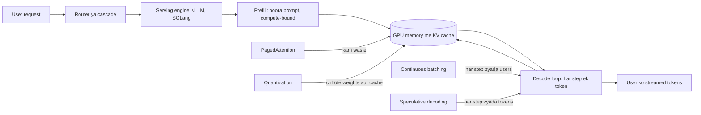
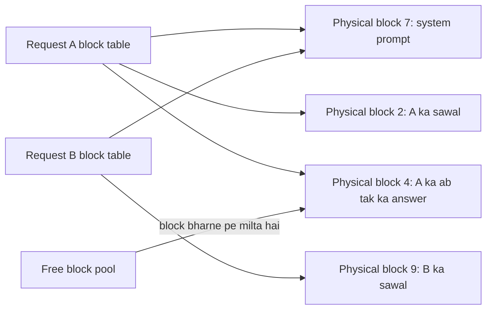
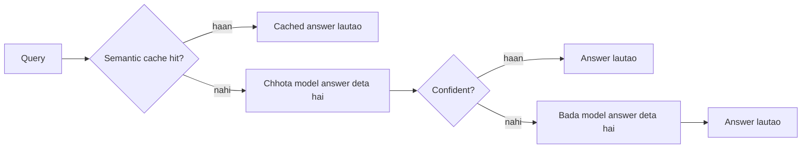

# Inference and Serving

Inference matlab trained model ko chala ke answer lena. Serving matlab yahi kaam hazaaron users ke liye ek saath, fast aur sasta, mehenge GPUs pe karna. Interviewers ye isliye poochhte hain kyunki kam candidates jaante hain ki LLM slow kyun hai, GPU memory kahan jaati hai, aur kaunsi trick (KV cache, batching, quantization, speculative decoding) kaunsi problem theek karti hai.

**Is page ke baad tum ye jawab de paoge:**
- "Decoding memory-bound kyun hai jabki prefill compute-bound hai?"
- "Llama-3-8B ki 8k context wali request ka KV cache size estimate karo."
- "Continuous batching static batching se zyada throughput kaise deti hai?"
- "Speculative decoding: output bilkul same kyun rehta hai?"
- "Kya 70B model ek 80 GB H100 pe chal sakta hai? Tum kya use karoge?"
- "INT4, FP8, GPTQ, AWQ, GGUF: kaunsa choose karoge aur kya khoge?"
- "API call karne ki jagah self-host kab karoge?"
- "1,000 requests per second wale chat product ki serving layer design karo."

## Pehle ye shabd samjho

| Shabd | Simple matlab |
|---|---|
| Token | Text ka ek tukda, English word ka lagbhag 3/4. Model tokens padhta aur likhta hai. |
| Parameter (weight) | Model ke andar ek seekha hua number. 8B model me 8 billion hote hain. |
| GPU memory (HBM) | GPU card pe fast memory. H100 me 80 GB. Weights yahin rehne chahiye. |
| Memory bandwidth | GPU apni memory se per second kitne bytes padh sakta hai. H100: lagbhag 3.35 TB/s. |
| FLOPs | Floating point operations: GPU ka multiply aur add wala kaam. |
| Prefill | Pehla pass jo poora prompt ek saath padhta hai. |
| Decode | Loop jo answer banata hai, har step me ek token. |
| KV cache | Purane tokens ke saved intermediate results, taaki har naya token purana kaam dobara na kare. |
| Batch | Requests ka group jo GPU ek step me saath process karta hai. |
| Throughput | Saare users milake server per second kitne tokens banata hai. |
| Latency | Ek user kitni der wait karta hai. |
| TTFT / TPOT | Time To First Token; Time Per Output Token, baad ke tokens ke beech ka gap. |
| Quantization | Weights ko kam bits me store karna (jaise 16 ki jagah 4) taaki memory bache. |
| LoRA adapter | Extra weights ka chhota add-on jo base model ko ek task ke liye customize karta hai. |

## Big picture

Request aati hai. Router model choose karta hai. Serving engine prompt pe prefill chalata hai, jo KV cache bharta hai. Phir decode chalta hai, har step ek token, aur har step me saare weights padhe jaate hain. Lagbhag har serving trick do limits me se ek pe hamla karti hai: **GPU memory** (weights plus KV cache fit hone chahiye) aur **memory bandwidth** (decode har step saare weights dobara padhta hai). PagedAttention aur quantization memory bachate hain. Continuous batching aur speculative decoding har weight read se zyada tokens nikaalte hain.



## ⭐ Prefill vs decode

**Ek line me:** Prefill poora prompt ek bade parallel pass me padhta hai aur compute se limited hai; decode har step ek token banata hai aur is baat se limited hai ki GPU apni memory kitni tez padh sakta hai.

**Ye kyun chahiye:** User ko do alag waits dikhte hain. Pehle kuch aane se pehle ek pause, phir shabdon ki stream. Ye do alag phases hain jinke do alag bottlenecks hain. Inhe alag nahi samjhoge to galat cheez tune karoge.

**Aise socho:** Swiggy delivery partner. Prefill matlab restaurant pe 40 orders ek baar me load karna: kaam bada hai, par ek saath ho jaata hai. Decode matlab har trip me ek order deliver karna, aur har trip me hub tak poori ride. Time ride (memory padhna) me jaata hai, handover (math) me nahi.

**Kaise kaam karta hai, step by step:**

1. **Chhota recap.** Transformer pichle saare tokens se agla token predict karta hai. 300 tokens banane ke liye 300 baar chalta hai. ([How LLMs Work](14-how-llms-work.md) dekho.)
2. **Prefill.** Prompt me 2,000 tokens hain. GPU saare 2,000 ek bade matrix multiplication me process karta hai. Kaam lagbhag `2 × params × tokens` FLOPs. 8B model ke liye: `2 × 8B × 2,000 = 32 trillion FLOPs`. H100 lagbhag 1,000 trillion dense BF16 FLOPs per second karta hai, to theory me ~30 ms; practice me shayad 50–150 ms. GPU ke math units busy hain, isliye prefill **compute-bound** hai.
3. **Decode.** Ab ek token banana hai. Iske liye har weight ek baar chahiye: 8B params × 2 bytes = **16 GB memory se padhna**. Math sirf `2 × 8B = 16 billion FLOPs`, jo H100 ~16 microseconds me kar deta hai. 3.35 TB/s pe 16 GB padhne me ~**5 ms** lagte hain. Math units ~99% time data ka wait karte hain. Decode **memory-bandwidth-bound** hai.
4. **Speed limit.** Akele user ko is 8B model se maximum `1 / 5 ms ≈ 200 tokens/s` milenge, GPU ka compute kitna bhi strong ho.
5. **Batching lagbhag free kyun hai.** 64 users saath decode karein to bhi GPU har step 16 GB ek hi baar padhta hai, bas math 64 guna. Step thoda hi lamba hota hai, par 64 tokens banta hai. Isliye serving engines zyada se zyada requests batch karne ki koshish karte hain.
6. **Yaad rakhne wala ratio.** Batch 1 pe decode har padhe gaye byte pe ~1 FLOP karta hai. H100 har padhe byte pe ~300 FLOPs kar sakta hai. Jab tak batch sau ke aas paas nahi, compute waste ho raha hai.

**Metrics jo pata hone chahiye:**

| Metric | Matlab | Zyada tar kisse set hota hai | Typical chat target |
|---|---|---|---|
| TTFT (Time To First Token) | Pehla token aane se pehle ka wait | queueing + prefill | ~500 ms se kam |
| TPOT / ITL (Time Per Output Token / Inter-Token Latency) | Baad ke tokens ke beech gap | decode step time | ~20–50 ms (insaan ke padhne se tez) |
| End-to-end latency | `TTFT + TPOT × (output tokens − 1)` | dono | answer length pe depend |
| Tokens/s per user | `1 / TPOT` | decode | 20–100 |
| Throughput | Saare users ke total output tokens/s | batch size | jitna SLO allow kare |
| Goodput | Requests per second jo latency target ke andar rahein | sab kuch | asli business number |

Example: TTFT 300 ms, TPOT 25 ms, 400 output tokens → `0.3 + 0.025 × 399 ≈ 10.3 s` total.

**Throughput vs latency trade-off.** Bada batch zyada total tokens/s deta hai (per token sasta) par har step slow hota hai (har user ka TPOT badhta hai). Tum woh batch size choose karte ho jo throughput max kare aur TPOT target ke andar rahe.

**Interview tip:** "Decode memory-bound kyun hai?" Bolo: "Har decode step har sequence ke liye ek token banata hai, par GPU memory se saare weights aur KV cache padhne padte hain. 8B BF16 model ke liye ye per step 16 GB hai, aur math sirf 16 GFLOPs. 3.35 TB/s pe ~5 ms padhna aur microseconds ka math, to bandwidth speed tay karti hai. Batching ek weight read ko kai sequences me baant ke isse theek karti hai."

**Common galti:**
- Kehna "decode slow hai kyunki GPU weak hai". GPU ke math units zyada tar khaali baithe hain; limit memory reads ki hai.
- Sirf tokens/s report karna. Throughput badhiya par TTFT 3 s ho to user ko server toota hua lagega. Hamesha given load pe TTFT aur TPOT report karo.

## ⭐ KV cache

**Ek line me:** KV cache har layer me har purane token ke key aur value vectors store karta hai, taaki naya token poora prompt dobara kiye bina attention nikaal sake; ye GPU memory deke speed khareedta hai.

**Ye kyun chahiye:** Attention me har naya token pichle har token ko "dekhta" hai. Cache na ho to token 1,001 banate waqt tokens 1 se 1,000 dobara process honge. N tokens banane ka kaam N² ki tarah badhega. Cache ke saath har step sirf naya token compute karta hai aur purane results padhta hai.

**Aise socho:** IRCTC booking clerk. Notes nahi hain to har naye passenger pe poori line ke forms shuru se padhta hai. Register (cache) ho to bas ek line jodta hai aur register pe nazar daalta hai. Par register mota hota jaata hai, aur desk (GPU memory) chhoti hai.

**Kaise kaam karta hai, step by step:**

1. Har layer ke andar har token teen vectors me badalta hai: query (Q, "main kya dhoondh raha hoon"), key (K, "mere andar kya hai"), value (V, "main kya aage deta hoon").
2. Naye token ki query pichli saari keys se compare hoti hai, aur matching values mix hoti hain. Purani keys aur values kabhi nahi badalti, isliye unhe save kar lete hain.
3. Prefill saare prompt tokens ke K aur V nikaal ke cache me likhta hai. Har decode step har layer me ek aur K aur V jodta hai.
4. **Size formula, per token:**
   `2 (K aur V) × layers × kv_heads × head_dim × bytes per value`
5. **Worked example, Llama-3-8B jaisa model:** 32 layers, 8 KV heads, head_dim 128, FP16 (2 bytes).
   `2 × 32 × 8 × 128 × 2 = 131,072 bytes ≈ 128 KB per token`.
6. 8,192 tokens context wali ek request: `128 KB × 8,192 = 1 GB`. Aise 32 users = **32 GB KV cache**, jo 16 GB weights ka double hai. High load pe weights nahi, KV cache tay karta hai kitne users fit honge.
7. **GQA ka asar.** Grouped-Query Attention (GQA) me kai query heads ek K/V head share karte hain. Llama-3-8B me 32 query heads hain par sirf 8 KV heads. Purane Llama-2-7B me 32 KV heads the: `2 × 32 × 32 × 128 × 2 = 512 KB per token`, 4 guna bada. GQA thode quality cost pe cache memory 4 guna kam karta hai. Multi-Query Attention (MQA) ek hi shared KV head tak jaata hai.
8. **Bada model, same idea.** Llama-3-70B jaisa model (80 layers, 8 KV heads, head_dim 128): `2 × 80 × 8 × 128 × 2 = 320 KB per token`, to 8k context ≈ 2.5 GB per request.

| Model shape | KV per token (FP16) | 8k context per request |
|---|---|---|
| 7B, bina GQA (32 KV heads) | 512 KB | 4 GB |
| 8B GQA ke saath (8 KV heads) | 128 KB | 1 GB |
| 70B GQA ke saath (8 KV heads) | 320 KB | 2.5 GB |

**Prefix caching.** Bahut si requests same tokens se shuru hoti hain: 2,000 token ka system prompt, same tool list, same document. Unka KV cache identical hota hai. Engine woh blocks rakh leta hai aur same prefix wali agli request me reuse karta hai. Us request ka zyada tar prefill skip ho jaata hai, to TTFT aur GPU kaam dono girte hain. vLLM ye block hashes se karta hai ("automatic prefix caching"); SGLang radix tree use karta hai. Provider ka "prompt caching" (Anthropic, OpenAI) yahi idea hai jo discount ki tarah bikta hai.

```python
# KV cache calculator: "KV cache estimate karo" wale sawalon ke liye
def kv_bytes_per_token(layers, kv_heads, head_dim, bytes_per_value=2):
    # 2 = ek key vector + ek value vector, har layer, har KV head
    return 2 * layers * kv_heads * head_dim * bytes_per_value

def kv_gb(layers, kv_heads, head_dim, tokens, users=1, bytes_per_value=2):
    return kv_bytes_per_token(layers, kv_heads, head_dim, bytes_per_value) * tokens * users / 1024**3

# Llama-3-8B jaisa: 32 layers, 8 KV heads, head_dim 128, FP16
print(kv_bytes_per_token(32, 8, 128) / 1024, "KB per token")   # 128.0
print(kv_gb(32, 8, 128, tokens=8192), "GB for one 8k request")  # 1.0
print(kv_gb(32, 8, 128, tokens=8192, users=32), "GB for 32 users")  # 32.0

# Same model, FP8 KV cache ke saath (1 byte per value)
print(kv_gb(32, 8, 128, tokens=8192, users=32, bytes_per_value=1), "GB")  # 16.0

# Llama-3-70B jaisa: 80 layers, 8 KV heads, head_dim 128
print(kv_bytes_per_token(80, 8, 128) / 1024, "KB per token")  # 320.0
```

**Code kya karta hai:**
- Formula ek function me rakhta hai taaki interview me bina notes dobara kar sako.
- 8B GQA model ke liye 128 KB per token aur 1 GB per 8k request dikhata hai.
- Dikhata hai ki 32 concurrent lambi chats ko weights se zyada memory chahiye.
- Dikhata hai ki FP8 KV cache ye memory aadhi kar deta hai.

**Interview tip:** "70B model, 4k context, 50 users ka KV cache estimate karo." Bolo: "Per token 2 × 80 layers × 8 KV heads × 128 × 2 bytes = 320 KB. 4,096 tokens se 1.25 GB per user, 50 users se ~62 GB. Usme 140 GB BF16 weights jodo, to kam se kam 4 H100 chahiye, ya quantize karna padega."

**Common galti:**
- KV heads ki jagah query heads ka number lena. GQA ke saath ye 4–8 guna zyada estimate deta hai.
- Bhool jaana ki KV cache users × context length ke saath badhta hai. Ek user pe "fit" hone wala model 30 users pe out of memory ho sakta hai.

## ⭐ PagedAttention

**Ek line me:** PagedAttention (vLLM, 2023) KV cache ko chhote fixed-size blocks me rakhta hai jo GPU memory me kahin bhi baith sakte hain, operating system ke pages ki tarah, to memory lagbhag waste nahi hoti.

**Ye kyun chahiye:** Purane servers har request ke liye maximum length (jaise 4,096 tokens) ka ek continuous chunk reserve karte the, kyunki answer kitna lamba hoga pata nahi tha. Sirf 300 tokens use karne wali request baaki waste karti thi. Chunks ke beech ke gaps bhi kaam nahi aate the. vLLM paper ke hisaab se purane systems is tarah lagbhag 60–80% KV memory waste karte the. Kam usable memory matlab chhote batch, matlab kam throughput.

**Aise socho:** Ek restaurant jo har group ke liye poori 10-seat table reserve karta hai "agar aur dost aa gaye to". Zyada tar groups 2 log ke hain, to jagah bhari dikhti hai par aadhi kursiyan khaali hain. PagedAttention 2-kursi ki units me seats deta hai, hall me kahin bhi, aur ek seating chart rakhta hai.

**Kaise kaam karta hai, step by step:**

1. KV cache ki GPU memory **blocks** me kati hoti hai, har block fixed number of tokens ke K aur V rakhta hai (vLLM default: 16 tokens).
2. Har request ki ek **block table** hoti hai: logical block 0 → physical block 57, logical block 1 → physical block 3, aur aise hi. Ye bilkul OS page table jaisa hai jo virtual pages ko physical frames se map karta hai.
3. Naya block tabhi milta hai jab pichla bhar jaaye. 300 token request `ceil(300 / 16) = 19` blocks leti hai. Waste maximum 15 token slots, aakhri block me.
4. Attention kernel block table follow karke K aur V padhta hai, isliye blocks ka paas paas hona zaroori nahi.
5. **Sharing.** Same system prompt wali do requests same physical blocks ko point kar sakti hain. Reference count track karta hai ki block kitni requests use kar rahi hain. Agar ek request ko shared block me likhna ho (jaise parallel samples jo alag ho jaate hain), use pehle private copy milti hai. Ye **copy-on-write** hai, bilkul OS ke `fork()` jaisa.
6. **Result.** Waste kuch percent tak gir jaata hai. Same GPU 2–4 guna zyada concurrent requests rakhta hai, aur throughput bhi lagbhag utna badhta hai.

| Problem | Contiguous allocation | PagedAttention |
|---|---|---|
| Reserved par unused jagah | har request max length tak | maximum ek adhoora block |
| Requests ke beech gaps | haan (external fragmentation) | nahi, koi bhi free block chalega |
| Shared system prompt | har request me copy | ref counts ke saath shared blocks |
| Har GPU pe concurrent requests | kam | 2–4 guna zyada |



**Interview tip:** "PagedAttention kaunsi problem solve karta hai?" Bolo: "KV cache ki memory fragmentation. Har request ke liye max-length continuous memory reserve karne ki jagah, ye per-request block table ke through zaroorat pe chhote blocks deta hai, OS virtual memory jaisa. Waste cache ke bade hisse se kuch percent pe aa jaata hai, to batch me zyada requests fit hoti hain, aur identical prefixes blocks share kar sakte hain."

**Common galti:**
- Kehna ki PagedAttention attention ka math tez karta hai. Ye memory management idea hai; speed bade batch fit hone se aati hai.
- Ise FlashAttention se confuse karna. FlashAttention ek kernel hai jo kam memory reads me attention compute karta hai; dono saath use hote hain.

## ⭐ Continuous batching and chunked prefill

**Ek line me:** Continuous (in-flight) batching har decode step pe batch dobara banati hai, to khatam hui request turant nikalti hai aur waiting request turant judti hai, poora batch sabse slow member ka wait nahi karta.

**Ye kyun chahiye:** Answers ki length bahut alag hoti hai: ek 5 tokens, doosra 800. Static batching me GPU batch ko tab tak chalata hai jab tak sabse lamba answer khatam na ho. Chhoti requests khatam hoke bhi slot gher ke baithi rehti hain, aur nayi requests queue me wait karti hain. GPU slots khaali jaate hain aur naye users ka TTFT badhta hai.

**Aise socho:** Shared auto-rickshaw. Static batching: auto tab tak wait karta hai jab tak teeno passengers apne stop pe na utar jaayein, tab jaake naye log uthata hai. Continuous batching: jaise hi ek passenger utarta hai, driver usi road pe khade agle bande ko bitha leta hai.

**Kaise kaam karta hai, step by step:**

1. Teen requests saath aati hain. A ko 10 output tokens chahiye, B ko 3, C ko 5. D thodi der baad aati hai.
2. **Static batching timeline:**

| Step | 1 | 2 | 3 | 4 | 5 | 6 | 7 | 8 | 9 | 10 | 11–15 |
|---|---|---|---|---|---|---|---|---|---|---|---|
| Slot 1 | A | A | A | A | A | A | A | A | A | A | D |
| Slot 2 | B | B | B | idle | idle | idle | idle | idle | idle | idle | |
| Slot 3 | C | C | C | C | C | idle | idle | idle | idle | idle | |

   Kaam ka hissa: 30 me se 18 slot-steps, yaani 60%. D shuru hone se pehle 10 steps wait karti hai.

3. **Continuous batching timeline:**

| Step | 1 | 2 | 3 | 4 | 5 | 6 | 7 | 8 | 9 | 10 |
|---|---|---|---|---|---|---|---|---|---|---|
| Slot 1 | A | A | A | A | A | A | A | A | A | A |
| Slot 2 | B | B | B | D | D | D | D | D | E | E |
| Slot 3 | C | C | C | C | C | F | F | F | F | F |

   D step 4 pe judti hai, jis pal B khatam hoti hai. E aur F bhi khaali slots bharte hain. Slots busy rehte hain, to throughput badhta hai aur queue wait girta hai.

4. Scheduler har step check karta hai: kaun khatam hua (end token ya max length)? Unke KV blocks free karo. Kaun wait kar raha hai aur free KV memory me fit hota hai? Unhe jodo.
5. **Prefill ki problem.** Nayi request ko pehle prefill chahiye. 16,000 token ka prefill sau-do sau ms le sakta hai. Engine use akele chalaye to har decoding user ruk jaata hai, jo TPOT spike ki tarah dikhta hai.
6. **Chunked prefill.** Us lambe prefill ko chunks me todo (jaise 512 ya 2,048 tokens). Har step ek chunk plus saare active users ke decode tokens chalata hai. Decode users smoothly stream karte rehte hain, aur decode steps ka bacha hua compute prefill math me use ho jaata hai.
7. **Preemption.** KV memory khatam ho jaaye to engine ek request ko pause karta hai, uske blocks free karta hai, aur baad me recompute ya reload karta hai. Logs me bahut preemptions dikhein to zyada memory chahiye ya concurrency limit kam karo.

Ye idea Orca paper (2022) se aaya, jisne ise iteration-level scheduling kaha. Aaj vLLM, SGLang, TensorRT-LLM aur TGI sab ye karte hain.

**Interview tip:** "Continuous batching throughput kaise badhati hai?" Bolo: "Static batching batch ko sabse lambe sequence ke khatam hone tak rokti hai, to chhoti requests ke slots khaali baithe rehte hain aur nayi requests queue me. Continuous batching har token step pe schedule karti hai: khatam sequences nikalte hain, waiting turant judte hain. Slots bhare rehte hain, tokens per second kai guna badhte hain, aur TTFT girta hai kyunki nayi requests batch khaali hone ka wait nahi karti. Chunked prefill lambe prompts ko sabka decode rokne nahi deta."

**Common galti:**
- Sochna ki continuous batching ek single request ko tez karti hai. Ye zyada tar total throughput badhati hai; bade batch se single-request TPOT thoda badh bhi sakta hai.
- Max concurrency itni zyada rakhna ki requests baar baar preempt hoti rahein. Isse kaam waste hota hai aur tail latency bigadti hai.

## Serving engines compared

**Ek line me:** Serving engine KV cache manager, scheduler, fast kernels aur HTTP API ek saath deta hai; hardware, workload shape aur kitna ops effort de sakte ho, uske hisaab se choose karo.

**Ye kyun chahiye:** Apni batching, paging aur kernels likhna mahino ka kaam hai. Ye open-source engines pehle se karte hain, aur speed, aasani aur kahan chalte hain me alag hain.

**Aise socho:** Cloud kitchen setup choose karna. vLLM sabka jaana-pehchana achha standard kitchen. SGLang repeat orders ke liye tuned kitchen. TensorRT-LLM custom factory line: sabse tez, par har dish ke liye setup karna padta hai. llama.cpp ghar ka kitchen jo bina commercial stove ke bhi chalta hai.

**Kaise kaam karta hai, step by step:**

1. Apne constraints se shuru karo: NVIDIA ya AMD GPUs, ya CPU / Mac? Ek user ya hazaaron? Bahut saare shared prefixes (agents, multi-turn chat) ya nahi?
2. Table se choose karo, phir **apne** prompts pe **apni** target concurrency pe benchmark karo. Published benchmarks har release ke saath badalte hain.

| Engine | Key idea | Strengths | Kab choose karo |
|---|---|---|---|
| vLLM | PagedAttention, continuous batching | Sabse wide model support, OpenAI-compatible server, quantization, multi-LoRA, speculative decoding, active community | GPU serving ka default choice |
| SGLang | RadixAttention: requests ke beech prefix reuse ke liye KV cache radix tree me | Multi-turn chat, agents, few-shot prompts, structured output ke liye bahut tez | Bahut requests prefix share karti hain; agent workloads |
| TensorRT-LLM | NVIDIA ke compiled engines, tuned kernels (FP8, in-flight batching) | NVIDIA GPUs pe aksar top raw performance | NVIDIA pe bada fleet, team build steps sambhal sakti hai (aksar Triton server ke saath) |
| TGI (Text Generation Inference) | Hugging Face ka server | HF ecosystem me simple setup | Pehle se HF tooling pe ho; development slow ho gaya hai, isliye naye projects aksar vLLM ya SGLang lete hain |
| llama.cpp / Ollama | C++ engine, GGUF quantized files; Ollama simple CLI ke saath wrap karta hai | CPU, Mac (Apple Silicon), chhote GPUs pe chalta hai | Laptop, edge, offline, single user ya dev use; high-concurrency serving nahi |

**Interview tip:** "vLLM ya SGLang?" Bolo: "Dono paged KV aur continuous batching karte hain. Breadth aur community ke liye main vLLM se shuru karunga. Agar workload agentic ya multi-turn hai jisme bahut shared prefix hai, to SGLang ka RadixAttention zyada cache hit rate de sakta hai. Final decision asli traffic pe benchmark se, TTFT, TPOT aur goodput target load pe measure karke."

**Common galti:**
- High-traffic production API ke peeche Ollama lagana. Ye convenience aur kam users ke liye bana hai, maximum batching throughput ke liye nahi.
- Blog benchmark dekh ke engine choose karna jisme prompt lengths aur hardware tumhare se alag the.

## ⭐ Speculative decoding

**Ek line me:** Ek chhota fast "draft" agle kuch tokens guess karta hai, aur bada model saare guesses ek pass me check karta hai; har bade-model step me kai tokens milte hain, aur output distribution bilkul same rehta hai.

**Ye kyun chahiye:** Decode memory-bound hai: har bada-model step saare weights padhta hai aur har sequence ke liye sirf ek token deta hai. Ek pass me 5 tokens verify karna lagbhag utna hi memory read leta hai jitna 1 banana, kyunki ye ek chhote prefill jaisa hai. Guesses aksar sahi hon to har weight read se zyada tokens milte hain.

**Aise socho:** Junior reply ka draft likhta hai aur senior review karta hai. Senior poora draft ek baar me padhta hai, pehle galat shabd tak rakh leta hai, phir sahi shabd khud likhta hai. Junior achha hai to senior ek shabd ki mehnat me paanch shabd sign kar deta hai.

**Kaise kaam karta hai, step by step:**

1. **Draft.** Chhota model (jaise 1B) jaldi se k = 4 tokens banata hai: "the", "order", "is", "late".
2. **Verify.** Bada model (jaise 70B) prompt plus charon draft tokens pe ek baar chalta hai. Usi ek pass me use charon positions ki apni probabilities milti hain, plus uske baad wali position ki bhi.
3. **Accept ya reject, left se right.** Greedy mode me: draft token rakho agar woh bade model ke top choice ke barabar hai. Pehle mismatch pe ruko.
4. **Fix aur bonus.** Pehle mismatch pe bade model ka token lo. Agar charon match hue, to bada model 5th token free me deta hai. To har verify step 1 se k + 1 tokens deta hai.
5. **Example.** Draft "the order is late", bada model "the order is" pe agree karta hai par "delayed" chahta hai. Output: "the order is delayed": 4 passes ki jagah ek bade-model pass me 4 tokens.
6. **Sampling ke saath lossless kyun.** Maan lo `p` bade model ki token probability hai aur `q` draft ki. Draft token ko `min(1, p / q)` probability se accept karo. Reject pe bache hue `max(0, p − q)` (normalized) se naya token sample karo. Is rejection sampling ka math guarantee deta hai ki har output token bilkul `p` follow kare, yaani bade model ka distribution (speculative sampling papers, 2023). Draft sirf speed badalta hai, average me kaunse answers milenge woh kabhi nahi.
7. **Acceptance rate.** Agar har draft token α = 0.8 probability se accept hota hai aur k = 4, to har bade step pe expected tokens `(1 − α^(k+1)) / (1 − α) = (1 − 0.8^5) / 0.2 ≈ 3.4`. Asli speedup aksar 2–3 guna hota hai, kyunki draft aur verify ka bhi time lagta hai.
8. **Kab kam help karta hai.** Bade batch pe GPU pehle se compute me busy hai, to extra verify kaam free nahi; fayda ghat jaata hai. Ye low se medium batch pe chamakta hai, jahan latency sabse zyada matter karti hai.

| Variant | Draft kahan se aata hai | Note |
|---|---|---|
| Draft model | Same family ka chhota model (same tokenizer) | Classic form; tokenizer same hona chahiye |
| Medusa | Bade model ke upar extra prediction heads, tokens t+2, t+3... guess karte hain | Alag model nahi; heads train karne padte hain |
| EAGLE | Halki draft layer jo bade model ke internal features padhti hai | Aksar alag chhote model se zyada acceptance |
| N-gram / prompt lookup | Prompt se hi matching span copy karta hai | Training nahi; summary, code editing, text quote karne wale RAG answers ke liye badhiya |

**Interview tip:** "Speculative decoding lossless kyun hai?" Bolo: "Bada model har token verify karta hai. Greedy me sirf woh draft tokens rakhte hain jo bade model ke argmax se match karein. Sampling me har draft token min(1, p/q) probability se accept karte hain aur reject pe normalized residual se resample karte hain, jo provably target distribution p deta hai. To quality identical hai; sirf bade-model passes ki ginti badalti hai."

**Common galti:**
- Kehna "chhote model ki quality output me aa jaati hai". Aa hi nahi sakti; kharab draft sirf acceptance rate aur speedup girata hai.
- Bahut bade batch pe on karke batch 1 jaisa fayda expect karna.

## ⭐ Quantization

**Ek line me:** Quantization numbers ko kam bits me store karta hai, to model kam memory leta hai aur har decode step kam bytes padhta hai, ek chhote aur measurable quality cost pe.

**Ye kyun chahiye:** 70B model BF16 me 140 GB leta hai, ek GPU se zyada. Aur decode speed har step padhe gaye bytes se tay hoti hai. Bytes aadhe karo to memory-bound decode ka time lagbhag aadha. To quantization fit hone aur speed dono me help karta hai.

**Aise socho:** Photos ko RAW ki jagah compressed JPEG me rakhna. Files 4 guna chhoti, aur zyada tar use me farak nahi dikhta. Zyada compress karo to chehre blocky ho jaate hain. Weights ke liye quantization yahi deal hai.

**Kaise kaam karta hai, step by step:**

1. `0.0371` jaisa weight BF16 (16 bits) me store hota hai. INT8 weights ke group ko ek **scale** number se 256 levels pe map karta hai: `int_value = round(weight / scale)`. INT4 sirf 16 levels use karta hai.
2. Scales har group (jaise har 128 weights) ke liye rakhe jaate hain, jisse error chhota rehta hai. Isse thodi memory badhti hai, to "4-bit" asal me ~4.25–5 bits per weight hai.
3. **Bytes per parameter:**

| Format | Bytes per param | 8B model | 70B model | Note |
|---|---|---|---|---|
| FP32 | 4 | 32 GB | 280 GB | Training ke master weights; serving me kabhi nahi |
| BF16 / FP16 | 2 | 16 GB | 140 GB | Standard serving baseline |
| FP8 | 1 | 8 GB | 70 GB | H100 aur naye GPUs pe native; zyada tar models ke liye lagbhag lossless |
| INT8 | 1 | 8 GB | 70 GB | Mature, chhota quality loss |
| INT4 | ~0.5 (plus scales) | ~4.5 GB | ~35–40 GB | Dikhne layak par aksar chalne layak loss; apne evals pe check karo |

4. **Weight-only vs weight + activation.**
   - **Weight-only (jaise W4A16):** weights 4 bits me, math se theek pehle wapas 16 bits me. Memory aur bandwidth bachti hai, to chhote batch pe decode tez hota hai. Math abhi bhi 16-bit.
   - **Weight + activation (jaise W8A8, FP8):** weights aur activations dono 8-bit, aur math 8-bit tensor cores pe chalta hai. Isse compute-bound prefill aur bade batches bhi tez hote hain. H100 me native FP8 tensor cores hain, isliye Hopper GPUs pe FP8 common production choice hai.
5. **Methods aur formats:**
   - **GPTQ (2022):** chhote calibration dataset ke saath layer by layer quantize karta hai, bache weights adjust karke error cancel karta hai. INT4 GPU serving me common.
   - **AWQ (Activation-aware Weight Quantization, 2023):** sabse important weight channels dhoondhta hai (jin pe bade activations aate hain) aur unhe scale karke bachata hai. 4-bit pe aksar robust; vLLM me achha support.
   - **GGUF:** llama.cpp aur Ollama ka file format. `Q4_K_M` jaise naam ka matlab ~4-bit "K-quant", medium size, lagbhag 4.5–5 bits per weight. `Q8_0` 8-bit hai, `Q5_K_M` beech me. CPU aur Mac ke liye.
   - **FP8:** aksar simple per-tensor ya per-channel scales se, kam calibration chahiye.
6. **Quality trade-offs.** 8-bit aksar BF16 ke noise ke andar hota hai. 4-bit thoda zyada costly: reasoning, math, code aur long context pe chhote drops common hain. Chhote models bade models se zyada suffer karte hain. Hamesha pehle aur baad apna eval set chalao.
7. **KV-cache quantization.** Cache bhi FP8 me rakh sakte ho. Isse KV memory aadhi (upar ke example me 32 GB → 16 GB), to ~2 guna zyada users ya context fit. Quality pe asar aksar chhota, par long-context tasks test karo.

```python
from vllm import LLM, SamplingParams

# AWQ 4-bit weights + FP8 KV cache ek GPU pe
llm = LLM(
    model="Qwen/Qwen2.5-7B-Instruct-AWQ",  # pehle se AWQ quantized checkpoint
    quantization="awq",                    # weights kaise padhne hain
    kv_cache_dtype="fp8",                   # K aur V 2 ki jagah 1 byte me
    max_model_len=8192,
)
out = llm.generate(["Explain UPI in one sentence."], SamplingParams(max_tokens=60))
print(out[0].outputs[0].text)
```

**Code kya karta hai:**
- Aisa model load karta hai jiske weights pehle se AWQ se quantized hain (~4 bits per weight).
- vLLM ko weight format batata hai; vLLM uske liye fast kernels choose karta hai.
- KV cache FP8 me rakhta hai, to fit hone wale tokens double.
- Ek prompt chala ke check karta hai ki output theek dikh raha hai; asli check eval set hai.

**Interview tip:** "INT4 me serve karoge ya FP8 me?" Bolo: "H100s pe main FP8 se shuru karunga: lagbhag lossless aur prefill aur decode dono tez. Agar model fit nahi hota ya chhote GPUs hain, to 4-bit AWQ ya GPTQ weight-only, jo zyada tar memory-bound decode me help karta hai. Dono case me apne eval set pe compare karunga, khaas kar reasoning aur long-context cases."

**Common galti:**
- Maan lena ki 4-bit hamesha 4 guna tez hai. Weight-only 4-bit memory-bound decode tez karta hai, par bade batches pe dequantization ka overhead fayda kha sakta hai.
- Quantize karke bina evals dobara chalaye ship karna. Quality loss aksar math, code ya non-English inputs me chhupa hota hai.

## GPU sizing and parallelism

**Ek line me:** Chahiye GPU memory = weights + concurrent users ka KV cache + overhead; fit na ho to quantize karo ya model ko GPUs me baanto.

**Ye kyun chahiye:** "Kaunse GPUs aur kitne?" kisi bhi self-hosted model ka pehla cost decision hai. Kam hon to out-of-memory errors ya chhote batches. Zyada hon to paisa waste.

**Aise socho:** Ghar shift karte waqt Tempo bharna. Furniture (weights) fixed hai. Boxes (KV cache) is pe badhte hain ki kitne logon ka saamaan le ja rahe ho. Ghoomne ke liye thodi jagah bhi chahiye (overhead). Fit na ho to furniture fold karo (quantize) ya do Tempo book karo (parallelism).

**Kaise kaam karta hai, step by step:**

1. **Formula:** `memory ≈ weights + KV cache + overhead`. Overhead (activations, CUDA graphs, buffers) lagbhag 10–20% ya kuch GB.
2. **Example: kya 70B model ek 80 GB H100 pe fit hoga?**
   - BF16: 70B × 2 bytes = **140 GB**. Nahi, weights bhi nahi.
   - FP8: 70 GB weights. Technically load ho jaata hai, par overhead ke baad KV cache ke liye ~5 GB bachta hai; 320 KB per token pe ye total ~15k tokens, yaani bas mutthi bhar users. Practical nahi.
   - INT4 (AWQ/GPTQ): ~**35–40 GB**. Haan. KV cache ke liye ~30–35 GB bachta hai, lagbhag 100k tokens: 4k context wale ~25 users.
   - Common production answer: 2× H100 pe FP8, ya 4× H100 pe BF16 tensor parallelism ke saath, ya quality chal jaaye to ek GPU pe INT4.
3. **Tensor parallelism (TP):** har layer ki weight matrices GPUs me baanto. Har GPU har layer ka hissa karta hai, aur har layer ke baad GPUs results jodte hain (all-reduce). Iske liye NVLink jaise bahut tez links chahiye, isliye ye **ek server ke andar** (2, 4 ya 8 GPUs) use hota hai. Ye per-token latency kam karta hai kyunki har GPU weights ka sirf apna hissa padhta hai.
4. **Pipeline parallelism (PP):** layers 1–40 GPU group 1 pe aur 41–80 group 2 pe. Stages ke beech sirf activations jaate hain, to ye slow network wale **servers ke paar** chal jaata hai. Nuksaan: stages ek doosre ka wait karte hain ("bubbles"), jo latency bigadta hai jab tak bahut requests flight me na hon.
5. **Data parallelism (replicas):** model ki poori copies alag GPUs pe, load balancer ke peeche. Ek copy fit ho jaaye to throughput isi se scale karte ho.
6. **Rough throughput reasoning.** H100 pe 8B BF16 model ka ek decode step ~16 GB plus KV cache padhta hai, to lagbhag 5–10 ms. 64 sequences batch me hon to upper bound `64 / 0.008 s ≈ 8,000 tokens/s`. Asli numbers kam hote hain (prefill interleaving, scheduling, kernel efficiency). Ise order-of-magnitude check samjho, phir benchmark karo.

| | Tensor parallel | Pipeline parallel |
|---|---|---|
| Kya baantta hai | har layer ki matrices | layers ke groups |
| Communication | har layer, bhaari | stages ke beech, halki |
| Chahiye | NVLink, same server | servers ke paar chal jaata |
| Latency pe asar | kam karta hai | badha sakta hai (bubbles) |
| Typical use | ek box me 4–8 GPUs pe 70B | kai boxes pe bahut bade models |

**Interview tip:** "70B kis hardware pe?" Bolo: "BF16 weights 140 GB hain, to ek 80 GB card pe nahi. Production ke liye 2× H100 pe FP8, tensor parallelism 2 ke saath, jo KV cache ke liye jagah chhodta hai; ya bina quantization chahiye to 4× H100 BF16. Budget tight ho to INT4 AWQ ek H100 pe ~35–40 GB me fit hota hai, kuch dozen users ki jagah ke saath, quality check ke baad."

**Common galti:**
- Sirf weights ke liye size karna aur KV cache bhool jaana, phir asli load pe OOM errors ya chhote batches.
- Normal network pe servers ke paar tensor parallelism chalana; har layer ka communication speed maar deta hai.

## Multi-LoRA serving

**Ek line me:** GPU memory me ek base model rakho aur har request pe alag chhota LoRA adapter lagao, to 100 customer-specific fine-tunes ka kharcha lagbhag ek model jitna.

**Ye kyun chahiye:** Maan lo 50 enterprise customers ke liye ek-ek model fine-tune kiya. 8B model ki 50 poori copies = 800 GB weights aur 50 zyada tar khaali GPUs. Par LoRA adapter (Low-Rank Adaptation, 2021) chhota hota hai, aksar 10–200 MB, kyunki ye sirf base weights me jodne wali chhoti extra matrices store karta hai.

**Aise socho:** Ek Domino's kitchen aur ek base dough, har order pe alag toppings. Har pizza type ke liye naya kitchen nahi banate.

**Kaise kaam karta hai, step by step:**

1. Base model ek baar load karo (jaise 16 GB).
2. Adapters GPU memory me rakho, extra wale CPU memory me, zaroorat pe swap hote hain.
3. Har request apna adapter batati hai. Engine **alag alag** adapters wali requests ko saath batch karta hai: base-model math share hota hai, aur special kernels har request ka apna chhota adapter math jodte hain. Ye approach S-LoRA aur Punica (2023) se aaya.
4. Example: 50 adapters × 100 MB = 5 GB, plus 16 GB base. Ek GPU saare 50 customers serve karta hai.
5. vLLM me: `--enable-lora --lora-modules support-bot=/path/to/adapter` ke saath start karo. Clients normal OpenAI-style call me `model="support-bot"` bhejte hain.

**Interview tip:** "200 fine-tuned variants kaise serve karoge?" Bolo: "Unhe ek base model pe LoRA adapters ki tarah train karo, aur vLLM me multi-LoRA se serve karo. Memory me ek base copy, adapters zaroorat pe load, aur adapters ke across mixed batches. Cost traffic ke saath badhti hai, variants ki ginti ke saath nahi."

**Common galti:**
- Har adapter ko full model copy me merge karke alag deploy karna.
- Alag base model version pe trained adapters use karna; woh chupchaap kachra output dete hain.

## ⭐ Model routing, cascades and semantic cache

**Ek line me:** Aasaan requests chhote saste model ko bhejo, mushkil ya uncertain wali bade model tak escalate karo, aur repeat sawalon ka jawab cache se do.

**Ye kyun chahiye:** Zyada tar asli traffic aasaan hota hai: greetings, FAQs, simple lookups. Sab kuch sabse bade model ko bhejna paisa waste karta hai aur latency badhata hai. Chhota model aksar per token 10–30 guna sasta aur kaafi tez hota hai.

**Aise socho:** Hospital ka front desk. Zyada tar sawal nurse sambhalti hai. Mushkil cases general doctor ke paas, aur sirf sabse tough specialist ke paas. Bahut common sawal ("pharmacy kahan hai?") printed board pe (cache).

**Kaise kaam karta hai, step by step:**

1. **Router (pehle decide karo):** classifier ya chhota LLM request ko label karta hai (intent, difficulty, tools chahiye, language) aur answer banne se pehle model choose karta hai. Sasta aur tez. Research example: RouteLLM (2024).
2. **Cascade (pehle chhota try karo):** chhota model answer deta hai. Ek check confidence estimate karta hai: token log-probabilities, self-check, verifier model, ya rule jaise "valid JSON aur source cite karta hai". Confidence kam ho to bade model pe escalate. FrugalGPT (2023) ne ise study kiya.
3. **Worked example.** Din me 1M requests. Chhota model 70% sambhalta hai, har ek 1 unit; 30% escalate hoti hain aur har ek 1 + 20 = 21 units. Total `0.7 × 1 + 0.3 × 21 = 7` units per request, sab-bade ke 20 ke muqable. Lagbhag 65% sasta. Latency sirf escalate hue 30% ki bigadti hai.
4. **Semantic cache.** User query ko vector me embed karo. Agar koi purani query bahut similar hai (cosine similarity, maan lo, 0.95 se upar) aur uska answer abhi bhi valid hai, cached answer lautao. Pehle exact-match cache use karo; woh sasta hai aur kabhi galat nahi.
5. **Cache safety rules.** Personal data wale cached answers users ke beech kabhi share mat karo. Time-sensitive answers ("mere order ka status") cache mat karo ya chhota TTL rakho. False hits pe nazar rakho: "cancel my order" aur "don't cancel my order" embedding me paas aa sakte hain.



**Interview tip:** "Quality bigade bina LLM serving cost aadhi kaise karoge?" Bolo: "Cascade: pehle chhota model, verifier ya confidence threshold, baaki escalate. Saath me repeat queries ke liye exact aur semantic caching, aur shared system prompt ke liye prefix caching. Escalation threshold eval set pe tune karunga taaki escalate hue cases pe quality sab-bade ke barabar rahe."

**Common galti:**
- Chhote model ke khud bataye confidence ("main 90% sure hoon") pe escalate karna. Verbal confidence ka calibration kharab hota hai; verifier, rules ya eval-tuned thresholds use karo.
- Dheela threshold wala semantic cache jo paas-ka-par-galat answer de deta hai.

## Self-host vs API

**Ek line me:** Jab tak volume, data rules ya latency control apne GPUs chalane ke ops bojh ko worth na banayein, API use karo.

**Ye kyun chahiye:** Paper pe self-hosting per token sasta dikhta hai, par GPU ka bill har ghante aata hai chahe busy ho ya khaali, aur kisi ko unhe chalana padta hai. Sahi jawab volume, privacy needs aur team skills pe depend karta hai.

**Aise socho:** Ola vs car khareedna. Hafte me kuch rides ke liye Ola sasta aur bina jhanjhat. Roz din bhar chalate ho to apni car jeetti hai, par ab petrol, servicing aur parking tumhari zimmedari.

**Kaise kaam karta hai, step by step:**

| Factor | API (hosted model) | Self-host (open weights) |
|---|---|---|
| Kam volume pe cost | Sasta, per token pay | Mehenga, GPUs khaali |
| High, steady volume pe cost | Linear badhta hai | Per token kaafi sasta ho sakta hai |
| Data privacy | Data tumhare network se bahar jaata hai (retention aur region terms check karo) | Tumhare VPC ya data centre ke andar |
| Latency control | Shared queues, rate limits | Batch size, region, TTFT tum tune karte ho |
| Model quality ceiling | Frontier models available | Best open models; frontier se peeche ho sakte hain |
| Customization | Limited fine-tuning | Poora control: LoRA, quantization, decoding |
| Ops bojh | Lagbhag kuch nahi | GPU capacity, upgrades, on-call, autoscaling |

**Break-even sochne ka tareeka:**

1. Self-host cost per million tokens = `GPU $ per hour ÷ (asli tokens per second × 3,600 ÷ 1,000,000)`.
2. Assumed numbers ke saath example: ek GPU $3 per hour, din bhar average 1,000 output tokens/s → 3.6M tokens per hour → lagbhag **$0.83 per million tokens**.
3. Traffic spiky ho aur GPU average sirf 200 tokens/s kare, to cost lagbhag **$4.2 per million** ho jaati hai. Utilization hi sab kuch hai.
4. Engineer ka time jodo (on-call aur upgrades ke liye salary ka hissa), aur redundancy ke liye kam se kam 2 GPUs.
5. Apne eval set pe **similar quality** wale model ki API price se compare karo. Self-host aksar tabhi jeetta hai jab volume high aur steady ho, data rules strict hon, ya custom fine-tuned model chahiye ho.

**Interview tip:** "Self-host karoge?" Bolo: "Product fit dhoondhne ke liye API se shuru karunga. Self-hosting pe tab jaunga jab monthly token volume itna high aur steady ho ki realistic utilization pe GPU cost API cost se kam pade, ya data residency rules ya custom fine-tune iski maang karein. Aksar hybrid: bulk traffic ke liye self-hosted chhota model, mushkil cases ke liye API frontier model."

**Common galti:**
- 100% GPU utilization pe self-host cost nikaalna. Asli traffic me raatein aur weekends hote hain.
- Chhote open model ki price frontier API se compare karna bina check kiye ki dono same quality tak pahunchte hain.

## Hands-on with vLLM

**Ek line me:** vLLM batch jobs ke liye offline Python API aur apps ke liye OpenAI-compatible HTTP server deta hai, to existing OpenAI client code sirf base URL badalne se chal jaata hai.

**Ye kyun chahiye:** Practice me do modes chahiye: batch jobs (raat bhar me 1M rows label karna) aur online service (chat app). vLLM dono same engine se karta hai.

**Aise socho:** Same kitchen jo bulk catering orders bhi chalata hai aur live dine-in counter bhi.

**Kaise kaam karta hai, step by step:**

1. **Offline batch:** `LLM(...)` ek baar banao, prompts ki list `generate` ko do. vLLM khud batch karta hai.
2. **Online server:** `vllm serve <model>` chalao. Ye port 8000 pe `/v1/chat/completions` aur `/v1/completions` ke saath sunta hai.
3. **Client:** official `openai` Python package `base_url="http://localhost:8000/v1"` ke saath use karo.

```python
# 1) Offline batch inference
from vllm import LLM, SamplingParams

llm = LLM(
    model="meta-llama/Llama-3.1-8B-Instruct",
    gpu_memory_utilization=0.90,  # weights + KV cache ke liye GPU memory ka hissa
    max_model_len=8192,           # prompt + answer ki max length
    enable_prefix_caching=True,   # shared prefixes ka KV cache reuse
)
params = SamplingParams(temperature=0.7, top_p=0.9, max_tokens=200)
prompts = ["Summarize: the Swiggy order was late by 40 minutes.",
           "Write a one-line apology for a late IRCTC refund."]
for out in llm.generate(prompts, params):  # saare prompts saath batch hote hain
    print(out.outputs[0].text)
```

```bash
# 2) OpenAI-compatible server (example ke liye 2 GPUs pe tensor parallel)
vllm serve meta-llama/Llama-3.1-8B-Instruct \
  --max-model-len 8192 --gpu-memory-utilization 0.90 --tensor-parallel-size 2
```

```python
# 3) Standard openai client se call karo
from openai import OpenAI

client = OpenAI(base_url="http://localhost:8000/v1", api_key="EMPTY")
stream = client.chat.completions.create(
    model="meta-llama/Llama-3.1-8B-Instruct",
    messages=[{"role": "user", "content": "Why is decode memory-bound?"}],
    max_tokens=200,
    stream=True,  # tokens stream karo taaki user ko total time nahi, TTFT dikhe
)
for chunk in stream:
    print(chunk.choices[0].delta.content or "", end="")
```

**Code kya karta hai:**
- `gpu_memory_utilization` vLLM ko batata hai ki GPU memory kitni le sakta hai; weights ke baad jo bachta hai woh KV cache blocks banta hai.
- `max_model_len` context length cap karta hai; chhota cap zyada requests fit karata hai.
- List pe `generate` continuous batching ko saare prompts saath chalane deta hai, single calls ke loop se kaafi tez.
- `vllm serve` OpenAI API format deta hai, to app code me sirf `base_url` aur `model` badalte hain.
- `stream=True` se user experience poore answer ke time ki jagah TTFT aur TPOT pe depend karta hai.

**Interview tip:** "Apne existing OpenAI-based app ke peeche open model kaise lagaoge?" Bolo: "vLLM ka OpenAI-compatible server chalao, client ka base_url uspe point karo, aur code same rakho. Phir max-model-len, GPU memory share aur tensor parallelism tune karo, aur target concurrency pe TTFT aur TPOT load test karo."

**Common galti:**
- Python loop me ek ek prompt pe `llm.generate` call karna, jisse batching ka fayda khatam.
- `max_model_len` ko model ke maximum (jaise 128k) pe chhod dena jabki traffic ko 8k chahiye, jisse kam requests fit hoti hain.

## Interview ke sawal

**Q: Decode memory-bound kyun hai?**
Har step har sequence ka ek token banata hai par saare weights (8B BF16 model ke liye 16 GB) plus KV cache padhta hai. Us read ke saamne math chhota hai, to memory bandwidth step time tay karti hai; batching ek read ko kai sequences me baant ti hai.

**Q: Llama-3-8B ki 8k context request ka KV cache estimate karo.**
`2 × 32 layers × 8 KV heads × 128 head_dim × 2 bytes = 128 KB per token`; × 8,192 tokens ≈ 1 GB per request. Aise 40 users = 40 GB, weights se zyada.

**Q: Continuous batching throughput kaise badhati hai?**
Har token step pe schedule karti hai: khatam requests nikalti hain, waiting turant judti hain. Slots sabse lambe sequence ke wait me khaali nahi baithte, to GPU utilization aur tokens/s badhte hain, aur queueing time girta hai.

**Q: Speculative decoding lossless kyun hai?**
Target model har draft token verify karta hai. Greedy me sirf argmax se match karne wale tokens rakhe jaate hain; sampling me `min(1, p/q)` se accept aur residual se resample, jo mathematically target distribution reproduce karta hai.

**Q: 70B model: kaunsa hardware?**
BF16 140 GB hai: tensor parallelism ke saath 4× H100, ya 2× H100 pe FP8. INT4 (~35–40 GB) ek H100 pe kuch dozen users ki jagah ke saath fit hota hai, agar evals quality accept karein.

**Q: PagedAttention kya theek karta hai?**
Har request ke liye max-length continuous memory reserve karne se hone wala KV cache fragmentation. Zaroorat pe blocks plus block table waste ko kuch percent tak laate hain aur prefix sharing allow karte hain, to batch bade hote hain.

**Q: TTFT high hai par TPOT theek hai. Kya check karoge?**
Queueing (kam replicas, concurrency limit), bina prefix caching ke lambe prompts, aur bina chunk kiye lambe prefills. Fixes: prefix caching, chunked prefill, zyada replicas, ya prefill aur decode ke alag servers.

**Q: Max batch size badhane ke baad TPOT bigad gaya. Kyun, aur kya karoge?**
Har step ab zyada kaam karta hai aur lambe prefills decode ko beech me rokte hain. TPOT target ke liye batch cap kam karo, chunked prefill on karo, ya replicas jodo. Ye throughput vs latency trade-off hai.

**Q: H100s pe 70B model ke liye FP8 ya INT4?**
2 GPUs afford kar sako to FP8: lagbhag lossless aur prefill aur decode dono tez. Ek GPU pe fit karna zaroori ho to INT4 weight-only; reasoning aur long-context evals pe drop check karo.

**Q: Tensor vs pipeline parallelism?**
Tensor har layer ko GPUs me baantta hai aur server ke andar NVLink chahiye; latency kam karta hai. Pipeline layers ko stages me baantta hai, servers ke paar chalta hai, aur bubbles jodta hai.

**Q: Prefix caching kya hai aur kab sabse zyada matter karta hai?**
Identical prompt prefix ka KV cache reuse karna. Lambe shared system prompts, history dobara bhejne wale agents, aur same documents pe RAG me sabse zyada: TTFT aur cost me badi bachat.

**Q: API ki jagah self-host kab karoge?**
High, steady volume jahan asli utilization pe GPU cost API price se kam ho, strict data residency, ya custom fine-tune. Warna API ka zero ops aksar jeetta hai.

**Q: 100 customer-specific fine-tunes sasta kaise serve karoge?**
Ek base model pe LoRA adapters, multi-LoRA serving ke saath (vLLM, S-LoRA style). Memory me ek base, mixed-adapter batches.

**Q: 1,000 RPS wale chat product ki serving design karo.**
Pehle estimate: maan lo har request 1,000 input aur 300 output tokens → 300k output tokens/s aur 1M prefill tokens/s. Apne TPOT target pe ek replica benchmark karo (maan lo 3,000 output tokens/s deta hai), to ~100 replicas plus ~30% headroom. vLLM ya SGLang, system prompt ke liye prefix caching, chunked prefill, streaming, prefix-aware load balancing, queue depth aur KV usage pe autoscaling (CPU pe nahi), cascade taaki aasaan traffic chhota model le, aur repeat sawalon ke liye cache. Is scale pe prefill aur decode ke alag pools (disaggregated serving) bhi socho.

**Q: GPU bill double ho gaya par traffic nahi badha. Kya dekhoge?**
Utilization (raat ko replicas khaali, scale-down nahi), prompt length badhna (bada prefill aur KV), prompt change ke baad prefix-cache hits khatam, aur zyada concurrency se preemptions.

## Aage padho

- [How LLMs Work](14-how-llms-work.md): tokens, attention aur next-token loop jis pe ye page khada hai.
- [Cost & Latency](11-cost-latency.md): tokens, caching aur budgets ka application-side view.
- [Fine-tuning and Post-training](16-fine-tuning.md): serve karne se pehle LoRA adapters kaise bante hain.
- [LLMOps](21-llmops.md): production me models deploy, monitor aur roll out karna.

## Checklist

- [ ] Main 8B numbers ke saath samjha sakta hoon ki prefill compute-bound aur decode memory-bandwidth-bound kyun hai
- [ ] Main TTFT, TPOT, throughput aur goodput define kar sakta hoon, aur batch-size trade-off samjha sakta hoon
- [ ] Main formula se KV cache size nikaal sakta hoon aur bata sakta hoon GQA aur prefix caching cost kaise ghatate hain
- [ ] Main OS paging analogy, blocks aur shared prefixes ke saath PagedAttention samjha sakta hoon
- [ ] Main static vs continuous batching timelines bana sakta hoon aur chunked prefill samjha sakta hoon
- [ ] Main speculative decoding, ye lossless kyun hai, aur acceptance rate kya karta hai, samjha sakta hoon
- [ ] Main FP8, INT8, INT4, GPTQ, AWQ aur GGUF compare kar sakta hoon, aur bata sakta hoon kya quality kho sakti hai
- [ ] Main 70B model ke liye GPUs size kar sakta hoon aur tensor vs pipeline parallelism samjha sakta hoon
- [ ] Main serving cost ghatane ke liye routing, cascades aur caching design kar sakta hoon
- [ ] Main break-even calculation ke saath self-host vs API argue kar sakta hoon
