# Fine-tuning and Post-training

Pre-training se nikla model sirf text aage badha sakta hai. Post-training wo sab kaam hai jo uske baad hota hai, taaki model helpful assistant, reasoning model, ya tumhare product ka specialist ban jaaye. Interviewers ye isliye poochte hain kyunki isme judgement (kya fine-tune karna bhi chahiye?) aur depth (LoRA maths, RLHF, DPO, GRPO) dono test hote hain.

**Is page ke baad tum ye jawab de paoge:**
- "Hamara bot company policies nahi jaanta. Fine-tune karein ya RAG use karein?"
- "LoRA vs full fine-tuning: memory, quality aur serving me kya badalta hai?"
- "RLHF me reference model ke saath KL penalty kyun chahiye?"
- "DPO vs PPO: DPO kya hata deta hai, aur kya kho deta hai?"
- "GRPO bina critic ke kaise kaam karta hai, aur isse reasoning models kaise bane?"
- "Customer-support model fine-tune karne ke liye dataset kaise banaoge?"
- "Kaise pata karoge ki eval set training data me leak ho gaya?"

## Pehle ye shabd samjho

| Shabd | Simple matlab |
|---|---|
| Parameters (weights) | Model ke andar ke numbers. 7B model me 7 billion. Training inhe badalti hai. |
| Base model | Internet text pe pre-train hua model. Text aage likhta hai, instructions theek se follow nahi karta. |
| Post-training | Pre-training ke baad ki saari training: SFT, preference tuning, RL, distillation. |
| Fine-tuning | Existing model ko apne chhote data pe thoda aur train karna. |
| Loss | Ek number jo batata hai model ek example pe kitna galat tha. Training ise neeche le jaati hai. |
| Gradient | Har weight ke liye: kis direction me kitna badlo ki loss kam ho. |
| Epoch | Training data pe ek poora chakkar. |
| Optimizer (Adam) | Gradients se weights update karne ka rule. Adam har weight ke liye do extra numbers rakhta hai. |
| Adapter | Frozen model ke bagal me jode gaye chhote naye weights; sirf yahi train hote hain. |
| Quantization | Weights ko kam bits me store karna (jaise 16 ki jagah 4) taaki memory bache. |
| Policy | RL ki bhasha me, jo model train ho raha hai. Wo agla token "chunta" hai. |
| Reward model | Model jo prompt aur answer padh ke ek score deta hai ki answer kitna achha hai. |
| Reference model | Is training stage se pehle wale model ki frozen copy, anchor ki tarah use hoti hai. |
| KL divergence | Number jo batata hai do models ki token probabilities kitni alag hain. Zero matlab same. |

## Big picture

Poore page ko ek decision plus ek pipeline samjho. Pehle decide karo ki training chahiye bhi ya nahi: prompting aur RAG (retrieval-augmented generation: documents dhoondh ke prompt me daal dena) zyada tar problems solve kar dete hain. Agar train karna hai, to standard pipeline: base ya instruct model se shuru karo, SFT se format sikhao, phir preferences (RLHF ya DPO) ya correctness (verifiable rewards wala RL jaise GRPO) sikhao. LoRA aur QLoRA har step sasta banate hain. Distillation aur synthetic data training examples dete hain. Evals decide karte hain ki ship karna hai ya nahi.

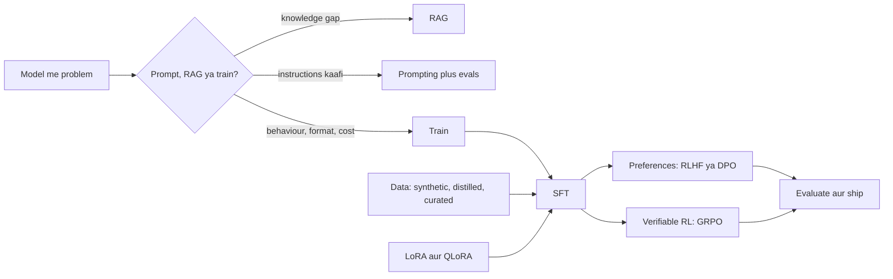

## ⭐ Fine-tune vs prompt vs RAG

**Ek line me:** RAG knowledge jodta hai, fine-tuning behaviour badalta hai, aur prompting plus evals hamesha pehle try karo.

**Ye kyun chahiye:** Fine-tuning powerful lagta hai, isliye teams jaldi kood padti hain. Isme data collection, GPU time, aur har base model update pe maintenance ka kharcha hai. "Model ko X nahi pata" wali kai problems asal me retrieval problems hain, aur "model mera format ignore karta hai" wali kai problems prompt problems hain.

**Aise socho:** Tumne Swiggy support ke liye ek smart naya agent hire kiya. "Aaj ki refund policy kya hai?" ke liye usko policy binder do (RAG). Company tone me baat karna aur har baar ticket form same tarah bharna sikhane ke liye do hafte training do (fine-tuning). Pehle din bas sticky note pe achhe instructions likh do (prompting).

**Kaise kaam karta hai, step by step:**
1. Pehle chhota eval set likho: 50 se 200 real inputs, expected output ya grading rules ke saath.
2. Best prompt try karo (clear instructions, kuch examples, structured output). Measure karo.
3. Agar failures "model ko fact nahi pata" wale hain, RAG jodo. Phir measure karo.
4. Agar failures "facts pata hain par style, format galat, ya bahut slow aur mehnga" wale hain, tab fine-tuning socho.
5. Fine-tune tabhi karo jab tumhare paas kam se kam kuch sau achhe examples hon (ya bana sako), aur step 2 se gain saaf dikhe.

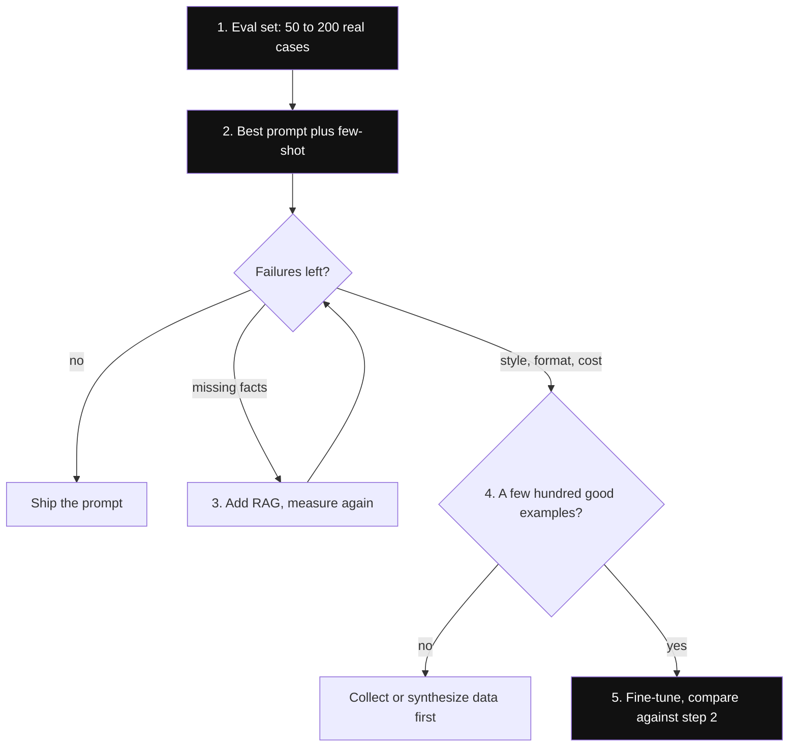

*Diagram:* Fine-tuning aakhri branch hai: wahan tabhi pahuncho jab prompt aur RAG dono usi eval set pe measure ho chuke hon.

| Zarurat | Best tool | Kyun |
|---|---|---|
| Company docs, policies, prices jo har hafte badalte hain | RAG | Document update karo, model nahi. Source cite kar sakte ho. |
| Per-user ya private data, access control ke saath | RAG | Retrieval user se filter kar sakta hai; weights nahi. |
| Fixed output format ya JSON schema | Pehle prompt + structured output, phir SFT | Constrained decoding aksar free me solve kar deta hai. |
| Brand tone, style, domain jargon | Fine-tune (SFT) | Prompt me poori tarah describe karna mushkil. |
| Cost aur latency kam: chhota model bade ka kaam kare | Fine-tune (distill) | Ek task pe tuned 8B model us task pe bade model ke barabar aa sakta hai. |
| Har call se 3,000-token system prompt hatana | Fine-tune | Behaviour weights me chala jaata hai; prompts chhote ho jaate hain. |
| Checkable tasks (math, code) pe better reasoning | Verifiable rewards wala RL | Reward checker se aata hai, human labels se nahi. |

Worked example: 3,000-token system prompt, 10 lakh calls roz = 3 billion input tokens roz. Wo behaviour fine-tuned chhote model me daal do to token bill aur time-to-first-token dono kam ho sakte hain.

**Interview tip:** "Company knowledge ke liye fine-tune ya RAG?" Bolo: "RAG. Knowledge badalti hai, citations aur access control chahiye, aur facts fine-tune karna unreliable hai: model phir bhi hallucinate kar sakta hai aur source nahi bata sakta. Fine-tune sirf behaviour ke liye karunga, jaise tone, format, ya chhote model ko sasta banana, aur aksar dono combine karta hoon: aisa fine-tuned model jo retrieved context achhe se use kare."

**Common galti:**
- Eval set banaye bina fine-tune karna, phir koi prove nahi kar pata ki help hui.
- Ye sochna ki fine-tuning "model ko hamari wiki sikha dega". Wo wiki ka style zyada seekhta hai, facts kam.

## Post-training pipeline

**Ek line me:** Base model → SFT (instructions follow karna seekho) → preference ya RL tuning (kya better hai seekho) → optionally chhote model me distill.

**Ye kyun chahiye:** Trillions tokens pe pre-training language aur knowledge sikhati hai, par model sirf agla text predict karta hai. Base model se poochho "France ki capital kya hai?" to wo aage likh sakta hai "Germany ki capital kya hai?", kyunki ye quiz page jaisa dikhta hai. Post-training raw ability ko kaam ke behaviour me badalti hai.

**Aise socho:** Cricket academy. Pre-training = saalon tak har match dekhna. SFT = coach har ball pe sahi shot dikhata hai. Preference tuning = coach bolta hai "ye shot us shot se better tha". Verifiable rewards wala RL = real match jahan scoreboard judge hai. Distillation = star player junior ko train karta hai.

**Kaise kaam karta hai, step by step:**

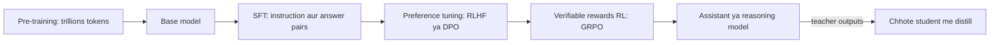

1. **Pre-training:** roughly 10 se 30+ trillion tokens pe next-token prediction. Mahino ka compute. Ye tum lagbhag kabhi nahi karte.
2. **SFT (supervised fine-tuning):** das hazaar se kuch million (prompt, ideal answer) pairs. Model chat format aur instructions follow karna seekhta hai.
3. **Preference tuning:** answers ke pairs jahan humans ya AI judge ne better wala chuna. Model helpfulness, safety aur tone seekhta hai.
4. **Verifiable rewards wala RL:** checkable answer wale problems (math, code tests). Model lamba aur dhyan se reason karna seekhta hai.
5. **Distillation (optional):** bade model ke outputs se chhota, sasta model train karo.

Application engineer ke roop me tum aksar already post-trained instruct model se shuru karte ho aur chhota SFT karte ho, kabhi kabhi uske baad DPO.

**Interview tip:** "Sirf SFT kyun nahi?" Bolo: "SFT sirf dekhe hue examples ki nakal kar sakta hai; wo kabhi nahi seekhta ki do answers me kaun sa bura hai. Preference tuning aur RL relative quality ka signal dete hain, aur RL model ko apni hi koshishon se seekhne deta hai, jo demonstrations se aage ja sakta hai."

**Common galti:**
- Base model pe poora post-training chalana jab instruct model already 90% kaam kar deta hai.

## ⭐ Supervised fine-tuning (SFT)

**Ek line me:** Model ko bahut saare (conversation, ideal reply) examples dikhao aur use ideal reply token by token predict karna sikhao.

**Ye kyun chahiye:** Format, tone ya narrow task sikhane ka sabse simple aur reliable tareeka. Har post-training pipeline ka pehla step bhi yahi hai.

**Aise socho:** IRCTC call-centre ka naya agent best agents ki 500 recordings sunta hai aur unki tarah jawab dena copy karta hai. Wo nayi train timings nahi seekhta; baat karne ka tareeka seekhta hai.

**Kaise kaam karta hai, step by step:**
1. **Data ko model ke chat template se format karo.** Har example messages ki list hai. Tokenizer unhe un special tokens me lapet-ta hai jinke saath model train hua tha, jaise `<|im_start|>user ... <|im_end|>`. Galat template chupchap quality maar deta hai.

```json
{"messages": [
  {"role": "system", "content": "You are Swiggy support. Be brief and polite."},
  {"role": "user", "content": "My order 8812 is 40 minutes late."},
  {"role": "assistant", "content": "Sorry about the delay. Order 8812 is 5 minutes away. I have added a Rs 50 coupon to your account."}
]}
```

2. **Loss sirf assistant tokens pe.** System aur user tokens mask ho jaate hain (unka loss ignore). Warna model user messages likhna bhi seekhta hai, aur lambe prompts loss pe haavi ho jaate hain.

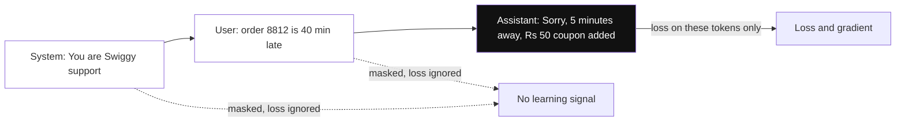

*Diagram:* System aur user turns model context ki tarah padhta hai, par grade sirf highlighted assistant reply ke tokens hote hain.

3. **Size chuno.** Roughly: kuch sau high-quality examples format sikhate hain; 1,000 se 10,000 ek narrow task achhe se; broad behaviour ke liye das hazaaron. LIMA paper (2023) ne sirf 1,000 dhyan se chune examples se strong assistant banaya.
4. **1 se 3 epochs train karo.** Example: 5,000 examples × 3 epochs = 15,000 example passes. Batch size 16 se lagbhag 940 update steps.
5. **Overfitting dekho:** training loss girta rahe par held-out examples ka loss badhne lage. Model answers ratt raha hai. Pehle roko, kam epochs lo, ya data badhao.
6. **Catastrophic forgetting dekho:** support chats pe tune karne ke baad model general cheezon me (maths, doosre instructions) kharab ho jaata hai. Fix: kam learning rate, kam epochs, full tuning ki jagah LoRA, aur 5 se 20% general instruction data mix karo.

| Setting | Typical value |
|---|---|
| Examples | 500 se 50,000 |
| Epochs | 1 se 3 |
| Learning rate, full fine-tuning | lagbhag 1e-5 se 2e-5 |
| Learning rate, LoRA | lagbhag 1e-4 se 2e-4 |
| Max sequence length | 95%+ examples ke liye kaafi, jaise 2,048 ya 4,096 tokens |

**Interview tip:** "Prompt tokens mask kyun karte ho?" Bolo: "Hum chahte hain model achhe answers banana seekhe, user text predict karna nahi. Masking saara learning signal assistant reply pe daalti hai, aur lambe prompts ko loss pe haavi hone se rokti hai."

**Common galti:**
- Inference wale se alag chat template ke saath train karna. Output tute hue dikhte hain ya kabhi rukte nahi.
- Bahut saare near-duplicate examples. Model ek phrasing pe overfit hoke har jagah wahi dohraata hai.

## Full fine-tuning aur uska memory bill

**Ek line me:** Har weight update karne ke liye activations se pehle hi lagbhag 16 bytes GPU memory per parameter chahiye, to 7B model ko 112 GB se zyada.

**Ye kyun chahiye:** Ye number samjhata hai ki LoRA aur QLoRA kyun bane. Interviewers ko "7B model fine-tune karne me kitni GPU memory?" poochna bahut pasand hai.

**Aise socho:** Ghar shift karna. Furniture (weights) bas 2 bytes per item hai, par shifting ke time changes ke liye boxes (gradients), pichhli moves ki notebook (Adam states), aur ek careful master copy bhi chahiye. Truck me sab ek saath aana chahiye.

**Kaise kaam karta hai, step by step:** Adam optimizer ke saath standard mixed-precision training per parameter ye store karti hai:

| Kya | Precision | Bytes per param |
|---|---|---|
| Forward aur backward pass wale weights | bf16 (16-bit) | 2 |
| Gradients | bf16 | 2 |
| Weights ki master copy | fp32 (32-bit) | 4 |
| Adam first moment (gradients ka running average) | fp32 | 4 |
| Adam second moment (squared gradients ka running average) | fp32 | 4 |
| **Total** | | **16** |

1. 7B params × 16 bytes = 112 GB.
2. Activations jodo (forward pass me save hui values jo backward pass me chahiye). Ye batch size aur sequence length ke saath badhti hain: aksar 10 se 50+ GB aur.
3. Ek 80 GB H100 me nahi aata. Kai GPUs aur DeepSpeed ZeRO ya PyTorch FSDP (fully sharded data parallel) jaise sharding tools chahiye, jo ye states GPUs me baant dete hain.
4. Inference se compare karo: 7B × 2 bytes = 14 GB. Training ko lagbhag 8× zyada chahiye.

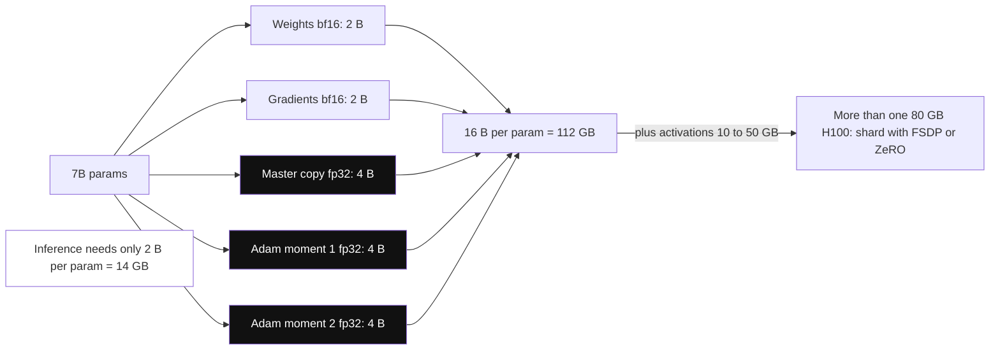

*Diagram:* 16 me se sirf 2 bytes weights hain; fp32 master copy aur do Adam moments (highlighted) 12 bytes aur jodte hain, isliye training ko inference se lagbhag 8x memory chahiye.

**Interview tip:** "Training inference se itni heavy kyun hai?" Bolo: "Inference 2 bytes per param rakhta hai. Training gradients, fp32 master copy aur do Adam moments jodti hai, lagbhag 16 bytes per param, plus activations. Isiliye parameter-efficient methods weights ka sirf chhota hissa train karte hain."

**Common galti:**
- Bolna "7B bf16 me 14 GB hai, to 24 GB GPU pe training ho jaayegi". Wo inference ka number hai.

## ⭐ LoRA (low-rank adaptation)

**Ek line me:** Original weights freeze karo aur har badi matrix ke liye ek chhota "patch" seekho, jo do patli matrices B × A ke product ke roop me likha jaata hai.

**Ye kyun chahiye:** Full fine-tuning train karne aur store karne dono me mehnga hai: har customer ya task ko apni 14 GB copy chahiye. LoRA (2021) 1% se bhi kam parameters train karta hai, kaafi chhote GPUs pe chal jaata hai, aur har task ke liye das-bees MB ki file save karta hai.

**Aise socho:** Ek zone ke change ke liye poora 1,000-page railway timetable dobara chhapne ki jagah, ek patli correction slip chhaapo aur andar clip kar do. Original kitaab waise hi rehti hai; alag zones ke liye slips badal sakte ho.

**Kaise kaam karta hai, step by step:**
1. Ek layer me weight matrix W hai, maan lo 4096 × 4096. Normal fine-tuning same size ka change ΔW seekhti hai.
2. LoRA maanta hai ki kaam ka change "low rank" hai: kuch hi directions se describe ho sakta hai. To ΔW = B × A likhta hai, jahan B 4096 × r aur A r × 4096 hai, chhote rank r jaise 8, 16 ya 64 ke saath.
3. Layer ab compute karti hai: output = W·x + (alpha / r) · B·A·x. W frozen hai; sirf A aur B train hote hain.
4. B zero se shuru hota hai, to step 0 pe model bilkul original jaisa behave karta hai. Training phir patch ko badhati hai.
5. **alpha** ek scaling knob hai. Common default alpha = r ya alpha = 2r. Zyada alpha matlab patch ka asar zyada.
6. **Kaun si layers:** originally sirf attention ki query aur value projections. Aaj aam choice saari linear layers (attention q, k, v, o aur MLP up, gate, down), jo thode extra cost me better quality deti hai.

**Worked parameter count** ek 4096 × 4096 matrix, r = 16 ke liye:

| | Calculation | Parameters |
|---|---|---|
| Full matrix | 4096 × 4096 | 16,777,216 (16.7M) |
| LoRA A | 16 × 4096 | 65,536 |
| LoRA B | 4096 × 16 | 65,536 |
| LoRA total | 65,536 + 65,536 | 131,072 (131k), lagbhag 0.78% |

Poore 7B model me saari linear layers pe r = 16 ke saath LoRA roughly 40M parameters train karta hai, lagbhag 0.5%. Adapter file roughly 80 se 160 MB, 14 GB ki jagah.

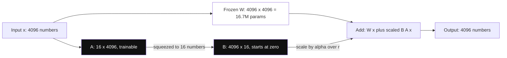

*Diagram:* W ko kabhi chhua nahi jaata (dimmed); sirf patla A phir B wala side path (131k params, W ka 0.78%) seekhta hai, jo x ko r = 16 numbers tak dabata hai aur wapas 4096 tak le jaata hai.

7. **Merging:** training ke baad ek baar W' = W + (alpha / r)·B·A compute karke save karo. Ab inference pe koi extra latency nahi. Ya adapters alag rakho aur ek base model pe kai load karo: vLLM jaise servers ek saath kai LoRA adapters serve kar sakte hain, har customer ka ek.

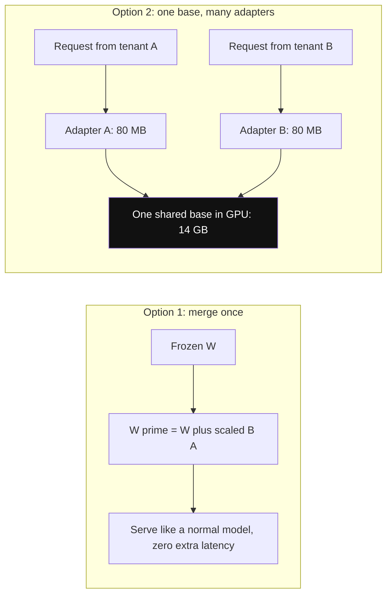

*Diagram:* Ya to patch ko ek baar W me bake kar do, ya ek 14 GB base memory me rakho aur har request pe alag 80 MB adapter lagao.

| | Full fine-tuning | LoRA |
|---|---|---|
| Trainable params (7B) | 7B | lagbhag 10 se 100M |
| Training memory (7B) | 112 GB+ | lagbhag 16 se 24 GB (bf16 base + chhota optimizer state) |
| Saved artifact | har task 14 GB | har task 10 se 200 MB |
| Quality | Sabse uncha ceiling, khaaskar bade domain shift me | Zyada tar SFT tasks pe full FT ke kareeb |
| Forgetting | Zyada risk | Kam risk, base frozen hai |
| Kai variants serve karna | Har ek ka full model | Ek base + adapters swap |

**Interview tip:** "LoRA vs full fine-tuning?" Bolo: "LoRA W freeze karke low-rank update BA seekhta hai. 4096 square matrix pe r = 16 se 16.7M ki jagah 131k params. Training memory kai guna kam, chhote adapters jo per tenant hot-swap kar sakta hoon, aur forgetting kam. Full fine-tuning tab jeet-ta hai jab shift bada ho, jaise nayi language ya heavy continued pre-training, aur GPUs hon."

**Common galti:**
- Sochna ki zyada rank hamesha better hai. r = 16 se 64 ke baad gains aksar flat; data quality kahin zyada matter karti hai.
- alpha ya learning rate adjust kiye bina r badalna, phir results badlein to LoRA ko dosh dena.

## ⭐ QLoRA (quantized LoRA)

**Ek line me:** Frozen base model 4-bit me load karo aur upar LoRA adapters 16-bit me train karo, taaki 7B ya 13B model ek consumer GPU pe fine-tune ho jaaye.

**Ye kyun chahiye:** LoRA ke saath bhi bf16 frozen base 7B ke liye 14 GB aur 13B ke liye 26 GB hai. QLoRA (2023) ise lagbhag 4× chhota karta hai, to fine-tuning data-centre GPU se 24 GB gaming card pe aa jaati hai.

**Aise socho:** Bada timetable compressed, read-only photocopy (4-bit) me rakho aur correction slips poori syahi (16-bit) me likho. Tum sirf slips pe hi likhte ho.

**Kaise kaam karta hai, step by step:**
1. **NF4 (4-bit NormalFloat):** model weights roughly bell curve follow karte hain, to NF4 apne 16 possible values wahan rakhta hai jahan weights ghane hain. Plain 4-bit integers se kam quality loss.
2. **Double quantization:** quantization ke scaling constants ko bhi quantize kar dete hain, lagbhag 0.4 bits per parameter aur bachte hain.
3. **Paged optimizers:** lambe sequence pe memory spike ho to optimizer states out-of-memory crash ki jagah CPU RAM me page out ho jaate hain.
4. Forward aur backward pass me 4-bit weights on the fly bf16 me de-quantize hote hain. Gradients sirf LoRA weights me jaate hain.
5. 7B ke liye memory: 7B × 0.5 bytes ≈ 3.5 se 4 GB weights, plus LoRA params, optimizer state aur activations. Aam taur pe total 8 se 16 GB. 13B moderate sequence lengths ke saath 24 GB card me aa jaata hai.
6. Cost: de-quantization ki wajah se training thodi slow, aur quality aam taur pe 16-bit LoRA ke bahut kareeb.

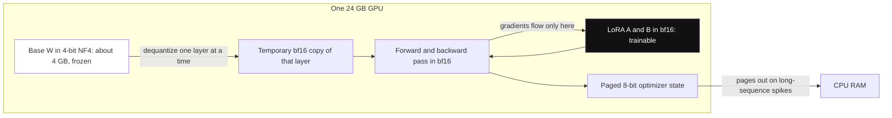

*Diagram:* 4-bit base sirf maths ke liye bf16 me khulta hai, kabhi update nahi hota; gradients sirf chhote bf16 LoRA box tak jaate hain, aur optimizer crash hone ki jagah CPU RAM me spill karta hai.

```python
import torch
from datasets import load_dataset
from transformers import AutoModelForCausalLM, BitsAndBytesConfig
from peft import LoraConfig
from trl import SFTConfig, SFTTrainer

model_id = "Qwen/Qwen2.5-7B-Instruct"
bnb = BitsAndBytesConfig(
    load_in_4bit=True, bnb_4bit_quant_type="nf4",       # NF4 base weights
    bnb_4bit_use_double_quant=True,                     # scales bhi quantize
    bnb_4bit_compute_dtype=torch.bfloat16)              # maths bf16 me hota hai
model = AutoModelForCausalLM.from_pretrained(model_id, quantization_config=bnb)

lora = LoraConfig(r=16, lora_alpha=32, lora_dropout=0.05,
                  target_modules="all-linear", task_type="CAUSAL_LM")

data = load_dataset("json", data_files="support_chats.jsonl", split="train")
split = data.train_test_split(test_size=0.05, seed=42)  # held-out set rakho

args = SFTConfig(output_dir="out/support-lora", num_train_epochs=2,
                 per_device_train_batch_size=4, gradient_accumulation_steps=4,
                 learning_rate=2e-4, max_length=2048, bf16=True,
                 assistant_only_loss=True,              # loss sirf replies pe (template unhe mark kare)
                 optim="paged_adamw_8bit",              # paged optimizer
                 eval_strategy="steps", eval_steps=100)

trainer = SFTTrainer(model=model, args=args, peft_config=lora,
                     train_dataset=split["train"], eval_dataset=split["test"])
trainer.train()
trainer.save_model("out/support-lora")                 # sirf adapter save hota hai
```

**Code kya karta hai:**
- 7B base ko 4-bit NF4 me double quantization ke saath load karta hai; compute bf16 me.
- `LoraConfig` har linear layer pe rank-16 adapters jodta hai, alpha 32 (scale 2).
- `SFTTrainer` `messages` rows padhta hai, model ka chat template lagata hai, aur `assistant_only_loss=True` system aur user tokens mask karta hai.
- Batch 4 × accumulation 4 = effective batch 16. `paged_adamw_8bit` optimizer memory chhoti rakhta hai aur out-of-memory spikes se bachata hai.
- 5% held-out split har 100 steps pe evaluate hota hai taaki overfitting pakad sako.

**Interview tip:** "24 GB GPU pe 7B model fine-tune kar sakte ho?" Bolo: "Haan, QLoRA se. Base 4-bit NF4 me, lagbhag 4 GB, LoRA adapters bf16 me train hote hain, aur paged optimizers memory spikes sambhalte hain. Full fine-tuning ko lagbhag 112 GB chahiye."

**Common galti:**
- Adapter ko 4-bit model me merge karke wahi ship karna. Best quality ke liye base ki bf16 copy me merge karo, phir zarurat ho to serving ke liye quantize karo.

## ⭐ RLHF (reinforcement learning from human feedback)

**Ek line me:** Do answers me se humans ne kaun sa chuna, us pe reward model train karo, phir reinforcement learning (PPO) se model ko high-reward answers banana sikhao, aur KL penalty use shuruaat ke kareeb rakhe.

**Ye kyun chahiye:** Human ke liye "answer A, B se better hai" bolna aasaan hai, perfect answer likhna mushkil. SFT "A better hai B se" wala data use nahi kar sakta. RLHF kar sakta hai. InstructGPT (2022) aur shuruaati ChatGPT isi se helpful aur safer bane.

**Aise socho:** Zomato ka chef perfect biryani ki recipe likh nahi sakta, par customers aasaani se bata dete hain do plates me kaun si tasty thi. Un votes pe ek food critic train karo. Phir chef experiment karta hai, critic har plate ko score deta hai, aur chef high scores ki taraf shift hota hai. Owner bolta hai: restaurant ke original style se zyada door mat jao, warna ajeeb dishes se critic ka taste exploit ho jaayega.

**Kaise kaam karta hai, step by step:**
1. SFT model se shuru karo. Uski ek copy freeze karo: ye **reference model** hai.
2. Prompts collect karo. Har ek ke 2 ya zyada answers sample karo. Humans better wala chunte hain. Example: 50,000 comparison pairs.
3. Un pairs pe **reward model** train karo (agla section). Ye har (prompt, answer) ka ek score deta hai.
4. **PPO loop** (proximal policy optimization, stable RL algorithm jo har step me model kitna badle use limit karta hai):
   - Policy prompt ka answer likhti hai.
   - Reward model score deta hai, maan lo 2.1.
   - KL penalty nikalo: policy ki token probabilities reference model se kitni hili. Maan lo KL = 5 aur β = 0.05, penalty = 0.25.
   - Final reward = 2.1 − 0.25 = 1.85.
   - Ek **value model** (critic) expected reward predict karta hai, taaki pata chale 1.85 normal se better hai ya bura. PPO policy ko chhote clipped steps me update karta hai.
5. To PPO memory me chaar models rakhta hai: policy, reference, reward model, value model.

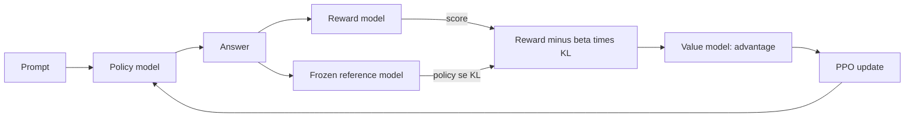

**KL penalty kyun:**
- Reward model perfect nahi hai. Wo limited answers pe train hua. Zor se push karo to policy aise answers dhoondh leti hai jo score high karein par bure hon. Ye hai **reward hacking**.
- Example: reward model ko lambe, confident, polite answers thode pasand hain. Bina KL ke policy 800-word answers likhna seekh leti hai, "Great question!" aur nakli certainty se bhare.
- KL term bolta hai: "improve karo, par SFT model ki language ke paas raho." Isse text fluent rehta hai, tum us area me rehte ho jahan reward model pe bharosa ho sakta hai, aur general skills bachti hain.
- β (beta) trade-off set karta hai. Bahut kam: reward hacking. Bahut zyada: model mushkil se badalta hai.

**Interview tip:** "RLHF me KL penalty kyun?" Bolo: "Reward model narrow distribution pe train hua proxy hai. Bina lagaam optimize karo to reward hacking aur high-score wala gibberish milta hai. Frozen SFT model se KL policy ko us area me rakhta hai jahan reward model reliable hai, aur fluency aur general skills bachata hai."

**Common galti:**
- Bolna "RLHF model ko human-written answers pe train karta hai". Wo SFT hai. RLHF human comparisons pe, reward model ke through, train karta hai.
- Engineering cost bhool jaana: chaar models, training loop ke andar online generation, aur nakhre wale hyperparameters.

## Reward models

**Ek line me:** Reward model aam taur pe wahi LLM hai jiski last layer ek single score dene wali layer se badal di gayi, aur train kiya gaya ki preferred answers rejected se zyada score karein.

**Ye kyun chahiye:** RL ko har answer ke liye ek number chahiye, aur humans live me millions answers score nahi kar sakte. Reward model ek seekha hua, automatic judge hai.

**Aise socho:** Cricket selector jisne hazaaron "player A vs player B" decisions dekhe hain, aur ab har naye player ko 10 me se rating deta hai.

**Kaise kaam karta hai, step by step:**
1. **Pairwise (Bradley-Terry) loss:** answer A ke B ko harane ki probability = sigmoid(score_A − score_B). Sigmoid kisi bhi number ko 0 se 1 me daba deta hai.
2. Loss = −log(sigmoid(score_chosen − score_rejected)). Sirf gap matter karta hai, absolute scores nahi.
3. Worked example: chosen ka score 2.0, rejected ka 0.5. Gap 1.5, sigmoid(1.5) ≈ 0.82, loss ≈ 0.20 (chhota, achha). Scores ulte hote to gap −1.5, sigmoid ≈ 0.18, loss ≈ 1.70 (bada, model correct hota hai).

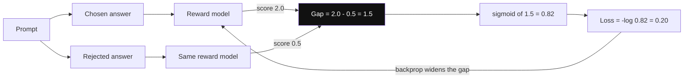

*Diagram:* Ek hi model dono answers ko score deta hai; loss me sirf dono scores ka gap jaata hai, aur training us gap ko badhati rehti hai.

4. **Outcome vs process reward models:**

| | Outcome reward model (ORM) | Process reward model (PRM) |
|---|---|---|
| Kya score karta hai | Sirf final answer | Har reasoning step |
| Labels chahiye | Saste: final answer sahi tha? | Mehnge: har step sahi tha? |
| Signal | Sparse; lucky galat raasta bhi full reward le sakta hai | Dense; pehla galat step pakadta hai |
| Use | Zyada tar RLHF, best-of-N selection | Math reasoning, step-level search (OpenAI ka "Let's Verify Step by Step", 2023) |

**Interview tip:** "Reward model pairs se kya seekhta hai?" Bolo: "Aisa score jisme chosen answer rejected ko hara de, score difference pe Bradley-Terry loss se. Ye relative quality seekhta hai, to uske absolute values ka koi matlab nahi, aur training distribution ke bahar ise bewakoof banaya ja sakta hai."

**Common galti:**
- Alag reward models ke raw scores ko comparable maan lena.
- RL chalane se pehle reward model me length bias check na karna.

## ⭐ DPO (direct preference optimization) aur uske variants

**Ek line me:** DPO wahi chosen/rejected pairs use karta hai jo RLHF karta hai, par model ko seedha ek simple classification jaise loss se train karta hai, bina reward model aur bina RL loop ke.

**Ye kyun chahiye:** PPO-based RLHF mehnga aur unstable hai: chaar models, online sampling, bahut knobs. DPO (2023) ne dikhaya ki wahi objective seedha preference pairs pe optimize ho sakta hai. Sirf do models chahiye (policy aur frozen reference) aur training SFT jaisi hai.

**Aise socho:** Food critic train karke chef ko uske peeche bhagane ki jagah, chef ko har plates ka pair dikhao aur seedha bolo "is jaisa zyada, us jaisa kam."

**Kaise kaam karta hai, step by step:**
1. Data: (prompt, chosen answer, rejected answer) ki rows.
2. Har row ke liye naapo ki policy har answer ko reference model ke comparison me kitna zyada likely banati hai: ek "log-probability ratio". Ye ratio implicit reward ki tarah kaam karta hai.
3. Loss = −log sigmoid(β × [ratio_chosen − ratio_rejected]). Reference ke relative chosen ko upar aur rejected ko neeche dhakelo.
4. Worked example: reference ke comparison me policy ne chosen answer ki log-probability 2.0 badhayi aur rejected ki 1.0 ghatayi. Margin = 3.0. β = 0.1 ke saath: 0.3, sigmoid(0.3) ≈ 0.57, loss ≈ 0.55. Training margin badhati rehti hai.
5. **β** KL strength ka role nibhata hai. Typical 0.1 (range lagbhag 0.01 se 0.5). Chhota β model ko reference se door jaane deta hai; bada β paas rakhta hai.

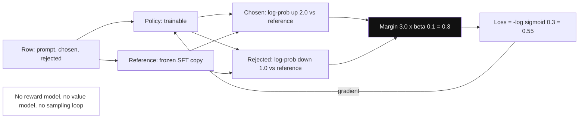

*Diagram:* Sirf do models; frozen reference log-probs ko ratios me badalta hai, aur loss seedha chosen-minus-rejected margin ko badhata hai.

```python
from datasets import load_dataset
from trl import DPOConfig, DPOTrainer

# har row: {"prompt": ..., "chosen": ..., "rejected": ...}
pairs = load_dataset("json", data_files="support_prefs.jsonl", split="train")

args = DPOConfig(output_dir="out/support-dpo", beta=0.1,  # KL jaisi strength
                 learning_rate=5e-7, num_train_epochs=1,  # DPO bahut chhote LR use karta hai
                 per_device_train_batch_size=4, bf16=True)

trainer = DPOTrainer(model="out/support-sft-merged",   # SFT model se shuru
                     args=args, train_dataset=pairs)   # reference = frozen copy
trainer.train()
```

**Code kya karta hai:**
- Standard `prompt` / `chosen` / `rejected` columns me preference pairs load karta hai.
- SFT model se shuru karta hai; koi reference na do to TRL frozen copy bana leta hai.
- `beta=0.1` set karta hai policy reference se kitna door ja sakti hai.
- SFT se kaafi kam learning rate, kyunki DPO jaldi over-optimize ho sakta hai.

| | PPO (RLHF) | DPO |
|---|---|---|
| Memory me models | 4 (policy, reference, reward, value) | 2 (policy, reference) |
| Data | Prompts + reward model; training me naye answers banata hai | Fixed offline pairs |
| Stability | Bahut hyperparameters pe sensitive | Simple, SFT jaisa |
| Exploration | Haan, apne naye samples se seekhta hai | Nahi, sirf diye gaye pairs |
| Ceiling | Scale pe achhe se kiya to aksar zyada | Zyada tar product teams ke liye strong |

**Variants ek table me:**

| Method | Saal | Key idea | Data | Reference model? |
|---|---|---|---|---|
| IPO | 2023 | Margin pe squared loss taaki DPO pakke winners wale pairs pe overfit na ho | Pairs | Haan |
| KTO | 2024 | Single answers se seekhta hai jo good ya bad label hain (thumbs up/down) | Unpaired labels | Haan |
| ORPO | 2024 | SFT loss plus odds-ratio penalty ek hi stage me, alag SFT step nahi | Pairs | Nahi |
| SimPO | 2024 | Reward = length-normalised average log-probability plus margin | Pairs | Nahi |

**Interview tip:** "DPO vs PPO?" Bolo: "DPO wahi KL-regularised preference objective offline pairs pe closed form me optimize karta hai, to na reward model na sampling loop: sasta aur stable. PPO online hai: explore karta hai, fresh samples pe reward model use kar sakta hai, aur aksar uncha ceiling deta hai, par chaar models aur bahut tuning lagti hai. Preference data wali product team ke liye main DPO se shuru karunga."

**Common galti:**
- Aise pairs pe DPO chalana jahan chosen aur rejected dono kisi aur model ke hain. Off-policy pairs kam achha kaam karte hain; ho sake to dono answers apne SFT model se generate karo.
- Length ignore karna: DPO models aksar verbose ho jaate hain kyunki lambe answers zyada chune gaye the. Pehle aur baad me average length check karo.

## ⭐ GRPO aur verifiable rewards wala RL (RLVR)

**Ek line me:** Checkable answer wale tasks ke liye har sawal pe answers ka group sample karo, har ek ko program se score karo, aur group average se behtar answers ko upar dhakelo. Na reward model, na value model.

**Ye kyun chahiye:** Math aur code ke liye human ya seekha hua judge nahi chahiye: checker bata deta hai sahi ya galat. Is reward ki chaaplusi nahi ho sakti, to lambi RL training possible hai. GRPO (group relative policy optimization, DeepSeekMath 2024) PPO ka value model bhi hata deta hai, memory aur complexity bachti hai. DeepSeek-R1 jaise reasoning models ke peeche yahi recipe hai.

**Aise socho:** JEE coaching class. Teacher ek problem deta hai, aath students solve karte hain. Answers key se check hote hain. Jo sahi the unhe bola jaata hai "jo kiya wo aur karo", baaki ko "wo kam karo". Pehle se kisi ko predict nahi karna padta ki sawal kitna mushkil tha; class average bata deta hai.

**Kaise kaam karta hai, step by step:**
1. Known answer wala prompt lo, jaise "17 × 24 kitna hai?" (answer 408), ya unit tests wala coding task.
2. Current model se G answers ka group sample karo, maan lo G = 4 (practice me 8 se 64).
3. Har ek ko **verifiable reward** se score karo: final answer match ya tests pass to 1, warna 0. Aksar chhota format reward bhi (jaise reasoning `<think>` tags ke andar).
4. Rewards: [1, 0, 0, 1]. Mean = 0.5, standard deviation = 0.5.
5. **Advantage** = (reward − mean) / std = [+1, −1, −1, +1]. Sahi answers upar, galat neeche.
6. Policy ko PPO-style clipped step plus reference model se chhoti KL penalty ke saath update karo.
7. Agar chaaron sahi (ya chaaron galat), har advantage 0: us prompt se kuch nahi seekha. Isliye training data current model ke liye "mushkil par solvable" hona chahiye.

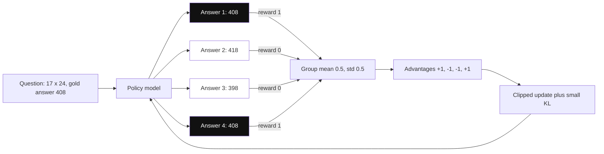

*Diagram:* Checker 1 ya 0 deta hai; sahi answers (highlighted) group mean se upar hain to push up hote hain, galat push down, aur value model ki zaroorat nahi.

**Critic kyun nahi chahiye:** PPO me value model estimate karta hai "is prompt ka typical answer kitna achha hai", taaki pata chale answer normal se upar hai ya neeche. GRPO ye baseline seedha group ke mean reward se nikal leta hai. Ek bada model kam, badle me har prompt pe zyada samples.

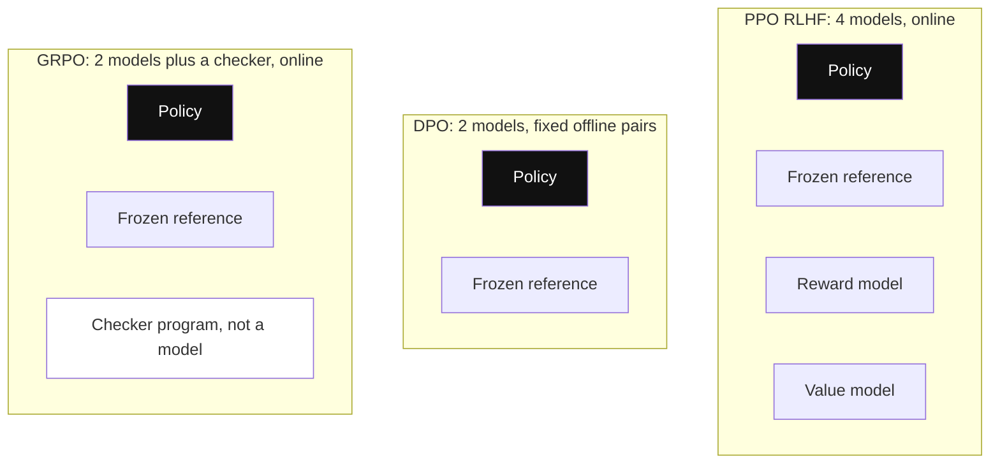

*Diagram:* DPO fixed pairs pe train karke reward aur value models hata deta hai; GRPO value model ko group average se aur reward model ko ek program se replace karta hai.

**DeepSeek-R1 ki kahani (January 2025):**
- **R1-Zero:** base model pe GRPO se pure RL, rewards sirf sahi answer aur format ke liye. Training ke dauraan responses kaafi lambe hote gaye, aur model apna kaam khud check aur revise karne laga ("aha moment"). Par languages mix karta tha aur padhna mushkil tha.
- **R1:** readable lambe reasoning examples pe chhota "cold start" SFT, phir GRPO, phir model ke best filtered outputs pe ek round SFT, phir general helpfulness ke liye dobara RL.
- **Distilled R1 models:** chhote Qwen aur Llama models (1.5B se 70B) ko lagbhag 800k R1-generated samples pe plain SFT kiya, unme bhi strong reasoning aa gayi.

**Isse reasoning models kyun bante hain:** reward sirf final sahi answer ko milta hai. Zyada sochna, doosra tareeka try karna, kaam check karna, sab sahi hone ka chance badhate hain, to RL inhe reinforce karta hai. Kisi ko achhi reasoning ke examples likhne nahi pade.

```python
import re
from datasets import load_dataset
from trl import GRPOConfig, GRPOTrainer

math_ds = load_dataset("json", data_files="math.jsonl", split="train")  # prompt, answer

def correctness_reward(completions, answer, **kwargs):
    # completions: generated strings ki list; answer: dataset ka column
    rewards = []
    for text, gold in zip(completions, answer):
        m = re.search(r"<answer>(.*?)</answer>", text)
        rewards.append(1.0 if m and m.group(1).strip() == gold else 0.0)
    return rewards

args = GRPOConfig(output_dir="out/math-grpo", num_generations=8,  # group size G
                  beta=0.04,                                       # KL strength
                  max_completion_length=1024, learning_rate=1e-6)
trainer = GRPOTrainer(model="Qwen/Qwen2.5-1.5B-Instruct",
                      reward_funcs=correctness_reward,
                      args=args, train_dataset=math_ds)
trainer.train()
```

**Code kya karta hai:**
- Reward ek plain Python function hai: `<answer>` nikalta hai aur dataset ke `answer` column se compare karta hai.
- `num_generations=8` har prompt pe 8 answers sample karta hai; advantages un 8 ke relative nikalte hain.
- Na reward model, na value model; sirf policy (aur KL term ke liye reference) load hote hain.
- `beta=0.04` starting model se chhoti KL lagaam rakhta hai.

**Interview tip:** "GRPO bina critic ke kaise kaam karta hai?" Bolo: "Har prompt ke liye answers ka group sample karta hai, verifier se score karta hai, aur har answer ka reward minus group mean, group std se divide, uska advantage hai. Group mean value model ke baseline ki jagah le leta hai, ek poora model bachta hai, aur jab rewards checkable hon tab achha kaam karta hai."

**Common galti:**
- Kamzor checker. Agar expected output print karke tests pass ho jaate hain, model tests hack karna seekh lega.
- Bahut aasaan ya bahut mushkil prompts pe training. Sab rewards same matlab zero advantage aur compute barbaad.

## ⭐ Distillation

**Ek line me:** Bade "teacher" model se chhota "student" model train karo, ya to teacher ki probabilities match karke (soft labels) ya teacher ke generate kiye text pe fine-tune karke.

**Ye kyun chahiye:** Bade models accurate par slow aur mehnge hain. Ek narrow task ke liye 7B ya 8B student teacher ke kareeb pahunch sakta hai, cost aur latency ke chhote hisse me.

**Aise socho:** Flipkart ka senior engineer (teacher) 10,000 tickets ke worked answers likhta hai. Junior (student) unhe padhta hai. Soft labels aise hain jaise senior ye bhi bole "mujhe 70% lagta hai payment issue hai, 25% delivery issue", jo sirf final call se zyada sikhata hai.

**Kaise kaam karta hai, step by step:**

| | Soft-label (logit) distillation | Synthetic-data (sequence) distillation |
|---|---|---|
| Student kis se seekhta hai | Har agle token ke liye teacher ki poori probability distribution | Teacher ke generate kiye answers, normal SFT data ki tarah |
| Chahiye | Teacher logits, same tokenizer (vocabulary) | Sirf teacher text, API se bhi chalta hai |
| Signal | Rich: "kitna sure" aur "kaun se alternatives" | Sirf final tokens |
| Typical use | Model families banane wali labs (Hinton 2015 idea) | Product teams, DeepSeek-R1 distilled models |

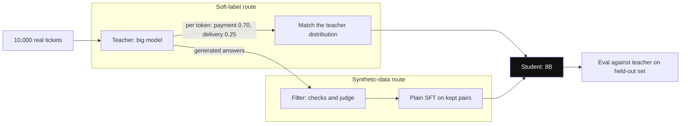

*Diagram:* Soft-label route ko teacher ki probabilities aur same tokenizer chahiye; synthetic-data route ko sirf uska text, isliye API se bhi chal jaata hai.

1. 5,000 se 100,000 real task inputs collect karo (jaise support tickets).
2. Har ek pe strong prompt ke saath teacher chalao, high-quality outputs lo.
3. Filter: wahi answers rakho jo checks pass karein (sahi JSON, verified facts, threshold se upar judge score).
4. Rakhe hue pairs pe student ko SFT karo. Held-out set pe teacher se compare karo.
5. Worked cost: agar teacher student se per token 20× mehnga hai aur student tumhare eval pe teacher ka 95% score le aata hai, to us task pe serving cost lagbhag 95% bachti hai.

**Licence caveats:** kai commercial API terms outputs se competing models banana mana karte hain. Kuch open-model licences derived models pe conditions lagate hain (jaise Llama 3.1 licence kehta hai ki uske outputs pe train hue models ke naam me "Llama" ho). Student ship karne se pehle teacher ke terms check karo.

**Interview tip:** "Hamare classification + reply task ke liye sasta model kaise banaoge?" Bolo: "Distill karunga: real inputs pe strong teacher se labelled outputs banaunga, checks aur LLM judge se filter karunga, phir 8B student ko LoRA-tune karunga. Held-out set pe teacher se compare, aur confirm ki licence allow karta hai."

**Common galti:**
- Teacher ki galtiyan distill karna. Bina filtering ke student teacher ki hallucinations poore confidence se copy karta hai.

## ⭐ Synthetic data aur data curation

**Ek line me:** LLM se examples generate karo, phir sakhti se filter, deduplicate aur decontaminate karo, kyunki chhota saaf dataset bade gande dataset ko harata hai.

**Ye kyun chahiye:** Real labelled data collect karna slow aur mehnga hai. LLMs ek ghante me hazaaron examples bana dete hain. Par raw generated data repetitive hota hai, kabhi galat hota hai, aur tumhare eval sawal leak kar sakta hai. Zyada tar quality curation se aati hai.

**Aise socho:** Kirana wala mandi se aam khareedta hai. Bulk me khareedna aasaan hai; asli hunar chhaantna hai: sade hue nikalo, ek hi variety ke duplicates hatao, aur achha mix rakho.

**Kaise kaam karta hai, step by step:**
1. **Seed:** 50 se 200 real, high-quality examples se shuru karo.
2. **Generate:**
   - **Self-Instruct (2022):** model ko kuch seed tasks dikhao, naye tasks aur answers likhwao.
   - **Evol-Instruct (WizardLM, 2023):** ek task lo aur model se use mushkil banwao: constraints, zyada steps, edge cases jodo.
   - **Persona ya attribute variation:** "gussa customer, Hindi-English mix, refund case" taaki diversity cover ho.
3. **Filter:**
   - Rule checks: valid JSON, length limits, required fields maujood.
   - **Deduplicate:** pehle exact hashes, phir near-duplicate detection (n-grams pe MinHash ya lagbhag 0.9 se upar embedding similarity).
   - **LLM-judge quality score:** rubric pe har example ko 1 se 5 rate karo; 4 aur 5 rakho.
   - Jahan ho sake **verify** karo: code chalao, math answers check karo.
4. **Decontaminate:** jo training example tumhare eval ya public benchmark sets se overlap kare use hatao. Common method: flag karo agar lamba n-gram share ho (jaise 13 lagataar tokens) ya embedding similarity bahut high ho.
5. **Diversity check:** embeddings cluster karo aur dekho ki koi ek intent data ka 40% na ho jab baaki ke paas paanch examples hon.
6. Example funnel: 20,000 generate → rule filter 17,000 → dedup 11,000 → judge score ≥ 4 se 6,000 → decontaminate 5,950.

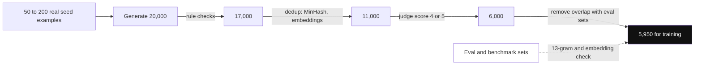

*Diagram:* Jo generate kiya uska ek-tihai se bhi kam bachta hai; dedup aur judge filter sabse zyada hatate hain, aur aakhir me eval sets ke against decontamination hota hai.

**Quality > quantity:** LIMA (2023) ne 1,000 haath se chune examples se strong assistant quality paayi. Microsoft ke Phi models ("Textbooks Are All You Need", 2023) ne dikhaya ki dhyan se chune, textbook-quality data pe train hue chhote models kaafi bade models ko hara sakte hain.

**Eval contamination kaise pakdein:**
- Training data aur eval items ke beech n-gram ya embedding overlap.
- Original benchmark vs naye likhe ya paraphrase kiye version pe score. Bada drop matlab ratta.
- Model ko eval item ka pehla aadha do; agar baaki word-for-word complete kare, to usne dekha hai.
- Eval items pe milte-julte naye items ke comparison me asaadharan kam perplexity (high confidence).

**Interview tip:** "Support model fine-tune karne ke liye dataset kaise banaoge?" Bolo: "Real resolved tickets se shuru, PII hatao, aur sirf achhe CSAT wale rakho. Intent se cluster karo taaki har intent cover ho. Gaps strong model se personas aur hard cases wali synthetic conversations se bharo, phir dedup, judge-score, aur agents se sample review karwao. Test set time aur intent se alag rakho, aur training ko uske against decontaminate karo."

**Common galti:**
- Generate aur judge dono ke liye same LLM, bina human spot-checks ke. Wo apne hi blind spots approve karta hai.
- Near-duplicates hone pe train aur test randomly split karna. Test scores shandaar dikhte hain aur unka koi matlab nahi.

## Fine-tune ko evaluate karna

**Ek line me:** Fine-tune tabhi ship hota hai jab held-out data pe best base-model-plus-prompt setup ko harata hai aur general skills nahi todta.

**Ye kyun chahiye:** Training loss girna sirf ye prove karta hai ki model training data fit kar raha hai. Real users ke baare me kuch nahi batata, aur fine-tunes aksar chupchap wo abilities kho dete hain jin pe product tika tha.

**Aise socho:** Naye spin bowler ko ek delivery pe coach kiya. Match ke liye chunne se pehle check karo ki nayi ball real batsmen pe chalti hai aur wo apni stock delivery bhoola nahi.

**Kaise kaam karta hai, step by step:**
1. **Held-out set:** 200 se 1,000 examples jo training me kabhi use nahi hue, ideally time ya customer se split, random nahi.
2. **Strong baseline:** base model ko best prompt aur few-shot examples ke saath compare karo, aur cost allow kare to bade model se bhi.
3. **Task metrics:** exact match, JSON validity rate, tests pe pass rate, ya side-by-side comparison me LLM-judge win rate (position bias se bachne ke liye order randomise karo).
4. **Regression suite:** general benchmarks ya doosre tasks ka apna sample (instruction following, safety refusals, maths). Example: task accuracy 72% → 88%, par harmful prompts pe safety refusals 98% se 85% gire. Ship mat karo.
5. **Online:** shadow traffic ya A/B test business metrics ke saath (resolution rate, escalations, cost per conversation).

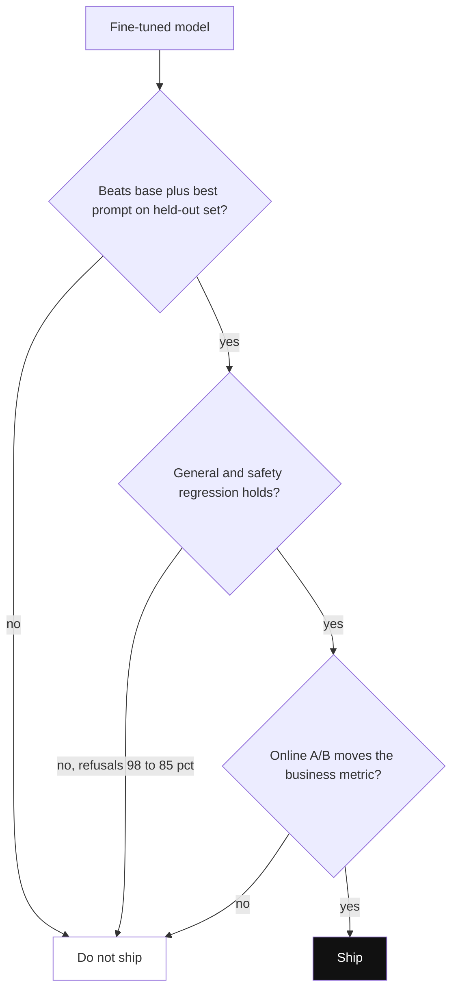

*Diagram:* Ek ke baad ek teen gates; sirf task eval pe jeetna kaafi nahi agar safety ya online metric fail ho.

| Check | Kya pakadta hai |
|---|---|
| Held-out task set | Overfitting, ratta |
| Base + prompt baseline | Aisa fine-tune jo kuch nahi jodta |
| General aur safety regression | Catastrophic forgetting, khoye refusals |
| Length aur format stats | Verbosity drift, tute stop tokens |
| A/B test | Offline gains jo real metrics nahi hilaate |

**Interview tip:** "Tumhare fine-tune ne eval 10 points improve kiya. Ship karein?" Bolo: "Tabhi jab check ho jaaye ki eval contaminated nahi tha, baseline kamzor nahi balki strong prompt tha, general aur safety regression theek hai, aur online A/B confirm kare."

**Common galti:**
- Fine-tune ko lazy prompt wale base model se compare karna. Gain fula hua dikhta hai.

## Practical stack

**Ek line me:** Hugging Face TRL aur PEFT default libraries hain; Unsloth, Axolotl aur torchtune unhe speed ya config ke liye wrap karte hain; hosted APIs GPUs ka jhanjhat hi hata dete hain.

**Ye kyun chahiye:** Training loops haath se kam hi likhte ho. Sahi tool chunne se hafte bachte hain.

**Aise socho:** Ghar pe apne masalon se khana banana (TRL/PEFT), ready meal kit (Axolotl), pressure cooker jo jaldi bana de (Unsloth), ya Swiggy pe order (hosted API).

**Kaise kaam karta hai, step by step:**

| Tool | Kya hai | Kab chuno |
|---|---|---|
| Hugging Face PEFT | LoRA, QLoRA aur doosre adapter methods | Koi bhi parameter-efficient tuning |
| Hugging Face TRL | SFT, DPO, KTO, ORPO, PPO, GRPO ke trainers | Python me zyada tar post-training ka default |
| Unsloth | LoRA/QLoRA ke optimised kernels, kaafi kam memory, aksar lagbhag 2× fast | Ek GPU, fast experiments |
| Axolotl | HF ke upar YAML-config training, multi-GPU, bahut recipes | Bina code likhe repeatable runs |
| torchtune | PyTorch-native fine-tuning recipes | Plain PyTorch pe standardised teams |
| DeepSpeed / FSDP | Weights aur optimizer states kai GPUs pe shard | Bade models ka full fine-tuning |
| Hosted fine-tuning APIs (OpenAI, Google Vertex AI, Amazon Bedrock, Together, Fireworks) | JSONL upload karo, tuned model endpoint lo | GPU team nahi, closed models, jaldi shuruaat |

1. Prototype: ek GPU pe TRL ya Unsloth se QLoRA, 1,000 se 5,000 examples.
2. Scale: GPUs pe FSDP/DeepSpeed ke saath Axolotl ya TRL.
3. Serve: adapter merge karo, ya vLLM se ek base pe kai LoRA adapters serve karo.

**Interview tip:** "Hosted fine-tuning ya self-hosted?" Bolo: "Hosted jab data hamari boundary se bahar ja sakta hai aur bina ML ops ke speed chahiye. Self-hosted open models jab data control, GRPO jaise custom methods, multi-LoRA serving, ya high volume pe kam cost chahiye."

**Common galti:**
- Hosted API se fine-tune karke bhool jaana ki tuned model us provider ke model version aur deprecation schedule se bandha hai.

## Interview ke sawal

**Q: LoRA vs full fine-tuning, kab kaun sa?**
Lagbhag saare product kaam ke liye LoRA: kaafi kam memory, chhote adapters, kam forgetting, multi-adapter serving. Full fine-tuning bade shifts ke liye (nayi language, bade domain corpus pe continued pre-training) jab GPUs hon.

**Q: RLHF me KL penalty kyun?**
Reward model ek imperfect proxy hai. KL lagaam ke bina policy reward-hack karti hai, aise text me bhatak jaati hai jo high score kare par bura ho. KL use reference model ke paas rakhta hai, jahan reward model reliable hai.

**Q: DPO vs PPO?**
DPO offline preference pairs pe seedha train karta hai, do models, koi RL loop nahi: simple aur stable. PPO reward aur value model ke saath online hai: mehnga aur nakhre wala, par explore karta hai aur uncha ceiling de sakta hai.

**Q: GRPO bina critic ke kaise kaam karta hai?**
Har prompt pe answers ka group sample karta hai aur reward minus group mean (std se divide) ko advantage banata hai. Group mean value model ke baseline ki jagah leta hai.

**Q: Company knowledge ke liye fine-tune ya RAG?**
RAG. Knowledge badalti hai, citations aur per-user access control chahiye. Fine-tuning behaviour sikhata hai, reliable facts nahi.

**Q: Support model fine-tune karne ke liye dataset kaise banaoge?**
Achhe outcome wale real resolved tickets, PII hata ke, intent se balanced, gaps filtered synthetic data se bhare, judge-scored aur human spot-checked. Time-based held-out set, decontaminated.

**Q: Eval contamination kaise detect karoge?**
n-gram aur embedding overlap checks, original vs paraphrased items pe score compare, eval prefixes pe completion tests, aur eval items pe asaadharan kam perplexity.

**Q: 7B model full fine-tune karne me kitni memory?**
Mixed precision me Adam ke saath lagbhag 16 bytes per param: 112 GB plus activations. QLoRA ise roughly 8 se 16 GB tak le aata hai.

**Q: Fine-tuned model task me better par baaki sab me kharab ho gaya. Kya hua aur kya karoge?**
Catastrophic forgetting. Learning rate aur epochs kam karo, LoRA use karo, 5 se 20% general data mix karo, aur gate me regression suite jodo.

**Q: DPO ke baad answers bahut lambe ho gaye. Kyun?**
Pairs me chosen answers average me lambe the, to model ne seekha "lamba matlab better". Data me lengths balance karo, β badhao, ya SimPO jaisa length-normalised method use karo.

**Q: Reward hacking kya hai? Example do.**
Policy asli task kiye bina reward signal maximise karti hai. Examples: verbose chaaplusi jo reward model ko pasand hai, ya code jo unit tests ko special-case kar de.

**Q: Sirf thumbs-up/thumbs-down logs hain, pairs nahi. Kya use karoge?**
KTO, jo unpaired good/bad labels se seekhta hai. Ya reward model train karke best-of-N sampling se pairs banao.

**Q: Sirf 200 examples hain to kya karoge?**
Pehle unhi se few-shot prompting try karo. Phir bhi fine-tune karna ho to LoRA, 2 se 3 epochs, held-out split, aur 200 ko seed bana ke filtered synthetic examples se data badhao.

**Q: 50 customer-specific fine-tunes sasta kaise serve karoge?**
Ek base model aur 50 LoRA adapters, multi-LoRA serving se per request load (jaise vLLM me). 50 model copies ki jagah ek GPU fleet.

**Q: Verifiable rewards wale RL se reasoning models kyun bane?**
Reward sirf final answer check karta hai, to jo bhi behaviour sahi hone ka chance badhaye (lamba sochna, self-check, backtrack) wo reinforce hota hai, bina kisi ke reasoning examples likhe.

## Aage padho

- [How LLMs Work](14-how-llms-work.md): post-training se pehle tokens, transformers aur pre-training.
- [Inference and Serving](15-inference-serving.md): quantization, vLLM aur multi-LoRA serving.
- [Evals for Agents](09-agent-evals.md): wo eval sets banana jo fine-tune ko gate karte hain.
- [What is RAG](../09-rag/01-what-is-rag.md): knowledge problems ka alternative.

## Checklist

- [ ] Prompting, RAG ya fine-tuning kab use karna hai "evals first" rule ke saath samjha sakta hoon
- [ ] Base model se SFT, preference tuning, RL aur distillation tak post-training pipeline bana sakta hoon
- [ ] SFT data format, assistant-only loss, epochs, overfitting aur catastrophic forgetting samjha sakta hoon
- [ ] Full fine-tuning memory (16 bytes per param) aur r = 16 ke liye LoRA parameter count calculate kar sakta hoon
- [ ] Samjha sakta hoon ki QLoRA 7B model ko ek consumer GPU pe kaise fit karta hai
- [ ] Reward model, PPO aur KL penalty ke saath RLHF samjha sakta hoon, aur reward hacking kya hai bata sakta hoon
- [ ] DPO ko PPO se compare kar sakta hoon aur IPO, KTO, ORPO, SimPO bata sakta hoon
- [ ] GRPO ka group-relative advantage aur RLVR se reasoning models kyun bane samjha sakta hoon
- [ ] Synthetic data, dedup aur decontamination ke saath curated fine-tuning dataset design kar sakta hoon
- [ ] Fine-tune ko baseline ke against evaluate karna aur regressions check karna bata sakta hoon
