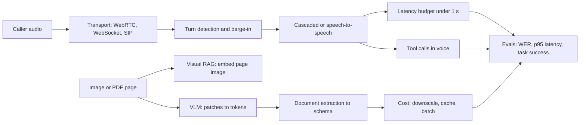
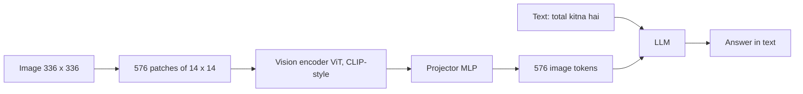
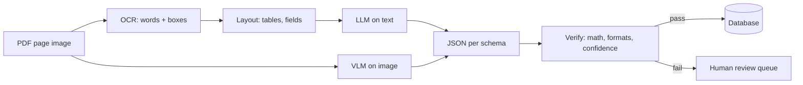
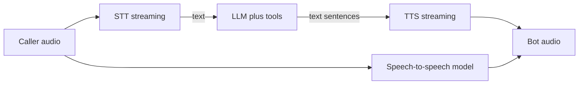
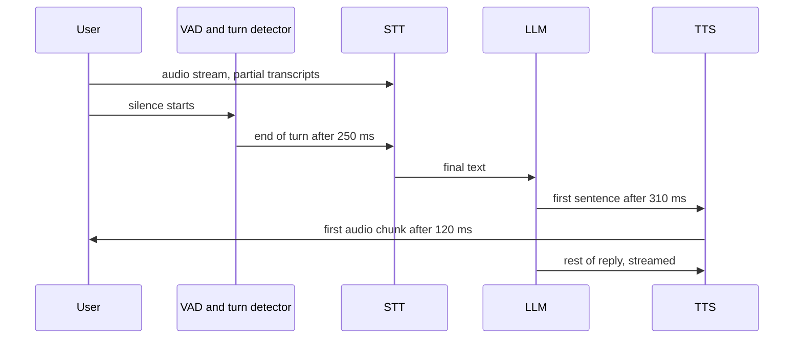
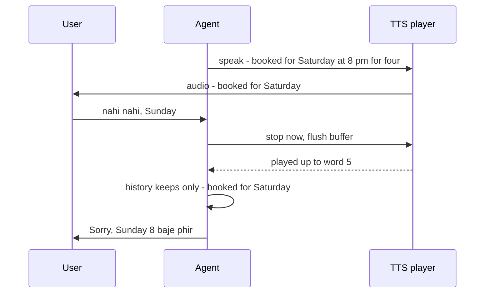
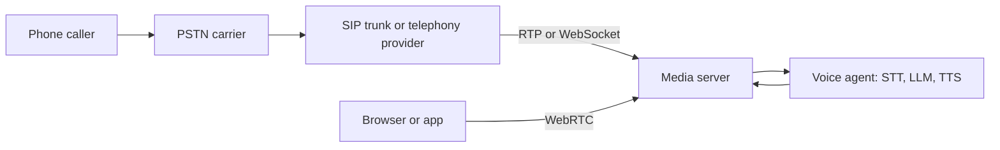

# Multimodal and Voice Agents

Multimodal agent sirf text nahi, aur bhi cheezein handle karta hai: images, scanned documents, video padhta hai, ya sunta hai aur bol ke jawab deta hai. Interviewers ye isliye poochhte hain kyunki aaj do products har jagah hain: "ye invoice ya PDF padh lo" aur "phone pe insaan jaisa jawab do". Dono demo me simple lagte hain, aur dono production me aisi wajah se toot-te hain jinka prompt se koi lena dena nahi.

**Is page ke baad tum ye jawab de paoge:**
- "LLM image ko actually 'dekhta' kaise hai, aur badi image zyada tokens kyun khaati hai?"
- "Invoices ke liye vision LLM loge ya OCR pipeline? Kyun?"
- "50,000 scanned PDFs jo tables aur charts se bhare hain, unme search kaise karoge?"
- "Cascaded STT → LLM → TTS ya speech-to-speech model: kaunsa aur kab?"
- "Ek voice turn 2 second leta hai. Latency kahan jaati hai, aur 1 second ke neeche kaise laoge?"
- "User bot ko beech sentence me interrupt kare to kaise handle karoge?"
- "Phone pe restaurant reservations lene wala voice agent design karo."
- "Real customers ke call karne se pehle voice agent ko test kaise karoge?"

## Pehle ye shabd samjho

| Shabd | Simple matlab |
|---|---|
| Multimodal | Aisa model jo ek se zyada tarah ka input le: text, images, audio, video. |
| VLM (vision-language model) | Aisa LLM jo image bhi input me le sake aur text me jawab de. |
| Patch | Image ka chhota square, jaise 14 × 14 pixels, jise ek "word" ki tarah treat karte hain. |
| Vision encoder | Neural network jo image patches ko numbers ki lists me badalta hai jo LLM use kar sake. |
| OCR (optical character recognition) | Software jo image me chhapa ya haath se likha text padh ke plain text deta hai. |
| STT (speech-to-text) | Audio ko text me badalta hai. Isko ASR, automatic speech recognition bhi kehte hain. |
| TTS (text-to-speech) | Text ko bolne wali audio me badalta hai. |
| VAD (voice activity detection) | Chhota model jo batata hai "abhi koi bol raha hai" ya "ye silence hai". |
| Endpointing | Decide karna ki user ka turn khatam ho gaya aur ab bot bol sakta hai. |
| Barge-in | Bot abhi bol hi raha hai aur user beech me bolna shuru kar de. |
| TTFT (time to first token) | Request bhejne se LLM ka pehla output token aane tak ka time. |
| WER (word error rate) | STT ne kitne words galat sune, sahi human transcript se compare karke. |
| PSTN (public switched telephone network) | Normal phone network jispe mobile aur landline calls chalti hain. |
| WebRTC | Internet pe real-time audio aur video ka browser standard, kam delay ke liye bana. |

## Big picture

Do hisse hain. **Dekhne wala** hissa: images tokens banti hain, documents ya to VLM padhta hai ya OCR pipeline, aur pages ko image ki tarah search kar sakte hain. **Bolne wala** hissa: audio phone line ya WebRTC se aata hai, turn detector decide karta hai ki user ruk gaya, cascaded ya speech-to-speech model jawab banata hai, aur har millisecond ka budget hota hai. Dono hisse ek hi jagah khatam hote hain: evaluation aur production cost control.



Har box neeche ek section hai. Shuru karte hain ki model image kaise dekhta hai, kyunki image ka token cost aage ke kai decisions tay karta hai.

## Vision-language models image kaise dekhte hain

**Ek line me:** image ko chhote squares me kaata jaata hai, har square ek vector banta hai, ek chhota adapter un vectors ko LLM ke "word" space me map karta hai, aur LLM unhe extra tokens ki tarah padhta hai.

**Ye kyun chahiye:** LLM sirf tokens samajhta hai, jo numbers ke vectors hain. Pixels tokens nahi hain. Hume bill ki photo ko aisi cheez me badalna hai jis pe LLM attend kar sake, text sawal "total kitna hai?" ke saath.

**Aise socho:** jigsaw puzzle jo dost ko ek-ek piece karke post kiya. Photo ke 576 pieces kaate, har piece ke peeche chhota description likha, aur har description dost ki bhasha me translate kiya. Dost ne photo kabhi nahi dekhi, sirf order me 576 described pieces dekhe.

**Kaise kaam karta hai, step by step:**
1. **Resize.** Image ko encoder ke input size pe resize karte hain, jaise 336 × 336 pixels.
2. **Patches me kaato.** 14 × 14 pixel patches ke saath: 336 / 14 = har side 24, to 24 × 24 = **576 patches**.
3. **Vision encoder.** Vision Transformer (ViT), aksar CLIP-style trained (images ko unke captions se match karke), har patch ko ek vector banata hai, jaise 1,024 numbers. Patches ek doosre ko "dekhte" hain, to har vector ko apne aas-paas ka pata hota hai.
4. **Projector.** Chhota network (aksar 2-layer MLP, yaani matrix multiplies ka simple stack) har 1,024-number vector ko LLM ke embedding size, jaise 4,096, pe map karta hai. Ab har patch ek word embedding jaisa dikhta hai.
5. **LLM me.** 576 image tokens prompt me text tokens ke saath rakhe jaate hain. LLM dono pe attend karta hai. Ye LLaVA-style design hai. Kuch models patches compress karte hain (2 × 2 ko 1 me pool) taaki kam tokens lagein.



**Resolution tiling.** 336 pixels me printed invoice padhna mushkil hai. Isliye high-resolution models badi image ko tiles me todte hain, har tile encode karte hain, aur aksar overall layout ke liye ek low-resolution thumbnail bhi jodte hain.

| Image | Tiles (example 512 px tiles) | Rough image tokens |
|---|---|---|
| 512 × 512 photo | 1 tile + thumbnail | kuch sau |
| 1024 × 1024 scan | 4 tiles + thumbnail | lagbhag 1,000–1,500 |
| 2048 × 2048 page | 16 tiles + thumbnail | kai hazaar, aksar downscaling se capped |

Numbers provider ke hisaab se badalte hain. Ek provider lagbhag **(width × height) / 750** tokens document karta hai, to 1000 × 1000 ≈ 1,333 tokens. Har jagah lagu rule: **tokens pixel area ke saath badhte hain**, to width aur height double karo to lagbhag 4x cost.

**Interview tip:** "VLM image kaise padhta hai?" Bolo: "Patches ViT encoder se jaate hain, projector unhe LLM embedding space me map karta hai, aur wo context me tokens ki tarah aate hain. High-res images tile hoti hain, to token cost area ke saath badhta hai. Isliye main image ko sabse chhote size tak downscale karta hoon jahan text abhi bhi padha ja sake."

**Common galti:**
- 12-megapixel phone photo waise hi bhej dena. Ya to provider khud downscale karega (control tumhare haath se gaya), ya bina accuracy gain ke hazaaron tokens lagenge.
- Ye maanna ki model "pixels" dekhta hai. Wo compressed patch vectors dekhta hai, to kone me chhota text kho sakta hai.

## ⭐ Document understanding: VLM ya OCR pipeline

**Ek line me:** document ya to classic pipeline se padho (OCR → layout → text pe LLM) ya page image seedha VLM ko bhejo; accuracy, cost, volume aur audit ki zarurat dekh ke chuno, aur numbers hamesha verify karo.

**Ye kyun chahiye:** zyada tar business data abhi bhi PDFs, scans aur photos me hai: invoices, KYC (know your customer) documents, bank statements, lab reports. Finance team ko database me `{"gstin": ..., "total": ..., "line_items": [...]}` chahiye, photo nahi.

**Aise socho:** haath se likhe kirana bill ko Excel me utaarne ke do tareeke. Option A: ek banda har word exact type karta hai, doosra mark karta hai kaunse words table hain, teesra typed copy padh ke Excel bharta hai. Option B: ek smart banda bill dekh ke seedha Excel bhar deta hai. B tez hai aur messy layout sambhal leta hai, par kabhi kabhi jo likha hai uski jagah "sahi lagne wala" number bhar deta hai.

**Kaise kaam karta hai, step by step:**

*Classic pipeline:*
1. **OCR** page image ko words me badalta hai, har word ke saath bounding box (x, y, width, height) aur confidence score.
2. **Layout analysis** words ko blocks me group karta hai: header, table rows, key-value pairs, footer.
3. **Serialize:** layout ko text ya markdown me likho (tables markdown tables ki tarah).
4. **LLM** wo text padh ke JSON schema bharta hai.

*VLM direct:*
1. PDF page ko image me render karo (jaise 150–200 DPI, dots per inch).
2. Image + schema + instructions VLM ko bhejo.
3. VLM seedha JSON lautata hai.



| | OCR + layout + LLM | Page image pe VLM |
|---|---|---|
| Messy layouts, stamps, charts | kamzor; layout step toot-ta hai | strong; poora page dekhta hai |
| Exact characters (IDs, amounts) | strong; OCR copy karta hai, guess nahi | plausible digits **hallucinate** kar sakta hai |
| Charts aur diagrams | kho jaate hain (andar text nahi) | trends aur values roughly padh leta hai |
| Cost per page | OCR sasta; LLM kam tokens dekhta hai | har page pe image tokens, zyada per page |
| Traceability | har value ka bounding box hai | "page pe kahan" batana mushkil |
| Handwriting | OCR engine pe depend | aksar behtar, phir bhi galti hoti hai |
| Engineering effort | zyada moving parts | ek call, simple |

Strong production answer aksar **hybrid** hota hai: OCR chala ke boxes ke saath text lo, aur OCR text aur page image dono VLM ko bhejo. VLM layout ke liye image use karta hai aur exact characters ke liye OCR text.

**Schema me extraction, phir verify.** Strict JSON maango (structured outputs ya tool schema), phir code se check karo, doosre prompt se nahi.

```python
from pydantic import BaseModel, field_validator, model_validator
import re

GSTIN_RE = re.compile(r"^\d{2}[A-Z]{5}\d{4}[A-Z][1-9A-Z]Z[0-9A-Z]$")

class LineItem(BaseModel):
    description: str
    qty: float
    unit_price: float
    amount: float

class Invoice(BaseModel):
    invoice_no: str
    gstin: str
    line_items: list[LineItem]
    tax: float
    total: float

    @field_validator("gstin")
    @classmethod
    def gstin_format(cls, v: str) -> str:
        if not GSTIN_RE.match(v):
            raise ValueError(f"bad GSTIN format: {v}")
        return v

    @model_validator(mode="after")
    def totals_add_up(self):
        for item in self.line_items:
            # har row: qty x price printed amount se match hona chahiye
            if abs(item.qty * item.unit_price - item.amount) > 1.0:
                raise ValueError(f"row math wrong: {item.description}")
        subtotal = sum(i.amount for i in self.line_items)
        if abs(subtotal + self.tax - self.total) > 1.0:
            raise ValueError("line items + tax != total")
        return self

# raw_json VLM se aata hai; ValidationError aaye to page human ke paas jaata hai
# invoice = Invoice.model_validate_json(raw_json)
```

**Code kya karta hai:**
- Pydantic se target schema define karta hai, to VLM output me yahi fields aur types hone chahiye.
- GSTIN (Indian GST number) ko uske 15-character pattern se check karta hai.
- Har row check karta hai: quantity × unit price printed amount ke barabar ho, rounding ke liye ₹1 tak ki chhoot.
- Check karta hai ki line items + tax = grand total.
- Koi bhi failure `ValidationError` raise karta hai, jise database ki jagah retry ya human review pe bhejte ho.

**Failure modes aur unhe kaise pakdo:**

| Failure | Example | Kaise pakdo |
|---|---|---|
| Chhota text kho gaya | footer me 6-point GSTIN galat padha | wo region crop karke high resolution pe dobara bhejo |
| Handwriting | haath ke bill pe "7" ko "1" padha | OCR confidence score + low confidence pe human review |
| Hallucinated numbers | page pe "₹12,840" hai, total "₹12,480" aaya | arithmetic checks, OCR text se cross-check |
| Table rows merge ya skip | 10-row table se 9 rows nikle | row count check, sum check |
| Multi-page tables | row page 3 aur 4 me bati hui | pages saath process karo ya header se jodo |
| Ghoomi ya tedhi scans | 90-degree ghoomi phone photo | model se pehle auto-rotate aur deskew |

**Interview tip:** "Invoices ke liye VLM ya OCR?" Bolo: "High volume pe kuch fixed, saaf invoice templates ho to OCR + layout sasta aur exact hai. Bahut saare vendors aur messy layouts ho to VLM zyada robust hai. Practice me main hybrid jaata hoon: OCR text + page image VLM me, strict schema, phir arithmetic aur format checks, aur jo fail ho ya low confidence ho wo human ke paas."

**Common galti:**
- VLM ke numbers pe bharosa kyunki JSON "sahi dikhta hai". VLMs plausible digits banate hain. Paise wale fields ko code checks chahiye.
- Accuracy sirf per document naapna. **Per field** naapo: 98% document score ke peeche total field pe 90% chhupa ho sakta hai, aur wahi field matter karta hai.

## Visual RAG: page image retrieve karo

**Ek line me:** har page ka OCR karke text embed karne ki jagah page image ko hi embed karo, sawal ke liye best page images retrieve karo, aur wo images VLM ko jawab ke liye do.

**Ye kyun chahiye:** annual reports, product manuals aur research papers me jawab aksar chart, table ya diagram me hota hai. Text extraction inhe flat kar deta hai ya gira deta hai. Phir text RAG "kis quarter me margin sabse zyada tha" nahi dhoondh paata, kyunki wo fact sirf chart ke bars ki height me hai.

**Aise socho:** ek librarian jise har page **kaisa dikhta hai** yaad hai, sirf uske words nahi. Tum bolo "wo page jisme region-wise revenue ka pie chart hai", aur wo nikaal deti hai.

**Kaise kaam karta hai, step by step:**
1. Har PDF page ko image me render karo, jaise 50,000 pages.
2. ColPali-style model (2024; ek VLM pe bana) har page ko **bahut saare vectors me, har patch ka ek**, encode karta hai, jaise lagbhag 1,000 vectors, har ek 128 numbers ka.
3. Sawal ko har query token ke ek vector me encode karo, jaise 12 vectors.
4. **Late interaction (MaxSim)** se score: har query vector ke liye page ka sabse similar patch vector dhoondho, phir un 12 best scores ko jodo. Ye ColBERT wala idea hai, image patches pe.
5. Top 3 pages lo aur unki images + sawal VLM ko jawab ke liye bhejo.

**Storage maths:** 50,000 pages × 1,000 vectors × 128 numbers × 2 bytes ≈ **12.8 GB**, jabki ek 1,536-number float32 vector per page lagbhag 0.3 GB. Multi-vector powerful hai par bhaari. Common fixes: patch vectors pool karo, kam bits me quantize karo, ya pehle sasta single-vector search aur phir top 100 pages ko MaxSim se re-rank karo.

| | Text RAG (OCR phir text embed) | Visual RAG (page image embed) |
|---|---|---|
| Charts, diagrams, layout | kho jaate hain | bache rehte hain |
| Indexing pipeline | OCR + chunking + embedding | render + embed, simple |
| Index size | chhota | bada (multi-vector) |
| Jawab dene wala model | koi bhi LLM | VLM hona zaroori (image tokens lagte hain) |
| Exact keyword match ("invoice 88213") | hybrid BM25 ke saath accha | kamzor |

**Interview tip:** "Charts se bhari 50,000 scanned reports me search kaise karoge?" Bolo: "Page images pe ColPali-style multi-vector index se visual retrieval, fast rakhne ke liye sasta first stage, MaxSim re-ranking, aur top pages pe VLM se jawab. Exact IDs aur numbers ke liye saath me ek text index bhi rakhunga."

**Common galti:** bhool jaana ki jawab wale step me bhi image tokens lagte hain. VLM ko 10 poore pages bhejna ek sawal pe 15,000+ tokens ho sakta hai. Kam retrieve karo, ya crop karo.

## Production me images aur video

**Ek line me:** image ka cost zyada tar pixel count ki problem hai, to resolution control karo, same image do baar mat bhejo, non-urgent kaam batch karo, aur video ke har frame ki jagah kuch frames sample karo.

**Ye kyun chahiye:** demo ek image bhejta hai. Production din me 10 lakh bhejta hai. Is volume pe per image 3x token farak = 3x bill farak, aur image tokens ke saath latency bhi badhti hai.

**Aise socho:** WhatsApp pe photo bhejna. "Ye sahi charger hai?" poochhne ke liye 48 MP original nahi bhejte. Compressed version kaafi hai. Par document ho to "as document" bhejte ho taaki text sharp rahe.

**Kaise kaam karta hai, step by step:**
1. **Task ke hisaab se downscale.** Product-photo classifier ko 512 px kaafi ho sakta hai. Ghane invoice ko long side pe 1,500 px chahiye ho sakte hain. 3–4 sizes pe accuracy test karo aur sabse chhota size lo jahan accuracy tike.
2. **Region crop karo.** Sirf address block chahiye to wahi crop karo. Kam pixels, kam tokens, aur text ko per token zyada resolution milta hai.
3. **Provider ki detail setting use karo.** Kuch APIs me "low detail" mode hota hai jisme per image chhota fixed token cost lagta hai. "Ye billi hai kya" jaise tasks ke liye use karo.
4. **Cache.** Image bytes ka hash lo (jaise SHA-256). Same hash + same prompt = stored result lautao. Stable images prompt me pehle rakho taaki prompt caching turns ke beech unhe reuse kare.
5. **Batch.** Raat ka kaam (2 lakh purane invoices dobara extract) batch API pe bhejo, aksar lagbhag aadhe daam, ghanton ke turnaround ke saath.
6. **Video = frames.** 60-second clip 1 frame per second pe 60 images hai. ~250 tokens per chhota frame pe ~15,000 tokens. Kam frames sample karo, scene change detect karo, aur audio transcript text ki tarah jodo.

**Worked example:** din me 10 lakh product images. 1,500 tokens each pe 1.5 billion input tokens. ~400 tokens each tak downscale karo to 0.4 billion: lagbhag 73% kam tokens, aur test ke baad is task pe accuracy loss nahi.

**Interview tip:** "Tumhari image pipeline bahut mehngi hai. Kya karoge?" Bolo: "Pehle tokens per image naapunga. Phir accuracy rakhte hue sabse chhote size tak downscale aur crop, jahan ho sake low-detail mode, hash se dedupe, non-urgent kaam batch me, aur video ke liye scene change pe frames sample."

**Common galti:** bina eval ke downscale karna. Jo size photos ke liye theek hai wo 8-point invoice text ko unreadable bana sakta hai. Har size pe per field accuracy hamesha check karo.

## ⭐ Voice agent architectures: cascaded vs speech-to-speech

**Ek line me:** cascaded agent teen models jodta hai (STT → LLM → TTS) jinke beech text hota hai; speech-to-speech (realtime) model ek hi model me audio leta hai aur audio deta hai; cascaded control deta hai, speech-to-speech naturalness aur kam latency.

**Ye kyun chahiye:** voice agent ko sunna, sochna aur bolna hai, tezi se, noisy phone line pe. Ye kaam kaise baanto, isse latency, cost, tools kitne ache chalte hain, aur kharab call ko debug karna kitna aasaan hai, sab tay hota hai.

**Aise socho:** IRCTC enquiry desk. Cascaded = line me teen log: ek tumhari baat likhta hai, ek jawab decide karta hai, ek padh ke sunata hai. Har note jo unhone pass kiya tum dekh sakte ho. Speech-to-speech = ek fluent banda jo sun ke seedha jawab deta hai. Tez aur zyada natural, par kuch likha nahi jaata, to galti kahan hui ye check karna mushkil.

**Kaise kaam karta hai, step by step:**

*Cascaded:*
1. Audio STT ko stream hota hai. User bolte waqt STT partial transcripts bhejta hai, aur turn ke end pe final transcript.
2. Final text + history LLM ko jaata hai. LLM tokens stream karta hai aur tools call kar sakta hai.
3. Jaise hi pehla sentence poora hota hai, TTS ko jaata hai. LLM likhta rehta hai aur TTS audio wapas stream karta rehta hai.

*Speech-to-speech (realtime):*
1. Audio WebSocket ya WebRTC session pe ek model ko stream hota hai (jaise OpenAI ka Realtime API ya Google ka Gemini Live API).
2. Model sunta hai, aksar apna turn detection khud chalata hai, aur seedha audio me jawab deta hai. Wo tool calls aur text transcript bhi de sakta hai.



| | Cascaded STT → LLM → TTS | Speech-to-speech |
|---|---|---|
| Latency | 3 stages ka sum; achhi streaming ke saath ~0.8–1.5 s | aksar kam, ~0.5–1 s |
| Naturalness | TTS voice achhi hai, par user ka tone text me kho jaata hai | tone, hansi, hichkichahat sunta hai; emotion ke saath jawab |
| Control | koi bhi part badlo: Hindi ke liye best STT, koi bhi LLM, brand voice | ek vendor, kam knobs |
| Tool use aur reasoning | strong text LLM ki poori taakat | supported, par complex tools pe aksar kam reliable |
| Cost | 3 vendors ko per minute ya per token, aksar predictable | audio tokens mehnge ho sakte hain; bahut vary karta hai |
| Debuggability | har hop pe text; transcript padho, ek stage replay karo | zyada tar audio; kyun bola ye dekhna mushkil |
| Guardrails, compliance | bolne se pehle text filter karo | audio output ya uska transcript baad me filter karna padta hai |

Kai teams **half-cascade** bhi chalati hain: speech ek audio-understanding model me, text out, phir TTS. Tone ki samajh bachi rehti hai aur bolne se pehle text check ho jaata hai.

**Interview tip:** "Cascaded ya speech-to-speech?" Bolo: "Bahut saare tools, compliance needs aur Indian languages wale business agent ke liye main cascaded se shuru karta hoon: Hinglish ke liye best STT chun sakta hoon, bolne se pehle text filter kar sakta hoon, aur har hop debug kar sakta hoon. Companion ya tutor app jahan warmth aur bahut kam latency complex tools se zyada zaroori hai, wahan speech-to-speech fit hai. Agent logic ek interface ke peeche rakhunga taaki switch kar sakoon."

**Common galti:**
- Non-streaming cascade ko streaming realtime model se compare karke bolna "cascaded bahut slow hai". Theek se streamed cascade kaafi paas aa jaata hai.
- Speech-to-speech chun lena aur phir pata chalna ki bot ke bolne se pehle card number redact nahi kar sakte.

## ⭐ Ek voice turn ka latency budget

**Ek line me:** insaan ek doosre ko lagbhag 200–300 ms me jawab dete hain, to ~1 second se zyada lene wala bot toota hua lagta hai; har stage ka millisecond me budget banao aur har stage stream karo taaki wo overlap karein.

**Ye kyun chahiye:** text chat me 2 second chalta hai. Call pe 2 second ki chuppi pe log "hello? hello?" bolte hain, bot use naya turn samajhta hai, aur call bikhar jaati hai.

**Aise socho:** relay race. Total time sabse tez runner ki speed nahi hai. Har runner plus har baton handover hai. Streaming matlab agla runner baton poora aane se pehle hi daudna shuru kar deta hai.

**Kaise kaam karta hai, step by step:** "user ne bolna band kiya" se "user ne bot ki pehli awaaz suni" tak naapo. Optimization se pehle ek typical cascaded turn:

| Stage | Kya hota hai | Typical range | Example |
|---|---|---|---|
| Endpointing (VAD silence wait) | pakka karna ki user ruk gaya | 200–500 ms (sabse bada single cost) | 500 ms |
| STT final | endpoint ke baad last words finish | streaming ke saath 50–200 ms | 150 ms |
| LLM TTFT | model se pehla token | model aur prompt size ke hisaab se 200–600 ms | 450 ms |
| First sentence | TTS shuru hone layak tokens | 50–200 ms | 150 ms |
| TTS first audio | TTS se pehla audio chunk | 80–250 ms | 200 ms |
| Network aur playout | dono taraf transport + jitter buffer | 50–150 ms | 100 ms |
| **Total** | | | **1,550 ms** |

Ab stage by stage optimize karo:
1. **Endpointing 500 → 250 ms**: fixed lambi silence ki jagah semantic turn detector (agla section).
2. **STT 150 → 80 ms** kyunki transcript partials me stream ho chuka tha; sirf last word baaki.
3. **LLM TTFT 450 → 250 ms**: chhota fast model, chhota system prompt, fixed prefix pe prompt caching, same region me server (Indian callers ke liye Mumbai region).
4. **First sentence 150 → 60 ms**: chhote pehle sentences ka instruction ("Sure, let me check."), pehle comma ya full stop pe TTS ko bhejo.
5. **TTS 200 → 120 ms**: low-latency streaming TTS aur persistent connection.
6. **Network 100 → 80 ms**: WebRTC aur co-located servers.

Naya total: 250 + 80 + 250 + 60 + 120 + 80 = **840 ms**. Ye 800 ms–1 s target ke andar hai.



**Aur tricks:** **speculative start** (endpoint se pehle hi partial transcript LLM ko bhejo, user bolta rahe to phenk do), **pre-generated fillers** ("Hmm," audio me cached), aur **average nahi, p95 track karo**: 20 me ek slow tool call bhi experience bigaad deti hai.

**Interview tip:** "Voice turn me latency kahan jaati hai?" Bolo: "Aksar sabse bada single hissa endpointing hai, phir LLM time to first token, phir TTS first audio. Main har turn pe har stage naapta hoon, sab kuch stream karta hoon taaki stages overlap karein, semantic turn detector, cached prefix wala fast model, sentence-level TTS aur co-located servers use karta hoon. Target p95 lagbhag 1 second ke neeche."

**Common galti:**
- TTFT ki jagah LLM ka total generation time naapna. User sirf pehli awaaz ka wait karta hai.
- TTS call karne se pehle poore LLM reply ka wait karna. Akele isse 1–2 second jud sakte hain.

## ⭐ Turn detection, barge-in aur backchannels

**Ek line me:** turn detection decide karta hai ki user ne baat khatam ki; barge-in handling user ke beech me bolte hi bot ko turant rokti hai aur history ko sach rakhti hai ki user ne actually kya suna.

**Ye kyun chahiye:** log beech sentence me rukte hain ("meri booking... umm... Saturday ke liye hai"). Simple silence timer ya to unhe kaat deta hai (bahut chhota) ya lag jodta hai (bahut lamba). Aur log interrupt karte hain: "nahi nahi, Saturday nahi, Sunday". Agar bot bolta rahe, ya baad me maane ki usne wo bola jo user ne suna hi nahi, to baatcheet toot jaati hai.

**Aise socho:** busy restaurant ka achha waiter. Tum "main lunga... ek minute" bolo to wo rukta hai, par "bas itna hi, thanks" bolo to turant jawab deta hai. Order repeat karte waqt tum "ruko, pyaaz nahi" bolo to wo beech sentence me ruk jaata hai. Uske notepad pe sirf wahi hai jo usne actually bola.

**Kaise kaam karta hai, step by step:**

*Turn detection:*
1. **VAD** (jaise Silero VAD) har 20–30 ms audio frame ko speech ya silence mark karta hai.
2. **Silence timer:** N ms silence ke baad turn khatam. Simple, par ek value sab pe fit nahi hoti: 300 ms sochne walon ko kaat deta hai, 800 ms slow lagta hai.
3. **Semantic end-of-turn model:** chhota text ya audio model ab tak ke words dekhta hai. "Mujhe table book karni hai for" → shayad khatam nahi, zyada wait (jaise 1 s). "Chaar logon ke liye raat 8 baje." → khatam, 200 ms me jawab. LiveKit aur Pipecat dono aise turn-detector models dete hain.

| | VAD + silence timer | Semantic end-of-turn model |
|---|---|---|
| Signal | awaaz vs silence | words ka matlab, kabhi intonation bhi |
| Beech sentence ka pause | user ko kaat deta hai ya lamba wait | wait karta hai, kyunki sentence adhoora hai |
| Added latency | fixed timer, har turn pe | chhote model ka inference, ~10–50 ms |
| Failure | noisy room turn ko khula rakhta hai | ajeeb phrasing, doosri bhashayein kam tested |

*Barge-in (interruption):*
1. Bot bolte waqt bhi VAD user ko sunta rehta hai (echo cancellation ke saath, taaki bot khud ko na sune).
2. ~200–300 ms se lambi user speech, ya STT se aaya asli word, barge-in maana jaata hai. Khaansi ya "hmm" nahi maana jaana chahiye.
3. **TTS playback turant roko** aur audio buffers flush karo. Pending LLM generation aur TTS request cancel karo.
4. **Transcript truncate karo.** LLM ne likha "Your table is booked for Saturday at 8 pm for four people." Playback "Your table is booked for Saturday" ke baad ruka. Assistant message me sirf bola hua hissa save karo. Warna model sochega user ne "8 pm for four" suna.
5. Us truncated history ke saath naya user turn process karo.



*Backchannels:* chhoti awaazein jaise "haan", "okay", "mm-hmm" jab doosra bol raha ho. Bot bolte waqt user "okay" bole to aksar wo sehmati hai, interruption nahi: bolte raho. Backchannel words ki chhoti list rakho, ya turn detector se unhe classify karao. Kuch systems lambe user turns ke dauraan bot se chhote "mm-hmm" bhi bulwate hain.

```python
import asyncio

class SpokenTracker:
    """Track karta hai ki bot ke reply ke kaunse words user ko actually sunaye gaye."""
    def __init__(self, text: str):
        self.words = text.split()
        self.played = 0  # ab tak kitne words play ho chuke

    def on_word_played(self):
        self.played += 1

    def spoken_text(self) -> str:
        return " ".join(self.words[: self.played])

BACKCHANNELS = {"ok", "okay", "haan", "hmm", "mm-hmm", "achha", "right"}

async def on_user_speech(text: str, tts_task: asyncio.Task,
                         tracker: SpokenTracker, history: list[dict]):
    if text.lower().strip(" .!") in BACKCHANNELS:
        return  # sehmati hai, interruption nahi: bolte raho
    tts_task.cancel()  # audio aur pending generation roko
    # sirf wahi store karo jo user ne sach me suna
    history.append({"role": "assistant", "content": tracker.spoken_text()})
    history.append({"role": "user", "content": text})
```

**Code kya karta hai:**
- `SpokenTracker` TTS ke word-timing events se ginta hai ki reply ke kitne words play ho chuke.
- "haan" ya "okay" jaise chhote backchannel words ignore hote hain, to bot bolta rehta hai.
- Asli speech TTS task cancel karti hai (real framework me ye audio buffers bhi flush karta hai).
- History me reply ka sirf bola hua hissa jaata hai, phir user ka naya message.
- LiveKit Agents aur Pipecat jaise frameworks ye tumhare liye karte hain; code wo idea dikhata hai jo tumhe samjhana hai.

**Interview tip:** "Interruptions kaise handle karoge?" Bolo: "Bot bolte waqt bhi echo cancellation ke saath VAD chalta rahe, minimum speech length ya asli word chahiye taaki khaansi aur 'haan' count na ho, phir TTS turant roko, in-flight LLM aur TTS cancel karo, aur TTS word timestamps se history me assistant message ko utna hi truncate karo jitna actually play hua."

**Common galti:**
- Interruption ke baad poora generated reply history me rakhna. Phir bot bolta hai "jaisa maine bataya, 8 baje hai", jo user ne kabhi suna hi nahi.
- Echo cancellation nahi, to speaker se aayi bot ki apni awaaz barge-in trigger karti hai aur bot khud ko hi interrupt karta rehta hai.

## Telephony aur transport

**Ek line me:** audio tumhare agent tak WebRTC (browser aur apps), WebSocket (simple server streams, kai phone providers) ya SIP (phone-network protocol) se aata hai; phone audio 8 kHz pe low quality hota hai, aur echo cancel karna padta hai.

**Ye kyun chahiye:** voice agent pehle real-time media system hai, AI system baad me. Galat transport choice sau-sau milliseconds jodti hai ya audio ko toota-toota bana deti hai, aur koi model use theek nahi kar sakta.

**Aise socho:** ek hi restaurant tak teen raaste. WebRTC expressway hai jisme live traffic ke liye lane discipline bani hai. WebSocket achhi city road hai: zyada din theek, kharab network pe jam. SIP aur PSTN purana highway hai jo India ka har phone use karta hai: sab pahunch sakte hain, par sadak patli hai (8 kHz).

**Kaise kaam karta hai, step by step:**
1. **Web ya app caller:** client WebRTC use karta hai. Ye UDP pe chalta hai (khoye packets dobara bhejne ka wait nahi), jitter buffers hain, aur browsers me echo cancellation aur noise suppression built-in hai.
2. **Phone caller:** call PSTN pe telephony provider ya tumhare SIP trunk pe aati hai. SIP (Session Initiation Protocol) call set up karta hai. Audio khud RTP (Real-time Transport Protocol) packets me chalta hai.
3. **Agent tak bridge:** provider ya to WebSocket pe tumhare server ko audio stream karta hai, ya SIP seedha media server se jodta hai (jaise LiveKit SIP bridge).
4. **Audio format:** phone audio aksar **8 kHz, G.711 (μ-law ya A-law)** hota hai, to ~3.4 kHz se upar ki frequencies gayab. Isse STT ko "f" vs "s" jaisi awaazon me dikkat hoti hai. Phone audio pe trained STT models use karo, aur dhyan se resample karo (8 kHz in, STT ka expected rate, phir 8 kHz wapas out).
5. **Echo cancellation (AEC):** speakerphone pe bot ki awaaz mic me wapas aati hai. AEC ke bina bot khud ko sunta hai aur barge-in fire hota hai. Browsers WebRTC me AEC karte hain; phone lines pe handset aur carrier pe depend karte ho, plus apni filtering.

| | WebRTC | WebSocket | SIP / PSTN |
|---|---|---|---|
| Kahan use | browser, mobile app | server-to-server audio streams | asli phone numbers |
| Network | UDP, real time ke liye bana | TCP; ek khoya packet stream rok deta hai | carrier network + RTP |
| Audio quality | wideband (16–48 kHz) | jo tum bhejo | aksar narrowband 8 kHz |
| Echo, noise handling | browsers me built-in | khud banao | handset aur carrier, kuch had tak |
| Complexity | zyada (media servers, NAT traversal) | sabse kam | telephony provider, numbers, regulations |



**Interview tip:** "Voice agent ke liye WebSocket ya WebRTC?" Bolo: "Client audio ke liye WebRTC, kyunki ye UDP-based hai, jitter buffers aur built-in echo cancellation ke saath. Data centre ke andar server-to-server ya jab phone provider hume audio stream kare, tab WebSocket theek hai. Phone numbers ke liye SIP se media server, aur 8 kHz audio pe tuned STT."

**Common galti:** sirf saaf laptop-mic audio se test karna, phir traffic noise wali 8 kHz phone lines pe live jaana, jahan WER double ho jaata hai.

## Voice me tool calls

**Ek line me:** voice me tool call matlab dead air, to tools fast rakho, chalte waqt kuch bolo, aur kuch bhi important karne se pehle read back karo.

**Ye kyun chahiye:** chat UI me 3-second tool call pe spinner dikhta hai. Call pe 3 second ki chuppi line kat jaane jaisi lagti hai. Voice me "Confirm" button bhi nahi hota, to naam, date aur numbers ki galtiyan seedha bookings aur payments me chali jaati hain.

**Aise socho:** phone banker jo type karne se pehle bolta hai "ek minute, aapka account khol raha hoon". Aur paise transfer karne se pehle bolta hai "₹5,000 Ramesh ko, account ending 4321, kar doon?"

**Kaise kaam karta hai, step by step:**
1. **Chuppi bharo.** Tool ~700 ms se zyada le sakta ho to pehle chhota filler bolo: "Ek second, check karta hoon." LLM se tool call se pehle chhota sentence nikalwao, ya pre-recorded filler chalao.
2. **Tools fast rakho.** Timeouts lagao (jaise 2 s), common lookups cache karo (menu, opening hours), aur jo data lagne wala hai pehle se laao (call connect hote hi caller ID se caller ki last booking load karo).
3. **Slow kaam async.** Lambe jobs ke liye bolo "Main aapko ek minute me SMS confirmation bhejta hoon", aur call ke baad ya background me poora karo.
4. **Critical actions bol ke confirm karo.** Slots read back karo: "4 logon ki table, Saturday 14 tareekh, raat 8 baje, naam Sharma. Confirm kar doon?" Saaf "haan" ke baad hi `create_booking` call karo.
5. **Kam aur simple tools.** Har extra tool prompt tokens badhata hai (zyada TTFT) aur choice errors bhi. 5 achhe naam wale tools wala voice agent 40 wale se behtar hai.

**Interview tip:** "Tumhara booking tool 4 second leta hai. Kya karoge?" Bolo: "Call karne se pehle filler bolunga, call start pe jo ho sake pre-fetch karunga, static data cache karunga, spoken fallback ke saath timeout lagaunga, aur agar sach me slow hai to request accept karke SMS se confirm karunga. Aur write action se pehle details hamesha read back."

**Common galti:** parsed values ki jagah user ke raw transcript se confirm karna. Wo read back karo jo system actually save karega ("Saturday 14 tareekh"), na ki jo STT ne suna ("is Saturday").

## Frameworks aur vendors

**Ek line me:** audio ki plumbing tum khud kam hi banate ho; frameworks streaming, turn detection aur interruptions sambhalte hain, aur tum STT, LLM aur TTS providers plug karte ho.

**Ye kyun chahiye:** audio streaming, cancellation, buffering, echo aur turn-taking mushkil real-time problems hain. Shuru se sahi banane me mahine lagte hain. Frameworks tested pipeline dete hain taaki tum agent logic pe kaam karo.

**Aise socho:** modular kitchen. Framework cabinet ka frame aur plumbing hai. STT, LLM aur TTS appliances hain jo tum chunte aur badalte ho.

**Kaise kaam karta hai, step by step:**
1. Aisa framework chuno jo real-time loop sambhale (transport, VAD, turn detection, interruptions).
2. Ek STT, ek LLM aur ek TTS plug karo, ya ek speech-to-speech model.
3. Apna agent logic likho: system prompt, tools, state.
4. Callers asli phone numbers use karein to telephony jodo (SIP ya phone provider).

| Layer | Examples | Notes |
|---|---|---|
| Framework | LiveKit Agents, Pipecat | dono open source, Python; LiveKit ka apna WebRTC media server hai, Pipecat "frame processors" ki pipeline hai jisme kai transports hain |
| STT | Deepgram, Whisper (OpenAI, open weights bhi), Google, Azure, Indian languages ke liye Sarvam | streaming support, Hinglish aur phone-audio accuracy check karo |
| LLM | tool calling wala koi bhi fast chat model | top benchmark scores se zyada TTFT matter karta hai |
| TTS | ElevenLabs, Cartesia, Google, Azure | time to first audio, Indian voices, barge-in ke liye word timestamps check karo |
| Speech-to-speech | OpenAI Realtime API, Gemini Live API | ek model, audio in aur out |
| Telephony | Twilio, Plivo, Exotel, ya apna SIP trunk | numbers, call routing, Indian regulations |

Prices aur latency har kuch mahine badalte hain, to interview me **criteria** bolo: streaming support, pehla result aane ka time, tumhare audio pe accuracy (8 kHz, Hinglish), word timestamps, users ke paas regions, aur cost per minute.

**Interview tip:** "Kaunsa stack use karoge?" Bolo: "Real-time loop ke liye LiveKit Agents ya Pipecat jaisa framework, phir STT aur TTS apni recorded calls pe naape WER aur time to first audio se chunta hoon, vendor benchmarks se nahi, aur har provider ko interface ke peeche rakhta hoon taaki switch kar sakoon."

**Common galti:** sabse sundar demo voice wala TTS chun lena, bina latency aur apni real script pe Indian naamon ka pronunciation check kiye.

## ⭐ Voice agents ka evaluation

**Ek line me:** voice agent ko teen level pe test karo: har component (WER, latency), har conversation (task success, interruption handling), aur real callers se pehle simulated callers ke saath scale pe.

**Ye kyun chahiye:** voice bug dikhna mushkil hai. Transcript theek lagta hai, par bot do baar user ke upar bola aur ek turn pe 2.5 second liye. Har stage aur har call ke numbers ke bina tum sirf gusse wale customers se seekhte ho.

**Aise socho:** call-centre training room me mock calls. Trainer mushkil customer banta hai (tez bolne wala, interrupt karta hai, kharab network) aur trainee ko sheet pe score karta hai.

**Kaise kaam karta hai, step by step:**
1. **STT quality: WER.** WER = (substitutions + deletions + insertions) / sahi transcript ke words. Reference "book a table for four at eight", hypothesis "book table for for at eight": 1 deletion ("a") + 1 substitution ("four" → "for") = 2 errors / 7 words ≈ **29%**. **Entity accuracy** bhi track karo (naam, dates, phone numbers), jo overall WER se zyada matter karti hai.
2. **Latency percentiles.** Har turn pe har stage log karo. "User ruka → bot ki pehli awaaz" ka p50, p95, p99 report karo. Example target: p50 600 ms, p95 1,000 ms ke neeche.
3. **Task success.** Booking sahi slots ke saath bani? Database check karo, transcript nahi.
4. **Interruption tests.** Scripted cases: word 3 pe interrupt, bot bolte waqt khaansi, bot bolte waqt "haan", beech sentence lamba pause. False barge-ins aur missed barge-ins naapo.
5. **Simulated callers.** LLM ek persona ke saath caller banta hai ("buzurg, dheere bolte hain, Hinglish, ek baar date badalte hain"), uska text background noise aur 8 kHz ke saath TTS se jaata hai, aur tumhare agent ko call karta hai. Har release pe sau-sau calls chalao.
6. **Production monitoring.** Calls record karo (consent ke saath), sample karke review karo, hang-up rate, transfer-to-human rate, aur turns per successful task track karo.

```python
import jiwer  # pip install jiwer

reference = "book a table for four at eight"
hypothesis = "book table for for at eight"

print(f"WER: {jiwer.wer(reference, hypothesis):.2f}")  # 2 errors / 7 words = 0.29

# har turn ki latency ms me: user bolna band kare -> bot ki pehli awaaz
turn_ms = sorted([640, 710, 580, 900, 1450, 620, 700, 680, 760, 2100])

def pct(values, p):
    idx = min(len(values) - 1, int(round(p / 100 * (len(values) - 1))))
    return values[idx]

print("p50", pct(turn_ms, 50), "p95", pct(turn_ms, 95))
```

**Code kya karta hai:**
- `jiwer` library se ek reference aur ek STT output ka WER nikaalta hai.
- Dikhata hai ki 7-word sentence me do chhoti galtiyan hi ~29% WER hain, aur unme se ek ("four" → "for") booking hi badal deti hai.
- Har turn ki latencies sort karke simple nearest-rank percentile se p50 aur p95 padhta hai.
- p50 theek lagta hai (~700 ms) jabki p95 ~2 s hai, aur users ko wahi number yaad rehta hai.

**Interview tip:** "Voice agent test kaise karoge?" Bolo: "Component metrics: apni call audio pe WER aur entity accuracy, p50 aur p95 pe per-stage latency. Conversation metrics: database se check kiya task success, interruption aur backchannel test cases. Phir har release pe personas, noise aur 8 kHz audio wale simulated callers, aur production me hang-up aur transfer rates ke saath sampling."

**Common galti:** sirf text pe evaluate karna, LLM ko typed messages de ke. STT errors, timing, barge-in aur noise miss ho jaate hain, aur voice agents asal me wahin fail hote hain.

## Indian context: Hinglish, accents aur numbers

**Ek line me:** Indian callers beech sentence bhasha badalte hain, accents bahut hain, aur numbers aur addresses mixed tareeke se bolte hain, to code-switching ke liye STT chuno, entities normalize karo, aur critical values read back karo.

**Ye kyun chahiye:** "Kal shaam 8 baje four logon ke liye table book karna hai" ek normal sentence hai. English-only STT ise bigaad deta hai, aur Hindi-only STT English hisson ko. Phone numbers aur addresses se hi galat bookings aur failed deliveries aati hain.

**Aise socho:** Swiggy delivery partner jo seedhiyan chadhne se pehle call karke confirm karta hai "flat 402, B wing, Hanuman mandir ke paas?" Read back karna galat delivery se sasta hai.

**Kaise kaam karta hai, step by step:**
1. **Code-switching STT.** Apne callers ki asli Hinglish recordings pe STT models test karo. Hindi, English aur mixed turns ke liye WER aur entity accuracy alag naapo. Kuch models expected languages bata dene pe behtar karte hain.
2. **Transcript ki script tay karo.** Roman Hinglish ("kal shaam") ya Devanagari? Ek chuno, aur LLM ko batao use kya milega.
3. **Numbers normalize karo.** "Nau aath saat...", "double five", "ninety-eight four one...", "do hazaar" (2,000), "dedh sau" (150). Normalization step me digits me badlo aur validate karo (6–9 se shuru hone wala 10-digit mobile, 6-digit PIN code).
4. **Chunks me read back.** "98 41 2 3 4 5 6 7, sahi hai?" Numbers chhote groups me, dheere, aur phone numbers digit by digit bolo.
5. **TTS pronunciation.** Indian naam aur jagahein test karo ("Thiruvananthapuram", "Sharma ji"). Jahan available ho TTS ki pronunciation dictionary ya phonetic hints use karo.
6. **Caller ki bhasha me jawab.** Caller Hinglish bole to Hinglish me jawab do. System prompt me ye saaf likho.

**Interview tip:** "Tumhara agent poore India ke callers ko serve karta hai. Kya badlega?" Bolo: "Apni Hinglish aur regional-accent 8 kHz calls pe naape WER se chuna STT, Indian number words ke liye normalization layer, mobile numbers aur PIN codes ka validation, critical values ka digit-by-digit read back, jawab me caller ki bhasha mirror karna, aur Indian naamon pe tested TTS."

**Common galti:** LLM pe bharosa karna ki wo STT ki number galtiyan chupchaap theek kar dega. STT ne "98 41 23" suna aur user ne "98 14 23" bola, to LLM ko pata hi nahi chal sakta. Sirf read back pakadta hai.

## Interview ke sawal

**Q: Phone pe restaurant reservations ke liye voice agent design karo.**
Telephony provider pe phone number, SIP se media server jisme LiveKit Agents ya Pipecat jaisa framework chalta hai; cascaded Hinglish-capable STT, 4 tools wala fast LLM (`check_availability`, `create_booking`, `cancel_booking`, `transfer_to_human`), streaming TTS. Slots (date, time, party size, naam, phone) step by step lo, caller ID se number pre-fill karo, `create_booking` se pehle booking read back aur confirm karo, phir SMS confirmation, aur baar baar fail ho to human takeover; task success, p95 turn latency aur transfer rate naapo.

**Q: Cascaded ya speech-to-speech?**
Control chahiye to cascaded: bahut tools, bolne se pehle compliance filtering, Indian-language STT ka choice, debug karne layak text logs. Naturalness aur sabse kam latency sabse zaroori ho aur tool use halka ho to speech-to-speech.

**Q: Interruptions kaise handle karoge?**
Bot bolte waqt bhi echo cancellation ke saath VAD sunta rahe. Asli speech (khaansi ya "haan" nahi) TTS turant roke, in-flight generation cancel kare, aur assistant message ko sirf actually play hue words tak truncate karo.

**Q: Voice turn me latency kahan jaati hai?**
Zyada tar endpointing (200–500 ms), LLM time to first token (200–600 ms) aur TTS first audio (80–250 ms), plus network. Har stage stream karo, semantic turn detection, cached prefix wala fast model, sentence-level TTS aur co-located servers use karo.

**Q: Invoices ke liye VLM ya OCR?**
High volume pe kuch saaf templates: OCR + layout sasta aur exact. Bahut saare messy vendors: VLM, ideally OCR text input ke saath hybrid. Dono me schema validation, arithmetic checks aur failures ke liye human review.

**Q: Tumhara VLM extraction totals pe 97% accurate hai. Accounting me auto-post karne ke liye kaafi hai?**
Akele nahi. Aise checks jodo jo 3% pakdein (line items + tax = total, OCR digits se cross-check, duplicate invoice number) aur sirf tab auto-post karo jab saare checks pass hon; baaki human ke paas. Overall accuracy nahi, auto-posted items ka error rate naapo.

**Q: 4000 × 3000 image 1000 × 750 wali se itne zyada tokens kyun khaati hai?**
High-res images tile hoti hain aur token count pixel area ke saath badhta hai: 16x area matlab lagbhag 16x tokens, jab tak provider pehle downscale na kare.

**Q: Charts se bhari scanned annual reports pe RAG kaise karoge?**
ColPali-style multi-vector model se page images embed karo, MaxSim se retrieve karo (sasta first stage ke baad), top 2–3 pages pe VLM se jawab do, aur exact IDs ke liye text index rakho.

**Q: Bot users ko beech sentence me kaat deta hai. Kya karoge?**
Endpointing dekho: silence timeout bahut chhota hai ya VAD bahut sensitive. Semantic end-of-turn model pe jao, jo adhoore sentences pe wait karta hai aur poore sentences pe tez jawab deta hai, aur recorded calls pe tune karo.

**Q: Speakerphone calls pe bot khud ko interrupt karta hai. Kyun?**
Uski apni awaaz echo hoke mic me aati hai aur barge-in trigger karti hai. Echo cancellation theek karo, minimum speech duration ya recognized word maango, aur bot bolte waqt barge-in threshold badhao.

**Q: Ek tool call 3 second leta hai. Caller kya sunta hai?**
Call se pehle bola gaya chhota filler ("ek second, check karta hoon"), chuppi kabhi nahi. Saath me cache aur pre-fetch karo, spoken fallback ke saath timeout lagao, aur slow kaam SMS follow-up pe le jao.

**Q: Launch se pehle voice agent ka evaluation kaise karoge?**
Apni call audio pe WER aur entity accuracy, per-stage latency p50 aur p95, database se check kiya task success, scripted interruption tests, aur personas, noise aur 8 kHz audio wale sau-sau simulated callers.

**Q: Tumhara STT WER 8% hai. Achha hai?**
Depend karta hai kaunse words galat hain. Filler words pe 8% theek hai; phone number ka ek galat digit task fail kar deta hai. Naam, dates aur numbers ki entity accuracy track karo, aur critical values read back karo.

**Q: Cascaded agent pe cost per minute bahut zyada hai. Kahan kaatoge?**
Per stage naapo. Aksar LLM tokens (har turn lambe prompts dobara jaate hain: history trim karo, prefix cache karo, chhota model lo) aur TTS characters (chhote replies). Silence pe STT mat chalao, aur simple FAQs cached audio ko do.

## Aage padho

- [Cost & Latency](11-cost-latency.md): token budgets, caching aur model routing jo image aur voice workloads pe bhi lagte hain.
- [Inference and Serving](15-inference-serving.md): TTFT kis cheez se banta hai aur serving choices use kaise badalte hain.
- [Evals for Agents](09-agent-evals.md): task success ke liye eval sets aur LLM judges banana.
- [What is RAG](../09-rag/01-what-is-rag.md): text RAG ka baseline jise visual RAG aage badhata hai.

## Checklist

- [ ] VLM image ko tokens me kaise badalta hai (patches, encoder, projector) aur token cost pixel area ke saath kyun badhta hai, samjha sakta hoon
- [ ] Documents ke liye VLM ko OCR + layout + LLM pipeline se compare karke verification wale hybrid ke liye argue kar sakta hoon
- [ ] Document extraction ke failure modes aur hallucinated numbers pakadne wale code checks gina sakta hoon
- [ ] Late interaction ke saath ColPali-style visual RAG aur uska storage trade-off samjha sakta hoon
- [ ] Cascaded aur speech-to-speech voice architectures ko latency, control, tools, cost aur debuggability pe compare kar sakta hoon
- [ ] Voice turn ki latency ko numbers ke saath stages me tod ke p95 lagbhag 1 second ke neeche laana samjha sakta hoon
- [ ] VAD vs semantic turn detection, transcript truncation ke saath barge-in, aur backchannels samjha sakta hoon
- [ ] WebRTC, WebSocket aur SIP me chun sakta hoon aur 8 kHz audio aur echo cancellation samjha sakta hoon
- [ ] Fillers, fast tools aur verbal confirmation ke saath restaurant reservation voice agent design kar sakta hoon
- [ ] WER, latency percentiles, task success aur simulated callers se voice agent ka evaluation bata sakta hoon, Hinglish callers samet
