# Agent Frameworks and Tooling

Agent ek loop hai: model ko call karo, jo tool woh maange use chalao, result wapas do, repeat. LangGraph, OpenAI Agents SDK ya CrewAI jaise frameworks is loop ko wrap karte hain aur saving, streaming, tracing aur multi-agent features jodte hain. Interviewer ye isliye poochhte hain ki dekh sakein tum tool kisi reason se chunte ho, popularity se nahi, aur tumhe pata hai uski keemat kya hai.

**Is page ke baad tum ye jawab de paoge:**
- "Agent loop khud likhne ki jagah LangGraph kyun use karoge?"
- "LangGraph vs CrewAI: kab kaunsa chunoge?"
- "Kab framework bilkul use nahi karoge?"
- "Claude Agent SDK tumhe kya deta hai jo plain API call nahi deti?"
- "Ek multi-agent run jo OpenAI aur Anthropic dono models call karta hai, use trace kaise karoge?"
- "Evals ke liye kaunsa tool use karoge, aur kyun?"
- "Model providers ke aage LiteLLM jaisa gateway kyun lagate hain?"
- "Aise framework me lock-in se kaise bachoge jo shayad do saal me band ho jaaye?"

## Pehle ye shabd samjho

| Shabd | Simple matlab |
|---|---|
| Agent loop | Code jo repeat karta hai: model se poochho, uska chuna tool chalao, result bhejo, jab tak jawab na aaye. |
| Tool call | Model ki structured request ki tumhara ek function chalao, arguments JSON me. |
| Framework | Library jo agent loop tumhare liye chalati hai aur uske aas-paas features jodti hai. |
| State | Woh data jo agent steps ke beech saath le jaata hai: messages, tool results, custom fields. |
| Checkpointer | Component jo har step ke baad state database me save karta hai, taaki run resume ho sake. |
| Handoff | Ek agent conversation ko doosre, zyada specialised agent ko saunp deta hai. |
| Guardrail | Check jo input ya output pe chalta hai aur use rok ya theek kar sakta hai. |
| Trace / span | Trace = ek poora run; span = uske andar ek step (ek LLM call, ek tool call). |
| OpenTelemetry (OTel) | Open, vendor-neutral standard jisse traces aur metrics kisi bhi backend ko bhej sakte ho. |
| MCP | Model Context Protocol: tools aur data ko kisi bhi agent me lagane ka open standard. |
| Gateway | Model providers ke aage proxy jo ek API, keys, limits aur fallbacks deta hai. |
| Eval | Repeatable test jo agent output ko score karta hai, code se ya LLM judge se. |
| Lock-in | Jab library ya vendor chhodna itna mehnga ho jaaye ki kharab hone pe bhi atke raho. |

## Big picture

Lagbhag 30 lines raw API code se agent ban jaata hai. Frameworks woh cheezein jodte hain jo baad me chahiye hoti hain: saved state, streaming, tracing, multi-agent handoffs. Kisi bhi framework ke aas-paas teen layers hoti hain jo tum alag se chunte ho: observability aur eval tool, model providers tak gateway, aur tools aur data (MCP servers, vector DBs). Ye page raw loop, main frameworks, ye teen layers, aur phir chunna aur lock-in se bachna, sab cover karta hai.

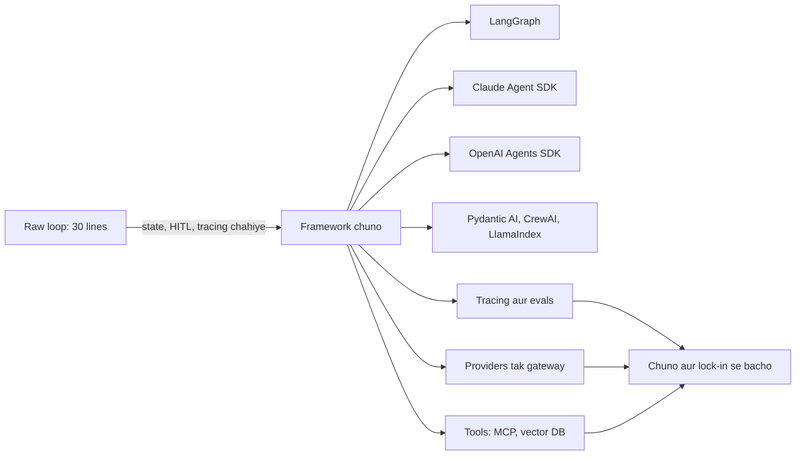

## ⭐ Framework kya deta hai, aur kya leta hai

**Ek line me:** Framework = agent loop + production ke boring hisse (state, persistence, streaming, tool plumbing, tracing, handoffs); keemat abstraction, lock-in aur mushkil debugging me chukaate ho.

**Ye kyun chahiye:** Raw loop pehle din aasaan hai. Chauthe hafte tak tumhe pod restart ke baad run resume karna hai, human approval ke liye rukna hai, UI ko tokens stream karne hain, aur dekhna hai step 7 ne galat tool kyun chuna. Inme se har ek kuch sau lines hai jo khud likhni aur test karni padengi. Frameworks ye ready dete hain.

**Aise socho:** Ghar pe khana banana vs Swiggy ke liye cloud kitchen chalana. Ghar pe kadhai aur stove kaafi hai. Cloud kitchen me order tickets, fridge log, head chef ka plate check, aur CCTV chahiye. Framework woh kitchen setup hai. Din ke 500 orders pe badhiya, Maggi banane ke liye overkill.

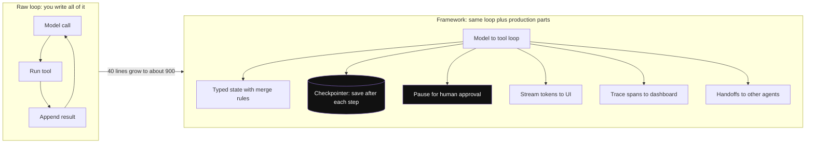

*Diagram:* Loop dono taraf wahi 4 steps hai; right side ke highlighted parts woh hain jo warna tumhe haath se likhne padte (40 se 900 lines wala jump).

**Kaise kaam karta hai, step by step:**

1. Raw loop se shuru karo: model call, check karo tool maanga kya, chalao, result jodo, step cap ke saath repeat.
2. Jo features sach me chahiye unki list banao. Neeche ki har row ek feature hai jo framework deta hai.
3. Har feature ke liye khud banane ki cost socho. Agar do-teen bade features chahiye, to framework aksar jeet-ta hai.
4. Phir keemat dekho: naye concepts seekhne, har kuch mahine badalne wali dependency, library code ke andar stack traces.

| Feature | Raw loop | Framework |
|---|---|---|
| Steps ke beech state | Python list jo tum sambhalo | merge rules ke saath typed state |
| Persistence / resume | DB save aur load khud likho | checkpointer: har step ke baad save, thread ID se resume |
| Run ke beech human approval | pause aur resume khud banao | built in (jaise LangGraph `interrupt`) |
| Tokens aur steps ki streaming | SSE events khud handle karo | stream modes ready |
| Tool plumbing | JSON schemas haath se likho | type hints aur docstring se schema |
| Tracing | spans khud jodo | dashboard pe auto traces |
| Multi-agent handoffs | routing khud design karo | handoff ya sub-agent primitives |

Ek worked number: ek team ka raw loop 40 lines tha. Postgres persistence, resume, approval pause, streaming aur retries jodne pe ye lagbhag 900 lines aur do hafte ho gaya. LangGraph pe switch karne se wahi features lagbhag 150 lines me mile. Keemat: do engineers ne ek hafta reducers aur checkpoints seekhne me lagaya, aur ek bug me ek din gaya kyunki stack trace library code ke andar tha.

**Iski keemat kya hai:**
- **Abstraction:** exact bheja gaya prompt ab dikhta nahi. Kuch frameworks hidden system text jodte hain.
- **Lock-in:** tumhara state, tools aur traces framework ki shape le lete hain.
- **Churn:** is space me 2024–2025 me APIs bahut badle. Upgrade se code toot sakta hai.
- **Debugging:** errors library ke andar gehraai me nikalte hain.

**Interview tip:** "Kya tum framework se shuru karoge?" Bolo: "Main task samajhne aur eval set banane ke liye raw loop se shuru karta hoon. Framework tab laata hoon jab inme se do ya zyada chahiye: durable state, failure ke baad resume, human approval, streaming, ya multi-agent routing. Single-tool bot ke liye raw loop simple aur debug karne me aasaan hai."

**Common galti:**
- Pehle framework chunna, phir problem ko usme zabardasti fit karna.
- Sochna ki framework agent ko smart banata hai. Quality model aur prompt decide karte hain; framework sirf loop chalata hai.

## ⭐ Ek hi task teen tarah se

**Ek line me:** Ek agent, ek tool ("get weather"), teen tarah likha: raw loop, LangGraph pe chalne wala LangChain `create_agent`, aur OpenAI Agents SDK, taaki dikhe har layer kya chhupati hai.

**Ye kyun chahiye:** Shabdon me frameworks compare karna vague hai. Same 1-tool agent har ek me dekhne se trade-off saaf hota hai: raw loop har message dikhata hai; frameworks plumbing hata dete hain par use chhupa bhi dete hain.

**Aise socho:** Train ticket teen tarah se book karna. IRCTC counter pe khud form bharna (raw loop). IRCTC app (framework). Travel agent ko bolna (higher-level framework). Ticket same, control alag.

**Kaise kaam karta hai, step by step:**

1. User poochhta hai: "Mumbai me umbrella chahiye kya?"
2. Model tool call se reply karta hai: `get_weather(city="Mumbai")`.
3. Code tool chalata hai: `"Mumbai: 31°C, humid, 80% chance of rain"` milta hai.
4. Code result wapas bhejta hai. Model jawab deta hai: "Haan, le jao."
5. Yaani 2 LLM calls aur 1 tool call. Neeche har framework bilkul yahi 4 steps karta hai.

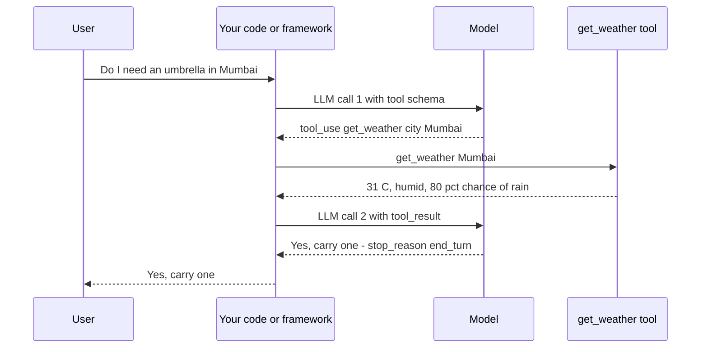

*Diagram:* 2 LLM calls aur 1 tool call; versions ke beech sirf beech wali lane badalti hai (raw loop: tum, LangGraph: create_agent, OpenAI: Runner).

**Version 1: raw loop (Anthropic Python SDK).**

```python
import anthropic

client = anthropic.Anthropic()            # env se ANTHROPIC_API_KEY padhta hai
MODEL = "claude-sonnet-5-5"               # docs se current model ID lo

def get_weather(city: str) -> str:
    return f"{city}: 31°C, humid, 80% chance of rain"   # demo ke liye fake data

TOOLS = [{
    "name": "get_weather",
    "description": "Current weather for one city.",
    "input_schema": {"type": "object",
                     "properties": {"city": {"type": "string"}},
                     "required": ["city"]},
}]

messages = [{"role": "user", "content": "Do I need an umbrella in Mumbai?"}]
for step in range(5):                                   # steps pe hard cap
    resp = client.messages.create(model=MODEL, max_tokens=1024,
                                  tools=TOOLS, messages=messages)
    messages.append({"role": "assistant", "content": resp.content})
    if resp.stop_reason != "tool_use":
        break                                           # final jawab, loop band
    results = []
    for block in resp.content:
        if block.type == "tool_use":                    # model ne tool maanga
            out = get_weather(**block.input)
            results.append({"type": "tool_result",
                            "tool_use_id": block.id, "content": out})
    messages.append({"role": "user", "content": results})

print("".join(b.text for b in resp.content if b.type == "text"))
```

**Code kya karta hai:**
- Tool ka JSON schema tum haath se likhte ho.
- `stop_reason == "tool_use"` matlab model tool chahta hai; kuch aur matlab kaam khatam.
- Har tool result matching `tool_use_id` ke saath user message ki tarah wapas jaata hai.
- `range(5)` safety cap hai. Iske bina confused model hamesha loop kar sakta hai.
- Kuch save nahi hota. Restart pe `messages` kho jaata hai.

**Version 2: LangChain `create_agent` (LangGraph pe chalta hai).**

```python
from langchain.agents import create_agent
from langchain_core.tools import tool
from langgraph.checkpoint.memory import InMemorySaver

@tool
def get_weather(city: str) -> str:
    """Current weather for one city."""            # docstring = tool description
    return f"{city}: 31°C, humid, 80% chance of rain"

agent = create_agent(
    model="anthropic:claude-sonnet-5-5",
    tools=[get_weather],
    system_prompt="Answer weather questions. Use the tool, never guess.",
    checkpointer=InMemorySaver(),                  # sirf dev; prod me PostgresSaver
)
cfg = {"configurable": {"thread_id": "user-42"}}
out = agent.invoke({"messages": [{"role": "user", "content": "Umbrella in Mumbai?"}]}, cfg)
print(out["messages"][-1].content)

# Baad me same thread_id: agent ko Mumbai wala turn ab bhi dikhta hai
agent.invoke({"messages": [{"role": "user", "content": "And Pune?"}]}, cfg)
```

**Code kya karta hai:**
- `@tool` type hints aur docstring se JSON schema banata hai.
- `create_agent` Version 1 jaisa hi model-tool loop LangGraph graph ki tarah banata hai.
- Checkpointer har step ke baad `thread_id` ke under state save karta hai, isliye turn 2 ko turn 1 yaad hai.
- `InMemorySaver` ko `PostgresSaver` se badlo to run ke beech crash hone pe resume ho sakta hai.

**Version 3: OpenAI Agents SDK.**

```python
from agents import Agent, Runner, function_tool

@function_tool
def get_weather(city: str) -> str:
    """Current weather for one city."""
    return f"{city}: 31°C, humid, 80% chance of rain"

agent = Agent(
    name="Weather bot",
    instructions="Answer weather questions. Use the tool, never guess.",
    tools=[get_weather],
)
result = Runner.run_sync(agent, "Do I need an umbrella in Mumbai?")
print(result.final_output)
```

**Code kya karta hai:**
- `@function_tool` function ko tool bana deta hai, schema ke saath.
- `Runner.run_sync` poora loop chalata hai jab tak agent final jawab na de.
- Tracing default me on hai aur OpenAI dashboard pe jaati hai; doosre trace processors bhi jod sakte ho.
- Turns ke paar memory ke liye session object jodo; routing ke liye `handoffs`.

| | Raw loop | LangChain / LangGraph | OpenAI Agents SDK |
|---|---|---|---|
| Is task ke liye lines | ~30 | ~15 | ~12 |
| Har message dikhta hai | haan | haan, state me | haan, result aur trace me |
| Persistence | khud likho | checkpointer, ek line | sessions |
| Model provider badalna | calls dobara likho | model string badlo | OpenAI ke saath best; baaki adapters se |

**Interview tip:** "Is example me framework kya chhupata hai?" Bolo: "Tool schema, stop check, message bookkeeping aur step cap. Jab tak sab theek chale, koi dikkat nahi. Isliye main tracing hamesha on rakhta hoon aur jaanta hoon exact bheje gaye messages kaise print karne hain."

**Common galti:**
- Raw loop me step cap bhoolna. Ek atka hua run sau calls kha sakta hai.
- Production me `InMemorySaver` aur deploy pe saare threads gayab.

## LangGraph

**Ek line me:** Library jisme agent ko ek shared, typed state ke upar steps ke graph ki tarah banate ho, aur checkpointer har step ke baad save karta hai.

**Poora page:** [LangChain](23-langchain.md)

**Ye kyun chahiye:** Real agents ek loop nahi hote. Woh branch karte hain ("refund hai ya delivery issue?"), limit ke saath loop karte hain, human ke liye rukte hain, aur restart jhelne chahiye. LangGraph is control flow ko nodes aur edges me saaf dikhata hai, aur state save karta hai taaki run resume ho. Poori API ke liye [LangGraph Core](02-langgraph-core.md) dekho.

**Aise socho:** IRCTC refund desk ki deewar pe chipka flowchart. Har box ek desk (node). Arrows batate hain file aage kahan jaayegi (edges). File khud (state) stamps ke saath ghoomti hai, aur har desk ke baad photocopy rakhi jaati hai (checkpoint).

**Kaise kaam karta hai, step by step:**

1. State define karo, jaise `messages`, `order_id`, `refund_amount`.
2. Nodes jodo: plain functions jo state padhte hain aur updates lautate hain.
3. Edges jodo, conditional bhi: "model ne tool maanga to tools node, warna end".
4. Checkpointer ke saath compile karo (production me `PostgresSaver`).
5. `thread_id` ke saath chalao. Har step ("super-step") ke baad state save hoti hai.
6. Approval ke liye rukna ho to node `interrupt(...)` call karta hai. Run rukta hai; baad me human ke jawab ke saath resume.

Example: refund agent ke 4 nodes (classify, fetch order, decide, approve). ₹5,000 se upar ke refund `interrupt` pe rukte hain aur human ka wait karte hain. Raat me pod restart hota hai. Subah human approve dabata hai, aur run saved checkpoint se resume hota hai, shuru se nahi.

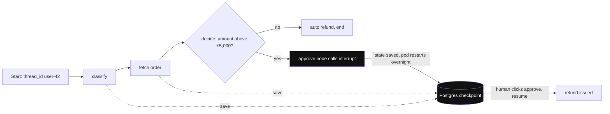

*Diagram:* Har node checkpoint me save karta hai; run interrupt pe rukta hai aur agli subah Postgres se resume hota hai, classify se dobara nahi.

| | |
|---|---|
| Mental model | state machine / graph; control flow tumhara |
| Strengths | fine control, durable checkpoints, human-in-the-loop, time travel, streaming, koi bhi model provider, bada ecosystem, LangSmith integration |
| Weaknesses | zyada concepts (reducers, super-steps, channels), higher-level tools se zyada code, LangChain-style messages aur tools se bandha |
| Kab chuno | lambe ya branching flows, approval steps, resume chahiye, production control chahiye |

**Interview tip:** "Raw loop ki jagah LangGraph kyun?" Bolo: "Checkpointer se durable state, crash ke baad resume, human approval ke liye `interrupt`, saaf branching jise node-by-node test kar sakun, aur streaming. One-tool bot ke liye main nahi lagaunga."

**Common galti:**
- Ek prompt + ek tool wale task ke liye bada graph banana.
- State me bade blobs (poore PDFs) daalna; har checkpoint unhe copy karta hai.

## Claude Agent SDK

**Ek line me:** Claude Code ke peeche wala agent harness, library ki tarah (Python aur TypeScript), taaki uske built-in tools, context management, subagents aur MCP support tumhare apne agent me mil jaayein.

**Poora page:** [Claude Agent SDK](29-claude-agent-sdk.md)

**Ye kyun chahiye:** Achha general agent sirf loop nahi hai. Safe file aur shell tools chahiye, window bharne pe automatic context compaction, permission prompts, apni window me kaam karne wale subagents, aur MCP connections. Anthropic ne ye sab Claude Code ke liye banaya. SDK (pehle naam Claude Code SDK) wahi harness deta hai.

**Aise socho:** Experienced site engineer hire karna jo apna toolkit laata hai, vs fresher hire karke har tool khud khareedna. Kya banana hai aur kaunse kamron me jaana allowed hai, ye ab bhi tum batate ho.

**Kaise kaam karta hai, step by step:**

1. SDK ko prompt aur options ke saath call karo: allowed tools, working directory, system prompt, MCP servers, permission mode.
2. Harness Claude ke saath loop chalata hai. Built-in tools me files padhna, likhna, edit karna, shell commands chalana, files search karna, aur web fetch aur search hain.
3. Window lambi hone pe harness purana context compact karta hai taaki run chalta rahe.
4. Side task ke liye agent fresh window wala **subagent** shuru kar sakta hai; sirf uska summary wapas aata hai.
5. Tumhare apne tools MCP servers ki tarah lagte hain (external, ya same Python app me in-process).
6. Hooks se tumhara code tool calls se pehle ya baad chal sakta hai, jaise `rm -rf` rokna ya har command log karna.
7. Agent kaam karte hue messages tumhare code ko stream karta hai; sessions resume ho sakte hain.

Example: repo ke liye "fix failing test" bot. Allowed tools: read, edit, run tests. Ye test padhta hai, file edit karta hai, tests chalata hai, repeat. Tumne koi file tool ya compaction logic nahi likha, sirf options aur ek hook jo `src/` ke bahar writes rokta hai.

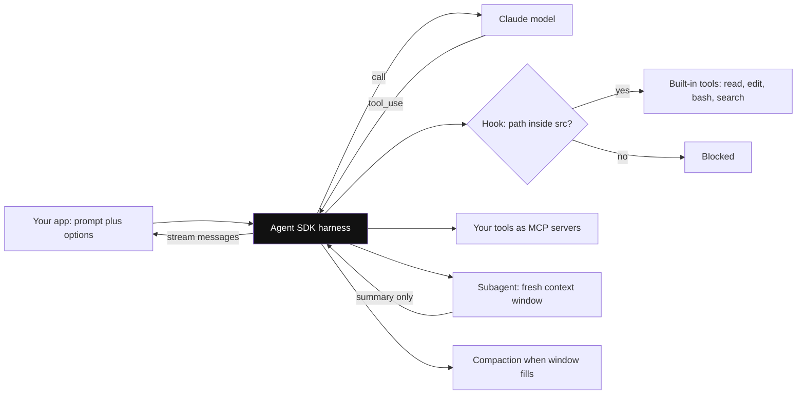

*Diagram:* Tum sirf options aur hook likhte ho; loop, built-in tools, subagents aur compaction harness sambhalta hai.

| | |
|---|---|
| Mental model | ready-made general agent harness jise configure karte ho, graph nahi jo draw karo |
| Strengths | code aur files ke liye strong built-in tools, context compaction, subagents, MCP first-class, hooks aur permissions, Claude Code jaisa behaviour |
| Weaknesses | Claude models ke liye bana; graph jitna explicit control flow nahi; shell aur file access ko careful sandboxing chahiye |
| Kab chuno | coding agents, files aur shell pe kaam karne wale ops aur research agents, ya jab apne product me Claude Code jaisa behaviour chahiye |

**Interview tip:** "Claude Agent SDK vs LangGraph?" Bolo: "Agent SDK ready harness hai: tools, compaction, subagents, MCP. LangGraph apna control flow durable state ke saath design karne ka toolkit hai. Open-ended coding agent ke liye SDK se shuru karunga. Approvals wale fixed business process ke liye LangGraph."

**Common galti:**
- Agent ko bina sandbox ya allow-list ke shell access dena.
- Ise patla chat wrapper samajhna aur phir woh tools dobara banana jo ye already deta hai.

## OpenAI Agents SDK

**Ek line me:** OpenAI ki halki agent library (Swarm experiment ki successor), kuch primitives pe bani: agents, handoffs, guardrails, sessions aur built-in tracing.

**Poora page:** [OpenAI Agents SDK](27-openai-agents-sdk.md)

**Ye kyun chahiye:** Bahut teams ko graph library seekhe bina multi-agent apps banane ka chhota, Python-first tareeka chahiye tha. SDK concepts kam rakhta hai aur default me tracing deta hai, taaki bina extra setup har run dikhe.

**Aise socho:** Bank branch. Front desk (triage agent) sunta hai, phir tumhe loans desk ya cards desk ko bhejta hai (handoff). Darwaze pe guard (guardrail) kisi ko bhi rok sakta hai. CCTV (tracing) sab record karta hai.

**Kaise kaam karta hai, step by step:**

1. `Agent` banao `name`, `instructions`, `tools` aur optional `handoffs` (doosre agents) ke saath.
2. `Runner.run(...)` loop chalata hai: model call, tools, final output tak repeat.
3. Model handoff chune to control conversation ke saath us agent ko chala jaata hai.
4. **Input guardrails** pehle user message check karte hain; **output guardrails** jawab check karte hain. Koi "trip" ho to run exception ke saath ruk jaata hai.
5. **Session** runs ke paar conversation history rakhta hai.
6. Har run trace hota hai: agent spans, LLM spans, tool spans, handoffs.

Example: support bot. `triage = Agent(name="Triage", instructions="Route to the right desk.", handoffs=[billing_agent, refund_agent])`. User bolta hai "mera do baar charge hua". Triage `billing_agent` ko handoff karta hai. Pehle ek input guardrail check karta hai ki message jailbreak attempt to nahi; iski cost ek sasti model call hai.

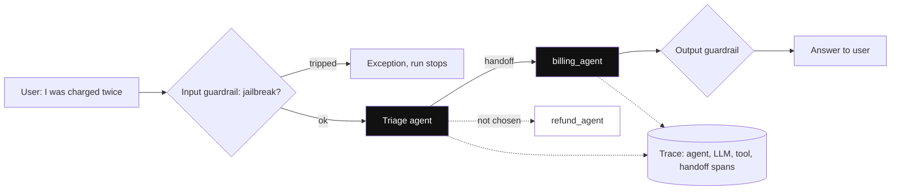

*Diagram:* Guardrail triage se pehle chalta hai; triage poori conversation billing_agent ko de deta hai (refund_agent idle rehta hai), aur har hop ek hi trace me aata hai.

| | |
|---|---|
| Mental model | kuch agents jo ek doosre ko handoff karte hain, plus guardrails aur tracing |
| Strengths | bahut chhoti API, handoffs aur guardrails first-class, default tracing, Python aur TypeScript |
| Weaknesses | complex flows pe graph jitna control nahi; durable lambe workflows ke liye extra pieces chahiye; OpenAI models ke saath best (baaki adapters se) |
| Kab chuno | OpenAI-centric teams, triage-and-specialist designs, jaldi prototypes jo badh sakte hain |

**Interview tip:** "Handoff vs agent-as-tool kya hai?" Bolo: "Handoff me naya agent conversation le leta hai. Tool ki tarah, main agent sub-agent ko call karta hai, result leta hai, aur khud incharge rehta hai. Handoff routing ke liye; agent-as-tool sub-task delegate karne ke liye."

**Common galti:**
- Bahut saare handoffs chain karna; har hop latency badhata hai aur context kho sakta hai.
- Aise data ke liye default tracing on chhodna jo region ke bahar nahi jaana chahiye.

## Pydantic AI

**Ek line me:** Pydantic team ki agent library jo agents ko type-safe banati hai: typed dependencies andar, validated structured output bahar.

**Poora page:** [DSPy and Pydantic AI](30-dspy-pydantic-ai.md)

**Ye kyun chahiye:** LLM apps ke zyada bugs boundaries pe hote hain. Model missing field wala JSON deta hai, ya tool ko galat DB connection milta hai. Pydantic AI Python types aur Pydantic models se ye jaldi pakadti hai, aur output validation fail hone pe model se retry karwati hai.

**Aise socho:** Required fields wala Swiggy order form. Address aur phone ke bina submit nahi hota. Model galat bhare to form wapas aata hai aur dobara poochhta hai.

**Kaise kaam karta hai, step by step:**

1. Output ko Pydantic model ki tarah define karo, jaise `Weather(city: str, temp_c: float, carry_umbrella: bool)`.
2. `Agent(model, output_type=Weather, deps_type=...)` banao.
3. Decorators se tools register karo. Jin tools ko DB ya API client chahiye unhe `RunContext` ke through milta hai (dependency injection), globals se nahi.
4. Chalao. Model ka final jawab validate na ho to library error wapas bhejti hai aur model dobara try karta hai.
5. `result.output` asli `Weather` object ki tarah milta hai.

```python
from pydantic import BaseModel
from pydantic_ai import Agent

class Weather(BaseModel):
    city: str
    temp_c: float
    carry_umbrella: bool

agent = Agent("openai:gpt-4.1-mini", output_type=Weather,
              system_prompt="Use the tool. Never guess the weather.")

@agent.tool_plain                       # bina injected dependencies wala tool
def get_weather(city: str) -> str:
    """Current weather for one city."""
    return f"{city}: 31°C, humid, 80% chance of rain"

result = agent.run_sync("Do I need an umbrella in Mumbai?")
print(result.output.carry_umbrella)     # asli bool, pehle se validated
```

**Code kya karta hai:**
- `output_type=Weather` structured jawab force karta hai aur validate karta hai.
- `@agent.tool_plain` plain function se tool register karta hai; schema type hints se aata hai.
- `result.output` typed object hai, to IDE aur type checker use samajhte hain.
- `"openai:..."` ko doosre provider string se badlo to model badal jaata hai.

| | |
|---|---|
| Mental model | FastAPI-style agents: types, validation, dependency injection |
| Strengths | type safety, structured outputs, injected deps se testable tools, model-agnostic, OTel-based tracing (Logfire) |
| Weaknesses | naya ecosystem, kam prebuilt multi-agent patterns, sirf Python |
| Kab chuno | agent ka output doosre code ko jaata hai (APIs, DB writes) aur galat shape mehngi padti hai |

**Interview tip:** "Agent ke output ki shape guarantee kaise karoge?" Bolo: "Schema se validate karo aur fail pe retry. Pydantic AI `output_type` se ye default me karta hai; doosre stacks me main provider structured outputs + Pydantic validation use karta hoon."

**Common galti:**
- Sochna validation = correctness. Valid `temp_c=31.0` bhi galat city ka ho sakta hai.

## CrewAI

**Ek line me:** Role-based multi-agent teams ka framework: agents ko role aur goal se describe karo, tasks do, aur crew tasks chalati hai.

**Poora page:** [CrewAI](25-crewai.md)

**Ye kyun chahiye:** Kuch problems chhoti team jaisi lagti hain: researcher, writer, reviewer. CrewAI us team ko kuch lines me describe karne deta hai, jo demos aur content pipelines ke liye fast hai.

**Aise socho:** Cricket team sheet. Har player ka role (opener, spinner, keeper). Captain batting order fix karta hai (sequential) ya chalte-chalte decide karta hai (hierarchical).

**Kaise kaam karta hai, step by step:**

1. Agents define karo `role`, `goal` aur `backstory` ke saath, plus tools.
2. Tasks define karo description aur `expected_output` ke saath, har ek kisi agent ko assigned.
3. Unhe `Crew` me daalo process ke saath: **sequential** (task 1, phir 2, phir 3) ya **hierarchical** (manager agent delegate karta hai).
4. `crew.kickoff()` chalata hai. Ek task ka output agle me jaata hai.
5. Zyada control ke liye CrewAI **Flows** event-driven, deterministic steps likhne dete hain aur unke andar crews call karte hain.

Example: market research. Researcher 5 sources search karta hai, Analyst 3 findings likhta hai, Writer 300-word brief banata hai. 3 agents, 3 tasks, lagbhag 6–10 LLM calls.

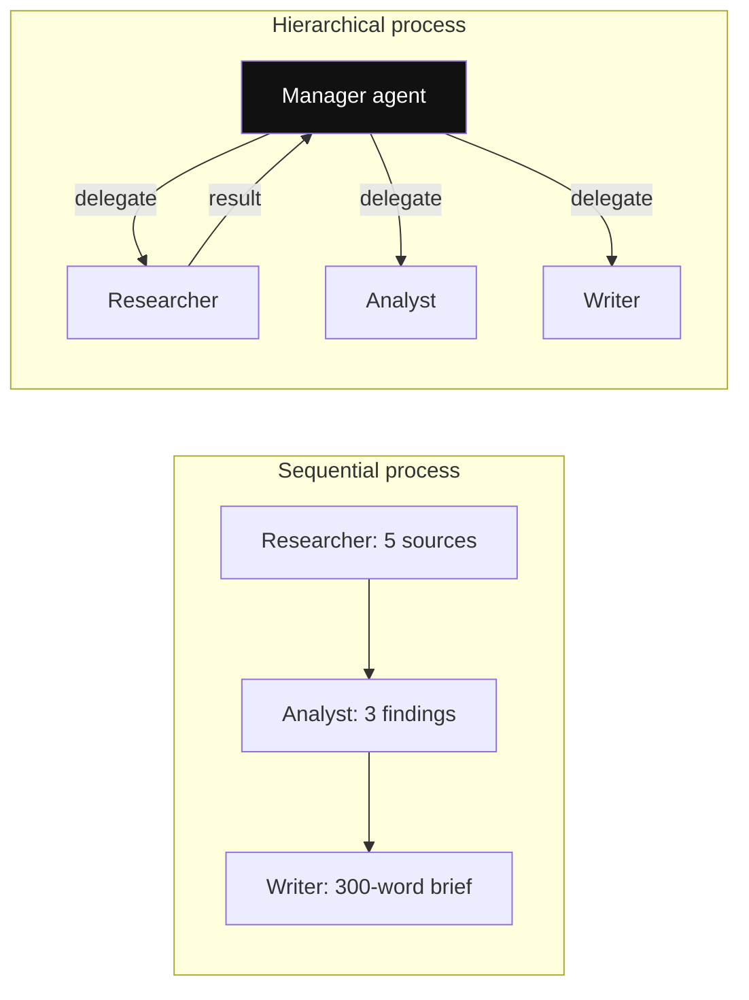

*Diagram:* Sequential: har task ka output fixed order me agle ko jaata hai. Hierarchical: manager LLM decide karta hai aage kaun kaam karega, jisme extra calls lagti hain aur debug karna mushkil hota hai.

| | |
|---|---|
| Mental model | role-play karne wale agents ki team jo tasks chalati hai |
| Strengths | multi-agent demo ka sabse tez raasta, readable configs, zyada control ke liye Flows |
| Weaknesses | har step pe kam control, role prompts tokens badhate hain, simple tasks pe zaroorat se zyada LLM calls, "manager ne aisa kyun kiya" debug karna mushkil |
| Kab chuno | content aur research pipelines, prototypes, roles me sochne wali teams |

**Interview tip:** "LangGraph vs CrewAI?" Bolo: "CrewAI high-level hai: roles aur tasks, shuru karna fast, control kam. LangGraph low-level hai: explicit state aur edges, checkpointing aur human approval. Demo ya content pipeline ke liye CrewAI try karunga. Branching, approvals aur resume wale production flow ke liye LangGraph."

**Common galti:**
- 4 role-play agents lagana jahan 4 tools wala ek agent sasta aur zyada accurate hota.

## LlamaIndex

**Ek line me:** Data-first framework: RAG ke liye connectors, parsing, indexes aur query engines, upar se event-driven Workflows aur agents.

**Poora page:** [LlamaIndex](24-llamaindex.md)

**Ye kyun chahiye:** Bahut saare "agents" asal me PDFs, wikis aur databases se sahi data nikaalne ke baare me hote hain. LlamaIndex usi data layer ki tarah shuru hua: load, chunk, index, retrieve. Agents aur Workflows baad me jude taaki retrieval kai tools me se ek tool ban sake. [What is RAG](../09-rag/01-what-is-rag.md) dekho.

**Aise socho:** Badhiya catalogue aur librarian wali library. Catalogue (index) asli value hai. Librarian (agent) usse jawab deta hai.

**Kaise kaam karta hai, step by step:**

1. Connectors se data load karo (files, Notion, databases); mushkil PDFs parse karo.
2. Chunk aur embed karke index me daalo (memory me ya vector DB me).
3. Index ko query engine ki tarah wrap karo, aur agent ko tool ki tarah do.
4. Multi-step logic ke liye **Workflow** likho: steps jo events sunte hain aur naye events emit karte hain.

Example: 2,000 PDF pages pe HR policy bot. LlamaIndex parse karta hai, lagbhag 6,000 chunks banata hai, index karta hai, aur agent ke do tools hain: `search_policy` aur `get_leave_balance`.

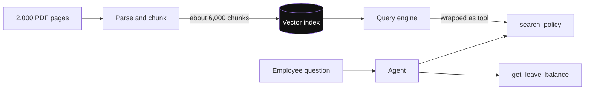

*Diagram:* Zyada kaam left half me hai (ingest aur index); right wala agent index ko bas ek aur tool ki tarah dekhta hai.

| | |
|---|---|
| Mental model | pehle data aur retrieval, upar agent |
| Strengths | rich ingestion aur parsing, kai retrievers aur index types, event-driven control ke liye Workflows |
| Weaknesses | badi API surface; sirf simple tools wala loop chahiye to bhaari hai |
| Kab chuno | mushkil hissa data hai: documents, RAG, knowledge assistants |

**Interview tip:** "RAG agent ke liye LlamaIndex ya LangGraph?" Bolo: "Agar ingestion aur retrieval quality mushkil hissa hai to LlamaIndex. Agar control flow mushkil hai to LangGraph. Dono jod sakte ho: LlamaIndex query engine ek LangGraph agent ke andar tool ki tarah."

**Common galti:**
- Kharab jawabon ke liye framework ko blame karna jab asli problem chunks ya embeddings hain.

## AutoGen, AG2 aur Google ADK

**Ek line me:** Do aur families jo pehchaanni chahiye: AutoGen/AG2 (agents jo conversations me ek doosre se baat karte hain) aur Google ka Agent Development Kit (ADK, Gemini aur Google Cloud ke liye tuned code-first agents).

**Poora page:** [AutoGen and Microsoft Agent Framework](26-autogen.md), [Google ADK](28-google-adk.md)

**Ye kyun chahiye:** Interviewer check karte hain ki tumhe LangChain aur OpenAI ke bahar ka landscape pata hai. Unki APIs ki zaroorat nahi; har ek kis kaam ka hai, ek line chahiye.

**Aise socho:** AutoGen agents ka WhatsApp group hai jo solve hone tak chat karte hain. ADK Google ka apna kitchen kit hai, Google ke stove ke saath best.

**Kaise kaam karta hai, step by step:**

1. **AutoGen** (Microsoft Research): multi-agent conversations, jaise assistant agent aur code chalane wala agent baari-baari baat karte hain. Version 0.4 event-driven design me rewrite tha.
2. **AG2**: purani AutoGen line ka community fork, kuch original creators ke saath. Wahi conversational idea.
3. Microsoft ne baad me **Microsoft Agent Framework** announce kiya, jo AutoGen ideas aur Semantic Kernel ko saath laata hai. Naye Microsoft-stack kaam ki direction ki tarah iska zikr karo.
4. **Google ADK**: LLM agents aur workflow agents (sequential, parallel, loop) define karo aur Google Cloud pe deploy karo. Gemini ke saath best chalta hai aur agent-to-agent calls ke liye A2A protocol support karta hai.

| | AutoGen / AG2 | Google ADK |
|---|---|---|
| Mental model | group me chat karte agents | code-first agents plus workflow agents |
| Best for | research, code-execution teams | Gemini aur Google Cloud shops |
| Dhyan rakho | conversation loops bound karna mushkil aur mehnga | Google ecosystem ke andar sabse strong |

**Interview tip:** "AutoGen use kiya hai?" Agar nahi, to jo pata hai imaandari se bolo: "Iska model group chat me baat karte agents hai. Production ke liye main explicit control flow prefer karta hoon kyunki chat-style loops ko bound aur test karna mushkil hai."

**Common galti:**
- Aise framework me deep experience claim karna jiske baare me sirf padha hai. Interviewer ek follow-up poochhta hai aur pata chal jaata hai.

## ⭐ Badi comparison table

**Ek line me:** Ek table jisse saare main frameworks ko un dimensions pe compare kar sako jo interviewers ke liye matter karte hain.

**Ye kyun chahiye:** "X aur Y compare karo" common sawal hai. Fixed dimensions (control, multi-agent, persistence, typing, ecosystem, learning curve) se jawab structured banta hai, opinion nahi.

**Aise socho:** CarDekho sheet pe cars compare karna: mileage, boot space, price, service network. Brand se nahi, apni trip se chunte ho.

**Kaise kaam karta hai, step by step:**

1. Pehle dimensions fix karo.
2. Har framework ko roughly rate karo: low, medium, high.
3. Row ko apni problem se match karo: tumhare use case me mushkil kya hai?

| Framework | Control | Multi-agent | Persistence | Typing | Ecosystem | Learning curve | Best for |
|---|---|---|---|---|---|---|---|
| Raw loop | poora | khud banao | khud banao | tumhari | zaroorat nahi | sabse kam | 1–3 tools, seekhna, max transparency |
| LangGraph | high, explicit graph | supervisor, subgraphs, handoffs | checkpointer, resume, time travel | typed state | bahut bada (LangChain, LangSmith) | medium-high | lambe, branching, human-in-loop production flows |
| Claude Agent SDK | medium, loop harness decide karta | subagents | sessions, compaction | moderate | MCP, Claude Code | low-medium | Claude pe coding, file aur shell agents |
| OpenAI Agents SDK | medium | handoffs, agents as tools | sessions | moderate | OpenAI platform | low | OpenAI-centric triage aur specialist bots |
| Pydantic AI | medium-high | agent delegation, graphs | integrations se | sabse strong | badh raha | low-medium | typed outputs jo doosre code ko jaate hain |
| CrewAI | low-medium | core feature (roles, crews) | limited, Flows state jodte | halki | medium | low | role-based content aur research pipelines |
| LlamaIndex | medium | agent workflows | workflow state | moderate | data ke liye bada | medium | document-heavy RAG agents |
| AutoGen / AG2 | low-medium | core feature (group chat) | limited | halki | medium | medium | research aur code-execution teams |
| Google ADK | medium | workflow agents, A2A | Google Cloud pe sessions | moderate | Google Cloud | medium | Gemini aur Vertex AI shops |

**Interview tip:** Jab poochhein "kaunsa best hai", bolo: "Kis cheez ke liye best? Mushkil hissa control flow aur durability hai to LangGraph. Typed outputs, Pydantic AI. Data, LlamaIndex. Coding agent, Claude Agent SDK. Jaldi role-based pipeline, CrewAI."

**Common galti:**
- Aisi table ko har version ke liye fact ki tarah quote karna. Ye libraries tez badalti hain; bolo "jo versions maine use kiye unke hisaab se".

## ⭐ Observability aur eval tools

**Ek line me:** Tracing tools har run ka har step record karte hain; eval tools fixed dataset pe outputs score karte hain; zyada products ab dono karte hain, aur OpenTelemetry GenAI conventions unke neeche neutral layer hain.

**Ye kyun chahiye:** Jo agent 20 me se 1 baar fail hota hai, uske 8 steps ka trace na ho to debug mushkil hai. Aur ek prompt change jo ek case theek kare, paanch aur tod sakta hai; sirf eval set ye pakadta hai. [AI Observability](10-agent-observability.md) aur [Evals for Agents](09-agent-evals.md) dekho.

**Aise socho:** Tracing flight ka black box recorder hai. Evals woh driving test hai jo har engine change ke baad dobara dete ho.

**Kaise kaam karta hai, step by step:**

1. App instrument karo: har LLM call, tool call aur agent step ek span banta hai jisme model, tokens, latency aur cost ho.
2. Spans backend ko bhejo (hosted ya self-hosted).
3. Dataset banao: 50–200 real inputs expected behaviour ke saath.
4. Har prompt ya model change pe evals chalao: code checks (sahi tool call hua?) plus LLM-as-judge scores.
5. Runs side by side compare karo; score maan lo 92% se 85% gire to release block karo.

| Tool | Type | Strength | Dhyan rakho |
|---|---|---|---|
| Langfuse | open source, self-host ya cloud | tracing, prompt management, evals, cost; OTel-based | self-host karo to infra tum chalaoge |
| LangSmith | hosted (enterprise ke liye self-host) | gehri LangChain/LangGraph integration, datasets, annotation queues, online evals; bina LangChain bhi chalta | LangChain duniya ke andar sabse strong |
| Braintrust | hosted | evals-first: experiments, scorers, side-by-side diffs, prompt playground, logging | pure tracing tool kam |
| Arize Phoenix | open source | OpenInference/OTel tracing, evals, notebook me locally chalta | bade scale ke liye Arize ka paid platform |
| W&B Weave | hosted | `@weave.op` tracing, evals, Weights & Biases wali teams me fit | W&B ecosystem |
| promptfoo | open-source CLI | assertions wale YAML test cases, model comparison, red-teaming, CI me chalta | production tracing tool nahi |

**OpenTelemetry GenAI semantic conventions:** LLM kaam ke liye span names aur attributes ka agreed set, jaise `gen_ai.operation.name`, `gen_ai.request.model`, `gen_ai.usage.input_tokens` aur `gen_ai.usage.output_tokens`. Tumhara app ye emit kare to koi bhi OTel backend inhe padh sakta hai. Ye abhi experimental marked hain, to names badal sakte hain.

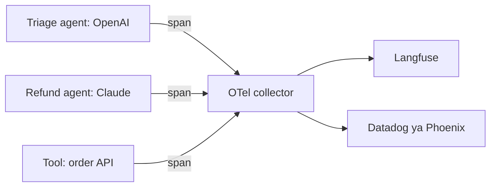

**Vendors ke paar ek run trace karna:** entry point pe har run ko ek trace ID do. Use har agent aur tool tak pass karo (OTel context propagation ye karta hai; HTTP ke paar ye `traceparent` header me jaata hai). Har LLM span pe GenAI attributes emit karo, provider koi bhi ho. Phir ek trace me OpenAI aur Claude calls ek tree me dikhti hain.

**Interview tip:** "Evals ke liye kaunsa tool aur kyun?" Bolo: "Constraints pe depend karta hai. Data apne servers pe rehna chahiye: Langfuse ya Phoenix, self-hosted. LangGraph-heavy team: LangSmith. Eval-driven product team jo kai prompt versions compare karti hai: Braintrust. CI me regression tests: promptfoo. Jo bhi chunu, OTel GenAI spans emit karta hoon taaki baad me move kar sakun."

**Common galti:**
- Do-teen tools parallel chalana, kisi me complete trace nahi.
- Tracing hai par eval dataset nahi; failures dikhte hain par fix kaam karta hai ye prove nahi kar sakte.

## Gateways aur routers

**Ek line me:** Gateway tumhare app aur model providers ke beech proxy hai jo ek API, central keys, budgets, fallbacks, caching aur logging deta hai.

**Ye kyun chahiye:** Teesre mahine tak company aksar 10 teams me 3 providers aur 8 models use karti hai. Gateway ke bina har team apni API keys rakhti hai, rate limits alag tarah handle karti hai, aur kisi ko pata nahi pichhle mahine ₹4 lakh kisne kharch kiye. Gateway ye ek jagah theek karta hai.

**Aise socho:** Society ka main gate. Saare delivery boys (requests) ek gate se ek register ke saath aate hain. Guard ko pata hai kaun aaya, kisi ko rok sakta hai, aur front band ho to back gate bhej sakta hai.

**Kaise kaam karta hai, step by step:**

1. App gateway ko ek API format (aksar OpenAI-compatible) aur model name ke saath call karta hai.
2. Gateway team ki virtual key aur budget check karta hai.
3. Provider ko route karta hai; 429 ya timeout pe retry, phir backup model pe fallback.
4. Har team ke tokens aur cost log karta hai; identical requests cache kar sakta hai aur PII redact kar sakta hai.

| Option | Kya hai | Kiske liye achha |
|---|---|---|
| LiteLLM | open-source Python SDK aur proxy server; kai providers ke liye OpenAI-format API | keys, budgets, fallbacks wala self-hosted gateway |
| OpenRouter | hosted service: ek key, kai models, ek bill | kai models tak jaldi access, prototypes |
| Cloud gateways | AWS Bedrock, Azure AI Foundry, Google Vertex AI; Cloudflare AI Gateway, Kong, Portkey bhi | enterprise: data residency, IAM, existing cloud contracts |

Example: primary model ka p99 (99th percentile latency) 12 second pe timeout hota hai. Gateway rule: "8 second ke baad chhote model pe fallback". Ab users ko max ~9 second dikhte hain, aur cost report batati hai fallback ne 3% traffic sambhala.

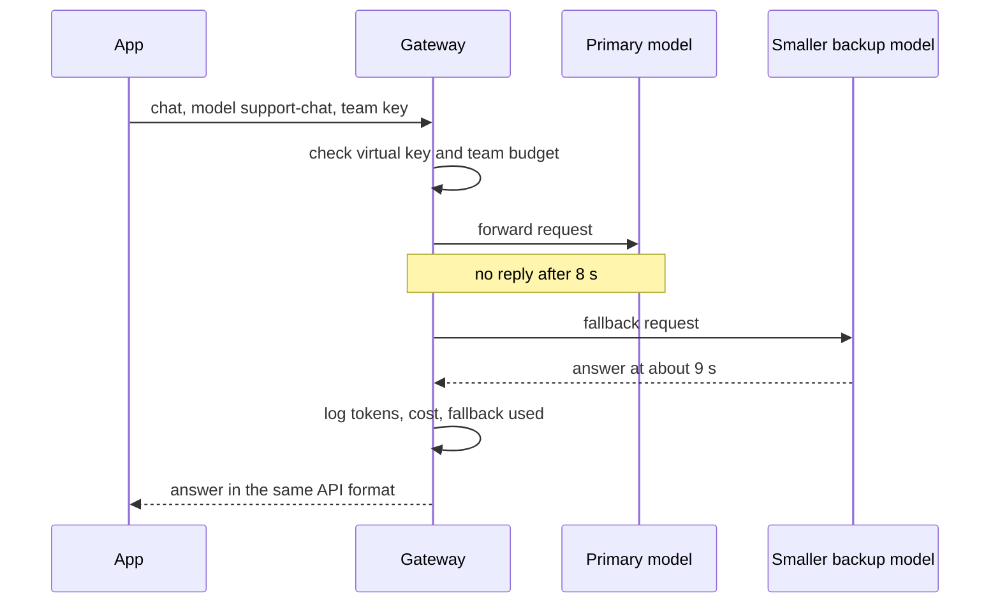

*Diagram:* App ek hi call karta hai; gateway budget check karta hai, 8 s pe primary chhodta hai, fallback karta hai, aur log karta hai taaki 3% fallback metrics me dikhe.

**Interview tip:** "Gateway kyun?" Bolo: "Providers ke paar ek API, central keys aur per-team budgets, retries aur fallbacks, cost logging aur PII redaction ki ek jagah. Aur kisi ek model vendor pe lock-in kam hota hai."

**Common galti:**
- Gateway ko bina high-availability setup ke single point of failure banana.
- Kamzor model pe silent fallback bina metric ke, quality girti hai aur kisi ko pata nahi kyun.

## Framework ke aas-paas vector DBs aur MCP

**Ek line me:** Kisi bhi framework ke bagal me do plug-in layers: tumhare data pe semantic search ke liye vector DB, aur tools jodne ke standard tareeke ki tarah MCP.

**Poora page:** [Vector Databases in Practice](31-vector-databases.md), [Vector Search in Postgres and Other Databases](32-vector-search-in-databases.md)

**Ye kyun chahiye:** Frameworks loop chalate hain, par agent utna hi kaam ka hai jitna data aur tools tak pahunch sake. Inhe framework se alag chunne se tum portable rehte ho.

**Aise socho:** Framework delivery app hai. Vector DB achhe index wala warehouse. MCP standard plug socket jisme har appliance fit hota hai.

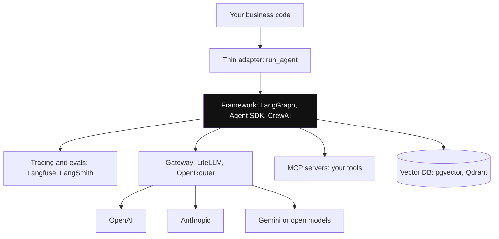

*Diagram:* Sirf highlighted box framework hai; tracing, gateway, MCP tools aur vector DB alag se chune jaate hain aur framework badalne pe bhi rehte hain.

**Kaise kaam karta hai, step by step:**

1. **Vector DB:** data ke chunks embed karo, vectors store karo, similarity se search karo. Options: pgvector (agar Postgres already chalate ho), Qdrant, Weaviate, Milvus, Pinecone, vectors ke saath Elasticsearch/OpenSearch. [Vector Databases](../05-db/11-vector.md) dekho.
2. Rule of thumb: kuch million vectors se kam aur already Postgres pe ho, to pgvector se shuru karo.
3. **MCP:** tool ek baar MCP server ki tarah likho; LangGraph, Claude Agent SDK, OpenAI Agents SDK, Pydantic AI aur baaki apne MCP clients se use kar sakte hain. [Tools, MCP & A2A](07-tools-mcp-a2a.md) dekho.
4. To framework badlo, tumhare MCP servers aur vector DB wahi rehte hain.

**Interview tip:** "Tools ko frameworks ke paar portable kaise rakhoge?" Bolo: "Unhe MCP servers ki tarah expose karo. Phir ek agent framework se doosre pe jaana client change hai, har tool ka rewrite nahi."

**Common galti:**
- Har tool teen framework-specific formats me teen baar likhna.

## ⭐ Kaise chunein

**Ek line me:** Apni problem me mushkil kya hai (control flow, data, typing, coding tasks, roles) aur constraints (model vendor, data residency, team skill) se shuru karo, phir sabse halka tool chuno jo cover kare.

**Ye kyun chahiye:** "Kaunsa framework use karoge?" asal me poochh raha hai "kya tum trade-offs pe reason kar sakte ho?". Saaf decision flow ye dikhata hai.

**Aise socho:** Auto, Ola aur metro me chunna. Chhoti trip, koi bhi. Saamaan ke saath lambi trip, cab. Rush hour, metro. Trip dekh ke chunte ho.

**Kaise kaam karta hai, step by step:**

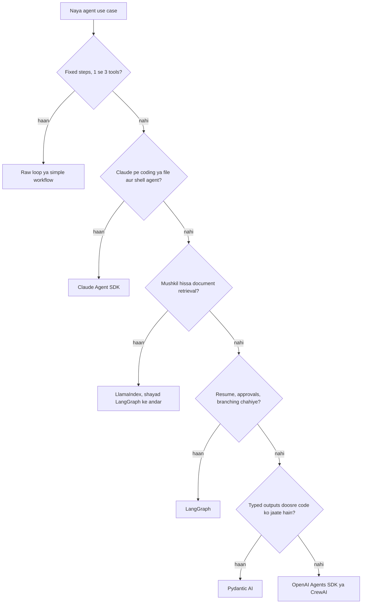

1. Kya ye sach me agent hai? Steps fixed hain to workflow ya raw loop kaafi hai.
2. Constraints check karo: kaunsa model vendor, data region me rehna chahiye kya, team pehle se kya jaanti hai?
3. Upar ke flow se chuno.
4. Pehle din se tracing (OTel-based) aur eval set jodo.
5. Ek se zyada team ya provider ho to aage gateway lagao.

**Interview me kya bolunga:** "Main raw loop aur lagbhag 50 real cases ke eval set se shuru karta hoon. Jab durable state, human approval ya branching chahiye, LangGraph pe jaata hoon kyunki har edge dekh aur test kar sakta hoon. Claude pe coding agent ho to Claude Agent SDK use karta hoon, uske tools dobara nahi banata. Tools MCP servers hain, tracing OpenTelemetry se Langfuse ya LangSmith me, aur model calls gateway se jaati hain. Is tarah framework sabse aasaani se badalne wala hissa hai."

**Interview tip:** "Kab framework use nahi karoge?" Bolo: "Single agent, 1–3 tools, lambe runs nahi, approvals nahi. Ya jab latency aur transparency sabse zaroori ho aur team ko har token debug karna ho. Raw loop 30 lines ka hai aur upgrade risk zero."

**Common galti:**
- GitHub stars ya pichhle conference talk se chunna.

## Framework churn aur lock-in

**Ek line me:** Agent frameworks tez badalte hain, to framework ko patli, badalne layak layer rakho aur asli value wale hisse khud own karo: prompts, tools, evals aur data.

**Ye kyun chahiye:** 2023–2025 me kai popular agent APIs deprecate ya rewrite hui (jaise LangChain ki purani agent classes ka LangGraph pe jaana, AutoGen ka 0.4 rewrite, Claude Code SDK ka naam Claude Agent SDK hona). Jin teams ne har jagah framework calls daali thi, unke upgrades dardnaak rahe.

**Aise socho:** Furnished flat kiraye pe lena. Unka sofa use karna theek hai. Par documents aur keemti saamaan apne bag me rakho, taaki ek din me shift ho sako.

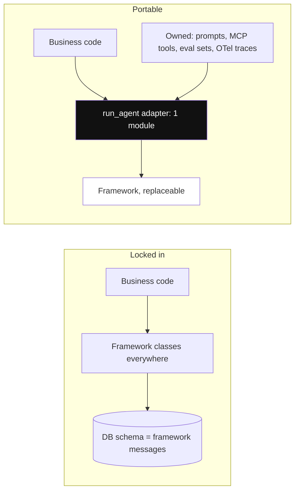

*Diagram:* Left me framework har file aur DB me ghus gaya hai; right me sirf adapter use chhoota hai, to swap matlab ek module dobara likhna aur evals chalana.

**Kaise kaam karta hai, step by step:**

1. **Thin adapter:** tumhara business code tumhara apna `run_agent(task) -> Result` call kare. Sirf ek module framework import kare.
2. **Prompts own karo:** unhe apne repo ya prompt store me plain text rakho, framework defaults me chhupe nahi.
3. **Tools own karo:** plain functions ya MCP servers, framework unhe wrap kare, unke liye likhe nahi.
4. **Evals aur data own karo:** datasets aur scorers tumhare repo me; traces OTel format me.
5. **Versions pin karo** aur changelogs padho; branch pe upgrade karo aur merge se pehle evals chalao.
6. Swap ek baar test karo: 20 eval cases doosre framework ya raw loop se chalao. Ek din lage to tum lock-in nahi ho.

**Interview tip:** "Lock-in se kaise bachoge?" Bolo: "Ek adapter module framework import karta hai. Prompts, tools (MCP ki tarah), eval datasets aur OTel traces hamare hain. Framework mar jaaye to adapter dobara likho aur evals chala do."

**Common galti:**
- Framework ki message classes ko apna database schema bana dena.
- Eval set nahi, to pata hi nahi chalta migration ne cheezein bigaadi ya nahi.

## Interview ke sawal

**Q: Raw loop ki jagah LangGraph kyun?**
A: Jab durable state (checkpointer), crash ke baad resume, `interrupt` se human approval, test karne layak explicit branching, aur streaming chahiye. 1–3 tools wale single agent ke liye raw loop simple hai.

**Q: LangGraph vs CrewAI?**
A: LangGraph low-level aur explicit hai: state aur edges tum design karte ho aur checkpointing milti hai. CrewAI high-level hai: roles, tasks aur crews, shuru karna fast, control kam. Approvals wale production flows LangGraph pe; jaldi role-based pipelines CrewAI pe.

**Q: Kab framework use nahi karoge?**
A: Chhote, fixed tasks; jab har token aur millisecond dikhna chahiye; jab team upgrade churn afford na kar sake. Step cap, tracing aur evals ke saath raw loop kaafi hai.

**Q: Vendors ke paar multi-agent run ko trace kaise karoge?**
A: Entry point se ek trace ID, OpenTelemetry context se har agent aur tool tak propagate (services ke paar `traceparent` header). Har LLM span pe `gen_ai.request.model` aur token counts jaise GenAI attributes, taaki OpenAI aur Claude calls kisi bhi OTel backend me ek tree me dikhein.

**Q: Evals ke liye kaunsa tool aur kyun?**
A: Constraint ke hisaab se: self-host aur data residency, Langfuse ya Phoenix; LangGraph team, LangSmith; bhaari experiment comparison, Braintrust; CI regression gates, promptfoo. Datasets apne repo me rakho taaki tool badla ja sake.

**Q: Claude Agent SDK Messages API se zyada kya deta hai?**
A: Claude Code harness: built-in file, shell aur search tools, automatic context compaction, subagents, MCP, hooks aur permissions. Raw API ke saath ye sab khud banana padta hai.

**Q: Handoff vs agent-as-tool?**
A: Handoff conversation ka control doosre agent ko de deta hai. Agent-as-tool me caller incharge rehta hai aur result wapas leta hai. Routing ke liye handoffs, delegated sub-tasks ke liye tools.

**Q: Pydantic AI kya jodta hai?**
A: Type safety: automatic retry ke saath validated structured outputs, aur tools ke liye dependency injection taaki test karna aasaan ho. Achha jab output APIs ya DB writes me jaata hai.

**Q: Providers ke aage gateway kyun?**
A: Ek API, central keys aur budgets, retries aur fallbacks, per-team cost, PII redaction, aur kisi provider pe kam lock-in. LiteLLM self-hosted, OpenRouter hosted, ya tumhare cloud ka gateway.

**Q: Team ne aise framework pe banaya jo ab deprecated hai. Kya karoge?** (trade-off)
A: Version freeze karo, phir patle adapter ke peeche le jao. Tools ko MCP ya plain functions me port karo, naye stack pe eval set chalao, aur flag se traffic dheere-dheere switch karo. Eval set hi ise safe banata hai.

**Q: Latency budget 2 second hai aur framework overhead jodta hai. Kya karoge?** (trade-off)
A: Pehle measure karo; framework overhead aam taur pe milliseconds hai, LLM calls seconds. Framework hatane se pehle LLM calls kam karo (kam steps, routing ke liye chhota model, parallel tools). Overhead sach me matter kare to us hot path ke liye raw loop.

**Q: Tools portable kaise rakhoge?**
A: Unhe plain functions ya MCP servers ki tarah likho, framework-specific wrappers ek jagah. Zyada major frameworks me MCP clients hain.

**Q: Kya multi-agent hamesha ek agent se behtar hai?**
A: Nahi. Har extra agent calls, latency aur khoya context jodta hai. Ek agent aur achhe tools se shuru karo; split tabhi karo jab tool count ya context size majboor kare.

**Q: Framework adopt karne se pehle use evaluate kaise karoge?**
A: Usme wahi chhota task banao, apna eval set chalao, traces padho, dekho persistence aur human approval kaise kaam karte hain, aur release history aur community size check karo. Phir chhodne ki cost estimate karo.

## Aage padho

- [LangGraph Core](02-langgraph-core.md)
- [Tools, MCP & A2A](07-tools-mcp-a2a.md)
- [AI Observability](10-agent-observability.md)
- [Evals for Agents](09-agent-evals.md)
- [LangChain](23-langchain.md)
- [LlamaIndex](24-llamaindex.md)
- [CrewAI](25-crewai.md)

## Checklist

- [ ] Main samjha sakta hoon ki framework raw agent loop pe kya jodta hai aur uski keemat kya hai.
- [ ] Main step cap wala raw tool-calling loop yaad se likh sakta hoon.
- [ ] Main LangGraph, Claude Agent SDK, OpenAI Agents SDK, Pydantic AI, CrewAI aur LlamaIndex ke liye ek line, ek strength aur ek weakness bata sakta hoon.
- [ ] Main LangGraph aur CrewAI compare karke bata sakta hoon kab kaunsa chunoonga.
- [ ] Main samjha sakta hoon ki OpenTelemetry se OpenAI aur Anthropic ke paar ek multi-agent run kaise trace karte hain.
- [ ] Main diye gaye constraint ke liye eval ya tracing tool chun ke justify kar sakta hoon.
- [ ] Main samjha sakta hoon ki teams providers ke aage LiteLLM jaisa gateway kyun lagati hain.
- [ ] Main apna framework decision flow samjha sakta hoon aur bata sakta hoon kab framework nahi lagana.
- [ ] Main samjha sakta hoon ki thin adapters, MCP tools aur apne evals lock-in kaise rokte hain.
