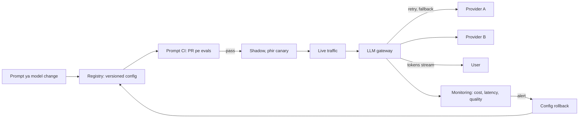
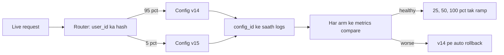
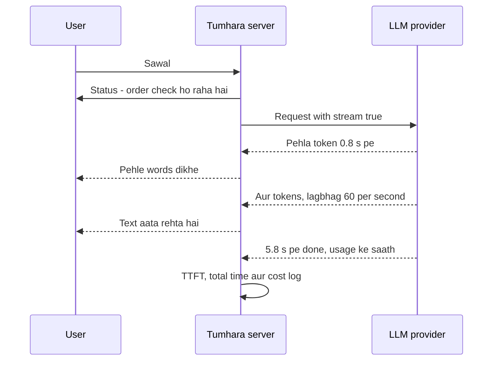

# LLMOps

LLMOps matlab production me LLM features ko roz chalane ki engineering: prompt aur model changes ko safely ship karna, provider fail ho to bhi feature chalu rakhna, aur bill aur latency ko control me rakhna. Interviewers ye isliye poochhte hain kyunki demo banana aasaan hai, production chalana mushkil. Wo sunna chahte hain ki tumne launch ke baad bhi LLM feature own kiya hai, sirf banaya nahi.

**Is page ke baad tum jawab de paoge:**
- "Prompt change ko safely ship kaise karte ho?"
- "Tumhara LLM provider down hai. Users ke saath kya hota hai?"
- "Traffic 10x ho jaaye to cost control me kaise rakhoge?"
- "Production me quality regression kaise pakadte ho jab koi error throw hi nahi hota?"
- "Naye model ka A/B test kaise karoge, aur kitna traffic chahiye?"
- "Chat product ke liye time to first token total time se zyada important kyun hai?"
- "Provider tumhara model 3 mahine me retire kar raha hai. Migration plan kya hai?"

## Pehle ye shabd samjho

| Shabd | Simple matlab |
|---|---|
| Token | Text ka ek tukda, English ke ~3/4 word jitna. Providers tokens se bill aur rate-limit karte hain. |
| Prompt version | Prompt ki numbered, saved copy, taaki pata ho exactly kaun sa text chala. |
| Model snapshot | Dated, frozen model ID (jaise `gpt-4.1-2025-04-14`) jo tumhare neeche se badlega nahi. |
| Golden set | Fixed test inputs ki list jinke sahi jawab pata hain, har change check karne ke liye. |
| LLM-as-judge | Ek doosri LLM call jo rubric ke hisaab se answer ko score karti hai, examiner ki tarah. |
| Canary | Naya version pehle real users ke chhote hisse ko bhejna, jaise 5%. |
| Shadow mode | Naya version real traffic pe chalana, par user ko sirf purana answer dikhana. |
| RPM / TPM | Requests per minute aur tokens per minute: provider ki account pe do limits. |
| Exponential backoff with jitter | Retries ke beech 0.5s, 1s, 2s, 4s ruko, random hisse ke saath taaki sab clients ek saath retry na karein. |
| Circuit breaker | Ek switch jo fail hoti service ko kuch der call karna band karta hai, phir dobara test karta hai. |
| LLM gateway | Ek internal service jisse saari LLM calls jaati hain; keys, retries, fallbacks aur cost wahi sambhalta hai. |
| TTFT | Time to first token: answer ka pehla word dikhne me kitna time laga. |
| p95 latency | 95% requests is number se tez hain; sabse slow 5% isse slow hain. |

## Big picture

Har LLM feature ko do loops wali pipeline socho. **Change loop**: prompt ya model change ek versioned config ke roop me save hota hai, CI (continuous integration, har pull request pe chalne wale tests) me evals se check hota hai, phir shadow aur canary se roll out hota hai. **Runtime loop**: har live request ek gateway se jaati hai jo rate limits, retries, fallbacks aur cost logging sambhalta hai, phir user tak stream hoti hai. Monitoring dono loops ko dekhti hai. Regression dikhe to config rollback karte ho, code nahi.



Har box neeche ek section hai. Shuru karte hain is baat se ki ye normal ops se alag kyun hai.

## LLM ops normal ops se alag kyun

**Ek line me:** LLM feature bina kisi error ke kharab ho sakta hai, cost text ki length pe chalti hai, aur model khud tumhare neeche se badal sakta hai.

**Ye kyun chahiye:** Normal ops maanta hai code deterministic hai: same input, same output, aur bug exception ya 500 ban ke dikhta hai. LLM features ye tod dete hain. Ek prompt edit 10% answers kharab kar sakta hai, aur har call phir bhi HTTP 200 deti hai. Tumhare standard dashboards green rehte hain aur users pareshaan.

**Aise socho:** Normal service vending machine hai. B4 dabao, hamesha same chips, ya saaf dikhe ki atak gayi. LLM feature dhabe ka cook hai. Plate hamesha aati hai, par kisi din dal me namak zyada. Koi bug file nahi karta. Customers bas aana band kar dete hain.

**Step by step kaise kaam karta hai:** chaar fark aur har ek tumse kya banwata hai.

| Fark | Kya hota hai | Tum kya banate ho |
|---|---|---|
| Non-determinism | Same input, alag outputs, temperature 0 pe bhi (batching aur hardware chhote fark laate hain) | Evals jo kai samples score karein, exact-match tests nahi |
| Silent quality regressions | Kharab answers bhi HTTP 200 dete hain | Quality metrics: judge scores, thumbs, escalation rate |
| Provider changes | `latest` jaise aliases badalte hain, models deprecate hote hain, outages hote hain | Pinned snapshots, fallbacks, migration process |
| Token-based cost | Cost prompt length, output length aur steps se badhti hai, sirf request count se nahi | Cost per task, token budgets, spend alerts |

Silent regression ka worked example:
1. Team cost bachane ke liye system prompt 1,800 se 1,200 tokens kar deti hai.
2. Error rate: pehle 0.2%, baad me 0.2%. Latency: thodi better. Har normal dashboard khush.
3. Hatayi gayi lines me tha "refund promise karne se pehle hamesha order ID poochho".
4. Ek hafte me human escalation rate 6% se 9% ho jaata hai. Bas yahi ek signal hai.
5. Dashboard pe quality metric na ho to hafton tak koi dono ko jodta nahi.

**Interview tip:** "LLMs operate karne me kya alag hai?" Bolo: "Failures silent aur statistical hote hain. Isliye main quality ko ek metric ki tarah treat karta hoon, apne dashboards aur alerts ke saath. Jo kuch badal sakta hai sab pin karta hoon, aur cost per task naapta hoon kyunki bill tokens chalate hain, requests nahi."

**Common galti:**
- Sirf error rate aur latency pe bharosa. Ye outages pakadte hain, kharab answers nahi.
- LLM output ke liye exact-string tests likhna. Wo randomly fail hote hain aur team CI ko ignore karna seekh jaati hai.

## ⭐ Prompt versioning aur prompt registry

**Ek line me:** prompt code hai, isliye use version karo, review karo, aur model aur params ke saath ek config ki tarah pin karo jise rollback kar sako.

**Ye kyun chahiye:** Behaviour chaar cheezon se milke banta hai: prompt text, model snapshot, parameters (temperature, `max_tokens`) aur tool definitions. Inme se ek bhi bina record ke badle, to tum jawab nahi de sakte "jab ye kharab answer aaya tab kya chal raha tha?". 30 second me rollback bhi nahi kar sakte.

**Aise socho:** Restaurant chain ka recipe card. Card pe recipe version, kaun sa masala brand, kitne gram, aur aag pe kitni der. Sirf masala brand badla aur card update nahi kiya, to har branch ki dal alag taste karegi aur kisi ko pata nahi kyun.

**Step by step kaise kaam karta hai:**
1. Prompt + model snapshot + params ko ek **config** me bundle karo jiska ID ho, jaise `support_reply@v15`.
2. Use git me rakho (prompts as code) ya managed **prompt registry** me (version history aur UI wala database).
3. App prompt hardcode nahi karta. Runtime pe maangta hai "`production` label wala version".
4. Har trace aur log line me `config_id=support_reply@v15` record hota hai, taaki har answer exact config tak trace ho.
5. Rollback = `production` label ko v15 se wapas v14 pe le jao. Koi redeploy nahi. Lagbhag 30 second.

Git me rakhi config file:

```yaml
# prompts/support_reply.yaml  (baaki code ki tarah pull request me review hoti hai)
id: support_reply
version: 15
model: gpt-4.1-mini-2025-04-14     # pinned snapshot, kabhi "latest" nahi
params:
  temperature: 0.2
  max_tokens: 400
tools: [get_order, create_ticket]
template: |
  You are the support assistant for an online grocery app.
  Always ask for the order ID before discussing refunds.
  Customer message: {{message}}
```

**Code kya karta hai:**
- Model ID, parameters, tools aur template ko ek reviewed file me rakhta hai, taaki sab saath badlein.
- Dated snapshot pin karta hai, taaki provider update chupke se behaviour na badle.
- Version number deta hai jo har trace aur har eval report me jaata hai.
- Prompt change ka diff code review me padhne layak banata hai.

**Prompts as code vs managed registry:**

| | Prompts git me | Managed registry (jaise Langfuse, LangSmith, PromptLayer) |
|---|---|---|
| Kaun edit karta hai | engineers, pull requests se | engineers aur product/ops log, UI se |
| Review | normal code review | tool ke andar approval flow |
| Rollout speed | deploy chahiye (ya config sync) | label switch, seconds me live |
| Risk | non-engineers ke liye slow | jab tak wire na karo, edits CI skip kar sakte hain |
| Accha default | chhoti teams, prompts code se jude | bahut prompts, non-engineers wording tune karte hain |

Kai teams dono karti hain: git source of truth, aur CI approved versions registry me publish karta hai.

**Interview tip:** "Prompts version kaise karte ho?" Bolo: "Prompt, model snapshot, params aur tools milke ek immutable config banate hain jiska ID hai. App production label wala config padhta hai. Har trace config ID log karta hai. Rollback label move hai, deploy nahi."

**Common galti:**
- Prompt version karna par model ko floating alias pe chhod dena. Aadha config abhi bhi unpinned hai.
- Registry UI me log bina eval gate ke live prompt edit karein. Ye untested code production me deploy karna hai.

## ⭐ Prompt CI: har pull request pe evals

**Ek line me:** har prompt ya model change CI me golden set pe chalta hai, aur quality, cost ya latency threshold cross kare to merge block hota hai.

**Ye kyun chahiye:** Ek complaint fix karne wala prompt edit aksar paanch doosre cases tod deta hai. Har change pe insaan 300 cases haath se dobara check nahi kar sakta. CI "is change ne kuch kharab kiya?" ko merge se pehle automatic haan/na bana deta hai.

**Aise socho:** Board exam ka fixed question paper. Har naya batch (har prompt version) wahi paper likhta hai. Class average gire, ya paper me bahut time lage, to batch promote nahi hota.

**Step by step kaise kaam karta hai:**
1. Ek **golden set** rakho: 200–500 real inputs (anonymized), common cases, edge cases aur purane bugs. Har ek ka reference answer ya rubric.
2. `prompts/` chhune wali pull request pe CI naya config har case pe chalata hai.
3. **Scorers:** pehle saste code checks (valid JSON, required fields, banned phrases nahi), phir likhe rubric wala **LLM judge** jo har case pe pass/fail deta hai.
4. **Budgets:** CI average tokens, cost per case aur p95 latency bhi record karta hai.
5. **Gate:** same cases pe current production config se compare karo. Pass rate noise margin se zyada gire, ya cost, maan lo, 15% se zyada badhe, to merge block.
6. CI pull request pe comment karta hai: pass rate, cost, latency, aur un cases ki list jo pass se fail hue.

GitHub Actions style flow:

```yaml
# .github/workflows/prompt-ci.yml
name: prompt-ci
on:
  pull_request:
    paths: ["prompts/**", "app/llm/**"]
jobs:
  evals:
    runs-on: ubuntu-latest
    steps:
      - uses: actions/checkout@v4
      - uses: actions/setup-python@v5
        with: { python-version: "3.12" }
      - run: pip install -r requirements.txt
      - name: Run golden set against PR config and production config
        run: python evals/run.py --cases evals/golden.jsonl --samples 3 --out results.json
        env: { OPENAI_API_KEY: "${{ secrets.OPENAI_API_KEY }}" }
      - name: Gate on quality, cost and latency
        run: python evals/gate.py results.json --max-drop 0.03 --max-cost-rise 0.15 --max-p95-ms 4000
```

**Code kya karta hai:**
- Sirf tab chalta hai jab prompt ya LLM code badle, taaki normal pull requests tez aur saste rahein.
- Har case 3 baar chalata hai (`--samples 3`) taaki randomness smooth ho.
- Same cases pe pull request config ko production se compare karta hai.
- Quality 3 points se zyada gire, cost 15% se zyada badhe, ya p95 4 second se upar jaaye to job fail, yaani merge block.

**Flaky evals kaise sambhalein.** LLM output random hai, isliye same prompt ek run me 86% aur agle me 89% score kar sakta hai. Scores ko error bars wale estimates ki tarah dekho.

1. **Noise kitna bada hai?** 200 cases aur 88% pass rate pe standard error √(0.88 × 0.12 / 200) ≈ 0.023. 95% confidence interval lagbhag ±4.5 points. Yaani 200 cases pe 2-point drop kuch prove nahi karta.
2. **Paired compare karo, raw nahi.** Purana aur naya same cases pe chalao. Sirf flip hue cases gino. "9 cases pass→fail gaye, 3 fail→pass" do averages se kahin zyada batata hai.
3. **Ek se zyada baar sample karo.** Har case 3–5 baar chalao aur majority ya mean lo. Random flips kam hote hain.
4. **Judge ko stable banao.** Temperature 0, fixed judge model snapshot, specific rubric, aur 1–10 score ki jagah pass/fail.
5. **Set badhao.** Chhote changes pakadne hain to zyada cases chahiye. Error bar aadha karne ke liye 4x cases.

**Interview tip:** "Eval score 2 points gira. Release block karoge?" Bolo: "Pehle dekhta hoon ki ye noise se bahar hai ya nahi. 200 cases pe interval ~±4.5 points hai, to paired flips dekhta hoon aur zyada samples ke saath rerun karta hoon. Specific important cases flip hue to block. Random spread hai to nahi."

**Common galti:**
- Evals sirf bade launches se pehle haath se chalana. Chhote roz ke prompt edits phir bina test ke jaate hain.
- Aisa LLM judge use karna jo kabhi human labels se check nahi hua. Pehle ~50–100 human-labelled cases pe judge agreement check karo. Dekho [Evals for Agents](09-agent-evals.md).

## ⭐ A/B tests aur canary rollouts

**Ek line me:** offline evals batate hain ki change shayad safe hai; real users pe canary ya A/B test batata hai ki wo sach me better hai.

**Ye kyun chahiye:** Golden set reality ka chhota, purana sample hai. Real users wo poochhte hain jo tumne kabhi nahi dekha, Hinglish me, typos ke saath, raat 2 baje. Kuch effects sirf live dikhte hain: users ka sawal dobara poochhna, thumbs-down dabana, ya human maangna. Inhe dekhne ke liye real traffic chahiye, par controlled tarike se.

**Aise socho:** Swiggy pe naya item. Pehle kitchen chakhta hai (offline eval). Phir purani dish ke saath banta hai par serve nahi hota (shadow). Phir ek city ke 5% orders me jaata hai (canary). Ratings theek rahein to poore menu me.

**Step by step kaise kaam karta hai:**
1. **Shadow:** live requests purane aur naye dono configs ko bhejo. Users ko sirf purana answer dikhe. Dono log karo, aur offline judge se score karo. Naye version ke write tools (refunds, emails) band rakho. Cost: shadow ke dauraan double calls ka paisa.
2. **Canary:** 1–5% users ko naye config pe route karo. Sticky split use karo: user ID ka hash, taaki ek user hamesha same version dekhe.
3. **Guardrail metrics** (koi bhi set limit se zyada bigde to roko): task success rate, thumbs-down rate, human escalation rate, cost per task, p95 latency, error rate, safety filter triggers.
4. **Ramp up:** 5% → 25% → 50% → 100%, har step pe kaafi data ka wait karke.
5. **Auto-rollback:** koi guardrail metric limit cross kare to router bina insaan ka wait kiye traffic purane config pe le jaata hai.



**Sample size ki intuition.** Chhote fark ke liye bahut traffic chahiye.

- Rule of thumb: users per arm ≈ 16 × p × (1 − p) / δ², jahan p base rate hai aur δ wo change jo pakadna hai. Isse lagbhag 95% confidence aur 80% power milti hai.
- Task success 80%, 2-point change pakadna hai (80% → 82%): 16 × 0.8 × 0.2 / 0.02² = 16 × 0.16 / 0.0004 = **6,400 users per arm**.
- 5-point change pakadna hai: 16 × 0.16 / 0.0025 ≈ **1,000 per arm**.
- Thumbs data kam hota hai. Agar sirf 3% users thumbs dabate hain, to utne hi votes ke liye ~33x traffic chahiye. Isliye wo metrics prefer karo jo har session me hote hain, jaise escalation rate ya "user ne dobara poochha".

**Offline vs online:**

| | Offline eval | Online A/B ya canary |
|---|---|---|
| Data | fixed golden set | real, current traffic |
| Speed | minutes | din |
| Users ko risk | koi nahi | chhota, traffic % se limited |
| Kya naapta hai | known cases pe correctness | real outcomes: success, thumbs, escalation, cost |
| Kya pakadta hai | known cases pe regressions | naye input types, user behaviour changes |

**Interview tip:** "Model ka A/B test kaise karoge?" Bolo: "Pehle offline evals, phir shadow taaki live inputs pe bina user risk compare ho, phir user ID se sticky canary. Primary metric aur guardrail metrics pehle se define karta hoon, sample size nikaalta hoon, aur auto-rollback thresholds set karta hoon. Sirf quality nahi, cost per task aur p95 bhi compare karta hoon."

**Common galti:**
- User ki jagah request se split karna. Ek user ko ek chat me do alag personalities dikhti hain.
- Graph accha dikhte hi test rok dena ("peeking"). Sample size pehle decide karo.

## ⭐ Reliability: rate limits, retries aur circuit breakers

**Ek line me:** LLM APIs slow, rate-limited shared services hain, isliye har call ko timeout, samajhdar retries aur ek breaker chahiye jo fail hote provider pe hathoda chalana band kare.

**Ye kyun chahiye:** Provider errors normal hain, rare nahi. Limits hit karne pe `429 Too Many Requests` milega, aur busy hours me `500`, `503` ya overloaded errors. Ek call 60 second tak latak bhi sakti hai. Handling na ho to ek slow provider tumhare saare worker threads ko rok deta hai, aur poora app slow ho jaata hai.

**Aise socho:** Subah 10 baje IRCTC pe Tatkal booking. Sab har second refresh dabayein to site aur bigadti hai. Har baar thoda zyada, random pause ke saath ruko, to chance bhi better aur site bhi jaldi theek hoti hai.

**Step by step kaise kaam karta hai:**

1. **Apni limits jaano.** Provider har account ko **RPM** (requests per minute) aur **TPM** (tokens per minute) deta hai. Example: 500 RPM aur 2,00,000 TPM. Har request 2,000 tokens ki hai to TPM sirf 100 requests per minute allow karta hai. Asli limit TPM hai, RPM nahi.
2. **Apni taraf traffic shape karo.** Gateway me har provider ke liye token bucket rakho. User-facing chat se pehle low-priority kaam (batch jobs, background summaries) ko queue ya shed karo. Kuch providers tumhare maange `max_tokens` ko TPM me ginte hain, to 300 chahiye to 4,000 mat maango.
3. **Har call pe timeout.** Connect timeout (~5s) aur expected output se juda total timeout (400 output tokens ~50 tokens/s pe, ~15–20s). Streaming me N second tak koi token na aaye to bhi timeout.
4. **Sirf retryable cheez retry karo.** 408, 429, 500, 502, 503, 504, timeouts aur connection errors retry karo. 400 (bad request), 401 (galat key) ya "context too long" kabhi retry mat karo. Wo har baar fail honge.
5. **Exponential backoff with jitter.** `random(0, min(cap, base × 2^attempt))` ruko. Base 0.5s ke saath: attempt 0 tak 0.5s, attempt 1 tak 1s, attempt 2 tak 2s. Randomness ("full jitter") 1,000 clients ko same millisecond me retry karne se rokti hai.
6. **`Retry-After` maano.** 429 pe providers aksar `Retry-After` header (seconds me) bhejte hain. Apne guess ki jagah utna ruko.
7. **Total cap karo.** 3 attempts, aur ek total deadline. User ka retry ke liye 40 second wait karna, jaldi fallback se bura hai.
8. **Circuit breaker.** Ek provider ki last 20 calls me 50% se zyada fail hui, to breaker open karo: 30–60s tak waha koi call nahi, seedha fallback. Phir ek trial call jaane do (half-open). Chal gayi to breaker close. Poori outage timeline [Agents in Production](12-agents-in-production.md) me hai.

**Side effects ke liye idempotency.** Padhne ke liye retries safe hain. Karne ke liye khatarnaak. Agent ne `issue_refund` call kiya aur response timeout ho gaya, to retry do baar refund kar sakta hai.
- Har side-effect wali tool call ko ek **idempotency key** do, jaise `f"{run_id}:{step_id}"`.
- Payments ya ticket API key store karti hai. Same key ke saath doosri call dobara action karne ki jagah pehla result lautati hai.
- Example: run `r42`, step 3, key `r42:3`. Pehli call ₹499 refund karti hai aur wapas aate time timeout. Retry phir `r42:3` bhejta hai; API kehti hai "already done, refund id RF-881". Customer ko ₹499 ek hi baar milte hain.

**Request hedging.** Slow tail ke liye, pehli request slow ho to doosri bhejo, aur jo pehle aaye wo use karo.
- Example: tumhara p95 time to first token 1.5s hai. 2s tak first token na aaye to same request backup model ko bhejo aur haarne wali cancel karo.
- Tail latency kam hoti hai par extra tokens lagte hain. Sirf time to first token pe hedge karo, sirf read-only calls ke liye, aur cap karo (maan lo, max 5% requests hedge hon).

**Interview tip:** "Jitter kyun add karte ho?" Bolo: "Jitter ke bina, jo clients ek hi pal me fail hue wo ek hi pal me retry karte hain, to provider ko load ki synchronized lehrein dikhti hain aur wo fail hota rehta hai. Jitter retries ko faila deta hai taaki wo recover kar sake."

**Common galti:**
- SDK me retry, phir apne code me, phir gateway me. Outage me ek request ke liye 3 × 3 × 3 = 27 calls. Sirf ek layer me retry karo.
- Paisa ya email bhejne wali tool call ko bina idempotency key retry karna.

## ⭐ LLM gateway se fallbacks

**Ek line me:** har LLM call ek gateway se bhejo jo fallback chain jaanta hai, taaki ek model ya provider fail ho to agla jawab de.

**Ye kyun chahiye:** Har provider ke outages hote hain. Product ek provider ke ek model pe tika hai to unka outage tumhara outage hai. Retry aur fallback logic har service me daalne ka matlab 10 thodi-thodi alag, buggy copies. Central gateway ye ek baar karta hai, aur keys, budgets aur cost logs ki ek jagah bhi deta hai.

**Aise socho:** Phone me do SIM. Jio me signal nahi to call apne aap Airtel se jaati hai. Tum alag dial nahi karte; phone sambhal leta hai.

**Step by step kaise kaam karta hai:**
1. Saari services gateway ko logical naam se call karti hain, jaise `model="support-chat"`, provider ka model ID nahi.
2. Gateway use ek chain se map karta hai: primary `provider A / model X` → fallback `provider B / model Y` → last resort `chhota, sasta model` ya canned message.
3. Retryable error (1–2 retries ke baad) ya open circuit breaker pe gateway agla entry try karta hai.
4. Primary se 429 aaye to, agar latency cost se zyada important hai, wo bina ruke seedha fallback pe ja sakta hai.
5. Har fallback model ka **apna prompt variant** hota hai, CI me tested. Ek model ke liye tune hua prompt doosre pe aksar kharab chalta hai.
6. Gateway log karta hai kis entry ne jawab diya. Fallback usage me spike ek alert hai.

Tools: LiteLLM (open-source proxy aur Python library, bahut providers ke liye ek OpenAI-style API, saath me fallbacks, retries, per-key budgets aur cost tracking), ya tumhare cloud provider ka managed gateway. Kai model families host karne wale cloud platforms ek hi account me cross-provider fallback aasaan bana dete hain.

**Fallback models me kya alag hota hai (ye sab test karo):**

| Fark | Kyun matter karta hai |
|---|---|
| Context window | Jo lamba prompt model X me fit hota hai, model Y me shayad na ho |
| Tool-call aur JSON behaviour | Fallback tumhara output parser tod sakta hai |
| Tokenizer | Same text, alag token count, alag cost |
| Quality | Fallback answers kamzor ho sakte hain; zaroorat ho to users ko batao |
| Data policy aur region | Fallback provider ko bhi same compliance rules follow karne chahiye |

**Interview tip:** "Provider down hai. Kya hota hai?" Bolo: "Calls timeout hoti hain ya 5xx deti hain. Gateway jittered backoff ke saath ek-do baar retry karta hai, failure rate threshold cross kare to circuit breaker open hota hai, aur traffic doosre provider ke fallback model pe jaata hai jiska apna tested prompt hai. Users ko thode alag answers dikhte hain, errors nahi. Fallback rate pe alerts fire hote hain. Sab fail ho to graceful message ya human handoff, aur lambe jobs baad me apne checkpoint se resume hote hain."

**Common galti:**
- Aisa fallback jo kabhi test nahi hua. Pehli baar outage me chalta hai, aur JSON parser tod deta hai.
- Aise provider pe fallback jo us customer ke contracts ya data rules me allowed nahi.

## ⭐ Python me resilient client

**Ek line me:** ek chhota wrapper jo kisi bhi OpenAI-compatible API ke around timeout, jittered retries, provider fallback aur per-request cost logging jodta hai.

**Ye kyun chahiye:** Pichle do sections ke reliability rules ek jagah dikhata hai. Production me LiteLLM jaisa gateway ye tumhare liye karta hai, par interviewers aksar sketch karne bolte hain, aur ek baar likhne se rules yaad reh jaate hain.

**Aise socho:** Delivery agent ka routine: darwaze pe fixed time ruko, badhte gap ke saath dobara bell bajao, phir peeche ka gate try karo, aur har delivery aur uska petrol kharcha logbook me likho.

**Step by step kaise kaam karta hai:**
1. Fallback order me routes ki list. Har ek me client, model ID aur per 1M tokens prices.
2. Har route ke liye 3 baar tak try.
3. Success pe `usage` field se cost nikaalo aur latency ke saath log karo.
4. Retryable error pe `Retry-After` ho to utna ruko, warna jittered backoff, phir retry.
5. Non-retryable error pe turant raise. Saare routes fail hon to saaf error raise.

```python
import logging, random, time
from openai import OpenAI, APIStatusError, APITimeoutError, APIConnectionError

# Fallback order. Prices per 1M tokens hain aur sirf illustrative.
ROUTES = [
    {"name": "primary", "model": "gpt-4.1-mini-2025-04-14", "in": 0.40, "out": 1.60,
     "client": OpenAI(timeout=20.0, max_retries=0)},   # SDK retries band: retry yahan karte hain
    {"name": "backup", "model": "backup-model-v2", "in": 0.50, "out": 2.00,
     "client": OpenAI(base_url="https://backup.example.com/v1", api_key="KEY",
                      timeout=20.0, max_retries=0)},
]
RETRYABLE = {408, 429, 500, 502, 503, 504}

def backoff(attempt, base=0.5, cap=8.0):
    return random.uniform(0, min(cap, base * 2 ** attempt))   # full jitter

def chat(messages, attempts=3):
    for r in ROUTES:
        for i in range(attempts):
            try:
                t0 = time.monotonic()
                resp = r["client"].chat.completions.create(
                    model=r["model"], messages=messages, max_tokens=400)
                u = resp.usage
                cost = (u.prompt_tokens * r["in"] + u.completion_tokens * r["out"]) / 1e6
                logging.info("llm route=%s ms=%.0f in=%d out=%d cost_usd=%.6f", r["name"],
                             (time.monotonic() - t0) * 1000, u.prompt_tokens, u.completion_tokens, cost)
                return resp.choices[0].message.content
            except (APITimeoutError, APIConnectionError):
                wait = backoff(i)
            except APIStatusError as e:
                if e.status_code not in RETRYABLE:
                    raise                                       # 400/401: retry se kuch nahi hoga
                ra = e.response.headers.get("retry-after")
                wait = float(ra) if ra and ra.isdigit() else backoff(i)
            if i < attempts - 1:
                time.sleep(wait)
    raise RuntimeError("all LLM routes failed")
```

**Code kya karta hai:**
- SDK ke built-in retries band karta hai (`max_retries=0`) taaki retries exactly ek layer me hon.
- Har call pe 20-second timeout, taaki latka hua provider worker ko hamesha ke liye na roke.
- Sirf retryable errors retry karta hai, provider `Retry-After` bheje to utna rukta hai, warna full-jitter backoff.
- 3 failed attempts ke baad backup route pe jaata hai, `base_url` se kisi bhi OpenAI-compatible endpoint ko use karke.
- Har successful call ka route, latency, tokens aur dollar cost log karta hai, jo cost dashboard ko feed karta hai.

**Interview tip:** "Production ke liye kya jodoge?" Bolo: "Har route ka circuit breaker, saare attempts pe total deadline, async calls, tool calls pe idempotency keys, fallback ke liye per-model prompt variant, aur cost attribution ke liye har log line pe config ID, user aur tenant tag."

**Common galti:**
- Fallback pe jaane se pehle last attempt ke baad sleep karna. Sirf latency badhti hai. Code ise skip karta hai.
- Cost provider ke `usage` numbers ki jagah string length se nikaalna.

## ⭐ Cost engineering

**Ek line me:** har complete task ki cost naapo, har level pe token budgets lagao, aur traffic badhne se pehle caching, batching aur routing se bill kaato.

**Ye kyun chahiye:** Ek user task ke liye agent 4–8 LLM calls kar sakta hai, saath me retries aur guardrail checks. "Average cost per call" ye chhupa deta hai. 10x traffic pe jo bill theek tha wo board-level problem ban jaata hai. Ek bug, jaise agent loop, raat bhar me hazaron dollar bhi jala sakta hai. Gehre levers [Cost & Latency](11-cost-latency.md) me hain.

**Aise socho:** Auto-rickshaw ki sawari. Per kilometre meter (cost per call) se tumhe matlab nahi. Ghar se station tak ka total kiraya (cost per task) matter karta hai, detour aur waiting time ke saath.

**Step by step kaise kaam karta hai:** ek support task ka worked example (illustrative prices: bada model $3 input / $15 output per 1M tokens, chhota model $0.30 / $1.20).

| Call | Model | Tokens in / out | Cost |
|---|---|---|---|
| Intent router | chhota | 500 / 10 | $0.00016 |
| Agent step 1 | bada | 4,000 / 250 | $0.01575 |
| Agent step 2 | bada | 4,000 / 250 | $0.01575 |
| Agent step 3 (final answer) | bada | 4,000 / 250 | $0.01575 |
| Answer pe safety check | chhota | 800 / 5 | $0.00025 |
| Retries (~5% extra) | mixed | | $0.00238 |
| **Total per task** | | | **≈ $0.050** |

1. Per call ye $0.01 dikhta hai. Per task $0.05 hai. Budget aur pricing task se karo.
2. 2 lakh tasks per day pe: $0.05 × 2,00,000 = **$10,000/day**. 10x traffic pe: $100,000/day.
3. **Prompt caching:** har step ke 4,000 input tokens me se 3,000 fixed prefix hain (system prompt + tool definitions). Cached input aksar normal ka ~10% hota hai. Per step: 1,000 × $3 + 3,000 × $0.30 = $3,900 per 1M, yaani $0.012 ki jagah $0.0039. Bachat $0.0081 × 3 steps ≈ **$0.024 per task**. Task ~$0.026 pe aa jaata hai.
4. **Model routing:** router 40% simple tasks ("mera order kahan hai") ko ~$0.002 wale one-step small-model flow pe bheje, to average aur girke lagbhag $0.017.
5. **Batch API:** async kaam (nightly evals, purane tickets tag karna) ke liye providers ke batch APIs ~50% saste hain aur 24 ghante me lautate hain. Live users ke liye kabhi nahi.

**Har level pe token budgets:**

| Level | Example limit | Hit hone pe |
|---|---|---|
| Per request | `max_tokens=400`, input 8k tak trim | answer kat jaata hai ya context summarize hota hai |
| Per task / run | max 8 steps, total max 40k tokens | agent rukta hai aur best answer deta hai ya handoff |
| Per user per day | $2 | polite "limit reached" ya sasta model |
| Per tenant per month | unke plan se, jaise 50M tokens | 80% pe account owner ko alert, 100% pe throttle |
| Global per hour | forecast ka 1.5x | on-call ko page |

**Spend monitor karna:**
- Har call ko feature, config ID, user aur tenant se tag karo. Phir per feature aur per tenant cost ek simple group-by hai.
- Sirf monthly total pe nahi, spend rate pe alert: "last hour ka spend > pichle hafte ke same hour ka 1.5x".
- Time ke saath tokens per task dekho. Dheere-dheere badhna aksar matlab prompts ya retrieved context phool rahe hain.

**Interview tip:** "10x traffic pe cost control kaise?" Bolo: "Pehle mujhe cost per task pata ho aur kaun sa feature aur tenant use chala raha hai. Phir safe levers: stable prefix ke saath prompt caching, context trimming, async ke liye batch API. Phir easy tasks ko chhote model pe routing, evals se check karke. Aakhir me hard limits: max steps, per-user aur per-tenant budgets, aur spend-rate alerts taaki loop bug raat bhar paisa na jalaye."

**Common galti:**
- Finance ko average cost per call report karna. Agents ke liye ye 4–8x kam ginta hai.
- Prompt ke top pe timestamp ya user ka naam daalna. Har call pe cached prefix toot jaata hai.

## ⭐ Streaming aur latency

**Ek line me:** tokens bante hi stream karo, taaki poora answer kai second le tab bhi user ko answer ek second se kam me shuru hota dikhe.

**Ye kyun chahiye:** LLM apna answer ek-ek token likhta hai. 60 tokens per second pe 300-token answer banne me 5 second lagte hain. Poora intezaar karo to user 5–6 second spinner ghoorta hai aur sochta hai app toot gaya. Streaming ke saath wo 0.8 second pe padhna shuru kar deta hai.

**Aise socho:** Cricket commentator over khatam hone ka wait karke chhe ki chhe balls describe nahi karta. Wo ball by ball bolta hai. Action hote hi sunai deta hai.

**Step by step kaise kaam karta hai:**
1. **Sahi cheezein naapo.** **TTFT** (time to first token), **tokens per second** (decode speed, hosted models ke liye aksar lagbhag 50–150), aur total time.
2. **Total time ≈ TTFT + output tokens ÷ tokens per second.** Example: TTFT 0.8s, 300 tokens 60 tokens/s pe = 5s. Total ≈ 5.8s. Users 0.8s feel karte hain, 5.8s nahi.
3. **SSE pe stream karo** (server-sent events: ek lambi HTTP response jo chhote `data:` chunks bhejti hai). Provider tumhare server ko stream karta hai, aur tumhara server browser ko.
4. **TTFT kam karo:** chhote prompts, prompt caching (cached prefix processing bhi tez karta hai), paas ka region, pehle step ke liye chhota model.
5. **Total time kam karo:** chhote outputs (`max_tokens`, "3 lines me jawab do"), kam agent steps, aur ek ke baad ek ki jagah parallel tool calls.
6. **Perceived latency tricks:** tools chalte waqt progress dikhao ("Aapka order check kar rahe hain…"), partial answers stream karo, aur pehla kaam ka sentence pehle dikhao.
7. **Har percentile ka budget set karo.** Chat feature ke example targets: TTFT p50 < 0.8s, p95 < 2s; total p95 < 8s; p99 < 15s, 30s pe hard timeout.



**Average nahi, p95 aur p99 kyun?** 2s ka average chhupa sakta hai ki 20 me se 1 user 12s wait karta hai. Wahi users complain karte hain aur chhod dete hain. Kai steps wale agent tasks ki tail khaas taur pe lambi hoti hai, kyunki har step apna variance jodta hai.

**Interview tip:** "TTFT total time se zyada important kyun?" Bolo: "Users speed is se judge karte hain ki kuch hona kab shuru hua. Pehle words ek second se kam me aa jaayein to streaming 6-second answer ko bhi tez feel karata hai. Par agents me final answer ka TTFT usse pehle ke saare tool steps include karta hai, isliye main progress bhi dikhata hoon aur steps kam karta hoon."

**Common galti:**
- Provider se stream karna par proxy ya load balancer me buffer karna, to browser ko phir bhi sab ek saath milta hai. Proxy buffering settings check karo.
- Bhool jaana ki streamed responses ko bhi usage logging chahiye. Kai APIs usage sirf last chunk me bhejti hain, kabhi sirf maangne pe.

## Production me monitoring

**Ek line me:** health, cost aur quality ke dashboards, saath me drift detection aur alerts, taaki kharab answers ka trend users ke tweet karne se pehle pata chale.

**Ye kyun chahiye:** Upar dekha, LLM failures silent hote hain. Aise signals chahiye jo quality ke saath hilein. Tracing tools [AI Observability](10-agent-observability.md) me hain; ye section is baare me hai ki screen pe kya rakhna hai aur kab kisi ko page karna hai.

**Aise socho:** Car ka dashboard. Speed (latency), petrol (cost), engine warning light (errors), aur passenger ka chehra (user feedback). Sab chahiye, sirf speedometer nahi.

**Step by step kaise kaam karta hai:**

1. **Ye dashboards banao:**

| Dashboard | Signals |
|---|---|
| Health | request rate, provider aur error code ke hisaab se error rate, 429 count, fallback rate, breaker state |
| Latency | TTFT aur total time p50 / p95 / p99 pe, model aur feature ke hisaab se |
| Cost | spend per hour, cost per task, tokens per task, cache hit rate, feature aur tenant ke hisaab se |
| Quality | 1–5% sample pe online LLM-judge score, task success, escalation rate, re-ask rate |
| Safety | guardrail triggers (prompt injection, PII, toxicity), refusals |
| Feedback | thumbs up/down rate, comments, config version ke hisaab se |

2. **Online scoring:** production traffic ke random 1–5% pe judge chalao, asynchronously, taaki user latency na badhe.
3. **Drift detection:** is hafte ko pichle hafte se compare karo.
   - **Input drift:** naye topics (query embeddings cluster karo aur naye clusters dekho), language mix, average prompt length.
   - **Output drift:** answer length, refusal rate, tool-call rate, JSON parse failures.
   - **Quality drift:** judge score aur escalation rate ke trends.
4. **Page karne wale alerts:** 5 min tak error rate > 2%; fallback rate > 10%; 10 min tak p95 TTFT > 3s; spend per hour > forecast ka 1.5x.
5. **Ticket kholne wale alerts:** judge score week-over-week 3 points se zyada gira; guardrail triggers 2x; naya bada input cluster dikha.
6. **Har chart config ID se split ho sake**, taaki rollout ke baad purana aur naya version saath-saath dikhein.

**Interview tip:** "Prod me quality regressions kaise detect karte ho?" Bolo: "Teen tarah ke signals. Har request pe proxy signals: escalation, re-ask rate, thumbs, answer length, refusal rate. Fixed rubric ke saath chhote sample pe online judge. Aur inputs aur outputs pe drift checks. Sab config version se split, week-over-week drops pe alerts. Kharab cases golden set me wapas jaate hain."

**Common galti:**
- Sirf errors aur latency pe alert. Quality drops kabhi kisi ko page nahi karte.
- Production failures golden set me wapas na daalna, to CI real bugs se kabhi nahi seekhta.

## Model upgrades aur deprecations

**Ek line me:** model change ko risky deploy ki tarah treat karo: eval, prompt re-tune, shadow, canary, aur purana model retire hone tak fallback rakho.

**Ye kyun chahiye:** Providers har kuch mahine naye models laate hain aur purane snapshots retire karte hain, aam taur pe kuch mahine ke notice ke saath. Naya model tumhare task ke liye apne aap better nahi. Wo instructions ko zyada literally follow kar sakta hai, lambe answers likh sakta hai, tools alag tarike se call kar sakta hai, ya alag tokenizer use kar sakta hai jo cost badal de.

**Aise socho:** Tumhara mobile network 3G band kar raha hai. 4G pe jaane ke liye kuch mahine hain. Naya phone tez hai, par purana phone phenkne se pehle tum check karte ho ki banking app aur OTP chal rahe hain.

**Step by step kaise kaam karta hai:**
1. Har pinned snapshot ki **deprecation dates track karo**, owner ke saath ek simple table me. Notice aate hi migration shuru karo, last hafte me nahi.
2. Current prompt ke saath naye model pe **golden set chalao**. Sirf average nahi, flip hue cases dekho.
3. Naye model ke liye **prompt re-tune karo**. Purane workarounds ("DO NOT forget to…") hatao, naye models unhe over-follow kar sakte hain. Naye config version ki tarah save karo.
4. **Cost aur latency compare karo.** Naye tokenizer se tokens gino. Same price pe token count me 10% fark = cost me 10% fark.
5. Kuch din live traffic pe **shadow**, phir guardrail metrics ke saath **canary**, jaise upar bataya.
6. Retirement date tak **purana model fallback rakho**, phir hatao aur fallback chain update karo.

**Interview tip:** "Jis model pe tum depend ho wo deprecate ho raha hai. Kya karoge?" Bolo: "Main pehle se snapshots pin karta hoon aur dates track karta hoon, to ye planned migration hai: candidate models pe golden set, har model ke liye prompt re-tune, quality, cost aur latency compare, shadow, canary, phir config switch. Purana snapshot retire hone tak fallback rehta hai."

**Common galti:**
- Model ID badal dena aur purana prompt jaisa ka taisa rakhna. Prompts model ke hisaab se tune hote hain.
- Shutdown wale hafte tak rukna, phir time pressure me shadow aur canary skip karna.

## Lambe jobs ke liye durable execution

**Ek line me:** lambe LLM jobs har step ke baad apni progress save karte hain, taaki crash ya deploy pe job resume ho, dobara shuru aur dobara payment na ho.

**Ye kyun chahiye:** Research agent ya report job 10 minute aur 50 LLM calls chal sakta hai. Pods restart hote hain, deploys hote hain, providers timeout hote hain. Zero se restart karna time aur paisa barbaad karta hai aur side effects repeat kar sakta hai.

**Aise socho:** Video game me har checkpoint pe save. Light jaaye to last checkpoint se continue, level 1 se nahi.

**Step by step kaise kaam karta hai:**
1. Job ko steps me todo. Har step ke baad state durable storage me save karo (Postgres pe LangGraph checkpointer, ya Temporal jaisa workflow engine jo har activity ka result record karta hai).
2. Queue job worker ko deti hai. Worker mar jaaye to visibility timeout ke baad job queue me wapas aati hai.
3. Naya worker last checkpoint load karke agle step se continue karta hai. Ho chuke steps dobara nahi chalte.
4. Side-effect wale steps idempotency keys use karte hain, taaki aadha hua step dobara chale to do baar action na ho.
5. User ko status dikhta hai ("5 me se step 3") aur khatam hone pe notification milti hai.

Sequence diagram ke saath poora walk-through [Agents in Production](12-agents-in-production.md) me hai.

**Interview tip:** "10-minute agent job reliably kaise chalaoge?" Bolo: "Request thread me nahi. Job ID lautao, worker pe chalao, har step ke baad checkpoint, side effects ke liye idempotency keys, aur crash ke baad naya worker checkpoint se resume kare. Temporal ya LangGraph checkpointer ye deta hai."

**Common galti:**
- Lambe jobs ko 60-second load balancer timeout wali HTTP request ke andar chalana.

## Interview ke sawal

**Q: Prompt change safely ship kaise karte ho?**
Naye config (prompt + model snapshot + params) ki tarah version karo, CI me golden set chalao jisme quality, cost aur latency pe gates hon, phir guardrail metrics aur auto-rollback ke saath shadow aur canary. Rollback config label move hai, deploy nahi.

**Q: Provider down hai. Kya hota hai?**
Calls timeout hoti hain ya 5xx deti hain. Gateway jittered backoff ke saath ek-do baar retry karta hai, circuit breaker open hota hai, aur traffic doosre provider ke tested fallback model pe jaata hai. Sab fail ho to users ko graceful message ya human milta hai, aur lambe jobs checkpoints se resume hote hain.

**Q: 10x traffic pe cost control kaise?**
Feature aur tenant ke hisaab se cost per task jaano, phir prompt caching, context trimming, async kaam ke liye batch APIs, aur easy tasks ki chhote models pe routing. Iske peeche per-request, per-user aur per-tenant token budgets aur spend-rate alerts.

**Q: Production me quality regressions kaise detect karte ho?**
Har request pe proxy metrics (escalation, re-ask, thumbs, refusals, answer length), 1–5% sample pe online LLM judge, aur input/output drift checks, sab config version se split, week-over-week alerts ke saath.

**Q: Model ka A/B test kaise karte ho?**
Offline eval, phir shadow, phir user ID se sticky canary. Primary metric aur guardrail metrics pehle define karo, sample size nikaalo (80% → 82% dekhne ke liye ~6,400 users per arm), aur cost aur latency bhi compare karo.

**Q: 200 cases pe CI eval 2 points gira. Block ya ship?**
200 cases pe 95% interval ~±4.5 points hai, to 2 points noise ho sakta hai. Paired flips dekho aur zyada samples ke saath rerun karo; important cases flip hue to block.

**Q: Jitter ke saath exponential backoff kyun, aur Retry-After kyun maano?**
Backoff provider ko recover hone ka time deta hai; jitter sab clients ko same pal me retry karne se rokta hai. `Retry-After` provider ka batana hai ki capacity kab lautegi, to wo tumhare guess se behtar hai.

**Q: Kaun se errors retry nahi karte?**
400 bad request, 401/403 auth errors, aur context-length errors. Wo har baar same tarah fail hote hain, to retry sirf cost aur latency badhata hai.

**Q: Trade-off: 429 pe turant doosre provider pe failover, ya ruk ke retry?**
Failover latency kam rakhta hai par cost zyada aur answers thode alag ho sakte hain. Rukna quality consistent rakhta hai par users wait karte hain. Live chat me main jaldi failover karta hoon; batch kaam me ruk ke retry.

**Q: Idempotency key kya hai aur kahan chahiye?**
Har side-effect wale action ki unique key, jaise `run_id:step_id`. Downstream API use store karke duplicates ignore karti hai, taaki retries do baar refund ya email na karein.

**Q: Request hedging kya hai, aur kab use nahi karoge?**
Pehli request slow ho to duplicate bhejna aur jo pehle aaye wo lena. Side-effect wali calls pe mat karo, aur cap karo, kyunki ye token cost badhata hai.

**Q: Traffic flat hai par spend raat bhar me double ho gaya. Kya karoge?**
Source dhoondhne ke liye cost ko feature, config aur tenant se group karo. Aam wajahein: agent loop, naya prompt jisne caching tod di, retry storm, ya bada retrieved context. Max-step aur per-run token limits jodo ya tight karo.

**Q: Deprecation se pehle naye model pe kaise migrate karte ho?**
Naye model pe golden set, prompt re-tune, quality, cost (naya tokenizer) aur latency compare, phir shadow aur canary. Purana snapshot retire hone tak fallback rakho.

**Q: latest jaise alias ki jagah model snapshot pin kyun?**
Alias tumhare neeche badal sakta hai, to tumhari taraf koi deploy hue bina behaviour badal jaata hai. Snapshot har eval aur trace ko reproducible banata hai.

## Aage padho

- [Evals for Agents](09-agent-evals.md): golden sets, judges aur online evals detail me
- [Cost & Latency](11-cost-latency.md): token economics, caching aur routing levers poore numbers ke saath
- [Agents in Production](12-agents-in-production.md): serving architecture, outage timeline, durable execution
- [Inference and Serving](15-inference-serving.md): server side pe TTFT aur tokens per second kya tay karta hai

## Checklist

- [ ] Main bata sakta hoon LLM ops normal ops se chaar tarah alag kaise hai aur har fark se kya banana padta hai
- [ ] Main samjha sakta hoon prompt, model snapshot aur params ek config ki tarah saath kyun version hote hain, aur rollback kaise hota hai
- [ ] Main prompt CI pipeline describe kar sakta hoon aur paired comparison aur zyada samples se noisy eval scores sambhalna samjha sakta hoon
- [ ] Main guardrail metrics ke saath shadow aur canary rollout plan kar sakta hoon aur per arm sample size estimate kar sakta hoon
- [ ] Main RPM vs TPM, timeouts, kaun se errors retry karne hain, jitter ke saath backoff aur Retry-After samjha sakta hoon
- [ ] Main circuit breakers, gateway fallbacks, idempotency keys aur request hedging samjha sakta hoon
- [ ] Main timeout, retries, provider fallback aur cost logging wala client wrapper likh sakta hoon
- [ ] Main cost per task calculate kar sakta hoon aur budgets, caching, batch aur routing levers bata sakta hoon
- [ ] Main TTFT vs total time, SSE pe streaming aur latency percentile budgets samjha sakta hoon
- [ ] Main LLM feature ke dashboards aur alerts list kar sakta hoon aur safe model migration describe kar sakta hoon
