# LLM Engineer Interview Prep

Ye page LLM engineer ya AI engineer interview loop se ek raat pehle ka revision hai. Agent wale rounds (agent design, LangGraph, memory, tool use) [Agentic AI Interview Prep](13-agentic-interview-qa.md) pe hain. Ye page baaki sab cover karta hai: model fundamentals, inference aur serving, fine-tuning, RAG aur prompting, ML system design, coding aur tumhara project deep-dive.

**Is page ke baad tum ye jawab de paoge:**
- "Decoding memory-bound kyun hai, aur batching ke liye iska kya matlab hai?"
- "8K-token requests serve karne ke liye 70B model ko kitni GPU memory chahiye?"
- "LoRA vs full fine-tuning vs RAG: kab kaunsa chunoge?"
- "RLHF, DPO aur GRPO me kya fark hai?"
- "Ek inference platform design karo jo 40 internal teams ko open-weight models serve kare."
- "Appointment book karne wala realtime voice agent design karo. 800 ms kahan jaate hain?"
- "NumPy me top-p sampling aur causal attention implement karo."
- "Apna banaya hua LLM project samjhao. Numbers kya the?"

## Pehle ye shabd samjho

| Shabd | Simple matlab |
|---|---|
| Token | Text ka ek tukda jo model padhta ya likhta hai; English me lagbhag 3–4 characters. |
| Logits | Har possible next token ko model ka raw score, probability banne se pehle. |
| Attention | Har token pichhle tokens ko dekhta hai aur tay karta hai kaun kitna important hai. |
| KV cache | Pichhle tokens ke saved keys aur values, taaki har naye token pe dobara calculate na karna pade. |
| Prefill / decode | Prefill poora prompt ek saath padhta hai. Decode jawab ek-ek token karke likhta hai. |
| TTFT | Time to first token: text dikhna shuru hone se pehle user kitna wait karta hai. |
| Quantization | Model ke numbers kam bits me rakhna (16 → 8 ya 4), memory bachane aur speed ke liye. |
| Fine-tuning | Existing model ko apne examples pe thoda aur train karna. |
| LoRA | Fine-tuning jisme poore model ki jagah do chhoti extra matrices train hoti hain. |
| RLHF / DPO | Model ko sikhane ke tarike ki do jawabon me se log kaunsa pasand karte hain. |
| MoE | Mixture of Experts: bahut saare sub-networks, har token ke liye sirf kuch chalte hain. |
| Eval set | Expected results ke saath fixed test inputs ki list, model ya prompt ko score karne ke liye. |
| LLM-as-judge | Ek strong model ko scoring rubric dekar doosre model ke jawab grade karwana. |
| Golden set | Haath se check kiya hua chhota eval set, jis pe sabse zyada bharosa hai. |

## Big picture

Typical AI engineer loop me paanch-chhe rounds hote hain. Recruiter ya hiring-manager screen fit aur depth check karta hai. LLM fundamentals round dekhta hai ki models kaise kaam karte aur chalte hain, ye tumhe pata hai. ML ya LLM system design round dekhta hai ki tum numbers ke saath real product bana sakte ho. Coding round normal coding plus chhote LLM building blocks check karta hai. Project deep-dive dekhta hai ki tumhara kaam real aur measured hai. Behavioural round ownership aur judgement dekhta hai. Ye page isi order me chalta hai.

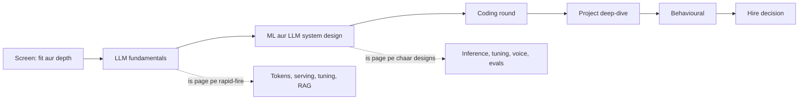

## ⭐ Har round kya test karta hai aur kaise prepare karo

**Ek line me:** har round ek hi cheez check karta hai: kya tum LLM product ko production me chala sakte ho, kyun chala samjha sakte ho, aur numbers se prove kar sakte ho.

| Round | Asal me kya test hota hai | Kaise prepare karo | Jeetne wala signal |
|---|---|---|---|
| Screen (30 min) | Kya tumne LLM features ship kiye hain? Ek ko clearly samjha sakte ho? | Best project ki 2-minute story, ek metric ke saath | "400-case eval set pe faithfulness 71% se 89% hua" |
| LLM fundamentals (45–60 min) | Tokens, attention, sampling, KV cache, fine-tuning, RAG basics | Neeche ke rapid-fire sections, bol bol ke | Chhote sahi jawab plus "kyun" |
| ML / LLM system design (45–60 min) | Requirements, numbers, architecture, evals, cost, failure modes | Neeche ke chaar designs; 35 min me draw karna practise karo | Eval aur numbers se shuru, vendor ke naam se nahi |
| Coding (45–60 min) | Clean Python, plus chhote LLM pieces (sampling, attention, retriever) | Is page ke snippets yaad se likho | Sahi, tested, edge cases bol ke |
| Project deep-dive (45–60 min) | Kya tumne khud kiya? Kyun kaam kiya, pata hai? | Deep-dive section ka template | Baseline, eval, iterations, numbers, kya fail hua |
| Behavioural (30–45 min) | Ownership, conflict, ambiguity, pressure me ship karna | 5–6 STAR stories, unme se do AI kaam pe | Specific "maine kiya" actions aur measured outcomes |

**Interview tip:** "Naye LLM feature pe sabse pehle kya karoge?" Bolo: "Real inputs se chhota eval set aur plain prompt se baseline banaunga. Phir us number ke against iterate karunga."

**Common galti:**
- Sirf agents aur frameworks ki taiyari, phir "KV cache me kya hota hai?" pe atak jaana.
- Bina numbers ke jawab. Har senior jawab me kam se kam ek number hota hai.

## ⭐ Rapid-fire: LLM fundamentals

**Ek line me:** LLM ek next-token predictor hai: text tokens banta hai, attention layers ka stack unhe logits me badalta hai, aur sampler next token chunta hai.

**Q: Token kya hai, aur tokenization kyun matter karta hai?**
Token ek fixed vocabulary se text ka tukda hai, jo BPE se banta hai (byte pair encoding: bytes se shuru karo, baar baar sabse frequent pair ko merge karo). English me lagbhag 0.75 words per token. Tokenization cost, context length aur ajeeb failures (arithmetic, letters ginna) decide karta hai. Hindi aur doosri non-Latin scripts ko same matlab ke liye aksar zyada tokens lagte hain (purane tokenizers me 2–4× tak).

**Q: Ek forward pass samjhao.**
Token IDs → embedding vectors → N transformer blocks (har block = attention + feed-forward MLP, residual connections aur normalisation ke saath) → final layer jo vocabulary pe logits deti hai → softmax → next token ki probabilities.

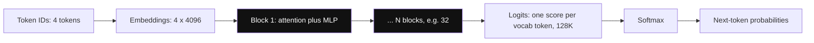

*Diagram:* Har block me shape 4 x 4096 hi rehta hai; sirf aakhri step last position ko poori vocabulary ke scores me badalta hai.

**Q: Attention kya compute karta hai?**
Har token ek query (Q), key (K) aur value (V) vector banata hai. Scores = Q·Kᵀ / √d, causal mask future tokens chhupata hai, softmax scores ko weights banata hai, aur output V ka weighted sum hai. √d se divide karne se scores dimension ke saath bade nahi hote aur softmax saturate nahi hota.

**Q: Attention O(n²) kyun hai, aur FlashAttention kya badalta hai?**
Har token har pichhle token ke saath score karta hai, isliye n tokens ke liye n×n score matrix banta hai. FlashAttention bilkul same result deta hai, par tiles me compute karta hai jo fast on-chip memory me rehte hain; poora n×n matrix GPU memory me kabhi likha nahi jaata. Memory traffic aur time bachta hai; ye approximation nahi hai.

**Q: Multi-head, MQA aur GQA?**
Multi-head attention kai attention heads parallel chalata hai, har ek alag relation seekhta hai. MQA (multi-query attention) saare query heads me ek hi K/V head share karta hai. GQA (grouped-query attention) har group me ek K/V head share karta hai, jaise 64 query heads aur 8 KV heads. Isme KV cache 8× chhota ho jaata hai aur quality thodi hi girti hai, isliye Llama 3 ise use karta hai.

**Q: Model ko words ka order kaise pata chalta hai?**
Positional information se. Aaj ke zyada models RoPE (rotary position embeddings) use karte hain, jo Q aur K ko position ke hisaab se ek angle se rotate karta hai. Context extension tricks (position interpolation, YaRN) RoPE ko stretch karti hain, taaki 8K pe trained model chhoti extra training ke baad 32K–128K pe chal sake.

**Q: Temperature, top-k, top-p aur min-p samjhao.**
Temperature softmax se pehle logits ko divide karta hai: 1 se kam top token ko aur likely banata hai, 1 se zyada distribution ko flat karta hai, 0 matlab greedy. Top-k sirf k sabse likely tokens rakhta hai. Top-p (nucleus) sabse chhota set rakhta hai jiski probabilities ka sum p ho. Min-p un tokens ko rakhta hai jinki probability kam se kam min_p × top token ki probability ho, isliye cut model ke confidence ke hisaab se adjust hota hai.

**Q: Temperature 0 pe bhi output alag kyun aa sakta hai?**
GPU floating-point maths perfectly associative nahi hai. Results batch size aur kernel choice ke saath badalte hain, aur server tumhari request ko doosron ki requests ke saath batch karta hai. MoE models me chhote fark se token ka expert bhi badal sakta hai. Greedy "zyada tar" deterministic hai, guaranteed nahi.

**Q: Mixture of Experts model kya hai?**
Har layer ka feed-forward hissa bahut saare "experts" me bata hota hai. Ek chhota router har token ke liye top-k experts (aksar 2 se 8) chunta hai. Mixtral 8x7B me lagbhag 47B total parameters hain par har token pe sirf ~13B active; DeepSeek-V3 me 671B total aur ~37B active. Per token compute active parameters pe chalta hai; GPU memory me phir bhi saare rakhne padte hain.

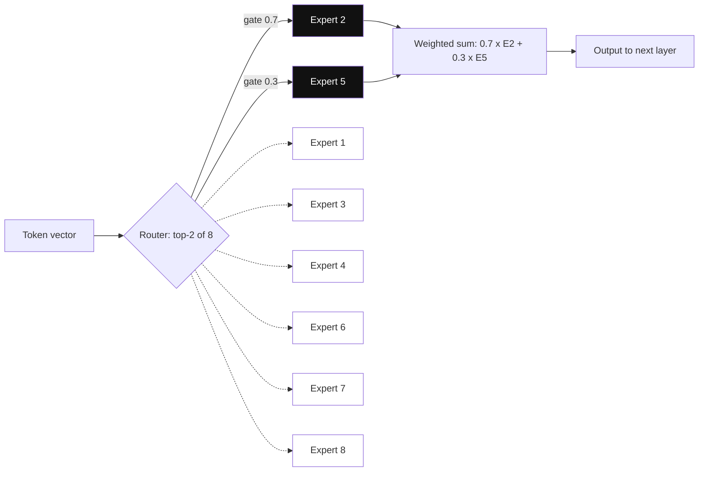

*Diagram:* Is token ke liye sirf 2 highlighted experts chalte hain; baaki 6 GPU memory me pade rehte hain, isliye compute active params se chalta hai par memory total se.

**Q: Serving me MoE ke trade-offs?**
Per token compute sasta aur per FLOP quality behtar. Par saare experts ke liye memory chahiye, routing unbalanced ho sakti hai (kuch experts overload), aur multi-GPU serving me all-to-all communication wala expert parallelism lagta hai. Chhote batch pe latency ka fayda active-parameter count jitna nahi milta.

**Q: Reasoning models kya hain?**
OpenAI o1 aur DeepSeek-R1 jaise models jo jawab se pehle lamba hidden chain of thought likhte hain. Inhe checkable answers wale tasks (maths, code) pe reinforcement learning se train kiya jaata hai. Ye zyada output tokens (test-time compute) ke badle zyada accuracy dete hain. Cost aur latency kaafi badhti hai, isliye inhe mushkil multi-step problems ke liye use karo, classification ke liye nahi.

**Q: Context window kya hai, aur kya bada hamesha behtar hai?**
Ye maximum tokens (prompt plus output) hain jin pe model attend kar sakta hai. Badi window mehngi padti hai (attention aur KV cache length ke saath badhte hain), aur beech me dabe facts pe quality girti hai ("lost in the middle"). Sahi 5K tokens retrieve karna aksar 500K daal dene se behtar hai.

**Q: Base model vs instruct model?**
Base model sirf text continue karne ke liye pre-trained hai. Instruct (chat) model ko phir SFT (supervised fine-tuning) se instruction-answer pairs pe aur preference tuning se train kiya jaata hai, taaki wo instructions follow kare aur chat format samjhe. Jab tak bahut data na ho, instruct model ke upar fine-tune karo.

**Q: LLMs hallucinate kyun karte hain?**
Unhe likely text banane ke liye train kiya gaya hai, sach text ke liye nahi. Jab jawab weights me achhe se stored nahi hota, tab bhi sabse likely continuation confident aur galat ho sakta hai. Fix: retrieved sources pe ground karo, citations maango, "mujhe nahi pata" allow karo, temperature kam karo, aur outputs check karo.

**Q: Scaling laws, ek sentence me?**
Loss parameters, data aur compute ke power law ke saath predictably girta hai; Chinchilla (2022) ne dikhaya ki compute-optimal training ko lagbhag 20 tokens per parameter chahiye, par aaj ke chhote models isse kahin zyada pe train hote hain kyunki inference cost zyada matter karti hai.

**Q: Embedding model vs generative model?**
Embedding model text ko similarity search ke liye ek fixed-size vector me badalta hai. Generative model next tokens predict karta hai. Dono alag goals ke liye train hote hain, isliye chat model ke hidden states ko search embeddings ki tarah mat use karo.

**Q: Trade-off: bada model ya zyada context ya tools ke saath chhota model?**
Sabse chhote model se shuru karo jo tumhara eval pass kare. Agar knowledge ki kami se fail ho, retrieval jodo. Agar reasoning me fail ho, ek size bada model lo ya sirf mushkil route pe reasoning model use karo. Measure karo, guess mat karo.

## ⭐ Rapid-fire: inference aur serving

**Ek line me:** prefill compute-bound hai, decode memory-bandwidth-bound hai, aur lagbhag har serving trick (batching, KV cache paging, quantization, speculative decoding) decode ke time GPU ko behtar use karne ka tarika hai.

**Q: Decoding memory-bound kyun hai?**
Har naya token banane ke liye GPU ko har weight memory se ek baar padhna padta hai. Ek request ke liye ye bahut padhna aur bahut kam maths hai. H100 lagbhag 3.35 TB/s padhta hai, isliye 16-bit me 8B model (16 GB) ek request ke liye ~200 tokens/s pe ruk jaata hai. Bahut saari requests batch karne se wahi weight read reuse hota hai, isliye batch size ke saath throughput badhta hai.

**Q: Prefill vs decode, aur TTFT vs TPOT?**
Prefill saare prompt tokens parallel process karta hai; ye compute-bound hai aur TTFT (time to first token) tay karta hai. Decode har step pe ek token banata hai; ye memory-bound hai aur TPOT (time per output token, jise inter-token latency bhi kehte hain) tay karta hai. Lambe prompts TTFT bigaadte hain; lambe jawab total latency.

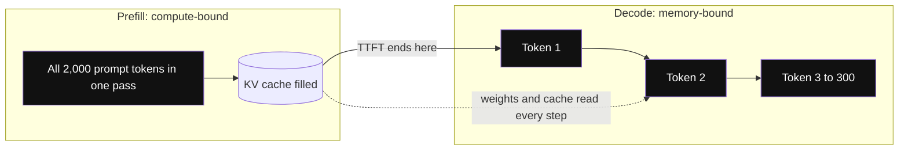

*Diagram:* Prefill ek bada parallel pass hai jo TTFT tay karta hai; decode 300 chhote steps hain, har step saare weights dobara padhta hai, jo TPOT tay karta hai.

**Q: KV cache kya hai, aur kitna bada hota hai?**
Har pichhle token aur har layer ke liye model key aur value vectors save karta hai taaki dobara compute na kare. Per token size = 2 (K aur V) × layers × KV heads × head dim × bytes. Llama 3 8B: 2 × 32 × 8 × 128 × 2 bytes = 128 KB per token, yaani 8K-token request ~1 GB leti hai.

**Q: Continuous batching kya hai?**
Purani static batching tab tak wait karti hai jab tak batch ki har request khatam na ho. Continuous (in-flight) batching har decode step pe requests jodti aur hatati hai, taaki chhota jawab nikle aur nayi request turant jud jaaye. Ye static batching se aam taur pe kai guna throughput deti hai.

**Q: PagedAttention (vLLM) kya solve karta hai?**
KV cache unpredictable tarike se badhta hai, aur har request ke liye max length reserve karne se zyada tar memory waste hoti hai. PagedAttention (vLLM, 2023) KV cache ko chhote fixed-size blocks me rakhta hai, OS memory pages ki tarah, jo zarurat pe allocate hote hain. Waste lagbhag zero ho jaata hai, isliye batch me zyada requests aati hain.

**Q: Prefix caching kya hai?**
Agar bahut requests ki shuruaat same hai (system prompt, tool list, few-shot examples), server us prefix ke KV blocks rakh ke reuse karta hai. Isse TTFT aur cost dono kam hote hain. Ye tabhi chalta hai jab prefix byte-identical ho, isliye stable content pehle aur per-request content last me rakho.

**Q: Chunked prefill aur disaggregated serving?**
Ek lamba prefill sabka decode rok sakta hai. Chunked prefill lambe prompt ko chunks me tod ke decode steps ke saath mix karta hai, taaki inter-token latency smooth rahe. Disaggregated serving aur aage jaata hai: prefill aur decode ke liye alag GPU pools, beech me KV cache transfer, taaki har pool apne bottleneck ke liye tune ho.

**Q: Quantization ke kya options hain, aur unki keemat kya hai?**
Weight-only INT8 ya INT4 (GPTQ aur AWQ jaise methods) memory kam karte hain aur memory-bound decode tez karte hain. FP8 weights aur activations (H100-class GPUs pe) compute bhi tez karte hain, quality loss bahut kam. KV cache quantization (FP8) se double tokens fit hote hain. INT4 maths, code aur long-context tasks bigaad sakta hai, isliye quantize karne ke baad eval hamesha dobara chalao.

**Q: Speculative decoding kaise kaam karta hai?**
Ek chhota, tez draft model (ya Medusa ya EAGLE jaise extra prediction heads) agle 3–5 tokens guess karta hai. Bada model saare guesses ek forward pass me check karta hai aur sabse lamba sahi run rakhta hai. Sahi acceptance rule ke saath output distribution bilkul bade model jaisa hi rehta hai. Ye chhote batch sizes pe sabse zyada help karta hai, jahan GPU ke paas spare compute hota hai.

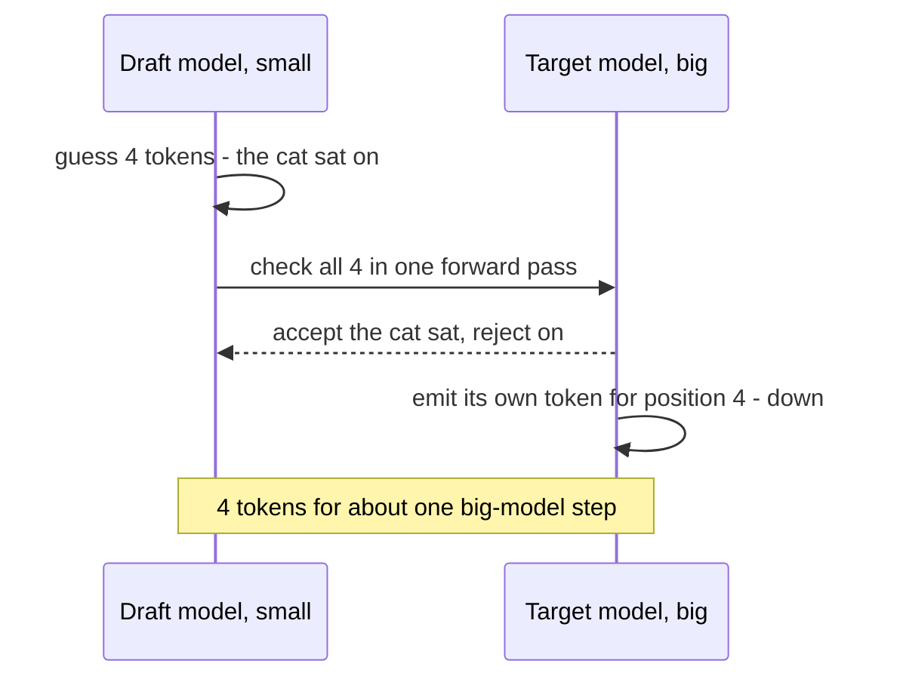

*Diagram:* Bada model 4 guesses ek pass me check karta hai, match hone wale 3 rakhta hai aur 4th apna jodta hai, to ek mehenge step me kai tokens aage badhte hain.

**Q: Tensor parallelism vs pipeline parallelism?**
Tensor parallelism har layer ki matrices GPUs me baant deta hai; isme fast links (NVLink) chahiye aur latency kam karne ke liye ek node ke andar use hota hai. Pipeline parallelism alag layers alag GPUs pe rakhta hai; multi-node setups ke liye theek hai par pipeline bubbles aate hain. 70B model serve karne ke liye ek node me 2–8 GPUs pe tensor parallelism default hai.

**Q: Bahut saare fine-tuned variants sasta kaise serve karoge?**
GPU memory me ek base model rakho aur har request pe LoRA adapters load karo (vLLM me multi-LoRA serving, S-LoRA wala idea). Har adapter kuch dasiyon MB ka hota hai, isliye har variant ke liye alag GPU set ki jagah saikdon adapters ek deployment share kar sakte hain.

**Q: Throughput vs latency: kya tune karte ho?**
Bade batches GPU per tokens/second badhate hain par har user ke tokens slow karte hain. Pehle SLO (service-level objective) set karo, jaise p95 TTFT 1 s se kam aur har user ko 30+ tokens/s, phir batch size tab tak badhao jab tak wo hit na ho. Offline jobs huge batches use kar sakte hain; chat nahi.

**Q: 70B model serve karne ke liye GPUs estimate karo (worked example).**

| Step | Maths | Result |
|---|---|---|
| FP8 me weights | 70B params × 1 byte | 70 GB |
| Per token KV (Llama 3 70B: 80 layers, 8 KV heads, dim 128, FP16) | 2 × 80 × 8 × 128 × 2 bytes | ≈ 320 KB |
| Ek 8K-token request ka KV | 8,192 × 320 KB | ≈ 2.6 GB |
| Ek replica = 2 × H100 80 GB | 160 GB − 70 GB weights − ~15 GB overhead | KV ke liye ≈ 75 GB |
| Har replica pe concurrent 8K requests | 75 / 2.6 | ≈ 28 (FP8 KV ya chhote prompts se zyada) |
| Peak load | 100 req/s × 300 output tokens | 30,000 output tokens/s |
| Replica throughput (assume karo, phir benchmark) | lagbhag 2,000–3,000 output tokens/s | 2,500 lo |
| Kitne replicas | 30,000 / 2,500 = 12, plus 30% headroom | ≈ 16 replicas = 32 H100s |

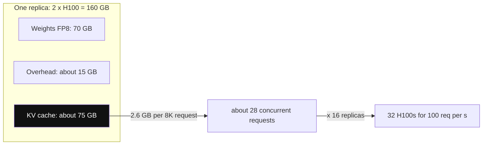

*Diagram:* Har replica ka lagbhag aadha hissa KV cache hai, aur ek saath kitne users fit honge ye wahi tay karta hai, weights nahi.

> **Bolo:** "Ye planning numbers hain. Commit karne se pehle main real prompt aur output lengths ke saath apne SLO pe benchmark karunga, kyunki length mix se throughput 2–3× badal jaata hai."

**Common galti:** GPUs sirf weights se size karna aur KV cache bhool jaana, jo aksar weights jitni hi memory leta hai.

## ⭐ Rapid-fire: fine-tuning aur post-training

**Ek line me:** pehle prompt, knowledge ke liye retrieval, behaviour aur format ke liye fine-tune, aur preference tuning ya RL tab jab "achha" likhne se zyada judge karna aasaan ho.

**Q: Prompting ya RAG ki jagah fine-tune kab karte ho?**
RAG us knowledge ke liye jo badalti hai ya jiska citation chahiye. Prompting har us cheez ke liye jo achhi instruction plus examples se solve ho jaaye. Fine-tune consistent style, format ya narrow skill ke liye; chhote model ko ek task pe bade jaisa banane ke liye (sasta, tez); ya jab prompt itna lamba ho ki bahut mehnga pade. Facts jodne ke liye fine-tuning kharab tarika hai.

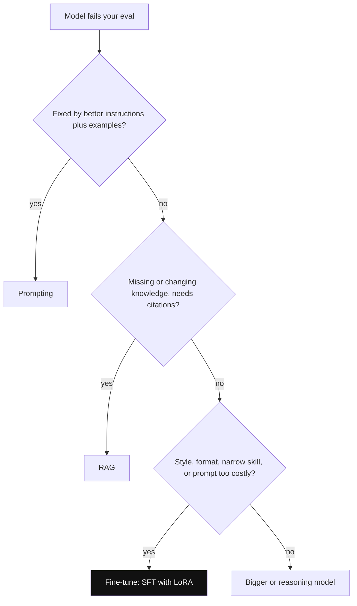

*Diagram:* Saste fixes order me try karo; fine-tuning behaviour aur format ke liye hai, facts ke liye nahi.

**Q: SFT kya hai, aur wo ek bug kaunsa hai jo sab karte hain?**
SFT (supervised fine-tuning) input-output pairs pe next-token loss se train karta hai. Loss sirf assistant tokens pe lagao, prompt pe nahi, aur bilkul wahi chat template use karo jis pe model train hua tha. Template mismatch chupchap quality bigaad deta hai.

**Q: LoRA kaise kaam karta hai, numbers ke saath?**
LoRA (2021) weight matrix W ko freeze karta hai aur low-rank update ΔW = B·A seekhta hai, jahan A r × d aur B d × r hai. 4096 × 4096 matrix me 16.8M parameters hain; rank r = 16 pe LoRA 2 × 4096 × 16 ≈ 131K train karta hai, 1% se kam. Adapters ko W me merge kar sakte ho (zero extra latency), ya multi-adapter serving ke liye alag rakh sakte ho.

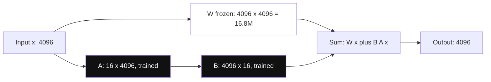

*Diagram:* Badi matrix kabhi nahi badalti; sirf patla A aur B wala raasta (lagbhag 131K numbers) train hota hai, aur uska output upar se jud jaata hai.

**Q: LoRA ke kaunse hyperparameters matter karte hain?**
Rank r (8–64 common), alpha (scaling, aksar r ka 1–2×), kin modules pe adapters lagenge (saari linear layers aam taur pe sirf attention se behtar), aur learning rate (full fine-tuning se zyada, lagbhag 1e-4 se 2e-4).

**Q: QLoRA kya jodta hai?**
QLoRA (2023) frozen base model ko 4-bit NF4 format me rakhta hai aur uske upar 16-bit me LoRA adapters train karta hai. Base weights ki memory ~4× girti hai, isliye 65B model ek 48 GB GPU pe fine-tune ho saka. Har step slow hai aur 16-bit base pe LoRA se quality thodi kam.

**Q: Full fine-tuning ko kitni memory chahiye?**
Adam aur mixed precision ke saath lagbhag 16 bytes per parameter: 2 weights ke, 2 gradients ke, 12 FP32 master weights aur do Adam moments ke. 7B model ko activations se pehle hi ~112 GB chahiye, isliye multiple GPUs plus sharding (FSDP ya DeepSpeed ZeRO). Usi model pe LoRA ek 24–48 GB GPU pe fit ho jaata hai.

**Q: RLHF samjhao.**
Teen steps: model ko SFT karo; human comparisons ("jawab A, B se behtar hai") collect karke un pe reward model train karo; phir policy ko PPO (proximal policy optimization) se high reward ke liye optimise karo, ek KL penalty ke saath jo use SFT model se zyada door jaane se rokti hai. Ye kaam karta hai par complex hai: memory me chaar models aur unstable training.

**Q: DPO kya hai, aur popular kyun hai?**
DPO (direct preference optimization, 2023) wahi preference pairs use karta hai par reward model aur RL loop skip karta hai. Iska loss seedha chosen jawab ki probability rejected ke relative badhata hai, ek frozen reference model se compare karke; beta tay karta hai kitna drift allowed hai. Simple, stable, aur sirf do models chahiye.

**Q: GRPO kya hai?**
GRPO (group relative policy optimization, DeepSeekMath se, DeepSeek-R1 me use hua) har prompt ke liye jawabon ka ek group, maan lo 8, sample karta hai aur har ek ko score karta hai. Har jawab ka advantage = (uska reward − group mean) / group std. Alag value (critic) model nahi chahiye, memory bachti hai. Checkable rewards (unit tests pass, maths answer match) ke saath ise RLVR (RL with verifiable rewards) kehte hain.

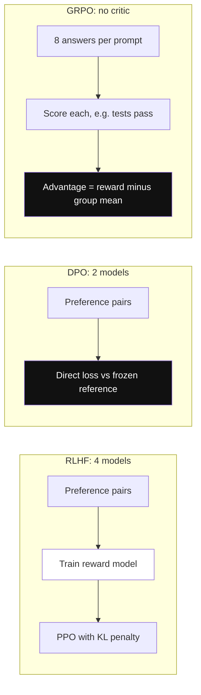

*Diagram:* DPO reward model aur RL loop hata deta hai; GRPO RL rakhta hai par critic ki jagah group average leta hai, jo checkable rewards ke liye fit hai.

**Q: Reward hacking kya hai?**
Model task kiye bina high reward lene ka rasta dhoondh leta hai: judge ko length pasand ho to bahut lambe jawab, reward "tests pass" ho to failing tests delete karna. Fix: KL penalty, behtar aur mushkil se fool hone wale rewards, length controls, aur samples haath se padhna.

**Q: Distillation kya hai?**
Ek chhote student model ko bade teacher ki copy karna sikhana. Sequence-level: teacher ke jawab generate karo aur student ko un pe SFT karo (API-only teachers ke saath chalta hai). Logit-level: student ko teacher ki poori probability distribution match karna sikhao (teacher logits chahiye; signal zyada rich). Teacher ke outputs training me use karne se pehle uski licence terms check karo.

**Q: Achha synthetic data kaise banate ho?**
Real inputs se seed karo, strong model se generate karo, phir sakhti se filter karo: dedupe, verify (code chalao, maths check karo, rubric wala LLM judge), difficulty balance karo, aur jo bhi eval set se overlap kare use hatao (decontamination). 1,000 saaf examples aam taur pe 50,000 noisy se behtar hote hain.

**Q: Catastrophic forgetting kya hai, aur use kaise kam karte ho?**
Narrow task pe fine-tune ke baad model general skills me kharab ho jaata hai. Kam karne ke liye LoRA (chhota change), low learning rate, kam epochs (1–3), thoda general instruction data mix karna, aur task eval ke saath ek general benchmark chalana.

**Q: Trade-off: tumhare task ke liye DPO ya GRPO?**
DPO jab preference pairs hain (ya collect kar sakte ho) aur "behtar" taste ki baat hai: tone, helpfulness. GRPO ya RLVR jab correctness automatically check ho sake: maths, code, SQL, exact answers wala extraction. Dono achhe SFT model se shuru hote hain.

## ⭐ Rapid-fire: RAG, structured outputs, prompting, multimodal, security, LLMOps

**Ek line me:** production ke zyada tar LLM failures model failures nahi hote; wo kharab retrieval, parse na hone wale output, untested prompts, unguarded inputs ya missing monitoring se aate hain.

**Q: Production RAG pipeline ek saans me batao.**
Docs parse aur clean karo → chunk karo (structure ke saath 300–800 tokens) → embed karo → metadata ke saath store karo → hybrid search (BM25 + vectors) → cross-encoder se top 50 ko 5 tak rerank karo → sources ke saath prompt → citations ke saath jawab → faithfulness aur retrieval recall evaluate karo. Details [What is RAG](../09-rag/01-what-is-rag.md) pe.

**Q: Jawab galat aa rahe hain. RAG debug kaise karoge?**
Do sawalon me todo. Kya sahi chunk retrieve hua (labelled set pe recall@k dekho)? Nahi to chunking, hybrid search, query rewriting ya reranker theek karo. Agar retrieve hua, to kya jawab us chunk ke faithful hai? Nahi to prompt theek karo, best chunk pehle rakho, ya strong model lo.

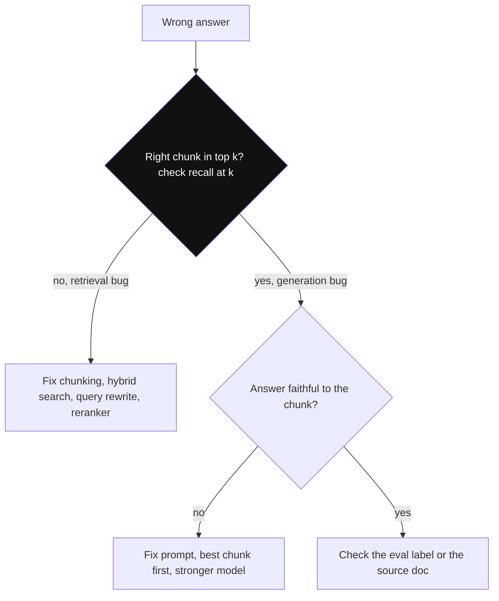

*Diagram:* Pehla sawal har RAG bug ko do alag fix lists me baant deta hai, isliye prompt chhedne se pehle yahi poochho.

**Q: Hybrid search plus reranking kyun?**
Vectors matlab match karte hain par error codes aur product IDs jaise exact terms miss kar dete hain; BM25 (keyword ranking) unhe pakadta hai. Cross-encoder reranker query aur har chunk ko saath padhta hai, isliye dono se kahin zyada accurate hai, par millions docs ke liye bahut slow, isliye sirf top 50 pe chalta hai.

**Q: JSON mode vs function calling vs constrained decoding?**
JSON mode output ko valid JSON banata hai par tumhare schema jaisa nahi. Function calling ya "structured outputs" model se tumhara diya schema bharwate hain. Constrained decoding (sampler pe grammar ya schema masks, jaise Outlines, XGrammar ya provider structured outputs) invalid tokens ko impossible bana deta hai, isliye output hamesha parse hota hai. Phir bhi Pydantic se validate karo, kyunki sahi shape ka matlab sahi content nahi.

**Q: Kya strict schemas quality bigaad sakte hain?**
Haan. Answer field ko pehle force karne se model jawab se pehle reason nahi kar paata. Answer se pehle ek chhota "reasoning" field rakho, ya pehle reason karo aur baad me extract karo. Schemas flat rakho aur fields ko clear naam aur descriptions do.

**Q: Few-shot, chain of thought aur prompt caching: ek-ek line?**
Few-shot: 2–5 real input-output examples format aur edge cases rules se behtar theek karte hain. Chain of thought: step-by-step reasoning maangna non-reasoning models pe multi-step tasks me help karta hai. Prompt caching: byte-identical prefix rakho taaki provider un tokens ka bahut kam charge kare aur TTFT gire.

**Q: DSPy kya hai?**
Ek framework jisme tum task ko signature (inputs → outputs) aur modules ki tarah declare karte ho, ek metric aur kuch examples dete ho, aur ek optimizer (jaise BootstrapFewShot ya MIPROv2) aisi instructions aur few-shot examples dhoondhta hai jo metric maximise karein. Prompt tuning ek measured search ban jaati hai. Ye tabhi help karta hai jab metric aur dataset achhe hon.

**Q: Vision-language model image ko kaise "dekhta" hai?**
Ek vision encoder (aksar ViT, vision transformer) image ko patches me kaat ke vectors banata hai. Ek chhota projector un vectors ko LLM ke token space me map karta hai, aur LLM unhe extra tokens ki tarah padhta hai. High-resolution image saikdon se kuch hazaar tokens tak le sakti hai, isliye detail na chahiye to resize karo.

**Q: Voice agents: cascade ya speech-to-speech?**
Cascade = STT (speech to text) → LLM → TTS (text to speech). Debug karna aasaan, kisi bhi LLM aur tools ke saath chalta hai, par har hop latency jodta hai. Speech-to-speech models (realtime audio APIs) latency kam dete hain aur tone bachate hain, par control, evaluate aur log karna mushkil. Aaj zyada tar production booking aur support bots streaming cascade use karte hain.

**Q: Prompt injection kya hai, aur sabse strong defence kya hai?**
Untrusted text (user, webpage, PDF, tool result) me instructions hoti hain jo model follow kar leta hai. Direct injection user se aata hai; indirect injection us content me chhupa hota hai jo model padhta hai. Model ke andar iska poora fix nahi hai. Sabse strong defence architecture hai: least-privilege tools, risky actions pe human approval, aur ek hi context me private data, untrusted input aur data bahar bhejne ka rasta kabhi ek saath na hon.

**Q: Ek real data-exfiltration path batao.**
Injected doc model ko `` jaisi markdown image render karne ko kehta hai. Chat UI image load karta hai aur URL me secret leak ho jaata hai. Fix: untrusted domains se images render mat karo, aur outputs me links strip ya allowlist karo.

**Q: Practice me LLMOps kya hai?**
Versioned prompts aur model IDs; ek eval suite jo har change pe CI me chale; har call ki tracing (inputs, outputs, tokens, latency, cost); online quality signals (thumbs, LLM-judge sampling, escalations); cost aur latency dashboards; aur safe rollout (shadow, canary, rollback).

**Q: Provider ne chupchap model update kiya aur quality gir gayi. Ab?**
Production me dated model versions pin karo. Roz online eval sampling aur quality metrics pe alerts se detect karo. Pinned version ya fallback provider pe rollback karo, phir offline eval chala ke dekho kaunse slices toote.

**Q: LLM feature ki cost 5× kaise kam karoge?**
Aasaan requests chhote model pe route karo (cascade), prompts aur repeated answers cache karo, context trim karo (kam par behtar chunks), output length cap karo, offline kaam batch karo (batch APIs aksar aadhi keemat pe), aur high-volume step ko fine-tuned chhote model me distil karo.

**Q: Trade-off: ek bada general model ya bahut saare chhote specialised?**
Ek bada model ship karne me sabse tez aur chalane me simple. Chhote fine-tuned models high volume pe saste aur tez hain, par har ek ko data, evals aur dekh-rekh chahiye. Bade se shuru karo, sab log karo, aur jo ek-do routes zyada traffic le jaate hain unhe specialise karo.

**Q: Summarisation jaisa open-ended feature kaise evaluate karoge?**
Rubric wala LLM judge (100–200 human labels pe calibrated), compute ho sakne wale checks (length, required fields, citation hai ya nahi), aur current version ke against pairwise comparison, teeno milao. Judge aur humans ka agreement track karo; ~80% se neeche jaaye to rubric theek karo.

## ⭐ Design round 1: internal teams ke liye LLM inference platform

> **Prompt:** "Ek platform design karo jo 40 internal teams ko open-weight models (Llama, Qwen, Mistral) serve kare. Kuch teams ko chat latency chahiye, kuch batch jobs chalati hain, kuch apne LoRA adapters laati hain."

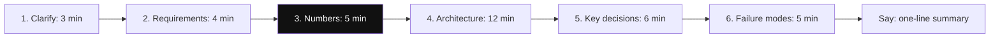

*Diagram:* Neeche ke chaaron design rounds lagbhag 35 minute me isi skeleton pe chalte hain; numbers wala step zyada candidates skip karte hain aur interviewers usi ko reward karte hain.

**1. Clarify.** Poochho: kaunse models aur sizes? Peak load aur chat vs batch ka mix? Latency SLOs? Data rules (data hamare VPC se bahar nahi)? Kya teams fine-tunes laati hain? Budget aur kaunse GPU types available?

**2. Requirements.**
- Functional: OpenAI-compatible API, streaming, multiple models, per-team LoRA adapters, batch endpoint, usage reporting.
- Non-functional: chat ke liye p95 TTFT < 1 s, har stream > 30 tokens/s, 99.9% availability, per-team quotas, consent ke bina prompt logging nahi, har team ki cost dikhe.

**3. Numbers.** Serving section ka GPU estimate use karo: 70B FP8 model pe 100 chat req/s ke liye 2 × H100 ke ~16 replicas. Batch jobs same pools pe raat me ya spare capacity pe, kam priority ke saath. Simple routes ke liye 8B model ko har replica pe ek GPU chahiye aur wo kahin zyada requests sambhalta hai.

**4. Architecture.**

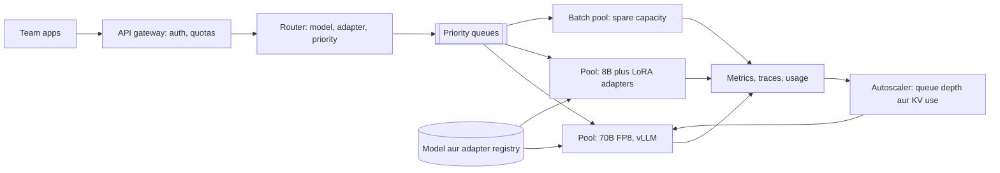

**5. Key decisions.**

| Decision | Choice | Kyun | Alternative |
|---|---|---|---|
| Serving engine | vLLM ya SGLang | Continuous batching, PagedAttention, prefix caching, multi-LoRA | Peak speed ke liye TensorRT-LLM, zyada build effort |
| Precision | H100 pe FP8 weights aur KV | ~2× memory bachat, quality loss kam | BF16 jab eval me drop dikhe |
| Parallelism | Ek node ke andar tensor parallel | 70B ke liye sabse kam latency | Pipeline parallel sirf un models ke liye jo ek node me fit na hon |
| Fine-tunes | Shared base plus per-request LoRA | Ek deployment saikdon adapters serve karta hai | Dedicated deployment sirf bahut high-traffic adapters ke liye |
| Autoscaling signal | Queue depth, KV cache usage, TTFT | LLMs ke liye GPU utilisation misleading hai | Sirf request count |
| Isolation | Per-team quotas aur priority classes | Ek team ka batch job doosri ki chat na bigaade | Har team ka alag cluster (waste) |
| API | OpenAI-compatible | Teams existing SDKs aur tools reuse karti hain | Custom API |

**6. Failure modes.**

| Failure | Asar | Fix |
|---|---|---|
| 70B model ka cold start (minutes) | Spikes ke liye scale-up bahut slow | Warm minimum replicas, weights local NVMe pe cache, queue trend pe scale |
| Ek team queue bhar deti hai | Baaki ke timeouts | Per-team token-rate limits, fair-share scheduling |
| KV cache full | Requests preempt hoke dobara compute | Har tier pe max context cap, KV budget se admit, FP8 KV |
| Kharab adapter upload | Us team ko kachra output | Adapter live hone se pehle registry smoke eval chalaye |
| GPU node failure | In-flight streams kho jaate | Health checks, idempotent requests doosre replica pe retry |
| Naya engine version outputs badal deta hai | Chupchap quality drop | Rollout se pehle eval suite ke saath canary |

> **Bolo:** "Main KV cache se size karta hoon, weights se nahi. Queue depth aur TTFT pe scale karta hoon, GPU utilisation pe nahi. Aur batch traffic ko kam priority class maanta hoon jo spare capacity bharti hai."

## ⭐ Design round 2: support domain ke liye fine-tuning pipeline

> **Prompt:** "Customer support replies ke liye hum GPT-class model ko call karne pe bahut paisa dete hain. Ek pipeline design karo jo chhote open model (7–8B) ko hamare domain pe uski quality tak laaye."

**1. Clarify.** "Match" ka matlab kya, kaise measure? Aaj ka volume aur cost? Latency target? Kya human-approved replies wale purane tickets hain? Kya bade model ke outputs uski terms ke under training me use ho sakte hain? Kaunsi languages (Hindi, Hinglish)?

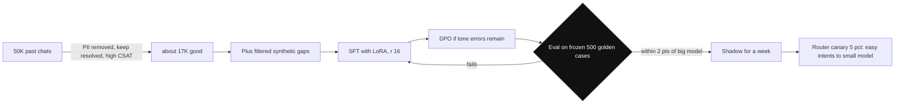

*Diagram:* Cleaning ke baad data lagbhag ek-tihai bachta hai, frozen golden set gate hai, aur pass hone ke baad bhi small model sirf woh intents leta hai jin pe router bharosa karta hai.

**2. Data.**
1. 50K purani conversations nikalo; PII hatao (naam, phone, card numbers).
2. Sirf achhi rakho: resolved, high CSAT, koi escalation nahi. 30–40% bachne ki ummeed.
3. Gaps bade model se generate karo (rare intents, Hinglish), phir LLM judge plus rules se filter karo.
4. Dedupe karo, intent ke hisaab se balance karo, aur time se split karo: purane months pe train, sabse naye month pe test.
5. Support team se reviewed 500-case golden test set freeze karo. Us pe kabhi train mat karo.

**3. Training.**
1. Baseline: achhe prompt plus RAG ke saath chhota model. Bahut teams yahin ruk jaati hain.
2. LoRA ke saath SFT (r = 16–32, saari linear layers, 2–3 epochs, loss sirf assistant tokens pe).
3. Agar tone ya policy errors bache hon, preference pairs collect karo (agents do drafts me se behtar chunein) aur DPO chalao.
4. Distillation option: jin intents pe human replies kamzor hain, wahan bade model ke replies ko targets banao.

**4. Evaluation.**

| Check | Kaise | Ship bar |
|---|---|---|
| Correctness aur policy | Rubric wala LLM judge, 200 human labels pe calibrated | Bade model ke 2 points ke andar |
| Pairwise preference | Golden set pe judge aur humans chhote vs bade ko compare karein | Win ya tie ≥ 45% |
| Hard rules | Regex aur code: galat refund promise nahi, PII echo nahi | 100% pass |
| General skills | Chhota general benchmark | Base ke muqable bada drop nahi |
| Slices | Har intent, har language | Koi slice 5 points se zyada na gire |

**5. Deploy.**
1. Shared platform (design 1) pe base model plus adapter serve karo.
2. Ek hafte shadow traffic: offline bade model ke replies se compare karo.
3. Router ke saath 5% canary: confident, common intents chhote model pe; mushkil ya rare intents bade pe hi.
4. CSAT, escalation rate aur policy violations dekho; route palat ke rollback karo.

**6. Cost.**

| Item | Bada model API | Chhota fine-tuned model |
|---|---|---|
| Per 1M tokens (rough) | Kuch dollars | Apne GPUs pe achhe batch me kuch dasiyon cents |
| Training | kuch nahi | LoRA ke liye kuch GPU-hours; data generation milake kuch sau dollars |
| Hidden cost | Price changes | Har quarter retraining, eval dekh-rekh, on-call |

> **Bolo:** "Project zyada tar data aur evals hai; training run aasaan hissa hai. Main router ke saath ship karunga taaki chhota model sirf wahan traffic le jahan eval kehta hai wo utna hi achha hai."

## ⭐ Design round 3: appointment booking ke liye realtime voice agent

> **Prompt:** "Ek clinic chain ke liye phone agent design karo jo English aur Hindi me appointments book, shift aur cancel kare."

**1. Clarify.** Phone (PSTN) ya app? Peak concurrent calls? Kaunsa calendar ya booking system? Languages aur accents? Kya human ko jaana chahiye (medical advice, complaints)? Recording consent rules?

**2. Latency budget.** Log rukne ke lagbhag ek second ke andar jawab expect karte hain. Caller ki speech khatam hone se bot ke first audio tak 800 ms se kam ka target rakho.

| Stage | Budget | Kaise |
|---|---|---|
| End-of-turn detection | 200–300 ms | VAD (voice activity detection) plus turn-end model, fixed lambi silence nahi |
| STT final text | 100–200 ms | Streaming STT; partials bolte waqt hi aa chuke |
| LLM first token | 200–300 ms | Chhota tez model, chhota prompt, prompt caching |
| TTS first audio | 100–150 ms | Streaming TTS jo pehle sentence pe shuru ho |
| Network aur telephony | 50–100 ms | Servers telephony provider ke same region me |

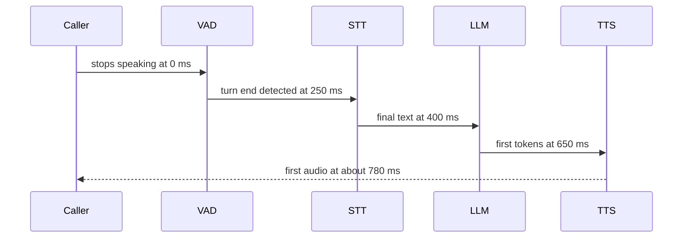

*Diagram:* Times caller ke rukne ke pal se cumulative hain; har stage agle me stream karta hai, 800 ms ke neeche rehne ka yahi ek tareeka hai.

**3. Architecture.**

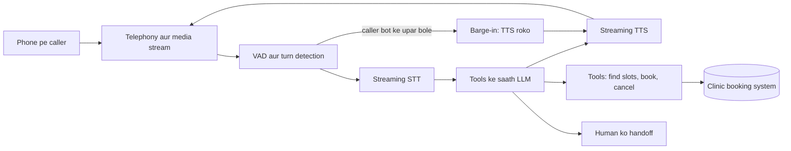

**4. Turn-taking.**
- Barge-in: jab caller bot ke upar bole, TTS turant roko aur jo text bola nahi gaya use history se hata do.
- Fillers: agar tool call 1 s se zyada le, "Ek second, slot check karta hoon" bolo taaki silence dropped call jaisi na lage.
- Confirmation: booking se pehle date, time aur doctor padh ke sunao ("Tuesday 14 ko 4:30 pm, Dr Mehta ke saath, sahi hai?").

**5. Tools.** `find_slots(clinic, doctor, date_range)`, `book(slot_id, patient_id, idempotency_key)`, `reschedule`, `cancel`, `transfer_to_human(reason)`. Patient ID verified caller number plus date of birth se aata hai, LLM ke guess se kabhi nahi. Booking calls idempotency key ke saath taaki retries kabhi double-book na karein.

**6. Evaluation.**
- Offline: simulated callers ke saath 200 scripted calls (ek LLM patient bana, TTS audio me accents aur noise jode). Task success, galat bookings, per booking turns score karo.
- Component: real clinic audio pe STT word error rate, khaaskar naam aur dates.
- Latency: p50 aur p95 voice-to-voice, har stage alag measure.
- Online: booking completion rate, transfer rate, pehle 10 seconds me hang-ups, aur roz ek sample ka human review.

**7. Failure modes.** Galat suni dates (hamesha confirm karo), caller medical advice maange (mana karo aur transfer), booking API slow (filler, phir callback offer), noisy line (repeat karwao, do failures ke baad transfer).

> **Bolo:** "Main har stage ka latency budget banata hoon, sab stream karta hoon, barge-in handle karta hoon, aur har write se pehle confirm karta hoon. Booking ka sahi hona clever lagne se zyada matter karta hai."

## ⭐ Design round 4: evaluation aur prompt-CI system

> **Prompt:** "Wo system design karo jo hamare LLM product me kharab prompt ya model changes ko users tak pahunchne se roke."

**1. Clarify.** Kitne features aur prompts? Kitni baar badalte hain? Prompts kaun edit karta hai (engineers, PMs)? Labelled data ya user feedback hai? CI me judge calls ka budget kya hai?

**2. Pieces.**
1. **Prompt registry:** har prompt apne model ID, parameters aur owner ke saath versioned. Production code version ko refer karta hai, string literal ko nahi.
2. **Datasets:** har feature ke liye golden set (100–300 haath se checked cases), regression set (har purana bug ek case banta hai), aur adversarial set (injections, edge inputs).
3. **Scorers:** pehle code checks (schema valid, required fields, length), phir reference-based checks, phir human labels pe calibrated rubric wala LLM judge.
4. **CI gate:** jo pull request prompt, model ya retrieval setting badle, wo suite chalata hai aur diff post karta hai: overall score, per-slice scores, aur examples ke saath sabse bure regressions.
5. **Online loop:** live traffic sample karo, same judges se score karo, thumbs aur escalations collect karo, aur failures ko regression set me wapas daalo.

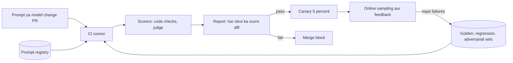

**3. Key decisions.**

| Decision | Choice | Kyun |
|---|---|---|
| Gate rule | Koi slice X points se zyada na gire, hard checks 100% | Average ek toota slice chhupa sakta hai |
| Judge | Strong model, binary ya 1–5 rubric, close calls pe pairwise | Binary aur pairwise fine scales se zyada stable |
| Noise | Har case 2–3 baar chalao ya kaafi cases lo; confidence intervals report karo | LLM outputs har run me badalte hain |
| Cost | Har PR pe code checks, prompt ya model changes pe poora judge suite | CI sasta aur tez rehta hai |
| Ownership | Har feature apne datasets aur thresholds own kare | Central team tooling own kare, har metric nahi |

**4. Failure modes.** Judge ka apna model update hone pe judge drift (judge version pin karo, har mahine agreement dobara check). Team golden set pe overfit karti hai (har quarter naye production samples se refresh, ek hidden holdout rakho). Flaky results merges block karte hain (margin wale thresholds aur repeat runs).

> **Bolo:** "Har bug ek eval case banta hai. Har change per slice gate hota hai, sirf average pe nahi. Aur judge ko khud humans ke against test kiya jaata hai."

## Coding round

**Ek line me:** normal coding plus ek-do chhote LLM building blocks expect karo; wo check karte hain ki tum maths samajhte ho aur clean, tested code likhte ho.

**Common tasks aur key points:**

| Task | Bolne aur code karne ke key points |
|---|---|
| Top-p sampling | Pehle temperature, stable softmax, sort, cumulative sum, renormalise, temperature 0 handle karo |
| NumPy me causal attention | Q·Kᵀ/√d, −inf ke saath upper-triangle mask, row max subtract, har row pe softmax, V se multiply |
| BPE merge step | Corpus me adjacent pairs gino, sabse frequent chuno, use har jagah merged token se replace karo, repeat |
| Cosine-similarity retriever | Vectors ek baar normalise, scores = matrix product, top-k ke liye `argpartition`, phir sirf un k ko sort |
| Retry-with-backoff client | Sirf 429, 5xx aur timeouts pe retry; jitter ke saath exponential delay; attempts cap; `Retry-After` maano; writes ke liye idempotency |
| Agent loop | Model call karo, tool calls hon to chalao aur results jodo, warna return; max-steps limit; tool errors ko messages ki tarah handle karo |
| Streaming parser | Chunks jodo, poori lines ya JSON objects emit karo, partial UTF-8 aur final flush handle karo |

**Reference: causal self-attention (ek head).**

```python
import numpy as np

def causal_attention(X, Wq, Wk, Wv):
    """X: (n, d_model) token vectors. Returns (n, d_head)."""
    Q, K, V = X @ Wq, X @ Wk, X @ Wv          # har ek (n, d_head)
    d = Q.shape[-1]
    scores = Q @ K.T / np.sqrt(d)              # (n, n): token i token j ko kitna dekhta hai
    mask = np.triu(np.ones_like(scores, dtype=bool), k=1)
    scores = np.where(mask, -np.inf, scores)   # causal: future tokens nahi dekh sakte
    scores -= scores.max(axis=-1, keepdims=True)   # numerical stability
    w = np.exp(scores)
    w /= w.sum(axis=-1, keepdims=True)         # softmax: har row ka sum 1
    return w @ V                               # value vectors ka weighted mix

rng = np.random.default_rng(0)
n, d_model, d_head = 4, 8, 4
X = rng.normal(size=(n, d_model))
Wq, Wk, Wv = (rng.normal(size=(d_model, d_head)) for _ in range(3))
print(causal_attention(X, Wq, Wk, Wv).shape)   # (4, 4)
```

**Code kya karta hai:**
- Teen weight matrices se har token ko query, key aur value vectors me project karta hai.
- Har token pair ko score karta hai aur √d se scale karta hai taaki softmax saturate na ho.
- Future positions ko −inf karta hai, taaki softmax ke baad unka weight 0 ho.
- Overflow se bachne ke liye `exp` se pehle row max subtract karta hai; result same rehta hai.
- Har token ke liye un value vectors ka weighted mix lautata hai jo use dekhne ki permission hai.

**Reference: temperature ke saath top-p (nucleus) sampling.**

```python
import numpy as np

def sample_top_p(logits, p=0.9, temperature=0.8, rng=np.random.default_rng()):
    """Tokens ke us sabse chhote set se sample karo jiski probability ka sum >= p ho."""
    if temperature == 0:
        return int(np.argmax(logits))              # greedy
    z = logits / temperature                       # <1 sharp karta hai, >1 flat
    probs = np.exp(z - z.max())
    probs /= probs.sum()                           # stable softmax
    order = np.argsort(probs)[::-1]                # sabse likely pehle
    cum = np.cumsum(probs[order])
    cutoff = np.searchsorted(cum, p) + 1           # mass >= p hone tak tokens rakho
    keep = order[:cutoff]
    kept = probs[keep] / probs[keep].sum()         # renormalise
    return int(rng.choice(keep, p=kept))

logits = np.array([2.0, 1.0, 0.5, -1.0, -3.0])
print(sample_top_p(logits, p=0.9))                 # aksar 0 ya 1, kabhi 2
print(sample_top_p(logits, temperature=0))         # hamesha 0
```

**Code kya karta hai:**
- Temperature 0 ko greedy maanta hai taaki zero se divide na ho.
- Logits pe temperature lagata hai, phir numerically stable softmax.
- Tokens ko probability se sort karta hai aur pehla index dhoondhta hai jahan running total p tak pahunche.
- Sirf wo "nucleus" rakhta hai, use sum 1 tak renormalise karta hai, aur usme se sample karta hai.

**Interview tip:** "Sequences ke batch ke liye kya badlega?" Bolo: "Ek batch axis jodo, cut har row pe alag lagao, aur attention me causal mask ke saath padding mask bhi jodo."

**Common galti:**
- Softmax me max-subtraction bhoolna, jisse bade logits pe overflow hota hai.
- Top-p me wo token chhod dena jo p cross karta hai; use shamil karna zaroori hai.

## Project deep-dive

**Ek line me:** ek project ko experiment log ki tarah sunao: problem, baseline, eval, numbers ke saath iterations, kya fail hua, aur aage kya karoge.

**Ye kyun matter karta hai:** ye round un logon ko alag karta hai jinhone LLM features banaye aur jinhone sirf padha. Interviewers har claim pe do-teen level deep jaate hain: "ye kaise measure kiya?", "X kyun nahi?", "kya toota?".

**Template (STAR-style, lagbhag 5 minute, phir follow-ups):**

| Part | Kya bolna hai | Example (support-reply assistant) |
|---|---|---|
| Situation | Users, scale, kyun matter karta tha | "Agents har ticket pe 6 min lagate the; mahine me 40K tickets." |
| Task | Tumhara role aur target metric | "Drafting service mera tha. Goal: CSAT gire bina 30% kam handle time." |
| Baseline | Pehle sabse simple cheez, uske score ke saath | "Plain GPT-class prompt: 300-case eval pe 58% drafts bina edit accept." |
| Eval | Kaise measure kiya, aur judge pe bharosa kaise kiya | "Rubric judge, 150 labels pe do senior agents se 88% agreement." |
| Iterations | 3–4 changes, har ek apne number ke saath | "Hybrid search plus reranker: 58 → 71%. Prompt me policy snippets: 71 → 79%. Top intents ke liye 8B pe LoRA: same score, 1/8 cost." |
| Kya fail hua | Ek sachcha failure aur sabak | "Facts ke liye fine-tuning fail hui; refund rules har mahine badalte the, isliye unhe retrieval me daala." |
| Result | Business numbers | "Handle time 34% kam, CSAT flat, per ticket cost 70% kam." |
| Next | Zyada time hota to kya karte | "Online judge sampling aur agents ke edits se DPO." |

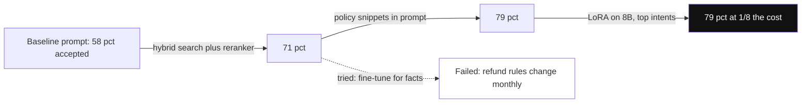

*Diagram:* Project ko isi chain ki tarah sunao: har arrow ek change aur uska number, saath me ek imaandaar dead end.

**Interview tip:** "Alag kya karte?" Ek real jawab tayyar rakho, jaise "eval set week 4 ki jagah week 1 me banata".

**Common galti:**
- Har cheez ke liye "humne" bolna; interviewer ko sunna hai ki tumne kya kiya.
- Bina eval ke numbers ("bahut better ho gaya").

## ⭐ Red flags aur green flags

**Ek line me:** interviewers un candidates pe bharosa karte hain jo measure karte hain, size karte hain aur trade-offs bolte hain; bina numbers ke buzzwords pe nahi.

| Red flag | Green flag |
|---|---|
| Knowledge problem ke liye "bas fine-tune kar do" | "Knowledge retrieval me jaata hai; fine-tuning behaviour aur format ke liye hai" |
| Pehle minute me vendor ya framework chun lena | Requirements, eval aur numbers se shuru karta hai |
| Koi eval nahi, ya "kuch examples haath se dekhe" | Golden set, calibrated judge, per-slice scores |
| GPUs sirf weights se size karna | KV cache, concurrency aur headroom jodta hai |
| "Temperature 0 deterministic hai" | Jaanta hai batching aur floating point exact repeat tod dete hain |
| Prompt injection ko better prompt se solve hone wala maanna | Least privilege aur risky actions pe human approval design karta hai |
| Apne project me kya fail hua, nahi bata paata | Ek failure aur uski wajah se kya badla, batata hai |
| Lambe jawab jo kahin pahunchte nahi | 2–3 sentences me jawab, phir depth offer karta hai |
| Cost aur latency ignore karna | p95 latency, per request cost aur dono kam karne ka tarika batata hai |
| LLM output ko structured data maan lena | Schema se validate karta hai aur retry ya fallback karta hai |

## 4-week study plan

**Ek line me:** ek-ek hafta fundamentals, serving aur tuning, applied systems, aur mock interviews ke liye; roz jawab bol ke practise karo.

| Week | Padho | Practise |
|---|---|---|
| 1. Fundamentals | [How LLMs Work](14-how-llms-work.md), [Structured Outputs and Prompt Optimization](17-structured-outputs-prompting.md), [What is RAG](../09-rag/01-what-is-rag.md) | Attention aur top-p yaad se code karo; fundamentals rapid-fire bol ke jawab do |
| 2. Serving aur tuning | [Inference and Serving](15-inference-serving.md), [Fine-tuning and Post-training](16-fine-tuning.md), [Cost & Latency](11-cost-latency.md) | 70B GPU estimate kaagaz pe karo; LoRA, DPO aur GRPO har ek 60 seconds me samjhao |
| 3. Applied systems | [RAG Evaluation](../09-rag/08-rag-evaluation.md), [Multimodal and Voice Agents](18-multimodal-voice.md), [LLM Security and Governance](20-llm-security-governance.md), [LLMOps](21-llmops.md), [Evals for Agents](09-agent-evals.md) | Design rounds 1–4 har ek 35 minute me draw karo; numbers ke saath apni project story likho |
| 4. Mock loop | [Agentic AI Interview Prep](13-agentic-interview-qa.md), [RAG Interview Q&A](../09-rag/10-rag-interview-qa.md), ye page | Dost ke saath do poore mock loops; 90 seconds se lamba har jawab theek karo |

## Aage padho

- [Agentic AI Interview Prep](13-agentic-interview-qa.md)
- [Inference and Serving](15-inference-serving.md)
- [Fine-tuning and Post-training](16-fine-tuning.md)
- [RAG Interview Q&A](../09-rag/10-rag-interview-qa.md)

## Checklist

- [ ] AI engineer loop ka har round kya test karta hai aur main uski taiyari kaise karunga, bata sakta hoon.
- [ ] Attention, sampling, MoE aur reasoning models har ek 2–3 sentences me samjha sakta hoon.
- [ ] Decoding memory-bound kyun hai aur batching, paging aur speculative decoding kaise help karte hain, samjha sakta hoon.
- [ ] KV cache milake 70B model ke liye GPUs estimate kar sakta hoon.
- [ ] SFT, LoRA, QLoRA, RLHF, DPO aur GRPO compare karke bata sakta hoon kab kaunsa use karna hai.
- [ ] Retrieval errors ko generation errors se alag karke RAG system debug kar sakta hoon.
- [ ] Numbers ke saath inference platform, fine-tuning pipeline, voice agent aur prompt-CI system design kar sakta hoon.
- [ ] NumPy me causal attention aur top-p sampling yaad se code kar sakta hoon.
- [ ] Apna LLM project baseline, eval, iterations aur ek sachche failure ke saath present kar sakta hoon.
- [ ] Interviewers jo red flags dekhte hain unki list aur har ek ka green-flag jawab bata sakta hoon.
