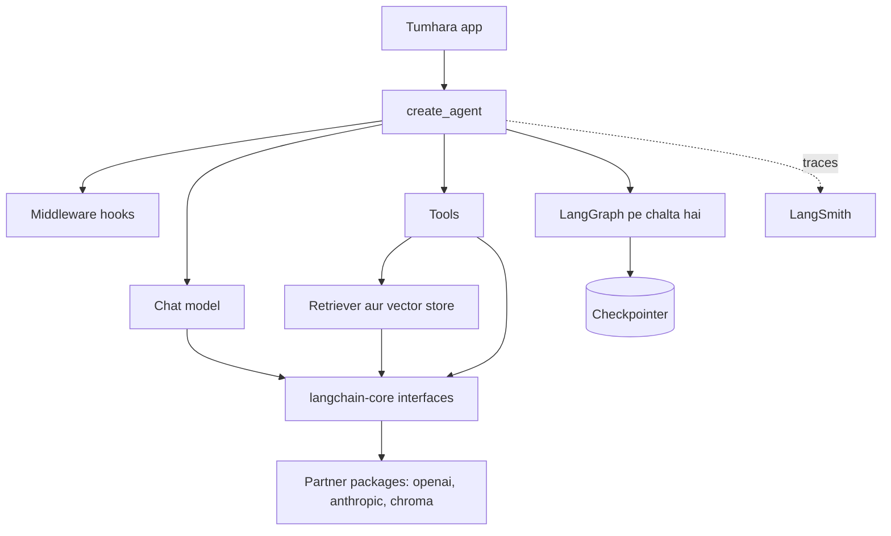
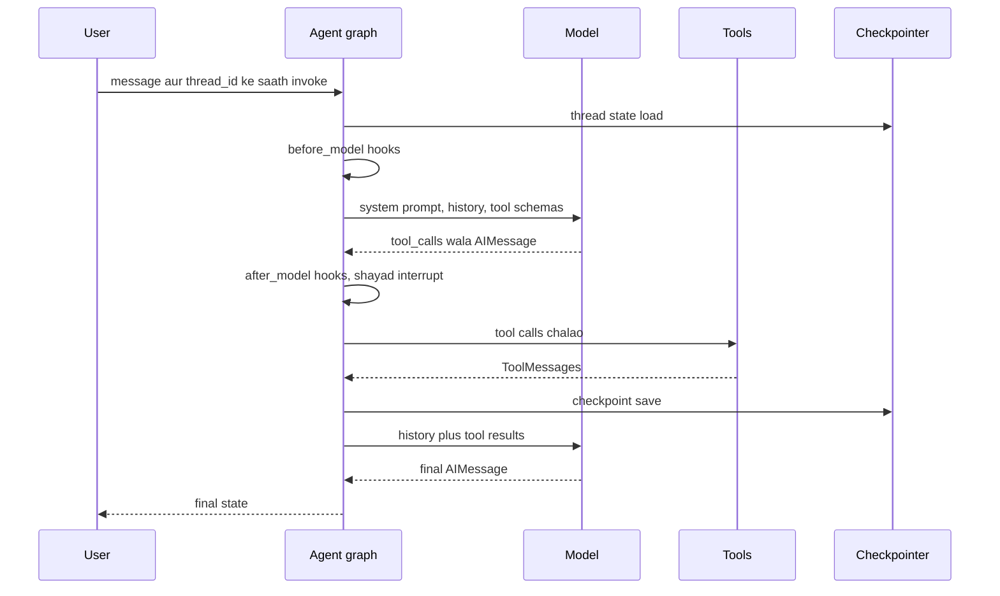

# LangChain

LangChain LLMs pe apps banane ki sabse zyada use hone wali Python aur JavaScript library hai. Ye har model provider ke liye ek interface deti hai, Python functions ko tools banane ka tareeka deti hai, aur ek ready-made agent loop (`create_agent`) deti hai jo LangGraph pe chalta hai. Interviewer ye isliye poochhte hain kyunki zyada teams ne ise chhua hai, kai logon ki iske baare me strong opinion hai, aur 1.0 rewrite ne 2023 me seekhi bahut saari cheezein badal di.

Ye page **LangChain 1.x** (`langchain` 1.4 ka daur, November 2026) aur LangGraph 1.x ke hisaab se likha hai. Jin purane tutorials me `LLMChain`, `initialize_agent` ya `AgentExecutor` hai, woh pre-1.0 code hai.

**Is page ke baad tum ye jawab de paoge:**
- "LangChain 1.0 me kya badla, aur `LLMChain` aur `AgentExecutor` kahan gaye?"
- "LangChain, LangGraph aur LangSmith me kya fark hai?"
- "`create_agent` asal me kya banata hai, aur middleware kis kaam ka hai?"
- "LangChain agent se typed JSON kaise nikaaloge?"
- "Kya LCEL abhi bhi use hota hai? `prompt | model | parser` kab likhoge?"
- "Log kehte hain LangChain me bahut zyada abstraction hai. Kya jawab doge?"
- "Jo LangChain agent baar-baar galat tool call kar raha hai, use debug kaise karoge?"
- "LangChain agent ko production-ready kaise banaoge?"

## Pehle ye shabd samjho

| Shabd | Simple matlab |
|---|---|
| Chat model | Ek provider ki LLM API ka wrapper jo messages ki list leta hai aur ek message lautata hai. |
| Message | Conversation ka ek turn: system, human, AI ya tool, text ke saath aur shayad tool calls ke saath. |
| Tool | Python function jise chalane ko model keh sakta hai. LangChain uska JSON schema khud banata hai. |
| Agent | Ek loop: model tool chunta hai, code chalata hai, result wapas jaata hai, jawab aane tak repeat. |
| `create_agent` | LangChain 1.x ka ek function jo tool-calling agent ko LangGraph graph ki tarah banata hai. |
| Middleware | Chhote hooks jo agent ke andar har model call ya tool call se pehle, baad me ya uske chaaron taraf chalte hain. |
| Structured output | Model se schema ke hisaab se data lena (jaise Pydantic class), free text nahi. |
| Retriever | Koi bhi cheez jo query string leke relevant documents ki list lautaye. |
| Vector store | Database jo text ko uske embedding ke saath rakhta hai aur query ke sabse paas wale dhoondhta hai. |
| Runnable | LangChain ka common interface: jisme `invoke`, `stream`, `batch` aur unke async roop hon. |
| LCEL | LangChain Expression Language: Runnables ko `|` se jod ke pipeline banana. |
| Partner package | Ek provider ke liye alag pip package, jaise `langchain-openai` ya `langchain-anthropic`. |
| LangSmith | LangChain ka hosted platform: tracing, evals, prompt management aur deployment ke liye. |
| Checkpointer | LangGraph component jo har step ke baad agent state save karta hai taaki run resume ho sake. |

## Big picture

Aaj LangChain teen layers ka stack hai. Sabse neeche `langchain-core` common interfaces define karta hai: messages, chat models, tools, retrievers, Runnables. Uske aas-paas partner packages hain jo asli providers aur databases jodte hain. Upar `langchain` package `create_agent` deta hai, ek prebuilt agent loop jo LangGraph pe chalta hai aur jise middleware se customise karte ho. LangSmith side me baith ke sab dekhta hai. Ye page har block samjhata hai, ek real app banata hai, phir dikhata hai run ke andar kya hota hai aur interview me choice ko defend kaise karna hai.



## ⭐ Aaj LangChain kya hai, aur mental model

**Ek line me:** LangChain 1.x models, messages aur tools ke liye ek patli, provider-neutral layer hai, plus ek prebuilt agent (`create_agent`) jo LangGraph pe chalta hai aur middleware se customise hota hai.

**Ye kyun chahiye:** Har LLM provider ki API ka shape alag hai: messages, tool calls, images, streaming. Common layer ke bina OpenAI se Claude pe jaana matlab har call dobara likhna. LangChain late 2022 me (Harrison Chase ne, ab company LangChain Inc.) yahi common layer plus prompts ki "chains" ke roop me shuru hua. 2024 tak isme bahut saare overlapping abstractions ho gaye. Version 1.0 (October 2025) ne ise kaat ke LangGraph ke upar ek agent abstraction tak la diya.

**Aise socho:** Universal travel adapter plus ek standard kitchen. Adapter (chat model interface) kisi bhi appliance ko kisi bhi desh ke socket me lagne deta hai. Kitchen (`create_agent`) ka layout fixed hai: chulha, sink, counter. Kitchen dobara nahi banate, fittings jodte ho (middleware), jaise chimney ya water filter.

**Kaise kaam karta hai, step by step:**

1. String se model chuno, jaise `"openai:gpt-5.5"`. LangChain matching partner package load karta hai.
2. Tools ko plain Python functions ki tarah `@tool` ke saath likho.
3. `create_agent(model, tools, ...)` call karo. Ye chhota LangGraph graph banata hai: ek model node aur ek tools node, loop me.
4. Extra behaviour ke liye middleware jodo: lambi chat summarise karo, refund se pehle insaan se poochho, model calls pe cap lagao.
5. `invoke` ya `stream` se chalao. Tracing on ho to har step LangSmith me trace hota hai.
6. Jab prebuilt loop chhota pade (kai agents, fixed branches, parallel steps), LangGraph graph khud likho. Dekho [LangGraph Core](02-langgraph-core.md).

| Product | Kya hai | Kis liye use karte ho |
|---|---|---|
| LangChain (`langchain`) | agent framework: models, tools, `create_agent`, middleware | ek loop aur kuch tools wale zyada tar agents |
| LangGraph (`langgraph`) | low-level runtime: graphs, state, checkpoints, interrupts | custom control flow, multi-agent, durable runs |
| Deep Agents (`deepagents`) | LangChain agents pe opinionated harness: planning, virtual files, subagents | lambe research ya coding tasks |
| LangSmith | hosted platform: tracing, evals, prompts, deployment | upar wale kisi ko bhi debug aur measure karna |

**Interview tip:** "LangChain vs LangGraph?" Bolo: "LangGraph runtime hai: state, graph, checkpoints, interrupts. LangChain 1.x upar wali layer hai: model aur tool integrations plus `create_agent`, jo khud ek LangGraph graph hai. Main `create_agent` se shuru karta hoon aur custom control flow chahiye ho to LangGraph pe utarta hoon."

**Common galti:**
- Kehna "LangChain aur LangGraph competitors hain". 1.x me LangChain agents LangGraph graphs hi hain.
- 2023 ke blog posts se seekhna. Us API ka zyada hissa ab `langchain-classic` me hai.

## ⭐ Package split aur 1.0 me kya badla

**Ek line me:** LangChain kai chhote pip packages hai: interfaces ke liye `langchain-core`, agents ke liye `langchain`, har provider ka ek package, aur purani chains ke liye `langchain-classic`.

**Ye kyun chahiye:** Ek bada package matlab har install sau integrations kheenchta tha aur har provider change kisi na kisi ko tod deta tha. Split se har provider package apna version alag rakhta hai aur `langchain` chhota rehta hai. 1.0 cleanup ne saara legacy code bahar kar diya, to main package me sirf wahi hai jo team aaj recommend karti hai.

**Aise socho:** IRCTC app jo pehle har train ka timetable APK ke andar bhejta tha. Ab app chhota hai aur sirf tumhare routes download karta hai.

**Kaise kaam karta hai, step by step:**

1. `langchain-core`: base classes aur interfaces. Messages, `BaseChatModel`, `BaseTool`, retrievers, vector store interface, Runnables. Bahut kam dependencies.
2. `langchain`: agent layer. Namespaces chhote hain: `langchain.agents` (`create_agent`), `langchain.messages`, `langchain.tools`, `langchain.chat_models` (`init_chat_model`), `langchain.embeddings`.
3. Partner packages: `langchain-openai`, `langchain-anthropic`, `langchain-google-genai`, `langchain-chroma`, `langchain-postgres` aur bahut saare. Har ek alag maintain aur release hota hai.
4. `langchain-community`: community integrations ki lambi list, quality bar kam.
5. `langchain-text-splitters`: chunking utilities jaise `RecursiveCharacterTextSplitter`.
6. `langchain-classic`: legacy chains (`LLMChain`, `ConversationChain`), purana `langchain.retrievers` module (jaise `MultiQueryRetriever`), indexing API, hub module, aur community re-exports. Sirf purane code ke liye install karo.
7. Saare packages ko Python 3.10 ya naya chahiye.

| 1.0 se pehle | 1.x me |
|---|---|
| `AgentExecutor`, `initialize_agent`, kai agent types | LangGraph pe bana ek `create_agent` |
| `langgraph.prebuilt.create_react_agent(prompt=...)` | `langchain.agents.create_agent(system_prompt=...)` |
| `pre_model_hook`, `post_model_hook` | middleware: `before_model`, `after_model`, `wrap_model_call` |
| `LLMChain`, `RetrievalQA`, `ConversationChain` | `langchain-classic` me gaye; agent ya plain LCEL use karo |
| `message.content` har provider me alag | `message.content_blocks`: text, reasoning, images, citations ka ek standard format |
| `msg.text()` method | `msg.text` property (method form warning deta hai) |
| per-run data `config["configurable"]` me | ab bhi chalta hai, par `context_schema` ke saath `context=` behtar |
| custom agent state Pydantic ya dataclass | `create_agent` state ke liye sirf `TypedDict` |

**Interview tip:** "LangChain 1.0 me kya badla?" Bolo: "Teen cheezein. Saari chains aur agent types LangGraph pe `create_agent` me simat gaye. Customisation middleware me gaya. Messages ko providers ke paar standard content blocks mile. Legacy code `langchain-classic` me gaya, to core package kaafi chhota hai."

**Common galti:**
- Jab maintained partner package maujood ho (`langchain_openai`, `langchain_chroma`) tab bhi `langchain_community` se import karna.
- Versions pin na karna. Partner packages jaldi-jaldi release hote hain; unhe saath pin karo aur evals ke saath branch pe upgrade karo.

## ⭐ Chat models aur `init_chat_model`

**Ek line me:** Chat model ek object hai jiske methods har provider ke liye same hain: `invoke`, `stream`, `batch`, `bind_tools` aur `with_structured_output`.

**Ye kyun chahiye:** OpenAI, Anthropic aur Google cheezon ke naam alag rakhte hain (`max_tokens`, `stop_reason`, `tool_use` blocks vs `tool_calls`). Common interface se ek string badal ke model switch kar sakte ho, aur bina naye code ke A/B tests ya fallbacks chala sakte ho.

**Aise socho:** UPI app. Paytm, PhonePe aur GPay alag banks se baat karte hain, par tumhe hamesha "amount daalo, PIN daalo" dikhta hai. Chat model interface wahi screen hai.

**Kaise kaam karta hai, step by step:**

1. `init_chat_model("openai:gpt-5.5")` prefix (`openai`) padhta hai, `langchain_openai.ChatOpenAI` import karta hai aur banata hai.
2. `model.invoke(messages)` messages bhejta hai aur `AIMessage` lautata hai.
3. `model.stream(messages)` tokens aate hi chhote `AIMessageChunk` deta hai.
4. `model.batch([m1, m2, m3])` kai inputs parallel threads me chalata hai.
5. `model.bind_tools([...])` tool schemas jodta hai, to reply me `tool_calls` aa sakte hain.
6. `AIMessage.usage_metadata` token counts deta hai, jaise `{"input_tokens": 812, "output_tokens": 64}`. ₹0.0002 per input token pe ye ek call lagbhag ₹0.16 ki hai.

```python
from langchain.chat_models import init_chat_model

# "provider:model" string partner package chunti hai (langchain-openai install hona chahiye)
model = init_chat_model("openai:gpt-5.5", temperature=0, timeout=30, max_retries=2)

reply = model.invoke("In one line, what is a vector database?")
print(reply.text)                 # 1.x me .text property hai
print(reply.usage_metadata)       # cost tracking ke liye input/output token counts

# Streaming: tokens aate hi print karo
for chunk in model.stream("Explain RAG to a 10 year old in 3 lines."):
    print(chunk.text, end="", flush=True)

# Same code, alag provider: sirf string badli
claude = init_chat_model("anthropic:claude-sonnet-5", max_tokens=1024)
```

**Code kya karta hai:**
- `init_chat_model` ek string se sahi provider class banata hai.
- `temperature=0`, `timeout` aur `max_retries` common settings hain jo har provider class leti hai.
- `.text` reply ke saare text parts jodta hai; `usage_metadata` standard token report hai.
- `stream` chunks deta hai; chunks jodne se poora message banta hai.
- Claude pe jaana ek line hai. Anthropic ke liye `max_tokens` khud set karo; 1.x me default ab 1024 pe fixed nahi.

**Interview tip:** "Providers safely kaise switch karoge?" Bolo: "Models ek hi jagah config string se `init_chat_model` se bante hain. Switch se pehle naye model pe eval set chalata hoon, kyunki same interface ke bawajood prompts aur tool-calling behaviour providers me alag hota hai."

**Common galti:**
- Sochna ki interface models ko interchangeable bana deta hai. Ek model ke liye tune kiya prompt doosre pe 10–20 points gir sakta hai.
- `timeout` nahi. Ek slow provider call request worker ko minutes tak atka sakti hai.

## Messages aur content blocks

**Ek line me:** Messages typed objects hain (`SystemMessage`, `HumanMessage`, `AIMessage`, `ToolMessage`), aur `content_blocks` providers ke paar text, reasoning, images aur tool calls ka ek standard view deta hai.

**Ye kyun chahiye:** Aaj ke model replies ek string nahi hote. Unme reasoning blocks, citations, server-side tool calls aur images hote hain, har provider ke alag format me. Standard blocks se tumhara UI aur logs unhe ek tarah padhte hain, provider koi bhi ho.

**Aise socho:** Courier waybill. Har courier company ka apna form hai, par Shiprocket ek standard label deta hai: sender, receiver, weight. `content_blocks` wahi label hai.

**Kaise kaam karta hai, step by step:**

1. Conversation ek list hai: system, human, AI, tool, AI, aur aage.
2. Jab model tool chahta hai, `AIMessage` me `tool_calls` hote hain, jaise `[{"name": "get_order_status", "args": {"order_id": "SW1234"}, "id": "call_1"}]`.
3. Tumhara code (ya agent) tool chalata hai aur `tool_call_id="call_1"` ke saath `ToolMessage` jodta hai.
4. `msg.content` provider ka raw shape rakhta hai. `msg.content_blocks` standard blocks deta hai jaise `{"type": "text"}`, `{"type": "reasoning"}`, `{"type": "image"}`.
5. Plain dicts jaise `{"role": "user", "content": "hi"}` har jagah chalte hain aur convert ho jaate hain.
6. `trim_messages` (`langchain.messages` me) purane messages ko token budget me kaatta hai, tool call ko uske result se alag kiye bina.

**Interview tip:** "Har tool call ka matching tool result kyun chahiye?" Bolo: "Providers aisi history reject karte hain jisme AI tool call ka same ID wala `ToolMessage` na ho. Isliye trimming ko pairs saath rakhne padte hain, warna agli call 400 error se fail hoti hai."

**Common galti:**
- History ko count se trim karna aur tool call aur uske result ke beech kaat dena.
- LangChain message objects ko apna database schema bana dena. Apna simple format store karo aur edge pe convert karo.

## ⭐ Tools

**Ek line me:** Tool docstring aur type hints wala Python function hai; `@tool` use schema me badalta hai jise model call kar sake, aur `ToolRuntime` use run context aur state tak safe access deta hai.

**Ye kyun chahiye:** Har function ke liye JSON schema haath se likhna slow hai aur galti hoti hai. Tools ko aisi cheezein bhi chahiye jo model control na kare, jaise logged-in `user_id`. Unhe model ko dikhne wale arguments me milana security hole hai.

**Aise socho:** Swiggy delivery partner ka app. Partner (model) buttons dekhta hai: "picked up mark karo", "customer ko call karo". Order ID aur partner ID app khud bharta hai. Partner kabhi type nahi karta.

**Kaise kaam karta hai, step by step:**

1. Type hints aur saaf docstring wala function likho. Docstring tool description banti hai jo model padhta hai.
2. `@tool` lagao. LangChain hints padh ke JSON schema banata hai.
3. Ek parameter `runtime: ToolRuntime[Context]` jodo. Ye model se chhupa rehta hai. Andar `runtime.context.user_id`, `runtime.state` aur `runtime.store` milte hain.
4. Tools `create_agent` ko do. Model sirf naam, description aur model wale arguments dekhta hai.
5. MCP servers ko MCP adapter se LangChain tools ki tarah load kar sakte ho, to wahi agent kisi bhi MCP server ke tools use kar sakta hai.
6. Purane code me `InjectedState`, `InjectedStore` ya `InjectedToolCallId` the. 1.x me in sab ke liye `ToolRuntime` use karo.

**Interview tip:** "Model ko doosre user ke orders padhne se kaise rokoge?" Bolo: "User ID kabhi model arguments se nahi aata. Woh `ToolRuntime.context` se aata hai, jo mera server authenticated session se bharta hai. Tool data lautane se pehle ownership check karta hai."

**Common galti:**
- "gets data" jaisi dhundhli docstrings. Model descriptions se tool chunta hai; kharab description matlab galat tool call.
- Tool se 50 KB ka JSON lautana. Sirf woh fields lautao jo model ko chahiye.

## ⭐ `create_agent`

**Ek line me:** `create_agent(model, tools, system_prompt, middleware, response_format, checkpointer, context_schema)` ek compiled LangGraph graph lautata hai jo model-tool loop tumhare liye chalata hai.

**Ye kyun chahiye:** Lagbhag har agent same loop hai: model call, tools chalao, repeat. 1.0 se pehle alag behaviour wali kai agent classes thi. Ab ek hai, LangGraph pe bani, to persistence, streaming aur human-in-the-loop free me milte hain.

**Aise socho:** Zomato cloud-kitchen franchise kit. Har outlet ko same layout aur process milta hai. Menu (tools) aur head chef (model) tum chunte ho, aur deewar pe rules lagate ho (middleware).

**Kaise kaam karta hai, step by step:**

1. Graph me ek `model` node aur ek `tools` node hai. Middleware unke pehle aur baad nodes jod sakta hai.
2. Input: `{"messages": [...]}`. State: kam se kam `messages`, plus woh fields jo middleware jode.
3. Model node system prompt, history aur tool schemas ke saath model call karta hai.
4. Reply me tool calls hon to tools node unhe chalata hai (kai hon to parallel) aur `ToolMessage` jodta hai.
5. Wapas model pe. Reply me tool calls na hon to run khatam.
6. `checkpointer` aur `thread_id` ke saath har step ke baad state save hoti hai. `response_format` ho to final state me `structured_response` bhi hota hai.
7. Result LangGraph graph hai, to use bade graph me node ya subgraph ki tarah jod sakte ho.

**Interview tip:** "`create_agent` kya lautata hai?" Bolo: "Ek compiled LangGraph `StateGraph`. Isliye ye `invoke`, `stream`, `ainvoke`, checkpointers, interrupts aur LangSmith Studio support karta hai, bilkul haath se likhe graph ki tarah."

**Common galti:**
- Aisa model dena jisme tools pehle se bound hain. 1.x me plain model aur tools list alag do.
- Agent ko 40 tools dena. Tool count badhne pe accuracy girti hai; domain se baanto ya tool-selector middleware use karo.

## ⭐ Middleware

**Ek line me:** Middleware woh hooks hain jo agent loop ke fixed points pe chalte hain (agent se pehle ya baad, har model call se pehle ya baad, ya har model ya tool call ke chaaron taraf) aur prompts, state ya control flow badalte hain.

**Ye kyun chahiye:** Purani shikayat thi: "prebuilt agent tab tak chalta hai jab tak ek chhota change na chahiye, phir sab dobara likhna padta hai". Middleware iska jawab hai. Summarisation, approvals, retries, PII masking aur dynamic prompts same loop pe plug-ins ban jaate hain, uske forks nahi.

**Aise socho:** Airport ke security checks. Har passenger ka safar same, par boarding se pehle check (before_model), pahunchne pe check (after_model), aur scanner jisme se bag guzarta hai (wrap_tool_call). Airport dobara banaye bina checks jodo ya hatao.

**Kaise kaam karta hai, step by step:**

1. Node-style hooks: `before_agent`, `before_model`, `after_model`, `after_agent`. Ye state padhte hain aur state update lautate hain, ya rokne ke liye `{"jump_to": "end"}`.
2. Wrap-style hooks: `wrap_model_call` aur `wrap_tool_call`. Inhe request aur ek `handler` milta hai. Handler ko zero, ek ya kai baar call karo (jaise 3 baar retry, ya model badal do).
3. `@dynamic_prompt` har call pe system prompt banata hai, jaise `request.runtime.context.user_role` se.
4. Order: `middleware=[a, b, c]` me before-hooks a, b, c chalte hain; after-hooks c, b, a; wrap-hooks nest hote hain to `a` sabko wrap karta hai.
5. Built-in middleware common zarurat cover karte hain:

| Middleware | Kya karta hai | Example setting |
|---|---|---|
| `SummarizationMiddleware` | token limit ke paas purane messages summarise karta hai | `trigger=("tokens", 4000), keep=("messages", 20)` |
| `HumanInTheLoopMiddleware` | chune hue tools se pehle approve, edit ya reject ke liye rukta hai | `interrupt_on={"issue_refund": True}` |
| `ModelCallLimitMiddleware` | har run ya thread me model calls pe cap | `run_limit=8` |
| `ToolCallLimitMiddleware` | tool calls pe cap, sab pe ya ek tool pe | `tool_name="search", run_limit=3` |
| `ModelFallbackMiddleware` | main model fail ho to backup models try karta hai | `"openai:gpt-5.4-mini"` |
| `ToolRetryMiddleware` / model retry | exponential backoff ke saath retry | `max_retries=3` |
| `PIIMiddleware` | PII pakad ke redact, mask ya block karta hai | email, credit card |
| `LLMToolSelectorMiddleware` | sasta model pehle relevant tools chunta hai | bahut saare tools |
| `TodoListMiddleware`, `ContextEditingMiddleware` | planning list; purane tool outputs saaf karna | lambe tasks |

```python
from langchain.agents.middleware import before_model, wrap_tool_call, AgentState
from langgraph.runtime import Runtime

@before_model(can_jump_to=["end"])
def stop_long_chats(state: AgentState, runtime: Runtime):
    if len(state["messages"]) > 60:                    # bhaagte threads pe safety valve
        return {"messages": [{"role": "assistant",
                              "content": "Let me connect you to a human agent."}],
                "jump_to": "end"}
    return None                                         # None = koi change nahi

@wrap_tool_call
def log_tools(request, handler):
    print("tool:", request.tool_call["name"], request.tool_call["args"])
    return handler(request)                             # asli tool chalao
```

**Code kya karta hai:**
- `stop_long_chats` har model call se pehle chalta hai aur thread bahut lamba ho to run khatam karta hai.
- `can_jump_to=["end"]` jump declare karta hai, taaki graph me woh edge ho.
- `log_tools` har tool call ko wrap karta hai; yahan timing, auth checks ya caching jod sakte ho.
- Dono `create_agent` ko `middleware=[stop_long_chats, log_tools]` ki tarah diye jaate hain.

**Interview tip:** "Sirf ₹500 se upar ke refunds pe human approval kaise jodoge?" Bolo: "`HumanInTheLoopMiddleware` tool ko naam se gate karta hai. Amount wale rule ke liye chhota `wrap_tool_call` ya `after_model` middleware likhunga jo args check kare aur sirf ₹500 se upar pe `interrupt` call kare. Checkpointer zaroori hai taaki ruka hua run bache."

**Common galti:**
- `HumanInTheLoopMiddleware` ke saath checkpointer bhool jaana; pause ke baad run resume nahi ho sakta.
- Jo business logic tool me honi chahiye use middleware me daalna. Middleware cross-cutting concerns ke liye hai.

## Structured output

**Ek line me:** Schema ko `response_format` me do (ya `model.with_structured_output(Schema)` call karo) aur LangChain `structured_response` me validated object lautata hai.

**Ye kyun chahiye:** Aage wale code ko fields chahiye, prose nahi. "Refund shayad ₹349 hai" database me nahi ja sakta. `amount: int` wala schema ja sakta hai.

**Aise socho:** Bank ka form jisme har field ka box hai, khaali page nahi. Clerk bina essay padhe process kar leta hai.

**Kaise kaam karta hai, step by step:**

1. Pydantic model, dataclass, TypedDict ya JSON schema define karo.
2. Use `response_format=Schema` ki tarah do. LangChain strategy chunta hai:
   - `ProviderStrategy`: provider ka native structured output (OpenAI, Anthropic, xAI aur doosre jo support karte hain). Sabse pakki guarantee.
   - `ToolStrategy`: bina native support wale models ke liye chhupa "is schema me jawab do" tool.
3. Plain JSON-schema dict ko in dono me se kisi strategy me explicitly wrap karna padta hai.
4. Output validate hota hai. `ToolStrategy` me validation error model ko retry ke liye wapas jaata hai.
5. `result["structured_response"]` padho.
6. Bina agent ke ek call ke liye `model.with_structured_output(Schema).invoke(...)` use karo.

```python
from pydantic import BaseModel, Field
from langchain.agents import create_agent

class TicketSummary(BaseModel):
    category: str = Field(description="late_delivery, missing_item, refund or other")
    order_id: str | None
    refund_inr: int = Field(ge=0, description="0 if no refund")

agent = create_agent("openai:gpt-5.5", tools=[], response_format=TicketSummary)
out = agent.invoke({"messages": [{"role": "user",
        "content": "Order SW1234 came without the raita, please refund 40 rupees"}]})
print(out["structured_response"])   # TicketSummary(category='missing_item', order_id='SW1234', refund_inr=40)
```

**Code kya karta hai:**
- Pydantic class contract hai; `Field` descriptions model ko guide karti hain.
- `response_format=TicketSummary` LangChain ko model ki profile se native ya tool strategy chunne deta hai.
- `ge=0` validation se enforce hota hai, sirf prompt se nahi.
- Parsed object final state me `messages` ke saath baithta hai.

**Interview tip:** "Native structured output vs tool-based?" Bolo: "Native provider ki constrained decoding use karta hai, to JSON hamesha parse hota hai. Tool strategy kisi bhi tool-calling model pe chalti hai par model ke schema follow karne pe tikti hai, errors pe retry ke saath. Provider support kare to main native chunta hoon." Dekho [Structured Outputs and Prompt Optimization](17-structured-outputs-prompting.md).

**Common galti:**
- Prompt me JSON maangna aur regex se parse karna. Schema use karo.
- Bahut bade nested schemas. Har extra level failures badhata hai; flat rakho.

## Retrievers, vector stores aur RAG

**Ek line me:** LangChain embeddings, vector stores aur retrievers ke liye ek interface deta hai, to RAG search ek tool ban sakta hai jise agent call kare.

**Ye kyun chahiye:** Dozens vector databases hain. Common `VectorStore` interface (`add_documents`, `similarity_search`, `as_retriever`) ka matlab in-memory store se prototype karo aur ek class badal ke pgvector ya Pinecone pe jao. Dekho [What is RAG](../09-rag/01-what-is-rag.md).

**Aise socho:** Library catalogue system jo same chalta hai, chahe kitabein chhoti school library me hon ya National Library me.

**Kaise kaam karta hai, step by step:**

1. Document loader se files ko `Document(page_content, metadata)` objects me load karo.
2. `langchain-text-splitters` ke `RecursiveCharacterTextSplitter(chunk_size=1000, chunk_overlap=200)` se split karo. Lagbhag 100,000 characters ki 40-page policy karib 120 chunks banti hai. Dekho [Chunking](../09-rag/03-chunking.md).
3. Embed karke store karo: `OpenAIEmbeddings` jaise embeddings model ke saath `vector_store.add_documents(chunks)`.
4. `vector_store.as_retriever(search_kwargs={"k": 4})` retriever deta hai. Retriever Runnable hai: `retriever.invoke("refund window")`.
5. Use karne ke do tareeke:
   - **2-step RAG:** hamesha retrieve karo, phir model ek baar call karo. Fast aur predictable.
   - **Agentic RAG:** search ko `@tool` me wrap karo; agent tay karta hai kab aur kya search karna hai, shayad kai baar.
6. `MultiQueryRetriever` jaise advanced retrievers ab `langchain-classic` me hain. Hybrid search aur reranking aam taur pe vector DB ya reranker integration karta hai. Dekho [Hybrid Search](../09-rag/04-hybrid-search.md).

| | 2-step RAG | Agentic RAG |
|---|---|---|
| Har sawal pe LLM calls | 1 | 2–4 |
| Latency | kam | zyada |
| "Policy A aur B compare karo" | kamzor | achha |
| Predictability | high | kam |

**Interview tip:** "RAG ke liye LangChain ya LlamaIndex?" Bolo: "Standard pipelines ke liye LangChain ki retrieval layer theek hai. Agar ingestion aur retrieval quality mushkil hissa hai, messy PDFs aur kai index types ke saath, to LlamaIndex zyada gehraai me jaata hai. Dono achhe se milte hain: LlamaIndex query engine LangChain agent me tool ban sakta hai." Dekho [LlamaIndex](24-llamaindex.md).

**Common galti:**
- Production me `InMemoryVectorStore`; restart pe sab gaya.
- Sab kuch re-embed kiye bina embedding model badalna. Purane aur naye vectors compare nahi ho sakte.

## LCEL aur Runnables, ab kahan khade hain

**Ek line me:** Runnables (`invoke`, `stream`, `batch`, async) ab bhi har model, retriever aur tool ka base interface hain; LCEL `prompt | model | parser` pipelines ab bhi chalti hain, par agents ke liye recommended raasta `create_agent` ya LangGraph hai.

**Ye kyun chahiye:** 2023 me LangChain ne LCEL laaya taaki koi bhi chain Runnables ko `|` se jod ke free me streaming, batching, async aur tracing paaye. Teams ne phir LCEL me complex branching logic banaya, jo padhna aur debug karna mushkil tha. Control flow LangGraph ne le liya; LCEL chhoti, seedhi pipelines ke liye reh gaya.

**Aise socho:** Pipe fitting system. Tap, filter aur bottle ko ek line me jodne ke liye badhiya. Loops aur valves wale poore ghar ki plumbing ke liye bekaar; uske liye proper naksha chahiye (LangGraph).

**Kaise kaam karta hai, step by step:**

1. Har Runnable me `invoke`, `batch`, `stream`, `ainvoke`, `abatch`, `astream` hain.
2. `a | b` ek `RunnableSequence` banata hai: `a` ka output `b` ka input.
3. `RunnableParallel({"context": retriever, "question": RunnablePassthrough()})` branches saath-saath chalata hai.
4. Poori chain ek unit ki tarah stream aur trace hoti hai.
5. Iske liye use karo: summariser, classifier, 2-step RAG chain, evaluation pipeline.
6. Iske liye nahi: loops, tool-calling agents, human approval, kuch bhi jo crash ke baad resume ho.

```python
from langchain_core.prompts import ChatPromptTemplate
from langchain_core.output_parsers import StrOutputParser
from langchain.chat_models import init_chat_model

prompt = ChatPromptTemplate.from_messages([
    ("system", "Classify the complaint into one word: late, missing, quality, other."),
    ("human", "{text}"),
])
classify = prompt | init_chat_model("openai:gpt-5.4-mini", temperature=0) | StrOutputParser()

print(classify.invoke({"text": "Biryani arrived cold after 70 minutes"}))   # late
print(classify.batch([{"text": "No spoon"}, {"text": "Too salty"}]))       # parallel calls
```

**Code kya karta hai:**
- `ChatPromptTemplate` `{text}` ko message list me bharta hai.
- `|` prompt, model aur parser ko ek Runnable me jodta hai.
- `StrOutputParser` `AIMessage` ko plain string banata hai.
- `batch` inputs parallel chalata hai, offline labelling jobs ke liye kaam ka.

**Interview tip:** "Kya LCEL mar gaya?" Bolo: "Nahi, Runnables ab bhi core interface hain aur chhoti seedhi chains ke liye LCEL theek hai. Par agents banane ka tareeka ab ye nahi. Control flow LangGraph ya `create_agent` me hona chahiye, jo padhna, test karna aur persist karna aasaan hai."

**Common galti:**
- `RunnableBranch` aur lambdas se LCEL me branching, retry aur loop logic banana. Padhne layak nahi rehta.
- Sochna LCEL matlab "LangChain". Jo interviewer 2024 me LangChain use karte the woh shayad LCEL ki baat kar rahe hon; version poochh lo.

## ⭐ Ek poora chhota app: Swiggy order support bot

**Ek line me:** Ek agent jo order-status ke sawal ka jawab deta hai, RAG se refund policy dekhta hai, aur insaan ke approve karne ke baad hi refund karta hai, summarisation aur call cap ke saath.

**Ye kyun chahiye:** Ye ek example upar ke saare blocks use karta hai: chat model, runtime context wale tools, retriever tool, `create_agent`, built-in middleware, checkpointer aur human-in-the-loop.

**Aise socho:** Swiggy support desk jisme policy binder hai, order lookup screen hai, aur ek supervisor hai jise har refund pe sign karna hai.

**Kaise kaam karta hai, step by step:**

1. Chhota policy vector store banao (block 1).
2. Teen tools likho: `search_policy`, `get_order_status`, `issue_refund` (block 2).
3. Middleware aur checkpointer ke saath agent banao (block 3).
4. Chalao; refund pe rukta hai; insaan approve karta hai; resume hota hai (block 4).

**Block 1: policy knowledge base.**

```python
from langchain_core.documents import Document
from langchain_core.vectorstores import InMemoryVectorStore
from langchain_openai import OpenAIEmbeddings
from langchain_text_splitters import RecursiveCharacterTextSplitter

policy_text = open("swiggy_refund_policy.md").read()          # asli zindagi me ~40 pages
docs = [Document(page_content=policy_text, metadata={"source": "refund_policy"})]
chunks = RecursiveCharacterTextSplitter(chunk_size=800, chunk_overlap=100).split_documents(docs)

store = InMemoryVectorStore(OpenAIEmbeddings(model="text-embedding-3-small"))
store.add_documents(chunks)                                    # har chunk embed karke store
retriever = store.as_retriever(search_kwargs={"k": 3})
```

**Code kya karta hai:**
- Policy file ko source metadata ke saath ek `Document` me lapetta hai.
- Use ~800-character chunks me 100 overlap ke saath kaatta hai, taaki kinaron ke sentences na khoyein.
- Har chunk embed karke memory me rakhta hai (production me `langchain-postgres` PGVector lagao).
- `as_retriever` kisi bhi query pe top 3 chunks lautata hai.

**Block 2: tools.**

```python
from dataclasses import dataclass
from langchain.tools import tool, ToolRuntime

@dataclass
class Ctx:
    user_id: str                                    # hamara server login session se bharta hai

ORDERS = {"SW1234": {"user": "u42", "status": "delivered", "total": 349}}

@tool
def search_policy(query: str) -> str:
    """Search Swiggy's refund and delivery policy. Use for any policy question."""
    return "\n\n".join(d.page_content for d in retriever.invoke(query))

@tool
def get_order_status(order_id: str, runtime: ToolRuntime[Ctx]) -> str:
    """Get status and total for one of the current user's orders."""
    o = ORDERS.get(order_id)
    if not o or o["user"] != runtime.context.user_id:    # ownership check, model ke haath me nahi
        return "Order not found for this user."
    return f"{order_id}: {o['status']}, total Rs {o['total']}"

@tool
def issue_refund(order_id: str, amount_inr: int) -> str:
    """Refund an amount in rupees for an order. Needs human approval."""
    return f"Refund of Rs {amount_inr} issued for {order_id}."
```

**Code kya karta hai:**
- `Ctx` me woh data hai jo model ko banana nahi chahiye; `runtime` model ke schema se chhupa hai.
- `search_policy` retriever ko tool bana deta hai, to ye agentic RAG hai.
- `get_order_status` check karta hai ki order logged-in user ka hai.
- Docstrings woh descriptions hain jinse model tools chunta hai.

**Block 3: agent.**

```python
from langchain.agents import create_agent
from langchain.agents.middleware import (
    HumanInTheLoopMiddleware, SummarizationMiddleware, ModelCallLimitMiddleware)
from langgraph.checkpoint.memory import InMemorySaver

agent = create_agent(
    model="openai:gpt-5.5",
    tools=[search_policy, get_order_status, issue_refund],
    system_prompt=("You are Swiggy support. Check the order and the policy before any refund. "
                   "Never promise more than the policy allows."),
    context_schema=Ctx,
    middleware=[
        HumanInTheLoopMiddleware(interrupt_on={"issue_refund": {"allowed_decisions": ["approve", "reject"]}}),
        SummarizationMiddleware(model="openai:gpt-5.4-mini", trigger=("tokens", 6000), keep=("messages", 20)),
        ModelCallLimitMiddleware(run_limit=8),        # har user message pe hard cap
    ],
    checkpointer=InMemorySaver(),                     # production me PostgresSaver
)
```

**Code kya karta hai:**
- `issue_refund` se pehle rukta hai; insaan sirf approve ya reject kar sakta hai, edit nahi.
- Thread 6,000 tokens paar kare to saste model se purane turns summarise karta hai.
- 8 model calls ke baad run rokta hai, taaki confused loop paise na jalaye.
- Checkpointer `thread_id` ke hisaab se state save karta hai, jo pause aur resume ke liye zaroori hai.

**Block 4: chalao, ruko, approve karo, resume karo.**

```python
from langgraph.types import Command

cfg = {"configurable": {"thread_id": "chat-9001"}}
ctx = Ctx(user_id="u42")

out = agent.invoke({"messages": [{"role": "user",
        "content": "SW1234 was missing raita worth 40 rupees, refund please"}]}, cfg, context=ctx)

if "__interrupt__" in out:                            # issue_refund se pehle ruka
    print("Needs approval:", out["__interrupt__"][0].value)
    out = agent.invoke(Command(resume={"decisions": [{"type": "approve"}]}), cfg, context=ctx)

print(out["messages"][-1].text)                       # "Done, Rs 40 refunded for SW1234."
```

**Code kya karta hai:**
- Pehli call get_order_status aur search_policy chalati hai, phir refund se pehle rukti hai.
- `__interrupt__` me pending tool call hai, supervisor UI ke liye.
- Same `thread_id` ke saath `Command(resume=...)` saved checkpoint se aage chalata hai.
- Asli app me approve call ghanton baad doosri request se aati hai; checkpointer ise mumkin banata hai.

**Interview tip:** "LangChain se support agent kaise banaoge, samjhao." Yahi order bolo: ownership checks wale tools, policy ke liye retriever tool, `create_agent`, approval, summarisation aur limits ke liye middleware, Postgres checkpointer, LangSmith tracing, 50 asli tickets ka eval set.

**Common galti:**
- Model ko `user_id` tool argument ki tarah dene dena.
- Sirf happy path test karna. Aise tickets bhi jodo jahan refund mana hona chahiye.

## ⭐ Andar kaise kaam karta hai: ek run, step by step

**Ek line me:** Ek `invoke` ek LangGraph run hai: middleware hooks, tool schemas ke saath model call, tool execution, har step ke baad state save, jab tak model tools call karna band na kare.

**Ye kyun chahiye:** Agent galat kare to pata hona chahiye kaunsa step dekhna hai: bheja gaya prompt, tool args, ya hook ke baad ki state. Andar ka raasta pata ho to debugging tez hoti hai.

**Aise socho:** Stations wala train safar. Har station (step) pe TC ticket pe stamp lagata hai (checkpoint). Train ruke to aakhri stamp wale station se dobara shuru.

**Kaise kaam karta hai, step by step:**

1. `invoke` thread ka aakhri checkpoint load karta hai (naye thread ke liye khaali) aur naya human message jodta hai.
2. `before_agent` hooks ek baar chalte hain. Phir `before_model` hooks (summarisation yahan purane messages badal sakta hai).
3. Model node request banata hai: system prompt (ya `dynamic_prompt` ka result), message history, tool schemas, aur structured-output schema agar ho. `wrap_model_call` hooks call ko wrap karte hain (retries, fallback).
4. Provider `AIMessage` lautata hai. `after_model` hooks chalte hain (human-in-the-loop yahan tool calls check karke `interrupt` kar sakta hai).
5. Tool calls hon to tools node har ek ko `wrap_tool_call` hooks se guzaarta hai aur `ToolMessage` jodta hai. Checkpoint save.
6. Wapas step 2. Tool calls nahi matlab khatam: `after_agent` hooks chalte hain aur final state lautti hai.
7. Swiggy example me: 3 model calls (plan, order check ke baad, policy ke baad), 2 tool calls, 1 interrupt, phir approval ke baad 1 aur model call. Kul lagbhag 6,000 input tokens.



**Interview tip:** "Jo agent baar-baar galat tool call kare use kaise debug karoge?" Bolo: "LangSmith trace kholke exact model request padhta hoon: tool descriptions, system prompt aur history. Aksar do tools ki descriptions overlap karti hain ya history bhari hui hai. Descriptions theek karta hoon, tools kam karta hoon, kuch examples jodta hoon, phir confirm karne ke liye eval set chalata hoon."

**Common galti:**
- Sirf final answer se debug karna. Bug lagbhag hamesha kisi beech ke message me dikhta hai.
- Bhool jaana ki summarisation badal deta hai model kya dekhta hai; raw thread nahi, hook ke baad ke messages check karo.

## Production concerns

**Ek line me:** Production me durable checkpointer, streaming, LangSmith tracing aur evals, calls aur cost pe limits, aur ek deployment target jodte ho.

**Ye kyun chahiye:** Demo agent laptop pe chalta hai. Production ko aise runs chahiye jo restart jhel sakein, UI jo progress dikhaye, ye dekhne ka tareeka ki jawab #4,512 galat kyun tha, aur aisa bill jo finance ko chaunka na de.

**Aise socho:** Ghar ki tiffin service se licensed restaurant tak jaana: fridge logs, CCTV, cash register aur fire safety, sirf achha khaana nahi.

**Kaise kaam karta hai, step by step:**

1. **Persistence:** threads ke liye `PostgresSaver` (ya koi aur LangGraph checkpointer); threads ke paar long-term memory ke liye LangGraph `Store`. Dekho [Memory & Context](05-memory-context.md).
2. **Streaming:** tokens ke liye `agent.stream(input, cfg, stream_mode="messages")`, step-by-step progress ke liye `"updates"`. 1.x me streamed node names `model` aur `tools` hain (purana code `agent` match karta tha).
3. **Tracing:** `LANGSMITH_TRACING=true` aur `LANGSMITH_API_KEY` set karo. Har model call, tool call aur middleware step ek span banta hai. Doosra backend ho to OpenTelemetry export milta hai. Dekho [AI Observability](10-agent-observability.md).
4. **Evals:** 50–200 asli conversations ka dataset rakho; har prompt ya model change pe LangSmith `evaluate` (ya apna runner) code checks aur LLM-judge scores ke saath chalao. Dekho [Evals for Agents](09-agent-evals.md).
5. **Deployment:** koi bhi Python web server (FastAPI) chalega; LangSmith Deployment (pehle LangGraph Platform) agents ko built-in task queues, persistence aur streaming APIs ke saath host karta hai.
6. **Cost aur latency:** `ModelCallLimitMiddleware`, summarisation aur tool selection ke liye sasta model, system prompt aur tool list stable rakh ke prompt caching. Lagbhag 3,000 input tokens wali 4 model calls ka run 12,000 tokens hai; ₹0.0002 per token pe karib ₹2.4 per ticket. Dekho [Cost & Latency](11-cost-latency.md).
7. **Failure modes:** provider timeouts (retry aur fallback middleware), tool exceptions (tool error ya retry middleware error model ko lautata hai), infinite loops (call limits), version drift (packages pin karo).

**Interview tip:** "LangChain agent ko production-ready kaise banaoge?" Bolo: "Postgres checkpointer, UI tak streaming, LangSmith tracing, call aur tool limits, fallback models ke saath retries, zarurat ho to PII middleware, pinned versions, aur ek eval set jo har change ship hone se pehle CI me chale."

**Common galti:**
- Production me `InMemorySaver`. Har deploy saare threads aur pending approvals mita deta hai.
- Eval set nahi, to chhota sa `langchain-openai` upgrade chupke se behaviour badal deta hai.

## ⭐ Kab use karo, aur comparison

**Ek line me:** LangChain tab use karo jab bahut integrations ke saath standard tool-calling agent chahiye aur LangGraph tak saaf upgrade path chahiye; chhoti scripts ke liye ya ek provider pe sabse patli layer chahiye to skip karo.

**Ye kyun chahiye:** "LangChain kyun?" interview ka favourite sawal hai, aksar uske baad "isme bahut abstraction nahi hai?". Tumhe fair jawab chahiye, fan wala nahi.

**Aise socho:** Ola, rented car aur apni scooter me se chunna. Har ek kisi trip ke liye sahi hai.

**Kaise kaam karta hai, step by step:**

1. Poochho tumhari problem me mushkil kya hai: control flow, data, typing, ya provider features.
2. Tools ke saath ek agent loop aur provider ki azaadi chahiye: `create_agent`.
3. Complex branching, multi-agent ya approvals ke saath lamba chalne wala: seedha LangGraph.
4. Messy documents pe ingestion aur retrieval: LlamaIndex, shayad tool ki tarah.
5. Chhoti service me typed outputs aur dependency injection: Pydantic AI. Dekho [DSPy and Pydantic AI](30-dspy-pydantic-ai.md).
6. Ek hi provider pe poori tarah: us provider ka SDK (OpenAI Agents SDK, Claude Agent SDK).

| | LangChain 1.x | LangGraph | LlamaIndex | OpenAI Agents SDK |
|---|---|---|---|---|
| Main idea | prebuilt agent plus middleware | explicit graph jo tum design karo | data aur retrieval pehle | agents, handoffs, guardrails |
| Control flow | fixed loop, hooks | kuch bhi | Workflows (events) | loop plus handoffs |
| Integrations | sabse bada catalogue | LangChain wale use karta hai | data ke liye bahut bada | kam, OpenAI-centred |
| Persistence | LangGraph checkpointer se | built in | Context serialise karo | sessions |
| Learning curve | low-medium | medium-high | medium | low |
| Best for | standard tool agents, kai providers | custom, durable flows | RAG-heavy apps | OpenAI shops, jaldi agents |

**"Bahut zyada abstraction" wali shikayat, aur 1.x ka jawab.** 2023–2024 ki shikayatein sahi thi: ek jaisa kaam karne wali kai classes, gehri inheritance, chhupe prompts, das layers se guzarte stack traces, baar-baar breaking changes. Version 1.x ka jawab:
- Kai chain aur agent classes ki jagah ek agent abstraction.
- Legacy code `langchain-classic` me bahar.
- Subclassing ki jagah chhote middleware hooks se customisation.
- Agent me koi chhupa prompt nahi: system prompt tum likhte ho; tool schemas tumhare functions se aate hain.
- Stability ka vaada: 2.0 tak koi breaking change nahi.
- Neeche LangGraph, to abstraction se ladne ki jagah hamesha ek level neeche utar sakte ho.

Fair jawab keemat bhi maanta hai: ek aur dependency jo jaldi badalti hai, aur tumhare aur provider ke naye features ke beech ek layer.

**Interview tip:** "LangChain me bahut abstraction nahi hai?" Bolo: "1.0 se pehle tha. 1.x me agent LangGraph pe ek function hai, middleware se customise hota hai, aur purani chains alag package me hain. Main ise integrations aur agent loop ke liye use karta hoon, tools plain functions rakhta hoon, aur control chahiye to LangGraph ya raw SDK pe utarta hoon. Tracing mujhe har raw request dikhata hai, to kuch sach me chhupa nahi."

**Common galti:**
- "Sab use karte hain" isliye LangChain chunna, bina bataye ki ye kya deta hai.
- Saalon tak ek codebase me `langchain-classic` chains aur naye agents milana. Migrate karo.

## Real projects ki common galtiyan

**Ek line me:** Zyada tar LangChain bugs purane tutorials, version mismatch, unsafe tool inputs aur missing limits se aate hain, model se nahi.

**Ye kyun chahiye:** Ye code reviews me aur "koi problem batao jo tumne jheli" wale interview jawabon me aate hain.

**Aise socho:** Purane Google Maps download ke saath gaadi chalana. Sadkein badal gayi, aur tum band exits lete rehte ho.

**Kaise kaam karta hai, step by step:**

1. **Purane imports.** `from langchain.chains import LLMChain` 1.x pe fail hota hai. `create_agent`, LCEL, ya `langchain_classic` use karo.
2. **Mismatched versions.** `langchain` 1.x ke saath purana `langchain-openai` 0.x ajeeb errors deta hai. Saath upgrade karo.
3. **Async servers me sync.** FastAPI async routes me `invoke` call karna event loop block karta hai; `ainvoke` aur `astream` use karo.
4. **Tool errors run crash karte hain.** Tool-error ya retry middleware use karo taaki model "error: order service timeout" dekhe aur jawab de sake.
5. **Bina hadd ke loops.** Na `ModelCallLimitMiddleware`, na recursion limit, to confused agent 25 calls kar deta hai.
6. **Badi state.** State me poori PDFs; har checkpoint unhe copy karta hai. IDs rakho, blobs nahi.
7. **Prompt-cache misses.** Har call pe tool order badalna ya system prompt me timestamp jodna provider ka prefix cache tod deta hai.
8. **Streaming name change.** Jo UI code stream events ko node `"agent"` se filter karta tha woh 1.x me tootega jahan ye `"model"` hai.

**Interview tip:** "Koi LangChain issue batao jo tumne debug kiya." Ek asli pattern chuno, jaise: "1.x upgrade ne hamari UI streaming tod di kyunki node names `agent` se `model` ho gaye. Staging eval run me pakda, filter theek kiya, aur stream events pe test joda."

**Common galti:**
- 2023 ke blog post ka code 2026 ke codebase me copy karna.
- Tools ke andar saare exceptions pakad ke "success" lautana, jo failures model aur tum dono se chhupata hai.

## Interview ke sawal

**Q: 1.x roop me LangChain ek sentence me kya hai?**
A: Chat models, messages aur tools ke liye provider-neutral layer, plus `create_agent`, ek prebuilt tool-calling agent jo LangGraph pe chalta hai aur middleware se customise hota hai.

**Q: LangChain 1.0 me kya badla?**
A: Saari chains aur agent classes ki jagah LangGraph pe `create_agent` aaya, customisation middleware me gaya, messages ko standard `content_blocks` mile, aur legacy code `langchain-classic` me gaya. Python 3.10+ zaroori.

**Q: LangChain vs LangGraph vs LangSmith?**
A: LangGraph runtime hai (graph, state, checkpoints, interrupts). LangChain upar ka higher-level framework hai (integrations plus `create_agent`). LangSmith tracing, evals aur deployment ka platform hai, aur in sab ke saath chalta hai.

**Q: Middleware kya hai aur kyun joda gaya?**
A: Agent loop ke fixed points pe hooks: model se pehle ya baad, model ya tool calls ke chaaron taraf. Isse summarisation, approvals, retries, limits aur PII handling agent fork kiye bina jod sakte ho, jo purane prebuilt agents ka sabse bada dard tha.

**Q: Agent se guaranteed JSON kaise loge?**
A: Pydantic schema `response_format` me do. Provider support kare to LangChain native structured output (`ProviderStrategy`) use karta hai, warna validation aur retry ke saath chhupa tool (`ToolStrategy`). `structured_response` padho.

**Q: Kya LCEL abhi relevant hai?**
A: Runnables ab bhi models, retrievers aur tools ka core interface hain, aur chhoti seedhi chains ke liye `prompt | model | parser` theek hai. Agents aur branching flows `create_agent` ya LangGraph pe hone chahiye.

**Q: Logged-in user ko tool tak safely kaise pahunchaoge?**
A: `context_schema` define karo, authenticated session se invoke pe `context=` do, aur tool me `ToolRuntime` se padho. Model use na dekhta hai na set karta hai.

**Q: Jo agent galat tool call kare use kaise debug karoge?** (debugging)
A: Exact request ke liye LangSmith trace padho: tool descriptions, history, system prompt. Overlapping descriptions theek karo, tool count kam karo ya LLM tool-selector middleware jodo, phir eval set dobara chalao.

**Q: Ise production-ready kaise banaoge?**
A: Postgres checkpointer, streaming, LangSmith tracing, call aur tool limits, retry aur fallback middleware, PII handling, pinned versions, aur CI me evals.

**Q: "LangChain me bahut abstraction hai." Jawab do.** (trade-off)
A: 0.x ke liye sahi tha. 1.x me ek agent function hai, changes ke liye middleware, aur poora control chahiye to neeche LangGraph. Main tools plain functions aur models ek factory ke peeche rakhta hoon, to chhodna mahino nahi, dino ka kaam hai.

**Q: LangChain kab use nahi karoge?**
A: Ek provider aur 30-line loop, latency-critical hot path, ya aisi team jo dependency churn na jhel sake. Tab provider SDK seedha apne step cap aur tracing ke saath use karta hoon.

**Q: 2-step RAG chain ya agentic RAG?** (trade-off)
A: 2-step ek LLM call hai, sasta aur predictable, single-fact sawalon ke liye achha. Agentic RAG model ko kai baar search aur compare karne deta hai, 2–4x calls pe. 2-step se shuru karo aur evals me multi-hop sawal fail hon tab switch karo.

**Q: Team ka 2024 ka codebase `AgentExecutor` pe hai. Migration plan batao.** (kya karoge)
A: Versions freeze karo, production logs se eval set banao, agent ko `create_agent` aur custom hooks ke liye middleware se dobara likho, purani chains ko kuch time `langchain-classic` pe rakho, evals compare karo, phir flag ke peeche roll out karo.

**Q: Deep Agents kya hai aur kab use karoge?**
A: LangChain agents ke upar opinionated harness jisme planning, virtual filesystem aur subagents hain. Lambe research ya coding tasks ke liye jahan ye built-in chahiye; poora control chahiye to plain `create_agent`.

**Q: Har conversation ki cost pe cap kaise lagaoge?**
A: Har run aur har thread pe `ModelCallLimitMiddleware` aur `ToolCallLimitMiddleware`, saste model se summarisation, caching ke liye stable prompt prefix, aur LangSmith se tokens per thread pe alerts.

## Aage padho

- [Agent Frameworks and Tooling](19-agent-frameworks.md)
- [LangGraph Core](02-langgraph-core.md)
- [LlamaIndex](24-llamaindex.md)
- [OpenAI Agents SDK](27-openai-agents-sdk.md)

## Checklist

- [ ] Main samjha sakta hoon ki LangChain 1.x kya hai aur LangGraph aur LangSmith se kaise juda hai.
- [ ] Main bata sakta hoon 1.0 me kya badla aur kya `langchain-classic` me gaya.
- [ ] Main `init_chat_model` se chat model bana sakta hoon aur ek string se provider badal sakta hoon.
- [ ] Main aisa tool likh sakta hoon jo user ID model arguments ki jagah `ToolRuntime` context se padhe.
- [ ] Main samjha sakta hoon `create_agent` kya banata hai aur ek run step by step chala ke dikha sakta hoon.
- [ ] Main middleware hook types bata sakta hoon aur approval, summarisation aur limits ke liye built-in middleware chun sakta hoon.
- [ ] Main validated structured output le sakta hoon aur native vs tool strategy samjha sakta hoon.
- [ ] Main samjha sakta hoon LCEL ab kahan fit hota hai aur kahan LangGraph behtar hai.
- [ ] Main "bahut abstraction" wali shikayat ka jawab de sakta hoon aur LangChain ko LangGraph, LlamaIndex aur OpenAI Agents SDK se compare kar sakta hoon.
