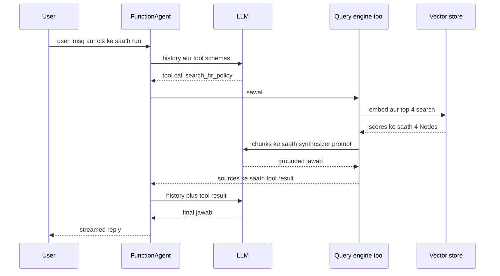

# LlamaIndex

LlamaIndex ek Python (aur TypeScript) framework hai jo tumhare apne data pe LLM apps banane ke liye hai: files load karna, chunking, indexing, retrieve karna aur jawab dena, plus upar event-driven Workflows aur agents. LangChain "models aur tools call karo" se shuru hua tha, LlamaIndex "sahi data prompt tak pahunchao" se. Interviewer ye RAG-heavy roles ke liye poochhte hain: knowledge assistants, document Q&A, contract aur invoice extraction.

Ye page **LlamaIndex Python 0.14.x** (`llama-index-core`, November 2026) aur alag `llama-index-workflows` package ke hisaab se likha hai. Jin purane tutorials me `ServiceContext`, `OpenAIAgent`, `AgentRunner` ya `chat_mode="react"` hai, woh outdated code hai.

**Is page ke baad tum ye jawab de paoge:**
- "LlamaIndex me Document aur Node me kya fark hai?"
- "Query engine vs chat engine vs agent: kab kaunsa use karoge?"
- "Response synthesizer kya karta hai, aur `compact`, `refine` aur `tree_summarize` kya hain?"
- "Ingestion pipeline bina badle documents ko dobara embed karne se kaise bachata hai?"
- "LlamaIndex Workflows kya hain, aur LangGraph graph se kaise alag hain?"
- "LlamaIndex RAG app ko evaluate kaise karoge?"
- "2,000 PDFs pe HR policy bot ke liye LlamaIndex ya LangChain?"
- "LlamaParse aisa kya karta hai jo normal PDF reader nahi karta?"

## Pehle ye shabd samjho

| Shabd | Simple matlab |
|---|---|
| Document | Ek load kiya hua source (PDF, web page, DB row) apne text aur metadata ke saath. |
| Node | Document ka ek chunk, metadata ke saath aur padosiyon aur parent ke links ke saath. |
| Reader | Connector jo kisi source se data Documents me load karta hai. |
| LlamaHub | LlamaIndex ke community readers, tools aur integrations ka catalogue. |
| Node parser | Splitter jo Documents ko Nodes me todta hai (sentences, markdown headings, matlab se). |
| Embedding | Numbers ki list jo text ka matlab pakadti hai, taaki milte-julte texts paas hon. |
| Index | Nodes ke upar structure jo unhe searchable banata hai, aksar vector index. |
| Retriever | Sawal leke sabse relevant Nodes scores ke saath lautata hai. |
| Response synthesizer | Sawal plus retrieved Nodes leke LLM se jawab likhwata hai. |
| Query engine | Retriever plus postprocessors plus synthesizer: ek sawal andar, ek jawab bahar. |
| Chat engine | Conversation memory wala query engine, multi-turn chat ke liye. |
| Workflow | LlamaIndex ka event-driven orchestration: steps jo events sunte hain aur naye events nikaalte hain. |
| Agent | LLM jo loop me tools chunta hai; LlamaIndex me `FunctionAgent` ya `ReActAgent`. |
| LlamaCloud | LlamaIndex ka hosted platform: LlamaParse, extraction, managed indexes, deployment. |

## Big picture

LlamaIndex ek data pipeline hai jiske end me LLM hai. Readers Documents load karte hain. Node parsers unhe Nodes me todte hain. Ingestion pipeline Nodes ko embed aur store karti hai, caching ke saath taaki dobara chalana sasta ho. Index Nodes ko searchable banata hai; retriever sabse achhe dhoondhta hai; response synthesizer jawab likhta hai. Query engines aur chat engines is raaste ko pack karte hain. Workflows aur agents upar baithte hain, taaki retrieval kai tools me se ek ho. Ye page har block samjhata hai, HR policy bot banata hai, phir dikhata hai query ke andar kya hota hai aur choice ko defend kaise karna hai.


## ⭐ LlamaIndex kya hai, aur mental model

**Ek line me:** LlamaIndex data-first framework hai: RAG ke liye connectors, parsing, chunking, indexing, retrieval aur answer synthesis, aur upar bane event-driven Workflows aur agents.

**Ye kyun chahiye:** LLMs ko tumhari company ka data nahi pata, aur context window limited aur mehngi hai. Knowledge assistant ka zyada kaam hazaron messy pages me se sahi 2–5 chunks nikaalna hai. LlamaIndex (Jerry Liu ne late 2022 me "GPT Index" naam se shuru kiya, ab LlamaIndex Inc.) isi pe focus karta hai. Agents aur Workflows baad me jode gaye taaki retrieval doosre tools aur multi-step logic ke saath mil sake.

**Aise socho:** Ek badi library. Readers woh trucks hain jo kitabein laate hain. Node parsers kitabon ko chapters me kaatte hain. Index catalogue hai. Retriever librarian hai jo 4 relevant chapters dhoondhta hai. Synthesizer woh insaan hai jo unhe padh ke tumhara jawab likhta hai. Agents research assistant hain jo tay karte hain librarian se poochhna hai, HR ko call karna hai, ya dono.

**Kaise kaam karta hai, step by step:**

1. Load: `SimpleDirectoryReader("./policies").load_data()` Documents deta hai.
2. Split: node parser 2,000 pages ko lagbhag ~512 tokens ke 6,000 Nodes me todta hai.
3. Embed aur store: har Node ka embedding banta hai (6,000 × ek call, batch me) aur vector store me jaata hai.
4. Query: retriever sawal embed karta hai aur top `k` Nodes chunta hai (maan lo 4).
5. Synthesize: LLM ko sawal plus woh 4 Nodes milte hain aur woh source references ke saath jawab likhta hai.
6. Wrap: query engine ko agent ke liye tool banao, ya Workflow me steps jodo.

Package layout:

| Package | Isme kya hai |
|---|---|
| `llama-index` | starter bundle: core plus OpenAI LLM, embeddings aur kuch readers |
| `llama-index-core` | Documents, Nodes, indexes, retrievers, query engines, agents, `Settings` |
| `llama-index-workflows` | Workflow engine (`workflows` naam se import, `llama_index.core.workflow` me bhi re-export) |
| `llama-index-llms-*`, `llama-index-embeddings-*` | har provider ka ek package, jaise `llama-index-llms-anthropic` |
| `llama-index-vector-stores-*`, `llama-index-readers-*` | har vector DB ya data source ka ek package |
| `llama-cloud` | LlamaParse jaisi LlamaCloud services ka SDK |

**Interview tip:** "LlamaIndex kis cheez me best hai?" Bolo: "RAG ke data side me: bahut readers, LlamaParse se strong parsing, kai node parsers aur index types, aur achhe retrieval building blocks. Agents aur Workflows bhi solid hain, par main ise mainly tab chunta hoon jab ingestion aur retrieval quality mushkil hissa ho."

**Common galti:**
- Sochna LlamaIndex "bas vector database ka wrapper" hai. Value parsing, chunking, retrieval strategies aur synthesis me hai.
- 2023 ka `ServiceContext` wala code copy karna. Uski jagah global `Settings` object aa gaya.

## ⭐ Documents aur Nodes

**Ek line me:** Document ek poora source hai; Node uska ek chunk hai metadata aur relationships ke saath, aur Nodes hi embed aur retrieve hote hain.

**Ye kyun chahiye:** 200-page PDF ko ek vector me embed nahi kar sakte; matlab dhundhla ho jaata hai aur prompt me fit nahi hota. Nodes me todne se search sateek hota hai. Links rakhne se (source document, pichla aur agla Node, parent) citations dikha sakte ho, padosi la sakte ho, aur sab dobara banaye bina ek file update kar sakte ho.

**Aise socho:** Ek textbook (Document) aur uske numbered paragraphs (Nodes). Har paragraph ko pata hai uski kitaab, chapter, aur uske pehle aur baad ke paragraphs kaun se hain.

**Kaise kaam karta hai, step by step:**

1. `Document` me `text`, `metadata` (jaise `{"file_name": "leave_policy.pdf", "dept": "HR"}`) aur ek stable `doc_id` hota hai.
2. Node parser `TextNode` banata hai. Har Node Document ka metadata copy karta hai aur relationships paata hai: `SOURCE`, `PREVIOUS`, `NEXT`, aur kabhi `PARENT` ya `CHILD`.
3. Default me metadata us text me shaamil hota hai jo embed hota hai aur LLM ko jaata hai. `excluded_embed_metadata_keys` aur `excluded_llm_metadata_keys` se keys hata sakte ho.
4. Metadata se query time pe filters lagte hain: "sirf `dept == HR` aur `year >= 2025`".
5. Stable `doc_id`s se ingestion pipeline badli files pakad ke sirf unke Nodes update karti hai.

**Interview tip:** "Nodes pe metadata kyun rakhte ho?" Bolo: "Teen reasons: filtering (sirf ye tenant ya department), citations (jawab me file aur page), aur incremental updates (ek badli file ke saare Nodes uske doc ID se dhoondhna)."

**Common galti:**
- Har Node pe lamba metadata (jaise poora summary) daalna; ye embedding aur prompt budget kha jaata hai.
- Har run pe random Document IDs, to har file nayi lagti hai aur dobara embed hoti hai.

## Readers aur LlamaHub

**Ek line me:** Readers kisi source se data Documents me load karte hain; `SimpleDirectoryReader` local files sambhalta hai, aur LlamaHub sau se zyada doosre list karta hai (Notion, Google Drive, Slack, SQL, S3).

**Ye kyun chahiye:** Har source ki apni API, auth aur paging hai. Reader ye sab ek call ke peeche chhupata hai: `load_data()` sensible metadata ke saath Documents lautata hai.

**Aise socho:** Universal phone chargers. Cable ka ek sira tumhare app me fit, doosra us socket me jahan data rehta hai.

**Kaise kaam karta hai, step by step:**

1. Local files: `SimpleDirectoryReader("./policies", recursive=True, required_exts=[".pdf", ".md"])` har file type ke liye parser chunta hai.
2. Har file ek ya zyada Documents banti hai (PDFs aksar har page ek) `file_name`, `page_label` jaise metadata ke saath.
3. Doosre sources: `pip install llama-index-readers-notion` (jaise) aur us reader ko same tarah use karo.
4. Complex PDFs ke liye readers aksar sabse kamzor kadi hain: tables, multi-column layouts aur scanned pages bigad ke aate hain. Wahan LlamaParse aata hai.

**Interview tip:** "PDFs ke liye reader kaise chunoge?" Bolo: "Simple text PDFs: default reader. Tables, forms, scans ya slides: LlamaParse jaisa layout-aware parser, kyunki kharab parsing baad me behtar retrieval se theek nahi hoti."

**Common galti:**
- Sirf retrieval scores dekhna aur parsed text kabhi na padhna. Pehle 20 parsed pages padho.

## LlamaParse

**Ek line me:** LlamaParse LlamaCloud ka hosted document parser hai jo vision aur language models se PDFs, slides aur spreadsheets ko saaf markdown me badalta hai, tables samet.

**Ye kyun chahiye:** Standard PDF text extraction table structure kho deta hai, do-column pages galat order me padhta hai aur scans pe fail hota hai. Kharab parse matlab kharab chunks, aur koi retriever use theek nahi kar sakta. LlamaParse page layout insaan ki tarah padhta hai.

**Aise socho:** Bigdi hui photocopy ek dhyaan se kaam karne wale typist ko dena jo use saaf-saaf dobara type kare, tables ko tables rakhte hue.

**Kaise kaam karta hai, step by step:**

1. `llama-cloud` SDK se file upload karo (`LlamaCloud` client, API key `LLAMA_CLOUD_API_KEY` me).
2. Tier chuno. Upar ke tiers (jaise `agentic`, `agentic_plus`) strong models use karte hain aur har page pe zyada credits lete hain; saste tiers plain text documents ke liye theek hain.
3. Har page ka markdown, text, page metadata ya structured items wapas lo.
4. Markdown ko `MarkdownNodeParser` me do taaki chunks headings follow karein aur tables poori rahein.
5. Cost check: har page kuch credits pe, 2,000 pages ek baar ki cost hai; sirf badli files dobara parse karo.

```python
from llama_cloud import LlamaCloud

client = LlamaCloud()                              # LLAMA_CLOUD_API_KEY padhta hai
file = client.files.create(file="leave_policy.pdf", purpose="parse")
result = client.parsing.parse(file_id=file.id, tier="agentic",
                              version="latest", expand=["markdown"])
print(result.markdown.pages[0].markdown)           # tables markdown tables ki tarah aati hain
```

**Code kya karta hai:**
- PDF LlamaCloud pe upload karta hai.
- `agentic` tier se parse karta hai; `parse` job khatam hone tak rukta hai.
- Har page ka markdown lautata hai, markdown-aware node parser ke liye tayyar.

Purane tutorials `from llama_parse import LlamaParse` (ya `llama-cloud-services`) use karte hain; current docs yahan dikhaya `llama-cloud` SDK use karte hain.

**Interview tip:** "Confidential HR PDFs hosted parser ko bhejoge?" Bolo: "Sirf data residency aur contract check karke, ya enterprise/self-hosted option se. Warna local layout-aware parser use karunga aur complex tables pe kam quality accept karunga."

**Common galti:**
- Har file ke liye sabse mehnga tier. Plain text files ko saste parsing pe bhejo.

## ⭐ Node parsers (chunking)

**Ek line me:** Node parsers Documents ko Nodes me todte hain; splitter aur chunk size ki choice aksar LLM ki choice se zyada matter karti hai.

**Ye kyun chahiye:** Bahut bade chunks me noise aur tokens ki barbaadi. Bahut chhote chunks me context kho jaata hai ("it" aur pata nahi "it" kya hai). Alag documents ko alag split chahiye: markdown heading se, code function se, policies section se. Dekho [Chunking](../09-rag/03-chunking.md).

**Aise socho:** Mehmaanon ke liye cake kaatna. Bahut bada to log waste karte hain; bahut chhota to kisi ko cream ke saath cherry nahi milti. Layers ke saath kaato.

**Kaise kaam karta hai, step by step:**

1. `SentenceSplitter(chunk_size=512, chunk_overlap=50)`: default; sentence boundaries ka khayal rakhta hai. 1,000-token page se lagbhag 2–3 Nodes.
2. `MarkdownNodeParser`: headings pe todta hai; LlamaParse output ke saath achha.
3. `SemanticSplitterNodeParser`: jahan matlab badle wahan todta hai, sentences ke beech embeddings se. Behtar boundaries, slow ingestion.
4. `SentenceWindowNodeParser`: single sentences embed karta hai par padosiyon ki window store karta hai; jawab ke time postprocessor window daal deta hai. Sateek search, kaafi context.
5. `HierarchicalNodeParser` 2048 → 512 → 128 jaise sizes ke saath plus `AutoMergingRetriever`: chhote chunks retrieve karo, kai siblings match hon to parent tak merge karo.
6. Source code ke liye `CodeSplitter`, syntax tree se.

| Parser | Kiske liye achha | Cost |
|---|---|---|
| SentenceSplitter | zyada tar text | sasta |
| MarkdownNodeParser | parsed PDFs, docs sites | sasta |
| SemanticSplitter | lamba mixed-topic text | extra embedding calls |
| SentenceWindow | fact lookup jisme context chahiye | zyada storage |
| Hierarchical + auto-merge | lambe structured docs | zyada Nodes, zyada storage |

**Interview tip:** "Chunk size kaise chunoge?" Bolo: "Lagbhag 512 tokens aur 10% overlap se shuru, phir 50 asli sawalon pe 256, 512 aur 1024 pe retrieval eval (hit rate, MRR) chalao. Numbers se chuno, feel se nahi."

**Common galti:**
- Sab kuch re-index kiye bina chunk size badalna.
- PDFs, code aur spreadsheets sab pe ek hi splitter.

## ⭐ Indexes aur storage

**Ek line me:** Index Nodes ko search ke liye organise karta hai; `VectorStoreIndex` (vector DB me embeddings) default hai, aur `StorageContext` tay karta hai Nodes, vectors aur index metadata kahan rahenge.

**Ye kyun chahiye:** Alag sawalon ko alag structure chahiye. "Notice period wala clause dhoondho" ko similarity search chahiye. "Poori handbook summarise karo" ko har Node dekhna padta hai. "Kaun manager kiski leave approve karta hai?" ko graph chahiye.

**Aise socho:** Teen catalogues wali library: topic se (vector), poori shelf list (summary), aur kaun kisko report karta hai uska family tree (graph).

**Kaise kaam karta hai, step by step:**

1. `VectorStoreIndex(nodes)` Nodes embed karta hai (agar pehle se nahi hain) aur store karta hai. Default store memory me hai.
2. Production ke liye vector DB lagao: `QdrantVectorStore`, `PGVectorStore`, `ChromaVectorStore` aur bahut saare, `StorageContext.from_defaults(vector_store=...)` se. Dekho [Vector Databases](../05-db/11-vector.md).
3. Default stores ko `index.storage_context.persist("./storage")` se persist karo aur `load_index_from_storage` se reload.
4. Doosre index types:

| Index | Nodes kaise dhoondhta hai | Kab use karo |
|---|---|---|
| `VectorStoreIndex` | embedding similarity | zyada tar Q&A |
| `SummaryIndex` | saare Nodes dekhta hai (optional filter) | poora document summarise karna |
| `PropertyGraphIndex` | entities aur relations ka graph plus vectors | multi-hop, relationship wale sawal |
| `DocumentSummaryIndex` | pehle summaries se documents chunta hai | bahut documents, sahi file chunna |
| `KeywordTableIndex` | keyword lookup | exact terms, chhote corpora |

**Interview tip:** "Vector index ke alawa kuch kab use karoge?" Bolo: "'Ye report summarise karo' ke liye SummaryIndex, multi-hop relationship sawalon ke liye property graph, aur ek router jo sawal dekh ke inme se chune."

**Common galti:**
- Har app start pe index shuru se banana. Persist karo ya external vector DB use karo.
- Production me sab kuch default in-memory store me rakhna.

## ⭐ Retrievers aur postprocessors

**Ek line me:** Retriever sawal ko Nodes ki ranked list me badalta hai; postprocessors phir LLM ke dekhne se pehle us list ko filter, rerank ya expand karte hain.

**Ye kyun chahiye:** Cosine similarity se top-k ek kamzor pehla andaaza hai. Asli systems keyword aur vector search milate hain, kam score wale Nodes hataate hain, cross-encoder se rerank karte hain, aur permission filters lagate hain. Dekho [Hybrid Search](../09-rag/04-hybrid-search.md) aur [Reranking](../09-rag/05-reranking.md).

**Aise socho:** Job ke liye shortlisting. HR ka keyword filter 200 CVs deta hai (retriever), ek jaldi read 20 tak laata hai (cutoff), aur hiring manager final 4 rank karta hai (reranker).

**Kaise kaam karta hai, step by step:**

1. `index.as_retriever(similarity_top_k=20)` scores ke saath 20 sabse paas ke Nodes lautata hai.
2. Metadata filters jodo, jaise `MetadataFilters(filters=[ExactMatchFilter(key="dept", value="HR")])`, aksar vector DB tak push down hote hain.
3. Hybrid: BM25 retriever aur vector retriever ko `QueryFusionRetriever` (reciprocal rank fusion) se milao, ya vector DB ka built-in hybrid mode use karo.
4. Postprocess: `SimilarityPostprocessor(similarity_cutoff=0.5)` kamzor matches hataata hai; reranker (jaise `SentenceTransformerRerank` ya Cohere rerank integration) 20 me se best 4 rakhta hai.
5. Smarter retrieval: `RouterRetriever` ya `RouterQueryEngine` har sawal ke liye index chunta hai; `SubQuestionQueryEngine` "2024 aur 2025 ki leave policy compare karo" ko do sub-questions me todta hai. Dekho [Advanced Retrieval](../09-rag/07-advanced-retrieval.md).

**Interview tip:** "Retrieval galat chunks laata hai. Kis order me kya try karoge?" Bolo: "Pehle parsing aur chunking check, phir policy codes jaise exact terms ke liye hybrid search, phir top 20 pe reranker, phir metadata filters. Har change ke baad hit rate measure."

**Common galti:**
- Top 20 Nodes seedhe LLM ko bhejna. Zyada context behtar nahi; 3–5 tak rerank karo.
- Retrieval ke baad Python me permissions filter karna, jo counts leak karta hai aur `k` barbaad karta hai. Query me filter karo.

## ⭐ Query engines, chat engines aur response synthesizers

**Ek line me:** Query engine ek sawal ka jawab deta hai (retrieve, postprocess, synthesize); chat engine conversation memory jodta hai; response synthesizer woh hissa hai jo chunks se LLM ka jawab likhwata hai.

**Ye kyun chahiye:** Same retrieved chunks se jawab alag tareeke se ban sakta hai. Ek prompt me fit hon to ek call kaafi. 50 chunks hon to kai calls me refine karna ya tree me summarise karna padta hai. Aur chat ko "interns ke liye kya?" ko search se pehle poore sawal me badalna padta hai.

**Aise socho:** Student notes se exam ka sawal likh raha hai. `compact`: saare notes ek sheet pe thoonso aur ek baar likho. `refine`: note 1 se draft likho, phir note 2, note 3 se sudhaaro. `tree_summarize`: notes ko jodiyon me summarise karo, phir summaries ka summary.

**Kaise kaam karta hai, step by step:**

1. `index.as_query_engine(similarity_top_k=4, response_mode="compact")` retriever + synthesizer banata hai.
2. Response modes:

| Mode | Kya hota hai | 12 chunks pe LLM calls jinhe 3 prompts jitni jagah chahiye |
|---|---|---|
| `compact` (default) | har prompt me jitne chunks fit hon utne bharo, packs ke paar refine | lagbhag 3 |
| `refine` | har chunk pe ek call, har baar jawab sudhaarna | 12 |
| `tree_summarize` | groups summarise karo, phir summaries ka summary | lagbhag 4 |
| `simple_summarize` | sab kuch kaat ke ek prompt me | 1, text kho sakta hai |
| `accumulate` | har chunk pe jawab, phir jodo | 12 |
| `no_text` | sirf retrieve, LLM nahi | 0 |

3. Response object me `.response` (text) aur `.source_nodes` (scores ke saath chunks) hote hain, to citations dikha sakte ho.
4. Chat engines: `index.as_chat_engine(chat_mode="condense_plus_context")` history se follow-up ko standalone sawal me badalta hai, retrieve karta hai, phir history aur context ke saath jawab deta hai. `context` mode raw message pe retrieve karta hai; `simple` bina retrieval ka LLM hai.
5. Agent chat modes (`react`, `openai`) hata diye gaye; unki jagah `QueryEngineTool` ke saath `FunctionAgent` ya `ReActAgent` use karo.

| | Query engine | Chat engine | Agent |
|---|---|---|---|
| Turns | ek | kai | kai |
| Search karna tay karta hai? | hamesha search | hamesha search | har step pe tay karta hai |
| Doosre tools | nahi | nahi | haan |
| Har turn pe LLM calls | 1–3 | 2–3 | 2–6 |

**Interview tip:** "Query engine, chat engine ya agent?" Bolo: "One-shot Q&A ke liye query engine, ek knowledge base pe conversation ke liye chat engine, aur agent tab jab kai sources me se chunna ho ya leave balance check karne jaise actions lene hon."

**Common galti:**
- `top_k=20` ke saath `refine`; 20 serial LLM calls se jawab 30 second leta hai.
- `source_nodes` na dikhana. Users citations wale jawab pe bharosa karte hain, aur debugging ke liye bhi chahiye.

## Settings

**Ek line me:** `Settings` ek global object hai jisme default LLM, embedding model, chunk size aur callbacks hote hain, jo har component use karta hai jab tak tum explicitly kuch aur na do.

**Ye kyun chahiye:** Iske bina har index, retriever aur engine me same LLM aur embed model dena padta. `Settings` ne purane `ServiceContext` ki jagah li, jise har call me pass karna padta tha.

**Aise socho:** Phone ki default settings: language, font size. Har app inhe use karta hai jab tak uski apni setting na ho.

**Kaise kaam karta hai, step by step:**

1. `Settings.llm = OpenAI(model="gpt-5.4-mini", temperature=0)`.
2. `Settings.embed_model = OpenAIEmbedding(model="text-embedding-3-small")`.
3. `Settings.chunk_size = 512` aur `Settings.chunk_overlap = 50` default splitting set karte hain.
4. Koi bhi component override kar sakta hai: `index.as_query_engine(llm=other_llm)`.
5. Query time ka embedding model wahi hona chahiye jo ingest time pe tha.

**Interview tip:** "Global Settings me koi khatra?" Bolo: "Multi-tenant server ya tests me global default chaunka sakta hai. Main ise startup pe ek baar set karta hoon aur jahan alag chahiye wahan models explicitly pass karta hoon, jaise summarisation ke liye sasta LLM."

**Common galti:**
- `Settings.embed_model` set karna bhoolna, phir sochna default me OpenAI kyun call ho raha hai.
- Indexing ke baad Settings me embed model badalna; queries aur stored vectors match nahi karte.

## ⭐ Workflows

**Ek line me:** Workflow async `@step` methods ki class hai; har step ek event type leta hai aur naye events lautata hai, aur engine events ko steps tak pahunchata hai jab tak `StopEvent` na lauta jaaye.

**Ye kyun chahiye:** RAG apps me loops aur branches aa jaate hain: "retrieved chunks kharab hon to query rewrite karke dobara try karo", "teen retrievers parallel chalao, phir merge". Hard-coded chains ye achhe se nahi keh paati. Workflows har step ko chhota aur testable banate hain, aur flow is se tay hota hai ki har step kaunse events leta aur lautata hai.

**Aise socho:** Order tickets wala restaurant kitchen. Waiter ticket daalta hai (event). Jo station us type ka ticket sambhalta hai woh uthata hai, banata hai, aur naya ticket daalta hai ("plating ke liye ready"). Koi fixed raasta nahi banata; tickets tay karte hain agla kaun kaam karega.

**Kaise kaam karta hai, step by step:**

1. Events ko Pydantic-style classes ki tarah define karo: `class RetrievedEvent(Event): nodes: list`.
2. Steps likho: `async def retrieve(self, ctx: Context, ev: StartEvent) -> RetrievedEvent`. Type hints engine ko batate hain kaunsa event kahan jaata hai.
3. `ctx.store` steps ke paar shared state rakhta hai (`await ctx.store.set("tries", 1)`).
4. `ctx.send_event` kai events fan out kar sakta hai; `ctx.collect_events` sabka intezaar karta hai (parallel branches).
5. `ctx.write_event_to_stream` streaming UIs ke liye progress events caller tak bhejta hai.
6. Human-in-the-loop: `InputRequiredEvent` nikaalo, `ctx.wait_for_event(HumanResponseEvent, ...)` se intezaar karo.
7. Run ek handler lautata hai; `await handler` result deta hai, `handler.stream_events()` live events. `ctx.to_dict()` state serialise karta hai taaki run baad me resume ho sake.

```python
from llama_index.core.workflow import Workflow, step, Context, Event, StartEvent, StopEvent

class Query(Event):
    question: str

class Retrieved(Event):
    question: str
    nodes: list

class PolicyRAG(Workflow):
    def __init__(self, retriever, synth, **kw):
        super().__init__(**kw)
        self.retriever, self.synth = retriever, synth

    @step
    async def start(self, ev: StartEvent) -> Query:
        return Query(question=ev.question)

    @step
    async def retrieve(self, ev: Query) -> Retrieved:
        nodes = await self.retriever.aretrieve(ev.question)
        return Retrieved(question=ev.question, nodes=nodes)

    @step
    async def answer(self, ctx: Context, ev: Retrieved) -> Query | StopEvent:
        good = [n for n in ev.nodes if n.score and n.score > 0.5]
        tries = await ctx.store.get("tries", default=0)
        if not good and tries < 1:                           # kamzor hits: rewrite ke saath ek baar retry
            await ctx.store.set("tries", tries + 1)
            return Query(question=f"HR leave policy: {ev.question}")
        resp = await self.synth.asynthesize(ev.question, nodes=good or ev.nodes)
        return StopEvent(result=str(resp))

# result = await PolicyRAG(retriever, synth, timeout=60).run(question="Notice period for interns?")
```

**Code kya karta hai:**
- `Query` aur `Retrieved` custom events hain jo steps ke beech data le jaate hain.
- `start` `StartEvent` sambhalta hai, `retrieve` `Query`, `answer` `Retrieved`. Routing type hints se aati hai.
- Koi Node 0.5 se upar score na kare to `answer` ek baar rewritten sawal ke saath naya `Query` nikaalta hai, jo wapas `retrieve` pe jaata hai.
- `ctx.store` retry count steps ke paar rakhta hai; `timeout=60` poore run ki hadd hai.
- `synth` `get_response_synthesizer()` se bana response synthesizer hai.

**Interview tip:** "Workflows vs LangGraph?" Bolo: "Dono shared state ke saath steps orchestrate karte hain. LangGraph explicit graph hai: nodes, edges aur checkpointer jo har step ke baad save karta hai. LlamaIndex Workflows event-driven hain: steps declare karte hain kaunse events lete hain, aur Context serialise karke persist karte ho. Dono streaming, parallel branches aur human input support karte hain."

**Common galti:**
- `timeout` nahi aur aisa loop jo kabhi `StopEvent` nahi lautata.
- `ctx.store` me bade objects daalna aur phir Context serialise karne ki koshish.

## ⭐ Agents: FunctionAgent, ReActAgent aur AgentWorkflow

**Ek line me:** LlamaIndex agents prebuilt Workflows hain: `FunctionAgent` model ki native tool calling use karta hai, `ReActAgent` text reasoning format, aur `AgentWorkflow` kai agents jodta hai jo ek doosre ko handoff karte hain.

**Ye kyun chahiye:** Kai sawalon ko retrieval se zyada chahiye: "Meri kitni leaves bachi hain, aur kya carry over kar sakta hoon?" ko database lookup plus policy search chahiye. Agents LLM ko loop me tools chunne dete hain, query engines samet.

**Aise socho:** Do screens wala HR helpdesk executive: policy handbook search aur HR system. Tumhare sawal ke har hisse ke liye woh tay karte hain kaunsi screen dekhni hai.

**Kaise kaam karta hai, step by step:**

1. Retrieval ko tool banao: `QueryEngineTool.from_defaults(query_engine=qe, name="search_hr_policy", description="...")`.
2. Plain Python functions apne aap tools ban jaate hain (ya `FunctionTool.from_defaults` se); docstring description hai.
3. Tool calling wale models (OpenAI, Anthropic, Gemini aur doosre) ke liye `FunctionAgent(tools=[...], llm=llm, system_prompt="...")`. Bina tool calling wale models ke liye `ReActAgent`. `CodeActAgent` action ke roop me code likh ke chalata hai.
4. `handler = agent.run(user_msg="...", ctx=ctx)`; `AgentStream`, `ToolCall`, `ToolCallResult` events stream karo; final jawab ke liye `await handler`.
5. Memory: runs ke paar chat history rakhne ke liye `Context(agent)` do, ya `Memory.from_defaults(session_id=..., token_limit=40000)` object. `Memory` ne purane `ChatMemoryBuffer` ki jagah li.
6. Multi-agent: `AgentWorkflow(agents=[...], root_agent="triage", initial_state={...})`. Har `FunctionAgent` ka `name`, `description` aur `can_handoff_to=[...]` hota hai. Handoff control doosre agent ko deta hai.
7. Legacy agent classes (`OpenAIAgent`, `AgentRunner`, `llama_index.core.agent` wala purana `ReActAgent`) 2025 me hata diye gaye; naya code `llama_index.core.agent.workflow` se import karta hai.

**Interview tip:** "FunctionAgent ya ReActAgent?" Bolo: "Jab bhi model native tool calling support kare, FunctionAgent: arguments structured hote hain aur parsing failures kam. ReActAgent sirf bina tool calling wale models ke liye, kyunki ye model ke text format follow karne pe tika hai."

**Common galti:**
- Paanch doosre tools ke saath "search docs" jaisi dhundhli description wala ek query engine tool. Agent samajh nahi paata kab use karna hai.
- Jo kaam teen tools wala ek agent kar sake uske liye multi-agent handoffs.

## Ingestion pipeline aur caching

**Ek line me:** `IngestionPipeline` Documents pe transformations ki list (splitter, metadata extractors, embedder) chalati hai, har step ka output cache karti hai, aur docstore ke saath na badle documents skip ya update karti hai.

**Ye kyun chahiye:** Ek PDF badalne pe har raat 6,000 chunks dobara embed karna paise aur ghante barbaad karta hai. Pipeline (node content + transformation) hash karke cache karti hai, aur docstore document hashes track karta hai taaki sirf nayi ya badli files process hon.

**Aise socho:** Laundry service jo har shirt pe tag lagati hai. Jo shirts dhul chuki aur tab se pehni nahi gayi, skip. Sirf nayi ya gandi machine me jaati hain.

**Kaise kaam karta hai, step by step:**

1. `transformations=[SentenceSplitter(...), TitleExtractor(), OpenAIEmbedding()]`. Har ek order me chalta hai.
2. `cache=IngestionCache(...)` (local, Redis, Mongo aur doosre): same input same transformation pe aaye to cached output reuse hota hai.
3. `docstore=SimpleDocumentStore()` (ya Redis, Postgres) har `doc_id` ka hash store karta hai. `docstore_strategy=DocstoreStrategy.UPSERTS` ke saath badle documents dobara process hote hain aur purane Nodes replace; na badle skip.
4. `vector_store=...` Nodes seedhe tumhare vector DB me likhta hai.
5. `pipeline.run(documents=docs, num_workers=4)` parallel karta hai; `pipeline.persist("./pipeline_storage")` cache aur docstore save karta hai.
6. Example: 2,000 PDFs, 6,000 Nodes. Raat ka run, 15 files badli: 6,000 ki jagah lagbhag 45 Nodes re-embed, 99% se zyada kam embedding calls.

**Interview tip:** "Sab kuch re-embed kiye bina index fresh kaise rakhoge?" Bolo: "Stable doc IDs pe keyed docstore aur upserts strategy wali ingestion pipeline, persistent cache, aur aisa vector store jo doc ID se delete support kare. Delete hui source files ke liye alag cleanup, jaise `UPSERTS_AND_DELETE`."

**Common galti:**
- Random ya path pe tike doc IDs jo har run pe badlein, jo docstore ko bekaar kar dete hain.
- Ephemeral container pe local cache file; agle deploy pe gayab. Redis ya koi shared store use karo.

## Evaluation

**Ek line me:** LlamaIndex retrieval (hit rate, MRR) aur answers (faithfulness, relevancy, correctness) ke liye evaluators deta hai, plus tumhare apne Nodes se test sawal banane ke helpers.

**Ye kyun chahiye:** RAG chupchaap fail hota hai: jawab achha padhta hai par galat ya bina sahare ka hota hai. Chunk sizes, retrievers aur prompts compare karne ke liye numbers chahiye. Dekho [RAG Evaluation](../09-rag/08-rag-evaluation.md).

**Aise socho:** Answer key wala mock exam. Uske bina bas itna pata hai ki student "confident lag raha tha".

**Kaise kaam karta hai, step by step:**

1. Dataset banao: `generate_question_context_pairs(nodes, llm=llm, num_questions_per_chunk=2)` synthetic sawal banata hai; 50+ asli user sawal bhi milao.
2. Retrieval eval: `RetrieverEvaluator.from_metric_names(["hit_rate", "mrr"], retriever=retriever)`. Hit rate 0.82 matlab 82% sawalon me sahi chunk top k me tha.
3. LLM judge se answer eval: `FaithfulnessEvaluator` (kya jawab retrieved context se supported hai?), `RelevancyEvaluator` (kya sawal ka jawab deta hai?), `CorrectnessEvaluator` (reference answer se match?).
4. `BatchEvalRunner` kai evaluators kai sawalon pe parallel chalata hai.
5. Har change pe results track karo; team use karti ho to external tools (Ragas, Phoenix, Langfuse) se bhi jodo.

**Interview tip:** "Faithfulness 0.95 hai par users phir bhi shikayat karte hain. Kyun?" Bolo: "Faithfulness sirf check karta hai ki jawab retrieved cheez se supported hai. Agar retrieval ne galat chunk dhoondha, jawab faithful hoke bhi galat ho sakta hai. Retrieval hit rate aur reference answers ke against correctness check karo."

**Common galti:**
- Sirf synthetic sawal. Woh aasaan hote hain aur document ke hi shabd use karte hain; asli sawal zyada messy hote hain.
- Generator aur judge dono ke liye same LLM, bina insaan ke spot-check ke.

## ⭐ Ek poora chhota app: HR policy bot

**Ek line me:** Company policy PDFs pe HR assistant jo employee ka leave balance bhi dekh sake, ingestion pipeline, query engine tool, function tool aur memory wale `FunctionAgent` se bana.

**Ye kyun chahiye:** Ye ek example key blocks use karta hai: Settings, reader, node parser, cache wali ingestion pipeline, vector index, query engine, tools, agent, streaming aur memory.

**Aise socho:** Company intranet pe HR helpdesk. Policy sawalon ke liye handbook padhta hai aur tumhare personal numbers ke liye HR system check karta hai.

**Kaise kaam karta hai, step by step:**

1. Models configure karo aur caching ke saath PDFs ingest karo (block 1).
2. Query engine aur tools banao; leave tool logged-in employee se bandha hai (block 2).
3. Agent banao aur streaming ke saath do-turn chat chalao (block 3).

**Block 1: settings aur ingestion.**

```python
from llama_index.core import Settings, SimpleDirectoryReader, VectorStoreIndex
from llama_index.core.ingestion import IngestionPipeline, DocstoreStrategy
from llama_index.core.node_parser import SentenceSplitter
from llama_index.core.storage.docstore import SimpleDocumentStore
from llama_index.llms.openai import OpenAI
from llama_index.embeddings.openai import OpenAIEmbedding
from llama_index.vector_stores.qdrant import QdrantVectorStore
from qdrant_client import QdrantClient

Settings.llm = OpenAI(model="gpt-5.4-mini", temperature=0)
Settings.embed_model = OpenAIEmbedding(model="text-embedding-3-small")
vector_store = QdrantVectorStore(client=QdrantClient(path="./qdrant"), collection_name="hr")

docs = SimpleDirectoryReader("./hr_policies", filename_as_id=True).load_data()  # stable doc IDs
pipeline = IngestionPipeline(
    transformations=[SentenceSplitter(chunk_size=512, chunk_overlap=50), Settings.embed_model],
    docstore=SimpleDocumentStore(),
    vector_store=vector_store,                  # upserts ke liye vector store chahiye
    docstore_strategy=DocstoreStrategy.UPSERTS,
)
pipeline.run(documents=docs)                    # split, embed, Qdrant me likho
pipeline.persist("./pipeline_storage")          # agla run: pipeline.load(...) phir na badli files skip
index = VectorStoreIndex.from_vector_store(vector_store)
```

**Code kya karta hai:**
- Default LLM aur embedding model ek baar set karta hai, aur vector store ke liye local Qdrant collection.
- `filename_as_id=True` har file ko stable ID deta hai, taaki docstore changes pakad sake.
- Pipeline ~512-token Nodes me todti hai, embed karti hai aur Qdrant me likhti hai.
- `persist` cache aur docstore save karta hai; agle run pe `pipeline.load(...)` unhe wapas laata hai aur na badli files skip hoti hain.
- `from_vector_store` jo pehle se stored hai uske upar index banata hai; kuch re-embed nahi hota.

**Block 2: query engine aur tools.**

```python
from llama_index.core.tools import QueryEngineTool, FunctionTool

policy_qe = index.as_query_engine(similarity_top_k=4, response_mode="compact")
policy_tool = QueryEngineTool.from_defaults(
    query_engine=policy_qe, name="search_hr_policy",
    description="Answers questions about leave, notice period, WFH and benefits policy.")

LEAVE_DB = {"E1001": {"earned": 12, "sick": 5}}

def make_leave_tool(employee_id: str) -> FunctionTool:
    def get_leave_balance() -> str:
        """Get the current employee's remaining earned and sick leave days."""
        b = LEAVE_DB.get(employee_id)                  # employee_id login se aata hai, model se nahi
        return f"Earned: {b['earned']} days, Sick: {b['sick']} days" if b else "No record."
    return FunctionTool.from_defaults(fn=get_leave_balance)
```

**Code kya karta hai:**
- Query engine 4 Nodes retrieve karta hai aur lagbhag ek LLM call me jawab likhta hai.
- `QueryEngineTool` agent ko poora RAG raasta ek tool ki tarah call karne deta hai; description batati hai kab.
- Leave tool har request pe employee ID ko closure me band karke banta hai, to model kisi aur ka balance nahi maang sakta.

**Block 3: memory aur streaming wala agent.**

```python
import asyncio
from llama_index.core.agent.workflow import FunctionAgent, AgentStream, ToolCallResult
from llama_index.core.workflow import Context

async def chat(employee_id: str):
    agent = FunctionAgent(
        tools=[policy_tool, make_leave_tool(employee_id)],
        llm=OpenAI(model="gpt-5.5"),
        system_prompt="You are the HR assistant. Cite the policy. Never guess numbers.")
    ctx = Context(agent)                                   # turns ke paar chat history rakhta hai
    for msg in ["How many earned leaves do I have?", "Can I carry them to next year?"]:
        handler = agent.run(user_msg=msg, ctx=ctx)
        async for ev in handler.stream_events():
            if isinstance(ev, ToolCallResult):
                print(f"\n[tool {ev.tool_name}]")
            elif isinstance(ev, AgentStream):
                print(ev.delta, end="", flush=True)        # tokens aate hi
        await handler

asyncio.run(chat("E1001"))
```

**Code kya karta hai:**
- `FunctionAgent` model ki native tool calling se policy search aur leave lookup me se chunta hai.
- `Context(agent)` history le jaata hai, to turn 2 me "them" ka matlab turn 1 ki earned leaves hai.
- `stream_events` tool results dikhata hai aur tokens UI tak stream karta hai.
- Turn 1 leave tool call karta hai; turn 2 policy tool. Kul lagbhag 4–5 LLM calls (agent plus synthesizer).

**Interview tip:** "LlamaIndex se HR bot kaise banaoge, samjhao." Ye order bolo: parse (tables ke liye LlamaParse), stable IDs wali ingestion pipeline se chunk aur embed, asli DB me vector index, reranking wala query engine, session se identity wale tools, memory wala `FunctionAgent`, 50 asli HR sawalon pe evals, tracing.

**Common galti:**
- Model ko `employee_id` tool argument ki tarah dene dena.
- Andar ke synthesizer aur agent dono ke liye top model; synthesis ke liye aksar chhota model chal jaata hai.

## ⭐ Andar kaise kaam karta hai: ek query aur ek agent run

**Ek line me:** Query matlab retrieve → postprocess → synthesize; agent run ek Workflow hai jo loop karta hai model call → tool calls (shayad andar poori query) → model call, har step pe events nikaalte hue.

**Ye kyun chahiye:** Jawab galat ho to pata hona chahiye retrieval fail hua, synthesizer prompt, ya agent ki tool choice. Har ek ka fix alag hai.

**Aise socho:** Dabbawala chain. Pickup, sorting station aur delivery, har ek tiffin pe nishaan lagata hai. Tiffin gum ho to nishaan batate hain kis haath se gira.

**Kaise kaam karta hai, step by step:**

1. `agent.run` agent Workflow shuru karta hai; user message aur `ctx` ki chat history input banti hai.
2. Agent step system prompt, history aur tool schemas ke saath LLM call karta hai (`AgentInput` event).
3. LLM tool calls lautata hai (`tool_calls` ke saath `AgentOutput`). Har tool chalta hai (`ToolCall`, phir `ToolCallResult`).
4. `search_hr_policy` ke liye tool poori query chalata hai: sawal embed (1 embedding call), vector search top 4, postprocess, 4 chunks ke saath synthesizer prompt (1 LLM call).
5. Tool results memory me judte hain; agent phir LLM call karta hai. Aur tool calls nahi matlab final jawab (`StopEvent`).
6. Instrumentation har LLM call, embedding call, retrieval aur tool call ke spans nikaalta hai, jinhe tracing tools ek tree me badalte hain.



**Interview tip:** "Galat jawab kaise debug karoge?" Bolo: "Trace dekhta hoon. Kya agent ne sahi tool call kiya? Kya retrieval ne sahi Nodes laaye (`source_nodes` check)? Haan to synthesizer prompt ya model ki problem. Nahi to parsing, chunking, filters theek karo ya reranking jodo. Phir woh sawal eval set me jodo."

**Common galti:**
- Sirf agent prompt debug karna jab retrieval step ne kuch relevant laaya hi nahi.
- Bhoolna ki agent ka LLM aur synthesizer ka LLM alag calls hain, alag cost ke saath.

## Production concerns

**Ek line me:** Production me asli vector DB, persistent ingestion pipeline, saved agent context, streaming, tracing, CI me evals, aur Workflows ka deployment raasta chahiye.

**Ye kyun chahiye:** Notebook version sab kuch memory me rakhta hai, start pe re-embed karta hai aur traces nahi. Ye pehle restart aur pehle naraaz user pe fail hota hai.

**Aise socho:** Ghar ki kitchen ko 50 outlets supply karne wali central kitchen banana: cold storage, labelled batches, quality checks aur delivery schedule.

**Kaise kaam karta hai, step by step:**

1. **Storage:** vector DB (Qdrant, pgvector, Pinecone, Elasticsearch aur doosre), shared docstore aur cache (Redis ya Postgres), stable doc IDs.
2. **Ingestion ek job ki tarah:** pipeline schedule pe ya file-change events pe chalao, request path me nahi.
3. **Agent state:** har session ka `ctx.to_dict()` DB me serialise karo aur `Context.from_dict(agent, data)` se restore karo; ruke hue human-in-the-loop runs ke liye bhi same.
4. **Streaming:** `AgentStream` deltas SSE ya WebSocket se bhejo; tool steps progress ki tarah dikhao.
5. **Tracing:** LlamaIndex ka instrumentation module spans aur events nikaalta hai; Arize Phoenix, Langfuse, OpenTelemetry backends aur doosron ke integrations hain. Dekho [AI Observability](10-agent-observability.md).
6. **Deployment:** Workflows plain async Python hain, to FastAPI chalega. LlamaIndex `WorkflowServer` aur `llamactl` CLI (LlamaAgents) bhi deta hai jo Workflows ko API ki tarah serve aur LlamaCloud pe deploy karte hain.
7. **Cost:** caching ke saath embeddings saste aur ek baar ke hain; zyada cost LLM calls ki hai. 2 agent calls aur 1 synthesis wala agent turn, har ek lagbhag 3,000 input tokens, 9,000 tokens hai. Synthesis ke liye chhota model aur `top_k` pe cap. Dekho [Cost & Latency](11-cost-latency.md).
8. **Failure modes:** khaali retrieval ("pata nahi" bolo, andaaza nahi), purana index (ingestion lag alerts), galat tenant data (har query me filters), timeouts (Workflow `timeout`).

**Interview tip:** "LlamaIndex RAG app ko production-ready kaise banaoge?" Bolo: "External vector DB aur shared docstore aur cache, upserts ke saath scheduled job ki tarah ingestion, har retriever me tenant filters, reranking, saved agent context, streaming, tracing, aur CI me retrieval aur faithfulness metrics wala eval set."

**Common galti:**
- Startup pe web server ke andar ingestion chalana.
- "Pata nahi" ka raasta nahi; model khaali jagah confident andaazon se bharta hai.

## LlamaCloud

**Ek line me:** LlamaCloud LlamaIndex ka hosted platform hai: parsing ke liye LlamaParse, schema-based extraction ke liye Extract, hosted ingestion aur retrieval ke liye managed Index, Classify, aur Workflow apps ki hosting.

**Ye kyun chahiye:** Complex documents parse karna aur scale pe ingestion chalana operational kaam hai jo kai teams nahi karna chahti. LlamaCloud ise service ki tarah bechta hai, jabki open-source framework free rehta hai.

**Aise socho:** Masale khud bhoonne aur peesne ki jagah bharosemand brand ka ready-made masala lena. Tez aur consistent, par paise dete ho aur brand pe nirbhar ho.

**Kaise kaam karta hai, step by step:**

1. **Parse (LlamaParse):** files andar, saaf markdown ya structured items bahar, tier ke hisaab se per page price.
2. **Extract:** schema do (jaise invoice number, GSTIN, total) aur documents se typed JSON lo.
3. **Index:** sources upload ya connect karo; LlamaCloud parse, chunk, embed karta hai aur retriever serve karta hai jise framework se use kar sakte ho.
4. **Classify:** process karne se pehle documents ko types me baanto (invoice, contract, resume).
5. **Deploy:** `llamactl` se Workflow apps push karo.
6. Product names aur tiers jaldi badalte hain; quote karne se pehle console aur changelog check karo.

**Interview tip:** "Parsing build karoge ya buy?" Bolo: "Buy (LlamaParse ya waisa) jab documents complex hon aur volume moderate, kyunki parsing quality sab kuch chalati hai. Build ya self-host jab data network se bahar na ja sake ya volume se per-page pricing bahut mehngi pade."

**Common galti:**
- Poori pipeline ko bina export path ke hosted index me lock kar dena.
- Lakhon pages ke liye per-page parse cost budget na karna.

## ⭐ Kab use karo, aur comparison

**Ek line me:** LlamaIndex tab use karo jab data ingestion aur retrieval quality mushkil hissa ho; LangChain ya LangGraph tab jab tool-calling agent ke aas-paas control flow aur integrations mushkil hon; dono ko khul ke milao.

**Ye kyun chahiye:** "LangChain kyun nahi, LlamaIndex kyun?" standard sawal hai. Achha jawab batata hai tumhari problem me mushkil kya hai.

**Aise socho:** Specialist eye hospital vs general hospital. Complex eye case ke liye specialist. Baaki sab ke liye general. Dono ek doosre ko patients refer karte hain.

**Kaise kaam karta hai, step by step:**

1. Messy PDFs, tables, kai document types, kai retrieval strategies: LlamaIndex.
2. Bahut tools aur providers wala ek agent, approval steps, middleware: LangChain ka `create_agent`. Dekho [LangChain](23-langchain.md).
3. Complex durable control flow, strict checkpointing: LangGraph, LlamaIndex query engine tool ki tarah.
4. Kam framework ke saath Pydantic models me typed extraction: Pydantic AI ya provider SDK. Dekho [DSPy and Pydantic AI](30-dspy-pydantic-ai.md).
5. Kuch sau docs pe chhota RAG: koi bhi framework, ya lagbhag 100 lines apna code.

| | LlamaIndex | LangChain 1.x | LangGraph | Haystack |
|---|---|---|---|---|
| Shuruaat | data aur retrieval | models, tools, agent loop | graph runtime | search pipelines |
| Ingestion aur parsing | sabse gehra (LlamaParse, kai parsers) | loaders aur splitters | kuch nahi, apna lao | achha |
| Retrieval strategies | kai built in (auto-merge, router, sub-question) | basics plus integrations | kuch nahi, apna lao | achha |
| Orchestration | Workflows (events) | `create_agent` plus middleware | explicit graph | pipelines |
| Persistence | Context serialise karo | LangGraph checkpointer | checkpointer built in | custom |
| Best for | RAG-heavy assistants, document AI | standard tool agents | durable custom agents | search-heavy RAG |

**Interview tip:** "2,000 PDFs pe HR bot ke liye LlamaIndex ya LangChain?" Bolo: "Ingestion aur retrieval ke liye LlamaIndex, kyunki tables parse karna aur chunking aur reranking tune karna mushkil hissa hai. Baad me bot ko approvals aur complex flows chahiye hon to query engine ko LangGraph ya LangChain agent ke andar tool bana sakta hoon."

**Common galti:**
- Framework wars. Teams aksar dono use karti hain: retrieval ke liye LlamaIndex, orchestration ke liye LangGraph.
- Problem ka kaunsa hissa mushkil hai uski jagah GitHub stars se chunna.

## Real projects ki common galtiyan

**Ek line me:** Zyada tar LlamaIndex problems data problems hain (parsing, chunking, IDs, embeddings) ya outdated API usage, model problems nahi.

**Ye kyun chahiye:** Ye code reviews me aate hain aur achhi "maine ek problem solve ki" stories banti hain.

**Aise socho:** Chef chulhe ko dosh de raha hai jabki sabziyan sadi hui thi.

**Kaise kaam karta hai, step by step:**

1. **Outdated APIs.** `ServiceContext`, `GPTVectorStoreIndex`, `OpenAIAgent`, `chat_mode="react"` ja chuke. `Settings`, `VectorStoreIndex`, `FunctionAgent` use karo.
2. **Har start pe re-indexing.** Index persist karo ya external vector DB use karo.
3. **Embedding mismatch.** Ek embedding model se index, doosre se query. Results random lagte hain.
4. **Unstable doc IDs.** Docstore har run ko naya maanta hai; cost phat jaati hai.
5. **Embeddings me default metadata.** File paths aur lamba metadata embedding ko patla karte hain; unhe exclude karo.
6. **LLM ko bahut zyada chunks.** `refine` ke saath `top_k=20` slow aur mehnga; 4 tak rerank karo.
7. **Async confusion.** Agents aur Workflows async hain; notebooks me `await`, scripts me `asyncio.run`, FastAPI me event loops nest mat karo.
8. **Version drift.** `llama-index-core` aur integration packages compatible hone chahiye; pin karo aur saath upgrade karo.

**Interview tip:** "Koi RAG bug batao jo tumne theek kiya." Strong story: "Leave carry-over ke jawab galat the. Traces me dikha sahi table PDF parser ne do chunks me tod di thi. Markdown node parser ke saath LlamaParse markdown pe jaane se table poori rahi; hamare eval set pe hit rate 0.71 se 0.88 gaya."

**Common galti:**
- Retrieved chunks padhne se pehle hafte bhar prompts tune karna.
- Integration packages upgrade kiye bina `llama-index-core` upgrade karna.

## Interview ke sawal

**Q: LlamaIndex ek sentence me kya hai?**
A: LLM apps ke liye data-first framework: RAG ke liye readers, parsing, node parsers, indexes, retrievers aur synthesizers, plus upar event-driven Workflows aur agents.

**Q: Document vs Node?**
A: Document metadata ke saath ek poora source hai; Node uska chunk hai inherited metadata aur source, padosiyon aur parent ke links ke saath. Nodes hi embed aur retrieve hote hain.

**Q: Query engine vs chat engine vs agent?**
A: Query engine: ek sawal, hamesha retrieve, ek jawab. Chat engine: history jodta hai aur follow-ups ko standalone sawal me badalta hai. Agent: har step pe tay karta hai kaunse tools call karne hain, query engines samet, aur actions le sakta hai.

**Q: `compact`, `refine` aur `tree_summarize` samjhao.**
A: `compact` har prompt me jitne chunks fit hon bharta hai aur packs ke paar refine karta hai, default aur aam taur pe sabse kam calls. `refine` har chunk pe ek call karke jawab sudhaarta hai. `tree_summarize` groups summarise karke phir summaries ka summary banata hai, kai chunks pe summarisation ke liye achha.

**Q: Ingestion pipeline re-embedding se kaise bachti hai?**
A: Node content plus transformation pe keyed cache outputs reuse karta hai, aur stable doc IDs aur hashes pe keyed docstore na badle documents skip aur badle hue upsert karta hai.

**Q: Workflows kya hain aur LangGraph se kaise alag?** (trade-off)
A: Event-driven steps: har `@step` ek event type leta hai aur events lautata hai, aur routing types follow karti hai. LangGraph explicit nodes aur edges use karta hai, har step ke baad checkpointer ke saath. Async, fan-out RAG pipelines ke liye Workflows natural lagte hain; LangGraph zyada strong built-in durability aur time travel deta hai.

**Q: FunctionAgent vs ReActAgent?**
A: FunctionAgent native tool calling use karta hai, to arguments structured aur reliable. ReActAgent model se thought, action aur input text me likhwata hai, bina tool calling wale models ke liye.

**Q: LlamaIndex RAG app ko evaluate kaise karoge?**
A: Retrieval: asli aur synthetic sawalon pe `RetrieverEvaluator` se hit rate aur MRR. Answers: LLM judges se faithfulness, relevancy aur correctness, insaan ke spot-check ke saath. Har change pe chalao.

**Q: Retrieval hit rate 0.6 hai. Kya karoge?** (kya karoge)
A: Fail hone wale cases padho. Aam taur pe parsing theek karo (tables, columns), phir chunking (size, markdown-aware), phir exact terms ke liye hybrid search, phir top 20 pe reranker, phir metadata filters. Har change ke baad dobara measure.

**Q: Multi-tenant data kaise sambhaaloge?**
A: Ingest pe Node metadata me tenant ID, har retriever me metadata filter jo vector DB tak push down ho, aur tenant ID session se, model se kabhi nahi. Ya strict isolation ke liye har tenant ka alag collection.

**Q: Agent conversation persist kaise karoge?**
A: `ctx.to_dict()` se Context ko session pe keyed DB me serialise karo aur `Context.from_dict(agent, data)` se restore karo, ya session ID aur persistent backend wala `Memory` object use karo.

**Q: LlamaIndex me haal hi me kya badla?**
A: `ServiceContext` `Settings` ban gaya; purani agent classes ki jagah Workflow-based `FunctionAgent`, `ReActAgent`, `CodeActAgent` aur `AgentWorkflow` aaye; Workflows apne package me gaye; `Memory` ne `ChatMemoryBuffer` ki jagah li; LlamaParse `llama-cloud` SDK pe gaya.

**Q: LlamaIndex ya LangChain?** (trade-off)
A: LlamaIndex jab ingestion aur retrieval quality mushkil hissa ho; LangChain jab agent loop, integrations aur middleware hon. Kai teams LlamaIndex query engine ko LangChain ya LangGraph agent ke andar tool ki tarah use karti hain.

**Q: LlamaIndex kab use nahi karoge?**
A: Kuch sau saaf documents pe chhota RAG jahan 100 lines apna code zyada saaf ho, ya strictly controlled agent flow jisme retrieval focus nahi.

**Q: Jawab sources cite karein, ye kaise karoge?**
A: File name aur page metadata ke saath `source_nodes` lautao, synthesizer se unhe cite karwao, ya citation query engine use karo. UI me sources dikhao aur evals me check karo.

## Aage padho

- [Agent Frameworks and Tooling](19-agent-frameworks.md)
- [What is RAG](../09-rag/01-what-is-rag.md)
- [LangChain](23-langchain.md)
- [Data & Retrieval for Agents](06-agentic-data-rag.md)

## Checklist

- [ ] Main samjha sakta hoon LlamaIndex kis liye hai aur uske packages kaise bante hain.
- [ ] Main Documents vs Nodes samjha sakta hoon aur bata sakta hoon metadata aur stable IDs kyun matter karte hain.
- [ ] Main node parser chun sakta hoon aur retrieval eval se chunk size justify kar sakta hoon.
- [ ] Main index type chun sakta hoon aur retrievers, postprocessors aur reranking samjha sakta hoon.
- [ ] Main query engines, chat engines aur agents compare kar sakta hoon, aur response modes samjha sakta hoon.
- [ ] Main cache aur docstore wali ingestion pipeline bana sakta hoon jo na badli files skip kare.
- [ ] Main custom events wala chhota Workflow likh sakta hoon aur routing kaise kaam karti hai samjha sakta hoon.
- [ ] Main query engine tool, memory aur streaming ke saath `FunctionAgent` bana sakta hoon.
- [ ] Main retrieval aur answer metrics se RAG app evaluate kar sakta hoon.
- [ ] Main LlamaIndex ko LangChain, LangGraph aur Haystack se compare karke bata sakta hoon kab kaunsa use karna hai.
