# CrewAI

CrewAI ek Python framework hai jisme tum AI agents ki ek chhoti team **role** ke hisaab se describe karte ho, har agent ko **tasks** dete ho, aur ek **crew** unhe chalati hai. Iske upar **Flows** hain: app ke deterministic hisse ko crews ke around likhne ka simple, event-driven tareeka. Interviewers CrewAI isliye poochhte hain kyunki ye sabse zyada use hone wale multi-agent frameworks me se ek hai, aur "role-play agents vs explicit graph" ek classic trade-off sawal hai.

Ye page **CrewAI 1.15.x** (November 2026, Python 3.10–3.13) ke hisaab se likha hai. Library tezi se badalti hai, isliye code copy karne se pehle changelog dekh lo.

**Is page ke baad tum jawab de paoge:**
- "CrewAI me Agent, Task, Crew aur Process kya hain, aur ye aapas me kaise jude hain?"
- "Sequential vs hierarchical process: manager agent asal me karta kya hai?"
- "CrewAI Flow kya hai, aur Crew ki jagah Flow kab use karoge?"
- "CrewAI task se typed, validated output kaise lete ho?"
- "Role, goal aur backstory se CrewAI kaun sa prompt banata hai, aur iski keemat kya hai?"
- "Jo crew loop me phans jaaye ya galat answer de, use debug kaise karoge?"
- "CrewAI vs LangGraph vs AutoGen: production support bot ke liye kaun sa chunoge?"
- "CrewAI me haal me kya badla?"

## Pehle ye shabd samjho

Agents me naye ho? Pehle [Agent Foundations](01-agent-foundations.md) aur [Agent Frameworks and Tooling](19-agent-frameworks.md) padho.

| Shabd | Simple matlab |
|---|---|
| Agent | Ek LLM worker jiske paas role, goal, backstory, model aur kuch tools hain. |
| Role / goal / backstory | Teen chhote texts jinhe CrewAI agent ke system prompt me badal deta hai. |
| Task | Kaam ki ek unit: description, expected output, aur kaun sa agent karega. |
| Crew | Agents ka group plus tasks ki list, jo `kickoff()` se saath chalte hain. |
| Process | Tasks chalane ka rule: ek ke baad ek (sequential) ya manager ke through (hierarchical). |
| Delegation | Ek agent ka built-in tool se sub-question kisi coworker agent ko dena. |
| Tool | Python function jise agent call kar sakta hai, naam, description aur typed arguments ke saath. |
| Guardrail | Task ke output pe check; fail ho to agent tumhare feedback ke saath dobara try karta hai. |
| Pydantic model | Python class jo typed shape define karti hai; CrewAI output ko usme parse karta hai. |
| Flow | Event-driven Python class: methods jo start karte hain, doosre methods ko sunte hain, aur route karte hain. |
| Flow state | Ek typed object jo Flow ke saare steps share karte hain, `self.state` se padha-likha jaata hai. |
| Memory | Store kiye facts jo crew baad ke tasks ya baad ke runs me yaad kar sake. |
| Knowledge | Documents (text, PDF, CSV) jo agent ya crew se jude hain aur RAG ki tarah search hote hain. |
| AMP | CrewAI ka paid platform (Agent Management Platform): tracing, deploys aur integrations ke liye. |

## Big picture

CrewAI ki do layers hain. **Crew** layer autonomy ke baare me hai: role wale agents tasks pe kaam karte hain, tools use karte hain, aur delegate kar sakte hain. **Flow** layer control ke baare me hai: normal Python steps jo fixed order me chalte hain ya state pe branch karte hain, aur jahan LLM team chahiye wahan crew call karte hain. Real app aksar ek Flow hota hai jo ek-do chhoti crews call karta hai. Dono ke around tools, memory, knowledge, guardrails aur tracing hote hain.

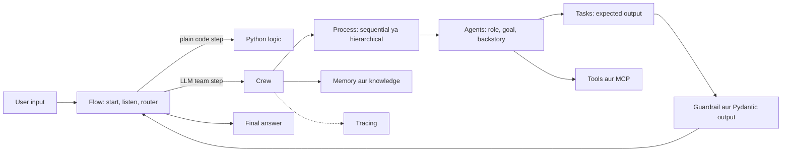

## ⭐ CrewAI kya hai aur mental model

**Ek line me:** CrewAI AI app ko role-play karne wale agents ki team ki tarah model karta hai jo assigned tasks karti hai, plus Flows jo unke around deterministic glue hain.

**Ye kyun chahiye:** Bahut saari business problems pehle se ek chhoti team jaisi dikhti hain: researcher, analyst, writer, reviewer. Raw agent loop se ye haath se likhna matlab bahut saara prompt aur routing code. CrewAI me tum team ko kuch lines ya ek config file me describe karke ek dopahar me working multi-agent pipeline bana lete ho. Ise late 2023 me João Moura ne shuru kiya tha, aur ab CrewAI Inc. maintain karti hai: open-source core (MIT licence) plus paid AMP platform.

**Aise socho:** Swiggy ka cloud kitchen. Har cook ka role hai (tandoor, curry, packing). Order ticket task hai. Head chef ya to tickets line me order se aage bhejta hai (sequential), ya chalte-chalte decide karta hai kaun kya banayega (hierarchical). Kitchen kholne aur band karne ka routine (lights, gas, safai) fixed hai aur ek sheet pe likha hai: wahi Flow hai.

**Step by step kaise kaam karta hai:**

1. Tum **agents** define karte ho: har ek ke paas `role`, `goal`, `backstory`, ek `llm` aur `tools`.
2. Tum **tasks** define karte ho: har ek ke paas `description`, `expected_output` aur `agent`.
3. Unhe ek **process** ke saath **crew** me daalte ho.
4. `crew.kickoff(inputs={...})` call karte ho. Texts me `{order_id}` jaise placeholders `inputs` se bhar jaate hain.
5. Har task ke liye CrewAI agent ke role texts plus task se prompt banata hai, tool-calling loop chalata hai jab tak agent final answer na de, aur wo answer aage context ki tarah bhejta hai.
6. Tumhe `CrewOutput` milta hai: `.raw`, `.pydantic`, `.json_dict`, `.tasks_output` aur `.token_usage`.
7. Jab iske around fixed steps, branches ya loops chahiye, crews ko **Flow** me wrap karte ho.

Padosiyon ke beech ye kahan baithta hai:

| Framework | Main idea | Level |
|---|---|---|
| CrewAI | role-based team + Flows | high-level, opinionated |
| LangGraph | typed state pe nodes ka explicit graph | low-level, sab khud wire karo |
| AutoGen / Microsoft Agent Framework | group chat me baat karte agents, plus graph workflows | beech ka |
| OpenAI Agents SDK | handoffs aur guardrails ke saath ek agent loop | patla |

Note: early 2025 se CrewAI LangChain pe depend **nahi** karta. Ye standalone package hai. Purane blog posts jo CrewAI me LangChain classes import karte hain, outdated hain.

**Interview tip:** "CrewAI ek sentence me kya hai?" Bolo: "High-level framework jisme main agents ko role aur goal se describe karta hoon, unhe tasks deta hoon, aur crew unhe sequentially ya manager ke under chalati hai. Deterministic hisse ke liye crews ko Flows me wrap karta hoon."

**Common galti:**
- Sochna ki CrewAI sirf role-play hai. 2025 se Flows framework ka aadha hissa hain, aur zyada tar production CrewAI apps Flow-first hain.

## ⭐ Agent

**Ek line me:** Agent = LLM + persona (role, goal, backstory) + tools ka set + kuch limits.

**Ye kyun chahiye:** Specialised prompt generic prompt se behtar karta hai. "Tum refund investigator ho jo sirf system data pe bharosa karta hai" model ko apni lane me rakhta hai. Role texts doosre agents (aur manager) ko bhi batate hain ki ye agent kis cheez me achha hai, taaki delegation sahi agent chune.

**Aise socho:** Naukri post ki job description: title (role), success kaisa dikhta hai (goal), aur kaisa insaan chahiye (backstory).

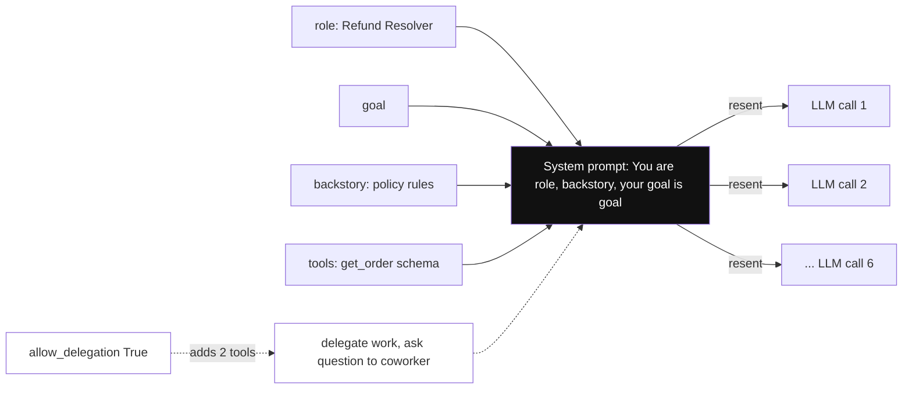

*Diagram:* Teen role texts aur tool schemas mil ke ek system prompt bante hain jo har call pe dobara jaata hai: task me 6 calls matlab persona ki 6 copies.

**Step by step kaise kaam karta hai:**

1. `role`: chhota title, jaise "Order Investigator". Delegation ke liye yahi agent ka naam bhi hai.
2. `goal`: agent kya achieve karna chahta hai. `{placeholders}` use kar sakta hai.
3. `backstory`: experience aur rules, chhote bio ki tarah. Style aur policy hints yahin daalo.
4. `llm`: `"openai/gpt-4.1-mini"` jaisa model string ya `temperature`, `max_tokens` wala `LLM(...)` object. Built-in set (OpenAI, Anthropic, Gemini, Azure, Bedrock) ke bahar ke providers ke liye `crewai[litellm]` extra chahiye.
5. `tools`: tools ki list jo agent call kar sakta hai.
6. `allow_delegation`: `True` ho to agent ko do extra tools milte hain, "delegate work to coworker" aur "ask question to coworker". Default `False` hai.
7. Limits: `max_iter` (har task me max reasoning steps), `max_execution_time` (seconds), `max_rpm` (requests per minute), `respect_context_window=True` (model limit ke paas history summarise karo).

| Field | Example | Kyun matter karta hai |
|---|---|---|
| `role` | "Refund Resolver" | delegation ka naam aur prompt ki pehli line |
| `goal` | "Decide a fair refund within policy" | agent ko focused rakhta hai |
| `backstory` | "Policy: refund at most the order amount" | rules aur tone |
| `llm` | `LLM(model="openai/gpt-4.1-mini", temperature=0)` | har agent ki cost aur quality |
| `tools` | `[get_order]` | wo asal me kya kar sakta hai |
| `allow_delegation` | `False` | achanak extra LLM calls rokta hai |
| `max_iter` | `5` | loops pe cap |

Ek worked number: teen role texts aksar 80–200 tokens hote hain. Ye us agent ki **har** LLM call pe jaate hain. Jo agent ek task me 6 calls karta hai, wo inhe 6 baar bhejta hai.

**Interview tip:** "Role aur backstory kyun help karte hain, aur kab nuksaan karte hain?" Bolo: "Ye model ka behaviour narrow karte hain aur delegation ko route karne ke liye description dete hain. Nuksaan tab jab ye lambe aur fluffy hon: har call pe tokens badhte hain aur model chatty ho sakta hai. Main backstory chhoti rakhta hoon aur hard rules code ya guardrails me daalta hoon."

**Common galti:**
- Adjectives se bhari 400-word backstory likhna. Chhote, factual rules better kaam karte hain aur sasti padti hain.
- Har agent pe `allow_delegation=True` chhod dena; phir agents ek doosre ko sawal uchhalte rehte hain aur bill badhta hai.

## ⭐ Task

**Ek line me:** Task kaam ka ek tukda hai jiska clear description, clear expected output aur ek owner agent hai.

**Ye kyun chahiye:** LLMs precise brief aur answer ke precise shape ke saath better karte hain. `expected_output` wahi shape hai. Tasks se kaam chain bhi hota hai: ek task ka output agle task ka context ban jaata hai.

**Aise socho:** JIRA ticket. Title, acceptance criteria, assignee aur "blocked by" links.

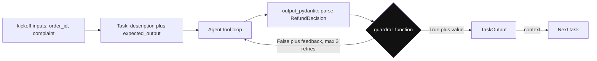

*Diagram:* Task ka answer Pydantic shape me parse hota hai, phir guardrail check karta hai; fail hone pe feedback agent loop me wapas, pass hone pe aage context banke jaata hai.

**Step by step kaise kaam karta hai:**

1. `description`: kya karna hai. `kickoff(inputs=...)` se bharne wale `{placeholders}` use karo.
2. `expected_output`: "done" kaisa dikhta hai, jaise "status, amount aur items ki bullet list". CrewAI ise prompt me final answer ke criteria ki tarah daalta hai.
3. `agent`: kaun karega. Hierarchical crew me khaali chhod sakte ho, manager chun lega.
4. `context=[other_task]`: pehle ke task outputs is task me bhejo. Sequential crew me pehle ke outputs default se aate hain; `context` ise explicit banata hai.
5. `output_pydantic=MyModel` (ya `output_json`): CrewAI structured output maangta hai aur parse karta hai. Tum ise `task_output.pydantic` se padhte ho.
6. `guardrail=fn` (ya `guardrails=[...]`): function jo output leta hai aur accept karne ke liye `(True, value)` ya retry karwane ke liye `(False, "feedback")` lautata hai. Plain string guardrail ("100 words se kam ho") LLM check karta hai. Retries capped hain (`guardrail_max_retries`, default 3).
7. Kaam ke aur fields: `tools` (sirf is task ke tools), `output_file`, `human_input=True` (aage badhne se pehle insaan review kare), `async_execution=True` (agle task ke saath parallel), `markdown=True`.

| Field | Tumhe kya deta hai |
|---|---|
| `expected_output` | prompt me answer ka shape |
| `context` | tasks ke beech explicit data flow |
| `output_pydantic` | typed, validated output |
| `guardrail` | code check plus feedback ke saath automatic retry |
| `human_input` | crew aage badhe usse pehle review step |
| `async_execution` | parallel tasks |

```python
from pydantic import BaseModel
from crewai import Task

class Summary(BaseModel):
    title: str
    bullets: list[str]

def max_five_bullets(output):
    s = output.pydantic                      # parsed Summary object
    if len(s.bullets) > 5:
        return (False, "Too many bullets. Keep at most 5.")
    return (True, output)                    # accept karo

summarise = Task(
    description="Summarise this HR policy for new joiners: {policy_text}",
    expected_output="A title and at most 5 short bullets.",
    agent=writer,                            # kahin aur define kiya Agent
    output_pydantic=Summary,
    guardrail=max_five_bullets,
)
```

**Code kya karta hai:**
- Answer ka shape Pydantic model se declare karta hai, to string nahi, typed object milta hai.
- Plain Python me guardrail lagata hai; check fail ho to feedback text agent ko wapas jaata hai.
- Agent retry limit tak dobara try karta hai; uske baad task error raise karta hai jise tum catch kar sakte ho.
- `{policy_text}` tab bharta hai jab crew `inputs={"policy_text": ...}` ke saath kickoff hoti hai.

**Interview tip:** "CrewAI se reliable structured output kaise lete ho?" Bolo: "Shape ke liye task pe `output_pydantic`, aur 'refund order amount se zyada nahi' jaise business rules ke liye code guardrail. Guardrail ka feedback agent ko jaata hai, to zyada tar ek retry me khud theek ho jaata hai."

**Common galti:**
- "Ek achha answer" jaisa vague `expected_output`. Phir format agent decide karta hai aur downstream parsing toot jaati hai.
- `output_pydantic` agent pe lagana. Ye task pe lagta hai.

## ⭐ Crew aur Process

**Ek line me:** Crew agents ki list ke saath tasks ki list chalati hai, ya fixed order me (sequential) ya ek manager agent ke through jo delegate karta hai (hierarchical).

**Ye kyun chahiye:** Ek object chahiye jo run ka owner ho: kaun se tasks, kis order me, kaun si shared settings (memory, knowledge, rate limits, tracing). Process main control knob hai.

**Aise socho:** Cricket team. **Sequential** me batting order fixed hai: opener, one-down, two-down. **Hierarchical** me captain chalte-chalte decide karta hai agla over kaun dalega, aur kisi bhi player se madad maang sakta hai.

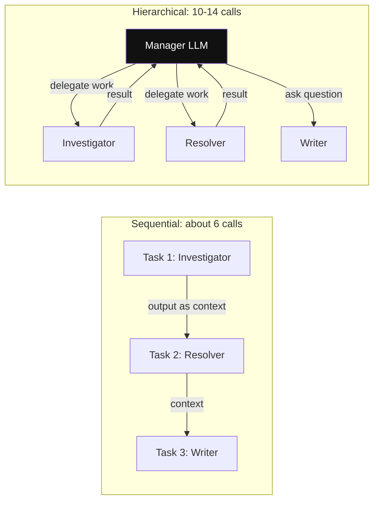

*Diagram:* Left: list ka order agla step tay karta hai aur output seedha aage jaata hai. Right: har hop manager LLM se guzarta hai, extra calls aur surprises yahin se aate hain.

**Step by step kaise kaam karta hai:**

1. **Sequential** (`Process.sequential`, default): task 1 chalta hai, uska output context me judta hai, phir task 2, aise hi. Bahut predictable. Tasks ki ginti = task runs ki ginti.
2. **Hierarchical** (`Process.hierarchical`): tum `manager_llm=...` ya custom `manager_agent=...` dete ho. CrewAI ek manager agent banata hai jiske tools "delegate work to coworker" aur "ask question to coworker" hain. Manager har task padhta hai, role dekh ke coworker chunta hai, delegate karta hai, result review karta hai, aur dobara delegate kar sakta hai.
3. Crew-level options: `memory=True`, `knowledge_sources=[...]`, `max_rpm`, `planning=True` (tasks se pehle ek extra LLM call jo step plan likhti hai), `verbose=True`, `stream=True`.
4. Run modes: `kickoff(inputs=...)`, `kickoff_async`, aur batch ke liye `kickoff_for_each(inputs=[...])`.

| | Sequential | Hierarchical |
|---|---|---|
| Agla step kaun chunta hai | tum, list order se | manager LLM |
| 3 tasks ke liye LLM calls | roughly 3 × (1–4 per task) | upar se 2–6 manager calls |
| Predictability | high | kam |
| Debugging | aasaan | "manager ne wo agent kyun chuna?" |
| Kiske liye achha | known steps wali pipelines | open tasks jahan split pata nahi |

Ek worked number: 3 tasks, har ek ko ~2 LLM calls, sequentially ~6 calls. Hierarchical aksar har delegation se pehle aur baad manager call jodta hai, to 10–14 calls. Har call pe 3,000 input tokens ho to same kaam ke liye 18k vs 36k input tokens.

```python
from crewai import Crew, Process, LLM

crew = Crew(
    agents=[researcher, analyst, writer],
    tasks=[research, analyse, write],
    process=Process.hierarchical,
    manager_llm=LLM(model="openai/gpt-4.1", temperature=0),  # routing ke liye strong model
    max_rpm=30,                                              # provider rate limit ke neeche raho
    verbose=True,
)
result = crew.kickoff(inputs={"topic": "UPI fraud trends in 2026"})
print(result.raw)
print(result.token_usage)                                    # poore run ke total tokens
```

**Code kya karta hai:**
- Hierarchical crew banata hai; CrewAI `manager_llm` se manager agent khud banata hai.
- Strong model sirf manager ke liye, kyunki routing ki galtiyan sabse mehngi padti hain.
- Requests per minute cap karta hai taaki delegations ka burst rate limits hit na kare.
- Final text aur token usage print karta hai, jo har run ke liye log karna chahiye.

**Interview tip:** "Sequential ya hierarchical?" Bolo: "Default sequential, kyunki predictable aur sasta hai. Hierarchical tabhi jab kaam ka split pehle se pata na ho, aur tab manager ko strong model, chhote agent descriptions aur iterations pe cap deta hoon."

**Common galti:**
- Jis pipeline ke steps pata hain uske liye hierarchical chunna. Aise manager ke paise dete ho jo kuch add nahi karta.
- Bhoolna ki har agent ka role text hi manager ka routing signal hai. Vague roles se galat delegation hota hai.

## Tools

**Ek line me:** Tools naam, description aur typed arguments wale Python functions hain jinhe agent call kar sakta hai.

**Ye kyun chahiye:** Tools ke bina agent sirf text likh sakta hai. Tools se wo order dekh sakta hai, web search kar sakta hai, database query kar sakta hai ya API call kar sakta hai. Model kab call kare ye sirf description padh ke decide karta hai, isliye description bahut matter karta hai.

**Aise socho:** Kitchen ke appliances. Cook ko tandoor ke baare me uspe lage label se pata chalta hai ki wo kya karta hai.

**Step by step kaise kaam karta hai:**

1. Jaldi wala tareeka: function pe `crewai.tools` se `@tool("Name")` lagao. Docstring description banta hai, type hints argument schema.
2. Poora tareeka: `BaseTool` subclass karo `name`, `description`, `args_schema` (Pydantic model) aur `_run` ke saath.
3. Ready-made tools `crewai-tools` package me hain (web search, scraping, file aur directory read, PDFs pe RAG, aur bhi).
4. MCP: agents MCP servers ke tools use kar sakte hain (dekho [Tools, MCP and A2A](07-tools-mcp-a2a.md)), to wahi tool server doosre frameworks ke saath bhi chalta hai.
5. Tool results crew run ke andar default se cache hote hain (same tool, same arguments), jisse repeat calls bachte hain.

**Interview tip:** "CrewAI me tools safe kaise rakhte ho?" Bolo: "Typed inputs wale narrow tools, default read-only, user ki permissions ka server-side check, kisi bhi write se pehle human-review task, aur tool outputs ka size capped taaki context na bhar jaaye."

**Common galti:**
- Har agent ko har tool dena. Har tool ka schema har call pe jaata hai aur model zyada baar galat tool chunta hai.

## Memory aur knowledge

**Ek line me:** Memory wo hai jo crew tasks aur runs ke beech seekhti aur yaad karti hai; knowledge wo documents hain jo tum pehle se jodte ho aur RAG ki tarah search hote hain.

**Ye kyun chahiye:** Memory ke bina har run khaali shuru hota hai: bot bhool jaata hai ki is customer ke pichhle hafte do refunds hue. Knowledge ke bina tumhe poori policy har prompt me paste karni padti.

**Aise socho:** Memory shift manager ki diary hai ki kya hua. Knowledge shelf pe rakha policy binder hai.

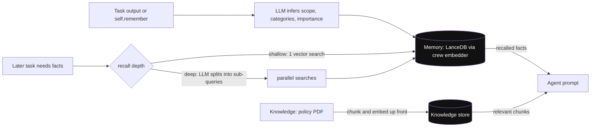

*Diagram:* Memory run ke dauraan likhi jaati hai aur baad me recall hoti hai (deep recall me extra LLM calls); knowledge pehle se load hoti hai aur RAG ki tarah search hoti hai. Dono prompt me pahunchte hain.

**Step by step kaise kaam karta hai:**

1. `Crew(memory=True)` ek **unified `Memory`** object banata hai. Save pe LLM item ka scope, categories aur importance nikalta hai. Local storage default LanceDB hai. Embeddings crew ki `embedder` setting se aate hain.
2. Recall ki do depths: `shallow` (ek vector search) aur `deep` (LLM query ko sub-queries me todta hai aur parallel search karta hai). Deep better hai par extra LLM calls lagti hain.
3. Flow me `self.remember("...")` aur `self.recall("...")` use karo. Flow memory ka read-only slice crew ko de sakte ho.
4. **Knowledge**: agent ya crew pe `knowledge_sources=[StringKnowledgeSource(content=...), PDFKnowledgeSource(file_paths=[...])]`. CrewAI chunk, embed aur store karta hai, phir relevant chunks prompt me daalta hai.
5. CLI se reset: `crewai reset-memories -m` (memory) ya `-kn` (knowledge).

Kya badla: purane CrewAI (0.x) me alag short-term, long-term aur entity memory types the. 1.x line ne inhe ek unified `Memory` class se replace kar diya. Jo purane tutorials teeno types alag configure karte hain, outdated hain.

**Interview tip:** "CrewAI me memory vs knowledge?" Bolo: "Knowledge static reference data hai jo main pehle load karta hoon, jaise policy PDF. Memory runs ke dauraan seekhi jaati hai, jaise customer ki purani complaints. Memory per user scope karta hoon, kyunki shared memory ek user ka data doosre ke answer me leak kar deti hai."

**Common galti:**
- Multi-user app me bina scoping `memory=True` on karna. Ek customer ke facts doosre customer ke run me aa sakte hain.
- Har call pe deep recall use karna aur sochna latency double kyun ho gayi.

## Project layout aur CLI

**Ek line me:** `crewai create crew <name>` project scaffold karta hai; default ab JSON-first layout hai, aur `--classic` purana YAML plus `crew.py` layout deta hai.

**Ye kyun chahiye:** Agent aur task texts config files me rakhne se non-engineers bhi prompts edit kar sakte hain, code chhota rehta hai aur review aasaan hota hai.

**Aise socho:** Restaurant ka menu card (config) kitchen equipment (code) se alag rakha hai. Menu badlo, kitchen dobara wire nahi karni padti.

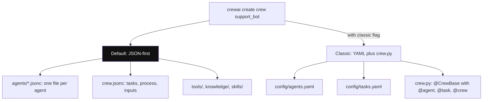

*Diagram:* Dono layouts prompts ko config files me rakhte hain; JSON-first ko `crewai run` seedha load karta hai, classic wala `crew.py` ke decorated methods se judta hai.

**Step by step kaise kaam karta hai:**

1. CLI `uv tool install crewai` se install karo. Projects `uv` use karte hain; `crewai install` dependencies sync karta hai.
2. `crewai create crew support_bot` banata hai `agents/*.jsonc` (har agent ki ek file), `crew.jsonc` (tasks, process, inputs), plus `tools/`, `knowledge/` aur `skills/` folders. `crewai run` JSON seedha load karta hai; koi `crew.py` nahi.
3. `crewai create crew support_bot --classic` banata hai `config/agents.yaml`, `config/tasks.yaml` aur `@CrewBase` class wala `crew.py`. `@agent` aur `@task` wale methods YAML keys se objects banate hain; `@crew` method `Crew` lautata hai.
4. `crewai create flow <name>` Flow project banata hai: `src/<pkg>/main.py` plus `src/<pkg>/crews/<name>/` me crews.
5. Aur commands: `crewai run`, `crewai flow plot` (flow graph draw karta hai), `crewai replay -t <task_id>` (ek task se dobara chalao), `crewai log-tasks-outputs`, `crewai eval`, `crewai deploy ...` (AMP).

```yaml
# config/agents.yaml  (classic layout)
investigator:
  role: Order Investigator
  goal: Find the facts of order {order_id} using tools, never guess
  backstory: You work in Swiggy support ops and trust only system data.

# config/tasks.yaml
investigate:
  description: Customer says {complaint}. Look up order {order_id}.
  expected_output: Bullet list of status, amount, items and the claim.
  agent: investigator
```

**Code kya karta hai:**
- Prompts ko Python se bahar rakhta hai, to support lead pull request me wording tune kar sakta hai.
- Code wale hi `{placeholders}` use karta hai; ye `kickoff(inputs=...)` pe bharte hain.
- `crew.py` me `@agent` laga `investigator` naam ka method `Agent(config=self.agents_config["investigator"], tools=[...])` banata hai.

**Interview tip:** "CrewAI ke project layout me haal me kya badla?" Bolo: "Default scaffold JSON-first ho gaya: `agents/*.jsonc` aur `crew.jsonc`, koi `crew.py` nahi. Purana YAML plus `@CrewBase` layout `--classic` ke peeche abhi bhi hai."

**Common galti:**
- Ek project me dono layouts mix karna, phir kisi ko pata nahi source of truth kaun si file hai.

## ⭐ Flows

**Ek line me:** Flow ek Python class hai jiske methods steps hain; decorators batate hain kaun sa step start karta hai, kaun kise sunta hai, aur kahan branch hona hai, aur saare steps ek typed state share karte hain.

**Ye kyun chahiye:** Crews autonomous hain, jo open-ended kaam ke liye badhiya aur un cheezon ke liye bura jo fixed tareeke se honi chahiye: input validate karo, category pe branch karo, API call karo, DB me save karo, retry karo. Flows ye control normal code me likhne dete hain aur crew sirf wahan call karte ho jahan LLM ka judgement chahiye. Ye state persistence aur resume bhi dete hain.

**Aise socho:** IRCTC booking process. Login, train chuno, passengers bharo, pay karo, confirm: fixed steps aur clear branches (payment fail → retry page). Ek step, "alternate trains suggest karo", smart assistant ho sakta hai. Flow fixed hai; ek step ke andar assistant free hai.

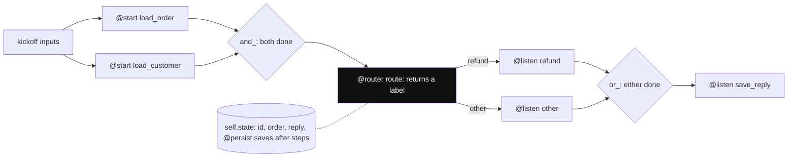

*Diagram:* Do `@start` steps pehle chalte hain, `and_` dono ka wait karta hai, router ka label ek branch chunta hai, `or_` unhe jodta hai; har step same typed `self.state` padhta-likhta hai.

**Step by step kaise kaam karta hai:**

1. State ko Pydantic model ki tarah define karo aur `Flow[MyState]` subclass karo. Defaults wale fields hi flow ke inputs bhi hain.
2. `@start()` entry methods mark karta hai. `flow.kickoff(inputs={...})` pe ye pehle chalte hain.
3. `@listen(step)` method ko `step` khatam hone ke baad chalata hai aur uska return value deta hai.
4. `@router(step)` `step` ke baad chalta hai aur `"refund"` jaisa label string lautata hai. Phir `@listen("refund")` wale methods chalte hain. Handler ka naam uske label jaisa nahi hona chahiye.
5. `or_(a, b)` tab chalta hai jab koi bhi ek khatam ho; `and_(a, b)` jab dono khatam ho jaayein.
6. Steps `self.state` padhte aur likhte hain. Har flow run ka state me ek unique `id` hota hai.
7. `@persist` (`crewai.flow` se) steps ke baad state save karta hai, to baad me uska `id` dekar run resume kar sakte ho.
8. `flow.plot()` ya `crewai flow plot` graph ko HTML me draw karta hai.

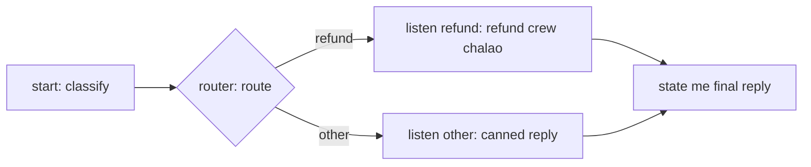

**Flows vs Crews:**

| Zarurat | Use karo |
|---|---|
| Known steps, branches, loops, API calls, DB writes | plain Python me Flow steps |
| Open-ended kaam jahan LLMs decide karein kaise | ek Flow step ke andar Crew |
| Structured output wali ek LLM call | Flow step me direct `LLM` ya single `Agent.kickoff()`, crew nahi |
| Lamba run jo restart ke baad bhi chale | `@persist` wala Flow |

**Interview tip:** "Flows vs Crews kab?" Bolo: "Flow backbone hai, crews kuch steps ke andar dimaag hain. Jo step code me likh sakta hoon, wo code hai. Crew sirf wahan call karta hoon jahan autonomy chahiye, isse cost, latency aur failure modes control me rehte hain."

**Common galti:**
- Poora app ek badi hierarchical crew bana dena aur phir fixed steps follow karwane ke liye usse ladna. Fixed hisse ke liye Flow use karo.
- `@start()` ke andar input fields overwrite karna; inputs defaults wale state fields ki tarah aate hain.

## ⭐ Ek poora chhota app: Swiggy refund helper

**Ek line me:** Ek Flow complaint classify karta hai, refund cases ko tool, typed output aur guardrail wali two-agent crew pe route karta hai, aur customer ko reply karta hai.

**Ye kyun chahiye:** Zyada tar real CrewAI apps ka yahi shape hai: Flow me deterministic routing, jahan judgement chahiye wahan chhoti crew, aur paise ko chhone wali har cheez pe code checks.

**Aise socho:** Support desk. Front desk tickets sort karta hai (Flow). Refund tickets do logon ki team ko jaate hain: ek order system check karta hai, ek policy ke under refund decide karta hai. Finance ka rule "bill se zyada refund kabhi nahi" machine check karti hai, logon pe bharosa nahi.

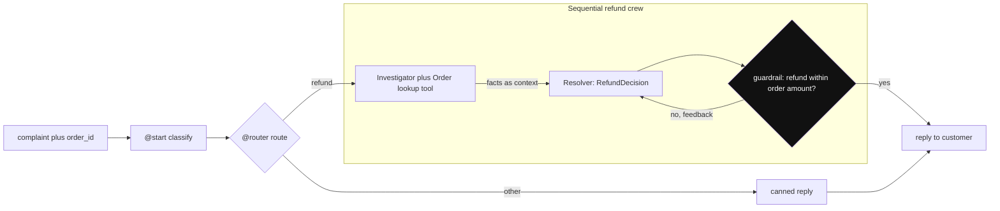

*Diagram:* Routing Flow code me karta hai; sirf refund tickets do-agent crew tak jaate hain, aur paise wala rule code guardrail lagata hai, prompt nahi.

**Step by step kaise kaam karta hai:**

1. Install: `uv add crewai` (ya `pip install crewai`), `OPENAI_API_KEY` set karo.
2. Ek tool aur output model likho.
3. Do agents aur guardrail ke saath do tasks likho.
4. Crew ko router wale Flow me wrap karo.

**Step 1: tool aur output shape**

```python
from pydantic import BaseModel
from crewai.tools import tool

ORDERS = {"SW123": {"amount": 450, "status": "delivered", "items": ["Paneer Biryani", "Coke"]}}

@tool("Order lookup")
def get_order(order_id: str) -> str:
    """Return status, amount in INR and items for a Swiggy order id."""
    order = ORDERS.get(order_id)
    return str(order) if order else "Order not found"

class RefundDecision(BaseModel):
    order_id: str
    refund_inr: int
    reason: str
    reply_to_customer: str
```

**Code kya karta hai:**
- `@tool` normal function ko tool bana deta hai; docstring wahi hai jo model padhta hai.
- `ORDERS` tumhari real order service ki jagah hai; production me tool user ke auth ke saath API call karta hai.
- `RefundDecision` wahi exact shape hai jo resolver ko lautana hai.

**Step 2: agents, tasks aur guardrail**

```python
from crewai import Agent, Task, Crew, Process, LLM

llm = LLM(model="openai/gpt-4.1-mini", temperature=0)

investigator = Agent(
    role="Order Investigator",
    goal="Find the facts of order {order_id} using tools, never guess",
    backstory="You work in Swiggy support ops and trust only system data.",
    tools=[get_order], llm=llm, allow_delegation=False, max_iter=5,
)
resolver = Agent(
    role="Refund Resolver",
    goal="Decide a fair refund within policy",
    backstory="Policy: refund at most the order amount. Missing item means refund its share.",
    llm=llm, allow_delegation=False,
)

def refund_within_limit(output):
    d = output.pydantic
    amount = ORDERS.get(d.order_id, {}).get("amount", 0)
    if d.refund_inr > amount:
        return (False, f"Refund {d.refund_inr} is above order amount {amount}. Fix it.")
    return (True, output)

investigate = Task(
    description="Customer says: {complaint}. Look up order {order_id} and list the facts.",
    expected_output="Bullet list: status, amount, items, and what the customer claims.",
    agent=investigator,
)
decide = Task(
    description="Using the facts, decide the refund for order {order_id}.",
    expected_output="A RefundDecision object.",
    agent=resolver, context=[investigate],
    output_pydantic=RefundDecision, guardrail=refund_within_limit,
)
refund_crew = Crew(agents=[investigator, resolver], tasks=[investigate, decide],
                   process=Process.sequential, verbose=True)
```

**Code kya karta hai:**
- Do narrow agents, ek model, stable answers ke liye `temperature=0`, delegation off.
- Sirf investigator ke paas tool hai, to sirf wahi order system ko chhoota hai.
- `context=[investigate]` facts ko explicitly resolver tak bhejta hai.
- Guardrail paise wala rule code me enforce karta hai; fail pe resolver feedback ke saath retry karta hai.

**Step 3: iske around Flow**

```python
from crewai.flow import Flow, start, listen, router

class SupportState(BaseModel):
    order_id: str = ""
    complaint: str = ""
    category: str = ""
    reply: str = ""

class SupportFlow(Flow[SupportState]):
    @start()
    def classify(self):
        text = self.state.complaint.lower()
        words = ["missing", "cold", "refund", "wrong item"]
        self.state.category = "refund" if any(w in text for w in words) else "other"

    @router(classify)
    def route(self):
        return self.state.category            # label: "refund" ya "other"

    @listen("refund")
    def handle_refund(self):
        out = refund_crew.kickoff(inputs={"order_id": self.state.order_id,
                                          "complaint": self.state.complaint})
        self.state.reply = out.pydantic.reply_to_customer
        return self.state.reply

    @listen("other")
    def handle_other(self):
        self.state.reply = "Connecting you to a support executive."
        return self.state.reply

flow = SupportFlow()
print(flow.kickoff(inputs={"order_id": "SW123", "complaint": "Coke was missing from my order"}))
```

**Code kya karta hai:**
- `classify` plain Python hai: sasta, turant aur testable. Baad me ise ek LLM call se badal sakte ho.
- `route` label lautata hai; sirf matching `@listen` method chalta hai.
- Refund branch crew chalati hai aur typed result `out.pydantic` se padhti hai.
- `kickoff(inputs=...)` state fields bharta hai; return value aakhri step ka output hai.
- Expected result: Coke ke liye ~Rs 40–60 ka refund (uska share), Rs 450 se kaafi kam, aur ek polite reply.

**Interview tip:** "Production me daalne wala CrewAI app samjhao." Bolo: "Typed state wala Flow backbone, code me deterministic routing, chhoti sequential crew sirf jahan judgement chahiye, paise wali har cheez pe `output_pydantic` plus code guardrails, tracing on, aur persistence taaki run resume ho sake."

**Common galti:**
- Refund limits LLM ko decide karne dena bina code check ke. Guardrails isi ke liye hain.

## ⭐ Andar kaise kaam karta hai

**Ek line me:** Har task ke liye CrewAI agent ke persona, task aur context se prompt banata hai, final answer tak tool-calling loop chalata hai, use validate karta hai, aur aage bhejta hai.

**Ye kyun chahiye:** Interviewers "kickoff call karne pe asal me kya hota hai?" poochhte hain ye check karne ke liye ki tum debug kar sakte ho. Prompt aur loop pata ho to samajh aata hai tokens kahan jaate hain aur cheezein kyun fail hoti hain.

**Aise socho:** Cook ko ticket milta hai jispe pichhle station ka note staple hai. Wo pakata hai, chakhta hai (tool call), adjust karta hai, aur plate lagata hai. Pass pe plate bahar jaane se pehle check hoti hai.

**Step by step kaise kaam karta hai:**

1. `kickoff(inputs)` saare agent aur task texts me `{placeholders}` bharta hai.
2. Pehle task ke liye executor system prompt banata hai, roughly: "You are {role}. {backstory}. Your personal goal is: {goal}", plus tool list.
3. User message me task hota hai: "Current Task: {description}", expected output "final answer ke criteria" ki tarah, aur pehle ke tasks ka context.
4. Loop: LLM call karo; agar wo tool maange (model support kare to native function calling, warna Thought, Action, Action Input, Observation wala text ReAct format), tool chalao, result jodo, dobara call karo. Final answer ya `max_iter` pe ruko.
5. `output_pydantic` set ho to answer model me parse hota hai. Guardrail set ho to chalta hai; fail pe feedback judta hai aur agent dobara try karta hai.
6. Memory save ho sakti hai; `TaskOutput` agle task ke context me jaata hai.
7. Events (task started, tool used, LLM call finished) CrewAI ke event bus pe emit hote hain, jinhe tracing aur tumhare listeners padhte hain.
8. Aakhri task ke baad outputs aur token usage ke saath `CrewOutput` wapas aata hai.

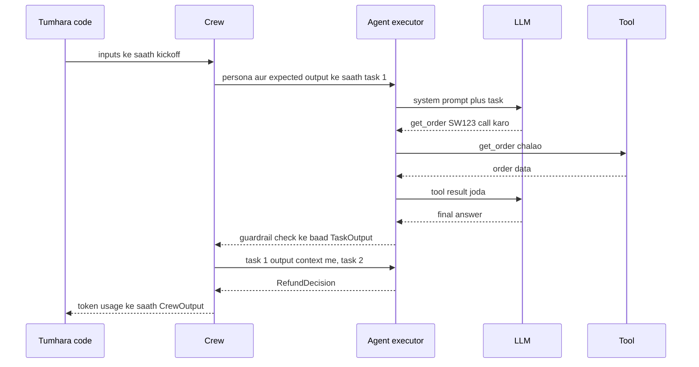

**Interview tip:** "Meri crew slow kyun hai?" Bolo: "LLM calls gino. Har task ek loop hai, har tool call ek aur round trip, hierarchical manager calls jodta hai, guardrail retries aur jodte hain, aur deep memory recall aur bhi. Main trace dekhta hoon, phir agents, tools aur retries kaatta hoon."

**Common galti:**
- Maan lena ki ek task matlab ek LLM call. Tools aur retries ke saath aksar 3–6 hoti hain.

## Production concerns

**Ek line me:** Crew ko kisi bhi LLM service ki tarah treat karo: har call trace karo, loops aur tokens cap karo, lambe runs persist karo, fixed set pe evaluate karo, aur apni API ke peeche deploy karo.

**Ye kyun chahiye:** Multi-agent runs lambe, mehnge aur non-deterministic hote hain. Limits aur traces ke bina ek kharab prompt minutes tak loop kar sakta hai aur kisi ko pata nahi chalta kyun.

**Aise socho:** CCTV, gas cut-off aur roz ke taste test wala restaurant.

**Step by step kaise kaam karta hai:**

1. **Observability:** CrewAI AMP pe built-in tracing (`crewai traces enable` ya `CREWAI_TRACING_ENABLED=true`). Third-party tools (Langfuse, Arize Phoenix, MLflow, OpenLIT aur doosre) OpenTelemetry ya CrewAI ke event listeners se judte hain. Har run ka `token_usage` log karo. Dekho [AI Observability](10-agent-observability.md).
2. **Limits:** agents pe `max_iter`, `max_execution_time`, `max_rpm`; tasks pe `guardrail_max_retries`; poori request pe timeout.
3. **Persistence:** Flows pe `@persist` taaki state save ho aur `id` se resume ho; debugging me `crewai replay -t <task_id>` ek task se dobara chalata hai.
4. **Streaming:** `Crew(stream=True)` chunks stream karta hai taaki UI 40 second tak khaali na rahe.
5. **Evals:** `crewai eval` `eval.jsonc` ke criteria pe ek traced run chalata hai; apne golden set se bhi outputs score kar sakte ho ([Evals for Agents](09-agent-evals.md)). `crewai test` aur `crewai train` ab legacy mark hain.
6. **Deployment:** `kickoff` ko apni FastAPI service me wrap karo aur lambi crews ko background job ki tarah chalao, ya `crewai deploy create` se AMP pe deploy karo.
7. **Cost:** role-text tokens × calls gino. Agla section dekho.

**Interview tip:** "CrewAI app ko production-ready kaise banate ho?" Bolo: "Typed state aur persistence wala Flow-first design, chhote toolsets wali sequential crews, `max_iter` aur timeouts, Pydantic output plus guardrails, har run ke token usage ke saath tracing, CI me eval set, aur async job API kyunki runs das-das second lete hain."

**Common galti:**
- Synchronous HTTP request ke andar `crew.kickoff()` chalana. Lambe runs gateway timeout hit karte hain; job queue ya streaming use karo.

## Role-play prompts ki keemat

**Ek line me:** Har agent, persona, delegation aur retry matlab zyada tokens, isliye crew same kaam karne wale single agent se kai guna mehngi pad sakti hai.

**Ye kyun chahiye:** Interviewers ko "multi-agent bas zyada mehnga nahi hai?" poochhna pasand hai. Tumhe opinion nahi, numbers chahiye.

**Aise socho:** Meeting me chaar log har sentence se pehle apna designation bolte hain.

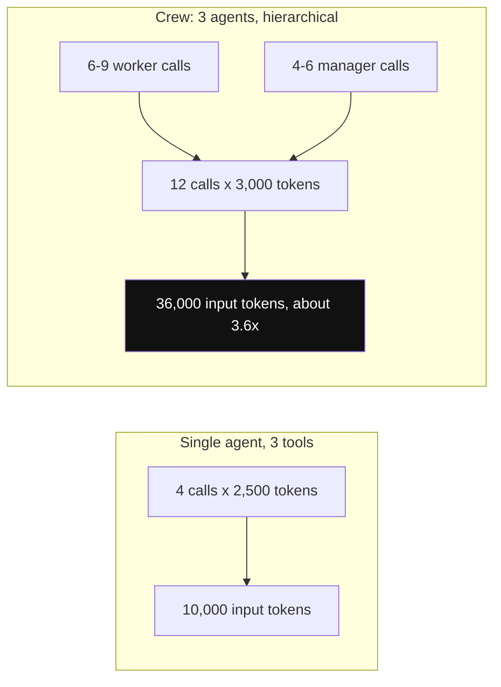

*Diagram:* Same kaam, do design: personas, manager calls aur aage bheja context crew ko ek agent se lagbhag 3–4× tokens tak le jaate hain.

**Step by step kaise kaam karta hai:**

1. Calls gino: 3 agents × 3 tasks, har ek ~2–3 calls, matlab 6–9 calls. Hierarchical 4–6 manager calls jodta hai.
2. Har call ke input tokens gino: persona (~150) + tool schemas (~100 per tool) + task + pehle ke tasks ka context (aksar 1,000–3,000).
3. Example: 12 calls × 3,000 input tokens = 36,000 input tokens. 3 tools wala single agent shayad 4 calls × 2,500 = 10,000 me kar de. Roughly 3–4× zyada.
4. Kam karo: hierarchical ki jagah sequential, kam agents, chhoti backstories, simple agents ke liye saste models, `allow_delegation=False`, chhote tool outputs, prompt caching (persona aur tool text same rakho taaki provider prefix cache kare).

**Interview tip:** "Ek agent ya crew?" Bolo: "Tools wale ek agent se shuru karta hoon. Crew me tabhi todta hoon jab roles ko alag tools, alag models ya isolated context chahiye, aur eval set pe saabit karta hoon ki split help karta hai. Crew roughly 2–4× zyada tokens leti hai."

**Common galti:**
- Readability ke liye agents me todna. Readability ke liye functions aur Flow steps use karo; agents sirf jahan autonomy help kare.

## ⭐ CrewAI kab use karo, aur comparison

**Ek line me:** Jab problem roles ki team jaisi dikhe aur build speed chahiye to CrewAI; fine control aur durable execution chahiye to LangGraph ya Microsoft Agent Framework.

**Ye kyun chahiye:** Frameworks pe sabse common senior sawal hai "ye kyun, X kyun nahi".

**Aise socho:** Ready-made thali vs a la carte. Thali (CrewAI) jaldi aati hai aur zyada tar logon ke liye achhi hai. A la carte (LangGraph) exact control deta hai par har dish tumhe plan karni hai.

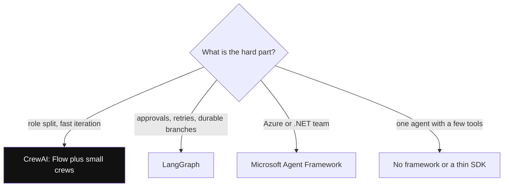

*Diagram:* Pehle pucho mushkil kya hai; CrewAI tab jeetta hai jab kaam roles wali team jaisa ho aur jaldi banana zaroori ho.

**Step by step kaise kaam karta hai:**

1. Poochho: mushkil hissa control flow hai (approvals, retries, branches)? LangGraph ki taraf jhuko, ya chhoti crews wala CrewAI Flow.
2. Mushkil hissa role split aur jaldi iterate karna hai? CrewAI.
3. Team Azure aur .NET pe hai? Microsoft Agent Framework.
4. Tools wala ek hi agent hai? Shayad framework hi nahi, ya patla SDK.

| | CrewAI | LangGraph | AutoGen 0.4 / Microsoft Agent Framework |
|---|---|---|---|
| Mental model | role-based crew + Flows | typed state pe explicit graph | group chat me agents + graph workflows |
| Control | medium (Flows high, crews low) | high | medium se high (workflows) |
| Multi-agent style | sequential ya manager delegation | supervisor, subgraphs, handoffs, koi bhi graph | round-robin, selector, handoff, Magentic |
| Persistence / resume | Flow `@persist`, task replay | har thread pe checkpointer, time travel | AutoGen `save_state`; MAF workflow checkpoints |
| Human in the loop | task pe `human_input`, flow feedback | kahin bhi `interrupt()` | user proxy, workflows me `request_info` |
| Learning curve | sabse kam | sabse steep | medium |
| Ecosystem | crewai-tools, AMP | LangChain, LangSmith | Azure, Foundry, .NET |
| Best for | content, research, ops pipelines, fast prototypes | lambe, branching production agents | Microsoft-stack enterprise agents |

**Interview tip:** "Production support bot ke liye CrewAI vs LangGraph?" Bolo: "Agar bot zyada tar approvals wale fixed steps hai aur crash ke baad resume hona chahiye, to LangGraph, kyunki state aur checkpoints first-class hain. Agar ye clear roles wali research ya content pipeline hai, to Flows ke saath CrewAI jaldi pahunchata hai. Dono me tools MCP servers hain aur tracing OpenTelemetry, to baad me switch karna rewrite nahi hai."

**Common galti:**
- GitHub stars ya demo videos dekh ke chunna. Jo tumhare use case me mushkil hai uske hisaab se chuno.

## Common pitfalls

**Ek line me:** Zyada tar CrewAI problems bahut saare agents, vague tasks, uncapped loops aur manager pe andha bharosa se aati hain.

**Ye kyun chahiye:** Real project ke pehle do hafton me yahi bugs dikhte hain.

**Aise socho:** Nayi team jiski job descriptions unclear hain aur manager ke paas checklist nahi.

**Step by step kaise kaam karta hai:**

1. **Loops:** agent same tool baar baar call karta hai. Fix: `max_iter`, behtar tool descriptions, clear "not found" messages lautao.
2. **Galat delegation:** manager tasks galat agent ko bhejta hai. Fix: chhote, alag roles; ya sequential pe jao.
3. **Format drift:** output ka shape har run me badalta hai. Fix: `output_pydantic` aur precise `expected_output`.
4. **Context bloat:** har task ko pehle ke saare outputs milte hain. Fix: sirf zaroori cheez ke saath explicit `context=[...]`.
5. **Hallucinated tool results:** text-based ReAct me kamzor models kabhi fake Observation likh dete hain. Fix: native function calling wala model use karo.
6. **Silent cost growth:** memory deep recall, planning aur guardrail retries sab calls jodte hain. Fix: har run ka `token_usage` log karo aur spikes pe alert lagao.
7. **Version churn:** fields deprecate hote rehte hain (`function_calling_llm`, `allow_code_execution`, purana `reasoning` flag). Fix: version pin karo, upgrade se pehle changelog padho.
8. **Telemetry surprise:** CrewAI default se anonymous usage telemetry bhejta hai; policy ho to `CREWAI_DISABLE_TELEMETRY=true` set karo (ye tracing se alag hai).

**Interview tip:** "Galat answer dene wali crew ko debug kaise karoge?" Bolo: "Trace kholta hoon, pehla task dhundhta hoon jiska output galat hai, uska prompt aur context check karta hoon, dekhta hoon tool ne sahi data diya ya nahi, phir sabse narrow cheez fix karta hoon: tool description, expected output, ya guardrail. Phir wo case eval set me daal deta hoon."

**Common galti:**
- Kharab answer theek karne ke liye ek aur reviewer agent jodna. Isse cost badhti hai aur aksar wahi galti repeat hoti hai.

## Interview ke sawal

**Q: CrewAI ke core building blocks kya hain?**
Agent (role, goal, backstory, llm, tools), Task (description, expected output, agent, context, structured output, guardrail), Crew (agents plus tasks plus process) aur Flow (typed state wale event-driven steps). Tools, memory aur knowledge agents aur crews me plug hote hain.

**Q: Sequential vs hierarchical process?**
Sequential tasks ko list order me chalata hai aur outputs aage bhejta hai; predictable aur sasta. Hierarchical ek manager agent jodta hai jo delegation tools se coworkers ko tasks deta hai; flexible par manager calls badhti hain aur debug mushkil hota hai.

**Q: `allow_delegation=True` asal me kya karta hai?**
Agent ko do tools deta hai, "delegate work to coworker" aur "ask question to coworker", taaki wo role ke hisaab se doosre agents ko sub-questions bhej sake. Har delegation extra LLM calls hai, isliye zarurat na ho to off rakho.

**Q: Typed output aur business rules kaise enforce karte ho?**
Shape ke liye task pe `output_pydantic`, aur rules ke liye `(True, value)` ya `(False, feedback)` lautane wala `guardrail` function. Fail guardrail agent ko feedback bhejta hai aur limit tak retry hota hai.

**Q: Flows vs Crews: kab kaun sa?**
Jo kuch code me likh sakte ho uske liye Flows: fixed steps, branches, loops, API calls, persistence. Crews sirf Flow step ke andar jahan autonomous LLM kaam help kare. Zyada tar production apps Flow-first hain.

**Q: `@start`, `@listen` aur `@router` kaise kaam karte hain?**
`@start` entry steps mark karta hai. `@listen(step)` us step ke baad chalta hai aur uska return value leta hai. `@router(step)` ek label lautata hai, aur us label ko sunne wale methods chalte hain. `or_` aur `and_` triggers combine karte hain.

**Q: CrewAI kaun sa prompt bhejta hai?**
Roughly: role, backstory aur goal se system message plus tool list, aur task description, final-answer criteria ki tarah expected output, aur pehle ke task context wala user message. Final answer tak tool calls pe loop karta hai.

**Q: Hamesha loop karne wali crew ko kaise debug karoge?**
Trace me repeat hota tool call dekho, `max_iter` aur `max_execution_time` cap karo, tool ko clear terminal message lautane do, aur expected output tight karo taaki agent ko pata ho kab kaam khatam hai.

**Q: CrewAI me haal me kya badla?**
LangChain dependency hata di (2025), 1.0 aaya (late 2025), unified `Memory` class pe gaya, project scaffold JSON-first bana (YAML `--classic` ke saath), Flow persistence aur checkpointing aaye, aur `function_calling_llm`, `allow_code_execution` jaise fields deprecate hue.

**Q: CrewAI ko production-ready kaise banate ho?**
Typed state aur `@persist` wala Flow, chhoti sequential crews, iterations aur time pe caps, Pydantic output plus guardrails, har run ka token logging aur tracing, CI me eval set, aur API ke peeche async job execution.

**Q: CrewAI vs LangGraph?**
CrewAI high-level hai aur roles aur tasks se jaldi banta hai. LangGraph low-level hai: explicit state, edges, checkpointing aur `interrupt()`. Lambe, branching, resumable production flows ke liye LangGraph; role-shaped pipelines aur quick builds ke liye Flows ke saath CrewAI.

**Q: CrewAI vs AutoGen?**
CrewAI kaam ko agents ke owned tasks ki tarah organise karta hai. AutoGen use termination conditions ke saath agents ke beech conversation ki tarah organise karta hai. AutoGen ab maintenance mode me hai; Microsoft ka naya kaam Microsoft Agent Framework me hai.

**Q: Crew tumhare estimate se 4× mehngi pad rahi hai. Kya karoge?**
Har task ka token usage padho, phir kaato: hierarchical se sequential, delegation hatao, backstories chhoti karo, har task ko sirf zaroori context do, simple agents ke liye sasta model, aur caching ke liye prompt prefix stable rakho.

**Q: Multi-user memory safely kaise handle karte ho?**
Memory per user scope karo (ya har run ke liye read-only slice do), customers ke beech ek global memory kabhi share mat karo, transactional facts database me rakho memory me nahi, aur privacy requests ke liye deletion allow karo.

**Q: Kab CrewAI use nahi karoge?**
Kuch tools wala ek agent (framework ki zarurat nahi), bahut approvals wale strict durable workflows (LangGraph ya workflow engine), ya team jo kisi aur stack pe standardise ho chuki hai.

## Aage padho

- [Agent Frameworks and Tooling](19-agent-frameworks.md)
- [LangGraph Core](02-langgraph-core.md)
- [AutoGen and Microsoft Agent Framework](26-autogen.md)
- [OpenAI Agents SDK](27-openai-agents-sdk.md)

## Checklist

- [ ] Main Agent, Task, Crew aur Process samjha sakta hoon aur bata sakta hoon kickoff inme se kaise guzarta hai.
- [ ] Main bata sakta hoon role, goal aur backstory prompt me kya bante hain aur unki keemat kya hai.
- [ ] Main sequential vs hierarchical samjha sakta hoon aur bata sakta hoon manager agent kya karta hai.
- [ ] Main task pe `output_pydantic` aur code guardrail laga sakta hoon aur retry samjha sakta hoon.
- [ ] Main `@start`, `@listen` aur `@router` wala Flow likh sakta hoon jo crew call kare.
- [ ] Main bata sakta hoon kab Flow step, kab single LLM call aur kab crew use karna hai.
- [ ] Main CrewAI memory vs knowledge samjha sakta hoon aur memory per user scope karna bata sakta hoon.
- [ ] Main crew ko production-ready banane ki list bata sakta hoon: limits, tracing, persistence, evals.
- [ ] Main CrewAI ko LangGraph aur AutoGen se compare karke use case ke liye ek chun sakta hoon.
