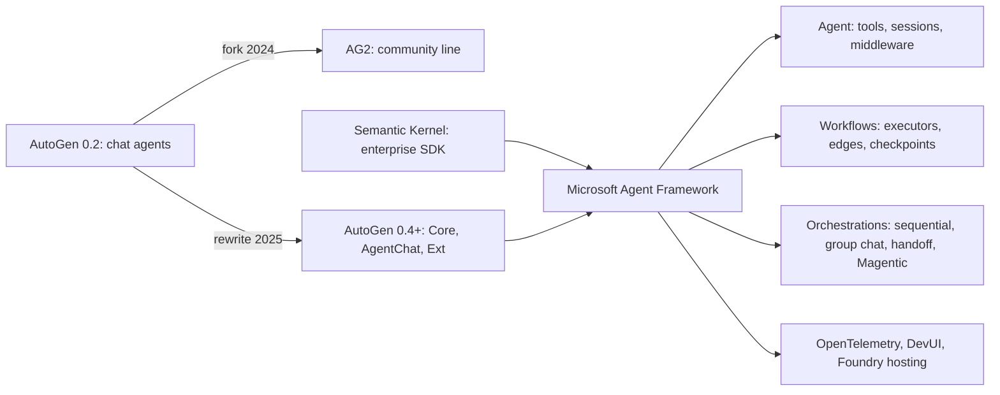
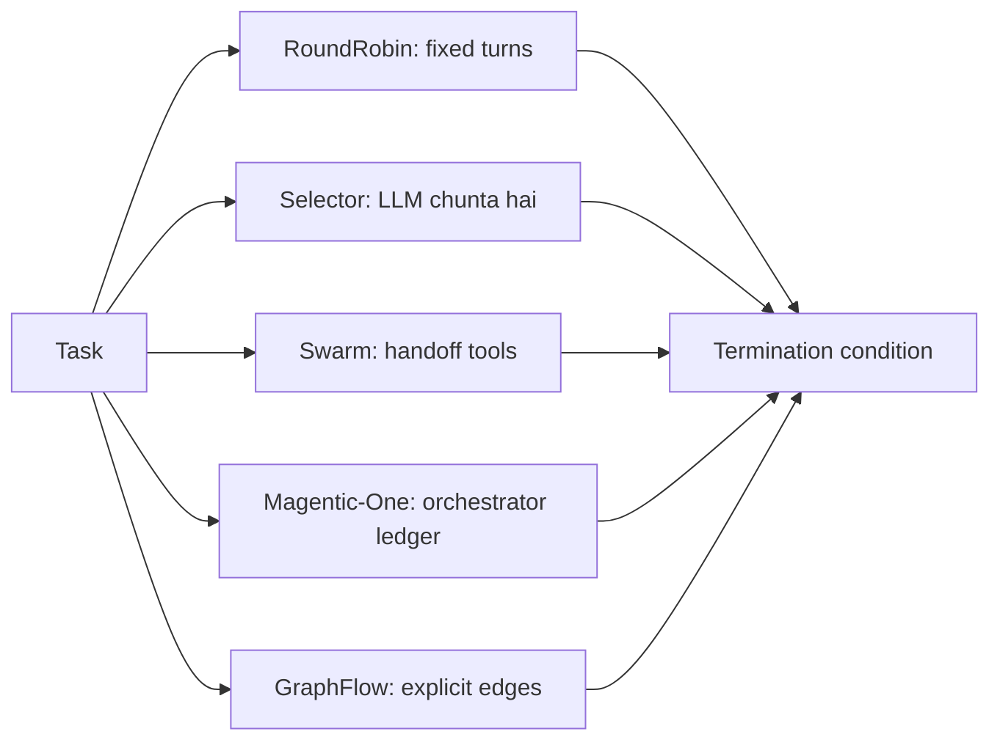
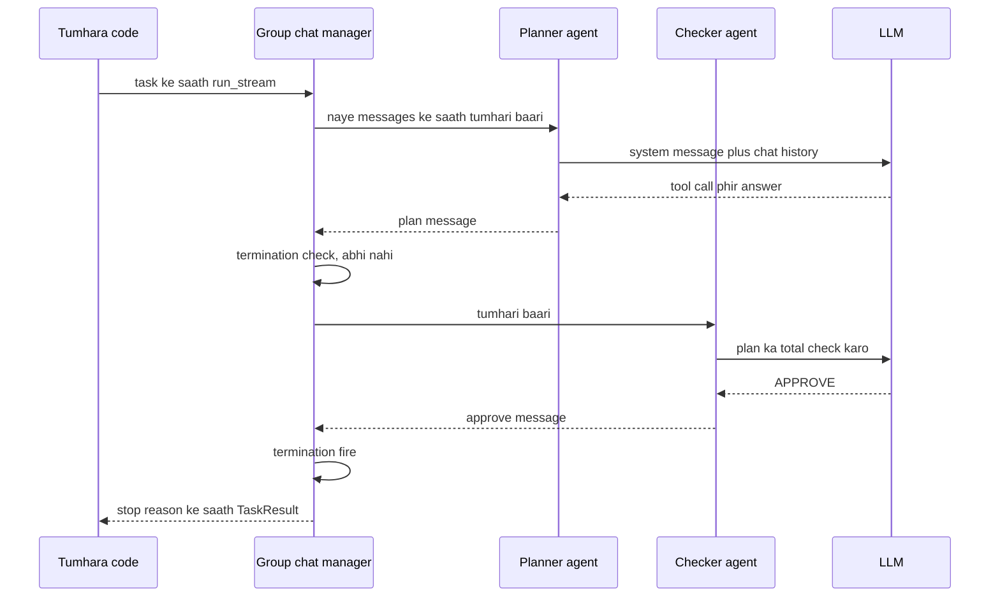

# AutoGen and Microsoft Agent Framework

AutoGen Microsoft Research ka framework hai jisme kai AI agents ek group chat me **aapas me baat karke** task solve karte hain. Iske ideas, Semantic Kernel ke enterprise features ke saath, ab **Microsoft Agent Framework** me hain, jo aaj agents banane ka Microsoft ka supported tareeka hai. Interviewers ye family isliye poochhte hain kyunki bahut companies ne AutoGen pe build kiya, naam aur forks confusing hain, aur "naya project kis pe shuru karoge?" se pata chalta hai tum updated ho ya nahi.

Ye page **Microsoft Agent Framework 1.x** (Python, April 2026 se generally available) aur **AutoGen 0.7.x** (0.4+ rewrite ki aakhri line, ab maintenance mode me) ke hisaab se likha hai. Code copy karne se pehle dono ke changelogs dekh lo.

**Is page ke baad tum jawab de paoge:**
- "AutoGen ki Core, AgentChat aur Extensions layers kya hain?"
- "RoundRobinGroupChat vs SelectorGroupChat vs Swarm vs GraphFlow: kab kaun sa?"
- "AutoGen team ko kaise pata chalta hai ki rukna hai?"
- "AG2 kya hai, aur `pip install autogen` se Microsoft ka AutoGen kyun nahi milta?"
- "Microsoft Agent Framework kya hai, kya merge karta hai, aur kya AutoGen khatam ho gaya?"
- "Agent Framework workflows agent orchestrations se kaise alag hain?"
- "LLM ka likha code safely kaise chalaoge?"
- "Aaj Azure pe naya agent project shuru kar rahe ho. Kya chunoge aur kyun?"

## Pehle ye shabd samjho

Agents me naye ho? Pehle [Agent Foundations](01-agent-foundations.md) aur [Agent Frameworks and Tooling](19-agent-frameworks.md) padho.

| Shabd | Simple matlab |
|---|---|
| Multi-agent conversation | Kai agents baari-baari ek shared chat me messages post karke task poora karte hain. |
| Team | AutoGen me agents ka group plus ye rule ki agla kaun bolega. |
| Speaker selection | Team agla agent kaise chunti hai: fixed order, LLM choice, handoff ya graph. |
| Termination condition | Team ko rokne ka rule, jaise "kisi ne APPROVE bola" ya "20 messages ho gaye". |
| Model client | Chhota object jo ek model provider se baat karta hai, jaise OpenAI ya Azure OpenAI. |
| Actor model | Design jisme independent workers sirf ek doosre ko messages bhej ke baat karte hain. |
| Code executor | Component jo agent ka likha code chalata hai, behtar hai Docker container ke andar. |
| Handoff | Ek agent ka special tool call karke control doosre agent ko dena. |
| AG2 | Purani AutoGen 0.2 line ka community fork, kuch original authors chalate hain. |
| Semantic Kernel (SK) | Microsoft ka pehle wala enterprise SDK, C#, Python aur Java apps me LLM jodne ke liye. |
| Microsoft Agent Framework (MAF) | Microsoft ka current agent SDK (.NET aur Python) jo AutoGen aur SK ke ideas merge karta hai. |
| Workflow | MAF me steps (executors) ka typed graph jo edges se jude hain, checkpoints ke saath. |
| Executor | MAF workflow ka ek step: agent ya function jo message handle karta hai. |
| Maintenance mode | Project ko sirf bug aur security fixes milte hain, naye features nahi. |

## Big picture

Is family me chaar naam hain, aur trick ye jaanna hai ki ye aapas me kaise jude hain. AutoGen ne "agents chat karte hain" idea shuru kiya. AG2 ne purana version fork kiya aur apne raaste chala gaya. Semantic Kernel Microsoft ka alag enterprise SDK tha. Microsoft Agent Framework ne AutoGen ke multi-agent patterns aur SK ke enterprise features liye aur ek supported raasta ban gaya. Ye page pehle AutoGen ka design cover karta hai, kyunki ideas aur bahut saare interview sawal wahin se aate hain, phir fork aur SK, phir Agent Framework detail me, ek poora app, internals aur kaise chunna hai.



## ⭐ Ek timeline me poori history

**Ek line me:** AutoGen 0.2 popular hua, ek fork (AG2) aur ek rewrite (0.4) me bata, aur rewrite plus Semantic Kernel Microsoft Agent Framework me merge hue, jo ab supported choice hai.

**Ye kyun chahiye:** Interviews aur PyPI pe zyada tar confusion isi history se aata hai. AG2 aur AutoGen 0.4 mix kiya, ya AutoGen ko "Microsoft ka current framework" bola, to interviewer notice karta hai.

**Aise socho:** Ek famous restaurant. Ek head chef purana menu leke chala jaata hai aur apni dukaan kholta hai (AG2). Original restaurant apni kitchen dobara banata hai (AutoGen 0.4). Baad me owners ise apne corporate catering arm (Semantic Kernel) ke saath ek naye brand (Agent Framework) me merge kar dete hain. Purani kitchen sirf repair ke liye khuli rehti hai.

**Step by step kaise kaam karta hai:**

| Kab | Kya hua |
|---|---|
| 2023 | Semantic Kernel open-source hua: enterprise apps me LLM features ke liye Microsoft ka SDK. |
| Late 2023 | Microsoft Research ka AutoGen 0.2 (`pyautogen`) multi-agent chat ko popular banata hai. |
| Nov 2024 | Kuch original AutoGen authors 0.2 ko **AG2** naam se fork karte hain; AG2 `autogen` aur `pyautogen` PyPI naam le leta hai. |
| Jan 2025 | **AutoGen 0.4** aata hai: Core, AgentChat aur Extensions me poora rewrite; async aur event-driven. |
| Mid 2025 | AutoGen 0.6–0.7 GraphFlow aur doosre features jodta hai. |
| Oct 2025 | **Microsoft Agent Framework** public preview. AutoGen aur Semantic Kernel maintenance mode ki taraf. |
| Apr 2026 | Agent Framework **1.0 GA**, .NET aur Python dono ke liye. |
| Aaj | Naye Microsoft-stack projects Agent Framework pe shuru hote hain. AutoGen ko sirf fixes. AG2 alag, active project hai. |

Package names matter karte hain:
1. `autogen-agentchat`, `autogen-core`, `autogen-ext` = Microsoft AutoGen 0.4+.
2. `autogen`, `pyautogen`, `ag2` = AG2 fork.
3. `agent-framework` (Python) aur `Microsoft.Agents.AI` (.NET) = Microsoft Agent Framework.
4. `semantic-kernel` = Semantic Kernel.

**Interview tip:** "Kya AutoGen dead hai?" Bolo: "Dead nahi, maintenance mode me hai: sirf bug aur security fixes. Microsoft ke naye features Agent Framework me jaate hain, jo AutoGen ke multi-agent patterns ko Semantic Kernel ke enterprise features ke saath merge karta hai aur April 2026 me GA hua. Purane AutoGen apps chalte rahenge aur official migration guide hai. AG2 purani 0.2 API ka alag community fork hai."

**Common galti:**
- `pip install autogen` chala ke Microsoft 0.4 tutorial follow karna. Tumhe AG2 milta hai, aur koi import match nahi karta.

## ⭐ AutoGen kya hai aur mental model

**Ek line me:** AutoGen multi-agent system ko ek conversation ki tarah treat karta hai: agents shared thread me messages post karte hain, ek rule chunta hai agla kaun bolega, aur termination condition use khatam karti hai.

**Ye kyun chahiye:** Kuch tasks tab better hote hain jab ek model doosre ko check kare: writer aur critic, coder aur code runner, planner aur specialists. AutoGen ne ye pattern aasaan banaya: agents define karo, team me daalo, chat shuru karo. Iske research results (aur Magentic-One generalist team) ne ise 2023–2025 me bahut popular banaya.

**Aise socho:** Shaadi ka WhatsApp group. Planner task post karta hai, caterer aur decorator baari-baari reply karte hain, koi bolta hai "Done, final", aur chat ruk jaati hai. Group admin decide karta hai agla jawab kaun dega.

**Step by step kaise kaam karta hai:**

1. Har agent ka naam, description aur model client hota hai, plus tools.
2. Team agents aur ek shared message list rakhti hai.
3. Tum `team.run(task=...)` ya `team.run_stream(task=...)` call karte ho.
4. Team ek speaker chunti hai, use naye messages bhejti hai, aur speaker reply karta hai (shayad tool calls ke baad).
5. Reply team me sabko broadcast hota hai.
6. Termination condition naye messages check karti hai. Fire ho to run `TaskResult` ke saath khatam. Nahi to step 4 pe jao.
7. Team apna state rakhti hai, to `run` dobara call karne pe wahi conversation aage chalti hai.

| Feature | AutoGen ka jawab |
|---|---|
| Coordination | shared conversation |
| Agla kaun act karega | team type (round robin, selector, swarm, graph) |
| Kab rukna hai | termination conditions |
| Code chalana | code executor agents, docs me default Docker |
| Extensibility | Core actor runtime aur Extensions packages |

**Interview tip:** "AutoGen ka core abstraction kya hai?" Bolo: "Coordination ki unit conversation hai. Agents ek message thread share karte hain, team decide karti hai kaun bolega, aur termination condition rokti hai. Ye flexible hai par explicit graph se bound karna mushkil hai, isliye main hamesha semantic stop ke saath hard cap lagata hoon."

**Common galti:**
- Bhoolna ki conversation har turn badhti hai. Das agents × 20 turns matlab har call pe bahut bada context.

## ⭐ AutoGen 0.4+ layers: Core, AgentChat, Extensions

**Ek line me:** AutoGen 0.4+ teen packages hai: Core (event-driven actor runtime), AgentChat (upar high-level agents aur teams), aur Extensions (model clients, code executors, tools).

**Ye kyun chahiye:** AutoGen 0.2 ek bada package tha jisme synchronous, tightly coupled agents the. Use scale, observe ya extend karna mushkil tha. 0.4 rewrite ne ise layers me toda: zyada tar users AgentChat me rehte hain; custom distributed systems banane wale Core tak jaate hain.

**Aise socho:** Food delivery platform. Core dispatch system hai jo riders aur restaurants ke beech messages route karta hai. AgentChat ready-made screens wala customer app hai. Extensions plug-in partners hain: payment, maps, SMS.

**Step by step kaise kaam karta hai:**

1. **Core** (`autogen-core`): agents actors hain. Ye handlers se typed messages lete hain (`RoutedAgent` with `@message_handler`). Direct messages (request aur response) se ya topics pe publish karke baat karte hain jinhe doosre subscribe karte hain. Runtime messages deliver karta hai: ek process me `SingleThreadedAgentRuntime`, ya machines ke across experimental distributed gRPC runtime.
2. **AgentChat** (`autogen-agentchat`): ready agents (`AssistantAgent`, `UserProxyAgent`, `CodeExecutorAgent`, `SocietyOfMindAgent`, `MessageFilterAgent`), teams (`RoundRobinGroupChat`, `SelectorGroupChat`, `Swarm`, `MagenticOneGroupChat`, `GraphFlow`), termination conditions aur `Console` UI helper.
3. **Extensions** (`autogen-ext`): model clients (OpenAI, Azure OpenAI, Anthropic, Ollama aur doosre), code executors (Docker, local, Jupyter, Azure Container Apps), `McpWorkbench` se MCP tools, aur web surfer jaise extra agents.
4. Sab kuch `async` hai. Runs ko `await` karte ho aur events stream karte ho.
5. Teams aur agents declarative JSON ki tarah save aur load ho sakte hain (`dump_component` aur `load_component`), jo AutoGen Studio use karta hai.

| Layer | Kab use karte ho |
|---|---|
| AgentChat | lagbhag hamesha: agents aur teams jaldi banao |
| Core | custom message protocols, bahut saare agents, distributed runtime |
| Extensions | hamesha, model clients aur executors ke liye |

Install: `pip install -U "autogen-agentchat" "autogen-ext[openai]"`.

**Interview tip:** "AutoGen 0.4 ne sab kuch rewrite kyun kiya?" Bolo: "0.2 synchronous aur tightly coupled tha. 0.4 Core me async actor model pe gaya, to agents messages se baat karte hain, jisse distributed runtimes, better observability aur pluggable components mumkin hue, aur AgentChat upar ek friendly layer hai."

**Common galti:**
- 0.2-style code (`ConversableAgent`, `initiate_chat`, `llm_config` dicts) ko 0.4 imports ke saath mix karna. 0.2-style ab AG2 ki API hai.

## ⭐ AssistantAgent

**Ek line me:** `AssistantAgent` AutoGen ka general agent hai: model client, system message, optional tools, aur settings ki tool results kaise handle karne hain.

**Ye kyun chahiye:** Team ke zyada tar agents "role aur tools wala ek LLM" hote hain. `AssistantAgent` ye cover karta hai, to tool loop tumhe khud nahi likhna padta.

**Aise socho:** Naya employee jiske paas job title (system message), laptop (tools) aur manager ka rule hai "tool use karne ke baad jo mila uska summary do" (reflection).

**Step by step kaise kaam karta hai:**

1. Model client banao: `OpenAIChatCompletionClient(model="gpt-4.1-mini")`.
2. Agent banao `name`, `model_client`, `system_message`, `tools` (plain Python functions automatically wrap hote hain) aur optional `description` (selector teams use karti hain) ke saath.
3. Turn pe agent model call karta hai. Model tools maange to agent unhe chalata hai.
4. Default se ye **ek** tool round karta hai (`max_tool_iterations=1`) aur tool output ko hi apna reply lauta deta hai. `reflect_on_tool_use=True` set karo to ek aur model call hoti hai jo tool output ko natural answer banati hai, ya `max_tool_iterations` badhao taaki loop kare.
5. Kaam ke extras: `handoffs=[...]` (Swarm ke liye), `output_content_type=MyPydanticModel` (structured output), `model_context` (history limit, jaise last N messages), `memory`, aur token streaming ke liye `model_client_stream=True`.
6. Akele `await agent.run(task=...)` se chalao ya team me daalo.

```python
import asyncio
from autogen_agentchat.agents import AssistantAgent
from autogen_agentchat.conditions import TextMentionTermination, MaxMessageTermination
from autogen_agentchat.teams import RoundRobinGroupChat
from autogen_agentchat.ui import Console
from autogen_ext.models.openai import OpenAIChatCompletionClient

def get_fare(src: str, dst: str) -> str:
    """Return the 3A train fare in INR between two cities."""
    return f"{src} to {dst}: Rs 1,150 in 3A"

async def main():
    mc = OpenAIChatCompletionClient(model="gpt-4.1-mini")
    planner = AssistantAgent("planner", model_client=mc, tools=[get_fare],
                             reflect_on_tool_use=True,
                             system_message="Plan Indian trips with a total cost in INR.")
    checker = AssistantAgent("checker", model_client=mc,
                             system_message="If the total is within Rs 15,000 reply APPROVE, else say what to cut.")
    stop = TextMentionTermination("APPROVE") | MaxMessageTermination(8)
    team = RoundRobinGroupChat([planner, checker], termination_condition=stop)
    await Console(team.run_stream(task="3 nights in Goa from Mumbai for 2 people"))
    await mc.close()

asyncio.run(main())
```

**Code kya karta hai:**
- Plain function tool ban jaata hai; uska docstring aur type hints schema bante hain.
- `reflect_on_tool_use=True` se planner tool use karne ke baad asli answer likhta hai, sirf tool output echo nahi karta.
- `RoundRobinGroupChat` planner aur checker ko baari-baari chalata hai jab tak "APPROVE" na aaye ya 8 messages na ho jaayein.
- `|` do termination conditions ko OR se jodta hai, to semantic stop ke saath hamesha hard cap rehta hai.
- `Console` har message stream hote hi print karta hai.

**Interview tip:** "Mera AutoGen agent answer ki jagah raw tool output lauta raha hai. Kyun?" Bolo: "0.4+ me `AssistantAgent` default se ek tool round karta hai aur tool result ko apna message lauta deta hai. `reflect_on_tool_use` on karo ya `max_tool_iterations` badhao."

**Common galti:**
- Expect karna ki AutoGen ka agent baaki frameworks ki tarah kaam khatam hone tak tools pe loop karega. Default se nahi karta. (Agent Framework ka `Agent` default se loop karta hai, ye migration ka bada fark hai.)

## ⭐ Teams: RoundRobin, Selector, Swarm, Magentic-One, GraphFlow

**Ek line me:** Team type hi speaker-selection rule hai: fixed order, LLM chunta hai, agents handoff karte hain, plan wala orchestrator, ya explicit graph.

**Ye kyun chahiye:** Alag problems ko alag coordination chahiye. Writer-reviewer loop turns se chal jaata hai. Support desk ko routing chahiye. Research task ko planner chahiye. Business process ko fixed graph chahiye.

**Aise socho:** Meeting chalane ke paanch tareeke: table ke around ghoomo (round robin), chair chunta hai kaun bolega (selector), log khud mic pass karte hain (swarm), task list wala project manager (Magentic-One), ya likha hua agenda (graph).

**Step by step kaise kaam karta hai:**

1. **RoundRobinGroupChat:** agents list order me baar baar bolte hain. Sabse sasta; reflection loops (writer, critic) ke liye achha.
2. **SelectorGroupChat:** har turn se pehle ek LLM conversation aur agents ke naam aur descriptions padh ke agla speaker chunta hai. `selector_func` se override kar sakte ho (naam lautao, ya LLM ko chunne dene ke liye `None`) aur `candidate_func` se restrict. Har turn ek extra LLM call.
3. **Swarm:** har agent ke paas `handoffs=[...]` hain. Active agent tab tak turn rakhta hai jab tak doosre agent ka handoff tool call na kare. Koi central LLM selector nahi. `HandoffTermination` team ko rok ke control insaan ko de sakta hai.
4. **MagenticOneGroupChat:** orchestrator task ledger aur progress ledger rakhta hai, plan banata hai, specialists (web surfer, file surfer, coder, terminal) ko steps deta hai, aur atakne pe re-plan karta hai. Open web aur file tasks ke liye powerful; mehnga aur slow.
5. **GraphFlow:** `DiGraphBuilder` se directed graph banate ho (nodes agents hain, edges pe conditions ho sakti hain). Sequence, parallel fan-out, joins, conditional branches aur loops support karta hai. `MessageFilterAgent` limit kar sakta hai ki har node kya dekhe. Jab aaya tha tab experimental mark tha.

| Team | Agla kaun chunta hai | Extra cost | Kiske liye best |
|---|---|---|---|
| RoundRobinGroupChat | list order | kuch nahi | write aur review loops |
| SelectorGroupChat | ek LLM (ya tumhara function) | har turn 1 call | specialists ke beech routing |
| Swarm | active agent, handoff se | kuch nahi | support desks, triage |
| MagenticOneGroupChat | ledgers wala orchestrator | high | open-ended web aur file tasks |
| GraphFlow | tumhara graph aur edge conditions | kuch nahi | known business processes |



**Interview tip:** "Support bot ke liye Selector ya Swarm?" Bolo: "Swarm, kyunki routing ka faisla us agent ke paas rehta hai jiske paas context hai aur har turn extra selector call nahi lagti. Selector tab fit hai jab kisi ek agent ko nahi pata agla kaun jaaye. Fixed process ke liye main graph use karunga."

**Common galti:**
- Vague agent descriptions ke saath SelectorGroupChat use karna. Selector LLM sirf naam aur descriptions dekhta hai, to galat route karta hai.

## ⭐ Termination conditions

**Ek line me:** Termination condition ek chhota stateful check hai jo har agent response ke baad chalta hai aur rule match hone pe run khatam karta hai.

**Ye kyun chahiye:** Conversations apne aap nahi rukti. Stop rule ke bina do polite agents hamesha ek doosre ko thank you bolte rahenge aur tokens jalate rahenge.

**Aise socho:** Meeting tab khatam hoti hai jab chair bole "decided", ghadi 5 baja de, ya budget khatam ho jaaye, jo pehle ho.

**Step by step kaise kaam karta hai:**

1. Har agent response ke baad team naye messages condition ko deti hai.
2. Built-in conditions: `MaxMessageTermination(n)`, `TextMentionTermination("APPROVE")`, `TokenUsageTermination`, `TimeoutTermination(seconds)`, `HandoffTermination(target)`, `SourceMatchTermination`, `FunctionCallTermination`, `StopMessageTermination` aur `ExternalTermination` (tumhare code se stop, jaise UI button).
3. `|` (OR) aur `&` (AND) se combine karo.
4. Har run ke baad conditions automatically reset hoti hain.
5. `team.reset()` conversation saaf karta hai; `await team.save_state()` aur `load_state()` use persist karte hain.

Ek worked number: `MaxMessageTermination(12)` wala 3-agent round robin task ke baad max 11 agent messages karta hai. Har turn ~4,000 input tokens (conversation badhti hai) ho to hard ceiling roughly 44,000 input tokens.

**Interview tip:** "Kaise ensure karte ho ki AutoGen team ruke?" Bolo: "Hamesha ek semantic condition, jaise keyword ya function call, ko messages, tokens aur time ke hard caps ke saath jodta hoon, plus UI ke liye external stop. Semantic wala clean finish deta hai; caps bill bachate hain."

**Common galti:**
- Sirf `TextMentionTermination("TERMINATE")` pe bharosa. Model shayad kabhi na bole, ya sentence ke beech jaldi bol de.

## Code execution agents

**Ek line me:** Code executor agent doosre agent ka likha code chalata hai aur output lautata hai; isi se AutoGen teams data analysis aur computation karti hain.

**Ye kyun chahiye:** LLMs arithmetic aur data crunching me kamzor hain par Python likhne me achhe. Code likh ke chalane se real data se exact answers milte hain, jaise "revenue se top 3 cities".

**Aise socho:** Chartered accountant (coder) formula likhta hai; junior (executor) use band kamre me Excel me chalata hai aur result padh ke sunata hai.

**Step by step kaise kaam karta hai:**

1. Coder agent fenced Python block me code likhta hai.
2. `CodeExecutorAgent` code nikaalta hai aur executor se chalata hai.
3. `DockerCommandLineCodeExecutor` ise container me chalata hai (safe default). `LocalCommandLineCodeExecutor` tumhari machine pe chalata hai (sirf trusted demos ke liye). Jupyter aur Azure Container Apps executors bhi hain.
4. Output (stdout, errors) conversation me wapas jaata hai; coder errors fix karke dobara try karta hai.
5. Coder bole ki kaam ho gaya to termination condition rokti hai.

```python
# upar wale AssistantAgent example ke imports reuse karta hai
from autogen_agentchat.agents import AssistantAgent, CodeExecutorAgent
from autogen_ext.code_executors.docker import DockerCommandLineCodeExecutor

async def analyse(mc):
    executor = DockerCommandLineCodeExecutor(work_dir="coding", timeout=60)
    await executor.start()                                   # container start karta hai
    coder = AssistantAgent("coder", model_client=mc,
        system_message="Write Python in a fenced python code block. Say TERMINATE when the answer is printed.")
    runner = CodeExecutorAgent("runner", code_executor=executor)
    team = RoundRobinGroupChat([coder, runner],
        termination_condition=TextMentionTermination("TERMINATE") | MaxMessageTermination(12))
    await Console(team.run_stream(task="Read coding/sales.csv and print the top 3 cities by revenue"))
    await executor.stop()                                    # hamesha cleanup karo
```

**Code kya karta hai:**
- Docker container start karta hai jisme saara generated code chalta hai, har run pe 60-second timeout.
- Coder code likhta hai; runner use chala ke output post karta hai.
- Loop tab tak chalta hai jab tak coder TERMINATE na bole ya 12 messages na ho jaayein.
- End me container band karta hai taaki leak na ho.

**Interview tip:** "LLM ka likha code safely kaise chalate ho?" Bolo: "Host pe kabhi nahi. Container ya microVM, default me network nahi, inputs ke liye read-only mount, CPU, memory aur time limits, non-root user, aur har session ke liye fresh sandbox. Phir output ko untrusted data maanta hoon."

**Common galti:**
- Server me `LocalCommandLineCodeExecutor` use karna. Ek prompt injection aur model files delete kar sakta hai ya secrets padh sakta hai.

## AutoGen Studio

**Ek line me:** AutoGen Studio ek local web UI hai jisme bina zyada code likhe AutoGen teams banao, test karo aur export karo.

**Ye kyun chahiye:** Product log aur researchers agent teams jaldi try karna chahte hain: agents drag karo, tools chuno, team se chat karo, har message dekho.

**Aise socho:** Test kitchen jahan menu pe daalne se pehle recipe try karte ho.

**Step by step kaise kaam karta hai:**

1. `pip install -U autogenstudio`, phir `autogenstudio ui --port 8081`.
2. Team builder me team banao, ya gallery se shuru karo.
3. Playground me test karo aur messages aur tool calls live dekho.
4. Team ko JSON me export karo (`dump_component` wala hi declarative format) aur Python me load karo.

Ye prototyping tool hai. Docs khud kehte hain ki ye production ke liye nahi hai (hardened auth, scaling ya security nahi). Agent Framework me isi tarah ka local tool **DevUI** hai.

**Interview tip:** "AutoGen Studio ship karoge?" Bolo: "Nahi. Ye prototyping ke liye hai. Main team config export karke apni service ke peeche auth, limits aur tracing ke saath daalunga, ya Agent Framework pe dobara banaunga."

**Common galti:**
- Demo ke liye Studio UI public URL pe khol dena; ye tools aur code chala sakta hai.

## AG2, community fork

**Ek line me:** AG2 alag, community-run project hai jo late 2024 me AutoGen 0.2 se fork hua, 0.2-style conversational API rakhta hai aur apni direction me badh raha hai.

**Ye kyun chahiye:** Jab Microsoft ne AutoGen ko 0.4 ki tarah rewrite karne ka faisla kiya, kuch original authors 0.2 design ko open community governance ke saath aage badhana chahte the. Unhone ise AG2 naam se fork kiya aur purane PyPI naam rakhe.

**Aise socho:** Ek hi family restaurant ki do branches jinke signboard pe wahi purana naam hai. Jadein same, menu ab alag.

**Step by step kaise kaam karta hai:**

1. `pip install ag2` se install karo (`autogen` aur `pyautogen` naam bhi AG2 pe point karte hain).
2. Classic API `ConversableAgent`, `UserProxyAgent`, `GroupChat` aur `initiate_chat` use karti hai, model settings `llm_config` me.
3. AG2 ne time ke saath apne features jode (swarm-style patterns, reasoning agents, realtime voice agents, MCP aur A2A support) aur apne 1.0 ki taraf nayi API pe kaam kar raha hai.
4. Ye Microsoft ka AutoGen nahi hai aur 0.4 design follow nahi karta.

**Interview tip:** "AutoGen vs AG2?" Bolo: "Origin same hai. AG2 kuch original authors ka 0.2 API ka community fork hai. Microsoft AutoGen 0.4+ rewrite hai Core, AgentChat aur Extensions ke saath, ab maintenance mode me, aur naya kaam Microsoft Agent Framework me hai."

**Common galti:**
- Bolna ki AG2 "AutoGen ka naya version" hai. Ye fork hai, successor nahi.

## Semantic Kernel

**Ek line me:** Semantic Kernel Microsoft ka pehle wala enterprise SDK hai, C#, Python aur Java apps me LLM jodne ke liye, jo kernel, plugins aur filters ke around bana hai.

**Ye kyun chahiye:** Badi companies ko existing .NET aur Java systems ke andar LLM features chahiye the: dependency injection, telemetry, stable APIs aur Azure services ke connectors ke saath. Agent frameworks mature hone se pehle SK ne ye diya.

**Aise socho:** Kitchen ka corporate IT version: strict SOPs, approved suppliers, audit logs, har branch me chalta hai.

**Step by step kaise kaam karta hai:**

1. **Kernel** AI services (model connectors) aur **plugins** (kernel functions ki tarah mark kiye functions ke groups) rakhta hai.
2. Model function calling se plugin functions call karta hai. (Purane "planners" ko plain function calling ne replace kar diya.)
3. **Filters** function calls aur prompts ko logging, approval ya blocking ke liye wrap karte hain, middleware ki tarah.
4. SK ne ek agent layer (chat completion agents, group chat orchestration) aur business workflows ke liye Process Framework joda.
5. Aaj Microsoft Agent Framework ko SK ka successor bataata hai. SK ko fixes aur security patches milte rehte hain, aur migration guide hai.

**Interview tip:** "Hum Semantic Kernel pe hain. Migrate karein?" Bolo: "Naye agent features ke liye haan, Agent Framework plan karo, kyunki naya kaam wahin jaata hai aur ye SK ke middleware aur telemetry jaise concepts rakhta hai. Big-bang rewrite ki zarurat nahi; official guide follow karke service by service migrate karo."

**Common galti:**
- Sochna ki SK aur Agent Framework competitors hain. Agent Framework unhi teams ki banayi next generation hai.

## ⭐ Microsoft Agent Framework: kya hai aur kya merge karta hai

**Ek line me:** Microsoft Agent Framework (MAF) Microsoft ka open-source SDK hai (.NET aur Python) jo AutoGen ke simple agents aur multi-agent patterns ko Semantic Kernel ke enterprise features ke saath jodta hai, plus ek naya graph-based workflow engine.

**Ye kyun chahiye:** Microsoft ke paas do overlapping frameworks the: AutoGen (badhiya ideas, research flavour) aur SK (enterprise-ready, kam multi-agent). Customers poochhte the kaun sa use karein. MAF ek jawab hai, dono teams ne banaya, April 2026 se generally available.

**Aise socho:** Do sister companies ek brand me merge hoti hain. Product team clever recipes laati hai (AutoGen), operations team hygiene, audits aur supply chain (SK).

**Step by step kaise kaam karta hai:**

| AutoGen se | Semantic Kernel se | MAF me naya |
|---|---|---|
| simple agent abstraction | middleware (SK filters jaisa) | typed, graph-based workflows |
| group chat, handoff, Magentic patterns | telemetry aur enterprise connectors | workflows me checkpointing aur human-in-the-loop |
| multi-agent focus | session aur state management | declarative YAML agents aur workflows |
| | bahut saare model providers | DevUI, A2A aur AG-UI protocol support |

Do main building blocks:
1. **Agents**: instructions aur tools wala LLM, jo apne steps khud decide karta hai. Task open-ended ho tab use karo.
2. **Workflows**: steps aur unke beech ke raaste tum define karte ho. Process known ho, lamba chale ya approvals chahiye tab use karo.

Ready-made **orchestrations** (`SequentialBuilder`, `ConcurrentBuilder`, `GroupChatBuilder`, `HandoffBuilder`, `MagenticBuilder`) common multi-agent patterns ke liye pehle se bane workflows hain.

Preview ke dauraan kya badla: early previews `ChatAgent(chat_client=...)` aur threads (`get_new_thread()`) use karte the. 1.x `Agent(client=...)` aur sessions (`create_session()`) use karta hai. Purane blog posts preview wale naam dikhate hain.

**Interview tip:** "Microsoft stack pe naya project kya use kare?" Bolo: "Microsoft Agent Framework. Ye AutoGen aur Semantic Kernel dono ka supported successor hai, .NET aur Python ke liye GA hai, aur isme checkpoints aur human approval wale workflows, OpenTelemetry aur Foundry hosting hain. AutoGen pe main sirf existing system maintain karne ke liye shuru karunga."

**Common galti:**
- Sochna ki MAF sirf Azure ke liye hai. Ye OpenAI, Anthropic, Ollama aur doosron ke saath chalta hai; Azure Foundry ek option hai.

## ⭐ Agent Framework ke building blocks

**Ek line me:** Open tasks ke liye `Agent` (model client, instructions, tools, session); controlled processes ke liye `Workflow` (executors, edges, checkpoints); common team patterns ke liye orchestration builders.

**Ye kyun chahiye:** Ek app me freedom aur control dono chahiye: agent tools freely chunta hai, workflow business steps ka order guarantee karta hai.

**Aise socho:** Hospital me doctor (agent) decide karta hai kaun se tests karwane hain. Admission process (workflow) fixed hai: registration, triage, doctor, billing, discharge.

**Step by step kaise kaam karta hai:**

1. **Chat client**: provider se baat karta hai, jaise `OpenAIChatClient(model="gpt-4.1-mini")`, Azure OpenAI, Foundry, Anthropic ya Ollama clients.
2. **Agent**: `Agent(client=..., name=..., instructions=..., tools=[...])`. `await agent.run("...")` `.text` wala response lautata hai. AutoGen ke ulat, ye answer milne tak tool calls pe automatically loop karta hai.
3. **Tools**: plain typed functions ya `@tool`-decorated. `approval_mode="always_require"` se tool call human approval ke liye rukta hai. MCP servers tools ki tarah plug ho sakte hain.
4. **Sessions**: agents default se stateless hain. `session = agent.create_session()` aur `agent.run(..., session=session)` conversation rakhte hain.
5. **Middleware aur context providers**: middleware agent runs aur function calls ko wrap karta hai (logging, policy, redaction). Context providers har call se pehle memory ya retrieved data daalte hain.
6. **Workflows**: `WorkflowBuilder(start_executor=...)` plus `.add_edge(a, b)` (edges pe conditions, fan-out aur fan-in ho sakte hain). Executors agents hote hain ya `@executor` wale functions ya `@handler` methods wali classes. Ye typed messages pass karte hain, aage badhne ke liye `ctx.send_message(...)` aur results dene ke liye `ctx.yield_output(...)` call karte hain.
7. **Checkpointing aur HITL**: builder ko checkpoint storage do taaki har step boundary pe state save ho aur baad me resume ho. Executor `ctx.request_info(...)` call karke insaan ke liye ruk sakta hai, aur jawab aane pe `@response_handler` aage chalata hai.
8. `agent_framework.orchestrations` me **Orchestrations**: Sequential, Concurrent, GroupChat (central manager speaker chunta hai), Handoff (agents tool call se route karte hain), Magentic (ledgers wala planner).

| AutoGen | Agent Framework |
|---|---|
| `AssistantAgent(model_client=...)` | `Agent(client=...)` |
| default ek tool round | default tools pe loop |
| `RoundRobinGroupChat` | `SequentialBuilder` ya `WorkflowBuilder` |
| `SelectorGroupChat` | `GroupChatBuilder` |
| `Swarm` | `HandoffBuilder` |
| `MagenticOneGroupChat` | `MagenticBuilder` |
| `GraphFlow` | `WorkflowBuilder` |
| team `save_state` | workflow checkpoint storage |

**Interview tip:** "Agent Framework me agents vs workflows?" Bolo: "Agar steps draw kar sakta hoon to workflow hai, jisme kuch executors agents hain. Agar steps is pe depend karte hain ki model kya dhundhta hai, to tools wala agent. Workflows mujhe steps ke beech checkpoints, approvals aur type checks dete hain."

**Common galti:**
- Sessions bhoolna. Session pass na karo to har `run` fresh shuru hota hai aur agent pichhla turn "bhool" jaata hai.

## ⭐ Ek poora chhota app: budget check wala Goa trip planner

**Ek line me:** Do tools wala planner agent Mumbai se Goa trip plan karta hai; ek workflow planner aur budget checker ko tab tak loop karta hai jab tak plan Rs 15,000 me fit na ho.

**Ye kyun chahiye:** Ye core MAF pattern dikhata hai: open kaam ke liye tools wala agent, multi-turn chat ke liye session, aur business rule ke liye code gate wala workflow.

**Aise socho:** MakeMyTrip ka travel agent plan draft karta hai; finance desk total check karta hai; budget se upar ho to draft notes ke saath wapas jaata hai.

**Step by step kaise kaam karta hai:**

1. Install: `pip install agent-framework`, `OPENAI_API_KEY` set karo.
2. Tools aur planner agent define karo.
3. Session ke saath multi-turn chat try karo.
4. Workflow banao: planner → checker → gate; gate ya plan output karta hai ya wapas bhejta hai.

**Step 1: tools aur agent**

```python
import asyncio
from typing import Annotated
from pydantic import Field
from agent_framework import Agent, tool
from agent_framework.openai import OpenAIChatClient

@tool(approval_mode="never_require")
def search_trains(src: Annotated[str, Field(description="From city")],
                  dst: Annotated[str, Field(description="To city")]) -> str:
    """Return train options with 3A fares in INR."""
    return f"{src} to {dst}: Jan Shatabdi Rs 1,150, Konkan Kanya Rs 1,280 per person"

@tool(approval_mode="never_require")
def hotel_price(city: str, nights: int) -> str:
    """Return a typical 3-star hotel total in INR for one room."""
    return f"{city}: Rs {2500 * nights} for {nights} nights"

client = OpenAIChatClient(model="gpt-4.1-mini")        # OPENAI_API_KEY padhta hai
planner = Agent(client=client, name="planner", tools=[search_trains, hotel_price],
    instructions="Plan Indian trips. Use tools for prices. Give a day-wise plan and a total in INR.")
```

**Code kya karta hai:**
- `@tool` type hints aur `Field` descriptions se tool schema banata hai.
- `approval_mode="never_require"` in read-only tools ko bina insaan se poochhe chalne deta hai.
- Agent ko instructions aur tools milte hain; ye tool calls pe khud loop karega.

**Step 2: session ke saath multi-turn chat**

```python
async def chat():
    session = planner.create_session()
    r1 = await planner.run("Plan 3 nights in Goa from Mumbai for 2 people", session=session)
    print(r1.text)
    r2 = await planner.run("Make it cheaper, budget Rs 15,000", session=session)
    print(r2.text)                                      # pehla plan yaad hai
```

**Code kya karta hai:**
- Session banata hai taaki doosra message pehla plan dekh sake.
- Har `run` lautne se pehle kai model calls aur tool calls kar sakta hai.
- `session=` ke bina doosri call ko pata nahi hoga kaun si trip ki baat hai.

**Step 3: budget gate wala workflow**

```python
from agent_framework import (AgentExecutorRequest, AgentExecutorResponse,
                             WorkflowBuilder, WorkflowContext, executor)

checker = Agent(client=client, name="checker",
    instructions="Check the plan total. If it is within Rs 15,000 reply APPROVED, else list what to cut.")

@executor
async def gate(response: AgentExecutorResponse,
               ctx: WorkflowContext[AgentExecutorRequest, str]) -> None:
    convo = response.full_conversation
    if "APPROVED" in convo[-1].text:
        await ctx.yield_output(convo[-2].text)            # planner ka aakhri plan
    else:
        await ctx.send_message(AgentExecutorRequest(messages=convo, should_respond=True))

workflow = (WorkflowBuilder(start_executor=planner, max_iterations=6)
            .add_edge(planner, checker).add_edge(checker, gate).add_edge(gate, planner)
            .build())

async def main():
    result = await workflow.run("3 nights in Goa from Mumbai, 2 people, budget Rs 15,000")
    print(result.get_outputs())

asyncio.run(main())
```

**Code kya karta hai:**
- Agents seedhe workflow executors ban jaate hain; `gate` ek plain async function executor hai.
- Edges loop banate hain: planner → checker → gate → planner, `max_iterations=6` se capped.
- Gate code hai, to "approved" ek clear rule se decide hota hai, ek aur free-form chat se nahi.
- `yield_output` approved plan ke saath khatam karta hai; `get_outputs()` use lautata hai.
- Worked numbers: train Rs 1,150 × 2 log × 2 taraf = Rs 4,600, hotel Rs 7,500, khana aur taxi ~Rs 2,500, total ~Rs 14,600, to ek loop me pass hona chahiye.

**Interview tip:** "Booking se pehle human approval kaise jodoge?" Bolo: "Ek executor jodunga jo plan ke saath `ctx.request_info(...)` call kare, aur ek `@response_handler` jo approval pe aage badhe. Checkpoint storage set ho to workflow ghanton ruk sakta hai aur doosre server pe resume ho sakta hai."

**Common galti:**
- Do agents ko sirf chat se "approved" decide karne dena. Stop rule ko code executor ya apni control wali termination condition me rakho.

## ⭐ Andar kaise kaam karta hai

**Ek line me:** AutoGen team ek loop hai: speaker chuno → speaker reply kare → broadcast → termination check; Agent Framework workflow executors ko supersteps me chalata hai, edges pe typed messages bhejta hai aur steps ke beech checkpoint karta hai.

**Ye kyun chahiye:** Debugging aur cost ke sawalon ke liye ye picture chahiye: tokens kahan jaate hain, state kahan rehta hai, run kyun rukta ya loop karta hai.

**Aise socho:** AutoGen ek group call hai jahan host ek-ek karke logon ko unmute karta hai. MAF workflows fixed lanes wali relay race hai jahan har baton handover pe photo khinchti hai.

**Step by step kaise kaam karta hai (AutoGen team):**

1. `run_stream(task)` task ko group chat manager pe publish karta hai (Core ke message runtime pe bana).
2. Manager agla speaker chunta hai (order, LLM, handoff ya graph se).
3. Speaker ko apne pichhle turn ke baad ke naye messages milte hain, wo apne system message plus chat ke apne view ke saath model call karta hai, aur tools chala sakta hai.
4. Uska response saare participants ko publish hota hai, jo use apne context me jodte hain.
5. Termination condition response dekhti hai; fire ho to saare messages aur stop reason ke saath `TaskResult` lautta hai.



**Step by step kaise kaam karta hai (MAF workflow):**

1. `workflow.run(input)` input message start executor ko bhejta hai.
2. Har superstep me har wo executor chalta hai jiske paas pending message hai; outputs outgoing edges pe messages bante hain (edge conditions se filter hoke).
3. Superstep ke end me state aur pending messages checkpoint ki tarah save ho sakte hain.
4. Executor `request_info` call kare to run rukta hai aur request event emit karta hai; jawab ke saath resume karte ho.
5. Koi message pending na ho ya iteration limit hit ho to run khatam; `yield_output` ki values results hain. Events (executor started, output, agent updates) tumhe aur OpenTelemetry ko stream hote hain.

**Interview tip:** "AutoGen team me state kahan rehta hai?" Bolo: "Har agent shared messages ka apna model context rakhta hai, aur team manager turn state rakhta hai. `save_state` ye sab serialise karta hai. MAF workflows me state pending messages plus executor state hai, jo checkpoint storage superstep boundaries pe save karta hai."

**Common galti:**
- Maan lena ki har agent sirf apne messages dekhta hai. Group chats me har agent ko sab kuch milta hai, isliye context tezi se badhta hai.

## Production concerns

**Ek line me:** Har loop cap karo, har call trace karo, state durable rakho, code sandbox karo, aur paise ya approvals wali har cheez ke liye workflows prefer karo.

**Ye kyun chahiye:** Conversation-style systems chupke se, mehnge tareeke se fail hote hain: kabhi na khatam hone wale polite loops, bahut bade contexts, unclear "ye ruka kyun".

**Aise socho:** Call centre jisme call timers, recorded calls aur supervisor ka escalation button hai.

**Step by step kaise kaam karta hai:**

1. **Observability:** MAF agent runs, model calls, tool calls aur workflow steps ke liye OpenTelemetry traces aur metrics emit karta hai (GenAI semantic conventions follow karke), jo Azure Monitor, Aspire dashboard, Jaeger, Langfuse aur doosron me dekh sakte ho. AutoGen 0.4+ bhi OpenTelemetry traces emit karta hai. Dekho [AI Observability](10-agent-observability.md).
2. **Limits:** AutoGen: message, token aur time termination conditions. MAF: workflows pe `max_iterations`, timeouts, aur middleware jo runaway calls block kare.
3. **Persistence:** AutoGen `save_state` aur `load_state` tumhare DB me. MAF checkpoint storage (dev ke liye file, production me durable store) aur session stores.
4. **Human in the loop:** AutoGen `UserProxyAgent` ya user tak `HandoffTermination`; MAF `request_info` aur tool `approval_mode`.
5. **Streaming:** AutoGen me `run_stream`; MAF agents aur workflows me `stream=True`.
6. **Evals:** fixed task set, final answer, tool-call correctness, har task ke turns aur tokens check karo ([Evals for Agents](09-agent-evals.md)).
7. **Deployment:** apni FastAPI ya ASP.NET service, ya Azure AI Foundry pe hosted agents. MAF agents doosre agents ke liye A2A pe expose ho sakte hain.
8. **Cost:** group chats har turn poori conversation bhejti hain. AutoGen me `model_context` limits ya `MessageFilterAgent`, aur MAF me har executor ke inputs narrow rakho.

**Interview tip:** "AutoGen ya MAF multi-agent system ko production-ready kaise banate ho?" Bolo: "Fixed steps ko checkpoints wale workflow me le jaata hoon, open steps ke liye agents rakhta hoon, messages, tokens aur time cap karta hoon, write tools pe approvals lagata hoon, code sandbox karta hoon, OpenTelemetry se trace karta hoon, aur har change pe eval set chalata hoon."

**Common galti:**
- Bina token cap ke SelectorGroupChat ship karna. Ek galat selector decision same do agents ko 30 turns tak loop kara sakta hai.

## ⭐ Kaun sa chunna, aur comparison

**Ek line me:** Naya Microsoft-stack ya .NET project: Agent Framework. Existing AutoGen app: chalate raho aur migration plan karo. Maximum control chahne wali Python-first team: LangGraph strong alternative. Fast role-based pipelines: CrewAI.

**Ye kyun chahiye:** Senior sawal kabhi "AutoGen aata hai?" nahi hota, balki "aaj kya chunoge aur kyun?".

**Aise socho:** Phone chunna: jo tumhari company ka IT support karta hai (Azure pe MAF), jisme sabse zyada control hai (LangGraph), ya jo box se nikalte hi sabse aasaan hai (CrewAI).

**Step by step kaise kaam karta hai:**

1. Team .NET ya Azure pe hai, ya Microsoft support chahiye? → Agent Framework.
2. Existing AutoGen 0.4 app hai? → chalate raho (fixes aate hain), official mapping se team by team migrate karo.
3. Existing AG2 ya 0.2 app hai? → AG2 natural ghar hai, ya Microsoft support chahiye to MAF pe migrate karo.
4. Python team, complex long-running graphs, LangChain ecosystem? → LangGraph.
5. Role-shaped content ya research pipeline, fast build? → CrewAI.

| | AutoGen 0.4+ | Microsoft Agent Framework | AG2 | LangGraph | CrewAI |
|---|---|---|---|---|---|
| Status | maintenance mode | GA, active | active community | active | active |
| Languages | Python (pehle .NET bhi) | Python aur .NET | Python | Python aur JS | Python |
| Core idea | group chat me agents | agents + typed workflows | 0.2-style conversable agents | typed state pe graph | role crews + Flows |
| Control | medium (GraphFlow zyada) | workflows me high | medium | high | medium |
| Durable resume | `save_state` | workflow checkpoints | limited | har thread pe checkpointer | Flow `@persist` |
| Human approval | user proxy, handoff | `request_info`, tool approval | human input modes | `interrupt()` | task `human_input` |
| Enterprise fit | ab low | high (Azure, telemetry) | medium | medium se high | medium |

**Interview tip:** "Hamare paas production me AutoGen 0.4 system hai. Kya karoge?" Bolo: "Kuch urgent nahi: security fixes milte hain. Us pe naye features freeze karunga, har team ko uske MAF equivalent pe map karunga (round robin se sequential, selector se group chat, swarm se handoff, GraphFlow se workflow), same API ke peeche ek-ek flow migrate karunga, aur traffic switch karne se pehle eval set pe compare karunga."

**Common galti:**
- Framework announce hote hi usi hafte sab rewrite kar dena. GA ka wait karo, flow by flow migrate karo, aur measure karo.

## Common pitfalls

**Ek line me:** Zyada tar problems naam ka confusion, kabhi na khatam hone wali conversations, badhta context, unsafe code execution aur preview-era APIs hain.

**Ye kyun chahiye:** Yahi bugs aur galat jawab log asal me hit karte hain.

**Aise socho:** Nayi team ki pehle mahine ki classic galtiyan.

**Step by step kaise kaam karta hai:**

1. **Galat package:** `pip install autogen` AG2 deta hai. Microsoft AutoGen ke liye `autogen-agentchat`, MAF ke liye `agent-framework`.
2. **Purane tutorials:** 0.2 code (`initiate_chat`, `llm_config`) ya MAF preview code (`ChatAgent`, `chat_client=`, threads) current APIs pe nahi chalega.
3. **Hard stop nahi:** sirf keyword termination; message, token aur time caps jodo.
4. **Answer ki jagah raw tool output:** AutoGen ka ek-tool-round default; reflection on karo ya `max_tool_iterations` badhao.
5. **Context explosion:** har agent har message dekhta hai; filter ya summarise karo.
6. **Selector misroutes:** vague descriptions; crisp likho ya `selector_func` ya graph use karo.
7. **Unsafe execution:** server pe local code executor; Docker ya remote sandbox use karo.
8. **MAF me stateless surprise:** session pass karna bhoolna.
9. **Users ke beech teams reuse:** AutoGen teams conversation state rakhti hain; har session ke liye nayi banao ya reset karo.

**Interview tip:** "Jo team kabhi khatam nahi hoti use kaise debug karoge?" Bolo: "Trace padh ke turn pattern dekhta hoon, check karta hoon kaun si termination conditions set hain, dhundhta hoon kahin agents politely ek doosre ko acknowledge to nahi kar rahe, phir hard cap jodta hoon, stop rule tight karta hoon, aur process known ho to use graph ya workflow me le jaata hoon."

**Common galti:**
- Concurrent users ke beech ek team object share karna; unki conversations mix ho jaati hain.

## Interview ke sawal

**Q: AutoGen 0.4 ki teen layers kya hain?**
Core ek async, event-driven actor runtime hai jahan agents messages exchange karte hain. AgentChat ready agents, teams aur termination conditions wali high-level API hai. Extensions model clients, code executors, MCP tools aur extra agents dete hain.

**Q: RoundRobin vs Selector vs Swarm vs GraphFlow?**
RoundRobin fixed turns use karta hai. Selector har turn agla speaker chunne ke liye LLM (ya tumhara function) use karta hai. Swarm active agent ko tool call se handoff karne deta hai. GraphFlow known processes ke liye conditions wale explicit edges follow karta hai.

**Q: Team kaise rukti hai?**
Termination conditions har response ke baad chalti hain: max messages, text mention, token usage, timeout, handoff, function call, ya external. Inhe `|` aur `&` se combine karo. Hamesha hard cap rakho.

**Q: `AssistantAgent` raw tool output kyun lautata hai?**
Default se ye ek tool round karta hai aur tool result lauta deta hai. `reflect_on_tool_use=True` ya zyada `max_tool_iterations` set karo. Agent Framework ka `Agent` default se loop karta hai.

**Q: AG2 kya hai?**
AutoGen 0.2 ka community fork jo late 2024 me kuch original authors ne shuru kiya. `autogen` aur `pyautogen` PyPI naam iske paas hain, conversable-agent API rakhta hai aur Microsoft se alag evolve hota hai.

**Q: Microsoft Agent Framework kya hai aur kya merge karta hai?**
Python aur .NET ke liye Microsoft ka open-source agent SDK, April 2026 me GA. Ye AutoGen ke agent aur multi-agent patterns ko Semantic Kernel ke enterprise features (middleware, telemetry, connectors) ke saath merge karta hai aur checkpoints aur human-in-the-loop wale typed workflows jodta hai.

**Q: Kya AutoGen abhi bhi achha choice hai?**
Existing systems maintain karne ke liye haan; fixes milte hain. Naye projects ke liye Microsoft Agent Framework recommend karta hai, aur direct mappings wala official migration guide hai.

**Q: MAF me agents vs workflows?**
Agents tools ke saath apne steps khud decide karte hain, open tasks ke liye. Workflows typed messages, checkpoints aur approvals wale executors ke explicit graphs hain, known ya lambe processes ke liye. Workflows me agents ho sakte hain.

**Q: Generated code safely kaise chalate ho?**
Container ya remote sandbox me, host pe kabhi nahi: default me network nahi, resource aur time limits, non-root user, har session ke liye fresh environment, aur output ko untrusted maano.

**Q: Persist aur resume kaise karte ho?**
AutoGen: agents aur teams pe `save_state` aur `load_state`, tumhare DB me store. MAF: workflow ka checkpoint storage superstep boundaries pe state save karta hai; checkpoint ID se resume, doosri machine pe bhi.

**Q: Group chats me cost control kaise karte ho?**
Kam agents, selector ki jagah round robin ya graphs, har agent ka limited model context, message filters, token-usage termination, simple roles ke liye saste models, aur fixed steps ko chat se nikaal ke code me daalna.

**Q: Tum Semantic Kernel pe ho. Plan kya hai?**
Chalate raho; fixes milte hain. Naye agent features Agent Framework pe banao, jo SK concepts rakhta hai, aur official guide se services dheere-dheere migrate karo.

**Q: Haal me kya badla?**
AutoGen maintenance mode me gaya, MAF GA hua (April 2026), preview ke dauraan MAF ne `ChatAgent` ko `Agent` aur threads ko sessions kiya, AutoGen ne 0.6 me GraphFlow joda, aur AG2 1.0 ki taraf nayi API pe ja raha hai.

**Q: AutoGen vs LangGraph?**
AutoGen conversation aur termination conditions se coordinate karta hai; LangGraph checkpoints aur `interrupt()` wale explicit state graph se. LangGraph finer control aur durable execution deta hai; AutoGen chatty multi-agent experiments ke liye jaldi hai. Microsoft shops ke liye MAF workflows ye gap kaafi had tak band karte hain.

**Q: Swarm support bot ko MAF pe kaise migrate karoge?**
Har agent ko MAF `Agent` pe map karo, routing `HandoffBuilder` se dobara banao, user tak `HandoffTermination` ko builder ke human-in-the-loop mode me badlo, checkpointing jodo, phir dono ko same eval set pe chalao aur traffic dheere-dheere shift karo.

## Aage padho

- [Agent Frameworks and Tooling](19-agent-frameworks.md)
- [CrewAI](25-crewai.md)
- [LangGraph Core](02-langgraph-core.md)
- [Google ADK](28-google-adk.md)

## Checklist

- [ ] Main AutoGen, AG2, Semantic Kernel aur Agent Framework ki history ek timeline ki tarah bata sakta hoon.
- [ ] Main AutoGen ki Core, AgentChat aur Extensions layers samjha sakta hoon.
- [ ] Main `AssistantAgent` ke defaults aur tool use pe reflection kyun zaroori hai samjha sakta hoon.
- [ ] Main RoundRobin, Selector, Swarm, Magentic-One aur GraphFlow teams compare kar sakta hoon.
- [ ] Main semantic stop aur hard caps ke saath termination conditions design kar sakta hoon.
- [ ] Main code executor se LLM ka likha code safely chalana samjha sakta hoon.
- [ ] Main bata sakta hoon Agent Framework kya merge karta hai aur kab agents vs workflows use karne hain.
- [ ] Main tools, session aur workflow loop wala chhota Agent Framework app bana sakta hoon.
- [ ] Main bata sakta hoon aaj naya project kya chune aur AutoGen se kaise migrate kare.
