# OpenAI Agents SDK

OpenAI Agents SDK OpenAI ki open-source Python (aur TypeScript) library hai agents banane ke liye. Isme ideas kam hain: agents, tools, handoffs, guardrails, sessions aur tracing. Interviewer isliye poochhte hain kyunki OpenAI models pe kaam karne wali bahut product teams yahin se shuru karti hain, aur "handoff vs agent-as-tool" ya "guardrails kahan chalte hain" jaise sawal dikhate hain ki tumhe multi-agent design samajh aata hai ya nahi.

Ye page `openai-agents` 0.24 (Python), November 2026 ke hisaab se likha hai. JavaScript version `@openai/agents` hai, ideas same hain.

**Is page ke baad tum ye jawab de paoge:**
- "`Runner.run` ke andar `final_output` milne tak step by step kya hota hai?"
- "Handoff vs agent-as-tool: farak kya hai, aur kab kaunsa chunoge?"
- "Multi-agent chain me input aur output guardrails kahan chalte hain, aur tripwire kya hai?"
- "SDK requests ke beech conversation kaise yaad rakhta hai?"
- "₹5,000 ka refund human approval ke liye kaise rokoge aur ghanton baad resume kaise karoge?"
- "Kya OpenAI Agents SDK ke saath Claude ya Gemini use kar sakte ho? Kya khote ho?"
- "Support bot ke liye OpenAI Agents SDK vs LangGraph: kaunsa aur kyun?"
- "Jo agent gol-gol handoff karta rahe, use kaise debug karoge?"

## Pehle ye shabd samjho

LLM naye ho? Pehle [How LLMs Work](14-how-llms-work.md) padho. General agent loop ke liye [Agent Foundations](01-agent-foundations.md) padho.

| Shabd | Simple matlab |
|---|---|
| Agent | Model + instructions + tools + settings. Ye ek config object hai, chalta hua process nahi. |
| Runner | Wo class jo asli loop chalati hai: model call, tools, repeat, jab tak final answer na mile. |
| Turn | Run ke andar ek model call. Do tool rounds aur ek answer wala run teen turns hai. |
| Function tool | Tumhara Python function jo model ko diya gaya. SDK uska JSON schema khud banata hai. |
| Hosted tool | OpenAI ke servers pe chalne wala tool, jaise web search ya file search. Tum bas on karte ho. |
| Handoff | Ek agent poori conversation doosre agent ko de deta hai, phir wahi user ko jawab deta hai. |
| Agent as tool | Ek agent doosre ko function ki tarah call karta hai, result leta hai, aur incharge rehta hai. |
| Guardrail | User input ya final output pe check jo agent ke saath-saath chalta hai. |
| Tripwire | Guardrail ka "ruko" signal. Run exception ke saath khatam hota hai. |
| Session | Purane messages ka store, taaki agla run pichli conversation dekhe. |
| Context object | Tumhara apna Python object (user id, DB handle) jo tools ko milta hai. Model ise kabhi nahi dekhta. |
| `output_type` | Ek Pydantic class. Agent ko exactly us JSON shape me jawab dena padta hai. |
| Trace / span | Trace ek poora run hai. Span uske andar ek step: model call, tool call, handoff. |
| Responses API | Tools ke saath model calls ke liye OpenAI ki main API. SDK default me yahi use karta hai. |

## Big picture

Tum **agents** describe karte ho (instructions, tools, handoffs, guardrails, output type). Pehla agent aur user ka message **Runner** ko dete ho. Runner loop chalata hai: **Responses API** se model call karta hai, **tools** chalata hai, **handoff** pe agent badalta hai, aur jab koi agent final answer de to rukta hai. **Guardrails** shuru me input aur end me output check karte hain. **Session** history load aur save karta hai, **context object** app ka data tools tak le jaata hai, aur **tracing** har step record karti hai.

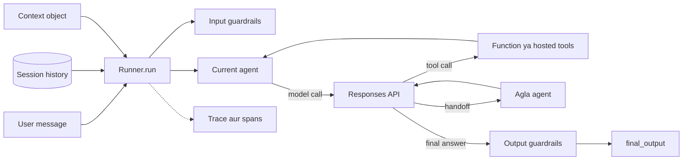

Har box neeche ek section hai. Phir ek Swiggy jaisa support desk banayenge jo sab use karta hai.

## ⭐ Ye kya hai aur mental model

**Ek line me:** OpenAI ki chhoti, Python-first agent library jisme agent ek config object hai aur Runner tool-calling loop chalata hai, saath me handoffs, guardrails, sessions aur tracing built in.

**Ye kyun chahiye:** 2024 me OpenAI ne **Swarm** release kiya, ek experimental, seekhne wala repo jo do ideas dikhata tha: "agents" aur "handoffs". Teams ko ideas pasand aaye par Swarm me tracing, guardrails aur support nahi tha. March 2025 me OpenAI ne Agents SDK ko production-ready successor ke roop me, Responses API ke saath release kiya. Purani Assistants API phir Responses API ke favour me deprecate hui.

**Aise socho:** Bank branch. Front desk (triage agent) sunta hai aur tumhe loans desk ya cards desk bhejta hai (handoff). Darwaze pe guard dekhta hai kaun aa raha hai (input guardrail). Manager har letter bahar jaane se pehle check karta hai (output guardrail). CCTV sab record karta hai (tracing). Passbook purani visits yaad rakhti hai (session).

**Kaise kaam karta hai, step by step:**

1. Tum `Agent` objects banate ho. Abhi kuch nahi chalta; ye sirf settings hain.
2. `Runner.run(first_agent, "user text")` call karte ho.
3. Runner agent ke instructions, history aur tool list model ko bhejta hai.
4. Model text, tool calls, ya handoff lautata hai. Runner uspe action leta hai aur loop karta hai.
5. Jab koi agent final answer de (aur koi tool call na ho), run khatam.
6. Har step ek trace me span ki tarah record hota hai, default me OpenAI dashboard pe dikhta hai.

**Padosiyon ke beech ye kahan hai:**

| Tool | Mainly kya hai | Kaun maintain karta hai |
|---|---|---|
| OpenAI Agents SDK | chhota agent loop + handoffs + guardrails + tracing | OpenAI (MIT licence) |
| [LangGraph](02-langgraph-core.md) | durable checkpoints wala graph runtime | LangChain Inc. |
| [Claude Agent SDK](29-claude-agent-sdk.md) | Claude Code ka poora harness (files, shell, subagents) library ki tarah | Anthropic |
| [Google ADK](28-google-adk.md) | Gemini aur Vertex AI ke liye agent kit | Google |

Ye **design me model-provider agnostic** hai: OpenAI models sabse achhe chalte hain (Responses API, hosted tools), par baaki models LiteLLM ya kisi OpenAI-compatible endpoint se chalte hain.

**Interview tip:** "OpenAI Agents SDK ek sentence me?" Bolo: "Swarm ka production successor: agent = instructions + tools, loop Runner ka hai, aur handoffs, guardrails, sessions aur tracing hi extra ideas hain."

**Common galti:**
- Ise "Swarm" bolna. Swarm experiment tha; SDK supported library hai.
- Sochna ki `Agent` object memory wala chalta hua cheez hai. Ye stateless config hai; memory session me rehti hai.

## ⭐ Agent aur Runner

**Ek line me:** `Agent` batata hai agent *kya* hai (instructions, tools, handoffs, output type, model); `Runner` batata hai ek run *kaise* hoga (input, context, session, turn limit).

**Ye kyun chahiye:** Config aur execution alag hone se agents startup pe ek baar bante hain aur har request pe reuse hote hain. Per-request cheezein (user id, history, limits) Runner call me jaati hain, to ek agent object hazaron users ko safely serve karta hai.

**Aise socho:** Recipe card (Agent) aur cook jo aaj ek customer ke liye use follow karta hai (Runner run). Card customer ke hisaab se nahi badalta.

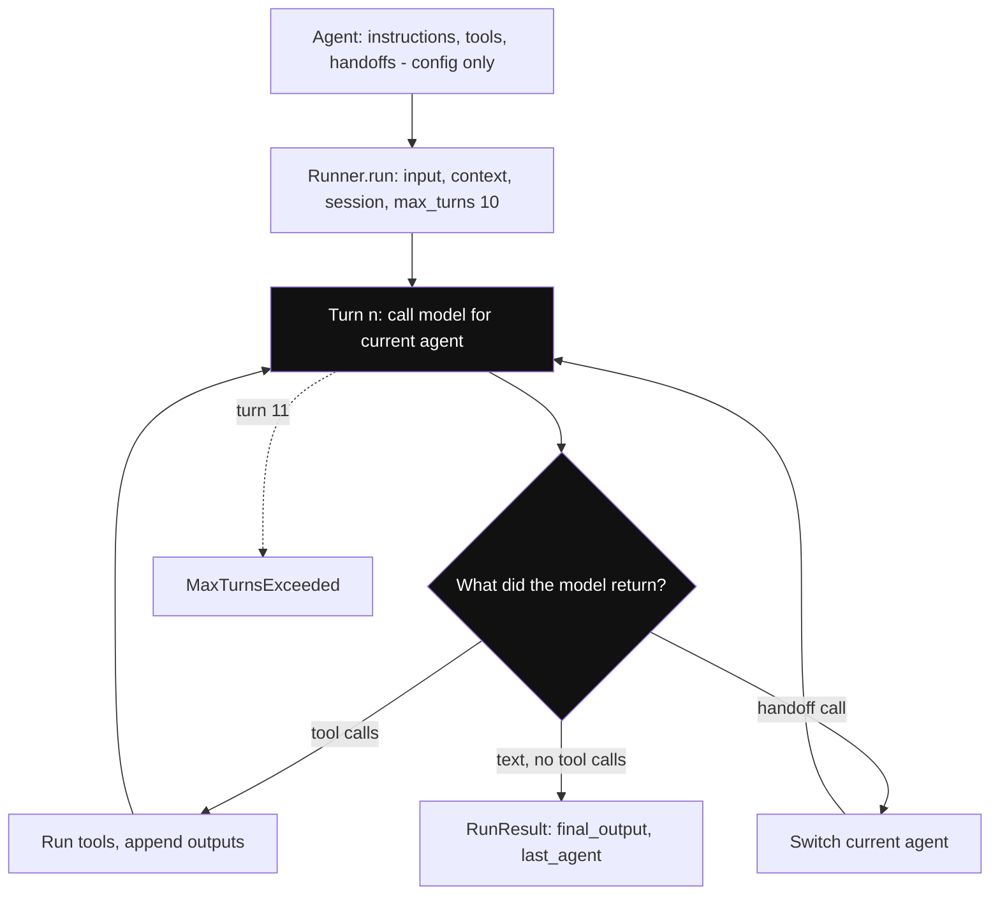

*Diagram:* Upar wala Agent sirf settings hai; highlighted model call Runner ka loop hai, tool calls aur handoffs dono wapas usi me jaate hain jab tak text-only reply na aaye (ya turn 11 pe MaxTurnsExceeded).

**Kaise kaam karta hai, step by step:**

1. Main `Agent` fields: `name`, `instructions` (system prompt; context ka function bhi ho sakta hai), `tools`, `handoffs`, `handoff_description`, `model`, `model_settings`, `input_guardrails`, `output_guardrails`, `output_type`, `tool_use_behavior`.
2. Chalane ke teen tareeke:

| Method | Style | Kab use karo |
|---|---|---|
| `await Runner.run(agent, input)` | async, `RunResult` lautata hai | web servers (FastAPI) |
| `Runner.run_sync(agent, input)` | blocking wrapper | scripts, notebooks |
| `Runner.run_streamed(agent, input)` | async, `RunResultStreaming` lautata hai | chat UIs jo tokens live dikhate hain |

3. Kaam ke run arguments: `context=`, `session=`, `max_turns=` (default **10**), `run_config=` (model override, tracing settings, global guardrails).
4. Kaam ke result fields: `final_output`, `last_agent` (kisne jawab diya), `new_items` (is run ke messages, tool calls, handoffs), `to_input_list()` (agle run ke liye history), `context_wrapper.usage` (tokens).
5. Loop `max_turns` cross kare to SDK `MaxTurnsExceeded` raise karta hai. Use catch karo, ya `error_handlers={"max_turns": ...}` do taaki polite message lautaye.

```python
import asyncio
from agents import Agent, Runner
from openai.types.responses import ResponseTextDeltaEvent

agent = Agent(
    name="IRCTC helper",
    instructions="Answer Indian Railways questions in two short sentences.",
)

# 1. Simple run: poore jawab ka wait karo
result = Runner.run_sync(agent, "What is Tatkal booking?")
print(result.final_output, "| answered by:", result.last_agent.name)

# 2. Streamed run: tokens aate hi print karo
async def stream():
    run = Runner.run_streamed(agent, "When does Tatkal open for AC classes?")
    async for event in run.stream_events():
        if event.type == "raw_response_event" and isinstance(event.data, ResponseTextDeltaEvent):
            print(event.data.delta, end="", flush=True)
        elif event.type == "run_item_stream_event":
            print(f"\n[{event.item.type}]")  # tool_call_item, message_output_item ...

asyncio.run(stream())
```

**Code kya karta hai:**
- `Agent(...)` sirf settings store karta hai; wahan koi model call nahi hoti.
- `run_sync` loop end tak chalata hai aur ek `RunResult` lautata hai.
- `run_streamed` turant lautata hai; `stream_events()` teen event types deta hai: `raw_response_event` (token deltas), `run_item_stream_event` (ek poora item khatam: tool call, tool output, message) aur `agent_updated_stream_event` (handoff ne agent badla).
- `last_agent` batata hai jawab kis agent ne diya, jo handoffs aane ke baad important hai.

**Interview tip:** "`max_turns` kyun important hai?" Bolo: "Confused model hamesha tools call karta reh sakta hai. Default 10 turns ka cap infinite bill ko ek saaf `MaxTurnsExceeded` bana deta hai jise main handle aur log karta hoon."

**Common galti:**
- Har request pe handler ke andar naya `Agent` banana. Nuksaan nahi par bekaar; agents ek baar banao.
- Async server ke andar `run_sync` use karna. Event loop block hota hai; `await Runner.run` use karo.

## ⭐ Tools: function tools, hosted tools aur MCP

**Ek line me:** Tools se agent kaam karta hai: tumhare Python functions (function tools), OpenAI ke chalaye tools (hosted tools), ya MCP servers ke tools.

**Ye kyun chahiye:** Har function ka JSON schema haath se likhna slow hai aur code se out of sync ho jaata hai. SDK function ke type hints aur docstring padh ke schema banata hai. Web search jaisi common zarooraton ke liye OpenAI tool khud chalata hai, tumhe code likhna hi nahi padta.

**Aise socho:** Kirana dukaan wale ke helpers. Kuch uske apne staff hain (function tools: usne train kiye). Kuch services hain jinhe woh call karta hai, jaise courier (hosted tools). Kuch agency se aate hain standard contract ke saath (MCP servers).

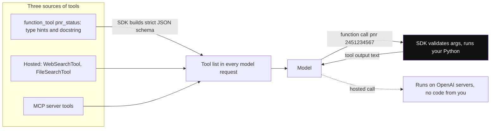

*Diagram:* Teeno tarah ke tools ek hi tool list me pahunchte hain; sirf function tools tumhare process me (highlighted) chalte hain, hosted tools OpenAI ki side pe chalte hain.

**Kaise kaam karta hai, step by step:**

1. Function pe `@function_tool` lagao. Name, description aur parameter schema function ke naam, docstring aur type hints se aate hain. (`agents.decorators.tool` wahi decorator chhote naam se hai.)
2. Pehla parameter `RunContextWrapper[YourCtx]` ho to SDK tumhara context object pass karta hai, aur ye parameter model se chhupata hai.
3. Kaam ke decorator options: `name_override`, `needs_approval` (human ke liye ruko), `failure_error_function` (function raise kare to model kya dekhe), `timeout`, `strict_mode` (strict JSON schema, default on).
4. Hosted tools (OpenAI chalata hai, sirf Responses API): `WebSearchTool`, `FileSearchTool` (tumhara vector store), `CodeInterpreterTool`, `ImageGenerationTool`, `HostedMCPTool`.
5. Local runtime tools jo tumhari machine pe chalte hain: `ComputerTool`, `ShellTool`, `ApplyPatchTool`.
6. MCP: agent ko `mcp_servers=[MCPServerStdio(...)]` ya `MCPServerStreamableHttp(...)` do; unke tools tumhare tools ke saath dikhte hain. [Tools, MCP & A2A](07-tools-mcp-a2a.md) dekho.
7. `tool_use_behavior` decide karta hai tool chalne ke baad kya ho: `"run_llm_again"` (default, model result dekhta hai), `"stop_on_first_tool"` (tool output hi final answer), ya `StopAtTools([...])`.

```python
from agents import Agent, FileSearchTool, RunContextWrapper, WebSearchTool, function_tool

@function_tool
def pnr_status(ctx: RunContextWrapper[dict], pnr: str) -> str:
    """Get the live status of an Indian Railways PNR.

    Args:
        pnr: The 10-digit PNR number.
    """
    if len(pnr) != 10 or not pnr.isdigit():
        return "Invalid PNR. Ask the user for the 10-digit number."  # kaam ka error text
    return f"PNR {pnr}: CNF, coach B2, berth 34 (user {ctx.context['user_id']})"

travel_agent = Agent(
    name="Travel desk",
    instructions="Help with train travel. Use tools, never guess a PNR status.",
    tools=[
        pnr_status,                                     # hamara code
        WebSearchTool(),                                # OpenAI chalata hai
        FileSearchTool(vector_store_ids=["vs_rules"]),  # hamari upload ki rule PDFs me search
    ],
)
```

**Code kya karta hai:**
- `pnr_status` ek string parameter `pnr` wala tool banta hai; docstring ki `Args:` line uska description banti hai.
- `ctx` model se chhupa hai aur hamara `user_id` le jaata hai.
- Galat input pe raise karne ki jagah saaf message lautata hai, taaki model sambhal ke user se poochh sake.
- `WebSearchTool` aur `FileSearchTool` ke liye hamara code nahi chahiye; ye sirf Responses API pe OpenAI models ke saath chalte hain.

**Interview tip:** "Model ko tumhare function ke baare me kaise pata chalta hai?" Bolo: "SDK signature aur docstring ko strict JSON schema me badalta hai aur har model call ke saath bhejta hai. Model arguments ke saath function call lautata hai; SDK validate karke mera function chalata hai aur output wapas bhejta hai."

**Common galti:**
- Vague docstrings. Docstring hi tool ka prompt hai; "does stuff" se galat calls hoti hain.
- LiteLLM ya Chat Completions models pe hosted tools chalne ki ummeed. Ye sirf Responses API pe hain.

## ⭐ Handoffs aur agents as tools

**Ek line me:** Handoff conversation doosre agent ko de deta hai; agent-as-tool doosre agent ko ek sub-task ke liye udhaar leta hai aur control apne paas rakhta hai.

**Ye kyun chahiye:** 40 tools aur 5 page prompt wala ek bada agent confuse hota hai. Specialists me todne se har prompt chhota aur har tool list chhoti rehti hai. SDK specialists jodne ke do tareeke deta hai, kyunki "customer transfer karo" aur "colleague se poochho" alag zaroorat hai.

**Aise socho:** Hospital me reception tumhe cardiology OPD *transfer* karta hai; ab se cardiologist tumse baat karta hai (handoff). Doctor jo tumhara *blood sample lab bhejta* hai, wahi tumse baat karta rehta hai; lab sirf report lautati hai (agent as tool).

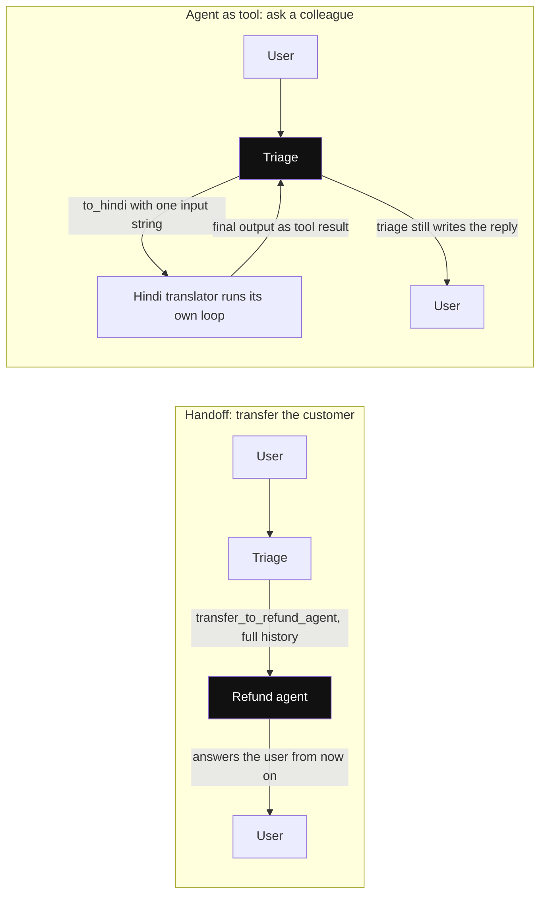

*Diagram:* Highlighted agent wahi hai jo user ko jawab deta hai: handoff ke baad specialist, agent-as-tool me caller hi rehta hai aur specialist sirf result lautata hai.

**Kaise kaam karta hai, step by step:**

1. **Handoff:** agents ko `handoffs=[billing, refunds]` me daalo. Har ek `transfer_to_<agent_name>` naam ka tool banta hai (jaise `transfer_to_refund_agent`), jiska description target ka `handoff_description` hai.
2. Model wo tool call kare to Runner current agent badal deta hai. Naya agent conversation history dekhta hai aur user ko jawab deta hai. Ab `result.last_agent` specialist hai.
3. `handoff(agent, ...)` se customise karo: `on_handoff` (callback, jaise data pehle se laana), `input_type` (structured arguments jaise reason), `input_filter` (agla agent kitni history dekhe; `handoff_filters.remove_all_tools` tool calls hata deta hai), `is_enabled` (per request on/off).
4. Instructions me `RECOMMENDED_PROMPT_PREFIX` (`agents.extensions.handoff_prompt` se) daalo taaki models handoff convention samjhein.
5. **Agent as tool:** `specialist.as_tool(tool_name=..., tool_description=...)`. Main agent use input string ke saath call karta hai, specialist apna loop chalata hai, aur uska final output tool result ki tarah wapas aata hai. Jawab main agent likhta hai.

| | Handoff | Agent as tool |
|---|---|---|
| User ko jawab kaun deta hai | naya agent | original agent |
| Kitni history milti hai | poori conversation (filter ho sakti hai) | sirf jis input string se call hua |
| Baad me control | naye agent ke paas | caller ke paas wapas |
| Achha kis liye | routing: triage → billing | delegation: "ise translate karo", "is doc ka summary do" |
| Parallel use | ek time pe ek handoff | ek turn me kai sub-agents chal sakte hain |

```python
from agents import Agent, handoff
from agents.extensions import handoff_filters
from agents.extensions.handoff_prompt import RECOMMENDED_PROMPT_PREFIX

hindi_translator = Agent(name="Hindi translator", instructions="Translate the text to simple Hindi.")
billing = Agent(name="Billing agent", handoff_description="Payment failures and double charges.",
                instructions=f"{RECOMMENDED_PROMPT_PREFIX} Solve billing issues.")
refunds = Agent(name="Refund agent", handoff_description="Refunds for late or wrong orders.",
                instructions=f"{RECOMMENDED_PROMPT_PREFIX} Solve refund issues.")

triage = Agent(
    name="Triage",
    instructions=f"{RECOMMENDED_PROMPT_PREFIX} Route billing or refund issues. Reply in Hindi if asked.",
    handoffs=[billing, handoff(refunds, input_filter=handoff_filters.remove_all_tools)],
    tools=[hindi_translator.as_tool(tool_name="to_hindi", tool_description="Translate text to Hindi.")],
)
```

**Code kya karta hai:**
- `billing` aur `refunds` tools `transfer_to_billing_agent` aur `transfer_to_refund_agent` bante hain.
- Refund handoff refund agent ko dikhne wali history se purane tool calls hata deta hai.
- `to_hindi` tool ki tarah use hone wala agent hai: triage incharge rehta hai aur translation apne jawab me use karta hai.

**Interview tip:** "Support bot ke liye handoff ya agent-as-tool?" Bolo: "Routing ke liye handoff, kyunki specialist ko conversation aur uska prompt own karna chahiye. Agent-as-tool jab main agent ko combine karne ke liye result chahiye, jaise translator ya policy summariser, ya jab kai sub-results parallel chahiye."

**Common galti:**
- 4–5 agents ki handoff chains. Har hop ek model call kharchta hai aur focus khota hai; ek triage + specialists rakho.
- Agents jo bina saaf rules ke dono taraf ek doosre ko handoff kar sakein. Isse `max_turns` tak ping-pong hota hai.

## ⭐ Guardrails aur tripwires

**Ek line me:** Guardrails functions hain jo pehle agent ka input ya aakhri agent ka output check karte hain; koi `tripwire_triggered=True` lautaye to run exception ke saath ruk jaata hai.

**Ye kyun chahiye:** Tum nahi chahte tumhara mehenga support model "mera college essay likho" ka jawab de ya customer ka phone number leak kare. Main agent se pehle ya saath chalne wala sasta check ise pakad leta hai. General theory ke liye [Guardrails & Safety](08-guardrails.md) dekho.

**Aise socho:** Metro station ka gate. Ticket check (input guardrail) chadhne se pehle hota hai; beep hua (tripwire) to safar nahi. Exit gate (output guardrail) end me dobara check karta hai.

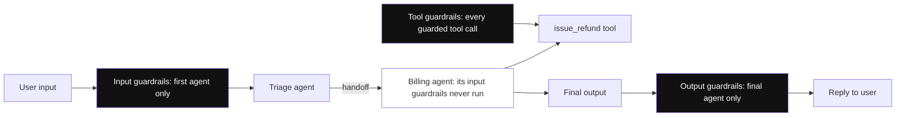

*Diagram:* Input guardrails sirf entrance pe (pehla agent) aur output guardrails sirf exit pe (final agent) chalte hain; handoffs ke paar sirf tool guardrails har call pe chalte hain.

**Kaise kaam karta hai, step by step:**

1. Likho `@input_guardrail async def check(ctx, agent, input) -> GuardrailFunctionOutput`. `output_info` (logs ke liye kuch bhi) aur `tripwire_triggered` (bool) lautao.
2. Agent pe `input_guardrails=[check]` se jodo (ya `RunConfig` me global).
3. **Input guardrails sirf run ke pehle agent pe chalte hain.** **Output guardrails sirf us agent pe chalte hain jo final output deta hai.**
4. Input guardrails default me agent ke saath **parallel** chalte hain (`run_in_parallel=True`): latency kam, par tripwire se pehle main model tokens kharch chuka ho ya tools chala chuka ho sakta hai. Pehle block karne ke liye `@input_guardrail(run_in_parallel=False)`.
5. Trip pe Runner `InputGuardrailTripwireTriggered` ya `OutputGuardrailTripwireTriggered` raise karta hai. Tum catch karke polite jawab do.
6. **Tool guardrails** (`@tool_input_guardrail`, `@tool_output_guardrail`) har guarded function-tool call pe chalte hain, handoffs ke baad bhi. "Refund amount ≤ order amount" jaise checks ke liye use karo.

Example numbers: main agent bada model hai, ~3 second per turn. Chhote model ka guardrail ~0.5 second leta hai. Parallel me user ~3.5 s ki jagah ~3 s wait karta hai. Pehle block karne pe off-topic message sirf 0.5 s ke check ka kharcha karta hai, koi tool call nahi.

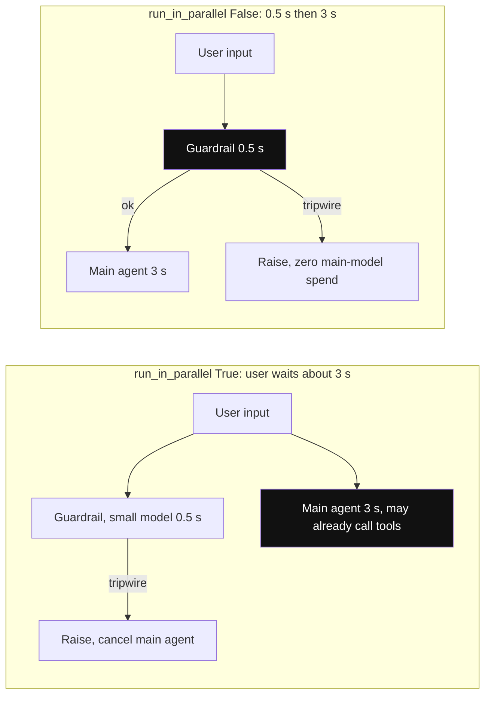

*Diagram:* Parallel 0.5 s bachata hai par trip se pehle main agent tokens ya tool chala chuka ho sakta hai; blocking me guardrail agent ke aage gate ban jaata hai.

```python
from pydantic import BaseModel
from agents import Agent, GuardrailFunctionOutput, InputGuardrailTripwireTriggered, Runner, input_guardrail

class Topic(BaseModel):
    about_food_order: bool
    reason: str

checker = Agent(name="Topic checker", output_type=Topic,
                instructions="Is the message about a food order, delivery or refund?")

@input_guardrail(run_in_parallel=False)   # main agent kuch kharche, usse pehle block
async def only_food_orders(ctx, agent, user_input) -> GuardrailFunctionOutput:
    verdict = await Runner.run(checker, user_input, context=ctx.context)
    return GuardrailFunctionOutput(
        output_info=verdict.final_output,
        tripwire_triggered=not verdict.final_output.about_food_order,
    )

support = Agent(name="Support", instructions="Help with food orders.",
                input_guardrails=[only_food_orders])

try:
    Runner.run_sync(support, "Write my college essay on Gandhi")
except InputGuardrailTripwireTriggered as e:
    print("Blocked:", e.guardrail_result.output.output_info.reason)
```

**Code kya karta hai:**
- Guardrail khud ek chhota agent hai jo structured verdict deta hai.
- `run_in_parallel=False` se main agent check ka wait karta hai.
- Off-topic essay request wire trip karti hai aur raise hota hai; logging ke liye reason exception se padhte hain.

**Interview tip:** "Agent triage se billing ko handoff karta hai. Kya billing ka input guardrail chalega?" Bolo: "Nahi. Input guardrails sirf run ke pehle agent ke liye chalte hain, aur output guardrails sirf final answer dene wale agent ke liye. Handoffs ke paar har tool call pe check ke liye main tool guardrails use karta hoon, ya guardrail `RunConfig` me daalta hoon."

**Common galti:**
- Input guardrails us specialist pe lagana jo sirf handoff se milta hai; woh kabhi nahi chalte.
- Bhoolna ki parallel guardrails ke rehte trip se pehle side-effect wala tool chal sakta hai. Side effects wale tools ho to blocking mode use karo.

## Sessions aur memory

**Ek line me:** Session object run se pehle purane messages load karta hai aur baad me naye save karta hai, taaki history haath se pass na karni pade.

**Ye kyun chahiye:** Memory ke bina turn 2 ("aur mere doosre order ka kya?") ko turn 1 ka pata nahi. Tum `result.to_input_list()` khud rakh ke wapas pass kar sakte ho, par phir har team wahi code likhti hai. Sessions ise ek argument bana dete hain. Memory theory ke liye [Memory & Context](05-memory-context.md) dekho.

**Aise socho:** Patient number wali clinic file. Doctor se milne se pehle receptionist file nikalta hai aur baad me aaj ke notes jodta hai.

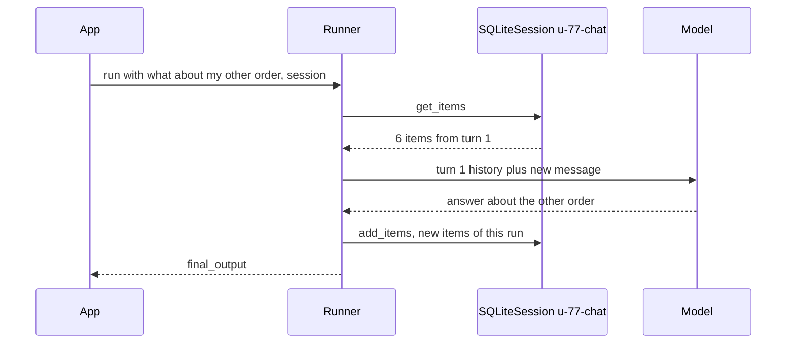

*Diagram:* Session model call se pehle padha jaata hai aur baad me likha jaata hai, isliye turn 2 ko turn 1 dikhta hai bina tumhare history pass kiye.

**Kaise kaam karta hai, step by step:**

1. Ek id ke saath session banao, jaise har user chat ke liye: `SQLiteSession("u-77-chat", "support.db")`.
2. Har `Runner.run` me `session=session` pass karo.
3. Run se pehle SDK session ke items padh ke naye input ke aage lagata hai. Run ke baad naye items append karta hai.
4. Backend chuno:

| Session class | History kahan rehti hai | Use |
|---|---|---|
| `SQLiteSession` | memory me ya local file | dev, single server |
| `SQLAlchemySession` | SQLAlchemy se Postgres, MySQL | zyada tar production apps |
| `RedisSession` | Redis | kai workers, fast reads |
| `OpenAIConversationsSession` | OpenAI ki Conversations API | history OpenAI ko store karne do |
| `EncryptedSession` | doosre session ko wrap karta hai | encryption at rest + TTL |
| `OpenAIResponsesCompactionSession` | doosre session ko wrap karta hai | lambi history compact karta hai |

5. Alternative: `previous_response_id` ya `conversation_id` se server-side history. Inhe ek hi run me session ke saath mat milao; ek chuno.
6. Lambi chats phir bhi badhti hain. Compaction session use karo, ya `session_settings` se limit karo kitne items load hon.

**Interview tip:** "Agents SDK me conversation state kahan rehti hai?" Bolo: "Agent me nahi. Ya to mere chune session backend me (production me SQLAlchemy ya Redis), ya OpenAI ki taraf `previous_response_id` ya Conversations se. Agent object stateless rehta hai isliye horizontally scale hota hai."

**Common galti:**
- Load balancer ke peeche default in-memory `SQLiteSession` use karna. Har pod ki memory alag hai.
- Saare users ke liye ek session id. Session id per user aur per conversation honi chahiye.

## Context object aur structured output

**Ek line me:** Context object app ka data tools aur dynamic instructions tak le jaata hai bina model ke dekhe; `output_type` final answer ko typed Pydantic object me force karta hai.

**Ye kyun chahiye:** Tools ko logged-in user id ya DB pool jaisi cheezein chahiye. Inhe prompt me daalna unsafe hai (model inhe badal sakta hai) aur tokens waste karta hai. Alag se, downstream code (refund API, DB write) ko bharosemand shape chahiye, free text nahi. [Structured Outputs and Prompt Optimization](17-structured-outputs-prompting.md) dekho.

**Aise socho:** Courier ke bag me parcel hai (jo customer dekhta hai) aur peeche delivery slip lagi hai (context: address, payment status). Customer slip kabhi nahi padhta, par parcel chhoone wala har haath padh sakta hai.

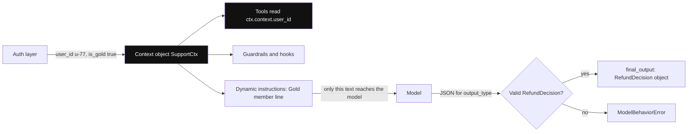

*Diagram:* Context object tools, guardrails aur instructions tak jaata hai par model tak kabhi nahi; model ko sirf instructions ka text milta hai, aur run khatam hone se pehle output_type check hota hai.

**Kaise kaam karta hai, step by step:**

1. Koi bhi class banao, jaise `@dataclass class SupportCtx: user_id: str; is_gold: bool`.
2. Pass karo: `Runner.run(agent, text, context=SupportCtx(...))`. Type hint `Agent[SupportCtx]` editors ko khush rakhta hai.
3. Tools, guardrails, hooks aur dynamic instructions ko `RunContextWrapper[SupportCtx]` milta hai; `ctx.context.user_id` padho. Wrapper me `ctx.usage` (ab tak ke token counts) bhi hai.
4. `instructions` ek function `(ctx, agent) -> str` ho sakta hai, taaki prompt har request pe "ye user Gold member hai" bol sake.
5. `output_type=RefundDecision` (Pydantic model) set karo. SDK JSON schema ko structured-output format ki tarah model ko bhejta hai. Run tabhi khatam hota hai jab model uska valid JSON lautaye, aur `final_output` ek `RefundDecision` instance hota hai.
6. Model invalid JSON de to SDK `ModelBehaviorError` raise karta hai (ya `error_handlers={"invalid_final_output": ...}` se handle karo).

**Interview tip:** "user_id prompt me kyun nahi?" Bolo: "Kyunki prompt injection se model ko doosri id use karne pe manaya ja sakta hai. Id mere auth layer se context object me aati hai, aur tool code me ownership check karta hai."

**Common galti:**
- Sochna ki model context object dekhta hai. Nahi dekhta; model ko koi fact chahiye to instructions me bhi daalo.
- 30 optional fields wale bahut bade `output_type` schemas. Model unhe kharab bharta hai; schema chhota rakho.

## Tracing

**Ek line me:** Har run apne aap ek trace banta hai jisme agents, model calls, tools, handoffs aur guardrails ke spans hote hain, aur ye OpenAI ke Traces dashboard pe jaata hai jab tak tum badlo nahi.

**Ye kyun chahiye:** 20 me se 1 baar fail hone wala agent sirf logs se debug karna namumkin hai. Exact prompt, tool arguments aur steps ka order dekhna padta hai. SDK ye zero setup me record karta hai. [AI Observability](10-agent-observability.md) dekho.

**Aise socho:** Swiggy order timeline: placed, accepted, picked up, delivered, har ek timestamp ke saath. Trace ek agent run ki wahi timeline hai.

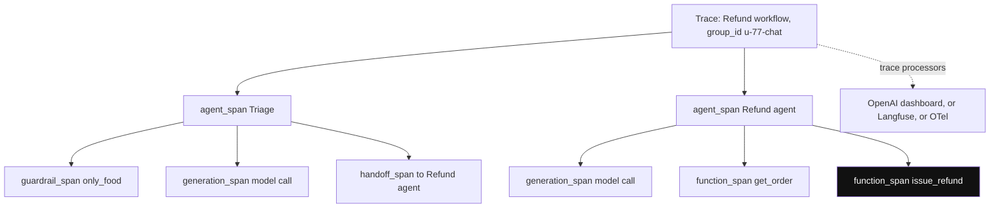

*Diagram:* Ek run ek trace hai; har agent, model call, tool, handoff aur guardrail ek nested span hai, isliye galat refund seedha uske function_span tak le jaata hai.

**Kaise kaam karta hai, step by step:**

1. Tracing default on hai. Ek run ek trace banata hai; andar `agent_span`, `generation_span` (model call), `function_span` (tool), `handoff_span`, `guardrail_span`.
2. Kai runs ko ek trace me group karne ke liye unke around `with trace("Refund workflow"):` lagao.
3. Traces kahin aur bhejo: `add_trace_processor(...)` ek destination jodta hai; `set_trace_processors([...])` OpenAI wala replace karta hai. Langfuse, Logfire, AgentOps, Braintrust aur baaki processors ya OpenTelemetry bridges dete hain.
4. Band karo: `RunConfig(tracing_disabled=True)` ya env `OPENAI_AGENTS_DISABLE_TRACING=1`.
5. Prompts aur tool data chhupao: `RunConfig(trace_include_sensitive_data=False)` ya env `OPENAI_AGENTS_TRACE_INCLUDE_SENSITIVE_DATA=false`.
6. Non-OpenAI models aur OpenAI key nahi? Ya to `set_tracing_export_api_key(...)` se tracing key do ya OpenAI export band karo.

**Interview tip:** "Kya default tracing compliance risk hai?" Bolo: "Ho sakta hai. Default me traces me inputs aur outputs hote hain aur OpenAI ko jaate hain. PII ya data-residency rules ke liye main sensitive data band karta hoon, ya processor ko apne OTel ya Langfuse exporter se replace karta hoon."

**Common galti:**
- Traces me sensitive data ke saath production me ship karna aur kisi ka data policy check na karna.
- `workflow_name` ya `group_id` set na karna, to hazaron traces flow ya conversation se filter nahi hote.

## Models: neeche Responses API, aur non-OpenAI models

**Ek line me:** Default me har agent OpenAI ki Responses API call karta hai; per agent Chat Completions, LiteLLM ya kisi OpenAI-compatible endpoint pe switch kar sakte ho, par hosted tools aur kuch features kho jaate hain.

**Ye kyun chahiye:** Teams ko ek framework par kai models chahiye: routing ke liye sasta model, mushkil cases ke liye strong, kabhi Claude ya Gemini. SDK agent loop ko model client se alag rakhta hai taaki mix kar sako.

**Aise socho:** Phone jo koi bhi SIM le leta hai. Calls har network pe chalti hain, par kuch special services sirf home network pe.

**Kaise kaam karta hai, step by step:**

1. Default: `OpenAIResponsesModel`. Agent koi model set na kare to SDK apna default use karta hai (0.24 me ye `gpt-5.6-luna` hai; env `OPENAI_DEFAULT_MODEL` ya `RunConfig(model=...)` se override).
2. Per agent: `Agent(model="gpt-5.6-sol")`, ya `Model` object pass karo.
3. LiteLLM: `openai-agents[litellm]` install karo, phir `model="litellm/anthropic/claude-sonnet-5-5"` ya `agents.extensions.models.litellm_model` se `LitellmModel(model=..., api_key=...)`.
4. Koi bhi OpenAI-compatible server (vLLM, Ollama, gateway): `OpenAIChatCompletionsModel(model=..., openai_client=AsyncOpenAI(base_url=...))`.
5. Responses API ke bahar kya khota hai: hosted tools (web/file search, code interpreter), `previous_response_id`, tool search aur kuch reasoning settings. Chat Completions inhe chupchaap drop kar sakta hai; jaldi fail ke liye `strict_feature_validation=True` set karo.

| Model path | Hosted tools | Handoffs, guardrails, sessions | Tracing |
|---|---|---|---|
| Responses API se OpenAI | haan | haan | haan |
| Chat Completions se OpenAI-compatible | nahi | haan | haan (OpenAI key ya doosra processor chahiye) |
| LiteLLM (Claude, Gemini, Mistral...) | nahi | haan, agar model tool calling achhi kare | haan, same note |

**Interview tip:** "Kya OpenAI Agents SDK me Claude chala sakte hain?" Bolo: "Haan, LiteLLM extension ya OpenAI-compatible gateway se. Handoffs, guardrails aur sessions phir bhi chalte hain kyunki ye loop me bas function calls hain. OpenAI hosted tools khote hain, aur check karna padta hai ki model strict JSON schemas aur parallel tool calls sambhalta hai."

**Common galti:**
- Bina eval set ke providers mix karna; tool-calling quality models me bahut alag hai.
- OpenAI key na ho to tracing band ya redirect karna bhoolna, jisse export errors ki baarish hoti hai.

## Voice, realtime aur sandbox agents (chhota sa)

**Ek line me:** Wahi agent ideas speech (voice pipeline ya Realtime API) aur sandboxed workspace me lambe kaam tak jaate hain.

**Ye kyun chahiye:** India me phone support aur in-app voice bade use cases hain (IVR replacement). Lambe coding ya data jobs ko filesystem chahiye. Agents, tools aur handoffs reuse karne se doosra framework nahi chahiye. [Multimodal and Voice Agents](18-multimodal-voice.md) dekho.

**Aise socho:** Wahi call-centre team, ab chat ki jagah phone line pe, aur ek back office jiski apni desk aur files hain.

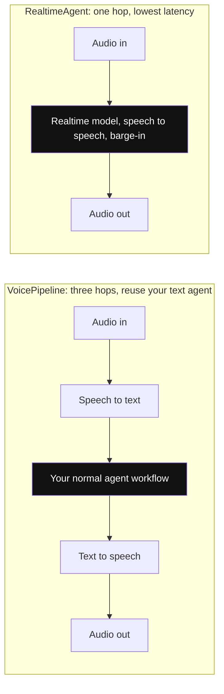

*Diagram:* Pipeline me teen latencies judti hain par text agent waisa hi rehta hai; realtime ek hi model me speech to speech karta hai interruptions ke saath, alag runner se.

**Kaise kaam karta hai, step by step:**

1. **Voice pipeline** (`agents.voice.VoicePipeline`): speech-to-text → tumhara normal agent workflow → text-to-speech. Existing text agent me jodna aasaan; latency teeno steps ka jod.
2. **Realtime agents** (`agents.realtime.RealtimeAgent`, `RealtimeRunner`): realtime model ke saath Realtime API pe speech-to-speech, interruptions (barge-in) aur handoffs. Latency kam, par runner aur event stream alag.
3. **Sandbox agents** (`agents.sandbox.SandboxAgent`, naya): agent `Manifest` se define kiye isolated workspace (jaise clone kiya git repo) me lambe kaam karta hai.

**Interview tip:** "Voice bot ke liye pipeline ya realtime?" Bolo: "Realtime jab ~1 second se kam latency aur barge-in matter kare, jaise phone agent. Pipeline jab text agent exactly reuse karna ho, STT aur TTS vendors pe poora control chahiye, ya har step ki transcripts chahiye."

**Common galti:**
- Lamba text prompt seedha voice prompt bana dena. Bole hue jawab chhote hone chahiye.

## ⭐ Ek poora chhota app: Swiggy jaisa support desk

**Ek line me:** Blocking guardrail wala triage agent order-status agent ya refund agent ko handoff karta hai; ₹300 se upar ke refunds human ke liye rukte hain; history har user ke liye store hoti hai.

**Ye kyun chahiye:** Interviewer sabse zyada yahi shape design karwate hain: routing, lookup tool, approval wala paisa hilane wala tool, structured output, memory aur off-topic filter.

**Aise socho:** Food delivery ka help screen. "Mera order kahan hai" ek desk pe, "refund" doosre pe. ₹300 se upar ka koi bhi refund supervisor ka OK maangta hai.

**Kaise kaam karta hai, step by step:**

1. Logged-in user wala context object; tools code me ownership check karte hain.
2. Refund tool me `needs_approval` ek function: sirf ₹300 se upar ke amounts rukte hain.
3. Do specialists aur handoffs wala triage agent, plus blocking topic guardrail.
4. Run loop jo tripwire, approvals aur session sambhalta hai.

Worked example: order SW-1042 ₹640 ka tha aur 48 minute late aaya. Policy: 30+ minute late → 50% refund = ₹320. ₹320 > ₹300, isliye run approval ke liye rukta hai.

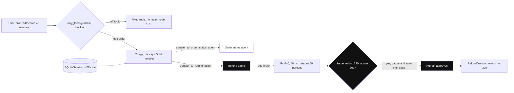

*Diagram:* Is example ke liye highlighted raasta dekho: guardrail pass, triage refund agent ko handoff karta hai, aur Rs 320 refund Rs 300 se upar hai isliye human ke liye rukta hai.

**Step 1: context aur tools.**

```python
from dataclasses import dataclass
from agents import Agent, RunContextWrapper, function_tool

@dataclass
class SupportCtx:                    # hamara data; model ye object kabhi nahi dekhta
    user_id: str
    is_gold_member: bool

ORDERS = {"SW-1042": {"user": "u-77", "status": "delivered", "amount": 640, "late_by_min": 48}}

@function_tool
def get_order(ctx: RunContextWrapper[SupportCtx], order_id: str) -> str:
    """Fetch one order of the current user. Args: order_id: like SW-1042."""
    order = ORDERS.get(order_id)
    if not order or order["user"] != ctx.context.user_id:   # ownership check code me
        return "No such order for this user."
    return str(order)

async def above_300(ctx: RunContextWrapper[SupportCtx], args: dict, call_id: str) -> bool:
    return args.get("amount", 0) > 300                       # bade refunds ko human chahiye

@function_tool(needs_approval=above_300)
def issue_refund(ctx: RunContextWrapper[SupportCtx], order_id: str, amount: int, reason: str) -> str:
    """Refund an amount in rupees for one order."""
    return f"Refund of Rs {amount} queued for {order_id}."
```

**Code kya karta hai:**
- `SupportCtx` hamare auth layer se aata hai, to prompt injection user id nahi badal sakta.
- `get_order` doosre users ke orders mana karta hai, code me, prompt me nahi.
- `above_300` approval policy hai: parsed arguments leta hai aur sirf bade refunds pe True lautata hai.

**Step 2: agents, structured output, handoffs aur guardrail.**

```python
from pydantic import BaseModel
from agents import GuardrailFunctionOutput, Runner, input_guardrail
from agents.extensions.handoff_prompt import RECOMMENDED_PROMPT_PREFIX as P

class RefundDecision(BaseModel):
    order_id: str
    refund_inr: int
    message_to_user: str

refund_agent = Agent[SupportCtx](
    name="Refund agent", handoff_description="Refunds for late, missing or wrong items.",
    instructions=f"{P} Use get_order first. 30+ min late: refund 50%. Never above the order amount.",
    tools=[get_order, issue_refund], output_type=RefundDecision)
status_agent = Agent[SupportCtx](
    name="Order status agent", handoff_description="Where is my order, ETA.",
    instructions=f"{P} Use get_order and explain the status in one line.", tools=[get_order])

class Topic(BaseModel):
    about_food_order: bool

checker = Agent(name="Topic checker", output_type=Topic, instructions="Is this about a food order?")

@input_guardrail(run_in_parallel=False)
async def only_food(ctx, agent, user_input) -> GuardrailFunctionOutput:
    v = await Runner.run(checker, user_input, context=ctx.context)
    return GuardrailFunctionOutput(output_info=v.final_output, tripwire_triggered=not v.final_output.about_food_order)

triage = Agent[SupportCtx](
    name="Triage",
    instructions=lambda ctx, agent: f"{P} Route the user. Gold member: {ctx.context.is_gold_member}.",
    handoffs=[status_agent, refund_agent], input_guardrails=[only_food])
```

**Code kya karta hai:**
- `refund_agent` ko valid `RefundDecision` ke saath khatam hona hai, jise hamara app store ya dikha sakta hai.
- Triage ke instructions function hain, to har request ko user ka Gold status milta hai.
- Guardrail triage pe hai, jo pehla agent hai, isliye sach me chalta hai; kisi kharche se pehle block karta hai.

**Step 3: tripwire, approvals aur session wala run loop.**

```python
import asyncio
from agents import InputGuardrailTripwireTriggered, SQLiteSession

async def handle(text: str, ctx: SupportCtx, session: SQLiteSession):
    try:
        result = await Runner.run(triage, text, context=ctx, session=session, max_turns=8)
    except InputGuardrailTripwireTriggered:
        return "Sorry, I can only help with your food orders."
    while result.interruptions:                    # ruka hua: refund ko approval chahiye
        state = result.to_state()                  # state.to_string() DB me save ho sakta hai
        for item in result.interruptions:
            ok = input(f"Approve {item.tool_name} {item.raw_item.arguments}? (y/n) ") == "y"
            state.approve(item) if ok else state.reject(item)
        result = await Runner.run(triage, state, context=ctx, session=session)
    print("answered by:", result.last_agent.name, "| tokens:", result.context_wrapper.usage.total_tokens)
    return result.final_output

ctx = SupportCtx(user_id="u-77", is_gold_member=True)
session = SQLiteSession("u-77-chat", "support.db")
print(asyncio.run(handle("SW-1042 came 48 minutes late, I want a refund", ctx, session)))
```

**Code kya karta hai:**
- Off-topic message tripwire uthata hai aur fixed jawab milta hai, main-model ka koi kharcha nahi.
- `result.interruptions` approval ka wait karne wale tool calls dikhata hai; `to_state()` ruka hua run pakad leta hai.
- `approve` / `reject` decision record karte hain, aur state ke saath dobara run karne pe wahin se aage chalta hai, shuru se nahi.
- Real app me `state.to_string()` Postgres me save karo, ops ko notify karo, aur approve click pe `RunState.from_string(...)` se resume karo.
- Example ka expected flow: triage → `transfer_to_refund_agent` → `get_order` → `issue_refund(amount=320)` rukta hai → approved → `RefundDecision(order_id="SW-1042", refund_inr=320, ...)`.

**Interview tip:** "Is design me human approval kahan baithega?" Bolo: "Paisa hilane wale tool pe, agent pe nahi. Policy function ke saath `needs_approval` sirf risky calls rokta hai, main run state persist karta hoon, aur human decide kare tab resume karta hoon, taaki koi process memory me wait na kare."

**Common galti:**
- Refund limit sirf prompt me rakhna. Model ko behla ke mana sakte hain; tool ya tool guardrail me enforce karo.
- Ruka hua run sirf memory me rakhna. Beech me deploy hua to approval kho gaya.

## ⭐ Andar kaise kaam karta hai

**Ek line me:** Runner Responses API ke around ek loop hai jo tools aur handoffs ko function definitions me badalta hai, phir model jo lautaye uspe action leta hai jab tak final output na aaye.

**Ye kyun chahiye:** Jab run gadbad kare, tum loop debug karte ho, framework ki marketing nahi. Exactly kya bheja jaata hai aur har reply kaise handle hota hai, ye pata ho to dikhta hai kahan dekhna hai.

**Aise socho:** Dabbawala relay. Har station (turn) pe koi label padhta hai (model output) aur decide karta hai: yahin deliver (final answer), agle runner ko do (handoff), ya pehle kuch utha lo (tool call).

**Kaise kaam karta hai, step by step:**

1. **Setup:** trace shuru; session items load; pehle agent ke input guardrails chalao (parallel ya blocking).
2. **Current agent ke liye request banao:** instructions system prompt ki tarah (dynamic ho to function call karke), input items (history + naya message), tool definitions (function tools strict JSON schemas, hosted tools, MCP tools, aur har handoff ke liye ek `transfer_to_<agent>` function), aur `output_type` schema response format ki tarah.
3. **Model call karo** (ek turn). Response items ki list hai: messages, function calls, reasoning items, hosted tool results.
4. **Agla step decide karo:**
   - Koi handoff call → `on_handoff` chalao, `input_filter` lagao, current agent badlo, loop.
   - Function ya MCP tool calls → approval aur tool guardrails check, unhe chalao (concurrently), `function_call_output` items jodo, loop.
   - Text jo `output_type` se match kare aur koi tool call na ho → yahi final output.
5. **Khatam:** final agent ke output guardrails chalao, naye items session me save, spans band, `RunResult` lautao.
6. **Limits:** har model call ek turn; `max_turns` (default 10) ke baad → `MaxTurnsExceeded`.

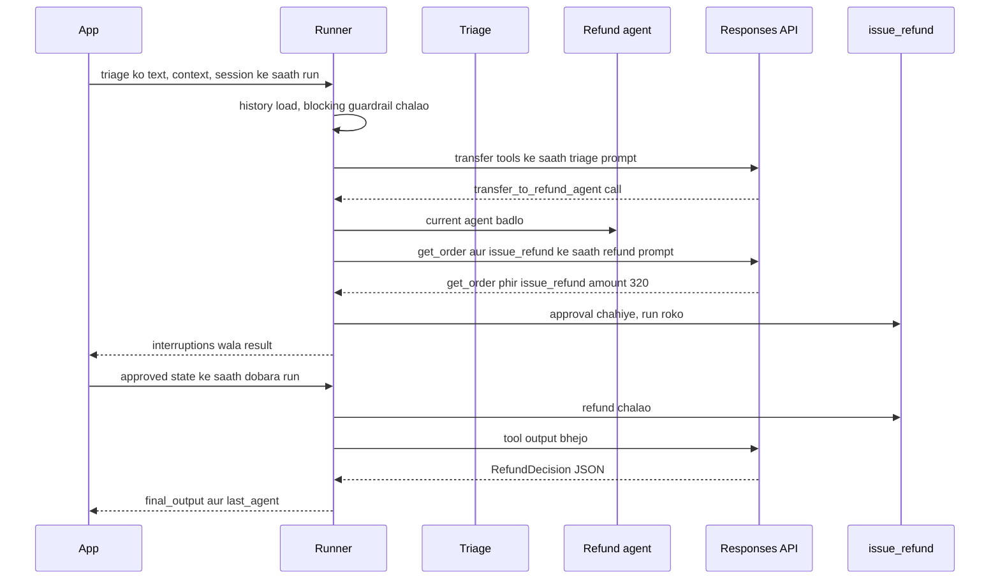

Is run ke turns: triage call (1), refund agent `get_order` call karta hai (2), refund agent `issue_refund` call karta hai (3), refund agent decision likhta hai (4). Chaar turns, 10 ke cap se kaafi kam. Agar 10 turns aur `MaxTurnsExceeded` dikhe, to trace me baar-baar handoffs ya baar-baar fail hote tool calls dekho.

**Interview tip:** "Handoff andar se kaise kaam karta hai?" Bolo: "Ye bas `transfer_to_<agent>` naam ka function tool hai. Model ise call kare to Runner current agent badalta hai, chahe to history filter karta hai, aur naye agent ke instructions aur tools ke saath model ko phir call karta hai. Koi alag process ya message bus nahi."

**Common galti:**
- Sochna ki agents default me concurrently chalte hain. Handoffs sequential hain; sirf ek turn ke tool calls concurrently chalte hain.
- Prompts badalne se pehle trace na padhna; zyada tar "model bewakoof hai" bugs galat tool descriptions ya missing history hote hain.

## Production concerns

**Ek line me:** SDK loop, sessions aur traces deta hai; durability, cost control, evals aur deployment ab bhi tumhara kaam hai.

**Ye kyun chahiye:** Demo laptop pe ek baar chalta hai. Production din me 50,000 chats pods ke paar chalata hai, conversation ke beech deploy hota hai, aur har refund finance ko samjhana padta hai. [Agents in Production](12-agents-in-production.md) dekho.

**Aise socho:** Food truck vs restaurant chain. Recipes same; chain ko storage, staff rota, audits aur kitchen display chahiye.

**Kaise kaam karta hai, step by step:**

| Concern | SDK kya deta hai | Tum kya jodte ho |
|---|---|---|
| Memory | sessions (SQLAlchemy, Redis, encrypted) | per-user session ids, retention policy, PII rules |
| Durability | ruke runs ke liye serialisable `RunState` | state DB me rakho; multi-hour workflows ke liye durable engine (Temporal ka Agents SDK integration hai) ya LangGraph |
| Streaming | `run_streamed` events | UI tak SSE ya WebSocket |
| Observability | default traces, custom processors | Langfuse ya OTel export, dashboards, alerts |
| Evals | traces jinse datasets ban sakte hain | 50–200 real chats ka eval set, CI me. [Evals for Agents](09-agent-evals.md) dekho |
| Cost | har run ka `usage` | triage aur guardrails ke liye sasta model, `max_turns` cap, stable instructions se prompt caching |
| Safety | guardrails, `needs_approval` | tools me enforced limits, audit logs |
| Deployment | ek Python library, server nahi | FastAPI ya worker; stateless pods kyunki state sessions me hai |

Cost example: chhote model pe triage ~1,500 input tokens per turn, bade model pe refund agent ~3,000 tokens per turn, har chat 4 turns. Agar chhota model ~10× sasta hai, to us pe routing triage ka zyada tar kharcha bachata hai, aur requests ke beech instructions same rakhne se provider ka prompt cache repeated input cost aur kaat deta hai. [Cost & Latency](11-cost-latency.md) dekho.

**Jin failure modes ke liye plan karo:** handoff ping-pong, tool exceptions model ko raw stack traces ki tarah dikhna, lambe tasks pe `MaxTurnsExceeded`, guardrail false positives jo real users ko block karein, aur non-OpenAI models pe hosted tools ka chupchaap fail hona.

**Interview tip:** "Agents SDK app production-ready kaise banaoge?" Bolo: "FastAPI service me stateless agents, SQLAlchemy ya Redis session me history, risky tools `needs_approval` ke peeche persisted run state ke saath, sensitive data control karke traces apne backend me, triage aur guardrails ke liye sasta model, error handler ke saath turn cap, aur har prompt change pe chalne wala eval set."

**Common galti:**
- Sessions ko durable workflow state samajhna. Session chat history rakhta hai, "hum 7 me se step 3 pe KYC ka wait kar rahe hain" nahi.

## ⭐ Kab use karo, kab nahi, aur alternatives

**Ek line me:** OpenAI-centric chat agents jinme routing, guardrails aur jaldi tracing chahiye, unke liye chuno; lambe durable workflows, bhaari file aur shell kaam, ya non-OpenAI-first stack ke liye kuch aur chuno.

**Ye kyun chahiye:** "Ye framework kyun, X kyun nahi?" standard senior sawal hai. Saaf jawab dikhata hai ki tum tool ko problem se match karte ho.

**Aise socho:** Auto, cab aur train me chunna. Teeno le jaate hain; doori, saaman aur budget decide karte hain.

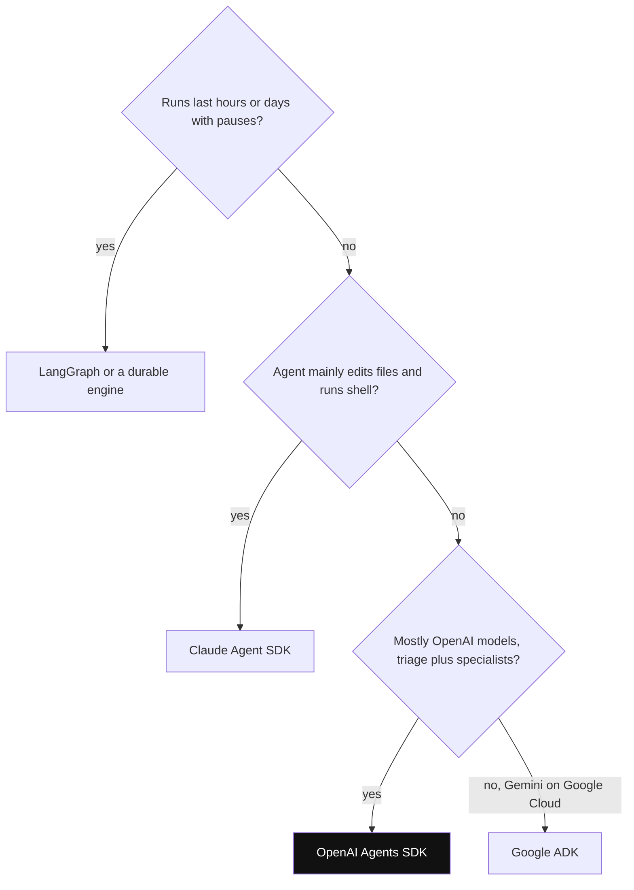

*Diagram:* Pehle durability poocho, phir kaam kis tarah ka hai, phir model provider; Agents SDK tab jeetta hai jab jawab chhota OpenAI-centric routing chat ho.

**Kaise kaam karta hai, step by step:**

1. Tab use karo jab: models zyada tar OpenAI hain; design triage + specialists hai; pehle din se guardrails aur tracing chahiye; team ko kam concepts chahiye.
2. Tab avoid karo jab: runs ghanton ya dinon chalte hain bahut pauses ke saath (durable graph ya workflow engine behtar); agent mainly files edit karta aur shells chalata hai (Claude Agent SDK me ye tools hain); explicit, testable branching chahiye (LangGraph).

| | OpenAI Agents SDK | LangGraph | Claude Agent SDK | Google ADK |
|---|---|---|---|---|
| Mental model | agents + handoffs + Runner loop | typed state pe nodes ka graph | ready Claude Code harness | agents + workflow agents (sequential, parallel, loop) |
| Control flow | model handoffs se decide karta hai | edges tum banate ho | harness decide karta hai; tum configure karte ho | LLM routing aur fixed workflow agents ka mix |
| Durability | sessions + serialisable `RunState` | har step ke baad checkpointer | sessions, resume, fork | pluggable services wale sessions |
| Built-in tools | hosted web/file search, code interpreter | koi nahi (apne lao) | Read, Edit, Bash, Grep, WebSearch... | Google Search, code execution |
| Best models | OpenAI (baaki LiteLLM se) | koi bhi | Claude | Gemini (baaki LiteLLM se) |
| Learning curve | low | medium-high | low-medium | medium |
| Kis liye chuno | support bots, routing, jaldi prototypes | approvals, lambe workflows, complex branching | coding, file aur ops agents | Google Cloud aur Gemini shops |

**Interview tip:** "Bank ke loan bot ke liye OpenAI Agents SDK vs LangGraph?" Bolo: "Agar ye chat hai jo specialists ko route karti hai, to Agents SDK jaldi banta hai. Agar ye loan workflow hai jisme KYC, credit check, manager approval aur dinon ka wait hai, to mujhe LangGraph ke checkpoints aur explicit edges chahiye, ya agent ke around durable engine."

**Common galti:**
- GitHub stars se chunna. Control-flow ki zaroorat, model provider aur durability se chuno.

## Common pitfalls

**Ek line me:** Zyada tar real bugs prompts aur tool design, guardrail ki galat jagah, missing durability aur dobara check na kiye default settings se aate hain.

**Ye kyun chahiye:** Ye real projects me baar-baar aate hain aur "kaise debug karoge" wale interview sawalon me bhi.

**Aise socho:** Ek hi sadak ke wahi gaddhe; pata ho kahan hain to wahan dheere chalte ho.

**Kaise kaam karta hai, step by step:**

1. **Handoff loops:** triage → billing → triage. Saaf `handoff_description`s, one-way handoffs, aur wapas ka raasta chhupane ke liye `is_enabled` se theek karo.
2. **Handoff ke baad context khona:** aggressive `input_filter` ne order id hata di. Key facts `input_type` ya context object se bhejo.
3. **Galat agent pe guardrail:** specialist pe input guardrail kabhi nahi chalta. Pehle agent pe, `RunConfig` me, ya tool guardrail ki tarah lagao.
4. **Parallel guardrail ke side-effects:** tripwire se pehle refund tool chal gaya. `run_in_parallel=False` use karo.
5. **Tool errors stack traces ki tarah:** `failure_error_function` set karo ya friendly error strings lautao.
6. **PII ke saath default tracing:** `trace_include_sensitive_data=False` ya apna processor.
7. **Non-OpenAI models pe hosted tools:** kuch nahi karte ya fail hote hain. Model path check karo.
8. **Multi-pod deploy me in-memory sessions:** history randomly gayab. SQLAlchemy ya Redis use karo.
9. **Turn cap handling nahi:** users ko `MaxTurnsExceeded` pe 500 dikhta hai. `error_handlers` jodo.

**Interview tip:** "Gol-gol handoff karne wale agent ko kaise debug karoge?" Bolo: "Trace kholo, handoff spans list karo, aur padho har agent ne kya dekha. Aksar do descriptions overlap karte hain ya filter ne key fact gira diya. Main descriptions theek karta hoon, handoffs one-way karta hoon, us conversation ka test case eval set me jodta hoon, aur friendly fallback ke saath turn cap rakhta hoon."

**Common galti:**
- Ek kharab conversation ko prompt me ek sentence jod ke theek karna, bina eval set ke jo pakde ki isne kya toda.

## Interview ke sawal

**Q: OpenAI Agents SDK ke core primitives kya hain?**
A: Agents (instructions, tools, handoffs, guardrails, output type), loop chalane wala Runner, tools (function, hosted, MCP), handoffs aur agents-as-tools, guardrails, sessions aur tracing. Baaki sab inke around configuration hai.

**Q: `Runner.run` samjhao.**
A: Session history load, pehle agent ke input guardrails, phir instructions, history aur tool schemas ke saath model call. Handoff pe agent badlo aur loop; tool calls pe unhe chalao aur loop; `output_type` se match karte text aur zero tool calls pe output guardrails, session save aur return. `max_turns` (default 10) loop ko cap karta hai.

**Q: Handoff vs agent-as-tool?**
A: Handoff conversation transfer karta hai; naya agent user ko jawab deta hai. Agent-as-tool ek input pe sub-agent chalata hai aur uska output lautata hai; caller incharge rehta hai. Routing ke liye handoffs, delegated sub-tasks ya parallel sub-results ke liye agent-as-tool.

**Q: Multi-agent run me guardrails kahan chalte hain?**
A: Input guardrails sirf pehle agent pe, output guardrails sirf final output dene wale agent pe. Tool guardrails har guarded tool call pe chalte hain, isliye handoff se pahunche specialists ko bhi cover karte hain.

**Q: Tripwire kya hai, aur parallel mode me kya risk hai?**
A: `tripwire_triggered=True` wala guardrail result; Runner `InputGuardrailTripwireTriggered` ya `OutputGuardrailTripwireTriggered` raise karta hai. Default parallel mode me trip se pehle main agent tokens kharch chuka ya tools chala chuka ho sakta hai, isliye side effects wale tools ho to blocking mode.

**Q: SDK conversations kaise yaad rakhta hai?**
A: `Runner.run` ko diye session object se, jo pehle history load aur baad me naye items save karta hai. Production me `SQLAlchemySession` ya `RedisSession`; ya `previous_response_id` ya Conversations se OpenAI server-side state, par ek run me dono nahi.

**Q: Human approval ke liye kaise rukoge aur ghanton baad resume karoge?** (kya karoge)
A: Tool ko `needs_approval` (bool ya policy function) mark karo. Run `interruptions` ke saath lautta hai; main `to_state()` call karke `state.to_string()` DB me save karta hoon aur approver ko notify karta hoon. Click pe `RunState.from_string` se load, `approve` ya `reject`, aur state ke saath dobara run.

**Q: Tool ko user id safely kaise doge?**
A: Context object se (run pe `context=`, tool me `RunContextWrapper`). Model ise na dekhta hai na badal sakta hai, aur tool code me ownership check karta hai.

**Q: `output_type` kaise kaam karta hai aur model kharab JSON de to?**
A: Pydantic schema response format ki tarah jaata hai aur final output us class me parse hota hai. Invalid output `ModelBehaviorError` raise karta hai, ya `invalid_final_output` error handler se sambhalo.

**Q: Kya Claude ya Gemini use kar sakte ho? Kya khote ho?**
A: Haan, `LitellmModel` / `litellm/...` model names se ya `OpenAIChatCompletionsModel` ke saath OpenAI-compatible endpoint se. Hosted tools, `previous_response_id` aur baaki Responses-only features khote ho, aur tracing ko OpenAI key ya doosra processor chahiye.

**Q: Haal me kya badla, Swarm se ab tak?**
A: Swarm (2024) experiment tha; Agents SDK (March 2025) supported successor hai, Responses API pe bana, aur Assistants API deprecate hui. Tab se sessions, `RunState` ke saath human-in-the-loop, tool guardrails, realtime agents aur sandbox agents jude.

**Q: Default tracing data OpenAI ko bhejti hai. Client ek bank hai. Kya karoge?** (trade-off)
A: Traces me sensitive data band ya OpenAI export disable, aur in-region Langfuse ya OTel collector ke liye apna processor. Span structure rakhta hoon kyunki bina traces debug karna bahut mehenga hai.

**Q: OpenAI Agents SDK vs LangGraph?**
A: Agents SDK chhota hai aur jaldi shuru hota hai, handoffs, guardrails aur tracing built in. LangGraph explicit graphs aur har step ke baad checkpoints deta hai, lambe, branching, pause-heavy workflows ke liye behtar. Chat routing → Agents SDK; durable business process → LangGraph.

**Q: Ise production-ready kaise banaoge?**
A: Service me stateless agents, Postgres ya Redis me sessions, persisted `RunState` ke saath approvals, tools me enforced limits, triage aur guardrails ke liye saste models, error handlers ke saath turn cap, hamare backend me traces, aur eval set jo har prompt ya model change ko gate kare.

**Q: `MaxTurnsExceeded` wale run ko kaise debug karoge?**
A: Uska trace kholo aur spans type se gino. Baar-baar handoff spans matlab overlapping descriptions; baar-baar same tool calls matlab tool output unclear hai ya error chhupa hai. Cause theek karo, case evals me jodo, phir decide karo cap badalna hai ya nahi.

## Aage padho

- [Agent Frameworks and Tooling](19-agent-frameworks.md)
- [Claude Agent SDK](29-claude-agent-sdk.md)
- [LangChain](23-langchain.md)
- [Google ADK](28-google-adk.md)

## Checklist

- [ ] Main samjha sakta hoon ki `Agent` aur `Runner` kya-kya own karte hain, aur chalane ke teen tareeke bata sakta hoon.
- [ ] Main context parameter wala function tool likh sakta hoon aur teen hosted tools ke naam bata sakta hoon.
- [ ] Main handoff vs agent-as-tool samjha sakta hoon aur bata sakta hoon kab kaunsa chunoonga.
- [ ] Main samjha sakta hoon ki input, output aur tool guardrails kahan chalte hain, aur parallel mode ka risk kya hai.
- [ ] Main sessions samjha sakta hoon aur production ke liye backend chun sakta hoon.
- [ ] Main risky tool call ko approval ke liye rok ke baad me `RunState` se resume kar sakta hoon.
- [ ] Main Runner loop turn by turn samjha sakta hoon, `max_turns` ke saath.
- [ ] Main samjha sakta hoon ki non-OpenAI models kaise use karte hain aur kya khota hai.
- [ ] Main Agents SDK ko LangGraph, Claude Agent SDK aur Google ADK se compare kar sakta hoon.
- [ ] Main common pitfalls bata sakta hoon aur handoff loop debug karne ka tareeka samjha sakta hoon.
