# Google ADK

Google ka Agent Development Kit (ADK) ek open-source, code-first framework hai jisse Python, TypeScript, Go aur Java me agents bante hain. Ye Gemini aur Google Cloud ke liye tuned hai, par doosre models bhi chala sakta hai. Google Cloud wali companies aur enterprises me interviewer ye isliye poochhte hain ki dekh sakein tumhe pata hai iske pieces kaise judte hain: agents, workflows, sessions, Runner aur events, aur ship kaise karte ho.

Ye page Python ke `google-adk` 2.x ke hisaab se likha hai (2.0 May 2026 me GA hua; likhte waqt 2.14 current hai). Jahan 1.x code alag hai, wahan ek line me bataya hai.

**Is page ke baad tum ye jawab de paoge:**
- "ADK me `LlmAgent` aur workflow agent me kya farak hai?"
- "ADK me state ek agent se agle agent tak kaise jaati hai?"
- "`Runner` kya karta hai, aur event kya hota hai?"
- "Sub-agent transfer vs `AgentTool`: kab kaunsa?"
- "ADK me tool chalne se pehle guardrail kaise lagaoge?"
- "ADK ke andar Claude ya GPT models kaise use karoge?"
- "ADK 2.0 me kya badla, aur upgrade pe kya toot-ta hai?"
- "ADK agent ko evaluate aur Google Cloud pe deploy kaise karoge?"

## Pehle ye shabd samjho

Agents me naye ho? Pehle [Agent Foundations](01-agent-foundations.md) padho. Saare frameworks ka chhota tour [Agent Frameworks and Tooling](19-agent-frameworks.md) me hai.

| Shabd | Simple matlab |
|---|---|
| ADK | Agent Development Kit: agents banane, test karne aur deploy karne ki Google ki open-source library. |
| Gemini | Google ke large language models (LLMs) ki family. ADK default me yahi use karta hai. |
| `LlmAgent` (`Agent`) | Agent jiska agla step LLM decide karta hai. `Agent` iska chhota alias hai. |
| Workflow agent | Agent jo doosre agents ko fixed order me chalata hai: ek ke baad ek, saath-saath, ya loop me. |
| `Workflow` | ADK 2.0 ka graph engine: agents, tools aur plain functions nodes bante hain, edges se jude. |
| Tool | Python function (ya doosra agent, ya remote API) jise chalane ko LLM ADK se bol sakta hai. |
| Session | Ek conversation: uske events ki list plus ek chhota key-value `state` dict. |
| State | Session ke andar key-value dict jise agents aur tools padhte aur likhte hain. |
| Event | Jo hua uska ek record: user message, model reply, tool call, state change. |
| `Runner` | Engine jo user message leta hai, agent chalata hai, events save karta hai aur tumhe stream karta hai. |
| Callback | Tumhara function jo ADK agent, model call ya tool call se pehle ya baad me chalata hai, check ya badalne ke liye. |
| A2A | Agent2Agent protocol: ek agent HTTP pe doosre agent ko call kare, iska open standard. |
| MCP | Model Context Protocol: tool servers ko kisi bhi agent me lagane ka open standard. |
| LiteLLM | Library jo 100+ model providers ke liye ek API deti hai. ADK non-Gemini models ke liye ise use karta hai. |

## Big picture

Tum agents define karte ho (LLM-driven, plus fixed-order workflows) aur unhe tools dete ho. `Runner` engine hai: session load karta hai, root agent chalata hai, aur har step ek event banata hai. Events session service save karti hai aur tumhari app ko stream hote hain. Callbacks se har model aur tool call check kar sakte ho. Iske aas-paas dev tools (`adk web`, `adk run`), evaluation (`adk eval`) aur deployment (Cloud Run ya Agent Engine) hain. Ye page isi order me chalta hai, phir ek poori app banata hai.

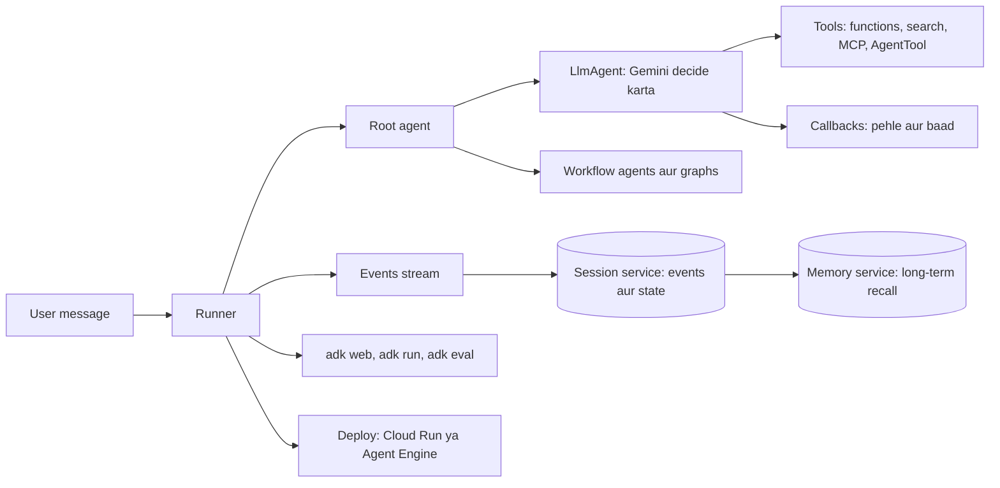

## ⭐ ADK kya hai aur mental model

**Ek line me:** ADK Google ka code-first agent framework hai jahan sab kuch agent hai (ya 2.0 se, graph ka ek node), `Runner` use chalata hai, aur har step ek event banke session me save hota hai.

**Ye kyun chahiye:** Google ko apne agent products aur Google Cloud customers ke liye ek framework chahiye tha. Use aise agents chahiye the jo normal software jaise lagein: code me likhe, unit-tested, versioned, aur service ki tarah deploy. Saath me first-class Gemini features (built-in Google Search, code execution, live audio) aur Vertex AI tak saaf raasta.

**Aise socho:** Zomato ki cloud kitchen. Head chef (`LlmAgent`) order dekh ke decide karta hai kya banana hai. "Dhona, kaatna, talna" jaise fixed stations order me = workflow agents. Dish ke saath chalne wala order ticket = session state. Kitchen manager jo order leta hai, kitchen chalata hai aur har step log book me likhta hai = `Runner`. Log book ki entries = events.

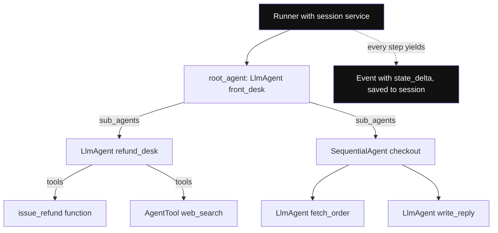

*Diagram:* Runner ke neeche sab agents ka tree hai (LLM ya workflow), patton pe tools; Runner tree chalata hai aur har step ko save hone wale event me badalta hai.

**Kaise kaam karta hai, step by step:**

1. Tum ek root agent likhte ho. Ye `LlmAgent`, workflow agent, ya `Workflow` graph ho sakta hai.
2. Root agent ke children (`sub_agents`) aur tools ho sakte hain.
3. Root agent aur session service ke saath ek `Runner` banate ho.
4. Tumhari app `runner.run_async(user_id, session_id, new_message)` call karti hai.
5. Runner session load karta hai, agent chalata hai, aur ek-ek karke events yield karta hai.
6. Jo event state badalta hai uspe `state_delta` hota hai. Runner use session service me commit karta hai.
7. Tumhari app events dikhati hai (UI ko stream) aur final response uthati hai.

**Kaun maintain karta hai aur kahan baith-ta hai:**

| | Google ADK | LangGraph | OpenAI Agents SDK |
|---|---|---|---|
| Maintainer | Google | LangChain Inc. | OpenAI |
| Core idea | agent tree, plus 2.0 me graph workflows | explicit state graph | handoffs wale agents |
| Best model fit | Gemini, LiteLLM se koi bhi | koi bhi | OpenAI, adapters se baaki |
| Hosted runtime | Vertex AI Agent Engine | LangGraph Platform | apna koi nahi |
| Languages | Python, TypeScript, Go, Java | Python, JS | Python, JS |

**2.0 me kya badla:** ADK 2.0 ne graph-based **Workflow Runtime** joda. Ab agents, tools aur functions graph me nodes ki tarah chalte hain. `BaseAgent` ab `BaseNode` ka subclass hai. Purane fixed workflow agents (`SequentialAgent` waghera) abhi bhi chalte hain, par docs kehte hain naye Python aur Go code ke liye graph aur dynamic workflows ne unki jagah le li hai.

**Interview tip:** "ADK 30 second me samjhao." Bolo: "Google ka code-first agent framework. LLM-driven steps ke liye `LlmAgent`, fixed control flow ke liye workflow agents ya 2.0 ka `Workflow` graph. `Runner` agent chalata hai aur events emit karta hai; session service events aur state persist karti hai. Guardrails ke liye callbacks, debugging ke liye `adk web`, tests ke liye `adk eval`, deploy Cloud Run ya Agent Engine pe."

**Common galti:**
- Sochna ki ADK sirf Gemini ke saath chalta hai. Gemini ke saath best hai, par `LiteLlm` se Claude, GPT ya local model bhi chala sakte ho.
- Agent tree (kaun kise handoff kar sakta hai) ko session (kya kaha gaya aur kya store hua) se mix kar dena.

## ⭐ LlmAgent: sochne wala agent

**Ek line me:** `LlmAgent` instructions, history aur tool list model ko bhejta hai, model ke maange tools chalata hai, aur tab tak repeat karta hai jab tak model final jawab na de.

**Ye kyun chahiye:** Zyada tar real tasks me judgment chahiye: "ye refund ka sawal hai ya delivery ka?". Ise `if-else` me nahi likh sakte. `LlmAgent` ye judgment model ko deta hai, aur loop, tool calls aur history ADK sambhalta hai.

**Aise socho:** Swiggy support executive jiske paas script (instruction), departments ki phone list (tools aur sub-agents), aur screen pe chat history (session events) hai.

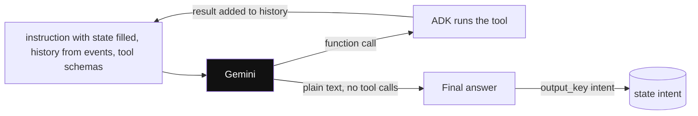

*Diagram:* LlmAgent yahi chhota loop hai: model ya to tool maangta hai (aur ADK loop karta hai) ya plain text deta hai, jise output_key state me save kar sakta hai.

**Kaise kaam karta hai, step by step:**

1. Tum `name`, `model`, `instruction`, `description` aur `tools` set karte ho.
2. `instruction` system prompt hai. Ye `{key}` placeholders se state padh sakta hai, jaise `"User's city is {city}"`.
3. `description` ek line ka summary hai. Doosre agents ise padh ke decide karte hain ki kaam is agent ko dena hai ya nahi.
4. `output_key="summary"` agent ka final text apne aap `state["summary"]` me save kar deta hai.
5. `output_schema=MyPydanticModel` structured JSON jawab force karta hai. Kuch purane docs kehte hain ise tools ke saath mix nahi kar sakte; apna version check karo.
6. `generate_content_config` se temperature, max tokens aur safety settings set hoti hain.

Worked example: `output_key="intent"` wala triage agent `"refund"` reply karta hai. Us turn ke baad `state = {"intent": "refund"}`. Agle agent ka instruction `"Handle a {intent} request"` ban jaata hai `"Handle a refund request"`.

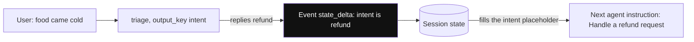

*Diagram:* Agents ek doosre ke messages parse nahi karte: ek event ke state_delta se state key likhta hai, agla apni instruction ke placeholder se padhta hai.

```python
from google.adk.agents import LlmAgent   # same class: from google.adk import Agent

triage = LlmAgent(
    name="triage",
    model="gemini-3.5-flash",            # koi bhi current Gemini model id
    description="Classifies a customer message into an intent.",
    instruction=(
        "Read the user's message. Reply with exactly one word: "
        "refund, delivery or other."
    ),
    output_key="intent",                  # final text state["intent"] me save hota hai
)
```

**Code me kya ho raha hai:**
- Ek LLM-driven agent banta hai, chhote aur strict instruction ke saath.
- `description` se parent agent decide karta hai kab isko transfer karna hai.
- `output_key` jawab session state me likhta hai, taaki agla agent messages parse kiye bina use kar sake.

**Interview tip:** "Do ADK agents data kaise share karte hain?" Bolo: "Session state se. Ek agent `output_key` se likhta hai ya tool `tool_context.state[...]` likhta hai; agla agent apne instruction me `{key}` placeholder se padhta hai. State changes events pe `state_delta` ki tarah jaate hain, to save bhi hote hain aur audit bhi ho sakte hain."

**Common galti:**
- Vague `description` likhna. Parent LLM description se hi sub-agent chunta hai, to vague hone pe routing galat hoti hai.
- Aisi key ka `{key}` placeholder jo abhi state me nahi hai. Runtime pe fail hota hai. Optional banane ke liye `{key?}` use karo.

## ⭐ Workflow agents aur 2.0 Workflow graph

**Ek line me:** Workflow agents (`SequentialAgent`, `ParallelAgent`, `LoopAgent`) sub-agents ko fixed pattern me chalate hain, order koi LLM decide nahi karta; ADK 2.0 isi kaam ke liye routing, retries aur pause ke saath general `Workflow` graph laata hai.

**Ye kyun chahiye:** Kuch steps hamesha same order me hone chahiye: order fetch, phir policy check, phir reply. Order LLM pe chhodo to tokens lagte hain aur kabhi step skip ho jaata hai. Fixed control flow sasta, fast aur testable hai.

**Aise socho:** IRCTC booking counter. Form bharo, phir pay karo, phir ticket print: hamesha isi order me (sequential). Do clerk ek saath ID aur payment check karein (parallel). Proofreader jo ticket tab tak dobara check kare jab tak sahi na ho, max teen baar (loop).

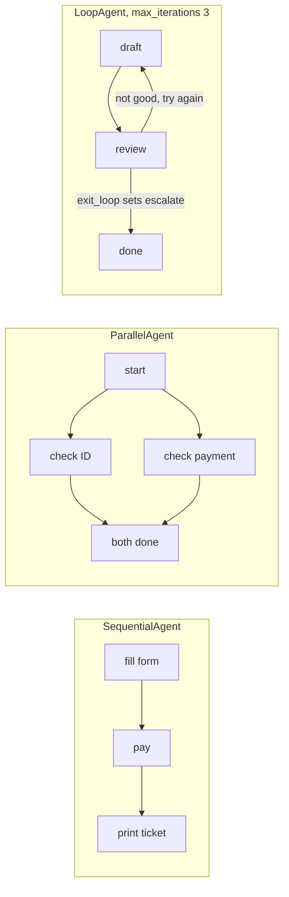

*Diagram:* Teen fixed shapes, order koi LLM nahi chunta: seedhi line, fan-out jo join hota hai, aur loop jo exit_loop pe ya 3 round ke baad rukta hai.

**Kaise kaam karta hai, step by step:**

1. **`SequentialAgent(sub_agents=[a, b, c])`**: a, phir b, phir c. Sab same session state share karte hain, to `a` ka `output_key` `b` ko dikhta hai.
2. **`ParallelAgent(sub_agents=[x, y])`**: x aur y ek saath alag branches pe chalte hain. Har ek ko alag `output_key` do taaki ek doosre ka data overwrite na kare.
3. **`LoopAgent(sub_agents=[draft, review], max_iterations=3)`**: `max_iterations` tak repeat, ya jab tak koi sub-agent `escalate` set na kare. Built-in `exit_loop` tool yahi karta hai.
4. **ADK 2.0 `Workflow`**: tum edges list karte ho. Node agent, plain Python function ya doosra workflow ho sakta hai. Node ek `route` emit kar sakta hai aur edge map agla node chunta hai.

| Zaroorat | 1.x style | 2.0 style |
|---|---|---|
| A phir B phir C | `SequentialAgent` | `Workflow(edges=[(START, a, b, c)])` |
| X aur Y saath, phir merge | `ParallelAgent` + merge agent | nodes ka tuple, phir `JoinNode` |
| Theek hone tak repeat | `LoopAgent` + `exit_loop` | loop edge plus routing |
| Value pe branch | custom agent | `Event(route="...")` aur route map |
| Human ke liye pause | khud banao | built-in human-in-the-loop input |

Worked example: parallel step me flights agent (2.1 s) aur hotels agent (1.6 s). Sequential me 3.7 s lagte; parallel me lagbhag 2.1 s, yaani sabse slow branch jitna.

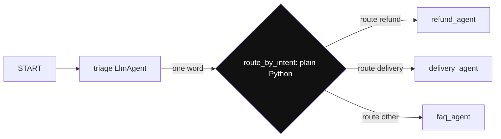

*Diagram:* Ye wahi graph hai jo neeche wala 2.0 Workflow banata hai: sirf triage LLM use karta hai; highlighted function route yield karke free me agla node chunta hai.

```python
from google.adk import START, Event, Workflow

def route_by_intent(node_input: str):
    # node_input pichhle node ka output hai, yahan triage agent ka ek word
    word = node_input.strip().lower()
    yield Event(route=word if word in ("refund", "delivery") else "other")

support_flow = Workflow(
    name="support_flow",
    edges=[
        (START, triage, route_by_intent,
         {"refund": refund_agent, "delivery": delivery_agent, "other": faq_agent}),
    ],
)
```

**Code me kya ho raha hai:**
- Graph banta hai: start, `triage` chalao, phir ek plain Python function route decide karta hai.
- Function `route` naam ke saath `Event` yield karta hai; routing pe koi LLM call kharch nahi hoti.
- Dict har route ko agle agent node se map karta hai. (`refund_agent`, `delivery_agent`, `faq_agent` kahin aur define kiye `LlmAgent` hain.)
- 1.x me ise custom agent se likhte, ya parent `LlmAgent` transfer se chunta.

**Interview tip:** "Ek hi LLM agent sab kyun nahi karta?" Bolo: "Deterministic hisse workflows me jaate hain. Unme zero tokens lagte hain, step kabhi skip nahi hota aur test karna aasaan hai. LLM ko main judgment ke liye rakhta hoon, jaise intent classify karna ya reply likhna."

**Common galti:**
- Do parallel agents ka same `output_key`. Jo last likhe wahi jeet-ta hai aur data kho jaata hai.
- Bina `max_iterations` wala `LoopAgent` aur reviewer jo kabhi `exit_loop` call nahi karta. Budget khatam hone tak chalta rehta hai.

## Custom agents aur dynamic nodes

**Ek line me:** Jab na LLM fit ho na fixed pattern, to control flow Python me likhte ho: 1.x me `BaseAgent` subclass karke, 2.0 me function nodes ya `ctx.run_node` call karne wala dynamic node likh ke.

**Ye kyun chahiye:** Real flows me rules hote hain jaise "cart value ₹5,000 se upar ho to pehle fraud agent chalao, warna skip". Ye plain code hai, prompt nahi.

**Aise socho:** Kitchen manager special cases ke liye har baar chef se poochhne ki jagah laminated rule card follow karta hai.

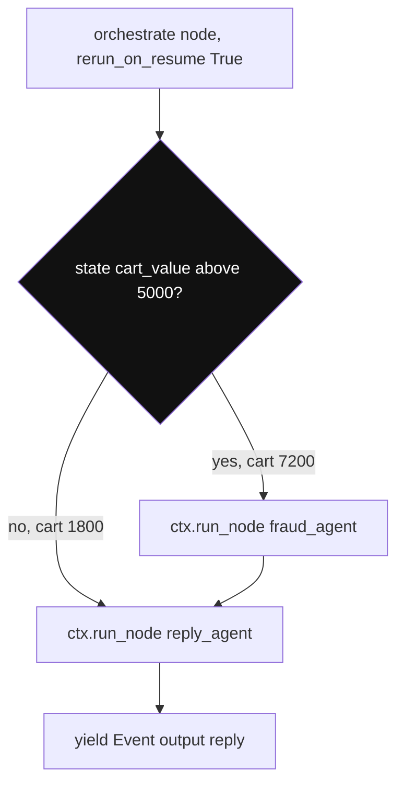

*Diagram:* Branch Python ka if hai, prompt nahi; pause ke baad poora node upar se dobara chalta hai, isliye har child call repeat karne pe safe honi chahiye.

**Kaise kaam karta hai, step by step:**

1. **1.x:** `BaseAgent` subclass karo, `async def _run_async_impl(self, ctx)` likho, aur jis order me chaho sub-agents call karke unke events `yield` karo.
2. **2.0:** migration guide warn karta hai ki ab `BaseAgent` ek `BaseNode` hai, isliye `_run_async_impl` jaise legacy methods override karna chupchaap ignore ho sakta hai. Logic function node me likho.
3. Runtime pe decide hone wale loops aur branches ke liye function pe `@node(rerun_on_resume=True)` lagao aur andar `await ctx.run_node(child, node_input=...)` call karo.
4. `rerun_on_resume=True` important hai: pause ya crash ke baad orchestrator shuru se dobara chalta hai, to child calls repeat hone pe safe hone chahiye.

```python
from google.adk import Context, Event, Workflow
from google.adk.workflow import node

@node(rerun_on_resume=True)
async def orchestrate(ctx: Context, node_input: str):
    # plain Python decide karta hai kaunsa child chalega
    if ctx.state.get("cart_value", 0) > 5000:
        await ctx.run_node(fraud_agent, node_input=node_input)
    reply = await ctx.run_node(reply_agent, node_input=node_input)
    yield Event(output=reply)

root_agent = Workflow(name="checkout", edges=[("START", orchestrate)])
```

**Code me kya ho raha hai:**
- Function node state padhta hai aur runtime pe decide karta hai fraud agent chalega ya nahi.
- `ctx.run_node` child agent chalata hai aur uska output lautata hai, function call jaisa.
- `yield Event(output=...)` reply ko node ka output banata hai.

**Interview tip:** "Rule hai 'refund ₹2,000 se upar ho to fraud check'. Ye kahan rahega?" Bolo: "Code me, dynamic node ya callback ki tarah, sirf prompt me kabhi nahi. Prompt suggestion hai; code guarantee hai."

**Common galti:**
- 1.x ka custom-agent code 2.0 project me copy karke maan lena ki chalega. Upgrade ke baad dobara test karo.

## ⭐ Tools: functions, built-ins, AgentTool, MCP aur OpenAPI

**Ek line me:** Tool woh sab hai jo model call kar sake: Python function, `google_search` jaisa Google built-in, `AgentTool` me wrap kiya doosra agent, MCP server ke tools, ya OpenAPI spec ka har endpoint.

**Ye kyun chahiye:** Model khud tumhara database nahi padh sakta, na refund API call kar sakta hai. Tools uske haath hain. ADK har tarah ke tool ko model ke liye ek jaisa dikhata hai.

**Aise socho:** Support executive ki desk: calculator (function tool), browser pe Google (built-in search), senior colleague ka phone jo jawab deke rakh deta hai (`AgentTool`), aur office ka shared printer jo koi bhi use kare (MCP server).

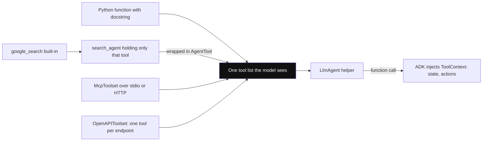

*Diagram:* Paanch alag sources model ko ek jaise dikhte hain; dhyan do built-in search apne agent me hai aur mixing limit se bachne ke liye AgentTool se judta hai.

**Kaise kaam karta hai, step by step:**

1. **Function tool:** `tools=[...]` me plain Python function do. ADK type hints aur docstring se JSON schema banata hai. `{"status": "ok", "eta_min": 25}` jaisa dict return karo.
2. **`ToolContext`:** ek parameter `tool_context: ToolContext` jodo aur ADK use inject karta hai. Isse `tool_context.state`, artifacts, memory search aur `tool_context.actions` (jaise `escalate`) milte hain.
3. **Built-in tools:** `google_search`, code execution aur Vertex AI Search Google ki side chalte hain. Gemini me ek agent me built-in tools aur tumhare function tools mix karne ki limits hain. Common fix: `google_search` ko alag chhote agent me rakho aur us agent ko `AgentTool` se wrap karo.
4. **`AgentTool(agent=x)`:** parent agent `x` ko function ki tarah call karta hai, jawab leta hai, aur control apne paas rakhta hai.
5. **MCP:** `McpToolset(connection_params=...)` stdio ya streamable HTTP pe MCP server se judta hai aur uske tools expose karta hai.
6. **OpenAPI:** `OpenAPIToolset(spec_str=..., spec_str_type="json")` har endpoint ko tool bana deta hai.
7. **Long-running tools aur confirmation:** tool chalne se pehle human confirmation maang sakta hai (tool confirmation flow).

**Sub-agent transfer vs `AgentTool`:**

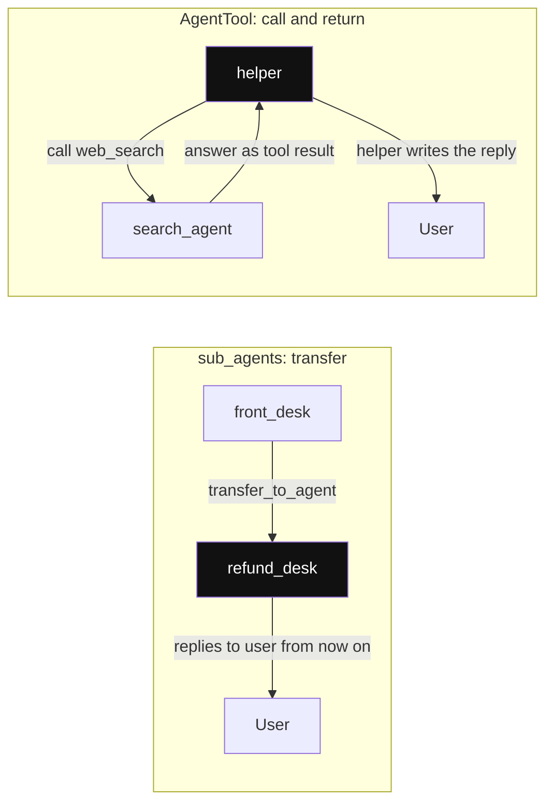

*Diagram:* Highlighted agent agla user se baat karta hai: transfer me control sub-agent ke paas jaata hai; AgentTool me wapas parent ke paas aata hai.

| | `sub_agents=[x]` (transfer) | `tools=[AgentTool(agent=x)]` |
|---|---|---|
| Aage user se kaun baat karega | `x` conversation le leta hai | parent hi baat karta rehta hai |
| Control | saunp diya | parent ke paas |
| Result | `x` ke replies user ko jaate hain | `x` ka jawab tool result banke parent ko aata hai |
| Kiske liye | "refund desk ko transfer karo" | "search specialist se poochho, phir reply main likhunga" |

```python
from google.adk.agents import LlmAgent
from google.adk.tools import google_search
from google.adk.tools.agent_tool import AgentTool

search_agent = LlmAgent(
    name="web_search", model="gemini-3.5-flash",
    instruction="Search the web and answer in 3 lines with sources.",
    tools=[google_search],                      # built-in tool apne agent me akela
)

def get_order(order_id: str) -> dict:
    """Return status and ETA for one order id."""
    return {"order_id": order_id, "status": "picked_up", "eta_min": 25}

helper = LlmAgent(
    name="helper", model="gemini-3.5-flash",
    instruction="Use get_order for order questions, web_search for anything public.",
    tools=[get_order, AgentTool(agent=search_agent)],
)
```

**Code me kya ho raha hai:**
- `get_order` function tool ban jaata hai. Docstring aur type hints tool description aur schema bante hain.
- `google_search` apne alag agent me hai, taaki built-in plus function tool mixing limit se bach sakein.
- `AgentTool` se `helper` search agent ko call karta hai aur final reply khud likhta hai.

**Interview tip:** "LangGraph aur ADK me same tools reuse kaise karoge?" Bolo: "Unhe MCP server ke peeche rakho. ADK `McpToolset` se load karta hai, aur doosre frameworks ke paas bhi MCP clients hain. Ek tool server, kai agents."

**Common galti:**
- Tool se bada raw JSON lautana. Context window bhar jaati hai. Sirf woh fields lautao jo model ko chahiye.
- Docstrings bhool jaana. Model tools description se chunta hai, khaali description wala tool ignore ya galat use hota hai.

## ⭐ Sessions, state aur memory

**Ek line me:** Session ek conversation hai (events plus `state` dict); session service sessions store karti hai; memory service kai sessions ke paar knowledge rakhti hai long-term recall ke liye.

**Ye kyun chahiye:** LLMs stateless hain. Har turn ADK ko history dobara banani padti hai aur order ID jaise facts yaad rakhne padte hain. Kuch facts ek chat se zyada jeene chahiye, jaise "user vegetarian hai".

**Aise socho:** Hospital visit ki file (session) me aaj ke notes. Patient ka master record (memory) me pichhle saare visits ki allergies.

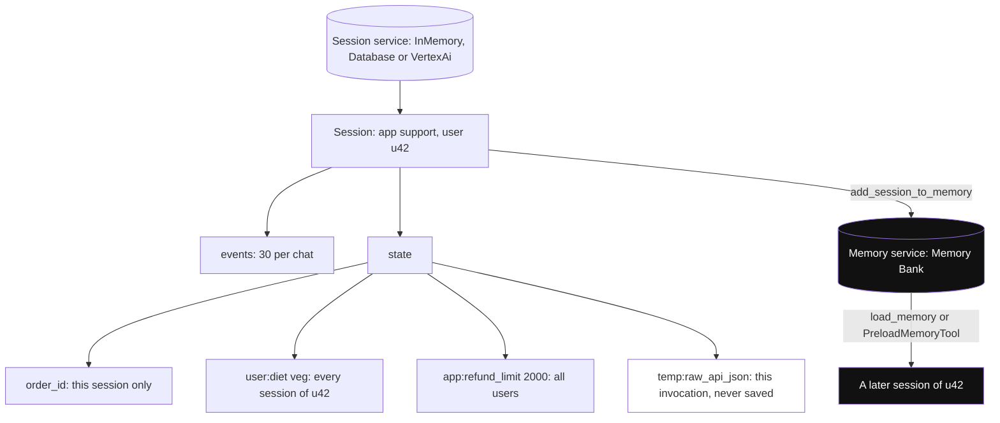

*Diagram:* Session ek chat ke events aur state rakhta hai, key prefix decide karta hai value kitni door tak dikhe; memory service alag long-term store hai jise baad ki chats search karti hain.

**Kaise kaam karta hai, step by step:**

1. Session service options: `InMemorySessionService` (sirf dev), `DatabaseSessionService` (Postgres jaisa SQL database), `VertexAiSessionService` (Google Cloud managed).
2. Har session me `app_name`, `user_id`, `id`, `events` aur `state` hote hain.
3. State keys ka scope prefix se tay hota hai:

| Prefix | Scope | Example |
|---|---|---|
| none | sirf ye session | `state["order_id"] = "8812"` |
| `user:` | is user ke saare sessions | `state["user:diet"] = "veg"` |
| `app:` | is app ke saare users | `state["app:refund_limit"] = 2000` |
| `temp:` | sirf ye invocation, save nahi hota | `state["temp:raw_api_json"]` |

4. State sirf events ke through badlo: `output_key`, `tool_context.state[...]` ya callback context state. ADK inhe `state_delta` ki tarah record karke save karta hai. Fetch kiye object pe seedha `session.state` edit karoge to save nahi hoga.
5. Memory service options: `InMemoryMemoryService` (keyword match, dev) aur `VertexAiMemoryBankService` (Vertex AI pe Memory Bank, facts extract aur search karta hai).
6. Khatam hua session `memory_service.add_session_to_memory(session)` se jodte ho. Agents memory `load_memory` tool (zaroorat pe) ya `PreloadMemoryTool` (har turn) se padhte hain.

Worked example: Postgres session table me har event 2 KB, ek chat me 30 events, roz 100,000 chats = roz lagbhag 6 GB events. Retention plan karo, jaise 30 din rakho.

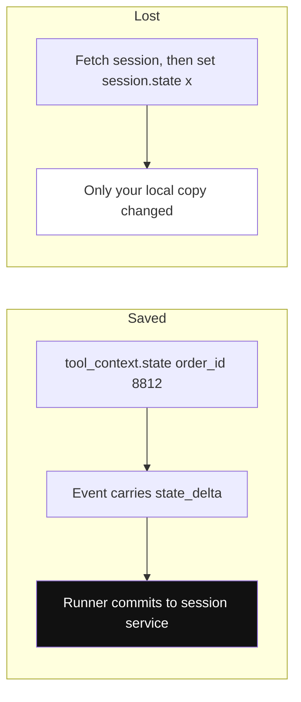

*Diagram:* Step 4 ki picture: state change tabhi save hota hai jab woh event pe chalta hai; fetched session object edit karne se storage me kuch nahi badalta.

**Interview tip:** "ADK me session vs memory?" Bolo: "Session short-term hai: ek conversation ke events aur state, session service store karti hai. Memory long-term hai aur sessions ke paar search hoti hai, memory service store karti hai jaise Vertex AI Memory Bank. User-level facts `user:` prefix wali state me bhi reh sakte hain."

**Common galti:**
- Production me `InMemorySessionService` ship karna. Restart pe saari conversations gayab.
- Fetch kiye session ka `state` dict badal ke sochna ki persist hoga. Sirf event deltas persist hote hain.

## Callbacks: guardrails aur hooks

**Ek line me:** Callbacks tumhare functions hain jinhe ADK agents, model calls aur tool calls se pehle aur baad chalata hai; "before" callback se value lautao to asli step skip ho jaata hai.

**Ye kyun chahiye:** Aise checks chahiye jinhe model baaton se ghuma na sake: limit se upar refund block karna, prompts me PII mask karna, answers cache karna, har tool call log karna.

**Aise socho:** Bank teller ka supervisor jo ₹50,000 se upar ki har withdrawal slip cash nikalne se pehle check karta hai.

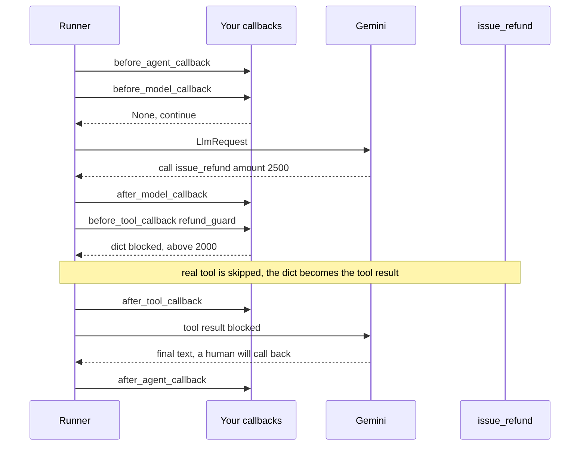

*Diagram:* Chhe hooks agent, har model call aur har tool call ko gherte hain; refund_guard dict lautata hai, isliye Rs 2,500 ke liye issue_refund kabhi nahi chalta.

**Kaise kaam karta hai, step by step:**

1. Chhe hooks: `before_agent_callback`, `after_agent_callback`, `before_model_callback`, `after_model_callback`, `before_tool_callback`, `after_tool_callback`.
2. `before_model_callback(callback_context, llm_request)`: `LlmResponse` lautao to model call skip (cache hit, blocked prompt). `None` lautao to aage chalo.
3. `before_tool_callback(tool, args, tool_context)`: dict lautao to tool skip aur wahi dict uska result. `None` lautao to tool chalega.
4. `after_*` callbacks response ya result ko rewrite kar sakte hain.
5. Callbacks apne context se state padh aur likh sakte hain.

```python
from typing import Any
from google.adk.tools.base_tool import BaseTool
from google.adk.tools.tool_context import ToolContext

def refund_guard(tool: BaseTool, args: dict[str, Any],
                 tool_context: ToolContext) -> dict | None:
    if tool.name == "issue_refund" and args.get("amount", 0) > 2000:
        tool_context.state["needs_human"] = True
        return {"status": "blocked", "reason": "Above ₹2,000. Sent to a human."}
    return None   # None matlab: asli tool chalao
```

**Code me kya ho raha hai:**
- Jis agent pe laga hai uske har tool call se pehle chalta hai.
- Refund ₹2,000 se upar ho to asli tool skip karta hai aur model ko "blocked" result deta hai.
- State flag set karta hai taaki app ya agla node human ki taraf route kar sake.

**Interview tip:** "ADK me guardrails kahan lagaoge?" Bolo: "Policy checks `before_tool_callback` me, taaki har call pe code me chalein. Input filtering `before_model_callback` me. Output checks `after_model_callback` me. Prompt sirf policy samjhata hai; callback use enforce karta hai."

**Common galti:**
- Har `before_model_callback` me slow network kaam karna. Har ek LLM call pe latency judti hai.

## ⭐ Ek poori chhoti app: Zomato-style order support bot

**Ek line me:** Support bot jo "mera order kahan hai" ka jawab deta hai aur refunds sambhalta hai: ek coordinator agent, do specialist agents, refund guardrail, persistent sessions aur Runner loop.

**Ye kyun chahiye:** Zyada tar real ADK apps ki shape yahi hai: ek coordinator jo route kare, tools wale specialists, code guardrail, aur tumhare API server me Runner.

**Aise socho:** Front-desk executive sunta hai aur tumhe "delivery desk" ya "refund desk" pe transfer karta hai. Refund desk pe bade amounts ke liye supervisor ka rule hai.

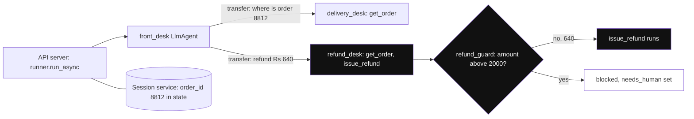

*Diagram:* Example ka turn 2 highlighted raasta leta hai: refund_desk ko transfer, guard check, aur Rs 640 pass kyunki Rs 2,000 limit se kam hai.

**Kaise kaam karta hai, step by step:**

1. Tools plain functions ki tarah likho (block 1).
2. Do specialist agents aur `sub_agents` wala coordinator banao (block 2).
3. Session service aur `Runner` banao, phir messages bhejo aur events padho (block 3).
4. `adk web` se local chalao aur har event aur state change dekho.

Block 1: tools.

```python
# support_bot/agent.py
from google.adk.agents import LlmAgent
from google.adk.tools.tool_context import ToolContext

ORDERS = {"8812": {"status": "picked_up", "eta_min": 25, "paid": 640}}

def get_order(order_id: str, tool_context: ToolContext) -> dict:
    """Look up an order's status, ETA in minutes and amount paid in rupees."""
    order = ORDERS.get(order_id)
    if not order:
        return {"error": f"No order {order_id}"}
    tool_context.state["order_id"] = order_id        # state_delta ki tarah save
    return order

def issue_refund(order_id: str, amount: int) -> dict:
    """Refund an amount in rupees for an order. Call only after checking the order."""
    return {"status": "refunded", "order_id": order_id, "amount": amount}
```

**Code me kya ho raha hai:**
- `get_order` chhota dict lautata hai aur order ID session state me yaad rakhta hai.
- `issue_refund` risky tool hai. Docstring model ko pehle order check karne ko kehti hai.
- `ToolContext` ADK inject karta hai; model ko tool schema me ye dikhta hi nahi.

Block 2: agents.

```python
delivery_desk = LlmAgent(
    name="delivery_desk", model="gemini-3.5-flash",
    description="Answers where an order is and when it will arrive.",
    instruction="Use get_order. Give status and ETA in one friendly line.",
    tools=[get_order],
)

refund_desk = LlmAgent(
    name="refund_desk", model="gemini-3.5-flash",
    description="Handles refund requests for late, wrong or missing items.",
    instruction=("Check the order with get_order, then refund at most the amount paid. "
                 "If a tool says blocked, tell the user a human will call back."),
    tools=[get_order, issue_refund],
    before_tool_callback=refund_guard,               # Callbacks section se
)

root_agent = LlmAgent(
    name="front_desk", model="gemini-3.5-flash",
    instruction="Greet briefly. Transfer delivery questions to delivery_desk "
                "and refund requests to refund_desk.",
    sub_agents=[delivery_desk, refund_desk],
)
```

**Code me kya ho raha hai:**
- Do specialists, har ek ke paas sirf zaroori tools (least privilege).
- `refund_desk` pe ₹2,000 wala guardrail `before_tool_callback` ki tarah laga hai.
- `front_desk` transfer se route karta hai: LLM har sub-agent ka `description` padhta hai aur woh transfer action call karta hai jo ADK apne aap jodta hai.
- Variable ka naam `root_agent` hi hona chahiye taaki `adk web` aur `adk run` use dhoondh sakein.

Block 3: chalao.

```python
import asyncio
from google.adk.runners import Runner
from google.adk.sessions import InMemorySessionService   # prod me DatabaseSessionService
from google.genai import types

async def main():
    sessions = InMemorySessionService()
    runner = Runner(agent=root_agent, app_name="support", session_service=sessions)
    s = await sessions.create_session(app_name="support", user_id="u42")
    for text in ["Where is order 8812?", "It came cold. Refund ₹640 please."]:
        msg = types.Content(role="user", parts=[types.Part(text=text)])
        async for event in runner.run_async(user_id="u42", session_id=s.id, new_message=msg):
            if event.is_final_response() and event.content and event.content.parts:
                print(f"[{event.author}] {event.content.parts[0].text}")

asyncio.run(main())
```

**Code me kya ho raha hai:**
- User `u42` ke liye session banta hai aur app name `support` se juda Runner.
- Same session pe do turns jaate hain, to doosre turn ko pehla turn (aur `state["order_id"]`) dikhta hai.
- Sirf final responses print hote hain; `event.author` batata hai kis agent ne reply kiya (pehle `delivery_desk`, phir `refund_desk`).
- `InMemorySessionService` ko `DatabaseSessionService("postgresql+asyncpg://...")` se badlo, baaki kuch nahi badalta.

Browser me try karne ke liye: `agent.py` aur ek `__init__.py` (`from . import agent`) ko `support_bot/` me rakho, `.env` me `GOOGLE_API_KEY` set karo, phir parent folder se `adk web` chalao. Dev UI har event, tool call, state change aur trace dikhata hai.

**Interview tip:** "'Refund ₹640' pe kya hota hai, walk through karo." Bolo: "Runner user event jodta hai, `front_desk` chalata hai, jo `refund_desk` ko transfer karta hai. Woh agent `get_order` call karta hai, phir `issue_refund`. Callback amount check karta hai (₹640 ₹2,000 se kam hai, to chalta hai). Har step ek event hai; state deltas session service commit karti hai; final response stream hokar wapas aata hai."

**Common galti:**
- Har agent ko har tool de dena. Routing confuse hoti hai aur delivery ka sawal refund trigger kar sakta hai.

## ⭐ Andar kaise kaam karta hai: ek run, step by step

**Ek line me:** Runner ek event loop chalata hai: agent events yield karta hai, Runner har event (aur uska state change) session service me commit karta hai, phir agent ko aage badhne deta hai.

**Ye kyun chahiye:** Loop samajh ke tum debug kar paoge "state save kyun nahi hui?", "tool do baar kyun chala?" aur "slow kyun hai?".

**Aise socho:** Cricket scorer. Har ball (event) agli ball se pehle scorebook me likhi jaati hai. Total (state) tabhi official hai jab likh diya gaya.

**Kaise kaam karta hai, step by step:**

1. Tumhari app naye user message ke saath `run_async` call karti hai.
2. Runner session load karta hai aur user message ko event ki tarah jodta hai.
3. `InvocationContext` banata hai (session, services, current agent) aur root agent ko call karta hai.
4. `LlmAgent` ek `LlmRequest` banata hai: instruction (`{state}` bhar ke), events se conversation history, tool schemas, aur sub-agents hon to transfer tool.
5. `before_model_callback` chalta hai. Phir Gemini (ya LiteLLM) call hota hai.
6. Model function calls lautaye to ADK `before_tool_callback`, tool, phir `after_tool_callback` chalata hai, aur results ke saath event yield karta hai.
7. Har yield hua event Runner ke paas jaata hai. Runner use session me jodta hai aur uska `state_delta` apply karta hai. Tabhi agent aage badhta hai.
8. Event me transfer action ho to Runner active agent ko us sub-agent pe switch karta hai.
9. Loop tab tak chalta hai jab tak model bina tool calls ke plain text na lautaye. Woh event final response hai.

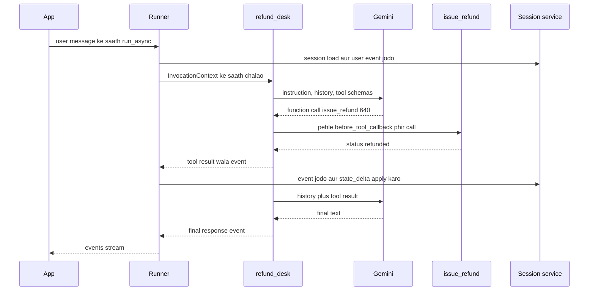

**Event fields jo tum use karoge:**

| Field | Matlab |
|---|---|
| `author` | kis agent (ya `user`) ne event banaya |
| `content` | text parts, function calls ya function responses |
| `actions.state_delta` | is event ne kaunsi state keys badli |
| `actions.transfer_to_agent` | control doosre agent ko do |
| `actions.escalate` | loop roko ya control upar bhejo |
| `partial` | streaming chunks ke liye true |
| `node_info`, `output` | 2.0 me naye, workflow graph use karta hai |

**Interview tip:** "ADK har event pe state commit kyun karta hai?" Bolo: "Taaki state hamesha history ke saath consistent rahe. Event 5 ke baad process mar jaaye to session me theek 5 events aur unki state hogi. Saath me audit trail milta hai ki kisne kya badla."

**Common galti:**
- 2.0 me khud `session.events` me append karna. Docs warn karte hain ki ye graph engine ko bypass karta hai aur resume tod deta hai. Events yield karo.

## Models: Gemini, LiteLLM aur baaki

**Ek line me:** Gemini model ka naam string me do, ya kisi bhi doosre model ko `LiteLlm(model="provider/model")` me wrap karo.

**Ye kyun chahiye:** Teams zyada calls ke liye Gemini ka price aur speed chahti hain, aur kuch agents ke liye shayad Claude ya GPT. Ek provider me lock-in risk hai.

**Aise socho:** Dual SIM phone. Default SIM Jio (Gemini); ek call ke liye Airtel (doosra provider) pe switch kar sakte ho.

**Kaise kaam karta hai, step by step:**

1. Gemini: `model="gemini-3.5-flash"`. Development me Gemini API key, enterprise me Vertex AI (`GOOGLE_GENAI_USE_VERTEXAI=TRUE`, project aur location).
2. Baaki: `from google.adk.models.lite_llm import LiteLlm`, phir `model=LiteLlm(model="anthropic/claude-sonnet-4-5")` ya `"openai/gpt-4.1"`, us provider ki key env me.
3. Local: Ollama server ke liye `LiteLlm(model="ollama_chat/llama3.1")`.
4. Gemini-only features (built-in `google_search`, Live streaming) LiteLLM ke through kaam nahi karte.

Cost ka worked example: agar triage flash model pe bade model ke lagbhag ek-dasvein price pe chale, aur triage 40% calls ho, to use shift karne se triage-heavy bill ka lagbhag 36% bachta hai. Hamesha apne traffic pe measure karo.

**Interview tip:** "ADK sirf Gemini ke liye hai?" Bolo: "Nahi. Gemini native hai aur built-in tools milte hain; baaki providers `LiteLlm` wrapper se aate hain. Main har agent ke hisaab se mix karta hoon, jaise triage ke liye sasta model aur likhne ke liye strong model."

**Common galti:**
- LiteLLM model ke saath built-in Gemini tools chalne ki ummeed. Ye Gemini server features hain.

## Dev tools: adk web, adk run, adk api_server

**Ek line me:** `adk` command line tumhe browser Dev UI, terminal chat, local API server, eval runner aur deploy commands deti hai.

**Ye kyun chahiye:** Agent bugs logs me mushkil se dikhte hain. Har event, har tool call aur har state change saath-saath dekhna padta hai.

**Aise socho:** Car ka diagnostic port. Plug karo aur har sensor live dekho.

**Kaise kaam karta hai, step by step:**

1. `adk create my_agent` ek folder banata hai jisme `agent.py`, `__init__.py` aur `.env` hote hain.
2. `adk run my_agent` terminal me chat karta hai.
3. `adk web` (parent folder se chalao) Dev UI kholta hai: chat, events tab, state, traces, aur chat ko eval case ki tarah save karne ka button.
4. `adk api_server` agent ko local FastAPI (REST) server ki tarah serve karta hai; A2A pe expose karne ke liye `--a2a` jodo.
5. No-code setups ke liye agents YAML (Agent Config) me bhi define ho sakte hain.

**Interview tip:** "ADK me galat tool call kaise debug karoge?" Bolo: "`adk web` me reproduce karo, event list kholo, exact `LlmRequest` (instruction, tool schemas) aur model ka lautaya function call dekho. Aksar fix hai saaf tool docstring ya chhoti tool list."

**Common galti:**
- `adk web` agent folder ke andar chalana, parent folder ki jagah. Agent package nahi milta.

## Evaluation

**Ek line me:** `adk eval` saved conversations replay karta hai aur tool-call path (trajectory) aur final answer ko expected se compare karke score deta hai.

**Ye kyun chahiye:** Agents non-deterministic hain. Prompt change chupchaap routing tod sakta hai. Har deploy se pehle regression tests chahiye.

**Aise socho:** Driving test ka route. Har baar same route; examiner dekhta hai tumne kaunse turns liye aur kahan pahunche, dono.

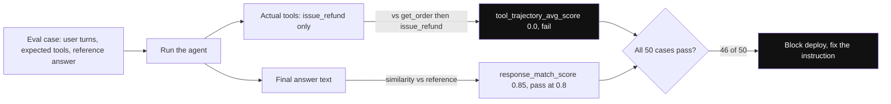

*Diagram:* Har case do baar score hota hai: tool calls ka raasta aur final text; yahan jawab theek dikhta hai par get_order skip karne se trajectory fail aur deploy block.

**Kaise kaam karta hai, step by step:**

1. Achhi conversations `adk web` se eval cases ki tarah save karo, ya `.test.json` / `.evalset.json` files haath se likho.
2. Har case me user turns, expected tool calls (naam aur args) aur reference answer hota hai.
3. Default criteria: `tool_trajectory_avg_score` (sahi tools sahi order me call hue; 1.0 = perfect) aur `response_match_score` (reference se text similarity, jaise threshold 0.8).
4. `adk eval path/to/agent path/to/cases.evalset.json --config_file_path eval_config.json` chalao, ya pytest ke andar `AgentEvaluator.evaluate(...)`.
5. Jahan text similarity bahut strict ho wahan LLM-as-judge criteria jodo.

Worked example: 50 cases, trajectory threshold 1.0. Prompt change ke baad 46 pass, 4 fail kyunki `refund_desk` ne `get_order` skip kiya. Tum deploy rokte ho aur instruction theek karte ho.

**Interview tip:** "Sirf answer nahi, trajectory kyun test karte ho?" Bolo: "Galat raaste se sahi answer kismat hai. Agent bina order check kiye refund kare, to aaj answer theek dikh sakta hai aur kal paisa doobta hai."

**Common galti:**
- Free-form replies ke liye exact text match. Harmless wording change pe fail hota hai. Similarity threshold ya judge use karo.

## Production concerns aur deployment

**Ek line me:** ADK ko Cloud Run ya GKE pe container ki tarah, ya Vertex AI Agent Engine (managed) pe ship karo, durable session service, tracing, CI me evals aur cross-team agents ke liye A2A ke saath.

**Ye kyun chahiye:** Laptop ke demo me na persistence hai, na scaling, na auth, na traces.

**Aise socho:** Ghar ki kitchen se licensed restaurant: fridge logs, CCTV, fire exits.

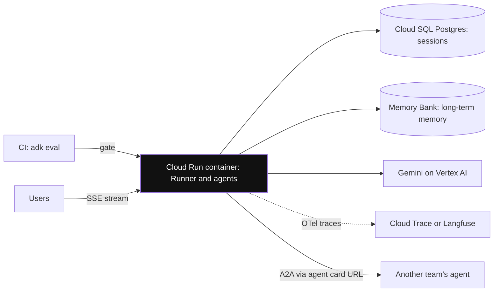

*Diagram:* Typical production layout: stateless container, durable sessions aur memory bahar, traces export, evals deploy ko gate karte hain, aur A2A sirf doosri teams ke liye.

**Kaise kaam karta hai, step by step:**

1. **Deploy:** `adk deploy cloud_run --with_ui <folder>` Cloud Run pe container banata hai. `adk deploy agent_engine` Vertex AI Agent Engine ko target karta hai (README ab ise Gemini Enterprise Agent Platform pe Agent Runtime kehta hai). GKE ya koi bhi Docker host bhi chalega.
2. **Persistence:** `DatabaseSessionService` (Postgres ya Cloud SQL) ya `VertexAiSessionService`. Long-term memory ke liye Memory Bank.
3. **Observability:** ADK OpenTelemetry traces emit karta hai; unhe Cloud Trace ya kisi bhi OTel backend pe bhejo (Langfuse, Arize Phoenix aur baaki integrate karte hain).
4. **Streaming:** `run_async` partial events yield karta hai; unhe SSE pe stream karo. Bidirectional audio aur video Gemini Live models ke saath `run_live` use karte hain.
5. **A2A:** agent ko A2A service ki tarah expose karo (`to_a2a(agent)` ya `adk api_server --a2a`) aur remote agents ko unke agent card URL se `RemoteA2aAgent` se call karo. Tab use karo jab agent doosri team ka ho.
6. **Cost:** har turn ki LLM calls gino. Coordinator plus specialist = har turn kam se kam 2 calls; har tool round trip ek aur.
7. **Failure modes:** model 429 (rate limit) errors, tool timeouts, agents ke beech routing loops. ADK 2.0 workflows per-node retry config dete hain; tools ke andar exceptions mat nigalo warna retries chal hi nahi paate.

| Option | Tum kya sambhalte ho | Kiske liye achha |
|---|---|---|
| Cloud Run | container, scaling settings, DB | zyada tar teams, agent ke aas-paas custom API |
| Vertex AI Agent Engine | thoda: managed sessions, memory, scaling | Google Cloud shops jinhe managed chahiye |
| GKE | sab kuch | existing Kubernetes wale bade platforms |

**Interview tip:** "ADK agent production-ready kaise banaoge?" Bolo: "Postgres ya Vertex me durable sessions, OTel tracing, CI me trajectory checks ke saath `adk eval`, policy ke liye callbacks, step aur cost limits, Secret Manager me secrets, Cloud Run ya Agent Engine pe deploy, aur A2A sirf team boundaries ke paar."

**Common galti:**
- 2.0 me tools ke andar broad `except Exception`. Ye framework se failures chhupa deta hai aur us step ke automatic retries band kar deta hai.
- Events ke strict DB schema ke saath 2.0 pe upgrade. 2.0 `node_info` aur `output` fields jodta hai; pehle readers update karo.

## ⭐ ADK kab use karo, aur comparison

**Ek line me:** ADK tab chuno jab Google Cloud ya Gemini pe ho aur poora kit chahiye (agents, workflows, sessions, eval, deploy); kuch aur tab chuno jab provider-neutral graphs ya bahut chhota surface chahiye.

**Ye kyun chahiye:** "ADK kyun, X kyun nahi?" standard senior sawal hai. Reasons chahiye, brand loyalty nahi.

**Aise socho:** Ek ecosystem ka phone lena. Android phone Google services ke saath best chalta hai, par doosre apps bhi install kar sakte ho.

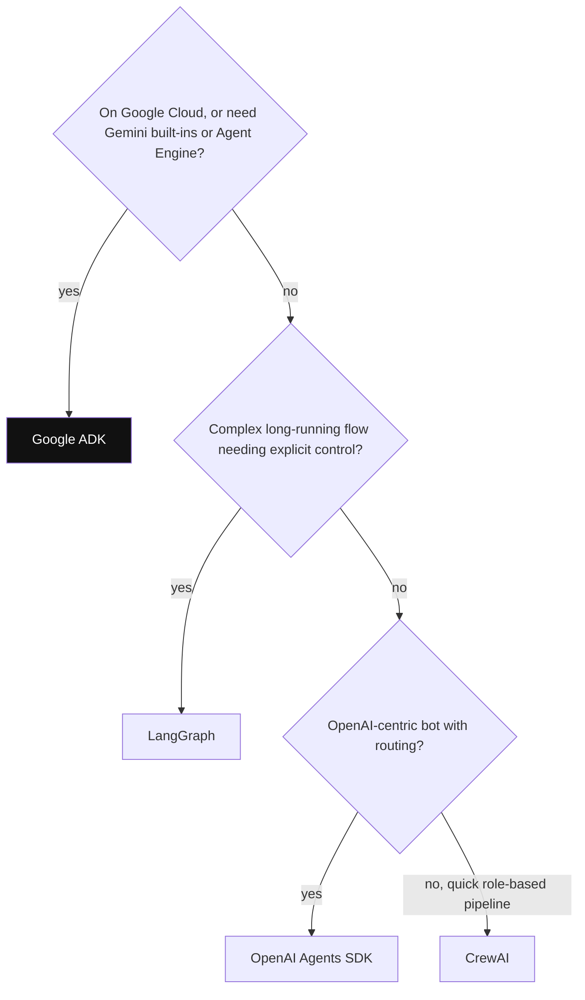

*Diagram:* Model brand se nahi, platform aur runtime needs se shuru karo; jab Google Cloud features matter karein to ADK pehla stop hai.

**Kaise kaam karta hai, step by step:**

1. ADK use karo jab: stack Google Cloud hai, Gemini built-ins chahiye (search grounding, Live audio), managed runtime chahiye (Agent Engine), ya teams ke paar A2A chahiye.
2. Ruk ke socho jab: team LangChain tools me gehri hai, sabse mature checkpoint aur time-travel chahiye, ya sabse chhoti dependency chahiye.
3. Neeche ke axes pe compare karo.

| | Google ADK | LangGraph | OpenAI Agents SDK | CrewAI |
|---|---|---|---|---|
| Control flow | LLM transfer, workflow agents, 2.0 graph | explicit graph, poora control | agents ke beech handoffs | role-based crews, Flows |
| State | prefixes wali session state | reducers wali typed state | sessions | crew memory |
| Durability | session services, 2.0 resume | har step checkpointer, time travel | session stores | limited |
| Human-in-the-loop | tool confirmation, 2.0 HITL nodes | `interrupt()` | guardrails ya tools se approval | human input flag |
| Dev UI aur eval | `adk web`, `adk eval` built in | LangGraph Studio, LangSmith (alag) | tracing dashboard | CLI, enterprise UI |
| Managed hosting | Vertex AI Agent Engine | LangGraph Platform | apna koi nahi | CrewAI enterprise |
| Best fit | Gemini aur Google Cloud teams | complex, long-running flows | OpenAI-centric bots | jaldi role-based pipelines |

**Interview tip:** "ADK vs LangGraph?" Bolo: "LangGraph sabse explicit control aur sabse mature checkpointing deta hai; provider-neutral hai. ADK box se poora kit deta hai: Dev UI, eval, session aur memory services, Google deploy targets aur A2A. Google Cloud aur Gemini pe main ADK ki taraf jhukta hoon; complex provider-neutral flows ke liye LangGraph."

**Common galti:**
- ADK sirf isliye chunna ki "hum Gemini use karte hain". LangGraph aur baaki bhi Gemini ko theek call karte hain. Runtime, ops aur team skills pe chuno.

## Real ADK projects ke common pitfalls

**Ek line me:** Zyada tar ADK bugs aate hain vague descriptions se routing, galat tarike se likhi state, built-in tool limits aur 2.0 upgrade surprises se.

**Ye kyun chahiye:** Ye real code reviews me aur interview ke "kya galat hua" sawalon me aate hain.

**Aise socho:** Same sadak pe same gaddhe. Pata ho to wahan speed kam kar lete ho.

**Kaise kaam karta hai, step by step:**

1. **Vague descriptions:** coordinator galat agent ko transfer karta hai. Fix: har sub-agent ke liye ek saaf line, plus routing ke eval cases.
2. **Ping-pong transfer:** do agents ek doosre ko transfer karte rehte hain. Fix: kaun wapas transfer kar sake ye limit karo (`disallow_transfer_to_parent`, `disallow_transfer_to_peers`) aur turn cap lagao.
3. **State kho gayi:** fetch kiye `session.state` ko seedha edit karna. Fix: `output_key`, `tool_context.state` ya callbacks se likho.
4. **Built-in tool mixing:** kuch models pe ek agent me `google_search` plus function tools fail hote hain. Fix: search ko alag agent me rakh ke `AgentTool` se wrap karo.
5. **`temp:` keys baad me chahiye:** invocation ke baad gayab ho jaati hain. Agle turn chahiye to normal key use karo.
6. **Parallel overwrite:** `ParallelAgent` me same `output_key`. Unique keys rakho.
7. **2.0 resume nodes dobara chalata hai:** pause ya failure ke baad kuch nodes phir chalte hain. `issue_refund` jaise tools idempotent banao (order ID jaisi idempotency key se).
8. **Event schema change:** stored events pe strict validators 2.0 ke baad toot-te hain. Writers se pehle readers update karo.

**Interview tip:** "Tumhare ADK bot ne do baar refund kar diya. Debug kaise karoge?" Bolo: "Us session ka trace ya `adk web` events kholo. Dekho refund tool event do baar hai ya nahi (model retry, resume pe node rerun, ya do agents ke paas same tool). Fix: refund API me idempotency key aur tool sirf ek agent ko do."

**Common galti:**
- Inhe model ki problem maan ke prompts rewrite karna, jabki fix code ya configuration me hai.

## Interview ke sawal

**Q: `LlmAgent` aur workflow agent me kya farak hai?**
A: `LlmAgent` model se decide karwata hai aage kya karna hai, tool calls aur transfers samet. Workflow agents (`SequentialAgent`, `ParallelAgent`, `LoopAgent`) sub-agents ko fixed pattern me chalate hain, order koi LLM decide nahi karta.

**Q: `SequentialAgent` me agents ke beech data kaise jaata hai?**
A: Shared session state se. Ek agent `output_key` ya `tool_context.state` se likhta hai, aur agla agent apne instruction me `{key}` placeholders se padhta hai.

**Q: Sub-agent transfer vs `AgentTool`?**
A: Transfer conversation sub-agent ko saunp deta hai; woh user ko reply karta hai. `AgentTool` agent ko function ki tarah call karta hai aur jawab parent ko lautata hai, jo control me rehta hai.

**Q: `Runner` kya karta hai?**
A: Session load karta hai, root agent chalata hai, har event leta hai, event aur uska `state_delta` session service me commit karta hai, transfers handle karta hai, aur events tumhari app ko stream karta hai.

**Q: ADK 2.0 me kya badla?**
A: Graph-based Workflow Runtime: agents, tools aur functions nodes ki tarah chalte hain, routing, retries, human-in-the-loop aur resume ke saath. `BaseAgent` ab `BaseNode` hai, events me `node_info` aur `output` jude, aur fixed workflow agents ki jagah graph aur dynamic workflows ne li. 2.0 sessions sirf 1.28+ padh sakta hai.

**Q: Guardrail kaise lagaoge taaki ₹2,000 se upar refund kabhi automatic na chale?**
A: `before_tool_callback` jo `tool.name` aur `args["amount"]` check kare aur "blocked" dict lautaye, jisse asli tool skip ho. Limit refund API me bhi enforce karo.

**Q: ADK me Claude kaise use karoge?**
A: Wrap karo: `model=LiteLlm(model="anthropic/claude-...")`, Anthropic key env me. Us agent ke liye Gemini-only built-in tools nahi chalenge.

**Q: Session state vs memory service?**
A: State ek session ke andar key-value dict hai (wider scope ke liye `user:` aur `app:` prefixes). Memory service sessions ke paar knowledge store aur search karti hai, jaise Vertex AI Memory Bank, jise `load_memory` se padhte hain.

**Q: ADK agent evaluate kaise karoge?**
A: Evalset files ke saath `adk eval` ya pytest me `AgentEvaluator`. Tool trajectory aur response (similarity ya LLM judge) score karo. CI me chalao aur regression pe deploy roko.

**Q: Cloud Run ya Agent Engine?**
A: Cloud Run jab agent ke aas-paas apni API aur container aur database pe poora control chahiye. Agent Engine jab chahte ho Google sessions, memory aur scaling sambhale aur Vertex AI se tight coupling chalega.

**Q: ADK me sub-agents ki jagah A2A kab?**
A: Jab doosra agent kisi aur team ka ho, alag service ki tarah chale, ya kisi aur framework me likha ho. Ek codebase ke andar plain sub-agents simple aur fast hain.

**Q: Multi-agent ADK app me galat routing kaise debug karoge?**
A: `adk web` me reproduce karo, coordinator ka `LlmRequest` aur transfer call padho, sub-agent descriptions saaf karo, aur routing eval cases jodo. Routing rule-based ho to LLM ki jagah workflow route me daalo.

**Q: Long-running approval flow ke liye ADK vs LangGraph?**
A: LangGraph ke paas sabse mature checkpointing, `interrupt()` aur time travel hai. ADK 2.0 me ab workflow resume aur human-in-the-loop nodes hain, plus Dev UI, eval aur Google deploy targets. Google Cloud pe main ADK 2.0 try karunga; warna LangGraph.

**Q: 2.0 workflow node resume ho to kya toot sakta hai?**
A: Kuch nodes resume pe dobara chalte hain, to refund jaisa non-idempotent tool do baar chal sakta hai. Idempotency keys use karo aur side effects aise tools me rakho jo "pehle ho chuka" check karein.

**Q: ADK ka cost kaise kam rakhoge?**
A: Deterministic routing workflows me (zero LLM calls), triage ke liye sasta model, chhote tool outputs, repeat sawalon ke liye `before_model_callback` caching, aur loop caps.

## Aage padho

- [Agent Frameworks and Tooling](19-agent-frameworks.md)
- [LangGraph Core](02-langgraph-core.md)
- [OpenAI Agents SDK](27-openai-agents-sdk.md)
- [Tools, MCP & A2A](07-tools-mcp-a2a.md)

## Checklist

- [ ] ADK ka mental model samjha sakta hoon: agents, Runner, events aur sessions.
- [ ] `LlmAgent` ke fields jaise `instruction`, `description` aur `output_key` samjha sakta hoon.
- [ ] Sequential, Parallel aur Loop agents aur ADK 2.0 ka `Workflow` graph samjha sakta hoon.
- [ ] Sub-agent transfer vs `AgentTool` aur kab kaunsa, bata sakta hoon.
- [ ] Session state prefixes aur session vs memory services ka farak samjha sakta hoon.
- [ ] `before_tool_callback` guardrail likh sakta hoon aur value lautane ka asar bata sakta hoon.
- [ ] Ek Runner run event-by-event walk through kar sakta hoon, `state_delta` samet.
- [ ] `LiteLlm` se non-Gemini models kaise use karte hain, samjha sakta hoon.
- [ ] `adk web`, `adk eval` aur Cloud Run ya Agent Engine pe deploy samjha sakta hoon.
- [ ] ADK ko LangGraph aur OpenAI Agents SDK se compare karke bata sakta hoon kab kaunsa.
