# Claude Agent SDK

Claude Agent SDK wo harness hai jo Claude Code chalata hai, Python aur TypeScript library ki tarah pack kiya hua. Tum prompt aur options do; ye agent loop, file aur shell tools, permissions, hooks, subagents, sessions aur automatic context compaction khud laata hai. Interviewer ye isliye poochhte hain ki dekh sakein tumhe "tools ke saath model call karna" aur "poora agent harness chalana" ka farak pata hai, aur itne powerful agent ko safely host kaise karoge.

Ye page Python ke `claude-agent-sdk` 0.2.x (November 2026) ke hisaab se likha hai. TypeScript package `@anthropic-ai/claude-agent-sdk` hai. Late 2025 tak iska naam **Claude Code SDK** tha.

**Is page ke baad tum ye jawab de paoge:**
- "Claude Agent SDK tumhe kya deta hai jo plain Messages API ka tool use nahi deta?"
- "`query()` kab use karoge aur `ClaudeSDKClient` kab?"
- "Kya `allowed_tools=["Read"]` Claude ko Bash use karne se rokta hai?"
- "`rm -rf` ya `src/` ke bahar writes kaise block karoge, `bypassPermissions` mode me bhi?"
- "Subagents main agent ki context window chhoti kaise rakhte hain?"
- "Lambe session me context window bhar jaaye to kya hota hai?"
- "Is agent ko 1,000 tenants ke liye kaise host karoge taaki ek tenant doosre ki files na padh sake?"
- "Claude Agent SDK vs LangGraph vs OpenAI Agents SDK: coding agent ke liye kaunsa, aur refund workflow ke liye kaunsa?"

## Pehle ye shabd samjho

LLM naye ho? Pehle [How LLMs Work](14-how-llms-work.md) padho. General agent loop ke liye [Agent Foundations](01-agent-foundations.md) padho.

| Shabd | Simple matlab |
|---|---|
| Harness | Model ke around wo sab jo use agent banata hai: loop, tools, permissions, memory, context handling. |
| Claude Code | Terminal aur IDE ke liye Anthropic ka coding agent. SDK uska engine library ki tarah hai. |
| Messages API | Anthropic ki basic API: messages aur tool definitions bhejo, ek reply wapas lo. |
| `query()` | Ek task ke liye SDK function: prompt bhejo, result tak messages stream karo. |
| `ClaudeSDKClient` | Live, multi-turn conversation ke liye SDK class jise interrupt aur continue kar sako. |
| Built-in tools | SDK ke saath aane wale tools: Read, Edit, Write, Bash, Glob, Grep, WebSearch, WebFetch aur aur bhi. |
| MCP | Model Context Protocol: kisi bhi agent me external tools jodne ka standard tareeka. |
| In-process MCP server | Tumhare Python functions MCP tools ki tarah tumhare hi app ke andar, alag process ke bina. |
| Permission mode | Setting ki agent bina poochhe kitna kar sakta hai: default, acceptEdits, plan, dontAsk, auto, bypassPermissions. |
| Hook | Tumhara callback jo fixed point pe chalta hai, jaise har tool call se pehle, aur use block kar sakta hai. |
| Subagent | Apni fresh context window wala helper agent; sirf uski final report wapas aati hai. |
| Session | Ek saved conversation transcript, ek id ke saath jise baad me resume ya fork kar sako. |
| Compaction | Context window lagbhag bharne pe purani history ka automatic summary. |
| `CLAUDE.md` / skill | Har turn load hone wali project memory file / instructions ka folder jo sirf zaroorat pe load hota hai. |

## Big picture

Tumhara app `query()` ya `ClaudeSDKClient` ko prompt aur `ClaudeAgentOptions` ke saath call karta hai. SDK ek Claude Code process shuru karta hai, jo Claude ke saath loop chalata hai: files, shell aur web ke built-in tools, MCP se tumhare custom tools, **permissions** aur **hooks** decide karte hain kya chal sakta hai, side kaam ke liye **subagents**, window bharne pe **compaction**, aur disk pe **session** transcript. Messages tumhare code tak stream hote hain, end me `ResultMessage` aata hai jisme answer, cost aur session id hai.

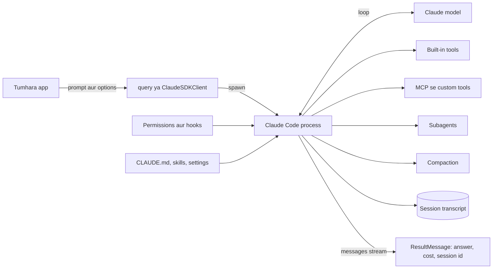

Har box neeche ek section hai. Phir ek UPI payments service ke liye on-call helper banayenge jo sab use karta hai.

## ⭐ Ye kya hai aur mental model

**Ek line me:** Claude Code ka agent harness library ki tarah: tum configure karte ho agent kya chhoo sakta hai, aur steps harness decide karta hai.

**Ye kyun chahiye:** Achhe general agent ko loop se kahin zyada chahiye. Safe file editing (exact string replace, "poori file dobara likho" nahi), shell, search, web access, permission prompts, lambe tasks ke liye context compaction, subagents, aur MCP. Anthropic ne ye sab Claude Code ke liye banaya aur tune kiya. 2025 me ise Claude Code SDK naam se release kiya; phir naam **Claude Agent SDK** hua kyunki teams ise coding se kahin zyada ke liye use kar rahi thi: research, ops, data aur support agents.

**Aise socho:** Experienced site engineer hire karna jo apna toolkit laata hai, vs fresher hire karke har tool khud khareedna. Kaun se kamron me ja sakta hai, ye tum decide karte ho (permissions), kisi bhi kamre ke darwaze pe rok sakte ho (hooks), aur woh basement naapne ke liye helper bhej sakta hai (subagent).

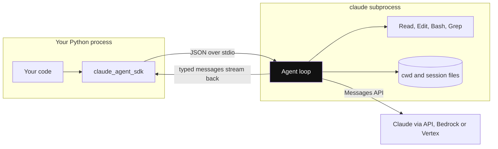

*Diagram:* Tumhara code loop khud nahi chalata: woh ek alag claude subprocess chalata hai jiske paas shell, working directory aur session files hain.

**Kaise kaam karta hai, step by step:**

1. `pip install claude-agent-sdk`. Package me native Claude Code binary bundled hai, to aam taur pe alag install nahi chahiye.
2. Tumhara code `query(prompt=..., options=ClaudeAgentOptions(...))` call karta hai.
3. SDK ek `claude` CLI subprocess spawn karta hai aur stdio pe usse baat karta hai. Wo subprocess shell, working directory (`cwd`) aur session files own karta hai.
4. Subprocess Claude ke saath loop chalata hai: socho, tools call karo, results padho, repeat, jab tak reply me koi tool call na ho.
5. Tumhe typed messages ka stream milta hai (`SystemMessage`, `AssistantMessage`, `UserMessage`, `ResultMessage`).
6. Auth: `ANTHROPIC_API_KEY`, ya Amazon Bedrock ya Google Cloud pe Claude, environment variables jaise `CLAUDE_CODE_USE_BEDROCK=1` ya `CLAUDE_CODE_USE_VERTEX=1` se.

**Anthropic ke options me ye kahan hai:**

| Option | Tum kya likhte ho | Loop kahan chalta hai | Built-in tools |
|---|---|---|---|
| Messages API, manual loop | poora loop | tumhara code | koi nahi, sirf tumhare define kiye tools |
| Messages API, Tool Runner (`client.beta.messages.tool_runner`) | tool functions | tumhara code, SDK helper | koi nahi |
| **Claude Agent SDK** | prompt + options | tumhare infra pe Claude Code subprocess | Read, Edit, Write, Bash, Glob, Grep, WebSearch, WebFetch, Agent, Skill... |
| Managed Agents (API, beta) | agent config + events | Anthropic ke servers, har session ka sandbox | bash, files, code execution, MCP, skills |

**Kya badla (achha interview material):**
- Package rename: `claude-code-sdk` → `claude-agent-sdk`; `ClaudeCodeOptions` → `ClaudeAgentOptions`.
- v0.1.0 se default system prompt **minimal** hai, Claude Code wala nahi. Claude Code jaisa behaviour chahiye to `{"type": "preset", "preset": "claude_code"}` maango.
- v0.1.0 me settings loading thodi der default off hui, phir revert hui: aaj `setting_sources` na do to CLI ki tarah user, project aur local settings load hoti hain. Isolate karne ke liye `setting_sources=[]` do.
- Subagent tool ab tool calls me `Agent` kehlata hai (pehle `Task` tha; init tool list me ab bhi `Task` dikh sakta hai).

**Interview tip:** "Claude Agent SDK kya hai?" Bolo: "Ye Claude Code ke peeche ka harness library ki tarah hai. Main prompt, working directory, allowed tools, permissions aur hooks deta hoon; ye built-in file, shell aur web tools, compaction, subagents aur sessions ke saath loop chalata hai. Main agent configure karta hoon; uska control flow draw nahi karta."

**Common galti:**
- Ise `anthropic` package ke Tool Runner se confuse karna. Tool Runner sirf tumhare define kiye tools pe loop karta hai; usme file, shell ya compaction features nahi.
- Sochna ki ye patla HTTP client hai. Ye shell wala asli process chalata hai; ise untrusted code chalane jaisa treat karo.

## ⭐ `query()` vs `ClaudeSDKClient`

**Ek line me:** `query()` matlab ek task andar, ek stream bahar; `ClaudeSDKClient` kai turns ke liye session khula rakhta hai, interrupts aur live controls ke saath.

**Ye kyun chahiye:** CI job "failing test theek karo" one shot hai. Chat UI ya Slack bot follow-ups bhejta hai, Stop button chahta hai, aur session ke beech permission mode badal sakta hai. Dono ke liye ek API bhaddi hoti.

**Aise socho:** `query()` darzi ko ek order dena aur shirt le aana hai. `ClaudeSDKClient` darzi ke paas khade rehna hai: "sleeves chhoti karo… ruko… ab collar".

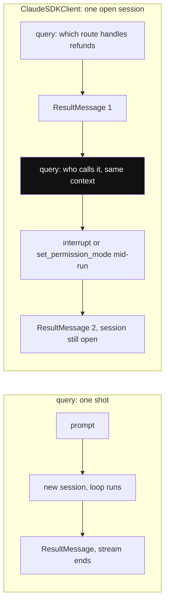

*Diagram:* query() stream khatam hote hi sab bhool jaata hai; client ek session zinda rakhta hai, isliye highlighted follow-up 'it' bol sakta hai aur beech me control kar sakte ho.

**Kaise kaam karta hai, step by step:**

| | `query()` | `ClaudeSDKClient` |
|---|---|---|
| Shape | `async for msg in query(prompt=..., options=...)` | `async with ClaudeSDKClient(options) as c: await c.query(...)` |
| Turns | ek prompt (ya input messages ka stream) | ek hi session me kai `query()` calls |
| Calls ke beech memory | har call naya session, jab tak `resume=` na do | automatic, same session |
| Interrupt | nahi | `await client.interrupt()` |
| Live changes | nahi | `set_permission_mode()`, `set_model()`, `get_context_usage()`, `rewind_files()` |
| Error result pe | `ResultMessage` yield karta hai, phir raise | session zinda rehta hai; doosra message bhej sakte ho |
| Kis liye | scripts, CI, batch jobs, one-off tasks | chat UIs, bots, lamba interactive kaam |

```python
import asyncio
from claude_agent_sdk import ClaudeAgentOptions, ClaudeSDKClient, ResultMessage, query

opts = ClaudeAgentOptions(cwd="/srv/app", allowed_tools=["Read", "Glob", "Grep"], max_turns=10)

async def one_shot():
    try:
        async for msg in query(prompt="List the API routes in this repo", options=opts):
            if isinstance(msg, ResultMessage):
                print(msg.subtype, msg.result, msg.total_cost_usd)
    except Exception as e:                      # error result ke baad query() raise karta hai
        print("ended with error:", e)

async def chat():
    async with ClaudeSDKClient(options=opts) as client:
        await client.query("Which route handles refunds?")
        async for msg in client.receive_response():   # ResultMessage ke baad rukta hai
            if isinstance(msg, ResultMessage):
                print(msg.result)
        await client.query("Who calls it?")             # pichla turn yaad hai
        async for msg in client.receive_response():
            if isinstance(msg, ResultMessage):
                print(msg.result)

asyncio.run(one_shot())
asyncio.run(chat())
```

**Code kya karta hai:**
- Yahan `allowed_tools` teen read-only tools pre-approve karta hai taaki run permission ke liye na ruke.
- `query()` `ResultMessage` tak stream karta hai; uska `subtype` `success` ya `error_max_turns` jaisa error hota hai.
- `ClaudeSDKClient` ek session rakhta hai; doosra sawal "Who calls it?" isliye chalta hai kyunki pehla turn context me hai.
- `receive_response()` us turn ke `ResultMessage` tak (usko milake) messages deta hai.

**Interview tip:** "`query()` me error result ke baad SDK raise kyun karta hai par client me nahi?" Bolo: "One-shot query to khatam hi hai, isliye cost aur session id wala result yield karke failure exception se batata hai. Client session interactive hai, isliye zinda rehta hai aur mujhe sudhra hua message bhejne deta hai."

**Common galti:**
- Message loop se jaldi `break` karna. Docs warn karte hain isse asyncio cleanup issues hote hain; stream khatam hone do.
- Do alag `query()` calls se memory share hone ki ummeed. Nahi hoti, jab tak `resume=session_id` na do.

## ⭐ Built-in tools aur tool access

**Ek line me:** SDK Claude Code ke tools ke saath aata hai; teen options decide karte hain kaun se tools exist karte hain (`tools`, `disallowed_tools` me bare names) aur kaun bina poochhe chalte hain (`allowed_tools`, permission mode).

**Ye kyun chahiye:** Achha file-edit tool likhna mushkil hai: exact replacements, badi files, aur code corrupt na ho. Claude inhi tools ke saath bahut train hua hai, isliye inhe achhe se use karta hai. Par har agent ko Bash dena khatarnaak hai, to access patla hona chahiye.

**Aise socho:** Hospital ka store room. Kuch cheezein shelf pe sabke liye (allowed), kuch ke liye doctor ka signature chahiye (permission prompt), kuch is ward me rakhi hi nahi (removed).

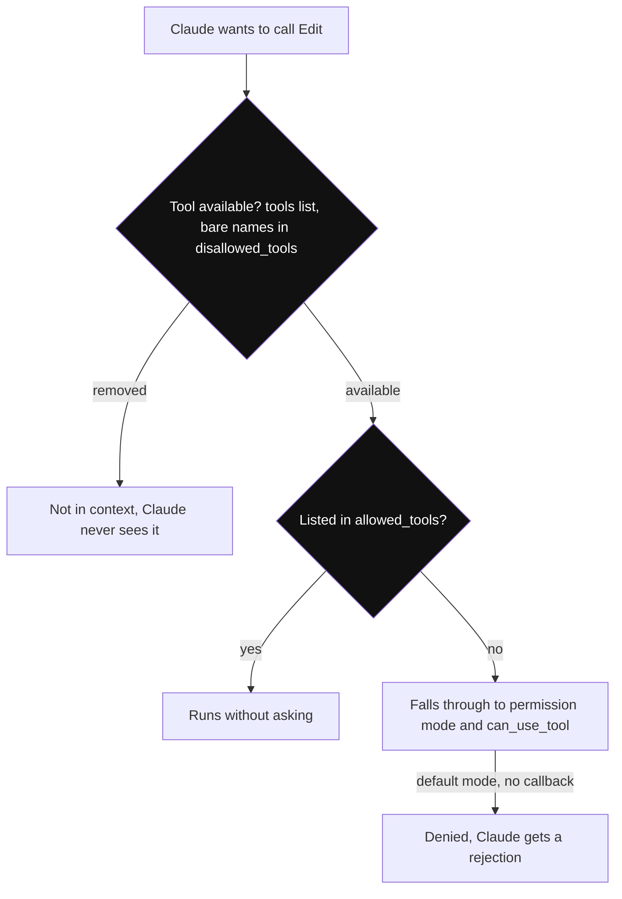

*Diagram:* Do alag sawal: tool exist karta hai ya nahi, aur pre-approved hai ya nahi; allowed_tools sirf doosra sawal answer karta hai, isliye unlisted tools exist karte hain aur aage girte hain.

**Kaise kaam karta hai, step by step:**

1. Main built-in tools:

| Category | Tools |
|---|---|
| Files | `Read`, `Edit`, `Write` |
| Search | `Glob`, `Grep` |
| Shell | `Bash` |
| Web | `WebSearch`, `WebFetch` |
| Orchestration | `Agent` (subagents), `Skill`, `AskUserQuestion`, `TaskCreate`, `TaskUpdate` |
| Discovery | `ToolSearch` (tool schemas zaroorat pe load karta hai) |

2. **Availability:** `tools=["Read", "Grep"]` Claude ke context me sirf wahi built-ins rakhta hai. `disallowed_tools` me bare name, jaise `"WebFetch"`, us tool ko hata deta hai.
3. **Permission:** `allowed_tools=[...]` listed tools ko **pre-approve** karta hai. Ye Claude ko unhi tak **restrict nahi** karta. Unlisted tools ab bhi hain aur permission mode aur tumhare callback tak jaate hain.
4. Scoped rules: `"Bash(npm test *)"` sirf matching commands allow karta hai; `disallowed_tools` me `"Bash(rm *)"` matching calls ko har mode me deny karta hai, `bypassPermissions` me bhi.
5. Read-only tools (`Read`, `Glob`, `Grep`, `readOnlyHint` wale MCP tools) parallel chal sakte hain; `Edit`, `Write`, `Bash` conflicts se bachne ke liye ek-ek karke.

Example: `default` mode me `allowed_tools=["Read", "Grep"]` aur bina callback wala doc-review agent. Woh aaram se padhta hai. Agar `Edit` try kare, call ko approval chahiye, callback nahi hai, to deny hota hai aur Claude ko rejection message milta hai.

**Interview tip:** "Kya `allowed_tools=["Read"]` Bash rokta hai?" Bolo: "Nahi. `allowed_tools` sirf auto-approve karta hai. Bash hatane ke liye main use `tools` se bahar rakhta hoon ya `"Bash"` `disallowed_tools` me daalta hoon. Deny rules har permission mode me jeet-te hain."

**Common galti:**
- `allowed_tools` ko security ka allow-list samajhna. Ye pre-approval list hai.
- "Sirf tests ke liye" `Bash` dena bina scoped rule ya hook ke; `Bash` wo sab chala sakta hai jo OS user chala sake.

## ⭐ In-process MCP servers se custom tools

**Ek line me:** Tumhare apne functions `@tool` decorator aur `create_sdk_mcp_server` wrap se tools bante hain; external MCP servers bhi aise hi judte hain.

**Ye kyun chahiye:** Real agents ko tumhara business data chahiye: "payment status lao", "PNR dekho". SDK natively MCP bolta hai, isliye custom tool format ki jagah ek standard reuse hota hai. In-process version alag server process chalane aur secure karne se bachata hai.

**Aise socho:** Universal charging port. Koi bhi MCP charger chalta hai; in-process server tumhare apne wall socket me laga charger hai.

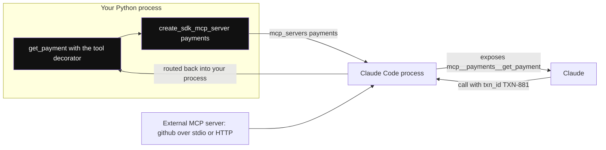

*Diagram:* In-process server tumhare Python app ke andar hai, isliye call bina extra service ke tumhare function tak wapas aati hai; external servers usi slot me lagte hain.

**Kaise kaam karta hai, step by step:**

1. Async function decorate karo: `@tool(name, description, input_schema)`. Schema `{"txn_id": str}` jaisa simple dict ho sakta hai ya poora JSON Schema (enums ya optional fields ke liye zaroori).
2. Function `{"content": [{"type": "text", "text": ...}]}` lautata hai. Claude ko call fail batane ke liye apne saaf message ke saath `"is_error": True` jodo.
3. `create_sdk_mcp_server(name="payments", version="1.0.0", tools=[...])` server config banata hai.
4. `mcp_servers={"payments": server}` pass karo. Tool names `mcp__<server key>__<tool name>` bante hain, jaise `mcp__payments__get_payment`.
5. `allowed_tools=["mcp__payments__get_payment"]` ya `"mcp__payments__*"` se pre-approve karo.
6. External servers: `mcp_servers={"github": {"command": "...", "args": [...]}}` (stdio) ya HTTP configs. [Tools, MCP & A2A](07-tools-mcp-a2a.md) dekho.
7. Tool search default on hai: MCP tool schemas defer hote hain aur zaroorat pe load, to 50 tools har turn window nahi bharte.
8. `annotations=ToolAnnotations(readOnlyHint=True)` Claude ko tool doosre read-only tools ke saath parallel chalane deta hai.

**Interview tip:** "Custom tools ke liye plain function calling ki jagah MCP kyun?" Bolo: "Claude Code, SDK aur baaki MCP clients me ek tool format. In-process server use mere Python process me rakhta hai, to extra service nahi, aur wahi tool baad me standalone MCP server pe ja sakta hai bina agent badle."

**Common galti:**
- Raw exceptions raise karna. Phir Claude ko bas error string dikhti hai; `is_error` ke saath kaam ka message lautao.
- `allowed_tools` me `mcp__server__tool` naming bhoolna, to har call permission maangti hai.

## ⭐ Permissions: modes, rules aur approval callback

**Ek line me:** Har tool call hooks, deny aur allow rules, permission mode aur aakhir me tumhare `can_use_tool` callback se guzarta hai, jo allow ya deny decide karta hai.

**Ye kyun chahiye:** Shell wala agent database delete kar sakta hai. Kuch calls kabhi nahi chalni chahiye, kuch hamesha, aur kuch ko human chahiye. Permissions ye decision har run me explicit aur same banate hain.

**Aise socho:** Office access. Kuch darwaze seal hain (deny rules), tumhara badge kuch kholta hai (allow rules), floor ka mode baaki decide karta hai (open day vs lockdown), aur baaki ke liye guard tumhare manager ko phone karta hai (callback).

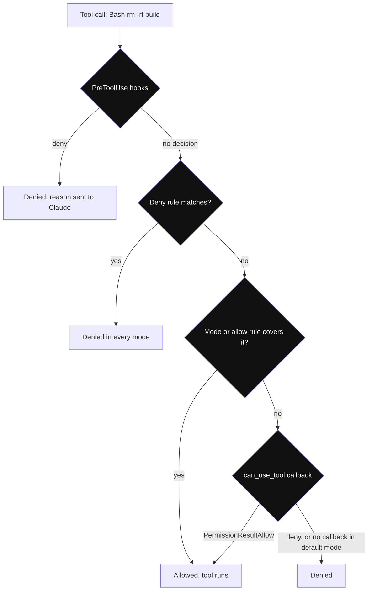

*Diagram:* Har call ye chaar checks upar se neeche chalti hai aur pehle decide karne wale pe ruk jaati hai; tumhara callback tabhi poocha jaata hai jab upar kisi ne decide na kiya ho.

**Kaise kaam karta hai, step by step:**

1. **Hooks** pehle chalte hain aur call deny kar sakte hain (agla section).
2. **Deny rules** (`disallowed_tools`, settings) matching calls har mode me block karte hain.
3. **Permission mode** aur **allow rules** jo cover karein use auto-approve karte hain.
4. Jo bacha woh **`can_use_tool`** tak jaata hai, tumhara async callback jo `PermissionResultAllow` (chahe to badla hua input) ya `PermissionResultDeny` lautata hai. `default` mode me callback na ho to deny.

| Mode | Bina poochhe kya chalta hai | Kis liye |
|---|---|---|
| `default` | sirf jo allow rules cover karein; baaki tumhare callback pe | approval UI wale interactive apps |
| `acceptEdits` | working dirs ke andar file edits aur simple filesystem commands | trusted dev kaam |
| `plan` | explore karna; edits tumhare callback pe | "pehle plan, phir main approve karunga" |
| `dontAsk` | sirf pre-approved calls; baaki sab deny | bina human wale headless agents |
| `auto` | model classifier risky actions review karke allow ya block karta hai | autonomous agents jinhe safety net bhi chahiye |
| `bypassPermissions` | sab kuch (deny rules phir bhi lagte hain) | sirf isolated CI containers |

Example: `dontAsk` mode me `allowed_tools=["Read", "mcp__payments__get_payment"]` wala support-ops agent. Woh padh sakta hai aur payments dekh sakta hai. Koi bhi `Edit` ya `Bash` turant deny, headless worker me koi latakta hua approval prompt nahi.

**Interview tip:** "Headless agent, approve karne wala koi nahi. Kaunsa mode?" Bolo: "Tight allow list ke saath `dontAsk`, ya `bypassPermissions` sirf throwaway sandbox container ke andar. Dono me deny rules aur destructive cheezon ke liye PreToolUse hook bhi lagata hoon, kyunki ye har mode me lagte hain."

**Common galti:**
- Developer laptop ya shared server pe `bypassPermissions` chalana.
- Approvals sirf prompt me banana ("delete se pehle poochho"). Prompts salah hain; permissions enforcement hain.

## ⭐ Hooks

**Ek line me:** Hooks loop ke fixed points (tool se pehle, tool ke baad, stop pe, compaction se pehle...) pe tumhare Python callbacks hain jo log, badal ya block kar sakte hain.

**Ye kyun chahiye:** Kuch rules permission syntax se zyada code me aasaan hain: "Bash sirf `pytest` aur read-only git ke liye", "har tool call ki audit row likho", "compaction se pehle poora transcript save karo". Hooks tumhare process me chalte hain, model ke context me nahi, isliye koi tokens nahi lagte.

**Aise socho:** Highway ke toll booths. Har gaadi (tool call) booth se guzarti hai; booth log kar sakta hai, jaane de sakta hai, ya rok sakta hai.

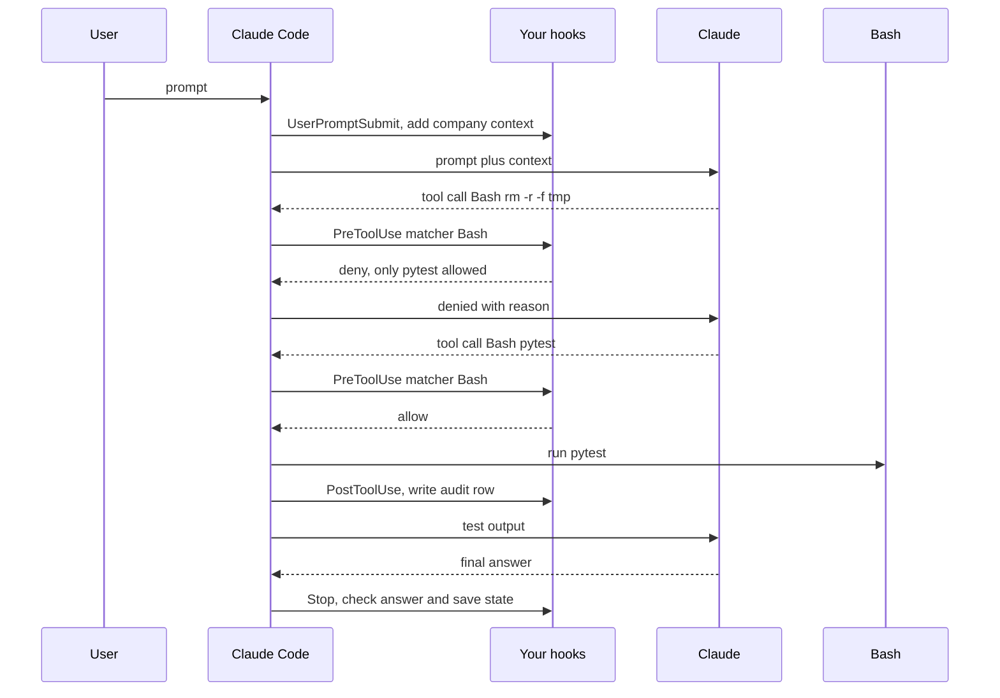

*Diagram:* Hooks tumhare process me fixed points pe chalte hain: pehli Bash call PreToolUse se block hoti hai, Claude reason padhkar allowed command pe switch karta hai.

**Kaise kaam karta hai, step by step:**

1. Python hook events: `PreToolUse`, `PostToolUse`, `PostToolUseFailure`, `UserPromptSubmit`, `Stop`, `SubagentStart`, `SubagentStop`, `PreCompact`, `Notification`, `PermissionRequest`. TypeScript me kuch aur hain.
2. Register: `hooks={"PreToolUse": [HookMatcher(matcher="Bash", hooks=[my_fn])]}`. `matcher` tool name ya `"Write|Edit"` jaisa pattern hai; matcher nahi matlab saare tools.
3. Callback signature: `async def my_fn(input_data, tool_use_id, context) -> dict`. `input_data` me `tool_name` aur `tool_input` hain.
4. Normal flow ke liye `{}` lautao. PreToolUse call block karne ke liye lautao `{"hookSpecificOutput": {"hookEventName": "PreToolUse", "permissionDecision": "deny", "permissionDecisionReason": "..."}}`. Claude reason dekhta hai aur doosra raasta try karta hai.
5. `HookMatcher(timeout=..., on_failure="block")` se crash hone wala hook action ko jaane dene ki jagah block karta hai.

| Zaroorat | Hook |
|---|---|
| Khatarnaak commands block | `Bash` pe `PreToolUse` |
| Har action ka audit log | bina matcher `PostToolUse` |
| Har prompt me company context jodo | `UserPromptSubmit` |
| Summary se pehle transcript archive | `PreCompact` |
| Final answer check, state save | `Stop` |
| Parallel helpers track | `SubagentStart` / `SubagentStop` |

**Interview tip:** "Hooks vs `can_use_tool`?" Bolo: "Hooks har matching call pe pehle chalte hain aur hard policy aur logging ke liye best hain. `can_use_tool` tabhi poochha jaata hai jab kisi aur ne decide na kiya ho, isliye human approval UI ki jagah wahi hai."

**Common galti:**
- Aise hook pe bharosa jo sirf `rm -rf /` string match kare. Attacker ya model `rm -r -f ~` likh sakta hai. Commands block-list karne ki jagah allow-list karo.

## Subagents

**Ek line me:** Main agent `Agent` tool se helper agents shuru kar sakta hai; har helper apne prompt, tools aur model ke saath fresh context window me kaam karta hai, aur sirf final report lautata hai.

**Ye kyun chahiye:** 40 log files padhne se main agent ki window noise se bhar jaati hai aur baad ki reasoning bigadti hai ("context rot"). Subagent unhe padhta hai, aur main agent ko 20 line ka summary milta hai. Subagents parallel bhi chalte hain aur read-only tools pe lock ho sakte hain. [Agent & Multi-agent Patterns](04-agent-patterns.md) dekho.

**Aise socho:** Senior doctor junior ko patient ki 200 page history padh ke ek page summary laane bhejta hai. Senior ki table saaf rehti hai.

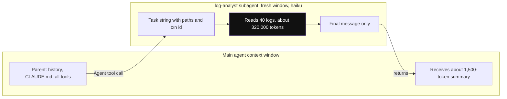

*Diagram:* 320,000 tokens ki log reading subagent ki apni window me rehti hai; parent ko sirf bheja hua task aur wapas aayi chhoti report dikhti hai.

**Kaise kaam karta hai, step by step:**

1. Define karo: `agents={"log-analyst": AgentDefinition(description=..., prompt=..., tools=[...], model="haiku")}`. Ya `.claude/agents/` me markdown files rakho.
2. `Agent` tool allow karo (jaise `allowed_tools` me).
3. Claude subagent ko uske `description` se chunta hai, ya tum prompt me naam lo ("log-analyst agent use karo").
4. Subagent fresh shuru hota hai: apna prompt, task string, project `CLAUDE.md` aur apne tools. Parent ki history nahi dekhta, isliye task string me file paths aur facts hone chahiye.
5. Sirf uska final message parent tak aata hai. Subagent ke andar ke messages me `parent_tool_use_id` hota hai, to UI me alag dikha sakte ho.
6. Limits: depth (`CLAUDE_CODE_MAX_SUBAGENT_SPAWN_DEPTH`, default 3), concurrency (`CLAUDE_CODE_MAX_CONCURRENT_SUBAGENTS`, default 20) aur `max_budget_usd` (subagent kharcha bhi ginta hai). `AgentDefinition(maxTurns=...)` har helper ko cap karta hai.

Example numbers: 40 log files × ~8,000 tokens = ~320,000 tokens. Main window me padha to lambe session ka zyada tar budget gaya aur baad me compact ho jaata hai. Chhote, saste model pe subagent padhe to parent ko shayad 1,500 tokens ka summary milta hai.

**Interview tip:** "Subagent vs ek bada agent?" Bolo: "Subagents jab side task bahut padhe par thoda lautaye, jab tasks parallel chal sakein, ya jab kam tools wala helper chahiye. Har ek extra calls kharchta hai, to chhote tasks ke liye nahi."

**Common galti:**
- "logs check karo" jaisi vague task string. Subagent ke paas parent history nahi; paths, ids aur kya lautana hai, sab do.
- Depth ya budget limits nahi, to ek prompt agents ka ped ban jaata hai.

## Sessions: resume, fork aur storage

**Ek line me:** Har run ek session id ke neeche transcript likhta hai; baad me resume kar sakte ho, doosra raasta try karne ke liye fork kar sakte ho, ya apne storage me mirror kar sakte ho.

**Ye kyun chahiye:** Lambe tasks rukte hain: user tab band karta hai, turn cap lagta hai, pod restart hota hai. Poore context (padhi files, liye decisions) ke saath resume karne se dobara shuru nahi karna padta.

**Aise socho:** Game save karna. Resume same save ko aage chalata hai. Fork save ki copy banata hai taaki original khoye bina risky move try kar sako.

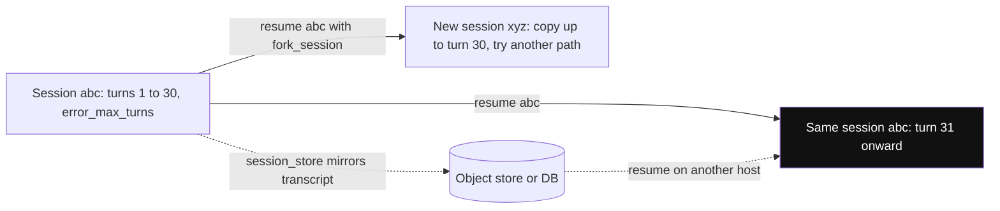

*Diagram:* Resume usi session me likhta rehta hai; fork naye id me copy karta hai taaki original na chhuye; session store se doosra pod bhi resume kar sakta hai.

**Kaise kaam karta hai, step by step:**

1. `ResultMessage` (ya init `SystemMessage`) se `session_id` padho.
2. Baad me: `ClaudeAgentOptions(resume=session_id)` use aage chalata hai. `continue_conversation=True` sabse latest wala chalata hai.
3. `resume` ke saath `fork_session=True` us point se naya session id shuru karta hai.
4. Transcripts default me local disk (`~/.claude/projects/`) pe rehte hain; container restart unhe kho deta hai.
5. `session_store=...` do (object store, key-value store ya database ka `SessionStore` adapter) taaki doosra host resume kar sake. Ye sirf transcripts mirror karta hai, working-directory files ya `CLAUDE.md` nahi.
6. `enable_file_checkpointing=True` plus `client.rewind_files(...)` file changes ko pichle user message tak undo kar sakta hai.

**Interview tip:** "Agent beech me `error_max_turns` pe ruk gaya. Ab?" Bolo: "Result me ab bhi session id aur cost hai. Main us session ko zyada limit ya patli instruction ke saath resume karta hoon, dobara shuru nahi, taaki padhi hui files context me rahein."

**Common galti:**
- Bina session store ke serverless ya autoscaled pods pe chalana, phir sochna doosre node pe resume kyun fail hua.

## System prompts, settings, `CLAUDE.md` aur skills

**Ek line me:** Agent ka base behaviour `system_prompt` se control karte ho, aur kaun si project files use shape karein `setting_sources` se: settings, `CLAUDE.md` memory, skills, commands aur filesystem agents.

**Ye kyun chahiye:** Wahi harness repo me Claude Code jaisa, production me strict support bot jaisa, aur multi-tenant service me saaf, isolated worker jaisa chalna chahiye. Iske liye kaun si instructions load hon, uspe explicit control chahiye.

**Aise socho:** Naya employee: company handbook (system prompt), team ka wiki page (`CLAUDE.md`), aur shelf pe how-to binders jo zaroorat pe hi kholta hai (skills).

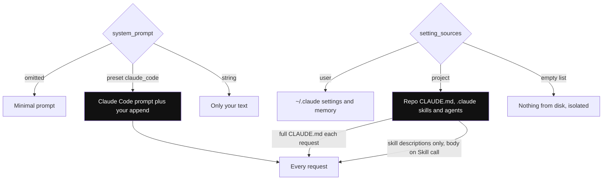

*Diagram:* Do dials agent ko shape karte hain: system_prompt base behaviour chunta hai, setting_sources disk ki kaunsi files load hon; CLAUDE.md har baar poora jaata hai, skills sirf descriptions ke roop me.

**Kaise kaam karta hai, step by step:**

1. `system_prompt="..."` default ko tumhare text se replace karta hai. Default **minimal** prompt hai.
2. `system_prompt={"type": "preset", "preset": "claude_code", "append": "..."}` Claude Code ka poora prompt (tool usage rules, coding style) plus tumhari baatein use karta hai. Coding agents ke liye best.
3. `setting_sources` decide karta hai kaun sa filesystem config load ho: `"user"` (`~/.claude/`), `"project"` (repo ka `.claude/` aur `CLAUDE.md`), `"local"` (`.claude/settings.local.json`). Na do to teeno. `[]` matlab koi nahi.
4. `CLAUDE.md` har request pe jaata hai (aur prompt-cached), isliye pakke rules wahan rakho, pehle user message me nahi.
5. **Skills** `.claude/skills/refund-policy/SKILL.md` jaise folders hain. Shuru me Claude har skill ka sirf chhota description dekhta hai; poora content tab load hota hai jab Claude `Skill` tool call kare. `skills="all"` ya names ki list unhe enable karti hai.
6. Plugins skills, agents, hooks aur MCP servers bundle karke local path se load ho sakte hain.

**Interview tip:** "Same repo me mera SDK agent Claude Code se alag behave kyun karta hai?" Bolo: "Shayad system prompt. v0.1.0 se SDK default me minimal prompt use karta hai; mujhe `claude_code` preset chahiye. Main `setting_sources` bhi check karta hoon, kyunki wahi control karta hai ki `CLAUDE.md` aur skills load hon ya nahi."

**Common galti:**
- Multi-tenant service me `setting_sources` default pe chhodna, jisse server ki `~/.claude` settings aur memory har tenant me leak hoti hai.
- 3,000 shabdon ka playbook `CLAUDE.md` me daalna. Har request pe uska paisa lagta hai; kam use hone wale hisse skills me le jao.

## Context aur compaction

**Ek line me:** Context window me system prompt, tools, `CLAUDE.md` aur badhti history hoti hai; limit ke paas harness purani history ka automatic summary bana deta hai.

**Ye kyun chahiye:** Lamba fix-the-bug session 60 tool calls kar sakta hai, har ek hazaron tokens lautata hai. Compaction ke bina window bharte hi run fail hota. Iske saath run purane hisse ke summary ke saath chalta rehta hai. [Memory & Context](05-memory-context.md) dekho.

**Aise socho:** Lambi meeting jisme minute-taker pehle do ghante ke notes ko ek page summary se badal deta hai, aur aakhri 20 minute word for word rakhta hai.

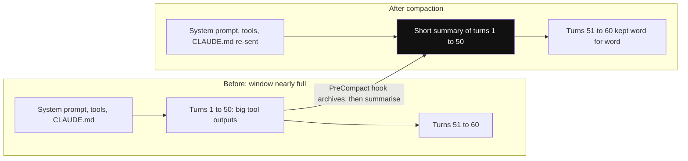

*Diagram:* Sirf history ka purana beech wala hissa summary me dabta hai (aur compact_boundary message aata hai); CLAUDE.md bachta hai kyunki har request me dobara jaata hai.

**Kaise kaam karta hai, step by step:**

1. Har session me sab jama hota hai: prompt, tool definitions, har tool input aur output.
2. Stable hisse (system prompt, tool definitions, `CLAUDE.md`) prompt-cached hote hain, to repeat turns saste hain.
3. Limit ke paas harness compact karta hai: purani history summary ban jaati hai. Stream `compact_boundary` subtype wala `SystemMessage` deta hai.
4. Chat ki shuruati instructions summary me kho sakti hain. Pakke rules `CLAUDE.md` me rakho, jo har request pe dobara jaata hai. `CLAUDE.md` me "summary karte waqt file paths, test results aur decisions rakho" jod sakte ho.
5. `PreCompact` hook se pehle poora transcript archive kar sakte ho. `/compact` bhejne se manually trigger hota hai.
6. Context patla rakho: bhaari padhai ke liye subagents, har agent ke kam tools, MCP schemas ke liye tool search, simple tasks ke liye kam `effort`.

**Interview tip:** "Compaction vs subagents?" Bolo: "Compaction window bharne ke baad ka safety net hai; detail khota hai. Subagents bhaari padhai doosri window me rakh ke bloat pehle hi rokte hain. Main subagents ke saath design karta hoon aur baaki compaction pe chhodta hoon."

**Common galti:**
- 2 ghante ke session me zaroori constraints sirf pehle prompt me dena. Compaction ke baad woh summary me ek dhundhli line reh sakte hain.

## ⭐ Ek poora chhota app: UPI payments service ka on-call helper

**Ek line me:** Agent jo failed UPI payment investigate karta hai: custom tool se payment dekhta hai, badi logs pe sasta subagent bhejta hai, code padh ke theek karta hai, guarded shell se tests chalata hai, phir same session me incident note likhta hai.

**Ye kyun chahiye:** Ye SDK ka sweet spot hai: ek task me files, shell, search, custom data aur lamba context. Ye har safety control bhi dikhata hai jo interviewer poochhega.

**Aise socho:** Razorpay jaisi company me night-shift engineer, aur ek strict senior dekh raha hai: "kuch bhi padh sakte ho, is repo me code edit kar sakte ho, tests aur read-only git chala sakte ho, aur kuch nahi".

**Kaise kaam karta hai, step by step:**

1. In-process MCP server me read-only `get_payment` tool.
2. `PreToolUse` hook jo Bash me sirf `pytest` aur read-only `git` aur `grep` commands allow kare.
3. Chhote model pe read-only tools wala `log-analyst` subagent.
4. Options: Claude Code preset prompt, sirf project settings, deny rules, turn aur budget caps.
5. Ek `ClaudeSDKClient` session: investigate aur fix, phir incident note ke liye follow-up turn.

Worked numbers: `max_turns=30` aur `max_budget_usd=2.0`. Yahan typical run 10–20 turns ka hai. Agent loop me phase to 30 turns pe `error_max_turns` ke saath, ya lagbhag $2 pe rukta hai (cap ko ek response jitna paar kar sakta hai, to headroom rakho).

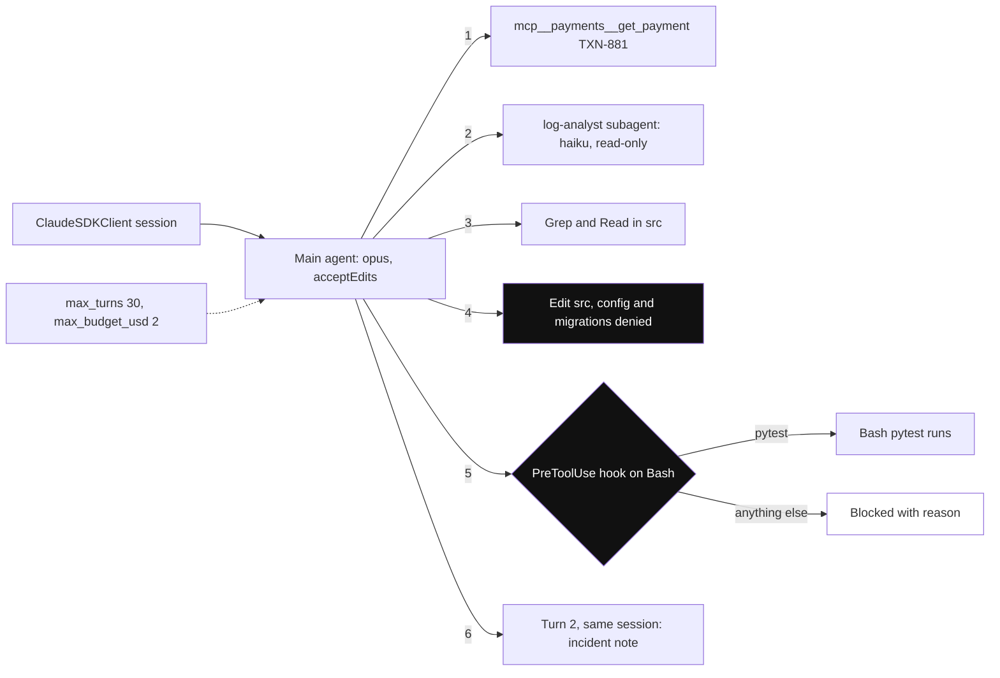

*Diagram:* Numbered edges expected run order hain; highlighted boxes woh safety layers hain jo decide karti hain agent kya badal sakta hai.

**Step 1: custom tool.**

```python
import json
from claude_agent_sdk import ToolAnnotations, create_sdk_mcp_server, tool

PAYMENTS = {"TXN-881": {"status": "FAILED", "method": "UPI", "error": "BANK_TIMEOUT", "amount": 1299}}

@tool("get_payment", "Look up one payment by transaction id, like TXN-881",
      {"txn_id": str}, annotations=ToolAnnotations(readOnlyHint=True))
async def get_payment(args):
    p = PAYMENTS.get(args["txn_id"])            # real life me: payments API call karo
    if p is None:
        return {"content": [{"type": "text", "text": f"No payment {args['txn_id']}"}], "is_error": True}
    return {"content": [{"type": "text", "text": json.dumps(p)}]}

payments = create_sdk_mcp_server(name="payments", version="1.0.0", tools=[get_payment])
```

**Code kya karta hai:**
- `@tool` `{"txn_id": str}` se schema banata hai; description Claude ko batata hai kab use kare.
- `readOnlyHint=True` Claude ko ise reads aur greps ke saath parallel chalane deta hai.
- Payment na mile to saaf message ke saath `is_error` lautata hai, taaki Claude sahi id maang sake.

**Step 2: hook, subagent aur options.**

```python
from claude_agent_sdk import AgentDefinition, ClaudeAgentOptions, HookMatcher

SAFE = ("pytest", "git diff", "git log", "git status", "grep")

async def only_safe_bash(input_data, tool_use_id, context):
    cmd = input_data["tool_input"].get("command", "").strip()
    if cmd.startswith(SAFE) and not any(c in cmd for c in [";", "&&", "|", "`", "$("]):
        return {}                                            # allow
    return {"hookSpecificOutput": {"hookEventName": "PreToolUse", "permissionDecision": "deny",
            "permissionDecisionReason": f"Only tests and read-only git are allowed. Blocked: {cmd}"}}

options = ClaudeAgentOptions(
    model="claude-opus-5-5",
    cwd="/srv/payments-service",
    system_prompt={"type": "preset", "preset": "claude_code",
                   "append": "You are on-call for the UPI payments service. Never edit config/ or migrations/."},
    setting_sources=["project"],                             # sirf is repo ka CLAUDE.md aur skills
    mcp_servers={"payments": payments},
    allowed_tools=["Read", "Grep", "Glob", "Edit", "Bash", "Agent", "mcp__payments__get_payment"],
    disallowed_tools=["WebFetch", "WebSearch", "Edit(config/**)", "Edit(migrations/**)"],
    permission_mode="acceptEdits",
    hooks={"PreToolUse": [HookMatcher(matcher="Bash", hooks=[only_safe_bash], on_failure="block")]},
    agents={"log-analyst": AgentDefinition(
        description="Reads large log files and returns only relevant error lines with timestamps.",
        prompt="You analyse logs. Return at most 20 relevant lines and a 3-line summary.",
        tools=["Read", "Grep", "Glob"], model="haiku", maxTurns=10)},
    max_turns=30,
    max_budget_usd=2.0,
)
```

**Code kya karta hai:**
- Hook command prefixes allow-list karta hai aur chaining characters reject karta hai, to `pytest; rm -rf .` block hota hai. `on_failure="block"` matlab crash hone wala hook allow karne ki jagah block karta hai.
- `Bash` pre-approved hai, par har Bash call pehle hook se guzarti hai.
- Web tools hataye gaye; `config/` aur `migrations/` ke edits scoped rules se har mode me deny.
- `setting_sources=["project"]` repo ka `CLAUDE.md` aur skills load karta hai par server user ki personal settings nahi.
- `log-analyst` subagent chhote model pe read-only tools aur apne turn cap ke saath chalta hai.

**Step 3: session chalao aur follow up karo.**

```python
import asyncio
from claude_agent_sdk import AssistantMessage, ClaudeSDKClient, ResultMessage, TextBlock, ToolUseBlock

async def main():
    async with ClaudeSDKClient(options=options) as client:
        await client.query("TXN-881 failed with BANK_TIMEOUT. Check the payment, use log-analyst on logs/, "
                           "find the bug in src/, fix it and run pytest.")
        async for msg in client.receive_response():
            if isinstance(msg, AssistantMessage):
                for block in msg.content:
                    if isinstance(block, ToolUseBlock):
                        print("tool:", block.name, str(block.input)[:80])
                    elif isinstance(block, TextBlock):
                        print("claude:", block.text[:200])
            elif isinstance(msg, ResultMessage):
                print(msg.subtype, msg.num_turns, "turns", f"${msg.total_cost_usd or 0:.3f}", msg.session_id)
        await client.query("Write a 5-line incident note for #payments-oncall.")   # same session
        async for msg in client.receive_response():
            if isinstance(msg, ResultMessage) and msg.subtype == "success":
                print(msg.result)

asyncio.run(main())
```

**Code kya karta hai:**
- Har tool call hote hi print karta hai, live UI ko aise hi feed karoge.
- `ResultMessage` subtype, turn count, cost (subagents milake) aur store karne layak session id deta hai.
- Doosra `query` same session reuse karta hai, to incident note root cause aur fix bata sakta hai.
- Likely run: `get_payment` → `Agent(log-analyst)` → `src/` me `Grep` aur `Read` → `Edit` → `Bash(pytest)` → final summary.

**Interview tip:** "Is agent me kaun si safety layers hain?" Bolo: "Tool availability (web nahi), config aur migrations ke liye scoped deny rules, shell commands allow-list karne wala PreToolUse hook, working directory tak limited `acceptEdits`, read-only subagent, turn aur dollar caps, aur production me egress proxy wala sandboxed container."

**Common galti:**
- Bina hook ya sandbox ke `Bash` pre-approve karna, aur prompt pe bharosa karna ki safe rakhega.
- `cwd` aisi directory pe point karna jisme `.env` jaise secrets bhi hain; agent wahan sab padh sakta hai.

## ⭐ Andar kaise kaam karta hai

**Ek line me:** Tumhara code Claude Code subprocess se baat karta hai, jo system prompt, settings, tools aur history se Messages API requests banata hai, permission checks ke saath tools chalata hai, aur tab tak repeat karta hai jab tak reply me koi tool call na ho.

**Ye kyun chahiye:** Jab run slow, mehenga ya blocked ho, pata hona chahiye kis layer ne kiya: model, hook, permission rule, subagent ya compaction.

**Aise socho:** Restaurant: tum (app) head waiter (SDK) se baat karte ho; kitchen (Claude Code process) chef (Claude), store room (tools) aur special orders approve karne wale manager (permissions aur hooks) ke saath poori service chalata hai.

**Kaise kaam karta hai, step by step:**

1. `query()` tumhare options ke saath `claude` subprocess spawn karta hai aur stdio pe JSON stream karta hai.
2. Subprocess session metadata, model aur tool list ke saath `SystemMessage(subtype="init")` deta hai.
3. Request banata hai: system prompt (minimal, preset ya tumhara), `setting_sources` se `CLAUDE.md` aur skill descriptions, tool definitions (core tools pehle se, MCP tools tool search ke peeche deferred), aur history.
4. Claude reply karta hai. Har content block (text ya tool call) tumhe `AssistantMessage` ki tarah milta hai.
5. Har tool call ke liye: hooks → deny rules → mode aur allow rules → `can_use_tool`. Allowed calls chalti hain (read-only parallel me). Results tumhe `UserMessage` ki tarah aate hain aur Claude ko wapas jaate hain.
6. Repeat. Tool calls wala har model reply ek turn; aakhri text-only reply ek aur turn.
7. Window limit ke paas ho to compaction chalta hai aur `compact_boundary` message aata hai.
8. Run `ResultMessage` pe khatam: `subtype`, `result`, `total_cost_usd`, `usage`, `model_usage`, `num_turns`, `session_id`.

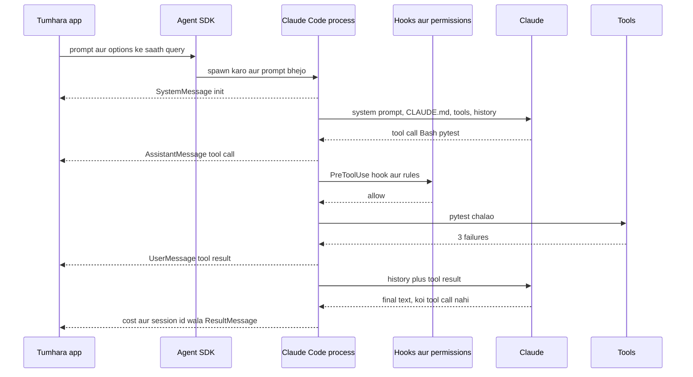

**Interview tip:** "Run me time aur paisa kahan jaata hai?" Bolo: "Zyada tar model turns me: har turn badhti history dobara bhejta hai, to cost session length ke saath badhti hai. Prompt caching stable prefix kaat deti hai. Tool execution time aam taur pe kam hai, tests ya builds chhod ke. `ResultMessage` aur OTel traces turns, tokens aur per-model cost dikhate hain."

**Common galti:**
- Billing ke liye `usage` padhna. Ye sirf main loop cover karta hai; subagents milake poore tree ke liye `model_usage` ya `total_cost_usd` use karo.

## ⭐ Agent SDK vs plain Messages API tool use

**Ek line me:** Messages API me loop aur har tool tumhara hai; Agent SDK me tum ek harness configure karte ho jisme loop, tools aur context handling pehle se hain.

**Ye kyun chahiye:** Iske baare me sabse common interview sawal yahi hai. Sahi jawab "SDK behtar hai" nahi; sahi jawab hai ki kya milta hai aur kya chhodte ho.

**Aise socho:** Ghar pe raw ingredients se khana banana (Messages API) vs poori kitchen wala caterer hire karna (Agent SDK). Ghar pe har masale pe poora control; caterer 200 mehmaanon ki shaadi sambhalta hai.

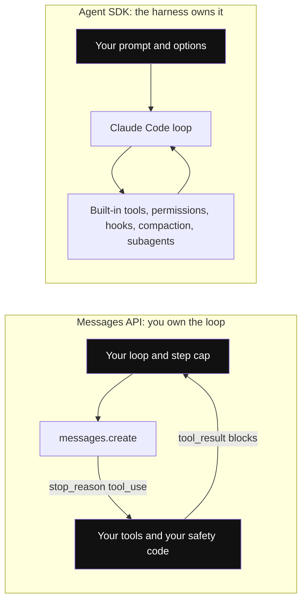

*Diagram:* Highlighted boxes woh code hain jo tum likhte ho: left me lagbhag poora loop, right me sirf configuration.

**Kaise kaam karta hai, step by step:**

1. Plain tool use: `messages` ke saath `tools` (JSON schemas) bhejo. `stop_reason == "tool_use"` ho to tools chalao, saare `tool_result` blocks ek user message me jodo, aur dobara call karo. Step cap, error handling, history trimming aur har tool tum likhte ho.
2. `anthropic` SDK ka Tool Runner ye loop tumhare liye likhta hai, par phir bhi sirf tumhare define kiye tools ke liye.
3. Agent SDK jodta hai: tested file, shell, search aur web tools; permissions aur hooks; subagents; automatic compaction; sessions; skills aur `CLAUDE.md`; cost caps; OTel telemetry.
4. Tum chhodte ho: har request pe fine control (exact prompt, exact history), halka stateless HTTP call (ab shell wala subprocess chalate ho), aur har session start pe thodi latency.

```python
import json
import anthropic

client = anthropic.Anthropic()
tools = [{"name": "get_payment", "description": "Look up one payment by transaction id",
          "input_schema": {"type": "object", "properties": {"txn_id": {"type": "string"}},
                           "required": ["txn_id"]}}]
messages = [{"role": "user", "content": "Why did TXN-881 fail?"}]

for _ in range(10):                                         # hamara apna step cap
    resp = client.messages.create(model="claude-opus-5-5", max_tokens=16000,
                                  tools=tools, messages=messages)
    messages.append({"role": "assistant", "content": resp.content})
    if resp.stop_reason != "tool_use":                      # real code me "refusal" aur "max_tokens" bhi sambhalo
        break
    results = [{"type": "tool_result", "tool_use_id": b.id,
                "content": json.dumps({"status": "FAILED", "error": "BANK_TIMEOUT"})}
               for b in resp.content if b.type == "tool_use"]
    messages.append({"role": "user", "content": results})   # saare results EK user message me

print(next((b.text for b in resp.content if b.type == "text"), ""))
```

**Code kya karta hai:**
- Ye haath se poora agent loop hai: call, `stop_reason` check, tools chalao, results jodo, repeat.
- Har tool, uska schema aur uski safety hamara kaam; file, shell ya compaction support nahi.
- Ye stateless HTTP call hai: scale karna aasaan, log karna aasaan, aur shuru karna sasta.

| | Messages API + tumhara loop | Claude Agent SDK |
|---|---|---|
| Loop | tum likhte ho | built in |
| Tools | sirf tumhare | built-in files, shell, web + MCP se tumhare |
| Lamba context | tum trim karo ya API compaction | automatic compaction, subagents |
| Safety | tumhara code | permission modes, rules, hooks, sandbox settings |
| Runtime | stateless HTTP call | working directory wala subprocess |
| Best kis liye | chat features, extraction, fixed workflows, high-volume calls | open-ended agents jo files, code aur shells pe kaam karein |

**Interview tip:** "Bas Messages API kyun nahi?" Bolo: "Teen API tools wale support bot ke liye wahi use karunga: simple aur stateless. Jis agent ko repo explore karna, files edit karna, tests chalana aur ghante bhar chalte rehna hai, uske liye Claude Code ke tools, compaction aur permissions dobara banane me mahine lagenge, isliye SDK."

**Common galti:**
- Ek classification call ke liye Agent SDK use karna; subprocess startup aur bade system prompt ka paisa bekaar dete ho.

## Production concerns

**Ek line me:** Har session shell aur local files wala lamba chalne wala process hai, to hosting isolation, persistence, cost caps aur telemetry ke baare me hai, sirf HTTP scale karne ke baare me nahi.

**Ye kyun chahiye:** Shell commands chala sakne wala agent ek remote-code-execution feature hai jo tumne jaan-boojh ke banaya. Log file me ek bura prompt injection use secrets bahar bhejne bol sakta hai. [LLM Security and Governance](20-llm-security-governance.md) aur [Agents in Production](12-agents-in-production.md) dekho.

**Aise socho:** Contractors ko flats ki chaabiyan dena. Har ek ko ek flat (container), building se kya bahar ja raha hai guard dekhta hai (egress proxy), aur kaam ke baad chaabiyan wapas (ephemeral containers).

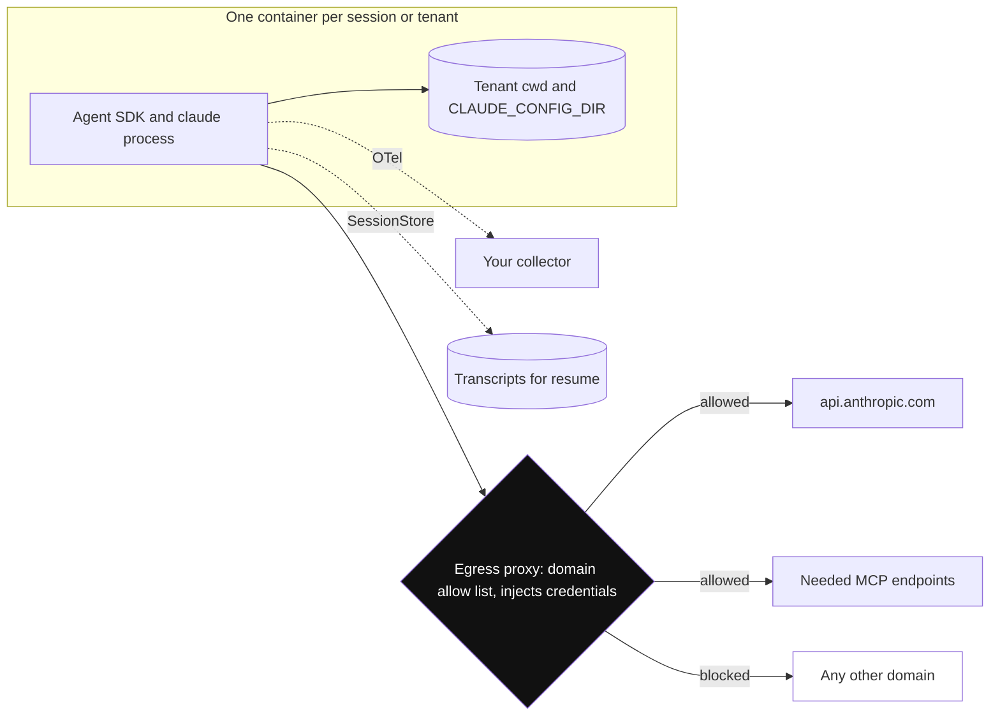

*Diagram:* Har session ko untrusted code samjho: apne container me band chalta hai, aur proxy hi bahar ka raasta hai, isliye injected 'secrets bhejo' instruction kahin nahi ja sakti.

**Kaise kaam karta hai, step by step:**

| Concern | Kya karo |
|---|---|
| Isolation | har session ya tenant ka ek container ya sandbox (Docker, gVisor, Firecracker, ya sandbox provider); andar command sandboxing ke liye `sandbox={"enabled": True, ...}` |
| Network | domain allow list wala egress proxy; sirf `api.anthropic.com` (ya tumhara Bedrock/Vertex endpoint) aur zaroori MCP endpoints |
| Secrets | tool credentials container se bahar; proxy unhe inject kare. `.env` files `cwd` me mount mat karo |
| Multi-tenant | `setting_sources=[]`, per-tenant `cwd`, per-tenant `CLAUDE_CONFIG_DIR`, `CLAUDE_CODE_DISABLE_AUTO_MEMORY=1` |
| Session patterns | ephemeral (har task ka ek container), long-running (containers ka pool, sessions id se pin), hybrid (idle pe band, `SessionStore` se resume) |
| Resources | har agent ke liye ~1 GiB RAM, 5 GiB disk, 1 CPU se shuru; memory session length ke saath badhti hai |
| Cost | `max_turns`, `max_budget_usd`, har agent ka `effort`, subagents ke liye chhote models; token cost aam taur pe container cost se kahin zyada (~$0.05/ghanta vs lambe session pe dollars) |
| Observability | `CLAUDE_CODE_ENABLE_TELEMETRY=1` plus `OTEL_*` env vars traces, metrics aur logs export karte hain; prompts default me bahar |
| Evals | real tasks (jaise 50 purane incidents) fresh containers me replay karo aur outcome, turns aur cost score karo. [Evals for Agents](09-agent-evals.md) dekho |
| Upgrades | bundled CLI SDK version se pinned hai; patch releases lo, minor se pehle changelog padho |

Koi total session timeout built in nahi hai, isliye `max_turns` tumhara main stop hai. Bade fan-outs ke liye kaam batches me todo taaki rate limits na lagein.

**Interview tip:** "Ise bahut customers ke liye kaise host karoge?" Bolo: "Har task ke liye ephemeral sandboxed containers, ya chat ke liye pinned pool, `setting_sources=[]` ke saath, per-tenant working aur config directories, credentials inject karne aur domains allow-list karne wala egress proxy, resume ke liye `SessionStore`, turn aur dollar caps, aur hamare collector me OTel."

**Common galti:**
- Kai tenants ke sessions ek container me default settings ke saath chalana, jisse `~/.claude` memory aur files share hoti hain.

## ⭐ Kab use karo, kab nahi, aur alternatives

**Ek line me:** Jab agent ko files, code, shells ya documents pe capable engineer ki tarah kaam karna ho tab use karo; simple chat features, strict business workflows ya non-Claude models ke liye avoid karo.

**Ye kyun chahiye:** "Ye kyun, X kyun nahi?" senior sawal hai. SDK powerful hai par bhaari aur Claude-specific.

**Aise socho:** Poori tarah equipped workshop. Furniture banane ke liye perfect; ek screw kasne ke liye zyada.

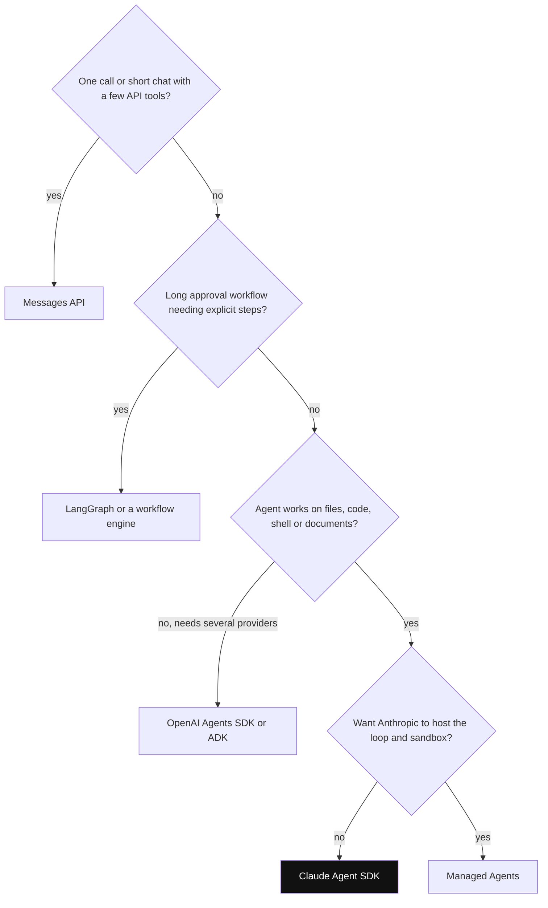

*Diagram:* SDK tabhi jawab hai jab halke options rule out ho jaayein: ye files aur shell pe open-ended kaam ke liye hai jo tum khud host karna chahte ho.

**Kaise kaam karta hai, step by step:**

1. Iske liye use karo: coding agents (tests fix, PR review, migrations), ops aur SRE helpers, bahut documents pe research, data-cleanup agents, internal tools jo Claude Code jaisa behave karein.
2. Iske liye avoid karo: ek model call ya kuch API tools wali chhoti chat (Messages API use karo); lambe approval-driven business workflows jinhe explicit, testable steps chahiye (LangGraph ya chhote agents ke around workflow engine); multi-provider models ki zaroorat (ye Claude ke liye bana hai, Bedrock, Vertex aur Foundry pe bhi).
3. Agar loop aur sandbox bhi Anthropic host kare, to self-hosting ki jagah Managed Agents dekho.

| | Claude Agent SDK | OpenAI Agents SDK | LangGraph | Messages API + apna loop |
|---|---|---|---|---|
| Mental model | ready harness jo tum configure karte ho | agents + handoffs + Runner | graph jo tum design karte ho | sab tum likhte ho |
| Built-in tools | files, shell, search, web, subagents | hosted web/file search, code interpreter | koi nahi | koi nahi |
| Control flow | harness ke andar model-driven | handoffs se model-driven | explicit edges | explicit code |
| Context handling | automatic compaction, subagents | sessions, compaction session | tumhare nodes aur reducers | tumhara code |
| Safety controls | permission modes, rules, hooks, sandbox | guardrails, tool approval | `interrupt()`, tumhare nodes | tumhara code |
| Runtime weight | har session ek subprocess | tumhare process me library | tumhare process me library | HTTP calls |
| Models | Claude | OpenAI pehle, baaki LiteLLM se | koi bhi | Claude |
| Kis liye chuno | coding, file, ops, research agents | OpenAI support aur routing bots | durable, branching workflows | simple features, poora control |

**Interview tip:** "Approvals wale refund workflow ke liye Claude Agent SDK vs LangGraph?" Bolo: "LangGraph, kyunki mujhe explicit steps, checkpoints aur restarts jhelne wala human pause chahiye. Agar kisi step me open-ended file ya code kaam chahiye to us ek node ke andar Claude Agent SDK agent call kar sakta hoon."

**Common galti:**
- Har agent ke liye ise chunna kyunki Claude Code achha hai. Harness ko kaam se match karo.

## Common pitfalls

**Ek line me:** Zyada tar real problems `allowed_tools` ki galat samajh, galat settings load hona, unsafe hosting aur bina limit ke sessions se aati hain.

**Ye kyun chahiye:** Ye code reviews aur "kaise debug karoge" wale interview sawalon me aate hain.

**Aise socho:** Naye shehar me har naya driver wahi kuch galat mod leta hai.

**Kaise kaam karta hai, step by step:**

1. **`allowed_tools` ko security samajhna:** ye sirf pre-approve karta hai. `tools`, `disallowed_tools`, deny rules aur hooks use karo.
2. **Claude Code se alag behaviour:** default system prompt minimal hai; `claude_code` preset use karo.
3. **Settings leak:** default `setting_sources` user aur project config load karta hai. Services me jaan-boojh ke `[]` ya `["project"]` do.
4. **Caps nahi:** `max_turns` ya `max_budget_usd` nahi to open-ended prompt der tak chal ke kharch kar sakta hai.
5. **Khoye sessions:** local transcripts container ke saath gaye. `SessionStore` jodo.
6. **Subagent explosion:** strong models jaldi delegate karte hain. Depth, concurrency aur budget limits set karo.
7. **Block-list hooks:** `rm -rf /` block par `rm -r -f ~` nahi. Allow-list karo.
8. **`usage` se billing:** subagents chhoot jaate hain. `total_cost_usd` ya `model_usage` use karo.
9. **Stream se jaldi bahar nikalna:** cleanup issues ho sakte hain; khatam hone do.
10. **Code me purane naam:** `claude_code_sdk`, `ClaudeCodeOptions`, aur subagent calls ke liye sirf `"Task"` match karna. `"Agent"` bhi match karo.

**Interview tip:** "Agent local pe chalta hai par production me alag behave karta hai. Kaise debug karoge?" Bolo: "Init message compare karo: model, tools, MCP servers aur loaded settings. Local pe shayad meri `~/.claude` settings aur `CLAUDE.md` load hui; production me `setting_sources` ya `cwd` alag hai. Phir OTel trace ya message stream me denied tool calls aur compaction events padhta hoon."

**Common galti:**
- Kaun se tools, settings aur permissions sach me load hue, ye check karne se pehle prompt badal ke debug karna.

## Interview ke sawal

**Q: Claude Agent SDK kya hai aur Claude Code se kaise juda hai?**
A: Ye Claude Code ka harness Python aur TypeScript library ki tarah hai: agent loop, built-in tools, permissions, hooks, subagents, sessions aur compaction. Iska naam Claude Code SDK tha aur badla gaya kyunki ye bahut non-coding agents ke liye use hota hai.

**Q: Ye tool use wali Messages API se zyada kya deta hai?**
A: Tested file, shell, search aur web tools, automatic compaction, subagents, resume aur fork wale sessions, permission modes, hooks, skills aur `CLAUDE.md`, cost caps aur telemetry. Messages API me ye sab tum banate ho, par poora control aur stateless call rakhte ho.

**Q: `query()` vs `ClaudeSDKClient`?**
A: `query()` har call ek task, resume na karo to har baar naya session, aur error result ke baad raise karta hai. `ClaudeSDKClient` kai turns tak ek session rakhta hai aur interrupt, model ya permission mode badalna, aur file rewind support karta hai.

**Q: Kya `allowed_tools=["Read"]` Bash rokta hai?**
A: Nahi. Ye sirf Read pre-approve karta hai. Bash `tools` se ya `disallowed_tools` me bare `"Bash"` se hatao; deny rules har mode me lagte hain, `bypassPermissions` me bhi.

**Q: Permission modes samjhao.**
A: `default` pre-approved ke alawa sab tumhare callback se poochhta hai; `acceptEdits` working dirs me file edits auto-approve karta hai; `plan` explore karta hai aur edits approval pe bhejta hai; `dontAsk` pre-approved ke alawa sab deny; `auto` classifier se risky actions allow ya block; `bypassPermissions` sab chalata hai aur sirf isolated sandboxes ke liye hai.

**Q: Hooks vs `can_use_tool`?**
A: Hooks fixed events pe pehle chalte hain aur policy, logging aur context injection ke liye hain; PreToolUse hook call deny kar sakta hai. `can_use_tool` tabhi poochha jaata hai jab kisi rule ya mode ne decide na kiya ho, isliye human approval UI wahan jaata hai.

**Q: Subagents context me kaise madad karte hain?**
A: Har ek apne prompt aur tools ke saath fresh window me chalta hai; sirf final message lautta hai. Bhaari padhai main window se bahar rehti hai, helpers parallel chal sakte hain, aur read-only tools ya saste models pe lock ho sakte hain.

**Q: Context window bhar jaaye to kya hota hai?**
A: Harness purani history ko summary me compact karta hai aur `compact_boundary` message deta hai. Pakke rules `CLAUDE.md` me hone chahiye, jo har turn dobara jaata hai; `PreCompact` hook poora transcript archive kar sakta hai.

**Q: Servers ke paar sessions kaise chalte hain?**
A: Har run local disk pe session id ke neeche transcript likhta hai. `resume=` se resume, `fork_session=True` se branch. Doosre host pe resume ke liye `SessionStore` adapter configure karo; ye transcripts mirror karta hai, working-directory files nahi.

**Q: Ise bahut tenants ke liye kaise host karoge?** (kya karoge)
A: Har task ya tenant ka sandboxed container, `setting_sources=[]`, per-tenant `cwd` aur `CLAUDE_CONFIG_DIR`, auto memory off, credentials inject aur domains allow-list karne wala egress proxy, resume ke liye `SessionStore`, turn aur budget caps, OTel export.

**Q: Haal me kya badla?**
A: Claude Code SDK (`claude-code-sdk`, `ClaudeCodeOptions`) se Claude Agent SDK (`claude-agent-sdk`, `ClaudeAgentOptions`) rename; opt-in `claude_code` preset ke saath minimal default system prompt; settings loading default wapas user, project aur local; subagent tool `Task` ki jagah `Agent` dikhta hai; plus skills, session stores, budget caps aur `auto` permission mode jaise naye features.

**Q: Cost kaise control karoge?**
A: `max_turns` aur `max_budget_usd` (jo subagents bhi ginte hain), simple agents ke liye kam `effort`, padhai-heavy subagents ke liye chhote models, kam aur deferred tools, caching ke liye stable prompts, aur har session ka `total_cost_usd` track karna.

**Q: Test environment me agent ne `rm -rf` chala diya. Kaun se controls missing the?** (kya karoge)
A: Commands allow-list karne wala PreToolUse hook, `Bash(rm *)` jaise scoped deny rules, non-bypass permission mode, aur important paths tak access ke bina sandbox. Main chaaron jodunga plus audit ke liye `PostToolUse` hook.

**Q: Claude Agent SDK vs OpenAI Agents SDK?**
A: Claude Agent SDK Claude ke liye bhaari, ready harness hai jisme file, shell aur subagent tools aur strong safety controls hain. OpenAI Agents SDK handoffs, guardrails aur hosted tools wala halka in-process loop hai, OpenAI models ke saath best. Coding ya file agents → Claude SDK; OpenAI pe chat routing → Agents SDK.

**Q: Kya ye non-Claude models use kar sakta hai?**
A: Ye Claude ke liye bana hai: Anthropic ki API, ya Bedrock, Vertex AI aur Foundry pe Claude. Providers mix karne hain to LangGraph ya LiteLLM ke saath OpenAI Agents SDK jaisa framework use karo, aur shayad Claude Agent SDK ko ek step ki tarah call karo.

## Aage padho

- [Agent Frameworks and Tooling](19-agent-frameworks.md)
- [OpenAI Agents SDK](27-openai-agents-sdk.md)
- [LangChain](23-langchain.md)
- [Tools, MCP & A2A](07-tools-mcp-a2a.md)

## Checklist

- [ ] Main samjha sakta hoon ki Claude Agent SDK kya hai, Claude Code se kaise juda hai, aur kya rename hua.
- [ ] Main `query()` aur `ClaudeSDKClient` me chun sakta hoon aur dono ka error behaviour samjha sakta hoon.
- [ ] Main samjha sakta hoon ki `allowed_tools` security allow-list kyun nahi hai aur tool sach me kaise hatate hain.
- [ ] Main `@tool` aur `create_sdk_mcp_server` se custom tool likh ke use `allowed_tools` me naam de sakta hoon.
- [ ] Main chhe permission modes samjha sakta hoon aur bata sakta hoon hooks aur `can_use_tool` kahan fit hote hain.
- [ ] Main samjha sakta hoon ki subagents aur compaction context window kaise sambhalte hain.
- [ ] Main sessions, resume, fork samjha sakta hoon aur bata sakta hoon production me session store kyun chahiye.
- [ ] Main system prompt presets, `setting_sources`, `CLAUDE.md` aur skills samjha sakta hoon.
- [ ] Main Agent SDK ko plain Messages API tool use, LangGraph aur OpenAI Agents SDK se compare kar sakta hoon.
- [ ] Main sandboxing, egress control aur cost caps ke saath safe multi-tenant hosting setup bata sakta hoon.
