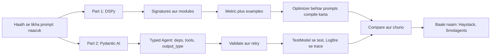
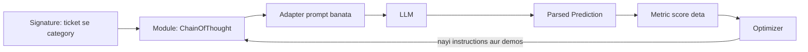
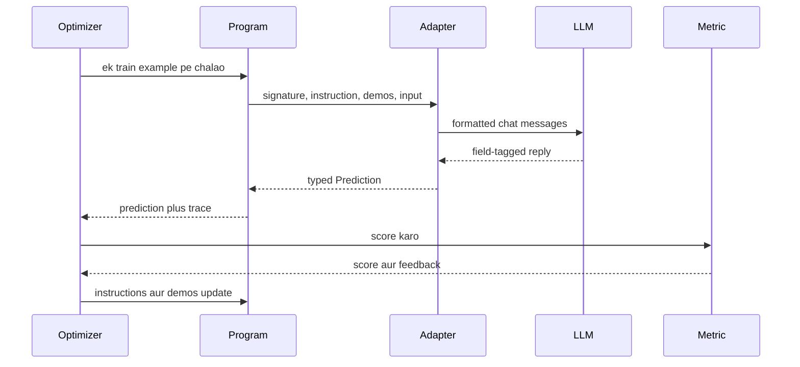
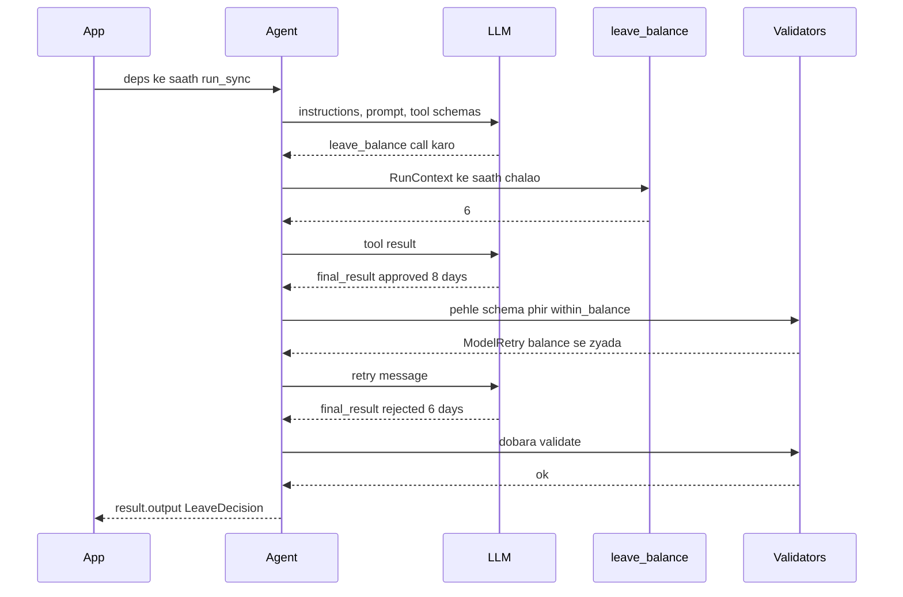

# DSPy and Pydantic AI

Do chhote Python frameworks jo do alag dard theek karte hain. DSPy (Stanford NLP se) tumhe LLM program typed modules ki tarah likhne deta hai aur phir metric ke against **prompts tumhare liye optimize karta hai**. Pydantic AI (Pydantic team se) agents waise banata hai jaise FastAPI APIs banata hai: **typed inputs, injected dependencies, validated outputs**. Interviewer ye isliye poochhte hain ki dekh sakein tumhe pata hai prompts haath se tune karne ki jagah seekhe ja sakte hain, aur agent output ko kisi bhi API ki tarah type-check kiya ja sakta hai.

Ye page DSPy 3.x (3.5 current hai) aur Pydantic AI 2.x (2.0 June 2026 me stable hua) ke hisaab se likha hai. Dono jaldi badalte hain, to code copy karne se pehle changelog dekh lo.

**Is page ke baad tum ye jawab de paoge:**
- "DSPy me 'programming, not prompting' ka matlab kya hai?"
- "DSPy signature kya hai, aur prompt se kaise alag hai?"
- "BootstrapFewShot vs MIPROv2 vs GEPA: har optimizer kya badalta hai?"
- "DSPy optimization sach me kab faayda deta hai, aur kab waste hai?"
- "Pydantic AI output ki shape kaise guarantee karta hai, aur model galat de to kya hota hai?"
- "Pydantic AI me dependency injection kya hai, aur isse agents testable kyun bante hain?"
- "Real LLM call kiye bina agent ka unit test kaise karoge?"
- "DSPy vs Pydantic AI vs LangGraph: kis kaam ke liye kaunsa chunoge?"

## Pehle ye shabd samjho

Structured output aur prompt tuning me naye ho? Pehle [Structured Outputs and Prompt Optimization](17-structured-outputs-prompting.md) padho. Poora framework tour [Agent Frameworks and Tooling](19-agent-frameworks.md) me hai.

| Shabd | Simple matlab |
|---|---|
| DSPy | Python framework jahan tum batate ho LLM step kya leta aur kya deta hai, aur woh prompt likhta aur tune karta hai. |
| Signature | DSPy me input aur output fields ka declaration, jaise `ticket -> category`. Haath se likhe prompt ki jagah leta hai. |
| Module | DSPy building block jo signature ko ek fixed tarike se use karta hai, jaise `Predict` ya `ChainOfThought`. |
| Metric | Tumhara Python function jo ek output ko score deta hai, jaise category sahi to 1, warna 0. |
| Optimizer | DSPy algorithm jo prompt variants aur examples try karta hai aur metric pe jo best ho use rakhta hai. |
| Few-shot demo | Prompt me rakha hal kiya hua input-output example, jo model ko dikhata hai kya karna hai. |
| Compile | Program aur training examples pe optimizer chalana, taaki tuned program mile. |
| Pydantic | Python library jo data ko type-hinted classes (models) ke against validate karti hai. |
| Pydantic AI | Pydantic team ka agent framework, typed dependencies, tools aur validated outputs ke saath. |
| Dependency injection | DB connection jaisi cheezein run time pe tools me pass karna, global variables ki jagah. |
| `RunContext` | Woh object jo Pydantic AI tool ko milta hai; isme injected dependencies aur run info hoti hai. |
| `TestModel` | Pydantic AI ka fake model jo schema-valid data lautata hai, taaki tests bina LLM chalein. |
| Logfire | Pydantic ka observability product, OpenTelemetry (OTel, open tracing standard) pe bana. |
| ReAct | Loop jisme model sochta hai, tool chunta hai, result dekhta hai, aur kaam hone tak repeat karta hai. |

## Big picture

Dono frameworks ek hi kamzor jagah pe vaar karte hain: naazuk, haath se likha prompt. DSPy kehta hai: task ko typed fields me batao, examples aur metric do, aur optimizer ko prompt dhoondhne do. Pydantic AI kehta hai: prompt rakho, par agent ko types me lapeto taaki galat shapes pakdi jaayein aur retry ho, aur tools ko saaf injected dependencies milein. Part 1 DSPy hai, Part 2 Pydantic AI, phir dono ko padosiyon se compare karte hain aur baaki naam jo pehchanne chahiye unki list.



## ⭐ Part 1, DSPy: kya hai aur mental model

**Ek line me:** DSPy LLM pipeline ko chhote neural network jaisa treat karta hai: tum structure likhte ho (typed signatures wale modules), aur optimizer metric ke against prompts aur examples ko "train" karta hai.

**Ye kyun chahiye:** Haath se likhe prompts toot jaate hain jab model, data ya pipeline ka ek step badalta hai. Teams din bhar wording badalti hain, bina kuch naape. DSPy, jo Stanford NLP me Omar Khattab aur saathiyon ne shuru kiya, is guesswork ko ek loop se badalta hai: declare, measure, optimize.

**Aise socho:** Naye Swiggy support agent ki coaching. Purana tarika: 3 page ki script pakda do aur ummeed karo. DSPy tarika: kaam batao ("ticket padho, category do"), 50 hal kiye tickets dikhao, unke jawab sahi ya galat mark karo, aur woh khud best tarika nikaal leta hai.

**Kaise kaam karta hai, step by step:**

1. Model configure karo: `dspy.configure(lm=dspy.LM("openai/gpt-5-mini"))`. DSPy neeche LiteLLM use karta hai, to zyada tar providers chalte hain.
2. Signature likho: inputs aur outputs, types aur optional docstring ke saath.
3. Use karne wala module chuno: `Predict` (seedha), `ChainOfThought` (reasoning field jodta hai), `ReAct` (tool loop).
4. Ek input pe chalao. DSPy ka adapter signature ko asli prompt banata hai aur reply ko wapas fields me parse karta hai.
5. 20 se 200 labelled examples jama karo aur metric likho.
6. Optimizer chalao (`compile`). Ye instructions aur few-shot demos try karta hai aur best score wale rakhta hai.
7. Optimized program JSON me save karo aur production me load karo.

Worked example: ticket classifier zero-shot `ChainOfThought` se 100 dev tickets pe 72% score karta hai. `BootstrapFewShot` 4 achhe demos jodta hai to 84%. `MIPROv2` instruction bhi rewrite kare to 88%. (Numbers samjhane ke liye hain; asli gain task aur data pe depend karta hai.)



**"Programming, not prompting":** tum code badalte ho (fields, modules, metric), prose nahi. Sasta model lena ho to haath se prompts dobara likhne ki jagah `compile` dobara chalate ho.

**Interview tip:** "DSPy 30 second me samjhao." Bolo: "Har LLM step ko modules ke andar typed signature ki tarah declare karte ho, PyTorch ke layers jaisa. Metric aur kuch examples dete ho. Optimizer instructions aur few-shot demos search karta hai taaki metric maximum ho. Prompt ek learned artifact ban jaata hai jise model badalne pe dobara compile kar sakte ho."

**Common galti:**
- Sochna ki DSPy LangGraph jaisa agent runtime hai. Isme na checkpointer hai, na human-in-the-loop, na server. Ye prompt-program compiler hai.
- Bina asli metric ke optimizer chalana. Kachra metric, kachra prompt.

## ⭐ Signatures

**Ek line me:** Signature batata hai kya andar jaata hai aur kya bahar aata hai, naam aur types ke saath; DSPy usse prompt banata hai.

**Ye kyun chahiye:** Field names aur types me matlab chhupa hota hai. `question -> answer` hi model ko kaafi bata deta hai. Types se DSPy outputs ko asli Python values (`bool`, `Literal`, Pydantic model) me parse karta hai, strings me nahi.

**Aise socho:** Sarkari form jisme labelled boxes hain. "Naam", "PIN code (6 digits)". Har box ke liye instructions nahi likhte; labels hi kaam kar dete hain.

**Kaise kaam karta hai, step by step:**

1. **Inline signature:** `"ticket -> category"` ya `"question, context -> answer"`. Jaldi kaam ke liye achha.
2. **Class signature:** `dspy.Signature` subclass karo. Docstring task instruction banti hai. Har field `dspy.InputField()` ya `dspy.OutputField()` hai, optional `desc=...` ke saath.
3. **Types:** `str`, `int`, `bool`, `list[str]`, `Literal["a", "b"]`, ya Pydantic models. DSPy parsed output validate karta hai.
4. Adapter (default `ChatAdapter`, ya `JSONAdapter`) fields ko messages me format karta hai aur reply parse karta hai.

```python
from typing import Literal
import dspy

class TriageTicket(dspy.Signature):
    """Classify a food-delivery support ticket."""
    ticket: str = dspy.InputField()
    category: Literal["refund", "late_delivery", "wrong_item", "other"] = dspy.OutputField()
    urgent: bool = dspy.OutputField(desc="true if the customer is angry or food is unsafe")
```

**Code me kya ho raha hai:**
- Docstring instruction hai; optimizer baad me ise rewrite kar sakta hai.
- `Literal[...]` `category` ko chaar labels tak seemit karta hai, to kuch aur aaye to parsing zor se fail hoti hai.
- `desc` poora prompt likhe bina ek field ko chhota hint deta hai.

**Interview tip:** "Signature vs prompt?" Bolo: "Prompt ek string hai. Signature ek typed interface hai. DSPy interface se string generate aur tune karta hai, to interface stable rehta hai aur prompt har model ke hisaab se badal sakta hai."

**Common galti:**
- Poora prompt docstring me thoons dena. Ek-do line rakho aur optimizer ko sudharne do.

## ⭐ Modules: Predict, ChainOfThought, ReAct

**Ek line me:** Modules signature use karne ki strategies hain: seedha jawab, pehle socho, ya tools ke saath loop; inhe `dspy.Module` me PyTorch layers ki tarah jodte ho.

**Ye kyun chahiye:** Ek hi task alag tariko se hal ho sakta hai. Strategy badalna ek line ka kaam hona chahiye, naya prompt nahi.

**Aise socho:** Exam ka ek sawal teen tarah: seedha jawab bolo (Predict), working dikhao phir jawab (ChainOfThought), ya steps ke beech library me cheezein dekho (ReAct).

**Kaise kaam karta hai, step by step:**

1. **`dspy.Predict(sig)`:** ek LLM call, output fields bharta hai.
2. **`dspy.ChainOfThought(sig)`:** asli outputs se pehle `reasoning` output field jodta hai. `pred.reasoning` padh sakte ho.
3. **`dspy.ReAct(sig, tools=[...], max_iters=20)`:** tool loop. DSPy ek `finish` tool jodta hai taaki model ruk sake.
4. **Apna module:** `dspy.Module` subclass karo, `__init__` me sub-modules banao, aur `forward()` me call karo. Optimizers andar ke har sub-module ko tune karte hain.
5. Baaki kaam ke modules: `dspy.Refine` aur `dspy.BestOfN` (reward function ke saath retry). 2.6 me inhone purane `dspy.Assert` / `dspy.Suggest` ki jagah li.

| Module | LLM calls | Kab use karo |
|---|---|---|
| `Predict` | 1 | simple extraction ya labels |
| `ChainOfThought` | 1 (lamba output) | reasoning se accuracy badhe |
| `ReAct` | har step 1, `max_iters` tak | task ko tools chahiye |
| custom `Module` | parts ka jod | RAG jaise multi-step pipelines |

```python
def order_status(order_id: str) -> str:
    """Return delivery status for an order id."""
    return {"8812": "picked up, ETA 25 min"}.get(order_id, "not found")

class SupportBot(dspy.Module):
    def __init__(self):
        super().__init__()
        self.triage = dspy.ChainOfThought(TriageTicket)
        self.agent = dspy.ReAct("ticket, category -> reply", tools=[order_status], max_iters=5)

    def forward(self, ticket: str):
        t = self.triage(ticket=ticket)
        return self.agent(ticket=ticket, category=t.category)
```

**Code me kya ho raha hai:**
- Do-step program banta hai: ticket classify karo, phir ReAct agent tool use karke reply likhta hai.
- `order_status` apne naam, type hints aur docstring se tool ban jaata hai.
- `max_iters=5` tool loop pe cap lagata hai taaki confused model hamesha loop na kare.
- Optimizer ek end-to-end metric ke against `triage` aur `agent` dono ko saath tune kar sakta hai.

**Interview tip:** "`ChainOfThought` prompt trick ki jagah module kyun hai?" Bolo: "Kyunki tab ye swappable aur optimizable hai. Ek line me `Predict` ko `ChainOfThought` kar sakta hoon, dobara compile karke gain ko extra output tokens ke against naap sakta hoon."

**Common galti:**
- Har jagah `ChainOfThought`. Reasoning me output tokens lagte hain; aasaan labels ke liye `Predict` aksar utna hi accurate aur sasta hota hai.

## ⭐ Metrics aur optimizers: compile

**Ek line me:** Metric outputs ko score karta hai; optimizer program ko training examples pe chalata hai, achha score karne wala rakhta hai, aur behtar instructions aur few-shot demos ke saath tuned copy lautata hai.

**Ye kyun chahiye:** Metric ke bina "behtar prompt" sirf ek raay hai. Metric aur examples ke saath prompt ka kaam ek search problem ban jaata hai jo computer raat bhar chala sakta hai.

**Aise socho:** Bowling machine aur scoreboard wala cricket coach. Ek grip try karo, achhi deliveries gino, best grip rakho.

**Kaise kaam karta hai, step by step:**

1. **Data:** `dspy.Example(ticket=..., category=..., urgent=...).with_inputs("ticket")`. Train (jaise 50) aur dev (jaise 100) me baanto.
2. **Metric:** `def metric(example, pred, trace=None)` bool ya float lautata hai. Fuzzy outputs ke liye LLM judge call kar sakta hai.
3. **Baseline:** `dspy.Evaluate(devset=dev, metric=metric)(program)` shuruaati score deta hai.
4. **Optimizer:** ek chuno aur `compile` karo.
5. **Dev pe dobara evaluate** karo. Optimized program tabhi rakho jab baseline se behtar ho.
6. **Save:** `optimized.save("triage.json")`; baad me `program.load("triage.json")`.

| Optimizer | Kya badalta hai | Kitna data | Cost (lagbhag) |
|---|---|---|---|
| `LabeledFewShot` | labelled examples demos ki tarah jodta hai | kuch labels | koi extra LLM call nahi |
| `BootstrapFewShot` | program chalata hai, metric pass karne wale traces demos banata hai | 10 se 50 examples | kam: har example ke liye lagbhag ek run |
| `MIPROv2` | instructions aur demo sets propose karta hai, phir Bayesian optimization se combos search karta hai | 50 se 300 examples | medium: das se sau calls (`auto="light"/"medium"/"heavy"`) |
| `GEPA` | metric ke text feedback se failures pe reflect karke instructions evolve karta hai | chhote sets chalte hain | medium se high; strong `reflection_lm` chahiye |
| `BootstrapFinetune` | achhe traces se model weights fine-tune karta hai | sau se zyada traces | training cost |

**GEPA ek paragraph me:** GEPA (Genetic-Pareto, DSPy 3.0 me aaya) tumhare metric se score **aur ek line ka feedback** maangta hai, jaise "Galat: ye late_delivery hai, customer ETA bol raha hai". Ek strong reflection model failures plus feedback padhke instruction rewrite karta hai. Ye sirf ek best nahi, candidates ka Pareto set rakhta hai (jo alag examples pe achhe hain). Aksar search-based methods se kam runs lagte hain kyunki feedback batata hai *kyun* fail hua.

```python
def metric_with_feedback(gold, pred, trace=None, pred_name=None, pred_trace=None):
    ok = gold.category == pred.category
    fb = "Correct." if ok else f"Expected {gold.category}, got {pred.category}."
    return dspy.Prediction(score=float(ok), feedback=fb)

gepa = dspy.GEPA(metric=metric_with_feedback, auto="light",
                 reflection_lm=dspy.LM("openai/gpt-5", temperature=1.0, max_tokens=16000))
tuned = gepa.compile(dspy.ChainOfThought(TriageTicket), trainset=train, valset=dev)
```

**Code me kya ho raha hai:**
- Metric score plus ek feedback line lautata hai; GEPA woh line reflection model ko deta hai.
- `auto="light"` chhota budget set karta hai; `"heavy"` behtar results ke liye lamba search karta hai.
- `reflection_lm` strong model hai jo sirf optimization me use hota hai, serving me nahi.

**Interview tip:** "BootstrapFewShot vs MIPROv2 vs GEPA?" Bolo: "Bootstrap sirf tumhare apne successful runs se achhe demos chunta hai: sasta, achha pehla step. MIPROv2 candidate instructions bhi likhta hai aur Bayesian optimization se combinations search karta hai. GEPA failures ke text feedback aur reflection model se instructions evolve karta hai; jab metric errors explain kar sake tab strong hai."

**Common galti:**
- Jin examples pe optimize kiya unhi pe evaluate karna. Overfit hoga aur khud ko dhokha doge. Alag held-out dev set rakho.
- Optimization ka bill bhool jaana: `heavy` run hazaaron LLM calls ho sakta hai. Budget set karo.

## ⭐ Ek poori chhoti DSPy app: Swiggy ticket triage

**Ek line me:** Support tickets ko chaar categories me classify karo, accuracy naapo, `BootstrapFewShot` se optimize karo, save karo, aur production me load karo.

**Ye kyun chahiye:** Ticket routing classic DSPy jeet hai: saaf label, naapna sasta, aur helpdesk history me bahut examples.

**Aise socho:** Naya joinee jo 50 purane tickets sahi jawab ke saath padhta hai aur sorting me kaafi behtar ho jaata hai.

**Kaise kaam karta hai, step by step:**

1. Sasta model configure karo aur data define karo (block 1).
2. Baseline, optimize, compare, save (block 2).
3. API server me saved program load karo (block 2 ka end).

Block 1: setup aur data.

```python
import dspy
dspy.configure(lm=dspy.LM("openai/gpt-5-mini"))      # koi bhi LiteLLM model string chalegi

rows = [
    ("Paid ₹640 but food never came", "refund", True),
    ("Rider is 40 minutes late, where is he?", "late_delivery", False),
    ("Got paneer instead of chicken biryani", "wrong_item", False),
    ("How do I change my saved address?", "other", False),
    # ... asli me helpdesk se export kiye 150+ rows
]
data = [dspy.Example(ticket=t, category=c, urgent=u).with_inputs("ticket") for t, c, u in rows]
train, dev = data[:50], data[50:]

def metric(gold, pred, trace=None):
    return gold.category == pred.category and gold.urgent == pred.urgent
```

**Code me kya ho raha hai:**
- `dspy.configure` se poore program ke liye ek model set hota hai.
- Har labelled row `dspy.Example` me wrap hoti hai aur sirf `ticket` input mark hota hai.
- Metric ko dono fields sahi chahiye; optimizer isi bar ko pakadne ki koshish karega.

Block 2: naapo, optimize karo, save, load.

```python
program = dspy.ChainOfThought(TriageTicket)            # Signatures section wala signature
evaluate = dspy.Evaluate(devset=dev, metric=metric, num_threads=8, display_progress=True)
print("baseline:", evaluate(program))

optimizer = dspy.BootstrapFewShot(metric=metric, max_bootstrapped_demos=4, max_labeled_demos=4)
optimized = optimizer.compile(program, trainset=train)
print("optimized:", evaluate(optimized))

optimized.save("triage.json")                       # instructions + demos JSON me

# API server me
serving = dspy.ChainOfThought(TriageTicket)
serving.load("triage.json")
pred = serving(ticket="Order 8812 has a cockroach in it!")
print(pred.category, pred.urgent)                   # jaise refund True
dspy.inspect_history(n=1)                           # last exact prompt print karo
```

**Code me kya ho raha hai:**
- Pehle zero-shot program score hota hai, taaki pata chale optimization se faayda hua ya nahi.
- `BootstrapFewShot` training tickets pe program chalata hai, pass hone wale traces demos ki tarah rakhta hai (4 tak), aur naya program lautata hai.
- `save` learned prompt state JSON file me likhta hai jise Git me version kar sakte ho.
- `inspect_history` DSPy ka bheja asli prompt dikhata hai, yahi tumhara main debugging tool hai.

**Interview tip:** "DSPy program ship kaise karte ho?" Bolo: "Offline compile karo, saved JSON ko code ke saath version karo, startup pe load karo, aur model ya data badle to CI me dobara compile karo, promote tabhi jab dev score badhe."

**Common galti:**
- Request path me compile karna. Optimization offline job hai; serving sirf saved state load karti hai.

## DSPy andar kaise kaam karta hai

**Ek line me:** Run time pe adapter signature plus learned instructions plus demos ko chat messages me badalta hai aur reply parse karta hai; compile time pe optimizer program bahut baar chalata hai, traces record karta hai aur woh learned state rewrite karta hai.

**Ye kyun chahiye:** Ye samajh ke tum jawab de paoge "prompt kahan hai?" aur "optimizer ne exactly kya badla?".

**Aise socho:** Recipe card (signature) plus perfect plates ki kuch photos (demos), waiter (adapter) cook (LLM) ko deta hai, aur waiter hi check karta hai ki plate order se match karti hai.

**Kaise kaam karta hai, step by step:**

1. Module ke andar har `Predict` state rakhta hai: signature ki instruction aur demos ki list.
2. Call pe adapter field descriptions aur instruction ke saath system message likhta hai, demos ko example turns ki tarah jodta hai, phir asli input.
3. LLM field-tagged format me reply karta hai (ya `JSONAdapter` ke saath JSON). Adapter use parse aur type-check karke `Prediction` banata hai.
4. `compile` ke dauran optimizer train examples pe program chalata hai aur **trace** record karta hai (har predictor ke inputs aur outputs).
5. Metric pass karne wale traces candidate demos bante hain; MIPROv2 aur GEPA nayi instruction text bhi propose karte hain.
6. Optimizer winners ko har predictor ki state me wapas likhta hai. `save` yahi state likhta hai.



**Interview tip:** "Optimized artifact me kya hota hai?" Bolo: "Har predictor ke liye instruction text aur chune hue few-shot demos, JSON me saved. Weights tab tak nahi badalte jab tak fine-tuning optimizer use na karun."

**Common galti:**
- Maan lena ki optimized program doosre model pe perfectly chalega. Demos aur wording compile wale model ke liye tuned hain; switch pe dobara compile karo.

## DSPy kab faayda deta hai, kab nahi

**Ek line me:** DSPy tab faayda deta hai jab task naapne layak ho, labelled examples hon, aur pipeline bade volume pe chalni ho ya models ke beech move karni ho; one-off prompt ya jo task score na ho sake uske liye overkill hai.

**Ye kyun chahiye:** Optimizer runs me time aur paisa lagta hai. Rule chahiye ki kab ye kharch wapas aata hai.

**Aise socho:** Bowling machine kharidna cricket academy ke liye theek hai, ek Sunday match ke liye nahi.

**Kaise kaam karta hai, step by step:**

1. Poochho: kya output ko automatically score kar sakta hoon (exact label, numeric check, ya bharosemand LLM judge)? Nahi to ruk jao.
2. Poochho: kya 30+ examples hain, ya ek din me label kar sakta hoon? Nahi to pehle label karo.
3. Poochho: kya ye hazaaron baar chalega, ya aise model pe jo badal sakta hai? Haan to ek baar ka compile cost har call pe chhota hai.
4. Compile cost ka andaaza lagao. Example: 100 examples pe `MIPROv2 auto="light"` kuch sau LLM calls le sakta hai; chhote model pe lagbhag ₹0.10 per call = kuch das rupaye. Bade reflection model ke saath `heavy` GEPA run kaafi zyada ho sakta hai.

| Achha fit | Kharab fit |
|---|---|
| classification, extraction, routing | creative writing jahan "sahi" saaf nahi |
| multi-step RAG jahan answers score ho sakein | one-off scripts |
| pipeline ko saste model pe le jaana | na labelled data na judge |
| teams me kai milte-julte prompts | durable state aur approvals wale long-running agents |

**Interview tip:** "Hamare support chatbot ke liye DSPy use karoge?" Bolo: "Naapne layak hisson ke liye haan: intent routing aur field extraction, jahan tickets label karke accuracy score kar sakun. Approvals wale conversational agent loop ke liye orchestration framework use karunga aur shayad uske andar DSPy modules call karunga."

**Common galti:**
- Ummeed karna ki DSPy kharab task definition theek kar dega. Agar insaan hi labels pe sehmat nahi, koi optimizer madad nahi karega.

## ⭐ Part 2, Pydantic AI: kya hai aur mental model

**Ek line me:** Pydantic AI "agents ke liye FastAPI" hai: `Agent` apni dependencies aur output se typed hota hai, tools ko `RunContext` se dependencies inject hoti hain, aur final jawab Pydantic model ke against validate (aur retry) hota hai.

**Ye kyun chahiye:** Zyada tar LLM app bugs boundaries pe hote hain: JSON ka missing field, number ki jagah string, ya tool jo global DB connection pakad leta hai aur test nahi ho pata. Pydantic team (jiski validation library zyada tar Python AI SDKs ke neeche baithi hai) ne aisa agent framework banaya jo Python types se ye galtiyan jaldi pakadta hai.

**Aise socho:** Swiggy order form jisme required, typed fields hain. Valid PIN code ke bina submit nahi hota. Model galat bhare to form error ke saath wapas aata hai aur dobara maangta hai.

**Kaise kaam karta hai, step by step:**

1. `Agent("provider:model", deps_type=..., output_type=..., instructions=...)` banao.
2. Tools `@agent.tool` (`RunContext` milta hai) ya `@agent.tool_plain` (bina context) se register karo.
3. `agent.run(...)` (async), `run_sync`, `run_stream` ya `run_stream_events` se chalao, `deps=` pass karke.
4. Model tools call kar sakta hai. Pydantic AI tool arguments ko function signature ke against validate karta hai; galat args retry prompt banke model ko wapas jaate hain.
5. Final jawab `output_type` ke against validate hota hai. Fail hone pe error text wapas jaata hai aur model dobara try karta hai (retry limit tak).
6. Tumhe `result.output` asli typed object ki tarah milta hai, plus `result.usage` aur poori message history.

**2.0 me kya badla:** capabilities (instructions, tools aur hooks ke bundles, `Agent(capabilities=[...])` se jude) aur alag Pydantic AI Harness package; `MCPServerStdio` jaise classes ab `MCPToolset`; `mcp_servers=` ab `toolsets=`; `Agent("gpt-5")` jaise bare model names ab error dete hain, to hamesha `provider:model` likho; `openai:` ab OpenAI ki Responses API use karta hai (Chat Completions ke liye `openai-chat:`); `result.usage` ab property hai; `pydantic_graph.beta` top-level `pydantic_graph` me aa gaya. Upgrade raasta: pehle latest 1.x pe jao aur deprecation warnings saaf karo.

**Interview tip:** "Pydantic AI 30 second me?" Bolo: "Agent framework jahan sab typed hai. Dependencies `RunContext` se aati hain, to tools testable hain. Output Pydantic model hai jo validate hota hai aur fail pe retry. Model-agnostic hai, Logfire ke through OpenTelemetry se trace karta hai, aur tests `TestModel` pe bina API calls chalte hain."

**Common galti:**
- Sochna ki validation matlab correctness. Valid `refund_amount=640` bhi galat order ka ho sakta hai. Business checks jodo.

## ⭐ Building blocks: Agent, deps, output types, tools, models

**Ek line me:** Paanch pieces: `Agent`, injected resources ke liye `deps_type`, validated results ke liye `output_type`, `ctx.deps` padhne wale tools, aur provider chunne wali model string.

**Ye kyun chahiye:** Har piece ek tarah ka bug hatata hai: globals (deps), shape errors (output types), untyped tool args (tools), aur provider lock-in (model strings).

**Aise socho:** Restaurant kitchen. Order slip ka format (output type), har station tak pahunchne wale ingredients aur gas line (deps), saaf inputs wale stations (tools), aur head chef jo badla ja sake (model).

**Kaise kaam karta hai, step by step:**

1. **Deps:** aksar dataclass (`DB connection`, `http client`, `user_id`). `deps_type` type checking ke liye hai; instance run time pe `deps=` se pass hota hai.
2. **Instructions:** static `instructions="..."`, ya `@agent.instructions` decorator wala function jo `ctx.deps` padhe (jaise user ka naam daale).
3. **Output types:** Pydantic model, `bool` jaisa primitive, list, ya `Approved | Rejected` jaisa union. Output modes: tool output (default), native structured output, ya prompted output.
4. **Tools:** `@agent.tool` functions pehle `ctx: RunContext[Deps]` lete hain. Docstrings descriptions banti hain. Model se call theek karwane ke liye `ModelRetry("message")` raise karo.
5. **Output validators:** `@agent.output_validator` schema validation ke baad tumhara business check chalata hai aur `ModelRetry` raise kar sakta hai.
6. **Models:** `"openai:gpt-5.2"`, `"anthropic:..."`, `"google:..."` aur aur; errors pe doosra provider try karne ke liye `FallbackModel` bhi.
7. **Toolsets aur MCP:** `toolsets=[MCPToolset(...)]` MCP servers lagata hai; `FunctionToolset` reuse ke liye tools group karta hai.

| Piece | Kya pakadta hai |
|---|---|
| `deps_type` + `RunContext` | chhupe globals, untestable tools |
| `output_type` | missing fields, galat types |
| `@agent.output_validator` | valid par galat business values |
| `ModelRetry` | galat tool args jo model theek kar sake |
| model string ya `FallbackModel` | provider outage, lock-in |

**Interview tip:** "Agent ke liye dependency injection kyun?" Bolo: "Tools ko DB, HTTP client aur current user chahiye. Injection se wahi agent production me real DB aur tests me fake DB ke saath chalta hai, aur user ID mere auth layer se aata hai, model se nahi."

**Common galti:**
- Model ko `user_id` tool argument ki tarah pass karne dena. Prompt-injected model doosre user ka data maang sakta hai. Identity `ctx.deps` se lo.

## ⭐ Ek poori chhoti Pydantic AI app: HR leave bot

**Ek line me:** HR bot jo injected DB se employee ka leave balance padhta hai, typed `LeaveDecision` lautata hai, business rule enforce karta hai, aur `TestModel` se unit-tested hai.

**Ye kyun chahiye:** Yahi core Pydantic AI pattern hai: typed deps andar, typed decision bahar, rules code me, tests bina LLM.

**Aise socho:** HR executive jo leave register (deps) check karta hai, fixed approval form (output type) bharta hai, aur jiska manager balance se zyada din approve karne wala har form reject karta hai (validator).

**Kaise kaam karta hai, step by step:**

1. Deps aur output model define karo (block 1).
2. Agent, ek tool aur validator banao (block 1).
3. Real deps ke saath chalao (block 2).
4. `TestModel` aur fake deps se test karo (block 3).

Block 1: agent, tool aur validator.

```python
from dataclasses import dataclass
from pydantic import BaseModel, Field
from pydantic_ai import Agent, ModelRetry, RunContext

@dataclass
class HRDeps:
    employee_id: str          # login se aata hai, model se kabhi nahi
    db: dict                  # asli DB client ki jagah

class LeaveDecision(BaseModel):
    approved: bool
    days: int = Field(ge=0, le=30)
    reason: str

agent = Agent("openai:gpt-5.2", deps_type=HRDeps, output_type=LeaveDecision,
              instructions="Decide leave requests using the employee's balance. Be brief.")

@agent.tool
async def leave_balance(ctx: RunContext[HRDeps]) -> int:
    """Remaining paid leave days for the current employee."""
    return ctx.deps.db[ctx.deps.employee_id]["balance"]

@agent.output_validator
async def within_balance(ctx: RunContext[HRDeps], out: LeaveDecision) -> LeaveDecision:
    if out.approved and out.days > ctx.deps.db[ctx.deps.employee_id]["balance"]:
        raise ModelRetry("Approved days exceed the balance. Re-check leave_balance.")
    return out
```

**Code me kya ho raha hai:**
- `HRDeps` me employee ID aur DB hai; tool inhe `ctx.deps` se padhta hai, to model koi doosra employee nahi chun sakta.
- `LeaveDecision` output ki shape tay karta hai; `Field(ge=0, le=30)` validation pe bekaar values reject karta hai.
- Validator asli rule enforce karta hai aur rule toote to model ko saaf message ke saath wapas bhejta hai.

Block 2: chalao.

```python
db = {"E101": {"name": "Asha", "balance": 6}}
result = agent.run_sync("I need 8 days off for my sister's wedding in Jaipur.",
                        deps=HRDeps(employee_id="E101", db=db))
print(result.output)        # LeaveDecision(approved=False, days=6, reason='Only 6 days left...')
print(result.usage)         # tokens aur request counts (2.x me property)
```

**Code me kya ho raha hai:**
- Run time pe real deps pass hoti hain; agent code me koi global nahi.
- `result.output` validated `LeaveDecision` hai, HR system me likhne ko taiyaar.
- `result.usage` cost tracking ke liye tokens aur requests deta hai.

Block 3: bina LLM ke test.

```python
from pydantic_ai import models
from pydantic_ai.models.test import TestModel

models.ALLOW_MODEL_REQUESTS = False          # tests me koi bhi real LLM call ab fail hogi

def test_leave_agent_calls_tool_and_returns_decision():
    fake_db = {"E1": {"name": "Test", "balance": 30}}
    with agent.override(model=TestModel()):
        result = agent.run_sync("5 days please", deps=HRDeps("E1", fake_db))
    assert isinstance(result.output, LeaveDecision)
```

**Code me kya ho raha hai:**
- `ALLOW_MODEL_REQUESTS = False` CI me galti se hui real calls ko zor se fail karta hai.
- `TestModel` har tool call karta hai aur phir schema-valid output banata hai, to wiring, tools aur validation free me test hote hain.
- `agent.override` sirf `with` block ke andar model badalta hai; exact scripted replies ke liye `FunctionModel` use karo.

**Interview tip:** "LLM agent ka unit test kaise karte ho?" Bolo: "Fake deps inject karo, model ko `TestModel` ya scripted `FunctionModel` se badlo, real model requests block karo, aur tool calls aur typed output pe assert karo. Quality alag se real models pe evals se test hoti hai."

**Common galti:**
- Sirf real model se test karna. Tests slow, flaky aur mehnge ho jaate hain, aur wiring bugs model ki randomness ke peeche chhup jaate hain.

## Pydantic AI andar kaise kaam karta hai

**Ek line me:** Har run ek chhota graph hai (pydantic-graph pe bana): request banao, model call karo, tool calls chalao, final output validate karo, aur kisi bhi validation failure pe error text ke saath wapas loop karo.

**Ye kyun chahiye:** Loop samajhne se retries, token usage aur ye samajh aata hai ki jahan 1 model call socha tha wahan 3 kyun lagi.

**Aise socho:** Passport office counter. Form do, clerk check karta hai, ek field theek karne wapas bhejta hai, phir check karta hai, phir stamp lagata hai.

**Kaise kaam karta hai, step by step:**

1. Request banao: instructions, message history, user prompt, tool schemas, aur output tool (agar output mode tool output hai).
2. Model call karo (`ModelRequestNode`).
3. Response sambhalo (`CallToolsNode`): maange gaye tools chalao (jahan ho sake parallel me) aur unke args validate karo.
4. Model ne output tool call kiya ya final text diya to use `output_type` ke against validate karo, phir output validators chalao.
5. Koi bhi `ValidationError` ya `ModelRetry` model ke liye retry message ban jaata hai. Retries gine jaate hain; limit ke upar run error raise karta hai.
6. Success pe run `result.output` ke saath khatam hota hai.



Worked example: upar wale run me ek validator retry ki wajah se 2 ki jagah 3 model requests lagi. Agar 10% runs ek baar retry karein, to average requests har run lagbhag 0.1 badhti hain; traces me ye number dekhte raho.

**Interview tip:** "Model invalid JSON lautaye to kya hota hai?" Bolo: "Pydantic AI validation error pakadta hai, error details retry prompt ki tarah wapas bhejta hai, aur model dobara try karta hai. Retry limit ke baad raise karta hai, to main log karke fallback karta hoon."

**Common galti:**
- Kharab schema "theek" karne ke liye retry limit badhana. Har retry paid call hai. Schema simple karo.

## Pydantic AI ke saath production: Logfire, pydantic-graph, evals

**Ek line me:** Logfire ya kisi bhi OTel backend se trace karo, lambe multi-step flows ke liye pydantic-graph ya durable execution use karo, aur `pydantic_evals` se quality naapo.

**Ye kyun chahiye:** Production me type safety kaafi nahi. Har run dekhna padta hai, lambe workflows me restarts jhelne padte hain aur quality regressions pakadne padte hain.

**Aise socho:** Delivery fleet jisme har bike pe GPS (tracing), fixed route plan (graph), aur deliveries ka monthly audit (evals).

**Kaise kaam karta hai, step by step:**

1. **Tracing:** `logfire.configure()` phir `logfire.instrument_pydantic_ai()`. Har run, model call aur tool call tokens ke saath OTel span banta hai. OTel hai, to Langfuse, Phoenix ya Grafana pe bhi bhej sakte ho.
2. **Multi-agent:** ek agent ke tool se doosra agent call karo (agent delegation, limits share karne ke liye `usage=ctx.usage` pass karo), ya app code me handoff karo.
3. **pydantic-graph:** usi team ki typed graph library. Nodes dataclasses hain jinke `run()` ka return type agla node batata hai, ya `GraphBuilder` steps use karo. Explicit state machines ke liye.
4. **Durable execution:** Temporal, DBOS aur Prefect integrations se lambe runs crash jhel lete hain.
5. **Evals:** `pydantic_evals` me `Dataset` aur `Case` objects hain evaluators ke saath (exact match, LLM judge). CI me chalao.
6. **Limits:** `UsageLimits(request_limit=..., total_tokens_limit=...)` run pe cap lagata hai.

**Interview tip:** "Pydantic AI agent production-ready kaise banaoge?" Bolo: "Auth layer se typed deps, business rules ke liye output validators, `UsageLimits`, providers ke paar `FallbackModel`, Logfire ya OTel tracing, CI me `pydantic_evals`, aur runs lambe hon to durable execution."

**Common galti:**
- Pydantic AI me bada multi-agent graph banana jab flow ko bhaari human approvals aur time travel chahiye. Wahan LangGraph zyada mature hai.

## ⭐ Kab kaunsa, aur comparison

**Ek line me:** DSPy behtar karta hai ki model se kya poochhte ho; Pydantic AI call ko safe aur typed banata hai; LangGraph lambe, stateful flows orchestrate karta hai. Inhe jod bhi sakte ho.

**Ye kyun chahiye:** "Ye kyun, X kyun nahi?" core senior sawal hai. Ye do tools aksar confuse hote hain kyunki dono "structured LLM calls" ko chhute hain.

**Aise socho:** DSPy coach hai jo technique sudharta hai. Pydantic AI umpire hai jo har ball pe rules lagata hai. LangGraph match schedule aur scoreboard hai.

**Kaise kaam karta hai, step by step:**

1. Mushkil hissa naapne layak task pe prompt quality ho, to DSPy se shuru karo.
2. Mushkil hissa doosre code ko jaane wala reliable typed output aur testable tools ho, to Pydantic AI se shuru karo.
3. Mushkil hissa persistence aur approvals wala long-running control flow ho, to LangGraph (aur nodes ke andar in dono me se koi call karo).
4. Jaldi ek plain, provider-specific agent chahiye, to OpenAI Agents SDK jaisa SDK kaafi ho sakta hai.

| | DSPy | Pydantic AI | LangGraph | Instructor-style libraries |
|---|---|---|---|---|
| Core idea | signatures aur metric se prompts compile | DI aur validated output wala typed agent | explicit state graph | ek call se structured output |
| Prompts optimize karta | haan, main feature | nahi | nahi | nahi |
| Tools wala agent loop | `ReAct` module | haan, core | haan, tum banate ho | nahi |
| Persistence aur HITL | nahi | durable execution integrations se | built-in checkpointer, `interrupt()` | nahi |
| Testing story | dev set pe evaluate | `TestModel`, `FunctionModel`, DI | nodes ka unit test | mock client |
| Tracing | MLflow aur OTel integrations | Logfire / OTel | LangSmith / OTel | khud ka |
| Best fit | classification, extraction, RAG quality | agent output use karne wale APIs aur services | lambe, branching production flows | jaldi extraction |

**Baaki naam jo pehchanne chahiye:**

| Naam | Kaun | Ek line | Kab chuno |
|---|---|---|---|
| Haystack (`haystack-ai`) | deepset | search, RAG aur agents ke liye typed components ki pipelines | RAG-heavy apps jinhe explicit, serializable pipelines chahiye |
| Smolagents | Hugging Face | chhoti agent library jiska `CodeAgent` actions ki tarah Python code likhta hai | open models pe jaldi agents; code sandbox me chalao |
| Instructor | open source | LLM clients ko patch karta hai taaki retries ke saath Pydantic models lautayein | sirf typed extraction chahiye, agent nahi |

**Interview tip:** "DSPy vs Pydantic AI?" Bolo: "Alag problems. DSPy metric ke against optimization se prompt behtar karta hai. Pydantic AI call ko safe banata hai: typed deps, validated outputs, testable tools. Maine routing ke liye DSPy-compiled modules ek aisi service me use kiye hain jiski agent layer typed thi."

**Common galti:**
- Sab kuch ke liye ek framework chunna. Achhe system me aksar typed agent layer, ek orchestrator aur naapne layak steps ke liye optimizer hota hai.

## Common pitfalls

**Ek line me:** DSPy projects kamzor metrics aur data leaks pe fail hote hain; Pydantic AI projects over-complex schemas aur tool args me identity pe.

**Ye kyun chahiye:** Ye code reviews aur "kisi failure ke baare me batao" interview sawalon me aate hain.

**Aise socho:** Roz ke raaste ke jaane-pehchaane speed breakers.

**Kaise kaam karta hai, step by step:**

1. **DSPy, train-test leak:** same examples pe optimize aur score karna. Fix: alag dev set.
2. **DSPy, metric bahut dheela:** LLM judge jo sabko "achha" bolta hai. Fix: judge outputs ko human labels se spot-check karo.
3. **DSPy, bina re-compile model swap:** model A ke liye tuned demos model B ko nuksaan dete hain. Fix: dobara compile karke compare karo.
4. **DSPy, cost surprise:** bade reflection model ke saath `heavy` optimizer. Fix: `light` se shuru karo, `max_metric_calls` set karo.
5. **Pydantic AI, bade schemas:** 40 nested fields se retries. Fix: chhote models, steps me todo.
6. **Pydantic AI, model se identity:** tool arg me `user_id`. Fix: `ctx.deps` se lo.
7. **Pydantic AI, 2.x pe 1.x code:** `mcp_servers=`, `MCPServerStdio`, bare model names, `result.usage()` call ki tarah. Fix: upgrade guide follow karo; pehle 1.x deprecation warnings saaf karo.
8. **Dono, bina tracing:** asli prompt ya retries dikhte hi nahi. Fix: `dspy.inspect_history`, Logfire ya MLflow tracing.

**Interview tip:** "Tumhara DSPy program offline 92% aur production me 70% score kar raha hai. Kyun?" Bolo: "Shayad dev set production traffic se match nahi karta, ya train aur dev sets overlap hue. Main asli tickets sample karke label karunga, dobara evaluate karunga, aur production jaise data pe dobara compile karunga."

**Common galti:**
- Data ki problems ke liye framework ko dosh dena. Yahan zyada tar failures data aur metrics ke baare me hain, code ke nahi.

## Interview ke sawal

**Q: "Programming, not prompting" ka matlab?**
A: Program ka structure typed signatures wale modules ki tarah likhte ho, plus ek metric. Prompt text aur demos optimizer seekhta hai, haath se nahi likhe jaate, aur model badalne pe dobara seekhe ja sakte hain.

**Q: DSPy signature kya hai?**
A: Input aur output fields ka typed declaration, inline jaise `"ticket -> category"` ya docstring wali class. DSPy ka adapter ise prompt banata hai aur reply ko typed fields me parse karta hai.

**Q: Predict vs ChainOfThought vs ReAct?**
A: `Predict` seedha jawab deta hai. `ChainOfThought` pehle reasoning field jodta hai, jisme zyada output tokens lagte hain par mushkil tasks me madad milti hai. `ReAct` tools ke saath tab tak loop karta hai jab tak `finish` call na kare ya `max_iters` na aaye.

**Q: BootstrapFewShot vs MIPROv2 vs GEPA?**
A: Bootstrap successful traces ko demos ki tarah rakhta hai. MIPROv2 instructions bhi propose karta hai aur Bayesian optimization se combinations search karta hai. GEPA metric ke textual feedback aur reflection model se instructions evolve karta hai, candidates ka Pareto set rakhte hue.

**Q: DSPy kab worth nahi hai?**
A: Jab outputs score nahi kar sakte, examples nahi hain, prompt kabhi-kabhi chalta hai, ya mushkil problem prompt quality nahi balki orchestration aur state hai.

**Q: Compile ke baad DSPy kya save karta hai?**
A: Har predictor ke liye instruction aur chune demos, JSON me. Model weights tab tak nahi badalte jab tak fine-tuning optimizer use na karo.

**Q: Pydantic AI output shape kaise guarantee karta hai?**
A: Final jawab ko `output_type` ke against validate karta hai. Fail hone pe validation error retry prompt ki tarah model ko bhejta hai, limit tak, phir raise karta hai.

**Q: Schema validation pass hua par jawab galat hai. Ab?**
A: Business rules wala `@agent.output_validator` jodo jo `ModelRetry` raise kare, aur asli cases ke saath evals jodo. Validation shape check karta hai, sach nahi.

**Q: Pydantic AI me dependency injection kyun?**
A: Tools ko DB clients, HTTP clients aur user identity `ctx.deps` se milti hai. Isse secrets aur identity model ke haath se bahar rehte hain aur tests fakes pass kar sakte hain.

**Q: Pydantic AI agent ko bina LLM test kaise karoge?**
A: `agent.override(model=TestModel())` ya scripted `FunctionModel`, fake deps, aur `models.ALLOW_MODEL_REQUESTS = False` taaki CI me real calls fail hon.

**Q: Pydantic AI 2.0 me kya badla?**
A: Instructions, tools aur hooks ki composable units ki tarah capabilities; per-transport MCP classes ki jagah `MCPToolset` aur `mcp_servers=` ki jagah `toolsets=`; bare model names error; `openai:` Responses API use karta hai; `result.usage` property hai; `pydantic_graph.beta` top level pe aa gaya.

**Q: Refund bot ke liye DSPy vs Pydantic AI vs LangGraph?**
A: Approvals aur persistence wale poore flow ke liye LangGraph. Typed tool calls aur validated refund decision ke liye Pydantic AI. Labelled tickets hon to intent classifier optimize karne ke liye DSPy.

**Q: Galat labels de raha DSPy program kaise debug karoge?**
A: `dspy.inspect_history` se asli prompt aur demos dekho, check karo demos galat ya unrepresentative to nahi, kuch cases pe metric haath se check karo, phir behtar train set ke saath dobara compile karo.

**Q: Haystack aur Smolagents ek-ek line me?**
A: Haystack deepset ka search, RAG aur agents ke liye component-pipeline framework hai. Smolagents Hugging Face ki chhoti agent library hai jahan `CodeAgent` actions ki tarah Python code likhta hai, to use sandbox me chalao.

**Q: Schema change ke baad tumhare Pydantic AI agent ka cost double ho gaya. Kyun?**
A: Zyada validation retries. Har failed validation ek aur model call hai. Traces me retry counts dekho aur schema simple karo ya todo.

## Aage padho

- [Agent Frameworks and Tooling](19-agent-frameworks.md)
- [Structured Outputs and Prompt Optimization](17-structured-outputs-prompting.md)
- [OpenAI Agents SDK](27-openai-agents-sdk.md)
- [LangChain](23-langchain.md)

## Checklist

- [ ] "Programming, not prompting" aur DSPy ka compile loop samjha sakta hoon.
- [ ] Typed fields ke saath DSPy class signature likh sakta hoon.
- [ ] Predict, ChainOfThought aur ReAct kab use karne hain, bata sakta hoon.
- [ ] BootstrapFewShot, MIPROv2 aur GEPA aur unke cost compare kar sakta hoon.
- [ ] DSPy optimization kab faayda deta hai aur kab nahi, bata sakta hoon.
- [ ] Deps, ek tool aur typed output ke saath Pydantic AI agent bana sakta hoon.
- [ ] Validate-and-retry loop aur output validators samjha sakta hoon.
- [ ] TestModel aur fake deps se agent ka unit test kar sakta hoon.
- [ ] DSPy, Pydantic AI aur LangGraph compare kar sakta hoon aur Haystack aur Smolagents ka naam le sakta hoon.
