# Vector Databases in Practice

Is page pe un dedicated vector databases ka comparison hai jo teams sach me production me chalati hain: Pinecone, Qdrant, Weaviate, Milvus (aur Zilliz Cloud), Chroma, LanceDB aur turbopuffer. Embeddings, HNSW ya filtering ki basics yahan dobara nahi padhayenge. Wo [Vector Databases](../05-db/11-vector.md) me hai. Interviewer ye isliye poochhta hai taaki dekhe tum product kisi wajah se chun sakte ho, uska size nikaal sakte ho, aur production me bina surprise ke chala sakte ho.

Kis version pe likha hai (November 2026): Pinecone Python SDK v10 (API version 2026-07), Qdrant 1.17, Weaviate 1.3x with v4 Python client, Milvus 2.6 with `pymilvus`, Chroma 1.x, `lancedb` Python package, aur turbopuffer Python client 1.x. Ye products har mahine kuch naya ship karte hain. Code copy karne se pehle docs check karo.

**Is page ke baad tum ye jawab de paoge:**
- "50M-chunk multi-tenant RAG product ke liye Pinecone, Qdrant ya Milvus: kaunsa chunoge, aur kyun?"
- "10 million 1024-dim vectors ko kitni RAM chahiye, aur quantization se kya badalta hai?"
- "Vector DB ke liye 'serverless' ya 'object-storage-first' ka matlab kya hai, aur catch kya hai?"
- "Ek vector database me 10,000 customers ko alag kaise rakhoge?"
- "Team embedding model badal rahi hai. 20 million chunks zero downtime ke saath re-embed kaise karoge?"
- "Chunk likha aur turant search kiya, par wo mila nahi. Kyun?"
- "Pinecone se Qdrant pe migrate kaise karoge, aur shuru se lock-in se kaise bachoge?"
- "Dedicated vector DB kab galat choice hai?"

## Pehle ye shabd samjho

| Shabd | Simple matlab |
|---|---|
| Collection / index | Same size aur same distance metric wale vectors ka ek naam wala set. Table jaisa. |
| Record / point | Ek stored item: id, ek ya zyada vectors, aur metadata. |
| Metadata / payload | Record pe extra fields (tenant, language, date) jo filtering aur display me kaam aate hain. |
| Namespace / tenant | Collection ke andar ek hissa jo ek customer ka data baaki sab se alag rakhta hai. |
| Segment | Collection ke data ka ek tukda, apne chhote index ke saath. DB background me segments merge karta hai. |
| WAL | Write-ahead log: writes pehle yahan append hote hain taaki crash pe bhi bache rahein. |
| Object storage | Sasta, durable file storage jaise Amazon S3 ya Google Cloud Storage. Har request slow, capacity bahut badi. |
| Serverless | Tum use ke hisaab se pay karte ho (reads, writes, storage), machines ka size kabhi khud nahi chunte. |
| Quantization | Har vector number ko kam bits me rakhna (32 se 8 ya 1) taaki memory bache, thodi accuracy jaati hai. |
| Rescoring | Quantized search ke baad top candidates ko original full-precision vectors se dobara rank karna. |
| Sparse vector | Zyada tar zeros wala vector, har word ka ek slot. BM25 ki tarah keywords pakadta hai. |
| Hybrid search | Keyword (sparse/BM25) aur meaning (dense) search saath chalake results ko fuse karna. |
| Recall@K | Asli top K nearest items me se kitne DB ne sach me lautaye, uska fraction. |
| Cold / warm query | Cold matlab data object storage se padha (slow). Warm matlab data pehle se RAM ya SSD cache me (fast). |

## Big picture

Saaton products ek hi cheez store karte hain: id + vector + metadata, collections me grouped aur tenant ke hisaab se bante hue. Farak teen jagah hai: data kahan rehta hai (RAM, local SSD, ya object storage), machines kaun chalata hai (tum ya vendor), aur saath me kya extras milte hain (embedding models, BM25, reranking). Chunna zyada tar scale, tenancy ka shape, ops ki himmat aur cost model pe tikta hai. Page pehle common anatomy dikhata hai, phir har product, phir comparison, sizing example aur production concerns.

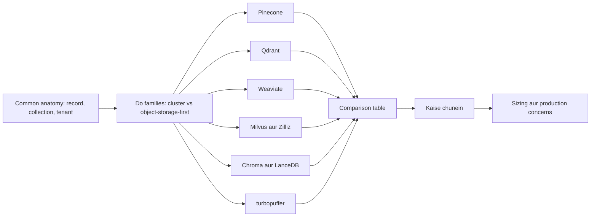

## ⭐ Dedicated vector DB kya extra deta hai

**Ek line me:** vector DB = ANN index + uske aas-paas wo sab jo ek database ko chahiye: durable writes, updates aur deletes, metadata filters, tenancy, replication, backups aur ek API.

**Ye kyun chahiye:** FAISS ya NumPy array fast nearest-neighbour search deta hai, par sirf ek process ke andar. Usme durable writes nahi, "is customer ka data delete karo" nahi, 20 fields pe filter nahi, replicas nahi, auth nahi. Jab RAG product ke paas bahut customers aur badalte documents hon, tab ye sab chahiye. Yahi gap ye products bharte hain.

**Aise socho:** FAISS ek tez chaaku hai. Vector DB poora restaurant kitchen hai: chaaku, plus fridge (storage), order tickets (WAL), har table ka alag section (tenants), aur safai wali team (compaction).

**Kaise kaam karta hai, step by step:**
1. **Write:** client `id + vector + metadata` bhejta hai. DB use WAL me append karta hai taaki durable ho, phir ek chhote "growing" segment me daalta hai.
2. **Naya likha data** us chhote segment me brute force se searchable hota hai, ya thodi der baad hi (yahin se "eventual consistency" aati hai).
3. **Background indexing:** segment kaafi bada ho jaaye to DB uske liye ANN index banata hai (HNSW, IVF, DiskANN, ya centroid index) aur use seal karta hai. Optimizers chhote segments merge karte hain aur deleted records hataate hain.
4. **Read:** query vector + filter har segment (aur har shard) pe jaata hai, har ek apna local top K lautata hai, aur DB unhe merge karke global top K banata hai.
5. **Deletes** pehle tombstones hote hain (dead mark, query pe skip), aur merge (compaction) ke time physically hat te hain.

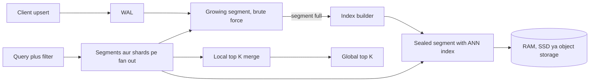

**Do architecture families.** Interview ke liye ye sabse kaam ka lens hai.

| | Cluster, memory/SSD-first | Object-storage-first (serverless) |
|---|---|---|
| Examples | Qdrant, Weaviate, Milvus (classic), Chroma local | Pinecone serverless, turbopuffer, Chroma Cloud, LanceDB on S3, Milvus 2.6 tiered storage |
| Data kahan rehta hai | Nodes ki RAM aur local SSD, jinka size tum (ya vendor) chunte ho | Object storage source of truth; RAM/SSD sirf cache |
| Latency | Kam aur steady (kuch ms) | Warm pe kam, cold pe sau-do sau ms se zyada |
| Cost ka shape | Nodes ka paisa 24x7, idle ho tab bhi | Stored GB + har read/write ka paisa; idle data sasta |
| Kiske liye best | Ek bade corpus pe steady high QPS | Bahut saare tenants, zyada tar idle; spiky traffic; bahut bada cold corpus |

**Interview tip:** "turbopuffer RAM-based cluster se sasta kyun hai?" Bolo: "Object storage per GB RAM ka chhota sa hissa padta hai. Zyada tar tenants idle hote hain, to wo unhe S3 pe rakhta hai aur sirf hot namespaces SSD pe cache karta hai. Keemat ye ki pehli (cold) query slow hoti hai."

**Common galti:**
- Vector DB ko source of truth maan lena. Original chunks aur metadata apne store (Postgres, S3) me rakho taaki index kabhi bhi dobara bana sako.

## ⭐ Pinecone

**Ek line me:** fully managed, closed-source vector database; index banao, namespaces me records likho, query karo, server kabhi dekhna nahi padta.

**Ye kyun chahiye:** bahut teams ko cluster chalaye bina vector search chahiye. Pinecone pehla bada managed option tha, aur aaj embedding, reranking aur full-text search bhi saath deta hai, taaki chhoti team ek vendor se RAG bana le.

**Aise socho:** Pinecone vectors ka Swiggy Instamart hai. Dark store kabhi nahi dikhta. Tum order dete ho (writes aur queries), aur har order aur shelf space ka paisa dete ho.

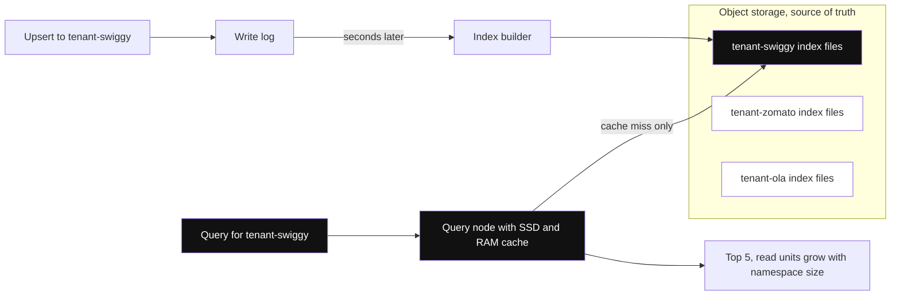

*Diagram:* Writes aur reads object storage ke upar alag raaste hain; query sirf apna namespace chhooti hai, aur indexing se pehle ka 'seconds later' gap hi eventual consistency hai.

**Kaise kaam karta hai, step by step:**
1. **History (interviewer "kya badla" poochhte hain):** Pinecone pod-based indexes se shuru hua, fixed-size machines (p1, s1, p2) jo tum chunte aur ghante ke hisaab se pay karte. 2024 me **serverless** indexes aaye, jo storage (object storage) ko compute se alag karte hain. 2026 me SDKs ne naye pod indexes banana band kar diya, aur pods se serverless ka migration path hai.
2. **Data model:** index → namespaces → records. Record me `_id`, dense aur/ya sparse vector, aur flat metadata hota hai. Python SDK v10 (API 2026-07) **schema-based document indexes** laata hai: index banate waqt searchable fields declare karte ho (`dense_vector`, `sparse_vector`, ya full-text search wala `string`). Jin fields pe sirf filter lagana hai unhe declare nahi karte; wo filtering ke liye apne aap index ho jaate hain.
3. **Serverless architecture:** writes ek log me jaate hain, object storage pe immutable index files ban jaati hain, aur query nodes hot files cache karte hain. Reads aur writes alag-alag scale hote hain. Naye records thodi der baad searchable hote hain (eventual consistency).
4. **Namespaces = tenants:** har namespace alag store aur search hota hai. Query sirf ek namespace padhti hai, to query ki cost us namespace ke size ke saath badhti hai. Har customer ka ek namespace isolation bhi deta hai aur cost bhi kam karta hai.
5. **Indexes:** Pinecone index types expose nahi karta. Tum dimension aur metric (cosine, dotproduct, euclidean) chunte ho; internal index wo khud chunta hai.
6. **Filtering aur hybrid:** MongoDB jaise metadata filters (`$eq`, `$in`, `$gt`, `$and`) search ke dauraan lagte hain. Hybrid search dense + sparse vectors se ho sakta hai (sparse indexes aur `pinecone-sparse-english-v0` model 2026 me GA hue), aur schema fields pe full-text search September 2026 me GA hua.
7. **Integrated inference:** Pinecone embedding model khud host kar sakta hai. Tum text bhejo, wo write aur query dono pe embed karta hai. Rerankers bhi host karta hai (jaise `bge-reranker-v2-m3`), jo `search()` ke andar ya `pc.inference.rerank` se chalte hain.
8. **Scaling options:** default on-demand serverless; **Dedicated Read Nodes** (April 2026 me GA) steady, high QPS ke liye read capacity reserve karte hain; **BYOC** (August 2026 me GA) data plane tumhare apne cloud account me chalata hai.
9. **Pricing model:** plan tiers (free Starter tier, paid tiers jinme monthly minimum ya flat fee) plus usage: har query pe **read units** (namespace size ke saath badhte hain), har upsert pe **write units**, storage per GB-month, aur inference per token. Exact prices yahan nahi; wo aksar badalte hain.

```python
from pinecone import DenseVectorQuery, Pinecone

pc = Pinecone()  # PINECONE_API_KEY env se padhta hai

# Ek baar ka setup: ek dense field wala serverless index
pc.indexes.create(
    name="support-docs",
    schema={"fields": {"embedding": {"type": "dense_vector", "dimension": 1024, "metric": "cosine"}}},
    deployment={"deployment_type": "managed", "cloud": "aws", "region": "us-east-1"},
)
index = pc.index("support-docs")

# Upsert: doc prefix wale deterministic ids, har tenant ka ek namespace
index.documents.upsert(
    namespace="tenant-swiggy",
    documents=[
        {"_id": "doc7#c0", "embedding": emb0, "lang": "hi", "doc_id": 7, "text": "Refund 5-7 din me aata hai"},
        {"_id": "doc7#c1", "embedding": emb1, "lang": "en", "doc_id": 7, "text": "Refunds take 5-7 days"},
    ],
)

# Sirf usi tenant ke andar filtered top-5 search
results = index.documents.search(
    namespace="tenant-swiggy",
    top_k=5,
    score_by=[DenseVectorQuery(field="embedding", values=query_emb)],
    filter={"lang": {"$eq": "en"}},
    include_fields=["text", "doc_id"],
)
for match in results.matches:
    print(match.id, match.score)
```

**Code kya karta hai:**
- v10 wale `pc.indexes.create(schema=..., deployment=...)` form se ek managed (serverless) index banata hai, jisme `embedding` naam ka 1024-dim cosine field hai.
- `tenant-swiggy` namespace me do chunks upsert karta hai. `lang`, `doc_id` aur `text` schema me nahi hain, to wo filterable metadata ki tarah store hote hain.
- `doc7#c0` jaise ids use karta hai, taaki baad me `doc7#` prefix wale saare ids list karke poora document delete kar sako.
- Sirf us tenant ke namespace me metadata filter ke saath search karta hai aur chune hue fields lautata hai.
- Purana code (`pc.create_index(..., spec=ServerlessSpec(...))`, `index.upsert(vectors=...)`, `index.query(...)`) v10 me deprecated sugar ki tarah ab bhi chalta hai.

**Kab chuno:** chhoti ya medium team, infra chalane ka mann nahi, per-tenant namespaces chahiye, embedding + rerank same vendor se chahiye, aur closed-source managed service se problem nahi.

**Interview tip:** "Pinecone me `tenant_id` filter ki jagah har tenant ka namespace kyun?" Bolo: "Query sirf apna namespace scan karti hai, to fast aur sasti hai, aur filter ka ek bug doosre tenant ka data leak nahi kar sakta. Customer delete karna ek namespace delete hai."

**Common galti:**
- Apna write turant padhna aur maan lena ki wo hoga. Serverless eventually consistent hai; "upload karke turant poochho" wale flow me processing state dikhao ya freshness ka wait karo.
- Ek bada shared namespace + tenant filter. Phir har query poore namespace ke read units deti hai.

## ⭐ Qdrant

**Ek line me:** Rust me likha open-source vector database, jo fast filtered search, rich payload indexing aur quantization se achhe memory control ke liye jaana jaata hai.

**Ye kyun chahiye:** real queries me lagbhag hamesha filters hote hain ("sirf ye tenant, sirf English, sirf last 30 din"). Jab filter zyada tar nodes hata de to plain HNSW graph toot jaata hai. Qdrant isi ke around bana: filtered vector search ko accurate aur fast banana, ek efficient binary me jo tum self-host kar sako.

**Aise socho:** Qdrant IRCTC search jaisa hai jo pehle proper index se train class aur date se narrow karta hai, phir bache hue me best seats dhoondhta hai, na ki saari seats search karke zyada tar phenk de.

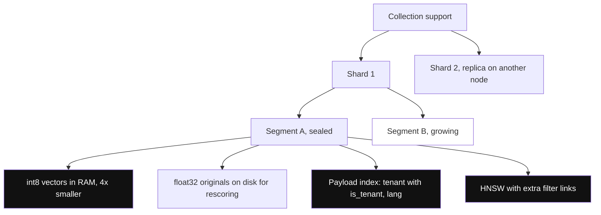

*Diagram:* Har sealed segment ke paas apne quantized vectors, disk pe originals, payload indexes aur HNSW hote hain; growing segment optimizer ke index karne tak brute force se search hota hai.

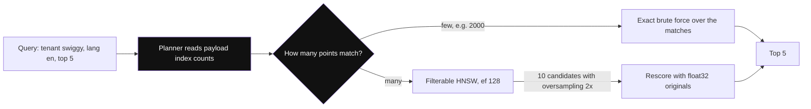

*Diagram:* Planner payload-index counts dekh ke chhote filtered set ke liye exact brute force chunta hai, aur bade set ke liye filter-aware HNSW plus rescoring.

**Kaise kaam karta hai, step by step:**
1. **Data model:** collection → points. Point me id (sirf unsigned integer ya UUID), ek ya zyada **named vectors** (dense, sparse, ya multi-vector), aur JSON **payload** hota hai.
2. **Storage:** collection → shards → segments. Har segment me vector storage, payload storage aur HNSW index hota hai. Optimizer background me segments merge karta aur indexes banata hai. Writes pehle WAL me jaate hain.
3. **Payload indexes:** jin fields pe filter lagate ho un pe khud index banate ho (`keyword`, `integer`, `float`, `datetime`, `geo`, `text`, `uuid`). Inke bina scale pe filters slow hote hain.
4. **Filterable HNSW:** indexed payload fields ke liye Qdrant extra graph links jodta hai taaki filter ke baad bhi graph connected rahe. Query planner payload-index cardinality dekhta hai: bahut selective filter matlab chhote matching set pe brute force; broad filter matlab filtered HNSW. Qdrant 1.16 ne mushkil multi-filter cases ke liye per query optional **ACORN** joda.
5. **Quantization:** scalar (int8, 4x chhota), binary (1-bit, 32x chhota; 1.5-bit aur 2-bit variants bhi), aur product quantization. Quantized vectors RAM me rehte hain; originals disk pe reh sakte hain oversampling ke saath **rescoring** ke liye.
6. **Hybrid:** har point pe ek dense aur ek sparse vector rakho, dono ko `prefetch` se chalao, aur ek Query API call me RRF (1.17 se weighted RRF) ya DBSF se fuse karo.
7. **Scaling:** sharding (automatic ya custom shard keys), `replication_factor`, cluster metadata ke liye Raft consensus. GPU-accelerated index building bhi available hai.
8. **Multi-tenancy:** aam taur pe ek collection jisme `tenant_id` payload index `is_tenant=True` ke saath, jo har tenant ka data saath rakhta hai. Qdrant 1.16 ne **tiered multitenancy** joda: chhote tenants shards share karte hain, bade tenant ko apna dedicated shard mil sakta hai.
9. **Hosting aur pricing model:** open source (Apache 2.0) self-host; Qdrant Cloud (managed, cluster ke resources pe billing: RAM, CPU, disk per hour, ek chhota free cluster); Hybrid Cloud (tumhara Kubernetes, unka control plane); Private Cloud (poora on-prem).

```python
import uuid
from qdrant_client import QdrantClient, models

client = QdrantClient(url="http://localhost:6333")

client.create_collection(
    "support",
    vectors_config=models.VectorParams(size=1024, distance=models.Distance.COSINE),
    quantization_config=models.ScalarQuantization(
        scalar=models.ScalarQuantizationConfig(type=models.ScalarType.INT8)
    ),
)
# Jin fields pe filter lagta hai unka index; tenant field ko co-location ke liye mark karo
client.create_payload_index("support", field_name="tenant",
    field_schema=models.KeywordIndexParams(type=models.KeywordIndexType.KEYWORD, is_tenant=True))
client.create_payload_index("support", field_name="lang", field_schema=models.PayloadSchemaType.KEYWORD)

def pid(s: str) -> str:  # Qdrant ids int ya UUID hi hone chahiye, to stable UUID banao
    return str(uuid.uuid5(uuid.NAMESPACE_URL, s))

client.upsert("support", wait=True, points=[
    models.PointStruct(id=pid("doc7#c1"), vector=emb1,
                       payload={"tenant": "swiggy", "lang": "en", "doc_id": 7, "text": "Refunds take 5-7 days"}),
])

res = client.query_points(
    "support", query=query_emb, limit=5,
    query_filter=models.Filter(must=[
        models.FieldCondition(key="tenant", match=models.MatchValue(value="swiggy")),
        models.FieldCondition(key="lang", match=models.MatchValue(value="en")),
    ]),
    search_params=models.SearchParams(hnsw_ef=128,
        quantization=models.QuantizationSearchParams(rescore=True, oversampling=2.0)),
)
for p in res.points:
    print(p.id, p.score, p.payload["text"])
```

**Code kya karta hai:**
- int8 scalar quantization ke saath 1024-dim cosine collection banata hai (search copy ke liye 4x kam RAM).
- `tenant` (tenant field mark karke) aur `lang` pe payload indexes banata hai, taaki filters fast hon aur planner selectivity ka andaza laga sake.
- String id `doc7#c1` ko stable UUID me badalta hai, kyunki Qdrant arbitrary string ids reject karta hai.
- `wait=True` ke saath upsert karta hai, to call tabhi lautti hai jab write apply ho chuka ho (read-your-writes).
- Do filters, recall ke liye `hnsw_ef=128`, aur quantization se gayi accuracy wapas laane ke liye 2x oversampling ke saath rescoring karke search karta hai.

**Kab chuno:** tum self-host karte ho ya predictable managed cluster chahiye, filters heavy aur important hain, RAM efficiency ki parwah hai, aur bina lock-in ka open source chahiye.

**Interview tip:** "Strict filter ke saath Qdrant recall kaise high rakhta hai?" Bolo: "Payload indexes planner ko batate hain kitne points match karte hain. Bahut kam hon to unhe exactly brute-force karta hai. Warna filter-aware HNSW pe chalta hai jisme har indexed field ke liye extra links hain, to graph bikharta nahi."

**Common galti:**
- Payload indexes banana bhool jaana, phir sochna ki 10M points pe filtered queries slow kyun hain.
- `"doc7#c1"` jaise string ids seedhe use karna. Qdrant sirf unsigned ints ya UUIDs leta hai.

## ⭐ Weaviate

**Ek line me:** Go me likha open-source vector database, jisme collections aur properties ka schema hai, built-in "vectorizer" modules jo tumhare liye embedding models call karte hain, aur first-class BM25 + vector hybrid search.

**Ye kyun chahiye:** bahut teams ko ek system chahiye jo objects store kare, unhe embed kare, keyword-search kare aur vector-search bhi kare. Weaviate ye sab ek typed schema aur strong native multi-tenancy ke saath deta hai.

**Aise socho:** Weaviate ek library hai jisme librarian bhi hai. Tum kitaabein (objects) do; librarian chune hue embedding model se catalogue cards (vectors) likhta hai, aur title ke words (BM25) aur topic (vectors) dono se ek saath dhoondh sakta hai.

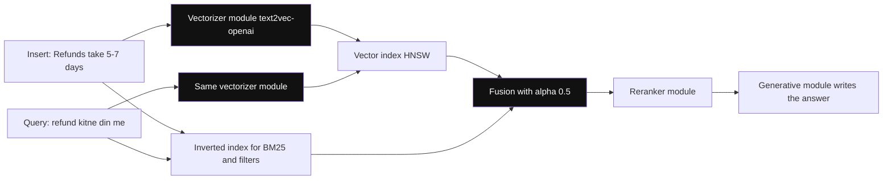

*Diagram:* Same vectorizer module insert pe objects aur search pe query text embed karta hai; BM25 aur vector results alpha se fuse hote hain, phir optional reranker aur generative modules usi query me chalte hain.

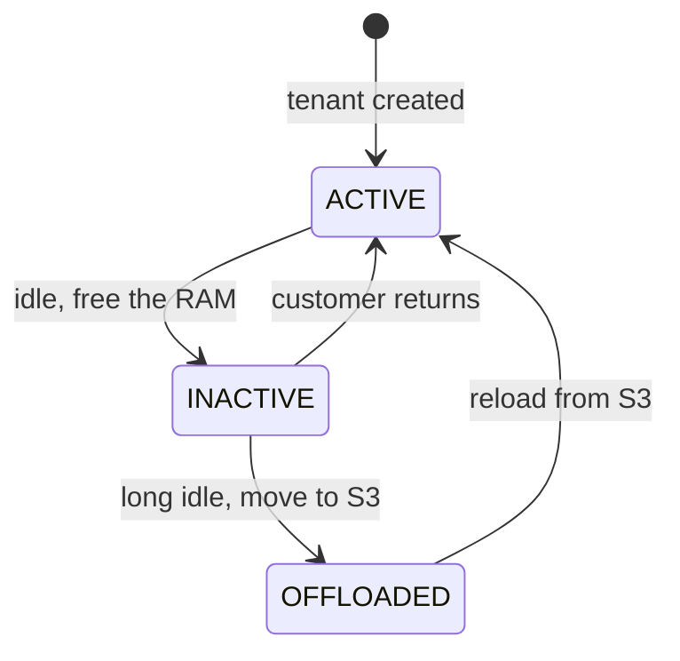

*Diagram:* Har tenant apna shard hai jo RAM, local disk aur S3 ke beech move karta hai; isi se ek cluster idle customers ki lambi list sasti me rakh leta hai.

**Kaise kaam karta hai, step by step:**
1. **Data model:** collection (purana naam: class) → objects. Har object me typed **properties** (text, int, date, geo...), ek UUID, aur ek ya zyada **named vectors** hote hain. Cross-references objects ko jodte hain.
2. **Modules:** **vectorizer** module (jaise `text2vec-openai`, `text2vec-cohere`, `text2vec-ollama`, `multi2vec-clip`) insert pe objects aur search pe query text embed karta hai. Apne vectors bhi la sakte ho (`self_provided`). Generative aur reranker modules same query me RAG answer aur reranking jodte hain.
3. **Indexes:** har vector ka ek vector index: `hnsw` (default), `flat` (brute force, chhote tenants ke liye achha), `dynamic` (flat se shuru, bada hone pe HNSW), aur `hfresh` (disk-friendly centroid index, 1.38 me GA). Properties pe inverted index banta hai jo filters aur BM25 me kaam aata hai.
4. **Compression:** PQ, BQ (binary), SQ aur RQ (rotational quantization). 1.33 se naye collections pe 8-bit RQ default on hai.
5. **Hybrid:** `hybrid(query, alpha=...)` BM25 aur vector search chalake fuse karta hai. `alpha=1` pura vector, `alpha=0` pura BM25. Fusion default me relative-score hai, ranked fusion (RRF jaisa) optional.
6. **Multi-tenancy:** har tenant apna shard hai, apne vector aur inverted index ke saath, to isolation physical hai. Tenants ACTIVE (memory me), INACTIVE (local disk pe), ya OFFLOADED (object storage pe) ho sakte hain. Isse ek cluster bahut saare tenants sasta rakh leta hai.
7. **Scaling:** horizontal sharding plus leaderless replication, tunable consistency ke saath (ONE, QUORUM, ALL).
8. **Hosting aur pricing model:** open source (BSD-3) Docker ya Kubernetes pe self-host; Weaviate Cloud (shared aur dedicated tiers), plan + usage (stored vector dimensions, storage, backups) pe priced; BYOC / enterprise options.

```python
import weaviate
from weaviate.classes.config import Configure, Property, DataType
from weaviate.classes.data import DataObject
from weaviate.classes.query import Filter, MetadataQuery
from weaviate.classes.tenants import Tenant
from weaviate.util import generate_uuid5

client = weaviate.connect_to_local()  # ya weaviate.connect_to_weaviate_cloud(...)

chunks = client.collections.create(
    "SupportChunk",
    properties=[Property(name="text", data_type=DataType.TEXT),
                Property(name="lang", data_type=DataType.TEXT)],
    vector_config=Configure.Vectors.self_provided(),  # embeddings hum khud laate hain
    multi_tenancy_config=Configure.multi_tenancy(enabled=True),
)
chunks.tenants.create([Tenant(name="swiggy")])
swiggy = chunks.with_tenant("swiggy")           # neeche ki har call isi tenant tak scoped

swiggy.data.insert_many([
    DataObject(properties={"text": "Refunds take 5-7 days", "lang": "en"},
               vector=emb1, uuid=generate_uuid5("doc7#c1")),
])

res = swiggy.query.hybrid(
    query="refund kitne din me", vector=query_emb, alpha=0.5, limit=5,
    filters=Filter.by_property("lang").equal("en"),
    return_metadata=MetadataQuery(score=True),
)
for o in res.objects:
    print(o.uuid, o.metadata.score, o.properties["text"])
client.close()
```

**Code kya karta hai:**
- Do text properties, self-provided vectors aur native multi-tenancy on karke collection banata hai.
- `swiggy` tenant banata hai; `with_tenant` us tenant ke apne shard tak scoped handle deta hai.
- `doc7#c1` se bane deterministic UUID ke saath object insert karta hai, taaki re-ingestion duplicate na banaye, overwrite kare.
- Hybrid query chalata hai: text pe BM25 plus hamari query embedding pe vector search, 50/50 weight, English tak filtered.
- Client close karta hai, ye zaroori hai kyunki v4 client gRPC connection khula rakhta hai.

**Kab chuno:** hybrid search aur embedding built-in chahiye, typed schema chahiye, aur bahut saare tenants physical isolation ke saath, idle tenants sasta offload karke.

**Interview tip:** "Weaviate pe 100,000 chhote customers kaise serve karoge?" Bolo: "Native multi-tenancy: har tenant ka ek shard, chhote tenants ke liye flat ya dynamic index, aur long tail ke liye inactive ya offloaded tenants, taaki unka kharcha RAM nahi, disk ya S3 ho."

**Common galti:**
- Vectorizer module ko data embed karne dena jabki app queries ko alag model se embed kare. Dono taraf same model chahiye.
- Naye code me v3 client ke patterns (`client.query.get(...)`) chhod dena. v4 client collection-based hai; v3 hata diya gaya hai.

## ⭐ Milvus aur Zilliz Cloud

**Ek line me:** open-source, distributed vector database (Go + C++), jisme storage aur compute poori tarah alag hain, GPU aur DiskANN samet sabse zyada index types hain, billions of vectors ke liye bana; Zilliz Cloud iska managed version hai.

**Ye kyun chahiye:** billion vectors pe ek machine ki RAM kaafi nahi, aur tum ingest, indexing aur querying ko alag-alag scale karna chahte ho. Milvus inhe object storage ke upar alag node types me baant deta hai, taaki har hissa apne aap scale ho.

**Aise socho:** Milvus Flipkart ka bada warehouse operation hai. Receiving docks (streaming nodes) maal lete hain, packing team (data nodes) boxes (indexes) banati hai, pickers (query nodes) orders serve karte hain, aur asli stock ek bade saste godown (object storage) me padha hai.

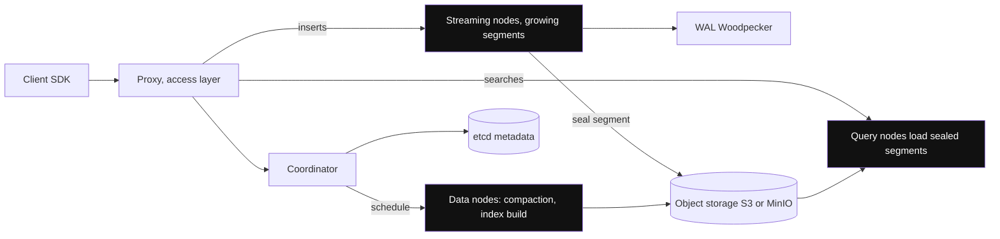

*Diagram:* Ingest, index building aur search teen alag node types hain jo object storage share karte hain, isliye QPS ke liye query nodes badhao bina ingest chhede.

**Kaise kaam karta hai, step by step:**
1. **Data model:** database → collection → partitions → segments. Collection ka **schema** hota hai: primary key, ek ya zyada vector fields (float, float16, bfloat16, binary, int8, sparse), scalar fields, aur optional dynamic JSON fields.
2. **Architecture (2.6):** access layer (proxies), ek coordinator, worker nodes (fresh writes ke liye streaming nodes, search ke liye query nodes, compaction aur index building ke liye data nodes), aur storage: metadata ke liye etcd, data ke liye object storage (S3/MinIO), aur WAL (2.6 me Woodpecker, pehle Kafka/Pulsar).
3. **Segments:** fresh data growing segments me rehta hai; sealed segments pe index banta hai aur query nodes unhe load karte hain. Milvus 2.6 tiered storage laata hai, to cold data object storage me reh sakta hai aur hot data locally cache hota hai.
4. **Index types:** FLAT, IVF_FLAT, IVF_SQ8, IVF_PQ, IVF_RABITQ (1-bit), HNSW (plus SQ/PQ variants), SCANN, **DISKANN** (SSD pe graph, RAM se bade data ke liye), aur **GPU indexes** (GPU_CAGRA, GPU_IVF_FLAT, GPU_IVF_PQ, GPU_BRUTE_FORCE). Sparse vectors inverted index use karte hain.
5. **Filtering aur hybrid:** boolean filter expressions (`lang == "en" and doc_id in [7, 9]`) scalar indexes ke saath. Built-in BM25 full-text search text field ko sparse vector bana deta hai; `hybrid_search` kai vector searches chalake RRF ya weighted rankers se fuse karta hai.
6. **Consistency levels** har request pe: Strong, Bounded (default, thoda stale), Session, Eventually.
7. **Multi-tenancy:** tenant per database, tenant per collection, tenant per partition, ya ek **partition key** field (tenants partitions me hash hote hain, aur key pe filter sirf unhi partitions ko search karta hai). Partition key sabse zyada tenants tak scale karta hai.
8. **Hosting aur pricing model:** Milvus Lite (pip install, local file, prototypes ke liye), Standalone (ek Docker container), Distributed (Helm ya Operator se Kubernetes). Zilliz Cloud serverless (usage pe pay), dedicated clusters (compute-unit hour pe pay) aur BYOC deta hai.

```python
from pymilvus import MilvusClient, DataType

client = MilvusClient(uri="http://localhost:19530")  # Milvus Lite: MilvusClient("demo.db")

schema = MilvusClient.create_schema(auto_id=False)
schema.add_field("id", DataType.VARCHAR, is_primary=True, max_length=64)
schema.add_field("embedding", DataType.FLOAT_VECTOR, dim=1024)
schema.add_field("tenant", DataType.VARCHAR, max_length=64, is_partition_key=True)
schema.add_field("lang", DataType.VARCHAR, max_length=8)
schema.add_field("text", DataType.VARCHAR, max_length=4096)

index_params = client.prepare_index_params()
index_params.add_index(field_name="embedding", index_type="HNSW", metric_type="COSINE",
                       params={"M": 16, "efConstruction": 200})
client.create_collection("support", schema=schema, index_params=index_params)

client.upsert("support", data=[
    {"id": "doc7#c1", "embedding": emb1, "tenant": "swiggy", "lang": "en", "text": "Refunds take 5-7 days"},
])

hits = client.search(
    "support", data=[query_emb], limit=5,
    filter='tenant == "swiggy" and lang == "en"',
    output_fields=["text"],
    search_params={"params": {"ef": 128}},
)
for h in hits[0]:
    print(h["id"], h["distance"], h["entity"]["text"])
```

**Code kya karta hai:**
- String primary key, 1024-dim vector, aur `tenant` ko **partition key** bana ke schema define karta hai, taaki har tenant ki rows partitions ke ek subset me jaayein.
- Cosine metric ke saath HNSW index banata hai. `index_params` ke saath collection banane se wo load bhi ho jaata hai, yaani searchable.
- Ek chunk ko uske deterministic id se upsert karta hai.
- Boolean filter ke saath search karta hai; `tenant` partition key hai, to Milvus sirf us tenant ke partitions scan karta hai.
- Har query vector ki ek list lautata hai; cosine ke liye `distance` me similarity score hota hai.

**Kab chuno:** sau-do sau million se billions vectors, Kubernetes chala sakne wali platform team, ya GPU ya DiskANN indexes ki zaroorat. Wahi engine bina ops ke chahiye to Zilliz Cloud.

**Interview tip:** "Milvus streaming, query aur data nodes alag kyun karta hai?" Bolo: "Ingest, index building aur search ka load pattern alag hai. Shared object storage ke upar inhe alag karke tum QPS ke liye query nodes badha sakte ho bina ingest ko chhede, aur search ko dheema kiye bina indexes rebuild kar sakte ho."

**Common galti:**
- 2M vectors ke liye distributed Milvus self-host karna. Wo etcd, object storage, WAL aur bahut saare pods laata hai. Is size pe Lite, Standalone ya koi aur product lo.
- Maan lena ki default Bounded consistency write turant dikhayegi. Jab user ko apna write dikhna zaroori ho, `Strong` ya `Session` use karo.

## Chroma

**Ek line me:** developer-first, open-source vector database jo bina setup ke tumhare Python process ke andar chalta hai, aur Chroma Cloud tak scale hota hai, jo object storage pe serverless version hai.

**Ye kyun chahiye:** zyada tar RAG projects notebook me shuru hote hain. Chroma pehla ghanta aasaan bana deta hai: `pip install chromadb`, documents add karo, query karo. Iski API chhoti aur readable hai, aur bahut tutorials aur frameworks ise default store ki tarah use karte hain.

**Aise socho:** Chroma vector DBs ki Maggi hai: packet se plate tak do minute. Hostel ki raat ke liye badhiya; 500 logon ki canteen ke liye bade kitchen pe jaana padta hai (Chroma Cloud ya koi aur DB).

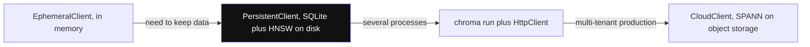

*Diagram:* Har step pe wahi chhota API; agla limit aane pe hi right me badhte ho: notebook, ek disk, server, phir serverless cloud.

**Kaise kaam karta hai, step by step:**
1. **Modes:** in-memory (`EphemeralClient`), disk pe embedded (`PersistentClient`, SQLite plus local HNSW index), client-server (`chroma run` with `HttpClient`), aur **Chroma Cloud** (`CloudClient`).
2. **Data model:** tenant → database → collection → records jinke `ids`, `embeddings`, `documents` (text), aur `metadatas` hote hain.
3. **Core:** 1.x line me core Rust me dobara likha gaya, jisse local engine kaafi fast hua.
4. **Indexes:** locally HNSW (`space`, `ef_construction`, `ef_search` configure karo). Chroma Cloud object storage pe SPANN/SPFresh jaisa index use karta hai, strong consistency ke liye WAL ke saath.
5. **Filtering:** metadata pe `where` (`$eq`, `$ne`, `$gt`, `$in`, `$and`, `$or`) aur text pe `where_document` (`$contains`, `$regex`). Chroma Cloud hybrid ke liye sparse vectors aur rank fusion wala Search API deta hai.
6. **Embeddings:** agar `embeddings` ke bina sirf `documents` bhejo, to Chroma collection ke embedding function se embed karta hai. Default ek chhota local model hai (all-MiniLM-L6-v2, 384 dims).
7. **Multi-tenancy:** har tenant ya user ka ek collection aam hai; tenants aur databases ek aur level dete hain.
8. **Hosting aur pricing model:** open source (Apache 2.0) self-host; Chroma Cloud usage-based hai: har GB written, har query/read, aur har GB stored ka paisa, free starter credit ke saath.

```python
import chromadb

client = chromadb.PersistentClient(path="./chroma")  # Chroma Cloud ke liye chromadb.CloudClient(...)

col = client.get_or_create_collection(
    name="support-swiggy",                   # har tenant ka ek collection
    configuration={"hnsw": {"space": "cosine"}},
)
col.upsert(
    ids=["doc7#c1"],
    embeddings=[emb1],                       # apne vectors do, default model skip karo
    documents=["Refunds take 5-7 days"],
    metadatas=[{"lang": "en", "doc_id": 7}],
)
res = col.query(
    query_embeddings=[query_emb],
    n_results=5,
    where={"$and": [{"lang": "en"}, {"doc_id": {"$in": [7, 9]}}]},
)
print(res["ids"][0], res["distances"][0])
```

**Code kya karta hai:**
- `./chroma` me on-disk embedded database kholta hai; koi server nahi chal raha.
- Har tenant ka ek collection cosine distance ke saath banata hai.
- Hamari embedding, raw text aur metadata ke saath ek chunk upsert karta hai.
- `$and` se jude do metadata conditions ke saath query karta hai (ek se zyada condition ke liye Chroma ko explicit `$and` chahiye).
- Har query ki lists lautata hai; `distances` distance hain, to chhota matlab zyada paas.

**Kab chuno:** prototypes, notebooks, demos, tests, chhote single-node apps, aur wo teams jinhe laptop se managed serverless cloud tak same API chahiye.

**Interview tip:** "Kya Chroma production me chalaoge?" Bolo: "Embedded Chroma chhote single-process apps aur tests ke liye theek hai. Multi-tenant production ke liye Chroma Cloud ya clustered DB lunga, kyunki local mode ek machine pe ek process hai."

**Common galti:**
- Sirf `documents` bhejna aur chupchaap default 384-dim model mil jaana, phir OpenAI embeddings se query karna. Dimension errors ya kachra results aate hain.
- Kai processes ko ek `PersistentClient` directory pe point karna. Kai writers ke liye client-server mode use karo.

## LanceDB

**Ek line me:** embedded vector database, AI data ke liye SQLite jaisa, Lance columnar file format pe bana, jo local disk pe ya seedhe S3 jaise object storage pe reh sakta hai.

**Ye kyun chahiye:** AI data sirf vectors nahi hai: text, images, video frames, features bhi. Teams ko sab ke liye ek table chahiye, versioned, S3 pe sasta stored, aur bina server chalaye searchable. LanceDB ek library deta hai jo import karo, tables ek open format me.

**Aise socho:** LanceDB aisa hai jaise data ko Google Drive pe ek achhe se indexed Excel file me rakhna. Koi server nahi chalana; jiske paas access hai wo file khole aur search kare.

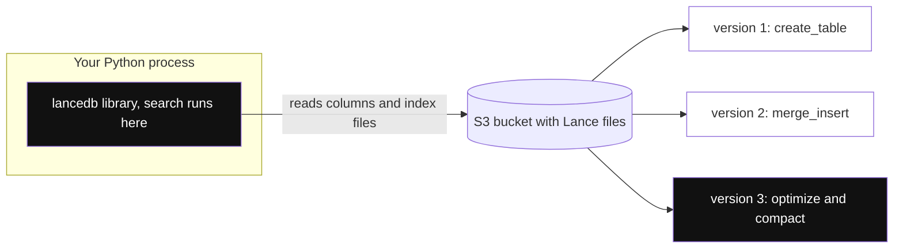

*Diagram:* Koi database server nahi: tumhare process ke andar library seedha S3 se Lance files padhti hai, aur har write ek naya version banata hai jisme cleanup tak time-travel kar sakte ho.

**Kaise kaam karta hai, step by step:**
1. **Lance format:** columnar format (Arrow-compatible, Parquet jaisa) jo fast random row access aur vectors ke liye bana. Har write naya **version** banata hai, to time travel aur aasaan rollback milta hai.
2. **Embedded:** `lancedb.connect("./data")` ya `lancedb.connect("s3://bucket/path")`. Search tumhare process ke andar chalta hai; storage remote ho sakta hai.
3. **Indexes:** vector indexes `IVF_PQ` (default), `IVF_FLAT`, `IVF_SQ`, `IVF_RQ`, `IVF_HNSW_SQ`, `IVF_HNSW_PQ`; filters ke liye scalar indexes (BTREE, BITMAP, LABEL_LIST); aur full-text (BM25) index.
4. **Filtering:** SQL jaisa `where("tenant = 'swiggy'")`, default prefilter (pehle filter, phir search).
5. **Hybrid:** `query_type="hybrid"` vector + full-text chalata hai aur reranker se merge karta hai (default RRF).
6. **Index freshness:** index build ke baad add hui rows bhi search hoti hain, par brute force se, jab tak `optimize()` ya rebuild na chalao.
7. **Hosting aur pricing model:** open source (Apache 2.0) embedded; LanceDB Cloud (serverless, usage-based) aur LanceDB Enterprise (tumhare cloud me).

```python
import lancedb

db = lancedb.connect("./lancedb")            # ya "s3://my-bucket/lancedb"
tbl = db.create_table("support", data=[
    {"id": "doc7#c1", "vector": emb1, "tenant": "swiggy", "lang": "en", "text": "Refunds take 5-7 days"},
], mode="overwrite")

# Id se aur rows upsert karo ("id" column pe merge)
(tbl.merge_insert("id")
    .when_matched_update_all()
    .when_not_matched_insert_all()
    .execute(new_rows))

tbl.create_scalar_index("tenant")            # tenant pe fast filter
tbl.create_index(metric="cosine", index_type="IVF_HNSW_SQ")  # train karne ke liye kaafi rows chahiye

res = (tbl.search(query_emb)
          .where("tenant = 'swiggy' AND lang = 'en'", prefilter=True)
          .limit(5)
          .to_list())
print([(r["id"], r["_distance"]) for r in res])
```

**Code kya karta hai:**
- Local folder se connect karta hai (same code `s3://` path ke saath bhi chalta hai).
- Python dicts se table banata hai; `vector` column embedding column ki tarah pehchana jaata hai.
- `id` pe keyed `merge_insert` se upsert karta hai, taaki document re-ingest karne pe rows update hon, duplicate na banein.
- `tenant` pe scalar index aur scalar quantization wala IVF-HNSW vector index jodta hai.
- Prefiltered vector search chalata hai aur LanceDB ka joda hua `_distance` column padhta hai.

**Kab chuno:** server nahi chahiye, data S3 pe open format me chahiye, multimodal tables, versioning, ya data pipeline ke andar ya device pe vector search.

**Interview tip:** "S3 pe embedded DB ka catch kya hai?" Bolo: "Cache na ho to har query object-storage latency deti hai, aur kai writers ko commit coordinator chahiye. Ye batch, analytics aur moderate QPS me chamakta hai, LanceDB Cloud ke bina shared high-QPS service ki tarah nahi."

**Common galti:**
- Bahut saare chhote writes. Har ek version aur chhoti files banata hai; writes batch karo aur compact karne aur purane versions saaf karne ke liye `optimize()` chalao.
- Maan lena ki deleted rows chali gayi. Cleanup tak purane versions me wo rehti hain, jo GDPR ke liye matter karta hai.

## turbopuffer

**Ek line me:** closed-source, serverless vector aur full-text search engine jo object-storage-first bana hai, isliye bahut saare (zyada tar idle) namespaces store karna bahut sasta padta hai.

**Ye kyun chahiye:** code assistants jaise AI apps har user ya har repo ka alag index rakhte hain: millions of namespaces, kisi bhi pal zyada tar idle. Sabko RAM me rakhna bahut mehenga hai. turbopuffer sab kuch object storage pe rakhta hai aur sirf jo query ho raha hai use cache karta hai.

**Aise socho:** ek cloud kitchen jo kachcha maal door ke saste godown me rakhta hai aur kitchen ke fridge me sirf aaj ke popular items. Kisi rare dish ka pehla order slow, repeat orders fast.

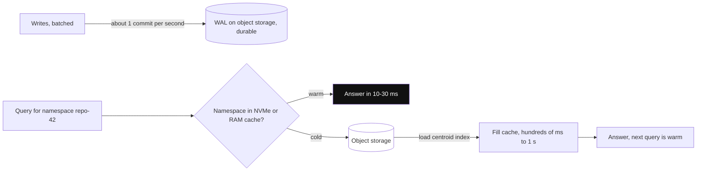

*Diagram:* Namespace ki sirf pehli (cold) query object storage ka chakkar lagati hai; uske baad cache se tens of ms me jawab aata hai.

**Kaise kaam karta hai, step by step:**
1. **Storage:** object storage source of truth hai. Har namespace ka apna path hai. Writes object storage pe WAL me jaate hain; successful write durable hai.
2. **Cache:** pehli query ke baad namespace NVMe SSD aur memory me cache hota hai. Docs ke hisaab se millions of documents pe cold queries sau ms se ek second se upar tak, warm queries lagbhag 10-30 ms.
3. **Index:** centroid-based ANN index (SPFresh pe bana), isliye chuna kyunki HNSW jaise graph indexes se kam object-storage round trips lagte hain. Recall apne aap tune hota hai (90-100%) aur monitor hota hai.
4. **Filters aur full-text:** filters ke liye exact attribute indexes, aur inverted BM25 index. Hybrid ke liye ek vector query aur ek BM25 query chalao (ek multi-query request me ja sakti hain) aur apne code me RRF se fuse karo.
5. **Consistency:** default strong (write agli query ko dikhta hai). Kam latency ke liye eventual reads opt-in kar sakte ho.
6. **Writes:** batched; har namespace lagbhag ek second me ek WAL entry commit karta hai, to bahut saare chhote writes group ho jaate hain.
7. **Multi-tenancy:** namespaces saste hain, to har tenant (ya har user, har repo) ka ek namespace normal pattern hai.
8. **Hosting aur pricing model:** sirf managed (multi-tenant cloud, enterprise ke liye single-tenant aur BYOC). Usage-based: storage, written data, aur queried data, har plan pe monthly minimum ke saath.

```python
import os
import turbopuffer

tpuf = turbopuffer.Turbopuffer(api_key=os.getenv("TURBOPUFFER_API_KEY"), region="gcp-us-central1")
ns = tpuf.namespace("support-swiggy")        # har tenant ka ek namespace

ns.write(
    upsert_rows=[
        {"id": "doc7#c1", "vector": emb1, "lang": "en", "doc_id": 7, "text": "Refunds take 5-7 days"},
    ],
    distance_metric="cosine_distance",
)

res = ns.query(
    rank_by=("vector", "ANN", query_emb),
    limit=5,
    filters=("And", (("lang", "Eq", "en"), ("doc_id", "In", [7, 9]))),
    include_attributes=["text"],
)
print(res.rows)
```

**Code kya karta hai:**
- Ek region ke liye client aur `support-swiggy` namespace ka handle banata hai (namespace pehle write pe banta hai).
- Hamare vector aur attributes ke saath ek row upsert karta hai, namespace ke liye cosine distance set karke.
- `vector` attribute pe ANN ranking aur `And` se jude do exact filters ke saath query karta hai.
- Response chhota rakhne ke liye sirf `text` attribute lautata hai.

**Kab chuno:** bahut saare namespaces jinka data zyada tar idle hai, bade corpora jahan RAM-resident clusters bahut mehenge hain, aur workloads jo slow pehli query bardasht kar lein.

**Interview tip:** "turbopuffer pe cold-start latency kaise chhupaoge?" Bolo: "User app ya repo khole tab namespace warm karo (cache-warm API hai), active tenants ko hot rakho, aur pehla answer stream karo taaki extra kuch sau ms mehsoos na hon."

**Common galti:**
- Sirf warm queries benchmark karke p99 50 ms se kam ka promise, phir har tenant ki pehli query ek second leti hai.
- Ek namespace pe har second bahut saare chhote writes. Batch karo; har namespace pe commit lagbhag ek second me ek baar hota hai.

## ⭐ Badi comparison table

Sibling page ([Vector Search in Existing Databases](32-vector-search-in-databases.md)) ke products context ke liye ek-ek line me hain.

| Product | Open source | Hosting | Architecture | Main ANN indexes | Filtering | Hybrid / BM25 | Multi-tenancy | Pricing model |
|---|---|---|---|---|---|---|---|---|
| Pinecone | Nahi | Managed serverless, dedicated read nodes, BYOC | Object storage + cache, read/write alag | Hidden (sirf metric chunte ho) | Search me metadata filters | Sparse + dense; full-text fields (2026) | Namespaces | Plan + read units, write units, storage |
| Qdrant | Haan (Apache 2.0) | Self-host, Cloud, Hybrid, Private | Rust cluster, segments, RAM/SSD | HNSW (filterable), quantized | Payload indexes, planner, ACORN | Sparse vectors + RRF/DBSF | Tenant payload index, tiered shards | Cluster resources per hour |
| Weaviate | Haan (BSD-3) | Self-host, Cloud, BYOC | Go cluster, har tenant ka shard | HNSW, flat, dynamic, HFresh | Inverted index | Native BM25 hybrid with alpha | Native, tenant offload to S3 | Plan + vector dims, storage, backups |
| Milvus / Zilliz | Haan (Apache 2.0) | Lite, Standalone, K8s; Zilliz serverless, dedicated, BYOC | Distributed, storage/compute alag | HNSW, IVF, DiskANN, GPU, RaBitQ, SCANN | Boolean expressions + scalar indexes | Built-in BM25, multi-vector rerankers | Partition key, partitions, DBs | OSS free; Zilliz usage ya compute units pe |
| Chroma | Haan (Apache 2.0) | Embedded, server, Chroma Cloud | Local SQLite + HNSW; cloud object storage pe | HNSW; cloud me SPANN | `where`, `where_document` | Cloud Search API | Tenant, database, collection | OSS free; cloud per GB written, query, storage |
| LanceDB | Haan (Apache 2.0) | Embedded, LanceDB Cloud, Enterprise | Disk ya S3 pe Lance files | IVF_PQ, IVF_HNSW_SQ, aur | SQL jaisa `where`, scalar indexes | FTS + vector, reranker ke saath | Table ya filter per tenant | OSS free; cloud usage-based |
| turbopuffer | Nahi | Managed, single-tenant, BYOC | Object storage first, SSD cache | Centroid (SPFresh) | Exact attribute indexes | BM25 + vector, client me fuse | Namespaces (millions) | Storage, writes, queries + minimum |
| pgvector | Haan | Postgres ke andar | Postgres tables | HNSW, IVFFlat | SQL `WHERE` | `tsvector` + vector | Rows, schemas, RLS | Tumhara Postgres cost |
| Elasticsearch / OpenSearch | Mixed | Self-host ya cloud | Lucene shards | HNSW (plus quantized) | Poora query DSL | Strong BM25 + kNN | Index ya filter | Cluster ya serverless |
| Redis | Mixed | Self-host ya cloud | In-memory | HNSW, flat | Tag/numeric filters | Text + vector | Key prefixes | Memory ke size pe |
| MongoDB Atlas | Nahi (Atlas) | Managed | DB ke saath search nodes | HNSW | Pre-filter fields | `$rankFusion` jaisa hybrid | Filter field | Atlas cluster |
| FAISS | Haan | Sirf library | In-process | Flat, IVF, PQ, HNSW, GPU | Khud banao | Nahi | Nahi | Free |

**Interview ke liye rule of thumb:** inme se zyada tar 50M vectors store kar sakte hain aur tenant se filter kar sakte hain. Asli farak ye hain: ops ka bojh, tumhare tenancy pattern pe cost ka shape, cold-start latency, aur kitna kuch (embedding, BM25, rerank) bundled chahiye.

## ⭐ Kaise chunein

**Ek line me:** paanch sawal is order me: prototype hai ya production, Postgres ya Elasticsearch pehle se hai kya, infra chalaoge kya, kitna bada aur kitne tenants, aur special indexes chahiye kya.

**Ye kyun chahiye:** "Best vector DB kaunsa hai?" ka koi jawab nahi. Interviewer sunna chahta hai ki tum kaunse sawal poochhoge aur har jawab choice ko kaise badalta hai.

**Aise socho:** gaadi chunna. 2 km office ke liye scooter (pgvector), family trip ke liye car (managed DB), poora godown shift karne ke liye trucks ka fleet (Milvus).

**Kaise kaam karta hai, step by step:**

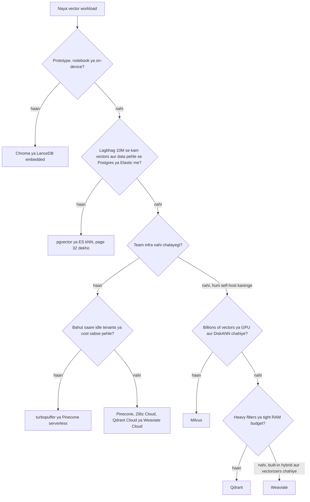

1. **Prototype?** Chroma ya LanceDB embedded. Koi server nahi, paanch line ka code.
2. **Data pehle se Postgres ya Elasticsearch me aur lagbhag 10M vectors se kam?** Jo hai wahi use karo. Sync, backup aur secure karne ke liye ek system kam.
3. **Infra team nahi?** Managed service. Bahut saare idle tenants hon ya cost pehli chinta ho to object-storage-first products jeet te hain. Warna Pinecone ya managed Qdrant/Weaviate/Zilliz.
4. **Bahut bade scale pe self-host** (sau-do sau million se billions, GPU ya SSD-resident indexes)? Milvus.
5. **Medium scale pe self-host?** Filter-heavy ya RAM-tight kaam ke liye Qdrant, built-in hybrid, modules aur native multi-tenancy ke liye Weaviate.
6. Phir **saabit karo**: realistic sample load karo (jaise apne 1M asli chunks), exact search ke against recall@10, asli filters ke saath p99 latency, aur monthly bill measure karo.

**Interview tip:** koi product naam lene se pehle bolo "Main scale, QPS, tenant count, filters, ops team aur budget poochhunga". Phir ek default aur ek fallback naam lo.

**Common galti:**
- Public benchmark dekh ke chunna. Benchmarks me shayad hi tumhare filters, tumhara dimension ya tumhara tenant pattern hota hai.

## ⭐ Ek realistic sizing example

**Ek line me:** vector memory = `count × dims × bytes per number`; index thoda jodta hai, quantization isse divide karta hai, replicas multiply karte hain.

**Ye kyun chahiye:** "Kitni RAM chahiye?" sabse common follow-up me se ek hai. Jaldi aur sahi calculation seniority dikhata hai aur RAM cluster vs object-storage design ka faisla karta hai.

**Aise socho:** trip ke liye packing. Kapde (raw vectors) bag ka zyada hissa lete hain, bag khud (index) thoda jodta hai, vacuum bags (quantization) kapde chhote karte hain, aur do bag (replicas) sab double kar dete hain.

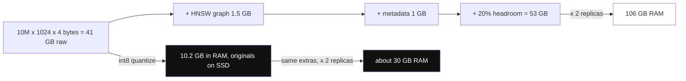

*Diagram:* Raw vectors hi bill ka bada hissa hain; int8 quantization aur originals disk pe rakhne se 2 replicas ki RAM ~106 GB se ~30 GB ho jaati hai.

**Kaise kaam karta hai, step by step.** Scenario: support RAG product, 10M chunks, 1024-dim embedding model, availability ke liye 2 replicas.

| Item | Math | Size |
|---|---|---|
| Raw float32 vectors | 10M × 1024 × 4 bytes | ~41 GB |
| HNSW graph (M = 16) | layer 0 pe 10M × ~32 links × 4 bytes, upper layers ke liye thoda aur | ~1.5 GB |
| Payload / metadata (ids, tenant, lang, doc_id) | 10M × ~100 bytes | ~1 GB |
| Chunk text agar DB me store ho | 10M × ~1.5 KB | ~15 GB (aksar disk pe ya kahin aur) |
| **Har replica ki RAM, float32 RAM me** | 41 + 1.5 + 1 + ~20% headroom | **~53 GB** |
| **2 replicas ke saath total** | 53 × 2 | **~106 GB RAM** |

Quantization search copy ki RAM kaise badalta hai (originals rescoring ke liye disk pe rehte hain):

| Format | Bytes per vector | 10M vectors | Bachat | Notes |
|---|---|---|---|---|
| float32 | 4096 | ~41 GB | 1x | baseline |
| float16 | 2048 | ~20.5 GB | 2x | recall loss lagbhag nahi |
| int8 scalar | 1024 | ~10.2 GB | 4x | chhota loss, rescoring se theek |
| PQ (128 sub-vectors × 1 byte) | 128 | ~1.3 GB | 32x | training chahiye, rescoring |
| binary (1-bit) | 128 | ~1.3 GB | 32x | high-dim models ke saath best; 3-4x oversample aur rescore |
| 512-dim (Matryoshka cut) + int8 | 512 | ~5.1 GB | 8x | sirf tab jab model chhote dims support kare |

Aur numbers jo bolne chahiye:
- **Rescoring reads:** int8 RAM me aur float32 SSD pe ho, to 2 × 10 = 20 candidates rescore karne wali query ~20 chhote SSD reads karti hai. NVMe pe fast.
- **Re-embedding cost:** 10M chunks × ~400 tokens = 4 billion tokens embedding model se. ~2,000 chunks per second upsert pe loading ~1.5 ghante, par embedding throughput aur rate limits aksar zyada time lete hain.
- **Object-storage design:** wahi 41 GB S3 pe har mahine bahut kam me padha rehta hai; paisa zyada tar per query aur hot namespaces ke cache ka lagta hai. Isliye 10,000 zyada tar idle tenants wahan 106 GB RAM cluster se bahut saste padte hain.

**Interview tip:** pehle formula bolo, phir: "int8 quantization aur rescoring ke saath vectors ke liye har replica pe 41 ki jagah lagbhag 11 GB RAM chahiye, rescoring ke baad recall lagbhag 1 point ke andar. Ye apne eval set pe confirm karunga."

**Common galti:**
- Replicas aur headroom bhool jaana. DB ko segment merges, index builds aur OS page cache ke liye bhi RAM chahiye.
- 384-dim model ke liye binary quantization ki bachat quote karna. Bahut low-dim vectors 1 bit pe bahut kuch kho dete hain.

## Migration aur lock-in

**Ek line me:** vectors, ids aur metadata portable hain; filter syntax, hybrid scoring, tenancy model aur hosted embedding models nahi.

**Ye kyun chahiye:** teams apni pehli choice se aage nikal jaati hain (Chroma se Qdrant, Pinecone se self-hosted, pgvector se dedicated DB). Planned migration boring hota hai; unplanned migration weekend ka outage.

**Aise socho:** ghar shift karna. Furniture (data) pack aur label ho to aaraam se shift hota hai. Fitted wardrobes (vendor-specific features) peeche reh jaate hain.

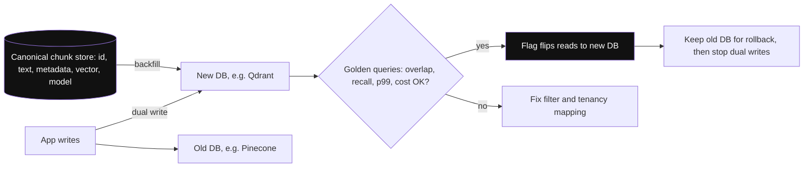

*Diagram:* Canonical chunk store hi escape hatch hai: woh naye DB ko backfill karta hai jab dual writes dono ko fresh rakhte hain, aur reads golden-query comparison pass hone ke baad hi flip hote hain.

**Kaise kaam karta hai, step by step:**
1. **Canonical copy rakho** har chunk ki vector DB ke bahar: `id, doc_id, tenant, text, metadata, embedding_model, vector`, S3 pe Parquet ya Postgres me rows. Yahi tumhara escape hatch aur backup hai.
2. **DB ko apne code me ek patli interface me lapeto:** `upsert(chunks)`, `delete(doc_id)`, `search(vector, tenant, filters, k)`. Framework adapters (LangChain, LlamaIndex vector stores) madad karte hain, par tenancy aur filters phir bhi leak hote hain.
3. **Filters aur tenancy translate karo:** Pinecone namespaces Qdrant tenant payloads ya Milvus partition keys ban sakte hain. Mapping likh ke rakho.
4. **Dual-write** naya data purane aur naye dono stores me, aur history canonical copy se **backfill** karo (ya export: Qdrant `scroll`, Milvus `query_iterator`, Pinecone prefix se ids list karke fetch).
5. **Compare** golden query set pe: purane store ke saath top-10 overlap, exact search ke against recall, p99 latency, cost.
6. Reads ko flag ke peeche **cut over** karo, rollback ke liye purana store kuch hafte rakho, phir dual writes band karo.

**Lock-in hot spots:**
- **Hosted embedding** (Pinecone integrated inference, Weaviate vectorizer modules): agar vectors kabhi khud store nahi kiye, to chhodne ka matlab sab dobara embed karna.
- **Hybrid scoring:** Weaviate relative-score fusion, Qdrant DBSF aur Pinecone sparse scaling sab alag rank karte hain, to results khisakte hain.
- **Sirf closed-source managed** (Pinecone, turbopuffer): self-host fallback nahi; BYOC data residency me madad karta hai, exit me nahi.

**Interview tip:** "Vector DB lock-in se kaise bachoge?" Bolo: "Vector DB ek derived index hai. Source of truth hamara chunk store hai, vectors aur model version ke saath. Koi bhi DB usse ghanton me dobara ban sakta hai, aur code ek chhoti repository interface se baat karta hai."

**Common galti:**
- Migration aur embedding model change ek hi step me karna. Ek baar me ek cheez badlo, warna pata nahi chalega quality drop kisse aaya.

## ⭐ Production concerns

**Ek line me:** production me mushkil hissa search speed nahi; re-embedding, freshness, deletes, tenant isolation, backups aur cost hain.

**Ye kyun chahiye:** demo ek baar likhta hai aur hamesha padhta hai. Product me documents har minute badalte hain, customers chhod ke jaate hain, models upgrade hote hain aur finance team bill ke baare me poochhti hai.

**Aise socho:** restaurant kholna aasaan hai. Roz chalana matlab stock rotation (re-embedding), expired khana phenkna (deletes), alag tables (tenancy), CCTV backups aur monthly P&L.

**Kaise kaam karta hai, step by step:**

**1. Model badalne pe re-embedding (blue-green index).**

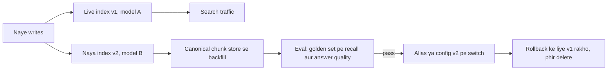

- Model A aur model B ke vectors mix nahi ho sakte. Model version ke naam ka naya collection, namespace ya index banao (`support_v2_bge-m3`).
- Naye chunks dono me dual-write karo, purane backfill karo, evaluate karo, phir switch. Qdrant, Milvus aur Weaviate me atomic switch ke liye **collection aliases** hain; Pinecone me config me index name badlo.
- Har record pe `embedding_model` aur `embedding_version` store karo.

**2. Consistency aur freshness.**
- Pinecone serverless aur Milvus "Bounded" eventually consistent hain (seconds). Qdrant `wait=True`, Milvus `Strong`/`Session`, aur turbopuffer ka default read-your-writes dete hain.
- "User PDF upload kare aur turant uske baare me poochhe" ke liye ya to us request ke liye strong read use karo, ya write confirm hone tak "indexing..." dikhao.

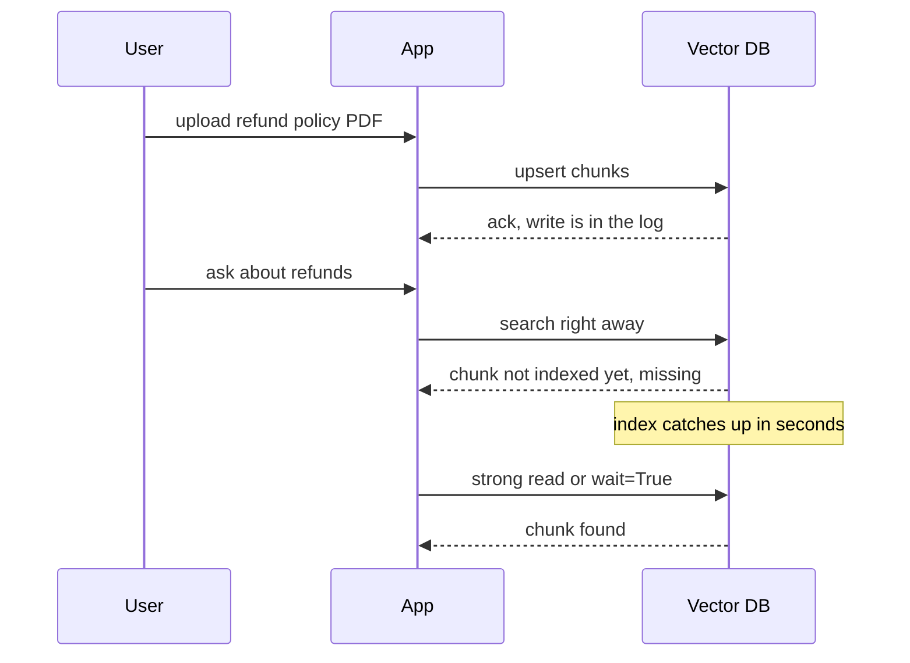

*Diagram:* Ack ka matlab durable hai, searchable nahi; eventual consistency me pehli search chunk miss kar sakti hai, isliye us request ke liye strong read lo ya indexing state dikhao.

**3. Deletes.**
- Zyada tar indexes tombstones se delete karte hain, aur space compaction ke baad wapas aata hai. Bahut zyada delete churn optimizer chalne tak recall aur latency ko nuksan karta hai.
- Deterministic ids (`doc7#c3`) ya `doc_id` field use karo taaki "ye document delete karo" ek call ho (id prefix se delete, ya filter se delete).
- GDPR erasure: snapshots, backups aur LanceDB ke purane versions bhi sambhalo, unme data ab bhi hota hai.

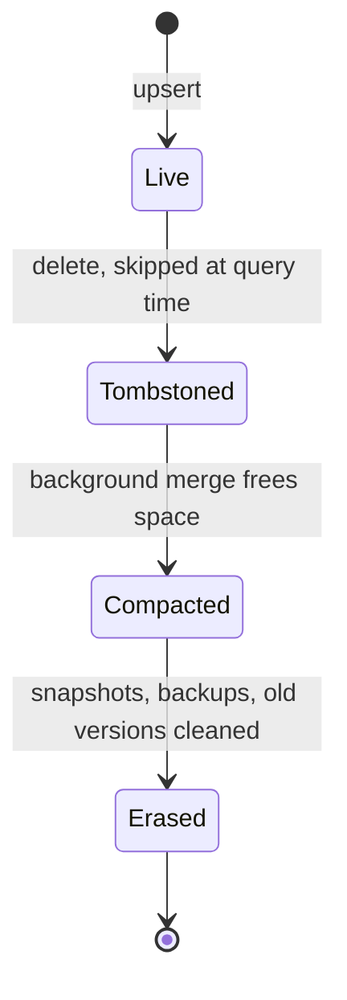

*Diagram:* Delete pehle sirf tombstone hota hai; space compaction ke baad wapas aata hai, aur GDPR erasure tabhi poora hai jab backups aur purane versions bhi saaf hon.

**4. Tenant isolation.**

| Pattern | Isolation | 10k tenants pe cost | Example |
|---|---|---|---|
| Har tenant ka collection ya index | Sabse strong | Har collection ka bhaari overhead | Chroma collections, sirf kam count pe |
| Namespace / native tenant / partition key | Strong, physical | Achha | Pinecone namespaces, Weaviate tenants, Milvus partition key, turbopuffer namespaces |
| Shared collection + tenant filter | Sirf logical | Sabse achha | Qdrant `is_tenant` payload, pgvector `WHERE` |

- Tenant hamesha server pe authenticated session se set karo, request body se kabhi nahi.
- Noisy neighbours pe nazar rakho: ek bahut bada tenant sabko slow kar sakta hai. Use apne shard (Qdrant tiered multitenancy) ya apne namespace pe promote karo.

**5. Backups aur disaster recovery.** Qdrant snapshots, Weaviate backup modules S3/GCS pe, `milvus-backup` tool, Pinecone backups aur restore, LanceDB aur turbopuffer data ke liye object-storage versioning. Restore test karo, aur yaad rakho: backups fail hon tab bhi canonical chunk store se rebuild kar sakte ho.

**6. Cost controls.** Quantize karo, model allow kare to dimensions kam karo, idle tenants disk ya object storage pe rakho, purane data pe TTL (purane tickets), bahut bada `top_k` avoid karo, aur capacity (dedicated read nodes, reserved clusters) sirf steady high QPS ke liye reserve karo.

**7. Observability.** Per tenant p50/p99 latency, exact search ke against nightly golden set pe recall@10, unindexed ya growing segment count, memory usage, write lag, aur per 1,000 queries cost track karo.

**Interview tip:** "Kaise pata chalega ki vector DB chupchaap kharab ho raha hai?" Bolo: "Ek nightly job 200 golden queries chalata hai, recall@10 ke liye ANN results ko exact search se compare karta hai, aur 2 points se zyada girne pe alert karta hai. Recall deletes, filters aur naye data ke saath drift karta hai, sirf config change se nahi."

**Common galti:**
- Embedding model ko in-place, record by record update karna. Ghanton tak index me do vector spaces ka mix rehta hai aur search quality gir jaati hai.
- Sirf latency monitor karna. Galat filter ya quantization recall aadha kar sakta hai jabki latency perfect dikhe.

## Common pitfalls

- **Model ke liye galat metric:** cosine ya dot product pe trained model ke liye euclidean se build karna. Zyada tar products creation ke baad metric badalne nahi dete; rebuild karna padta hai.
- **Creation pe dimension fixed:** 1024-dim index me 3072-dim vectors store nahi ho sakte. Model choice pehle plan karo.
- **Random ids:** har chunk ka UUID4 matlab re-ingestion pe duplicates. `doc_id + chunk_no` se deterministic ids banao.
- **Bahut bada metadata:** poore pages metadata me rakhna. Pinecone har record ka metadata cap karta hai (lagbhag 40 KB), aur bade payloads har product ko slow karte hain. Text apne store me rakho ya chunks chhote rakho.
- **Filter fields pe payload ya scalar index nahi** (Qdrant, Milvus, LanceDB). Filters full scan pe gir jaate hain.
- Object-storage-first products pe **sirf warm benchmark**, ya kisi bhi product pe **bina filters ke benchmark**.
- **Ek shared collection, tenant client se:** ek bug ek customer ka data doosre ko leak kar deta hai.
- **Write batching ignore karna:** har chunk ka alag upsert. Har product pe ek call me 100 se 1,000 records batch karo.

## Interview ke sawal

**Q: Naye RAG product ke liye Pinecone vs Qdrant?**
Pinecone agar team ko zero ops, har tenant ka namespace aur bundled embedding aur rerank chahiye, aur closed source aur usage billing se dikkat nahi. Qdrant agar open source, self-host ya predictable cluster bill chahiye, aur tight RAM control ke saath heavy filtering.

**Q: "Object-storage-first" ka matlab kya hai aur trade-off kya hai?**
S3 jaisa storage source of truth hai aur RAM/SSD sirf cache. Storage bahut sasta aur idle tenants lagbhag free, par namespace pe pehli (cold) query sau ms se ek second se upar tak le sakti hai.

**Q: 1024 dims pe 10M vectors ke liye kitni RAM?**
10M × 1024 × 4 bytes ≈ 41 GB raw, plus ~1-2 GB HNSW graph aur thoda metadata, to headroom ke saath har replica ~50 GB. int8 quantization vector hissa ~10 GB pe laata hai, binary ~1.3 GB pe, disk pe rakhe originals se rescoring ke saath.

**Q: 10,000 tenants ko alag kaise rakhoge?**
Product ka physical partition use karo: Pinecone ya turbopuffer namespaces, Weaviate native tenants, Milvus partition key, ya Qdrant ka tenant payload index bade tenants ke liye tiered shards ke saath. Tenant server pe auth se set karo, client input se kabhi nahi.

**Q: Embedding model badal rahe ho. 20M chunks bina downtime re-embed kaise karoge?**
Blue-green: model version ke naam ka naya index banao, naya data dual-write karo, canonical chunk store se backfill karo, golden set pe evaluate karo, phir alias ya config switch karo. Rollback ke liye purana index rakho.

**Q: User document upload karke turant poochhta hai, par retrieval use miss karta hai. Kyun?**
Eventual consistency: write accept hua par abhi searchable nahi (Pinecone serverless, Milvus Bounded). Us request ke liye strong ya session read, Qdrant me `wait=True`, ya confirm hone tak indexing state dikhao.

**Q: Milvus storage aur compute alag kyun karta hai?**
Taaki ingest, index building aur querying shared object storage ke upar alag-alag scale hon. QPS ke liye query nodes badha sakte ho bina ingest chhede, aur search dheema kiye bina indexes bana sakte ho. Keemat: chalane ke liye bahut saare moving parts.

**Q: Weaviate kab chunoge?**
Jab BM25 + vector hybrid aur embedding modules built-in chahiye, typed schema chahiye, aur native multi-tenancy jahan har tenant apna shard ho aur idle tenants object storage pe offload ho sakein.

**Q: DiskANN aur GPU indexes kis liye hain?**
DiskANN graph SSD pe rakhta hai, to RAM se kaafi bada data achhe recall ke saath search kar sakte ho. GPU indexes (jaise Milvus me CAGRA) index building aur bahut high-throughput batch search tez karte hain. Dono sau-do sau million se billions vectors pe matter karte hain.

**Q: Kya Chroma production-ready hai?**
Embedded Chroma prototypes, tests aur chhote single-process apps ke liye theek hai. Multi-tenant production ke liye Chroma Cloud (serverless, object storage) ya clustered database lo.

**Q: Binary quantization on karne ke baad recall gir gaya, kya karoge?**
Original vectors se rescoring on karo, oversampling badhao (3-4x), model ka dimension dekho (low-dim models 1 bit pe kharab hote hain), ya int8 pe switch karo. Pehle aur baad exact search ke against recall@10 measure karo.

**Q: Lock-in se kaise bachoge?**
Chunks, vectors aur model version ka canonical store DB ke bahar rakho, DB se ek chhoti interface ke through baat karo, aur vectors khud store kiye bina hosted embedding pe depend mat karo.

**Q: Pinecone me haal me kya badla?**
Pod-based indexes legacy hain aur naye SDKs unhe bana nahi sakte. Serverless default hai, dedicated read nodes aur BYOC ab GA hain, aur Python SDK v10 (API 2026-07) full-text search wale schema-based document indexes laata hai.

**Q: Dedicated vector DB kab galat choice hai?**
Jab corpus chhota ho (kuch million se kam), QPS kam ho, aur data pehle se Postgres ya Elasticsearch me ho. pgvector ya ES kNN ek doosre system ko sync, secure aur backup karne se bachata hai.

**Q: Document ke chunks reliably kaise delete karoge?**
Doc prefix wale deterministic ids ya `doc_id` field, phir prefix ya filter se delete. Yaad rakho tombstones ko compaction chahiye, aur backups ya purane versions me data ab bhi ho sakta hai.

## Aage padho

- [Vector Databases](../05-db/11-vector.md): embeddings, metrics, HNSW, IVF/PQ, pre/post filtering ki basics.
- [Vector Search in Existing Databases](32-vector-search-in-databases.md): pgvector, Elasticsearch/OpenSearch, Redis, MongoDB Atlas aur FAISS.
- [Hybrid Search](../09-rag/04-hybrid-search.md): BM25 + dense fusion aur RRF detail me.
- [LlamaIndex](24-llamaindex.md): in vector stores ko RAG pipeline me jodna.

## Checklist

- [ ] Main vector DB ki common anatomy samjha sakta hoon: WAL, segments, background indexing, tombstones
- [ ] Main cluster vs object-storage-first designs aur unke latency aur cost trade-offs samjha sakta hoon
- [ ] Main Pinecone, Qdrant, Weaviate aur Milvus describe kar sakta hoon: architecture, indexes, filtering, hybrid, tenancy aur pricing model
- [ ] Main bata sakta hoon Chroma, LanceDB ya turbopuffer kab sahi choice hai aur unke main gotchas kya hain
- [ ] Main inme se kam se kam do products ke liye create, metadata ke saath upsert aur filtered query ka code likh sakta hoon
- [ ] Main decision flow chala sakta hoon aur kisi scenario ke liye ek default aur ek fallback bata sakta hoon
- [ ] Main 10M × 1024-dim vectors ka size nikaal sakta hoon aur int8, PQ aur binary quantization ki bachat samjha sakta hoon
- [ ] Main zero-downtime re-embedding aur vector DBs ke beech migration plan kar sakta hoon
- [ ] Main production me freshness, deletes, tenant isolation, backups aur recall monitoring samjha sakta hoon
