# Vector Search in Postgres and Other Databases

Zyada tar teams ko vector search shuru karne ke liye naya database nahi chahiye. Postgres, Elasticsearch, OpenSearch, Redis aur MongoDB ab embeddings store karke nearest-neighbour search chala sakte hain, usi data ke paas jo already unke andar hai. Interviewers ye isliye poochte hain kyunki "kaun sa vector DB?" asal me "kya alag DB chahiye bhi?" hai, aur achhe jawab ke liye real numbers, sahi index knobs aur failure modes pata hone chahiye.

pgvector 0.8.x, pgvectorscale 0.x, Elasticsearch 9.x, OpenSearch 3.x, Redis 8.x, MongoDB Atlas Vector Search aur FAISS 1.x ke hisaab se likha gaya (November 2026). Basics (embeddings, cosine vs L2, HNSW, IVF, PQ, recall) [Vector Databases](../05-db/11-vector.md) pe hain. Ye page maan ke chalta hai ki wo padh liye.

**Is page ke baad tum ye jawab de paoge:**
- "Hum already Postgres chalate hain. Pinecone add karoge ya pgvector? Kis scale pe mind badlega?"
- "Tumhari filtered pgvector query 10 rows maangti hai aur 3 deti hai. Kyun, aur fix kaise?"
- "pgvector me HNSW ya IVFFlat? `m`, `ef_construction`, `ef_search`, `lists` aur `probes` kya karte hain?"
- "Plain SQL me hybrid search (keywords plus vectors) kaise karoge?"
- "Tumhare vectors 60 GB RAM le rahe hain. Bina zyada recall khoye ise kaise kam karoge?"
- "Hum embedding model badal rahe hain. 20 million vectors zero downtime ke saath kaise migrate karoge?"
- "FAISS database hai kya? Uske around tumhe kya banana padta hai?"
- "Hum product search ke liye already Elasticsearch chalate hain. Semantic search kaise add karein?"

## Pehle ye shabd samjho

| Shabd | Simple matlab |
|---|---|
| Extension | Ek add-on package jo Postgres ko naye column types, functions aur index types deta hai. |
| pgvector | Vectors store karne aur sabse paas wale dhoondhne ka sabse zyada use hone wala Postgres extension. |
| ANN index | Approximate nearest neighbour index: har row check karne ki jagah "kaafi paas" wale neighbours jaldi dhoondhta hai. |
| Recall | Asli top 10 neighbours me se index ne kitne lautaye. 10 me se 9 = 0.9. |
| Operator class | Postgres index ko batata hai ki wo kis distance (L2, cosine, inner product) ke liye bana hai. |
| Quantization | Har number kam bits me rakhna (32 se 16, 8 ya 1) memory bachane ke liye, thodi accuracy jaati hai. |
| Re-rank (rescore) | Sasti rough distance se extra candidates lao, phir exact vectors se dobara sort karo. |
| `tsvector` | Postgres ka built-in full-text search column: document ko searchable word stems me badla hua. |
| BM25 | Elasticsearch aur OpenSearch ka standard keyword relevance score. |
| RRF | Reciprocal Rank Fusion: do ranked lists ko har list se `1 / (60 + rank)` jod ke merge karna. |
| MVCC aur VACUUM | Postgres update ya delete pe purane row versions rakhta hai; VACUUM baad me unhe saaf karta hai. |
| `maintenance_work_mem` | Index banate waqt Postgres kitni memory use kar sakta hai. Bahut kam ho to HNSW build bahut slow. |
| FAISS | Meta ki C++/Python library jo tumhare process ke andar vector search karti hai. Database nahi. |

## Big picture

Vector search teen jagah reh sakta hai. **Already chal rahe database ke andar extension** ki tarah (pgvector, Elasticsearch, Redis, MongoDB). **App process ke andar library** ki tarah (FAISS, hnswlib). Ya **dedicated vector database** (Pinecone, Qdrant, Milvus, jo [Vector Databases in Practice](31-vector-databases.md) pe hain). Ye page pehle do pe gehra jaata hai aur decision guide pe khatam hota hai.

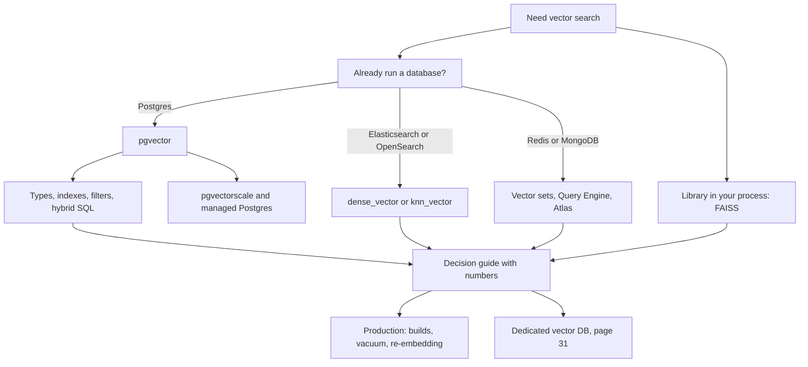

## ⭐ Vector search ek feature hai, alag product nahi

**Ek line me:** vector index bas ek aur index type hai; agar tumhare database me hai, to vector search ke saath wahi backups, permissions, transactions aur joins milte hain jin pe tum already bharosa karte ho.

**Ye kyun chahiye:** alag vector DB matlab data ki doosri copy. Sync pipeline chahiye, doosra backup plan, doosra access-control model, aur dono copies ke drift ko sambhalne ka tareeka. Bahut products me vectors baaki data ke mukable chhote hote hain, aur wo extra system jitna deta hai usse zyada kharcha karata hai.

**Aise socho:** kirana dukaan counter pe UPI QR code laga deti hai. Digital payment ke liye doosri dukaan nahi kholti. Jab volume bahut bada ho jaaye tab alag billing setup ka matlab banta hai.

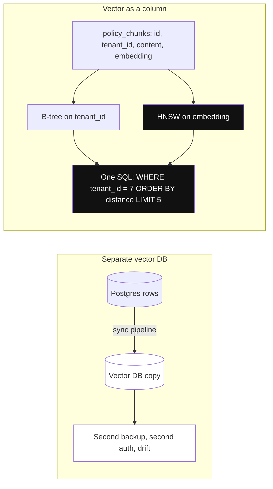

*Diagram:* Left: data ki doosri copy jise sync, backup aur secure karna padta hai. Right: vector bas ek aur column hai apne index ke saath, tenant filter wali same SQL me.

**Kaise kaam karta hai, step by step:**
1. Normal columns ke saath ek vector column (ya field) add karo, jaise `policy_chunks` table pe `embedding vector(1536)`.
2. Us column pe ANN index banao, waise hi jaise `email` pe B-tree index banate ho.
3. Query normal conditions aur vector order mix karti hai: `WHERE tenant_id = 7 ORDER BY embedding <=> $1 LIMIT 5`.
4. Database ka planner tay karta hai ise kaise chalana hai, kisi bhi aur query ki tarah.
5. Size check: 2 million chunks × 1536 dims × 4 bytes ≈ 12 GB raw vectors. 32–64 GB RAM wala normal Postgres box ise sambhal leta hai.

| Vector search kahan rehta hai | Examples | Free me kya milta hai | Kya chhodna padta hai |
|---|---|---|---|
| Existing DB ke andar | pgvector, Elasticsearch, OpenSearch, Redis, MongoDB Atlas | data ki ek copy, transactions ya same consistency, joins, existing ops | peak scale, kuch vector-specific features |
| Process ke andar library | FAISS, hnswlib, ScaNN | sabse tez raw speed, poora control | persistence, filtering, updates, replication: khud banao |
| Dedicated vector DB | Pinecone, Qdrant, Milvus, Weaviate | scale, tuned filtered ANN, multi-tenancy | sync aur chalane ke liye doosra system |

**Interview tip:** "Kaun sa vector DB use karoge?" Bolo: "Pehle, kitne vectors, kitni queries per second, aur hum already kya chalate hain? Agar Postgres hai aur lagbhag 10 million vectors se kam, to pgvector se shuru karunga."

**Common galti:**
- Corpus size calculate kiye bina dedicated vector DB chun lena. 50,000 FAQ chunks lagbhag 300 MB vectors hain.

## ⭐ pgvector types: vector, halfvec, sparsevec, bit

**Ek line me:** pgvector chaar column types deta hai: full-precision floats, half-precision floats, sparse vectors aur bit vectors, har ek memory aur accuracy ka alag trade karta hai.

**Ye kyun chahiye:** ek size sabke liye fit nahi. 3072-dim model `vector` me index karne ke liye bahut bada hai (limit 2000 dims). SPLADE jaise learned sparse models aise vectors banate hain jo zyada tar zero hote hain. Binary vectors 32 guna chhote hain. Har type inme se ek zaroorat poori karta hai.

**Aise socho:** photos store karna. RAW files (`vector`), high-quality JPEG (`halfvec`), sirf non-empty pixels ki list (`sparsevec`), aur black-and-white thumbnail (`bit`).

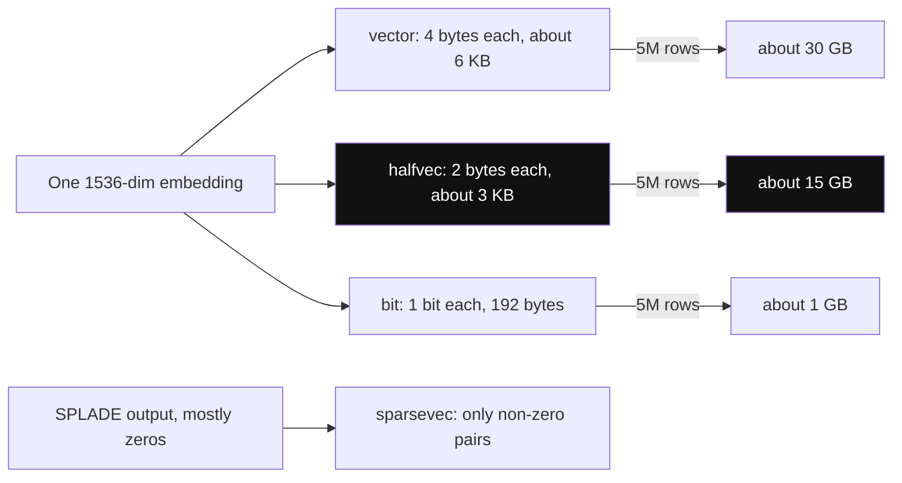

*Diagram:* Same embedding type ke hisaab se 6 KB, 3 KB ya 192 bytes leta hai; 5 million rows pe yeh 30 GB vs 15 GB vs 1 GB hai.

**Kaise kaam karta hai, step by step:**

| Type | Har value | Index ke liye max dims | 1536 dims ke bytes | Kab use karo |
|---|---|---|---|---|
| `vector(n)` | 4-byte float | 2,000 (store 16,000 tak) | ~6 KB | default, zyada tar models |
| `halfvec(n)` | 2-byte float | 4,000 | ~3 KB | bade models (3072 dims), 50% memory bachao |
| `sparsevec(n)` | index + value pairs | 1,000 non-zero values (sirf HNSW) | non-zeros pe depend | SPLADE / learned sparse, keyword jaise vectors |
| `bit(n)` | 1 bit | 64,000 | 192 bytes | binary quantization, phir re-rank |

1. 1536 dims pe 5 million chunks ki memory: `vector` ≈ 30 GB, `halfvec` ≈ 15 GB, `bit` ≈ 1 GB.
2. Sparse vector aise likhte hain: `'{1:0.5,42:1.2,907:0.3}/30000'`: position:value pairs, phir total dimensions.
3. Bit vector `'101101...'` ki tarah likhte hain aur Hamming distance (alag bits ki ginti) se compare karte hain.
4. Column `vector` hi rakh sakte ho aur sirf `halfvec` ya `bit` cast ko index karo. Ise expression index kehte hain (agle sections).

**Interview tip:** "Hamara model 3072 dims ka hai aur pgvector index mana kar raha hai." Jawab: "Ise `halfvec(3072)` ki tarah index karo, jo 4000 dims tak allow karta hai, ya agar model Matryoshka-style truncation support karta hai to `dimensions` option se embedding chhota karo."

**Common galti:**
- 3072-dim `vector` store karna aur index ke time pata chalna ki HNSW aur IVFFlat 2000 dims pe ruk jaate hain.

## ⭐ pgvector indexes: HNSW vs IVFFlat

**Ek line me:** HNSW ek layered graph hai, speed aur recall behtar par build slow aur memory zyada; IVFFlat clusters plus lists hai, build tez aur chhota, par build se pehle data chahiye aur same speed pe recall kam.

**Ye kyun chahiye:** index ke bina `ORDER BY embedding <=> $1 LIMIT 5` query ko har row se compare karta hai. Ye exact hai par 10 million rows pe seconds lagte hain. Index data ka chhota hissa hi dekhta hai.

**Aise socho:** HNSW naye shehar me rasta poochne jaisa hai: pehle highway ka board, phir area, phir gali. IVFFlat library jaisa hai: un 3 shelves pe jao jinka label tumhare topic ke sabse paas hai, aur sirf unhe scan karo.

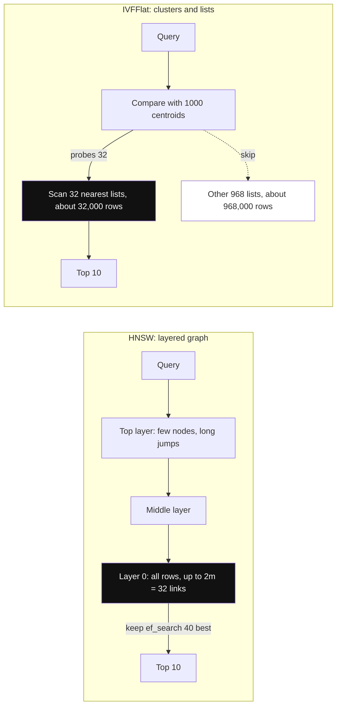

*Diagram:* HNSW layer by layer narrow karta hai aur ef_search candidates rakhta hai; IVFFlat probes jitne nearest clusters pe jaata hai aur 1 million rows ka baaki hissa skip karta hai.

**Kaise kaam karta hai, step by step:**
1. **HNSW build:** har row graph node banti hai, har layer pe lagbhag `m` neighbours se judi (`m` default 16; layer 0 me `2 × m` tak). `ef_construction` (default 64) batata hai builder links chunne ke liye kitne candidates dekhta hai.
2. **HNSW query:** graph ko top layer se neeche chalo. `hnsw.ef_search` (default 40) batata hai search kitne candidates rakhta hai. Zyada = behtar recall, slow.
3. **IVFFlat build:** k-means abhi maujood rows se `lists` clusters banata hai. pgvector docs ka rule of thumb: 1 million rows tak `lists = rows / 1000`, uske upar `sqrt(rows)`. To 500k rows → 500 lists; 4 million rows → 2000 lists.
4. **IVFFlat query:** sirf `ivfflat.probes` sabse paas wali lists scan karo (default 1, `sqrt(lists)` ke aas paas se shuru karo). Probes = lists matlab exact search.
5. 1 million rows ka worked example: 1000 lists aur 32 probes wala IVFFlat 1,000,000 ki jagah lagbhag 32,000 rows scan karta hai.

| | HNSW | IVFFlat |
|---|---|---|
| Build knobs | `m` (16), `ef_construction` (64) | `lists` |
| Query knob | `hnsw.ef_search` (40) | `ivfflat.probes` (1) |
| Khaali table pe build | haan, training step nahi | nahi, data load karke banao |
| Build speed aur memory | slow, graph fit karne ke liye `maintenance_work_mem` chahiye | tez, chhota |
| Same latency pe recall | zyada | kam |
| Build ke baad naya data | naturally fit ho jaata hai | data drift pe clusters stale, kabhi kabhi rebuild |
| Default choice | haan, zyada tar apps ke liye | bahut bade bulk loads, tight memory, kam rebuilds |

```sql
-- Cosine distance ke liye HNSW; pehle build memory badhao taaki graph fit ho
SET maintenance_work_mem = '8GB';
SET max_parallel_maintenance_workers = 7;   -- plus leader process
CREATE INDEX CONCURRENTLY policy_chunks_hnsw
    ON policy_chunks USING hnsw (embedding vector_cosine_ops)
    WITH (m = 16, ef_construction = 64);

-- IVFFlat alternative: pehle data load karo, phir build
-- CREATE INDEX ON policy_chunks USING ivfflat (embedding vector_cosine_ops) WITH (lists = 1000);

-- Query-time knobs, har transaction me
BEGIN;
SET LOCAL hnsw.ef_search = 100;      -- ya: SET LOCAL ivfflat.probes = 32;
SELECT id FROM policy_chunks ORDER BY embedding <=> $1 LIMIT 10;
COMMIT;
```

**Code kya karta hai:**
- Index build ko 8 GB aur 8 processes tak deta hai, taaki HNSW graph memory me aur parallel bane. Graph fit na ho to Postgres NOTICE print karta hai.
- `CONCURRENTLY` table pe writes block kiye bina banata hai, live system pe ye zaroori hai.
- `vector_cosine_ops` index ko `<=>` operator se baandhta hai. Doosra operator use karne wali query ise use nahi karegi.
- `SET LOCAL` `ef_search` sirf is transaction ke andar badalta hai, jo connection pooler ke peeche safe hai.

**Interview tip:** "pgvector me recall kaise tune karte ho?" Jawab: "Defaults ke saath HNSW banao, 200 real queries lo, index disable karke exact top-10 nikalo, phir `ef_search` (40, 80, 120, 200) badhao jab tak recall@10 target tak na pahunche, har step pe p95 latency check karte hue."

**Common galti:**
- Khaali ya chhoti table pe IVFFlat banana. Clusters build time ki rows se bante hain, to real data aane pe recall kharab.
- `maintenance_work_mem` ko chhote default pe chhod dena, to 5-million-row HNSW build das minute ki jagah kai ghante leta hai.

## ⭐ Distance operators aur operator classes

**Ek line me:** har operator ek distance function hai, har index ek operator class ke liye bana hai, aur index use hone ke liye query me matching operator `ORDER BY ... LIMIT` ke saath hona chahiye.

**Ye kyun chahiye:** Postgres indexes operators se bandhe hote hain. Planner index tabhi use karta hai jab query ka operator wahi ho jiske liye index bana.

**Aise socho:** jo dukaan shelves price se sort karti hai, wo "weight se sort karo" ka jawab jaldi nahi de sakti. Shelf ka order aur sawal match hone chahiye.

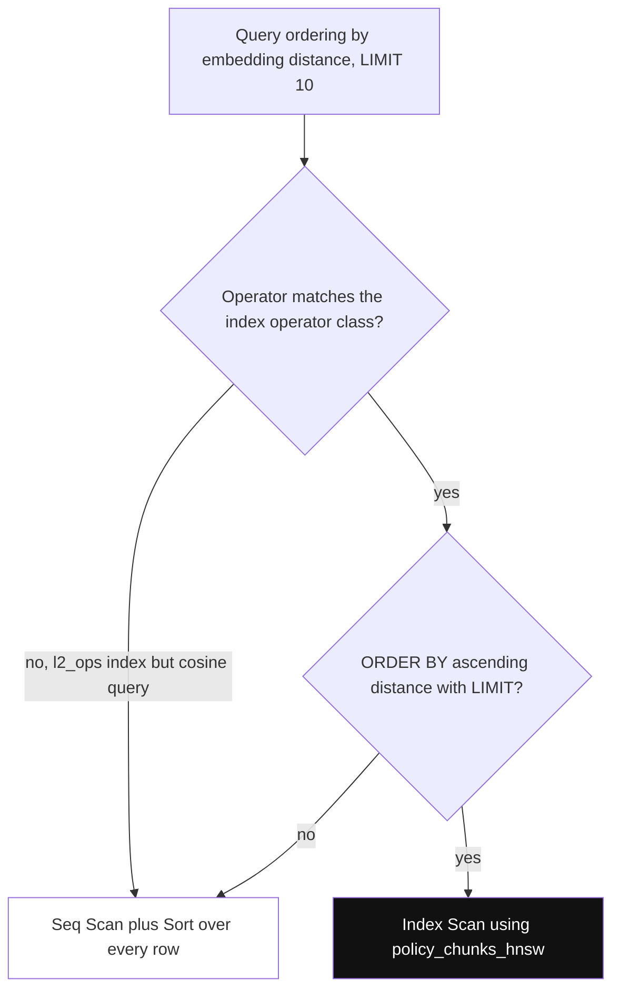

*Diagram:* Planner ANN index tabhi use karta hai jab dono checks pass hon; koi ek bhi fail ho to chupchaap full scan ho jaata hai.

**Kaise kaam karta hai, step by step:**

| Operator | Distance | Index operator class (vector) | Chhota matlab |
|---|---|---|---|
| `<->` | L2 (Euclidean) | `vector_l2_ops` | zyada paas |
| `<=>` | cosine distance = 1 − cosine similarity | `vector_cosine_ops` | zyada paas |
| `<#>` | negative inner product | `vector_ip_ops` | zyada paas (zyada similar) |
| `<+>` | L1 (taxicab) | `vector_l1_ops` (sirf HNSW) | zyada paas |
| `<~>` | Hamming, `bit` ke liye | `bit_hamming_ops` | kam alag bits |
| `<%>` | Jaccard, `bit` ke liye | `bit_jaccard_ops` | zyada paas |

1. `halfvec` aur `sparsevec` ki same classes apne prefix ke saath hain: `halfvec_cosine_ops`, `sparsevec_l2_ops`, waghera.
2. `<#>` **negative** inner product deta hai taaki ascending order me best match pehle aaye. Similarity dikhane ke liye `(embedding <#> $1) * -1`.
3. Display ke liye cosine similarity: `1 - (embedding <=> $1)`. Agar vectors normalized hain (OpenAI ke hote hain), to inner product sabse tez hai aur cosine jaisa hi rank deta hai.
4. Index sirf `ORDER BY <distance> ASC LIMIT k` ke liye use hota hai. `ORDER BY ... LIMIT` ke bina `WHERE embedding <=> $1 < 0.3` use nahi karta.
5. `EXPLAIN` se check karo: `Index Scan using policy_chunks_hnsw` chahiye, `Seq Scan` plus `Sort` nahi.

**Interview tip:** "HNSW index hone ke baad bhi query slow hai. Kya check karoge?" Jawab: "`EXPLAIN` chalaunga. Aksar operator operator class se match nahi karta, `ORDER BY` descending ya expression pe hai, ya `LIMIT` nahi hai."

**Common galti:**
- `vector_l2_ops` se build karna aur `<=>` se query karna. Chupchaap full sequential scan milta hai.

## ⭐ Filtered queries aur iterative index scans

**Ek line me:** HNSW scan lagbhag `ef_search` candidates hi lautata hai, to uske baad laga `WHERE` filter `LIMIT` se kam rows chhod sakta hai; iterative index scans (pgvector 0.8+) tab tak scan karte rehte hain jab tak kaafi rows filter pass na kar lein.

**Ye kyun chahiye:** real queries me hamesha filters hote hain: tenant, language, country, "sirf active documents". 0.8 se pehle `ef_search = 40` ke saath `WHERE country = 'IN' ... LIMIT 10` sirf 40 candidates dekhta tha. Agar sirf 10% Indian the, to lagbhag 4 rows milti thi aur koi error nahi. RAG systems me ye sabse common pgvector bug hai.

**Aise socho:** dukaandaar se 10 laal shirts maangte ho. Wo shelf se 40 random shirts laata hai, 4 laal milti hain aur bolta hai "bas itni hi hain". Iterative scan matlab wo shelf pe wapas jaata hai jab tak 10 laal na mil jaayein ya limit na aa jaaye.

**Kaise kaam karta hai, step by step:**
1. Planner HNSW index chunta hai, `ef_search` = 40 nearest candidates laata hai, phir `WHERE country = 'IN'` lagata hai.
2. 10% matching rows ke saath lagbhag 4 bachti hain. `LIMIT 10` 4 lautata hai.
3. `SET hnsw.iterative_scan = strict_order` (exact distance order) ya `relaxed_order` (tez, thoda out of order ho sakta hai) ke saath index scan dobara chalta hai aur aur candidates laata hai jab tak 10 rows pass na ho jaayein.
4. Ye `hnsw.max_scan_tuples` (default 20,000 visited tuples) ya `hnsw.scan_mem_multiplier` × `work_mem` pe rukta hai, to bahut selective filters pe ab bhi kam rows aa sakti hain.
5. IVFFlat ke liye: `SET ivfflat.iterative_scan = relaxed_order` aur `ivfflat.max_probes` se cap.
6. Filters ke liye aur tools:
   - **Filter column pe B-tree index.** Bahut selective filter (maan lo 2,000 matching rows) pe planner HNSW chhod ke un rows ka exact scan kar sakta hai. Ye tez hai aur 100% recall.
   - Har hot value ke liye **partial index**: `CREATE INDEX ... USING hnsw (embedding vector_cosine_ops) WHERE country = 'IN'`.
   - Tenant ya region se **partitioning**, taaki har partition ka apna chhota index ho.

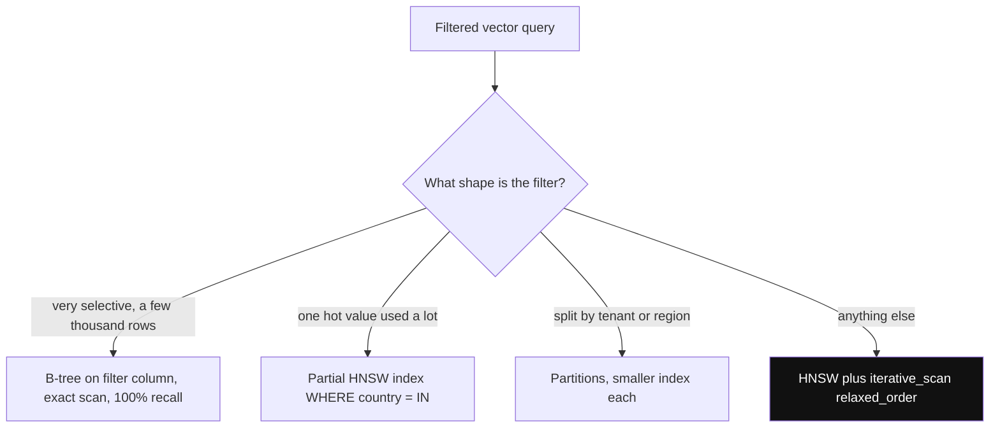

*Diagram:* Filter ki shape dekh ke tool chuno; iterative scan general default hai aur baaki teen special cases ke liye hain.

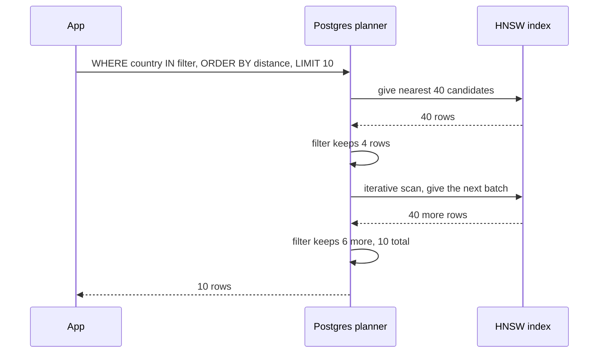

```sql
BEGIN;
SET LOCAL hnsw.iterative_scan = relaxed_order;
SET LOCAL hnsw.ef_search = 100;
-- relaxed_order thoda out of order ho sakta hai, isliye chhote result ko dobara sort karo
WITH hits AS MATERIALIZED (
    SELECT id, content, embedding <=> $1 AS distance
    FROM policy_chunks
    WHERE country = 'IN' AND is_active
    ORDER BY embedding <=> $1
    LIMIT 10
)
SELECT * FROM hits ORDER BY distance;
COMMIT;
```

**Code kya karta hai:**
- Iterative scan sirf is transaction ke liye on karta hai, baaki queries default behaviour pe rehti hain.
- `MATERIALIZED` Postgres ko CTE outer query me merge karne se rokta hai, taaki outer `ORDER BY distance` `relaxed_order` ki chhoti ordering galtiyan theek kare.
- Filter aur vector order ek hi SQL statement me rehte hain. App me koi post-filter code nahi.

**Interview tip:** "Ise test kaise karoge?" Jawab: "Har filter value ke liye row count aur recall@10 ko exact scan se compare karunga. Production me 'k se kam rows aayi' ko metric ki tarah track karunga."

**Common galti:**
- Kam results theek karne ke liye har query ka `ef_search` 1000 kar dena. Sabki latency badhti hai; asli fix iterative scan ya partial index hai.

## pgvector me quantization: halfvec aur binary

**Ek line me:** table me full vectors rakho, par index chhoti copy ka banao (`halfvec` = aadha size, `bit` = 1/32 size), phir top candidates ko full vectors se re-rank karo.

**Ye kyun chahiye:** HNSW tabhi tez hai jab index RAM me ho. 20 million × 1536 floats = 123 GB. Quantization hot index ko 61 GB (`halfvec`) ya lagbhag 4 GB (`bit`) tak la sakta hai.

**Aise socho:** pehle exam papers cover page ke total se sort karo (jaldi, rough). Phir sirf top 50 papers dhyaan se dobara check karo.

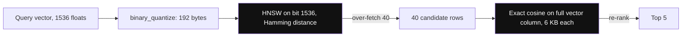

*Diagram:* Rough pass chhote 192-byte codes me search karta hai; exact pass sirf 40 rows ke full vectors padhta hai, jisse recall wapas aata hai.

**Kaise kaam karta hai, step by step:**
1. **Half precision:** `embedding::halfvec(1536)` index karo. Zyada tar text models me recall mushkil se badalta hai, aur memory aadhi.
2. **Binary quantization:** `binary_quantize(embedding)` har positive number ko 1 aur baaki ko 0 banata hai. 1536 dims → 192 bytes.
3. Akele binary me recall kaafi girta hai. To Hamming distance se 4–10 guna zyada candidates lao (final 5 ke liye maan lo 40), phir real column pe exact `<=>` se dobara sort karo.
4. Binary zyada dims (1024+) wale models pe best chalta hai. 384 dims pe 1 bit per dim aksar bahut rough hai.
5. Ship karne se pehle apne data pe exact search ke against recall@10 hamesha naapo.

```sql
-- Half-precision expression index; query me bhi same cast hona chahiye
CREATE INDEX ON policy_chunks USING hnsw ((embedding::halfvec(1536)) halfvec_cosine_ops);
SELECT id FROM policy_chunks ORDER BY embedding::halfvec(1536) <=> $1::halfvec(1536) LIMIT 5;

-- Binary quantization index plus exact re-rank
CREATE INDEX ON policy_chunks USING hnsw ((binary_quantize(embedding)::bit(1536)) bit_hamming_ops);
SELECT id, content FROM (
    SELECT id, content, embedding FROM policy_chunks
    ORDER BY binary_quantize(embedding)::bit(1536) <~> binary_quantize($1)
    LIMIT 40                                 -- rough distance se zyada lao
) candidates
ORDER BY embedding <=> $1                    -- sirf 40 rows pe exact distance
LIMIT 5;
```

**Code kya karta hai:**
- Table full `vector(1536)` values rakhti hai; sirf index chhota version store karta hai.
- Query ka expression index expression se bilkul match hona chahiye, warna index use nahi hoga.
- Andar wali query tez rough pass hai; bahar wala `ORDER BY` 40 rows pe exact re-rank hai, jiska kharcha lagbhag zero.

**Interview tip:** "Re-ranking ke saath binary quantization lagbhag 3% memory pe zyada tar recall bacha leta hai. Badle me har query zyada candidates leti hai aur re-rank ke liye full vectors padhne padte hain."

**Common galti:**
- Re-rank step ke bina binary quantization ship karna aur kharab results ka dosh model ko dena.

## ⭐ Postgres me hybrid search: tsvector plus vectors with RRF

**Ek line me:** ek hi SQL statement me full-text search aur vector search chalao aur Reciprocal Rank Fusion se merge karo, taaki exact words (policy codes, naam) aur matlab dono gine jaayein.

**Ye kyun chahiye:** vectors `LTA-2024`, `Form 16` ya employee ID jaise exact tokens miss karte hain. Keyword search "baby ke baad chhutti" vs "maternity leave" jaise paraphrase miss karta hai. Theory [Hybrid Search](../09-rag/04-hybrid-search.md) me hai; yahan pure Postgres me.

**Aise socho:** do shop assistants store me dhoondhte hain, ek product label se, ek "tumhara matlab kya tha" se. Jo items dono laayein, un pe bharosa karo.

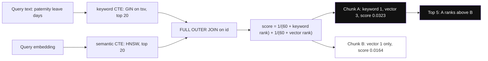

*Diagram:* Do indexes alag alag rank karte hain aur sirf ranks fuse hote hain, isliye jis chunk pe dono sahmat hain (A) woh ek hi list me top wale (B) se aage aata hai.

**Kaise kaam karta hai, step by step:**
1. Generated `tsvector` column aur uspe GIN index add karo. Postgres har insert aur update pe ise khud update rakhta hai.
2. Semantic CTE: `embedding <=> $1` se top 20, `RANK()` uska rank.
3. Keyword CTE: `tsv @@ query` wali rows me `ts_rank_cd(tsv, query)` se top 20.
4. Dono lists ko `id` pe `FULL OUTER JOIN` karo aur har row ko jis list me hai usse `1/(60 + rank)` score do.
5. Worked example: jo chunk keyword me 1st aur vector me 3rd hai uska score 1/61 + 1/63 ≈ 0.0323. Jo sirf vector me 1st hai uska 1/61 ≈ 0.0164. Agreement jeetta hai.
6. Note: `ts_rank_cd` asli BM25 nahi hai. Agar keyword quality bahut matter karti hai, to ParadeDB ka `pg_search` jaise extensions Postgres me BM25 index add karte hain.

```sql
ALTER TABLE policy_chunks
    ADD COLUMN tsv tsvector GENERATED ALWAYS AS (to_tsvector('english', content)) STORED;
CREATE INDEX ON policy_chunks USING gin (tsv);

-- $1 = query embedding, $2 = query text
WITH semantic AS (
    SELECT id, RANK() OVER (ORDER BY embedding <=> $1) AS rank
    FROM policy_chunks
    ORDER BY embedding <=> $1
    LIMIT 20
),
keyword AS (
    SELECT id, RANK() OVER (ORDER BY ts_rank_cd(tsv, q) DESC) AS rank
    FROM policy_chunks, plainto_tsquery('english', $2) AS q
    WHERE tsv @@ q
    ORDER BY ts_rank_cd(tsv, q) DESC
    LIMIT 20
)
SELECT COALESCE(s.id, k.id) AS id,
       COALESCE(1.0 / (60 + s.rank), 0) + COALESCE(1.0 / (60 + k.rank), 0) AS rrf_score
FROM semantic s
FULL OUTER JOIN keyword k ON s.id = k.id
ORDER BY rrf_score DESC
LIMIT 5;
```

**Code kya karta hai:**
- Generated column ki wajah se app ko text index update karna yaad nahi rakhna padta.
- Har CTE apna index use karti hai: vector part ke liye HNSW, keyword part ke liye GIN.
- `FULL OUTER JOIN` sirf ek side me mili rows bhi rakhta hai; `COALESCE(..., 0)` missing side ko zero score deta hai.
- Sirf ranks use hote hain, to cosine distance aur `ts_rank_cd` ke alag scales kabhi mix nahi hote.

**Interview tip:** "Postgres me hybrid ek SQL statement hai, do CTEs aur RRF. Ek round trip, ek transaction snapshot, aur dono sides ko same filters aur permissions dikhte hain."

**Common galti:**
- `ts_rank_cd` aur cosine similarity seedha jod dena. Scales alag hain; ranks (RRF) use karo.
- Hinglish ya Hindi text pe `'english'` config use karna aur sochna ki stemming ajeeb kyun hai. Mixed-language text ke liye `'simple'` use karo.

## ⭐ Ek poora chhota app: psycopg ke saath HR policy search

**Ek line me:** Bengaluru ki ek company ka HR policy bot jo policy chunks Postgres me rakhta hai aur "paternity leave kitne din ki hai?" ka jawab filtered vector search se deta hai.

**Ye kyun chahiye:** ye saare sections jodta hai: schema, bulk insert, index, iterative scan wali filtered query, aur safe per-transaction settings.

**Aise socho:** HR team ki handbook, paragraphs me kati hui, har paragraph pe country ka tag aur uske "matlab wale numbers" saath me rakhe hue.

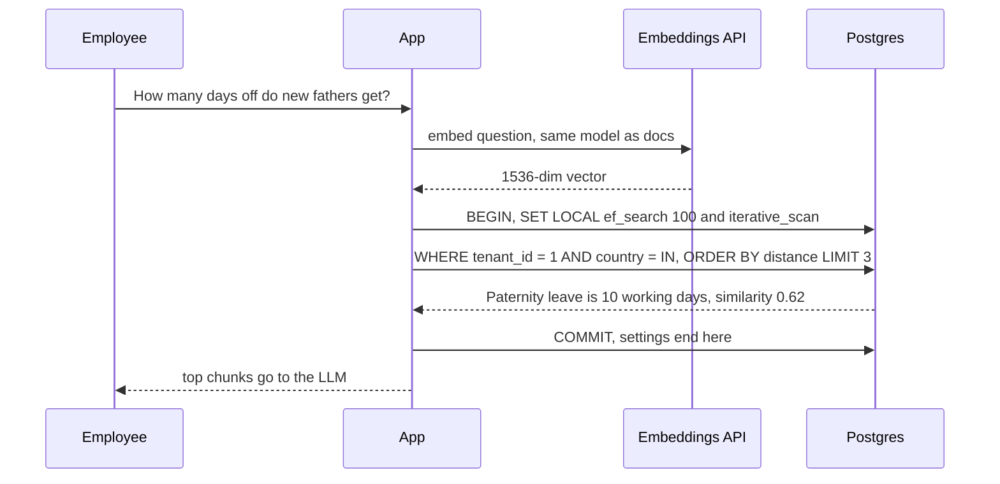

*Diagram:* Ek request: same model se embed, phir transaction ke andar filtered query, taaki SET LOCAL tuning COMMIT pe khatam ho jaaye.

**Kaise kaam karta hai, step by step:**
1. Table ek baar banao, filters ke liye tenant aur country columns ke saath.
2. Chunks ko batches me embed karo aur insert karo.
3. Pehle bulk load ke baad HNSW index banao (row by row badhane se tez).
4. Query time pe sawal embed karo, filtered query chalao, top chunks LLM ko do.

```python
# pip install "psycopg[binary]" pgvector numpy openai
import numpy as np
import psycopg
from pgvector.psycopg import register_vector
from openai import OpenAI

client = OpenAI()
conn = psycopg.connect("postgresql://app@localhost/hr", autocommit=True)
conn.execute("CREATE EXTENSION IF NOT EXISTS vector")
register_vector(conn)                      # psycopg numpy arrays ko vector ki tarah bhej sake

conn.execute("""
CREATE TABLE IF NOT EXISTS policy_chunks (
    id         bigserial PRIMARY KEY,
    tenant_id  int  NOT NULL,
    country    text NOT NULL,
    content    text NOT NULL,
    embedding  vector(1536) NOT NULL,
    model      text NOT NULL DEFAULT 'text-embedding-3-small'
)""")

def embed(texts: list[str]) -> list[np.ndarray]:
    resp = client.embeddings.create(model="text-embedding-3-small", input=texts)
    return [np.array(d.embedding, dtype=np.float32) for d in resp.data]
```

**Code kya karta hai:**
- `register_vector(conn)` psycopg 3 ko `vector` type bhejna aur padhna sikhata hai; ye extension banne ke baad hi chalna chahiye.
- `model` column record karta hai ki har vector kis embedding model ne banaya, jo baad me migrations ke liye chahiye.
- `embed` ek API call me texts ka batch leta hai, jo har chunk ke liye ek call se kaafi sasta hai.

```python
chunks = [
    (1, "IN", "Paternity leave is 10 working days, to be taken within 6 months of birth."),
    (1, "IN", "Maternity leave is 26 weeks as per the Maternity Benefit Act."),
    (1, "SG", "Childcare leave in Singapore is 6 days per year."),
]
vectors = embed([c[2] for c in chunks])
with conn.cursor() as cur:
    cur.executemany(
        "INSERT INTO policy_chunks (tenant_id, country, content, embedding) VALUES (%s, %s, %s, %s)",
        [(t, c, text, v) for (t, c, text), v in zip(chunks, vectors)],
    )
conn.execute("SET maintenance_work_mem = '2GB'")
conn.execute("CREATE INDEX IF NOT EXISTS policy_hnsw ON policy_chunks "
              "USING hnsw (embedding vector_cosine_ops)")
conn.execute("CREATE INDEX IF NOT EXISTS policy_filter ON policy_chunks (tenant_id, country)")
```

**Code kya karta hai:**
- `executemany` se saare chunks ek batch me insert karta hai; millions of rows ke liye `COPY ... WITH (FORMAT BINARY)` use karo, jo pgvector-python bhi support karta hai.
- Bulk load ke baad HNSW banata hai, aur filter columns pe B-tree, taaki bahut selective filter pe planner exact scan chun sake.

```python
def search(question: str, tenant_id: int, country: str, k: int = 3):
    qvec = embed([question])[0]
    with conn.transaction():               # SET LOCAL sirf is transaction tak
        conn.execute("SET LOCAL hnsw.ef_search = 100")
        conn.execute("SET LOCAL hnsw.iterative_scan = relaxed_order")
        rows = conn.execute("""
            WITH hits AS MATERIALIZED (
                SELECT content, embedding <=> %(q)s AS dist
                FROM policy_chunks
                WHERE tenant_id = %(t)s AND country = %(c)s
                ORDER BY embedding <=> %(q)s
                LIMIT %(k)s)
            SELECT content, 1 - dist AS similarity FROM hits ORDER BY dist
        """, {"q": qvec, "t": tenant_id, "c": country, "k": k}).fetchall()
    return rows

for content, sim in search("How many days off do new fathers get?", 1, "IN"):
    print(f"{sim:.3f}  {content}")
```

**Code kya karta hai:**
- Sawal ko usi model se embed karta hai jisse documents bane. Models mix karne se distances toot jaate hain.
- `conn.transaction()` ke saath `SET LOCAL` tuning settings ko same pooled connection ki doosri requests me leak hone se rokta hai.
- Tenant filter SQL me hai, to ek tenant doosre tenant ke chunks kabhi nahi dekh sakta, app ke post-processing me bug ho tab bhi.
- Similarity (1 − cosine distance) lautata hai taaki app LLM call se pehle kamzor matches, maan lo 0.3 se neeche, hata sake.

**Interview tip:** "`SET` ki jagah `SET LOCAL` kyun?" Jawab: "Transaction mode wale PgBouncer ke peeche plain `SET` server connection pe chipak jaata hai aur doosre users ki queries me leak hota hai. `SET LOCAL` transaction ke saath khatam."

**Common galti:**
- `CREATE EXTENSION` se pehle `register_vector` call karna. Fail hota hai kyunki `vector` type abhi exist nahi karta.

## pgvectorscale: bade data ke liye StreamingDiskANN

**Ek line me:** pgvectorscale ek extra Postgres extension hai (Timescale ka, ab Tiger Data) jo SSDs aur compressed vectors ke liye bana `diskann` index add karta hai, taaki pgvector-type data RAM me fit hone se aage scale kare.

**Ye kyun chahiye:** achhi latency ke liye HNSW ko apna graph RAM me chahiye. 50 million vectors pe iska matlab sau GB memory ho sakta hai. DiskANN-style graphs aise design hote hain ki zyada tar reads SSD pe jaayein, memory me chhoti compressed copy ke saath.

**Aise socho:** har file desk (RAM) pe rakhne ki jagah, desk pe har file ka ek line summary rakho aur poori file almari (SSD) se sirf final shortlist ke liye nikalo.

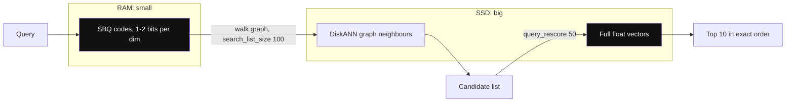

*Diagram:* Compressed codes graph walk ko sasta guide karte hain; sirf final rescore candidates SSD se full vectors padhte hain.

**Kaise kaam karta hai, step by step:**
1. `vector` aur `vectorscale` dono extensions install karo. Column type `vector` hi rehta hai.
2. `USING diskann (embedding vector_cosine_ops)` se build karo. Default `storage_layout = memory_optimized` Statistical Binary Quantization (SBQ) use karta hai, lagbhag 1–2 bits per dimension.
3. Build knobs: `num_neighbors` (default 50), `search_list_size` (default 100).
4. Query knobs: `diskann.query_search_list_size` (default 100) aur `diskann.query_rescore` (default 50, kitne candidates full vectors se re-score hote hain). Zyada accuracy ke liye pehle `query_rescore` badhao.
5. Label filtering: index me `smallint[]` labels column add karo aur `labels && ARRAY[1, 3]` se filter karo; filter graph search ke andar lagta hai.
6. Iska apna benchmark (50 million 768-dim Cohere vectors) 99% recall pe Pinecone ke storage-optimized index se kaafi kam p95 latency claim karta hai. Vendor benchmarks ko hint maano, aur apne data pe test karo.

```sql
CREATE EXTENSION IF NOT EXISTS vectorscale CASCADE;
CREATE INDEX policy_diskann ON policy_chunks USING diskann (embedding vector_cosine_ops);
SET diskann.query_rescore = 200;
SELECT id FROM policy_chunks ORDER BY embedding <=> $1 LIMIT 10;
```

**Interview tip:** "Postgres 10 million vectors se aage ja sakta hai: halfvec ya binary indexes, pgvectorscale ka DiskANN, partitioning, aur query load ke liye read replicas. Tuning ka kaam chahiye, par ye hard wall nahi hai."

**Common galti:**
- Ye maan lena ki pgvectorscale har managed Postgres pe milta hai. Pehle provider ki extension list check karo; bahut pgvector support karte hain par pgvectorscale nahi.

## Managed Postgres options

**Ek line me:** lagbhag har managed Postgres pgvector ke saath aata hai; fark version, extra extensions aur ek node pe kitni RAM khareed sakte ho, isme hai.

**Ye kyun chahiye:** zyada tar teams Postgres haath se nahi chalati. Provider tay karta hai kaun sa pgvector version (aur isliye kaun se features, jaise iterative scans) milega.

**Aise socho:** same recipe, alag restaurant kitchens. Dish same hai, par ek kitchen ka oven bada hai.

**Kaise kaam karta hai, step by step:**

| Provider | Vector support | Notes |
|---|---|---|
| Amazon RDS / Aurora PostgreSQL | pgvector | Aurora Optimized Reads RAM se bade indexes ke liye local NVMe ko cache ki tarah use kar sakta hai |
| Google Cloud SQL for PostgreSQL | pgvector | plain managed Postgres |
| Google AlloyDB | pgvector plus ScaNN index (`alloydb_scann` extension) | Postgres ke andar Google ka apna ANN index |
| Azure Database for PostgreSQL | pgvector, DiskANN index (`pg_diskann`) | Postgres ke andar Microsoft ka DiskANN |
| Supabase | pgvector | app developers me popular, client libraries me vector helpers |
| Neon | pgvector | branching ke saath serverless Postgres, scale to zero |
| Timescale / Tiger Cloud | pgvector plus pgvectorscale | pgvectorscale ka ghar |

1. `SELECT extversion FROM pg_extension WHERE extname = 'vector';` check karo. Iterative scans ke liye 0.8.0 ya naya chahiye.
2. Har instance ki max RAM check karo. HNSW index shared buffers plus OS page cache me fit hona chahiye.
3. Check karo ki us plan pe `maintenance_work_mem` aur parallel workers badha sakte ho ya nahi.

**Interview tip:** "Managed Postgres pe mere pehle sawal: pgvector version, har node ki RAM, aur pgvectorscale ya ScaNN jaise custom index extensions allowed hain ya nahi."

**Common galti:**
- Iterative scans ke around design karna jabki provider abhi bhi pgvector 0.7 chala raha hai.

## ⭐ Elasticsearch aur OpenSearch: dense_vector aur knn_vector

**Ek line me:** agar keyword search ke liye already Elasticsearch ya OpenSearch chalate ho, to usi index me vector field add karo aur ek query me filters ke saath BM25 plus kNN hybrid search pao.

**Ye kyun chahiye:** search teams ke paas cluster, main DB se sync pipeline, analyzers aur dashboards pehle se hain. Vector field add karne se doosra retrieval system nahi chahiye, aur wahan BM25 asli wala hai (Postgres `ts_rank` se behtar). Basics ke liye [Search with Elasticsearch](../05-db/08-search.md) dekho.

**Aise socho:** ek badi library jiska catalogue zabardast hai (BM25), usi building me "milti-julti books dhoondho" desk khol deti hai.

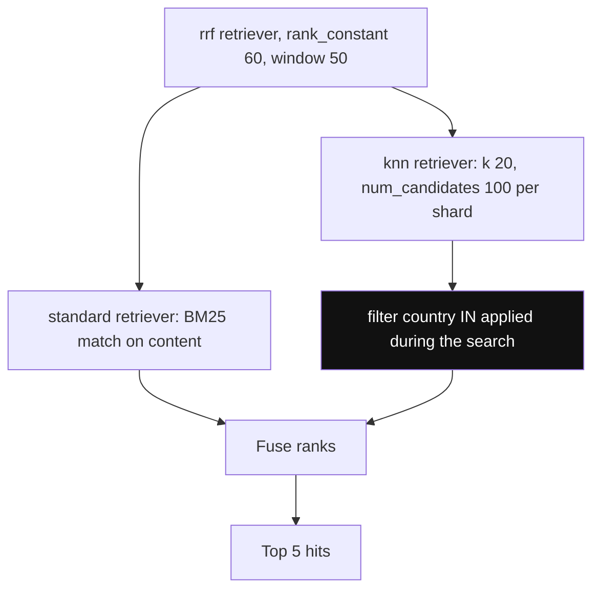

*Diagram:* Ek request same index pe BM25 aur kNN saath chalati hai aur ranks fuse karti hai; filter knn ke andar hai, isliye woh pre-filter hai.

**Kaise kaam karta hai, step by step:**
1. **Elasticsearch:** `dense_vector` field ko `dims`, `similarity` aur `index_options` ke saath map karo. 9.x me vectors default se quantized hain: chhote dims ke liye `int8_hnsw` aur 9.1 se 384+ dims ke liye `bbq_hnsw` (Better Binary Quantization, 1 bit per dim plus re-scoring). Naye releases higher licence tiers pe disk-friendly `bbq_disk` add karte hain.
2. `knn` retriever se query karo: `k` (results) aur `num_candidates` (har shard pe candidates; recall knob, `ef_search` jaisa). Filters `knn.filter` ke andar jaate hain taaki search ke dauran lagein, baad me nahi.
3. Hybrid: `rrf` retriever ek `standard` (BM25) retriever aur ek `knn` retriever ko wrap karta hai. `linear` retriever iski jagah weighted score fusion karta hai. RRF ke liye apna licence tier check karo.
4. **OpenSearch:** `index.knn: true` set karo aur `knn_vector` ko `dimension`, `space_type` aur `method` (HNSW ya IVF) ke saath `faiss` ya `lucene` engine pe map karo. `nmslib` deprecated hai.
5. OpenSearch me memory bachana: `mode: on_disk` with `compression_level` (`32x` tak), jo compressed vectors memory me rakhta hai aur disk se re-score karta hai.
6. OpenSearch hybrid: `hybrid` query plus search pipeline jo scores normalize karke jodti hai (`normalization-processor`), ya `score-ranker-processor` se RRF.
7. Cost note: HNSW graphs har Lucene segment me rehte hain, to heavy updates se segment merges hote hain jo graphs dobara banate hain aur bahut CPU lete hain.

```json
PUT hr-policies
{
  "mappings": {
    "properties": {
      "content":   { "type": "text" },
      "country":   { "type": "keyword" },
      "embedding": { "type": "dense_vector", "dims": 1536, "similarity": "cosine",
                     "index_options": { "type": "bbq_hnsw" } }
    }
  }
}

GET hr-policies/_search
{
  "size": 5,
  "retriever": {
    "rrf": {
      "retrievers": [
        { "standard": { "query": { "match": { "content": "paternity leave days" } } } },
        { "knn": { "field": "embedding", "query_vector": [0.012, -0.044, 0.031],
                   "k": 20, "num_candidates": 100,
                   "filter": { "term": { "country": "IN" } } } }
      ],
      "rank_window_size": 50,
      "rank_constant": 60
    }
  }
}
```

**Code kya karta hai:**
- Ek index me text, ek keyword filter field aur vector hai; `bbq_hnsw` graph ke liye 1-bit copy rakhta hai aur full floats se re-score karta hai.
- `rrf` retriever BM25 aur kNN chalata hai, phir `rank_constant` 60 ke saath ranks fuse karta hai, SQL version wala hi RRF formula.
- `knn` ke andar wala `filter` pre-filter hai, to selective filter pe bhi `k` results milte hain.
- Query vector yahan chhota dikhaya hai; asli use me usme 1536 numbers hote hain.

**Interview tip:** "Catalogue search ke liye hum already Elasticsearch chalate hain. Main `dense_vector` field add karunga, existing indexing pipeline se embeddings backfill karunga, aur RRF retriever use karunga. Koi naya datastore nahi."

**Common galti:**
- `num_candidates` ko `k` ke barabar rakhna. Recall girta hai; `num_candidates` lagbhag 5–10 × `k` se shuru karo.
- Live index pe `index_options` badalna aur umeed karna ki purane segments badal jaayenge. Sirf naye segments badalte hain; sab convert karne ke liye reindex karo.

## Redis, MongoDB Atlas aur baaki

**Ek line me:** Redis bahut kam latency ke liye in-memory vector search deta hai (semantic caching, session memory); MongoDB Atlas tumhare documents ke paas `$vectorSearch` add karta hai; bahut se aur databases me bhi ab vector type hai.

**Ye kyun chahiye:** teams vectors wahin chahti hain jahan app data already hai. Mongo-first app sirf vectors ke liye Postgres me sync nahi karna chahti.

**Aise socho:** har badi app me ab "UPI" option hai. Tum wahi use karte ho jo phone me pehle se hai.

**Kaise kaam karta hai, step by step:**

**Redis.**
1. **Redis Query Engine** (pehle RediSearch, Redis 8 me built in): hashes ya JSON pe `FT.CREATE` index banao, `VECTOR` field ke saath jo `FLAT`, `HNSW` ya (Redis 8.2+) compression wala `SVS-VAMANA` use kare. `FT.SEARCH` me tag ya numeric filters ke saath `KNN` se query karo.
2. **Vector sets** (Redis 8 ka naya native type): `VADD` element ko uske vector ke saath add karta hai, `VSIM` milte-julte dhoondhta hai. Vectors default se 8-bit quantization me store hote hain. `SETATTR` se set attributes `FILTER` se filter ho sakte hain.
3. Sab kuch RAM me rehta hai: LLM answers ke semantic cache (hazaron se kuch million entries) ke liye badhiya, 100 million vectors ke liye mehnga.

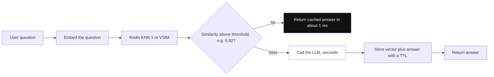

*Diagram:* Semantic cache ke roop me Redis LLM ke aage baithta hai: kaafi milta-julta purana sawal ~1 ms me stored jawab deta hai, aur sirf miss pe LLM ka kharcha hota hai.

```bash
# Redis Query Engine: faq: prefix wale hashes ka index
FT.CREATE faq_idx ON HASH PREFIX 1 faq: SCHEMA lang TAG embedding VECTOR HNSW 6 TYPE FLOAT32 DIM 1536 DISTANCE_METRIC COSINE
FT.SEARCH faq_idx "(@lang:{hi})=>[KNN 5 @embedding $vec AS score]" PARAMS 2 vec "<1536 float32 bytes>" SORTBY score DIALECT 2

# Vector sets: commands dikhane ke liye 3-dim toy vectors
VADD faq:vs VALUES 3 0.12 0.80 0.31 faq:17 SETATTR '{"lang":"hi"}'
VSIM faq:vs VALUES 3 0.10 0.79 0.30 COUNT 5 WITHSCORES FILTER '.lang == "hi"'
```

**MongoDB Atlas Vector Search.**
1. `type: "vectorSearch"` ka search index banao, `vector` field (`numDimensions`, `similarity`, optional `quantization: "scalar"` ya `"binary"`) aur `filter` fields ke saath.
2. `$vectorSearch` aggregation stage se query karo: `queryVector`, `numCandidates` (recall knob), `limit`, aur pehle se declared filter fields pe `filter`.
3. Atlas me ye alag search nodes pe chalta hai, to vector load main database ko nuksaan nahi karta. Self-managed Community aur Enterprise editions me bhi search aur vector search aa raha hai (2025 se preview).

```javascript
db.policies.createSearchIndex({
  name: "policy_vec", type: "vectorSearch",
  definition: { fields: [
    { type: "vector", path: "embedding", numDimensions: 1536, similarity: "cosine", quantization: "scalar" },
    { type: "filter", path: "country" }
  ] }
});
db.policies.aggregate([
  { $vectorSearch: { index: "policy_vec", path: "embedding", queryVector: qvec,
                     numCandidates: 150, limit: 5, filter: { country: "IN" } } },
  { $project: { content: 1, score: { $meta: "vectorSearchScore" } } }
]);
```

**Code kya karta hai:**
- Redis: index `faq:` ke neeche har hash ko dekhta hai; query tag filter ko KNN 5 ke saath mix karti hai aur distance se sort karti hai.
- Vector sets: ek key poora set rakhti hai; `VSIM` wo 5 sabse paas wale elements lautata hai jinka attribute `lang` `hi` hai.
- Mongo: `$vectorSearch.filter` me use karne se pehle `country` ko index me `filter` field declare karna padta hai.

**Baaki databases, short me:**

| Database | Vector support | Kab fit |
|---|---|---|
| SQLite + `sqlite-vec` | `vec0` virtual table, zyada tar brute-force search | mobile, desktop, edge, local agents |
| ClickHouse | vector similarity index (HNSW), 25.8 me GA, bf16/int8/binary quantization ke saath | analytics aur log tables pe vector search |
| Oracle Database 23ai / 26ai | in-memory aur partition-based indexes ke saath `VECTOR` type | Oracle shops |
| SQL Server 2025 / Azure SQL | `VECTOR` type, DiskANN index | Microsoft shops |
| Cassandra / DataStax Astra | SAI (storage-attached index) ke saath vector type | already Cassandra pe |
| DuckDB `vss` | HNSW extension | notebooks aur local analysis |

**Interview tip:** "LLM semantic cache ke liye Redis chunoonga: sub-millisecond lookups, built-in TTLs, aur data chhota hai. Main RAG corpus ke liye primary database ya vector DB."

**Common galti:**
- 50 million vectors Redis me daal dena aur phir 300+ GB RAM ka bill bharna.
- Mongo me aise field pe filter karna jo vector index me `filter` declare nahi hai; query error deti hai.

## FAISS aur baaki libraries: database nahi

**Ek line me:** FAISS ek tez C++ library hai (Python bindings ke saath) jo tumhare apne process me ANN indexes banati hai; ye search deti hai, aur persistence, filtering, updates aur serving tum khud banate ho.

**Ye kyun chahiye:** kabhi kabhi bina network hop ke raw speed chahiye: offline batch jobs, 100 million images ka deduplication, research, ya bade system ke andar engine (kai vector DBs andar FAISS ya waisa code use karte hain).

**Aise socho:** FAISS car ka engine hai. Vector DB seats, brakes aur insurance ke saath poori car hai.

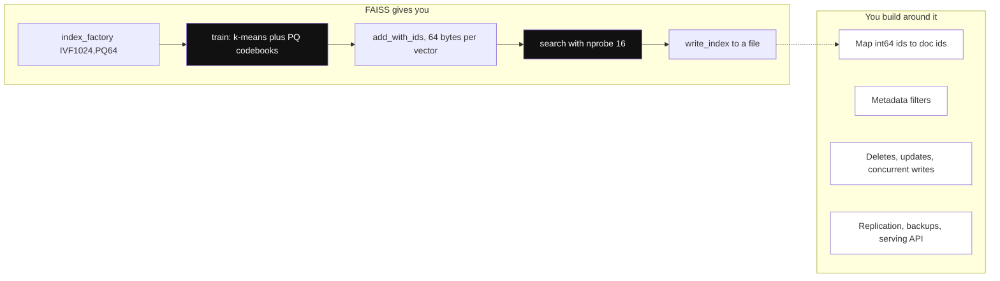

*Diagram:* FAISS train se search tak index pipeline deta hai; database banane wali saari cheezein dim box me hain jo tumhe khud banani padti hain.

**Kaise kaam karta hai, step by step:**

| FAISS index | Idea | 768-dim vector ki memory | Kab use karo |
|---|---|---|---|
| `IndexFlatL2` / `IndexFlatIP` | exact, sabse compare | 3 KB | < 1 million, recall ke liye ground truth |
| `IndexHNSWFlat` | HNSW graph | 3 KB + links | tez, high recall, RAM me fit |
| `IndexIVFFlat` | clusters, `nprobe` lists scan | 3 KB | tez build, `train()` chahiye |
| `IndexIVFPQ` | clusters plus product quantization | jaise 64 bytes | 100 million se billions |

1. `"IVF1024,PQ64"` jaisi factory string se banao: 1024 clusters, har vector 64 bytes me compressed.
2. IVF aur PQ indexes ko sample pe `train()` chahiye (kam se kam ~40 × clusters jitne vectors).
3. GPU: `faiss-gpu` build (ab NVIDIA cuVS support ke saath) bade batches ke liye 10–100 × tez build aur search karta hai.
4. Jo tumhe khud banana hai: save aur load (`write_index` / `read_index`), FAISS integer IDs ko document IDs se map karna, metadata filtering (FAISS me sirf basic ID selectors hain), deletes (`remove_ids` mehnga hai ya kuch index types pe support nahi, HNSW samet), concurrent writes, replication aur backups.
5. Rishtedaar: **hnswlib** (chhoti, tez, sirf-HNSW library) aur Google ka **ScaNN** (anisotropic quantization, CPU pe bahut tez, AlloyDB ke andar bhi).

```python
import faiss, numpy as np

d = 768
xb = np.random.rand(100_000, d).astype("float32")   # asli embeddings ki jagah
faiss.normalize_L2(xb)                              # unit vectors pe cosine = inner product
index = faiss.index_factory(d, "IVF1024,PQ64", faiss.METRIC_INNER_PRODUCT)
index.train(xb)                                     # clusters aur PQ codebooks seekho
index.add_with_ids(xb, np.arange(len(xb)))          # tumhare apne int64 IDs
index.nprobe = 16                                   # har query me kitni lists scan

xq = xb[:5]
scores, ids = index.search(xq, 10)                  # har query ke top 10
faiss.write_index(index, "policies.faiss")          # persistence tumhari zimmedari
```

**Code kya karta hai:**
- Vectors normalize karta hai taaki inner product cosine similarity ke barabar ho.
- 1024 clusters aur PQ codebooks train karta hai, phir 100k vectors lagbhag 64 bytes each pe add karta hai (300 MB ki jagah lagbhag 6 MB).
- `nprobe` recall knob hai, `ivfflat.probes` jaisa.
- Index file me likhta hai. Reload, naye docs sync karna aur filtering tumhara code hai.

**Interview tip:** "Offline ya batch similarity ke liye, ya engine ki tarah, FAISS sahi jawab hai. Online, multi-tenant, filtered, baar-baar update hone wale workload ke liye main iske around haath se database nahi banaunga."

**Common galti:**
- Har web server ke andar FAISS chalana aur deploy pe rebuild karna. Har pod ki apni copy, restart pe updates gayab, aur pods aapas me agree nahi karte.

## ⭐ Kya mujhe dedicated vector DB chahiye? Decision guide

**Ek line me:** jo already chalate ho usse shuru karo; dedicated vector DB pe tabhi jao jab scale, query load, filtering ya multi-tenancy naap ke usse bade ho jaayein.

**Ye kyun chahiye:** "kaun sa vector DB" ke peeche asli interview sawal yahi hai. Senior jawab numbers use karte hain, brand names nahi.

**Aise socho:** ek sofa shift karne ke liye truck nahi khareedte. Shifting kaafi badi ho to tempo kiraye pe lete ho, aur tumhe roughly pata hota hai wo point kahan hai.

**Kaise kaam karta hai, step by step:**
1. **Vectors gino.** Chunks × versions × tenants. Example: 200k documents × 15 chunks = 3 million vectors.
2. **Memory nikalo.** 3 million × 1536 × 4 bytes ≈ 18 GB raw; HNSW index lagbhag utna hi aur. `halfvec` dono aadha karta hai.
3. **QPS aur p95 target socho.** p95 < 100 ms pe 50 QPS ek Postgres ke liye aasaan; p95 < 20 ms pe 5,000 QPS nahi.
4. **Filters check karo.** Kam, broad filters har jagah theek. Bahut tenants jinke chhote slices hain ya bahut selective filters, filter-aware graphs wale engines ko favour karte hain.
5. **Write churn check karo.** Roz millions rows re-embed karna Postgres (MVCC bloat, vacuum) aur Lucene (merges) ko nuksaan karta hai.
6. Neeche ki table se chuno, phir apne data pe recall aur latency benchmark karo.

| Situation (rough numbers) | Achha default |
|---|---|
| ~100k vectors se kam, zyada tar read | in-memory NumPy ya FAISS flat, ya bina index pgvector |
| ~5–10 million vectors se kam, Postgres already stack me | ⭐ HNSW ke saath pgvector |
| ~10–50 million, Postgres team, moderate QPS | `halfvec`/binary indexes ke saath pgvector, pgvectorscale, partitioning, replicas |
| Search ke liye already Elasticsearch / OpenSearch | unka kNN field plus RRF hybrid |
| Mongo-first app | Atlas Vector Search |
| Semantic cache ya session memory, chhota aur hot | Redis |
| Offline batch, dedup, research | FAISS (bada ho to GPU) |
| 50–100 million+ vectors, hazaron QPS, heavy filtering, hazaron tenants, ya DB team nahi | dedicated vector DB ([page 31](31-vector-databases.md)) |

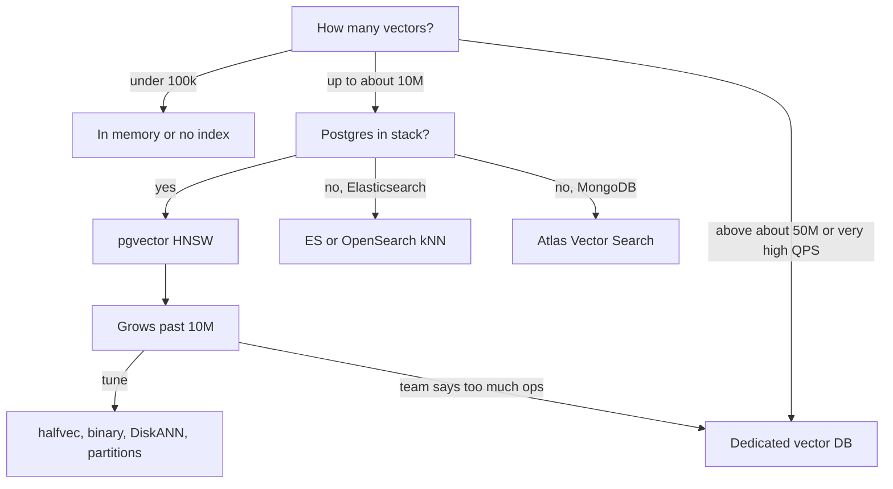

| | pgvector | Elasticsearch / OpenSearch | Redis | MongoDB Atlas | Dedicated (Qdrant, Pinecone, Milvus) | FAISS |
|---|---|---|---|---|---|---|
| App data ke saath consistency | same transaction | near real time (refresh ~1 s) | turant, RAM me | eventually consistent search nodes | alag copy | tumhara code |
| Hybrid keyword + vector | SQL me `tsvector` + RRF | best BM25, built-in RRF | Query Engine me text + vector | `$rankFusion` / combine stages | zyada tar me built-in | nahi |
| Filtered ANN | iterative scan, partial indexes | kNN me pre-filter | tag/numeric pre-filter | declared filter fields | strong, filter-aware graphs | sirf ID selectors |
| Har node pe comfortable scale | ~10–50M | har cluster me tens se hundreds of millions | RAM-bound | cluster tiers | billions (distributed) | billions (single process, PQ) |
| Already chal raha ho to ops cost | lagbhag zero | kam | kam | kam | naya system | system tum banao |

**Interview tip:** "3 million chunks aur Postgres already stack me, to pgvector HNSW: 18 GB vectors 64 GB instance pe fit, aur joins, ACID aur ek backup rehta hai. Lagbhag 50 million vectors pe, ya replicas ke baad bhi peak QPS pe p95 SLO tode, tab dobara sochunga."

**Common galti:**
- Bina numbers ke bolna "Postgres scale pe vector search nahi kar sakta". Bahut products pgvector pe tens of millions vectors chalate hain.
- Ulta: "hum sirf Postgres use karte hain" bol ke billions vectors ek Postgres node me thoosna.

## ⭐ Production concerns

**Ek line me:** mushkil pehli query nahi hai; mushkil hai index build time aur memory, updates aur vacuum, re-embedding migrations, aur filter-plus-ANN recall jo chupchaap girta hai.

**Ye kyun chahiye:** demos me 10,000 rows hoti hain aur koi update nahi. Production me 20 million rows, roz document edits, har saal naya embedding model, aur bahut alag size ke tenants hote hain.

**Aise socho:** restaurant kholna aasaan hai. Roz deliveries, safai aur menu changes ke saath chalana asli kaam hai.

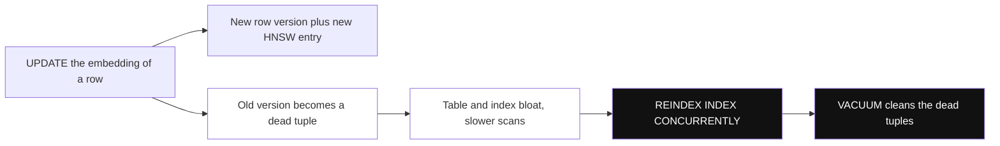

*Diagram:* Postgres me har update ek dead version chhod jaata hai; bahut rows badlein to pehle reindex, phir vacuum karo, jaisa neeche step 3 me hai.

**Kaise kaam karta hai, step by step:**
1. **Index build time aur memory.** 10 million × 1536 pe HNSW build me ghante lag sakte hain. Graph ke liye `maintenance_work_mem` me kaafi RAM do, parallel workers use karo, bulk loads ke baad build karo, aur live tables pe `CREATE INDEX CONCURRENTLY` use karo. Pehle replica-size test box pe build karne se time pata chal jaata hai.
2. **RAM sizing.** HNSW index memory me rakho: `pg_relation_size('policy_hnsw')` se size check karo. Agar index + hot data > RAM, to latency ms se das ms me kood jaati hai.
3. **Updates aur vacuum.** Postgres me `UPDATE` naya row version aur naya index entry likhta hai; purana VACUUM tak rehta hai. HNSW vacuum slow hai. pgvector docs suggest karte hain ki bahut rows badli hon to pehle `REINDEX INDEX CONCURRENTLY`, phir `VACUUM`. Unrelated updates pe embedding column mat chhuo (`view_count` jaise tez badalne wale fields alag table me rakho).
4. **Bade vectors aur TOAST.** 1536-dim `vector` (~6 KB) Postgres ki ~2 KB in-line limit se bada hai, to out of line store hota hai (TOAST). Exact scans zyada pages padhte hain; ANN index RAM me rakhne ki ek aur wajah.
5. **Re-embedding migration** (zero downtime):
   - `embedding_v2 vector(1024)` aur uska index add karo, `CONCURRENTLY` bana hua;
   - 1,000–10,000 rows ke batches me backfill, embedding API rate limit ke hisaab se throttle;
   - nayi writes dono columns bharein (dual write);
   - shadow-read: purani aur nayi queries saath chalao aur labelled set pe recall compare karo;
   - feature flag se reads switch karo, phir purana column aur index drop karo.
6. **Filter + ANN recall pitfalls.** "k se kam lautaya" rate aur har filter value ka recall track karo. 0.1% data wale tenants sabse bade tenant se alag behave karte hain. Iterative scans, partial indexes ya har bade tenant ke liye partitions use karo.
7. **Connection poolers.** `ef_search` aur iterative scan settings ke liye transactions ke andar `SET LOCAL` use karo.
8. **Monitoring.** p50/p95 latency, fixed eval set pe recall (weekly), index size vs RAM, dead tuples (`pg_stat_user_tables.n_dead_tup`), aur ingest pipeline me embedding API errors.

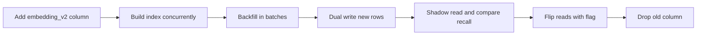

**Interview tip:** "Embedding models kaise switch karoge?" Jawab: "Kabhi in place nahi. Nayi column ya naya index, throttled batches me backfill, dual write, labelled set pe recall compare, flag ke peeche reads flip, phir purana drop. Purane aur naye vectors comparable nahi hain."

**Common galti:**
- 20 million rows pe ek transaction me `UPDATE policy_chunks SET embedding = ...` chalana. Table size double, index bloat, aur ghanton vacuum block.

## Common pitfalls

**Ek line me:** zyada tar pgvector aur in-database vector incidents kuch repeat hone wali galtiyon ki chhoti list se aate hain.

**Ye kyun chahiye:** interviewers inhi sawalon se dekhte hain ki tumne ise production me chalaya hai ya nahi.

**Aise socho:** roz ke raste ke wahi paanch gaddhe. Pata ho to bach ke nikal jaate ho.

**Kaise kaam karta hai, step by step:**

| Pitfall | Symptom | Fix |
|---|---|---|
| Operator class se operator match nahi | seq scan, slow queries | index aur `ORDER BY` me same distance, `EXPLAIN` check karo |
| HNSW scan ke baad filter | k se kam rows | iterative scan, partial index, partition |
| Kam data pe IVFFlat bana | baad me low recall | load ke baad banao, data bahut badhe to rebuild |
| Chhota `maintenance_work_mem` | HNSW build me ghante | build session ke liye badhao |
| Pooler ke peeche `SET` | settings requests ke beech leak | transaction me `SET LOCAL` |
| Query aur docs ke liye alag models | random jaise results | har row me `model` rakho, ek index ek model |
| Re-rank ke bina binary quantization | recall tezi se girta | 4–10× over-fetch, full vectors se re-rank |
| ES `num_candidates` bahut kam | recall chupchaap girta | 5–10 × `k`, naapo |
| Har web pod me FAISS | pods disagree, restart pe data gayab | central service ya asli database |

**Interview tip:** "Data load ke baad RAG answers kharab hue to pehle kya check karoge?" Jawab: "Eval set pe recall, 'k se kam' rate, index ab bhi use ho raha hai ya nahi (`EXPLAIN`), aur nayi rows ne same embedding model use kiya ya nahi."

**Common galti:**
- Sirf latency benchmark karna. Recall numbers ke bina tez index aur toota index me fark nahi pata chalta.

## Interview ke sawal

**Q: Hum Postgres me 4 million chunks chalate hain. Pinecone ya pgvector?**
pgvector. 4 million × 1536 × 4 bytes ≈ 25 GB, jo HNSW ke saath ek bade instance pe fit hai. Joins, transactions aur ek backup rehte hain. Lagbhag 50 million vectors pe ya peak QPS pe p95 SLO miss ho to dobara sochunga.

**Q: pgvector me HNSW vs IVFFlat?**
HNSW same latency pe behtar recall deta hai, khaali table pe ban sakta hai aur nayi rows achhe se sambhalta hai, par build slow aur memory zyada. IVFFlat tez aur chhota banta hai par build se pehle data chahiye aur clusters stale hote hain. Default HNSW.

**Q: `m`, `ef_construction` aur `ef_search` kya badalte hain?**
`m` har node ke links hai (memory aur recall), `ef_construction` build-time search width (graph quality aur build time), `ef_search` query-time search width (recall vs latency). Sirf `ef_search` har query pe badal sakta hai.

**Q: `LIMIT 10` wali filtered query 3 rows deti hai. Kyun?**
HNSW scan lagbhag `ef_search` candidates lautata hai aur `WHERE` zyada tar hata deta hai. `hnsw.iterative_scan` on karo, hot filter ke liye partial index ya partition add karo, ya bahut selective filters pe planner ko exact scan karne do.

**Q: Strict vs relaxed iterative scan?**
`strict_order` exact distance order rakhta hai par slow hai; `relaxed_order` tez hai aur thoda out of order ho sakta hai. Relaxed ke saath query ko `MATERIALIZED` CTE me wrap karo aur distance se dobara sort karo.

**Q: Recall bigade bina vector memory 30 guna kaise kam karoge?**
`binary_quantize(embedding)::bit(n)` ko Hamming distance ke saath index karo, 4–10 guna candidates lao, aur full vectors se re-rank karo. Recall@10 naapo; 1024+ dims pe best chalta hai.

**Q: Postgres me hybrid search kaise karte ho?**
GIN index ke saath generated `tsvector` column, ek semantic CTE aur ek keyword CTE, dono `RANK()` ke saath, phir `FULL OUTER JOIN` aur RRF `1/(60 + rank)`. Asli BM25 ke liye ParadeDB ka `pg_search` jaisa extension ya Elasticsearch.

**Q: Postgres kab kaafi nahi rehta?**
Roughly har node pe 50–100 million vectors se upar, tight p95 pe hazaron QPS, bahut zyada write churn, chhote filtered slices wale hazaron tenants, ya jab team tuning pe time nahi de sakti. Tab dedicated vector DB, ya Citus jaise kuch se shard karo.

**Q: Product search ke liye hum already Elasticsearch use karte hain. Vector DB add karein?**
Nahi. `dense_vector` field add karo (9.x me default quantized), existing pipeline se backfill karo, aur BM25 aur kNN jodne ke liye `rrf` retriever use karo, filters `knn` section ke andar.

**Q: FAISS vector database hai?**
Nahi, library hai. Index types (Flat, IVF, HNSW, PQ) aur GPU support milta hai, par persistence, ID mapping, filtering, deletes, replication aur serving khud banane padte hain.

**Q: 20 million vectors naye embedding model pe zero downtime ke saath kaise migrate karoge?**
Nayi column aur index concurrently add karo, throttled batches me backfill, dual write, shadow-compare recall, flag se reads flip, phir purana column drop. Do models ke vectors kabhi ek index me mix mat karo.

**Q: Meri pgvector query index use kyun nahi kar rahi?**
Aksar operator operator class se match nahi karta, `ORDER BY distance ASC LIMIT k` nahi hai, ya expression, expression index se alag hai (jaise `::halfvec` cast missing). `EXPLAIN` dikha deta hai.

**Q: Redis vector search kahan use karoge?**
LLM answers ka semantic cache ya short-lived session memory: chhota, hot data, TTLs aur sub-millisecond lookups ke saath. 100-million-vector corpus ke liye nahi, kyunki sab RAM me rehta hai.

**Q: Haal me kya badla jo interviewers poochna pasand karte hain?**
pgvector 0.8 ne filtered queries ke liye iterative index scans add kiye; `halfvec`, `sparsevec` aur `bit` types 0.7 me aaye. Elasticsearch 9.x vectors default se quantize karta hai (BBQ). Redis 8 ne native vector sets add kiye. OpenSearch ne `nmslib` engine deprecate kiya. ClickHouse ne 25.8 me apna vector index GA kiya.

**Q: In-database vector search me kya monitor karoge?**
p95 latency, fixed eval set pe recall@k, har filter ka "k se kam rows" rate, index size vs RAM, dead tuples aur vacuum time, aur nayi rows ka embedding model version.

## Read next

- [Vector Databases](../05-db/11-vector.md): embeddings, distance metrics, HNSW, IVF aur PQ shuru se.
- [Vector Databases in Practice](31-vector-databases.md): Pinecone, Qdrant, Weaviate, Milvus waghera, jab is page se bade ho jao.
- [Hybrid Search](../09-rag/04-hybrid-search.md): BM25, sparse vectors aur RRF gehraai se.
- [Search with Elasticsearch](../05-db/08-search.md): ES section ke peeche inverted index, analyzers aur BM25.

## Checklist

- [ ] Main memory math ke saath bata sakta hoon kab existing database ke andar vector search alag vector DB se behtar hai
- [ ] Main `vector`, `halfvec`, `sparsevec` aur `bit` me se chun sakta hoon aur unki index limits bata sakta hoon
- [ ] Main pgvector me HNSW aur IVFFlat compare kar sakta hoon aur `m`, `ef_construction`, `ef_search`, `lists` aur `probes` tune kar sakta hoon
- [ ] Main distance operators ko operator classes se match kar sakta hoon aur `EXPLAIN` se index use check kar sakta hoon
- [ ] Main samjha sakta hoon filtered queries k se kam rows kyun deti hain aur iterative scans, partial indexes ya partitions se fix kar sakta hoon
- [ ] Main `tsvector`, do CTEs aur RRF ke saath SQL me hybrid search likh sakta hoon
- [ ] Main psycopg example bana sakta hoon: schema, batch insert, HNSW index aur `SET LOCAL` wali filtered query
- [ ] Main Elasticsearch / OpenSearch, Redis aur MongoDB ke vector options aur FAISS ko library ki tarah samjha sakta hoon
- [ ] Main decision guide se bata sakta hoon kab Postgres pe rehna hai aur kab dedicated vector DB pe jaana hai
- [ ] Main zero-downtime re-embedding migration plan kar sakta hoon aur production pitfalls gina sakta hoon
